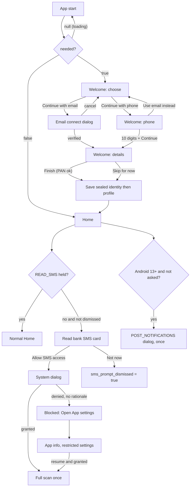

# Onboarding and Permissions

| Field | Value |
|---|---|
| Feature ID | F-01 |
| Status | Existing |
| Priority | P0 |
| Phase | 1 |
| Last Updated | 2026-10-19 |

## 1. Description

Onboarding takes a first-time user from install to a working ledger in one short flow. It captures who the user is, asks for the SMS and notification permissions at the right moment with a plain-language reason, and helps when Android refuses to show the permission dialog. It exists so the app can read bank messages and later guess statement passwords, while repeating on every screen that the data never leaves the phone.

## 2. What This Feature Will Do

- Shows a welcome screen on first launch until a name and a sign-in (email or phone) exist.
- Collects the user's full name as per the bank before any sign-in button is enabled.
- Offers sign-in by verified email or by a 10-digit mobile number.
- Collects optional statement details: alternate name, alternate phone, date of birth and PAN.
- Saves the statement details to sealed storage first, then the profile, which ends the welcome screen.
- Lets the user skip the statement details and still finish, saving only name, email and mobile.
- Keeps the user's own phone numbers from ever becoming accounts in the ledger.
- Asks for SMS access with a card on Home and remembers if the user dismisses it.
- Detects a blocked SMS permission and shows steps to allow restricted settings, with a button to App info.
- Starts one full SMS scan each time SMS access changes from missing to granted.
- Asks for the notification permission once per install on Android 13 and above.
- Shows the privacy line "Your data never leaves this phone." on the welcome screen.

### 2.1 Inputs

- First app launch: stored profile and mail connection state decide whether the welcome screen is needed.
- User typing: name, mobile, alternate name, alternate phone, date of birth, PAN.
- User taps: continue with email, continue with phone, finish, skip, allow SMS, not now.
- Email verification code from the email sign-in dialog.
- Android permission results for SMS and notifications, re-read every time the app resumes.

### 2.2 Processing

1. On launch, decide whether the welcome screen is needed; draw nothing while this is unknown.
2. Collect name, then sign-in by email or phone, then the optional statement details.
3. On finish, save the statement details to sealed storage, then save the profile, which closes the welcome screen.
4. Publish the last 4 digits of the user's own numbers so the ledger ignores them as accounts.
5. On Home, show the SMS card while SMS access is missing and not dismissed.
6. Request SMS access; if Android refuses without a prompt, mark it blocked and show the App settings guidance.
7. On a missing-to-granted change, start one full SMS scan.
8. Ask for the notification permission once, recording the ask before showing it.

### 2.3 Outputs

- The user sees the welcome screen, the SMS permission card, the blocked-permission guidance and the notification prompt.
- Stored: the profile (name, email, mobile) and the sealed statement identity, used later by [Statement import](05_statement_import.md).
- Other features receive: the own-number tails for the ledger ([Parsing engine](06_transaction_parsing_engine.md)), the SMS permission state and the scan trigger ([SMS ingestion](02_sms_ingestion.md)).

### 2.4 Out of Scope

- Reading SMS and scan scheduling: [SMS ingestion](02_sms_ingestion.md).
- Email verification and connection internals: [Email ingestion](03_email_ingestion.md).
- Notification-listener (payment app) opt-in: [Notification ingestion](04_notification_ingestion.md).
- Profile editing, avatar, Customise, Security screen and app lock.
- iOS: there are no SMS or listener APIs, so the permission card is not shown there.

## 3. Behaviour in Existing App

Source of truth: `existing_app_analysis.md` Part A sections 1.1, 2.1, 2.2, 5 and the Kotlin files named below (paths relative to `hisaab_apk/app/src/main/kotlin/com/hisaab/app/`).

### 3.1 The Welcome gate (`ui/onboarding/WelcomeScreen.kt`, `ui/nav/HisaabNavHost.kt:83-88`)

- Welcome is NOT a nav route. It is a gate drawn before the NavHost. `WelcomeViewModel.needed` is a combine of app settings and mail settings:

  ```text
  needed = profile.name == null
        || (profile.email == null && profile.phone == null && !mail.connected)
  ```

  While the flow is still loading the value is `null` and nothing is drawn (avoids a flash). `true` shows WelcomeScreen, `false` shows the app. A user who connected an inbox before this screen existed counts as signed in.
- The splash (`Theme.Hisaab.Starting`) is held until the app-lock setting is known (`MainActivity.kt:46`); the lock overlay sits above the nav host, so Welcome is also behind the lock when the lock is on.
- Layout: vertical gradient backdrop (emerald 18% alpha, transparent, sapphire 12%), 96 dp `artha_mark` shield, title "DhanKosh" (displaySmall, bold), tagline "Know your money.". Content is scrollable and `imePadding`-aware, 28 dp horizontal padding.
- Name field (always visible): label "Full name (as per bank)", person icon, `KeyboardCapitalization.Words`, single line. Both sign-in buttons are disabled while the name is blank.
- Three modes held in `rememberSaveable` `mode`: `choose`, `phone`, `details`. Switching is an `AnimatedContent` cross-fade.
  - `choose`: filled button "Continue with email" (opens `EmailConnectDialog`, see [Email ingestion](03_email_ingestion.md); `onUseGoogle = null`, so the Google option is hidden here), outlined button "Continue with phone number" (moves to `phone`).
  - `phone`: field "Mobile (as per bank)", `+91 ` prefix, digits only, max 10 digits; "Continue" enabled when name not blank and exactly 10 digits (moves to `details`); text button "Use email instead" (back to `choose`).
  - `details`: heading "Unlock your statements". If the user came through email, a mobile field (same rules) is shown. Then `AlternateFields` (alternate name + alternate phone, 10 digits) and `StatementDetailsFields` (date of birth picker + PAN). "Finish" is enabled when `validPan(pan)` (blank or valid). "Skip for now" is always enabled.
- After a successful email connect (verification code OK) the dialog calls `onConnected(email)`: `email` is remembered, the dialog closes and mode becomes `details`.
- Footers: "Email sign-in also reads your bank alerts and statements." and a lock icon row "Your data never leaves this phone.".

### 3.2 First-run identity save (`WelcomeViewModel.finish`)

Order matters, and is deliberate ("saving the name ends sign-up and closes this screen"):

1. Compute `mobile = phone ?: existing profile phone`.
2. Save `Identity(name.trim(), dob, pan (trimmed, null if empty), mobile (null if blank), altName (trimmed, null if empty), altPhone (null if blank), email = email ?: profile.email (null if blank))` into the sealed `StatementPasswordStore` FIRST (Keystore AES-256-GCM, see [Statement import](05_statement_import.md)).
3. Then `AppSettingsStore.saveProfile(name, email ?: "", mobile, occupation ?: "")`. This writes `display_name`, `profile_email`, `profile_phone`, `profile_occupation` and flips `needed` to false.

Notes:

- Alternate name and alternate phone live ONLY in the sealed identity, never in plain settings.
- "Skip for now" calls `finish(name, email, phone)` without DOB, PAN or alternates: nothing from those fields is saved.
- Phone numbers are stored as `"+91 " + 10 digits`; a phone field with fewer than 10 digits is treated as absent.
- The phone path does NOT verify the number (no OTP). Only the email path is verified (6-digit code, see 03).
- Own-number guard: `HisaabApplication` collects the profile phone and identity phone/altPhone, and feeds the last 4 digits of every number with >= 10 digits into `transactions.phoneLast4s`, so a user's own mobile number never becomes an account in the ledger (see [Parsing engine](06_transaction_parsing_engine.md) section 10).

### 3.3 SMS permission (`ui/components/SmsPermission.kt`, `ui/home/HomeScreen.kt:286-310`)

- `rememberSmsPermission(onGranted)` returns a `SmsPermissionState { granted, blocked, request(), openAppSettings() }`.
  - `granted` = `READ_SMS` is held. It is re-read every `ON_RESUME` (`LifecycleResumeEffect`), so a grant made in system Settings, or via "Allow restricted settings", is noticed the moment the user returns and the card disappears.
  - `request()` launches `RequestMultiplePermissions([READ_SMS, RECEIVE_SMS])`; when `blocked` is true it opens the App info screen instead.
  - After the dialog result the real permission is re-checked (some phones report the result map inaccurately). If still not granted and `shouldShowRequestPermissionRationale(READ_SMS)` is false, `blocked = true` ("don't ask again" or a restricted setting).
  - `onGranted` fires once each time the permission goes missing to granted, however it was granted. Home passes `vm.scanInbox(full = true)`, i.e. a full look-back scan starts immediately.
  - No `AppLockGate.skipNextLock()` for the system dialog (it does not stop the activity); `openAppSettings()` does call it first.
- Home "Read bank SMS" `PermissionCard` (accent-soft card, SMS icon): shown when `READ_SMS` is missing AND `smsPromptDismissed == false`. Body: "DhanKosh reads SMS only from known bank senders, on this phone. Nothing is uploaded; there is no server.". Buttons: "Allow SMS access" (test tag `grant-sms`) and "Not now" (sets `sms_prompt_dismissed = true`; the card never returns on Home, the same ask stays available on Data sources).
- Blocked state text: "Android didn't show the permission prompt. Open App settings, then Permissions, SMS, Allow. If SMS is greyed out, first tap the menu at the top right of App info and choose Allow restricted settings." The main button then reads "Open App settings".
- The same state machine backs the Data sources "Bank SMS" card ("Allow SMS access" / "Open app settings" plus "Then App info, menu, Allow restricted settings."), documented in [SMS ingestion](02_sms_ingestion.md).

### 3.4 Notification permission (`HomeScreen.kt:122-128`, `HomeViewModel.shouldAskNotifications`)

- On Home first composition: if `SDK_INT >= 33` and `settings.notificationsAsked == false`, set `notifications_asked = true` (before asking, so it is asked exactly once ever) and launch `RequestPermission(POST_NOTIFICATIONS)`. The result is ignored.
- Purpose stated in code: so "a statement needs its password" and other alerts can reach the user.
- Later recovery lives in Notifications & alerts (banner "Notifications are off" + Allow, opens `ACTION_APP_NOTIFICATION_SETTINGS`); all posting first checks `NotificationManagerCompat.areNotificationsEnabled()` and swallows `SecurityException`.
- This is a different thing from the notification-listener (payment-app) access, covered in [Notification ingestion](04_notification_ingestion.md).

### 3.5 Other first-run facts

- App lock is OFF by default and is not offered during onboarding. Turning it on later sets `unlocked = true` for the session.
- `hide_amounts` defaults to true, so figures show as `₹••••` until the user taps the eye on Home. First-run users therefore see masked amounts.
- `ProfileSetupSheet` ("Create your profile") exists in code with no caller; Welcome replaced it. `profile_prompt_dismissed` is legacy.
- No camera, contacts, location or storage permissions are ever requested (system pickers are used).

## 4. User Stories

- US-01-01: As a first-time user I enter my name and sign in with my email so the app can later read my bank emails.
- US-01-02: As a user without email access I sign in with just my mobile number.
- US-01-03: As a user I can add DOB and PAN now so my locked statements open automatically, or skip and do it later.
- US-01-04: As a user I am asked for SMS access with a clear reason and can say "Not now" without being nagged on Home.
- US-01-05: As a sideload user whose SMS permission is greyed out I am told exactly which menu to use.
- US-01-06: As a user I grant SMS access in system Settings and, when I return, the card disappears and my history is read without any extra tap.
- US-01-07: As a user on Android 13+ I am asked once for notification permission.
- US-01-08: As a returning user who already connected an inbox in an older version I never see Welcome.

## 5. Functional Requirements (FR-01-01 ...)

| ID | Requirement |
|---|---|
| FR-01-01 | On launch, evaluate `needed = name == null OR (email == null AND phone == null AND !mailConnected)`. While unknown, draw nothing (blank splash-coloured surface). If true show Welcome; if false show the app. |
| FR-01-02 | Welcome shows logo, "DhanKosh", "Know your money.", a required name field, and mode `choose` with two buttons, both disabled while name is blank. |
| FR-01-03 | "Continue with email" opens the email connect dialog (Google sign-in option hidden). On verified success, remember the email and move to `details`. |
| FR-01-04 | "Continue with phone number" shows a `+91` field limited to 10 digits; "Continue" is enabled only for non-blank name and exactly 10 digits; "Use email instead" returns to `choose`. |
| FR-01-05 | `details` shows mobile (email path only), alternate name + phone (10 digits), DOB picker and PAN. "Finish" is enabled when PAN is blank or matches `[A-Z]{5}[0-9]{4}[A-Z]`. "Skip for now" is always enabled. |
| FR-01-06 | Finish MUST write the sealed identity before the plain profile; the profile write ends the gate. Skip saves only name, email and mobile. |
| FR-01-07 | Alternate name and phone MUST be stored only in the sealed identity store. |
| FR-01-08 | Own-number tails (profile phone, identity phone, alternate phone with >= 10 digits) MUST be published to the ledger so they cannot become accounts. |
| FR-01-09 | Expose a permission state with `granted`, `blocked`, `request()`, `openAppSettings()`. Re-read the real permission on every app resume; trust the real state, not the dialog result map. |
| FR-01-10 | `request()` asks for READ_SMS and RECEIVE_SMS together; when blocked it opens App info for the package instead. |
| FR-01-11 | After a refusal with no rationale available, set `blocked = true` and show the restricted-settings guidance text and "Open App settings" button. |
| FR-01-12 | When the permission transitions from missing to granted (any route), trigger one full SMS look-back scan exactly once per transition. |
| FR-01-13 | Home shows the "Read bank SMS" card only when SMS permission is missing and `sms_prompt_dismissed` is false. "Not now" persists the dismissal; the card does not return. |
| FR-01-14 | On Android 13+ ask POST_NOTIFICATIONS exactly once per install: set `notifications_asked` before launching the request; ignore the result. |
| FR-01-15 | Skip the app lock for the next background transition before launching any external system screen from this feature (App info). |
| FR-01-16 | Show the privacy line "Your data never leaves this phone." on Welcome and keep the exact permission-card wording about known bank senders and no upload. |
| FR-01-17 | All user-facing strings go through the i18n lookup (English text is the key). |

## 6. Non-Functional Requirements (performance, battery, privacy, offline)

- Offline: Welcome works with no network except the email path (IMAP login and SMTP send need internet; show a clear error when offline). Phone path is fully offline.
- Performance: the gate decision must resolve from local settings in under one frame budget after the splash; no network call blocks first paint.
- Privacy: PAN, DOB, alternate names and phone numbers are sealed (Keystore/Keychain AES-256-GCM). They are never logged, never in analytics (there is none), never in backups (`allowBackup=false`, no device transfer).
- Battery: no work starts before permission is granted; granting triggers a single scan.
- Accessibility: all fields labelled, buttons >= 48 dp (52 dp used), works with text scale up to XL (1.2, capped at max(1.3, system) in the existing app).
- Security: do not mark the window secure (existing app does not), but do not keep PAN in `rememberSaveable` beyond process death without need (existing code does keep it in saveable state; see Open Questions).

## 7. UI / Screens & User Flow (screen list + flow diagram)

Screens, dialogs and sheets:

| # | Screen / element | Kotlin source |
|---|---|---|
| 1 | WelcomeScreen, mode `choose` | `ui/onboarding/WelcomeScreen.kt:105` |
| 2 | WelcomeScreen, mode `phone` | same file |
| 3 | WelcomeScreen, mode `details` (Unlock your statements) | same file, `ui/profile/ProfileScreen.kt` (`AlternateFields`, `StatementDetailsFields`, `validPan`) |
| 4 | EmailConnectDialog (hosted from Welcome) | `settings/EmailConnect.kt:145` (owned by [Email ingestion](03_email_ingestion.md)) |
| 5 | DOB date picker (inside `StatementDetailsFields`) | `ui/profile/ProfileScreen.kt` |
| 6 | Home "Read bank SMS" PermissionCard (normal and blocked variants) | `ui/home/HomeScreen.kt:286` |
| 7 | System SMS permission dialog | Android |
| 8 | System POST_NOTIFICATIONS dialog | Android |
| 9 | App info (system) for restricted-settings recovery | Android, `ACTION_APPLICATION_DETAILS_SETTINGS` |

Flow:



Reference GIFs (each file Status: Pending, not yet captured):

-  (Status: Pending, not yet captured)
-  (Status: Pending, not yet captured)
-  (Status: Pending, not yet captured)
-  (Status: Pending, not yet captured)
-  (Status: Pending, not yet captured)
-  (Status: Pending, not yet captured)
-  (Status: Pending, not yet captured)

## 8. Data Models (Dart entities + fields + types)

Freezed-style field lists.

```dart
@freezed
class UserProfile with _$UserProfile {
  const factory UserProfile({
    String? name,            // display_name
    String? email,           // profile_email
    String? phone,           // profile_phone, "+91 NNNNNNNNNN"
    String? occupation,      // profile_occupation
    String? photoPath,       // profile_photo, absolute path
  }) = _UserProfile;
}

/// Sealed (Keystore) identity used to guess statement passwords.
@freezed
class Identity with _$Identity {
  const factory Identity({
    required String name,
    DateTime? dob,           // ISO date when serialised
    String? pan,             // [A-Z]{5}[0-9]{4}[A-Z]
    String? phone,           // "+91 NNNNNNNNNN"
    String? altName,
    String? altPhone,
    String? email,           // stored, not used for password guesses
  }) = _Identity;
}

enum WelcomeMode { choose, phone, details }

@freezed
class WelcomeState with _$WelcomeState {
  const factory WelcomeState({
    @Default('') String name,
    @Default(WelcomeMode.choose) WelcomeMode mode,
    @Default('') String phoneDigits,     // max 10
    String? verifiedEmail,
    DateTime? dob,
    @Default('') String pan,
    @Default('') String altName,
    @Default('') String altPhoneDigits,  // max 10
    @Default(false) bool connecting,
  }) = _WelcomeState;
}

@freezed
class SmsPermissionState with _$SmsPermissionState {
  const factory SmsPermissionState({
    @Default(false) bool granted,
    @Default(false) bool blocked,        // only App settings can grant now
  }) = _SmsPermissionState;
}

/// null = still loading, true = show Welcome, false = show app
typedef OnboardingGate = bool?;
```

Persisted flags (DataStore `app_settings` equivalents, see section 9): `sms_prompt_dismissed`, `notifications_asked`, `display_name`, `profile_email`, `profile_phone`, `profile_occupation`.

## 9. Database Tables / Changes

No Drift table is owned by this feature. The existing app keeps these in DataStore and sealed stores; the Flutter port maps them to a typed key-value store.

| Existing key (store) | Type | Default | Flutter mapping |
|---|---|---|---|
| `display_name` (`app_settings`) | string? | null | `settings` key-value table (name owned by [26_settings_data_sources.md](26_settings_data_sources.md) FR-26-25) |
| `profile_email` | string? | null | same |
| `profile_phone` | string? | null | same |
| `profile_occupation` | string? | null | same |
| `profile_photo` | string? | null | same (path in app documents dir) |
| `sms_prompt_dismissed` | bool | false | same |
| `notifications_asked` | bool | false | same |
| `profile_prompt_dismissed` | bool | false | legacy, do not port |
| Identity (7 fields, `statement_passwords` store, `\u001F`-separated, append-only order name, dob, pan, phone, altName, altPhone, email) | sealed string | none | `flutter_secure_storage` key `statement.identity` holding JSON; Keystore-backed AES-256-GCM |

Suggested Drift fallback if a single settings table is preferred:

```dart
class AppSettingsEntries extends Table {
  TextColumn get key => text()();
  TextColumn get value => text().nullable()();
  @override
  Set<Column> get primaryKey => {key};
}
```

## 10. Business Rules & Logic (regex, parsing rules, algorithms, thresholds)

- Gate rule: `needed = name == null || (email == null && phone == null && !mail.connected)`.
- Phone: digits only (`it.filter(isDigit).take(10)`), valid iff length == 10, stored as `"+91 " + digits`.
- PAN: `[A-Z]{5}[0-9]{4}[A-Z]`; blank is allowed ("valid-or-blank"); input is trimmed and compared upper-case in the existing validator (confirm case handling, Open Questions).
- Finish ordering: identity (sealed) first, profile second.
- Notifications ask: once per install, flag set before the request.
- SMS permission refresh: on every resume; `onGranted` only on the false-to-true edge.
- Blocked inference: after a result with permission still missing, `blocked = !shouldShowRequestPermissionRationale(READ_SMS)` (or true if no activity is found).
- Own-number tails: take every number from profile phone, identity phone, identity altPhone; keep digits; if length >= 10, last 4 digits go into the guard set.
- Copy (verbatim, English keys): "Read bank SMS", "DhanKosh reads SMS only from known bank senders, on this phone. Nothing is uploaded; there is no server.", "Allow SMS access", "Not now", "Open App settings", "Know your money.", "Full name (as per bank)", "Mobile (as per bank)", "Unlock your statements", "Finish", "Skip for now", "Use email instead", "Email sign-in also reads your bank alerts and statements.", "Your data never leaves this phone.".

## 11. Platform / Native Requirements (permissions, channels, background work)

Android:

- Manifest: `READ_SMS`, `RECEIVE_SMS`, `POST_NOTIFICATIONS` (API 33+), `INTERNET`, `ACCESS_NETWORK_STATE`; `uses-feature telephony required=false`.
- Flutter packages: `permission_handler` (SMS group + notification), `app_settings` or an `android_intent_plus` call to `ACTION_APPLICATION_DETAILS_SETTINGS` with `package:<id>` URI.
- `shouldShowRequestPermissionRationale` is not exposed by `permission_handler` for SMS in all versions: expose it through a small platform channel (`dhankosh/permissions`, method `smsRationale`) or use `Permission.sms.shouldShowRequestRationale`.
- A resume hook: `WidgetsBindingObserver.didChangeAppLifecycleState(resumed)` re-reads status and fires the grant edge callback.
- App lock integration: before starting App info, call `AppLockGate.skipNextLock()` equivalent (a flag the lock overlay consumes when the app resumes).
- Android 13+ ask is requested from Home, not from Welcome; keep that placement.

iOS: no SMS, no notification listener. The card and the SMS permission flow are Android-only; on iOS Welcome still works (name + email/phone), and the Home card is hidden (Open Questions).

Secure storage: `flutter_secure_storage` with `encryptedSharedPreferences: true` (Android Keystore AES-GCM), iOS Keychain.

## 12. Dependencies (other features → link to their memory file; packages)

Features:

- [SMS ingestion](02_sms_ingestion.md): consumes the granted permission; owns the Data sources Bank SMS card and the scan that `onGranted` triggers.
- [Email ingestion](03_email_ingestion.md): EmailConnectDialog and the mail-connected flag used by the gate.
- [Notification ingestion](04_notification_ingestion.md): listener enablement (separate from POST_NOTIFICATIONS).
- [Statement import](05_statement_import.md): consumes the sealed Identity for password guessing.
- [Transaction parsing engine](06_transaction_parsing_engine.md): own-number tail guard.
- Profile, Security / app lock, Settings (Data sources), i18n: separate features (not linked here).

Packages: `flutter_riverpod`, `freezed`, `permission_handler`, `flutter_secure_storage`, `app_settings` (or `android_intent_plus`), `go_router` (gate as redirect), Drift `settings` table.

## 13. Folder Location (lib/features/<name>/...)

```text
lib/features/onboarding/
  data/
    profile_repository_impl.dart        // saveProfile, watchProfile (settings store)
    identity_store.dart                 // sealed Identity read/write (flutter_secure_storage)
    permission_channel.dart             // sms rationale, open app settings
  domain/
    entities/user_profile.dart
    entities/identity.dart
    entities/sms_permission_state.dart
    repositories/profile_repository.dart
    usecases/watch_onboarding_gate.dart
    usecases/finish_onboarding.dart     // identity first, profile second
    usecases/request_sms_permission.dart
    usecases/ask_notifications_once.dart
    validators/pan_validator.dart
    validators/phone_validator.dart
  presentation/
    welcome_screen.dart
    welcome_controller.dart             // Riverpod notifier, WelcomeState
    widgets/statement_details_fields.dart
    widgets/alternate_fields.dart
    widgets/sms_permission_card.dart    // Home card (exported to home feature)
    providers/sms_permission_provider.dart
    providers/onboarding_gate_provider.dart
```

## 14. Edge Cases & Error Handling

- Process death on the Welcome screen: name, mode, phone, email, DOB, PAN, alternates survive via saved state. Decide whether PAN should be restored from saved state (Open Questions).
- User connects email, then backs out of `details` by killing the app: mail is connected, name may not be saved, so `needed` stays true (name == null). Welcome reopens with name blank; the email path need not be repeated because connected mail makes the second clause false, but name is still required.
- Existing install upgraded from a version that had no Welcome: name present and inbox connected, so the gate is false. If only a name exists and nothing else, Welcome shows.
- Permission revoked later in system settings: `granted` flips false on resume; the Home card returns only if not previously dismissed; Data sources card shows "No permission".
- Dialog result map wrong (some OEMs): ignore it, re-check real state.
- User denies twice on Android 11+: dialog is suppressed; `blocked` shows the Settings route.
- "Allow restricted settings" menu is absent on Play-installed builds: copy says "If SMS is greyed out" so it applies only to sideloads.
- Verification email never arrives or offline: surfaced by the email dialog; Welcome stays in `choose` and phone path remains available.
- Phone with 11+ digits pasted: truncated to 10; fewer than 10 treated as absent on Skip.
- Name only whitespace: treated as blank, both buttons disabled.
- Notification permission denied: nothing breaks; later notifications are skipped silently.
- Tablet / landscape: content scrolls; keyboard never hides buttons (`imePadding`).

## 15. Test Cases (unit / widget / integration + sample fixtures)

| ID | Type | Covers | Case |
|---|---|---|---|
| TC-01-01 | unit | FR-01-01 | `needed(name: null, ...)` is true; `needed(name:'A', email:null, phone:null, mail:false)` true; `needed(name:'A', email:'a@b.c')` false; `needed(name:'A', phone:'+91 9876543210')` false; `needed(name:'A', mail:true)` false. |
| TC-01-02 | unit | FR-01-01 | Gate emits null before settings load, then a bool. |
| TC-01-03 | widget | FR-01-02 | Both buttons disabled with blank name; enabled after typing. |
| TC-01-04 | widget | FR-01-04 | Phone field strips non-digits, caps at 10; Continue disabled at 9 digits, enabled at 10. |
| TC-01-05 | unit | FR-01-05 | PAN validator: `ABCDE1234F` ok, `""` ok, `abcde1234f` per decision, `ABCD1234F` rejected. |
| TC-01-06 | unit | FR-01-06, FR-01-07 | `finishOnboarding` calls identity store before profile store (verify call order with mocks); altName/altPhone only in identity payload. |
| TC-01-07 | unit | FR-01-06 | Skip path saves name/email/mobile and null DOB/PAN. |
| TC-01-08 | unit | FR-01-08 | Own-number tails: inputs `+91 98765 43210` -> `3210`; 8-digit number ignored. |
| TC-01-09 | unit | FR-01-09, FR-01-12 | Permission controller: states granted false -> true on resume emits `onGranted` once; repeated resumes do not re-fire. |
| TC-01-10 | unit | FR-01-10, FR-01-11 | After denial with rationale unavailable, `blocked == true`; `request()` then calls `openAppSettings` not the dialog. |
| TC-01-11 | widget | FR-01-13 | Home shows card when not granted and not dismissed; "Not now" hides it and persists; rebuilt app keeps it hidden. |
| TC-01-12 | unit | FR-01-14 | `askNotificationsOnce` returns true first call, false afterwards; flag set before the request. |
| TC-01-13 | integration | FR-01-03, FR-01-06 | Email path with a fake IMAP connector: verified email leads to `details`, Finish writes profile, gate closes, Home visible. |
| TC-01-14 | integration | FR-01-12 | Grant SMS via fake channel then verify exactly one full scan job enqueued. |
| TC-01-15 | widget | FR-01-16, FR-01-17 | Welcome contains "Your data never leaves this phone." and each string resolves through i18n. |
| TC-01-16 | integration | FR-01-15 | Opening App info sets the lock-skip flag. |

Fixtures: identity `Identity(name: 'Asha Rao', dob: 1990-05-14, pan: 'ABCDE1234F', phone: '+91 9876543210', altName: 'Asha R', altPhone: '+91 9123456780', email: 'asha@example.com')` (all synthetic).

## 16. Acceptance Criteria

- AC-01-01: Fresh install shows Welcome; after Finish or Skip the app opens on Home and never shows Welcome again (FR-01-01, FR-01-06; TC-01-01, TC-01-07, TC-01-13).
- AC-01-02: With no name, no sign-in button is enabled; phone path requires exactly 10 digits (FR-01-02, FR-01-04; TC-01-03, TC-01-04).
- AC-01-03: A PAN with wrong format blocks Finish but not Skip (FR-01-05; TC-01-05).
- AC-01-04: Sealed identity is written before the profile and contains the alternates; plain storage never contains PAN, DOB or alternates (FR-01-06, FR-01-07; TC-01-06).
- AC-01-05: The user's own number never appears as an account after ingestion (FR-01-08; TC-01-08).
- AC-01-06: Granting SMS from the dialog or from system Settings triggers exactly one full scan and removes the Home card (FR-01-09, FR-01-12; TC-01-09, TC-01-14).
- AC-01-07: After a blocked refusal the card shows the restricted-settings text and the button opens App info (FR-01-10, FR-01-11; TC-01-10).
- AC-01-08: "Not now" removes the card permanently (FR-01-13; TC-01-11).
- AC-01-09: The notification permission dialog appears at most once per install on Android 13+ (FR-01-14; TC-01-12).
- AC-01-10: Welcome shows the privacy line and all strings are translatable (FR-01-16, FR-01-17; TC-01-15).

## 17. Open Questions

1. Is the PAN validator case-sensitive? Source says `validPan(pan)` in `ui/profile/ProfileScreen.kt` with regex `[A-Z]{5}[0-9]{4}[A-Z]`; whether lower-case input is upper-cased first was not read.
2. `rememberSaveable` keeps PAN and DOB in saved instance state (plain Bundle). Should the Flutter port avoid persisting them across process death?
3. The phone number is never verified. Is that acceptable for Flutter, or should an OTP-free "I own this number" confirmation be added? (Existing behaviour: no verification.)
4. The notification permission is asked from Home, not Welcome. Keep, or move into onboarding so the first "statement needs password" alert can arrive sooner?
5. iOS: no SMS and no listener. What should Welcome and Home show on iOS (a different permission card, or none)? The v2 spec mentions a Shortcuts bridge only.
6. `ProfileSetupSheet` and `profile_prompt_dismissed` are dead code; assumed not to be ported.
7. Exact `Skip for now` consequence: statement unlock still works only if DOB/PAN is later added in Profile; confirm there is no reminder surface that nudges the user.
8. Whether the Google-sign-in path should ever be offered at Welcome (existing code passes `onUseGoogle = null`).

## 18. Implementation Notes

N/A - not built yet. Filled during the build (decisions, deviations).

## 19. Change Log (date | change | reason)

| Date | Change | Reason |
|---|---|---|
| 2026-10-17 | Created from hisaab_apk 2.9.8 analysis | Initial |
| 2026-10-19 | Restructured to the 19-section standard (Description, What This Feature Will Do, Implementation Notes added); Last Updated bumped | Audit Gate (Prompt 2, Part A) |
| 2026-10-19 | Key-value store name aligned to `settings` (26 owns it); manifest, splash theme and adjustResize facts live in 26 section 11, not duplicated here | Audit Gate gap, scan_4 |
