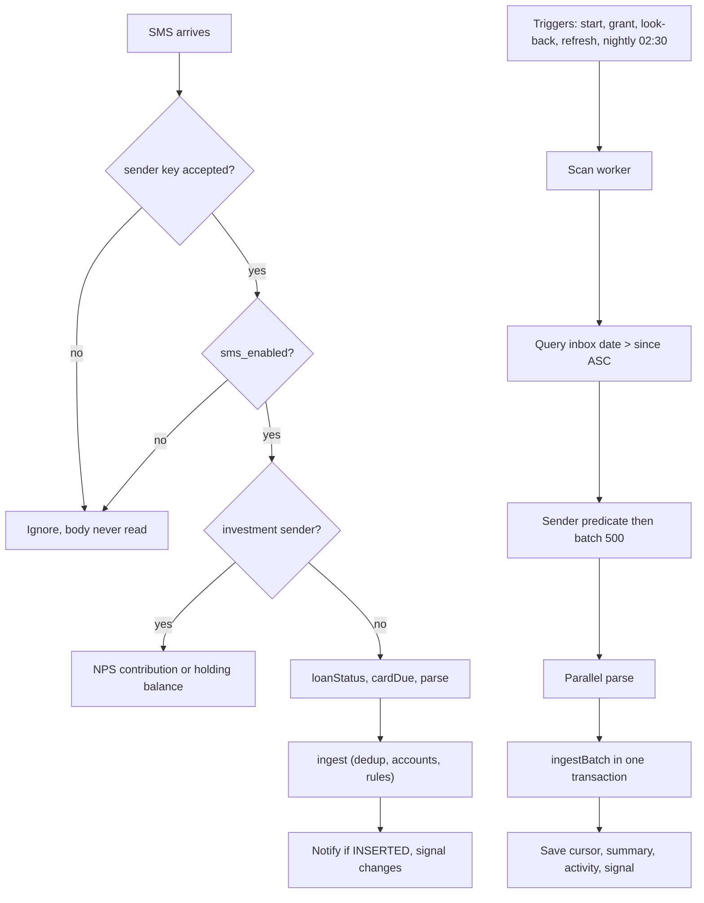

# SMS Ingestion

| Field | Value |
|---|---|
| Feature ID | F-02 |
| Status | In progress (Phase 1: native, data, parser wiring, engine, Data sources UI, headless background drain, nightly scan and off-isolate parse implemented; the new Kotlin is not compiled or run on a device; Home progress pending) |
| Priority | P0 |
| Phase | 1 |
| Last Updated | 2026-10-27 |

## 1. Description

SMS ingestion turns the bank SMS already on the phone, and every new one as it arrives, into ledger entries with no typing and no server. It reads new messages live, catches up through background inbox scans, and uses the sender name alone to decide whether a message is worth reading. This saves the user from entering each bank payment by hand while keeping non-bank messages private.

## 2. What This Feature Will Do

- Reads a bank SMS the moment it arrives and adds it to the ledger.
- Scans the inbox in the background on first run, after a history change, on refresh and every night.
- Decides from the sender name alone whether a message is from a bank, before looking at the text.
- Joins multi-part messages before reading them.
- Gives each message a fixed identity so a message is never recorded twice, live or scanned.
- Sends investment senders (EPFO, NPS) to holdings or contributions instead of the transaction parser.
- Records loan status and card due messages alongside the transaction read.
- Reads the inbox in batches of 500 bank messages and saves each batch in one step.
- Remembers how far it has read so later scans only look at new messages.
- Lets the user pause live reading and choose how much history to read (7 to 365 days).
- Shows live progress and a last-read summary on Home and Data sources.
- Records an activity entry with counts only, never message text.
- Reports a missing SMS permission as an error instead of crashing.

### 2.1 Inputs

- Live: each incoming SMS delivered by Android.
- Scan: the SMS inbox, read from the last saved position or a chosen look-back window.
- Triggers: app start, SMS permission granted, history setting changed, Home refresh (14 days), Data sources button, nightly run at 02:30.
- User settings: SMS reading on or off, history to read.

### 2.2 Processing

1. Check the sender name; drop anything not from a known bank, a bank-looking sender or an investment sender.
2. For live messages, stop if SMS reading is paused; otherwise join multi-part text.
3. Route investment, loan status and card due messages to their own recorders.
4. Hand bank messages to the [Parsing engine](06_transaction_parsing_engine.md) to extract the payment.
5. Save results through the ledger, which skips any message already processed ([Dedup and review](07_dedup_review.md)).
6. For scans, read oldest first in batches, parse in parallel, save each batch together, then store the new position and a summary.
7. Notify the user of new transactions and refresh the widget and budget check when anything changed.

### 2.3 Outputs

- New, merged and to-review transactions in the ledger ([Transactions ledger](08_transactions_ledger.md)).
- A notification for each newly added transaction.
- A progress bar and "Reading messages" pill on Home, then a short result line.
- The Bank SMS card on Data sources: status, last read time, last result, pause switch and permission button.
- Activity entries with counts and error names only.

### 2.4 Out of Scope

- Parsing rules, templates and rejection order: [Parsing engine](06_transaction_parsing_engine.md).
- Duplicate matching, merging and review: [Dedup and review](07_dedup_review.md).
- New-transaction notification content and channels (Notifications and alerts feature).
- The SMS permission flow: [Onboarding and permissions](01_onboarding_permissions.md).
- Email, app notifications and statements: [Email ingestion](03_email_ingestion.md), [Notification ingestion](04_notification_ingestion.md), [Statement import](05_statement_import.md).
- iOS SMS reading, which is not possible.

## 3. Behaviour in Existing App

Sources: analysis Part A 4.2, 4.3, 4.1, 2.9 (Data sources), 3.1; Kotlin files under `hisaab_apk/app/src/main/kotlin/com/hisaab/app/sms/` and `sync/NightlySync.kt`.

### 3.1 Live receiver (`sms/SmsReceiver.kt`)

- Manifest: exported, guarded by `android:permission="android.permission.BROADCAST_SMS"`, intent-filter priority 999, action `android.provider.Telephony.SMS_RECEIVED`.
- Flow in `onReceive`:
  1. Ignore any other action.
  2. `getMessagesFromIntent`; group by `originatingAddress`; keep only senders where `registry.accepts(sender) || InvestmentParser.accepts(sender)`. This sender-only filter runs before any body is looked at. If no sender survives, return (no work, no log).
  3. `goAsync()`, then on the app scope: abort (no activity entry) if `smsEnabled == false`.
  4. Per sender: multi-part SMS bodies are concatenated (`parts.joinToString("")`); `sentAt = parts.first().timestampMillis`.
  5. Investment-type senders (EPFO, NPS, CRA headers): `InvestmentParser.npsContribution(body, sentAt)`; if null, `InvestmentParser.parse(...)` then `holdings.record(listOf(..), "SMS")` (a balance, not a transaction) and continue; if it is an NPS contribution, `nps.contribute(...)` builds an INVESTMENT transaction which is ingested.
  6. Other senders: `registry.loanStatus` then `repository.applyLoanStatus`; `registry.cardDue` then `CardDueRecorder.apply(.., "SMS")`; then `registry.parse(body, sender, now, Source.SMS)` and `repository.ingest(IncomingMessage(tx, messageId, body))`.
  7. `NewTransactionNotifier.onIngested(outcome, "SMS", messageId)` posts the user notification (INSERTED only).
  8. If anything changed, `notifier.onTransactionsChanged()` (widget refresh + budget check).
  9. One `SMS_LIVE` activity entry per receipt: `read = relevant = senders count`, `added/merged/review/skipped` from outcomes, `millis`, `error` = exception class name if any. Entries for the same source within 30 minutes are coalesced in the log (see Activity log feature).
- The live parse passes `System.currentTimeMillis()` as the message timestamp (arrival), while the scan passes the inbox `date` column. See Open Questions.
- Message id (shared by both paths so a message is never ingested twice): `SmsIds.of(sender, sentAt, body)` = `"sms:" + hex(first 16 bytes of SHA-256("<SENDER_UPPERCASE>|<sentAtMs>|<body>"))`, 32 hex chars. In the scan `sentAt = dateSent` if > 0 else `receivedAt`; in the receiver it is the PDU timestamp.
- Required permissions: `READ_SMS` (scan) and `RECEIVE_SMS` (live).

### 3.2 Inbox scan (`sms/OptimizedSmsReaderWorker.kt`, `SmsInboxSource.kt`)

- WorkManager unique work name `sms-scan`, a `CoroutineWorker` (Hilt). Inputs: `full` (bool), `recent_days` (int). Outputs/progress keys: `scanned` (bank messages so far), `found` (parsed so far), `sms_checked` (all rows examined), `summary`, `error`.
- Start-of-window (`since`):
  - `full` -> `now - lookbackDays` days (lookback is the shared "History to read" setting, choices 7/30/90/180/365, default 90; stored in the email settings store) and the saved cursor is ignored (`stored = 0`).
  - `recent_days > 0` -> `min(storedCursor, now - recentDays)`; used by the Home refresh with 14 days.
  - default (incremental) -> `storedCursor` (`sms_cursor`, absent = 0).
  - The saved cursor never moves backwards: `cursor = max(since, stored)`, then `max(cursor, newest receivedAt in each batch)`.
- Inbox query: `Telephony.Sms.Inbox.CONTENT_URI`, projection `ADDRESS, BODY, DATE, DATE_SENT`, selection `DATE > ?` with `since`, order `DATE ASC`. The `accept(sender)` predicate runs on the address column only, so non-bank bodies are never read into memory beyond the cursor.
- Batches of `BATCH_SIZE = 500` accepted messages. Per batch:
  1. Partition into investment senders and bank senders.
  2. Investment senders: NPS contributions via `nps.contribute`, balances via `holdings.record(.., "SMS")`.
  3. Bank messages parsed in parallel on `Dispatchers.Default`: slice size `max(batch.size / parallelism, 50)`, `parallelism = CPU count coerced to 2..8`; each slice `registry.parse(body, sender, receivedAt, Source.SMS)`.
  4. Sequentially: `registry.loanStatus` -> `applyLoanStatus`; `registry.cardDue` -> `CardDueRecorder.apply(.., "SMS")`.
  5. `repository.ingestBatch(incoming + npsInvestments)` in ONE Room write transaction per batch; the report (`inserted, merged, flagged, skipped`) is summed.
  6. `setProgress(scanned, found)`.
- After the last batch: summary string `"{examined} SMS checked, {bankMessages} from banks, {inserted} new, {merged} merged, {flagged} to review ({seconds:.1}s)"`; `settings.smsScanned(cursor, summary)` writes `sms_cursor`, `last_sms_scan` (= now) and `last_sms_result`; one `SMS_SCAN` activity entry (`read = examined`, `relevant = bankMessages`, `added`, `merged`, `review`, `skipped`, `millis`); `notifier.onTransactionsChanged()` if `inserted + merged + flagged > 0`.
- Missing permission: `Result.failure(error = "permission")` plus an activity entry with `error = "permission"`.

### 3.3 Scheduling (`sms/SmsScanScheduler.kt`, `sync/NightlySync.kt`, `HisaabApplication.kt:34`)

| Trigger | Call | Policy | Window |
|---|---|---|---|
| App start (appScope, off main thread) | `scanIfPermitted(context)` -> `scan(full=false)` | `ExistingWorkPolicy.KEEP` | since cursor |
| Permission granted (Home card or Data sources) | `scan(full=true)` | `REPLACE` | full look-back |
| "History to read" changed | `settings.rescanSms` / full scan + email re-read | `REPLACE` | full look-back |
| Home refresh FAB | `scanRecent(days = 14)`, only if READ_SMS held | `REPLACE` (starts even if one is queued) | `min(cursor, now-14d)` |
| Data sources "Read new messages now" | `scan(context)` + toast "Reading new messages…" | `KEEP` | since cursor |
| Nightly safety net | `NightlySyncWorker` -> `scanIfPermitted` | periodic, unique name `nightly-sync`, 1 day, `ExistingPeriodicWorkPolicy.KEEP` | since cursor |

Nightly details: initial delay = minutes until the next 02:30 local time (if 02:30 today has passed, tomorrow); constraints `requiresBatteryNotLow = true`, `requiresDeviceIdle = false`. Doc comment: "catches up on any SMS the live receiver missed. Email has its own nightly job". Home also shows a 3 dp progress bar and a `SyncPill` "Reading messages · n" fed by WorkManager progress `KEY_SCANNED`, then "n messages · m emails read" for 3 seconds.

### 3.4 Sender pre-filter (`parser-core registry`)

`registry.accepts(sender)` = the sender key is a registered header OR the generic bank-looking test passes. `InvestmentParser.accepts(sender)` is OR-ed in.

SMS sender key (`SenderKeys.smsHeader`): upper-case; split on `-`; strip non-alphanumerics from each part; if there are >= 2 parts and the first has <= 2 characters (operator prefix such as VM, AD, JD, VK) use the second part, else the first. Example `VM-HDFCBK-S` -> `HDFCBK`; `AX-ICICIB-T` -> `ICICIB`; `HDFCBK` -> `HDFCBK`.

Registered headers (full per-bank templates in [Transaction parsing engine](06_transaction_parsing_engine.md)):

| Group | Headers |
|---|---|
| HDFC Bank | HDFCBK HDFCBN HDFCCC |
| ICICI Bank | ICICIB ICICIT ICICIO |
| SBI | SBIINB SBIUPI CBSSBI ATMSBI SBIPSG SBICRD SBIBNK |
| Axis Bank | AXISBK AXISMR AXISCC |
| Kotak Mahindra | KOTAKB KOTAKM KMBLTD |
| IDFC FIRST | IDFCFB IDFCBK |
| Yes Bank | YESBNK YESBKK YESBK |
| Bank of Baroda | BOBTXN BOBSMS BOBCRD BOBCMS |
| Punjab National Bank | PNBSMS PNBBNK PUNBNK |
| AU Small Finance | AUBANK AUSFBL AUBNKK |
| Payment apps | PHNEPE PHONPE PHONEP CREDCL MOBIKW |
| Lenders (17 parsers) | e.g. PROPLD PRPLDF BAJAJF BAJFIN TATACP TATCAP CREDLA AVANSE INCRED NAVIFN POONAW HDBFSL LTFINC HEROFC CHOLAF MMFSLT (full list in doc 06) |
| 51 listed banks | each with 2 to 12 headers from `IndianBanks` (Canara, Union, IDBI, IndusInd, Federal, RBL, Bandhan, HSBC, Standard Chartered, Citi, DBS, Paytm Payments Bank, ...) |
| Investments (`InvestmentParser.accepts`) | `EPFO*`, `EPFIND`, `UMANGB`, any header containing NPS or PRAN, `PFRDA*`, CRA headers `NSDLPR NSDLCR NSDLNP PROTEN PRTEAN PROTNC KFINTN KFNCRA KFCRA KCRA KCRANP CAMSNP CAMSCR` |

Generic fallback (`GenericBankParser.canHandle` for SMS): header is in `CARD_ISSUERS` = `AMEXIN AMEXCC INDUSB INDUSL HSBCIN HSBCCC SCBNKS STANCB ONECRD BOBFIN BOIIND SIBSMS PAYTMB SLCEIT UNIONB RBLCRD DBSIND CITIIN IDBIIN FEDSMS`, or matches `(?:BK|BNK|BANK|BNKK|CRD)$|BANK|CARD`. Unclaimed senders like `VM-AMAZON` are rejected. The registry throws at construction if two parsers claim the same header.

### 3.4a Bank SMS card on Data sources (`ui/more/DataSourcesScreen.kt:219-243`)

- Title "Bank SMS", icon Sms, accent palette[0].
- Status chip: `No permission` (red) when READ_SMS missing; `Paused` (amber) when permission held but `sms_enabled` false; `On` (green) otherwise.
- Detail line: `Last read {ago}` or `Not read yet`, then ` · ` + `last_sms_result` string if present.
- Toggle (`sms_enabled`) is shown only when permission is granted; it pauses/resumes the live receiver (the receiver checks it; scans are still allowed but are started by user/system).
- Actions: not granted -> button "Allow SMS access" (or "Open app settings" when blocked) with help "Then App info › ⋮ › Allow restricted settings."; granted and on -> outlined "Read new messages now".
- Warning colour on the More tab subtitle `SMS ✓/✗ · Email ✓/✗ · Notifications ✓/✗` when SMS reading is off.
- Segmented "History to read" 7d / 30d / 90d / 180d / 365d (default 90): "How far back SMS and email are read. Changing it reads that period again." (shared with [Email ingestion](03_email_ingestion.md)).

### 3.5 Sample inputs (already anonymised in the corpus; received 25 Sep 2026 12:00 IST)

| Sender | Body | Outcome |
|---|---|---|
| `VM-HDFCBK-S` | `Sent Rs.250.00\nFrom HDFC Bank A/C *1234\nTo SWIGGY\nOn 25/09/26\nRef 526812345678\nNot You?\nCall 18002586161/SMS BLOCK UPI to 7308080808` | accepted, DEBIT 250.00 |
| `AD-SBIUPI-S` | `Dear UPI user A/C X1234 debited by 250.0 on date 25Sep26 trf to SWIGGY Refno 526812345678. If not u? call 1800111109. -SBI` | accepted, DEBIT |
| `VM-AMAZON` | any | rejected at pre-filter (unclaimed sender) |
| `HDFCBK` | `123456 is your OTP for txn of INR 1,500.00 at AMAZON on HDFC Bank card ending 5678. Valid for 5 mins. Do not share OTP with anyone.` | accepted by sender, rejected by parser (`otp`) |
| `VM-PROPLD-S` | `Dear Customer, EMI of Rs.12,345 for your loan a/c no. XXXX1234 has been received on 05-10-2026. Thank you. - Propelld` | lender EMI -> DEBIT on loan account |
| `VK-AXISBK-S` | `Your statement for Axis Bank Credit Card no. XX4821 is generated.\nDue on: 30-10-26\nTotal amt: INR  Dr. 5432.10\nMin amt due: INR  Dr. 109.00 ...` | not a transaction; `cardDue` recorded |
| `EPFOHO` | `Dear Member, your passbook balance against MH/BAN/0012345/000/0001234 is Rs. 2,56,250/-. Contribution of Rs. ...` | holding balance (EPF) |

## 4. User Stories

- US-02-01: As a user I want a new bank SMS to appear in my ledger within seconds so I do not have to open the app.
- US-02-02: As a new user I want my last 90 days of bank SMS read after I grant permission.
- US-02-03: As a user I want to change how far back history is read, and have it re-read.
- US-02-04: As a user I want to pause live SMS reading without revoking permission.
- US-02-05: As a user I want a refresh button that also catches messages the receiver missed (last 14 days).
- US-02-06: As a privacy-conscious user I want only bank/issuer SMS read, decided by sender, never personal chats.
- US-02-07: As a user I want a nightly safety net that never drains battery.
- US-02-08: As a user I want to see when SMS was last read and what it found.

## 5. Functional Requirements (FR-02-01 ...)

| ID | Requirement |
|---|---|
| FR-02-01 | Register a native broadcast receiver for `SMS_RECEIVED` (priority 999) that runs in the background and hands accepted messages to the Dart ingest pipeline (or to a native-side parser with the same behaviour). |
| FR-02-02 | Filter by sender header first: compute the SMS sender key; accept only registered headers, the generic bank-looking pattern, or investment senders. Do not read or retain the body of any other message. |
| FR-02-03 | Join multi-part SMS per sender before parsing. |
| FR-02-04 | Compute `messageId = "sms:" + hex(first16bytes(SHA256(upper(sender) + "|" + sentAtMs + "|" + body)))`; the live and scan paths MUST produce the same id for the same message. |
| FR-02-05 | If setting `sms_enabled` is false, the live receiver does nothing and records no activity. |
| FR-02-06 | Route investment senders (EPFO, NPS, CRA) to holdings/NPS contribution instead of the transaction parser; route lender status and card-due messages to their recorders before/alongside the transaction parse. |
| FR-02-07 | Ingest live messages through the same repository entry point as scans (`ingest`), post the new-transaction notification only for INSERTED, and emit a "transactions changed" signal when any outcome is not ALREADY_PROCESSED. |
| FR-02-08 | Scan worker: unique work `sms-scan`; modes full / recent(days) / incremental as in section 2.3; never move the stored cursor backwards. |
| FR-02-09 | Read the inbox ordered by date ascending with `date > since`; apply the sender predicate before copying the body; emit batches of 500 accepted messages. |
| FR-02-10 | Parse each batch in parallel with slice size `max(batch/parallelism, 50)` and parallelism in 2..8; write each batch in one DB transaction. |
| FR-02-11 | After a scan persist `sms_cursor`, `last_sms_scan`, `last_sms_result` using the exact summary format, record an activity entry, and signal changes when `inserted + merged + flagged > 0`. |
| FR-02-12 | When READ_SMS is missing the scan fails with `error = permission` and logs an activity entry; no crash. |
| FR-02-13 | Schedule: scan at app start if permitted (incremental, KEEP); full scan on permission grant and on look-back change (REPLACE); Home refresh = `scanRecent(14)` (REPLACE, permission-checked); Data sources button = incremental (KEEP). |
| FR-02-14 | Schedule a unique periodic job `nightly-sync` every 24 hours, first run at the next 02:30 local time, requiring battery-not-low, policy KEEP, that runs an incremental scan if permitted. |
| FR-02-15 | Expose live progress (messages read, parsed) to Home (progress bar and SyncPill). |
| FR-02-16 | Data sources "Bank SMS" card shows status (No permission / Paused / On), last read time and last result, the pause toggle (only when permitted), the permission button (with restricted-settings help when blocked) and "Read new messages now". |
| FR-02-17 | Look-back choices 7/30/90/180/365 days (default 90) are shared with email; changing it triggers a full SMS re-read. |
| FR-02-18 | Own-phone-number tails must not create accounts (guard supplied by [Onboarding and permissions](01_onboarding_permissions.md)); the SMS pipeline passes it to ingest. |
| FR-02-19 | Never log or persist SMS bodies of rejected messages; activity entries carry only counts and error class names. |
| FR-02-20 | Re-ingesting a message already processed (by `(source, messageId)` or tombstone) is a no-op reported as skipped (idempotent rescans). |

## 6. Non-Functional Requirements (performance, battery, privacy, offline)

- Performance targets (from the v2 spec, existing design): initial scan of 10,000 inbox rows under 20 s; one DB transaction per 500-message batch; parsing parallel up to 8 isolates.
- Memory: only accepted messages are materialised; inbox cursor streams; batch of 500 bounded.
- Battery: no periodic polling; nightly job only when battery not low; live receiver is event-driven; no foreground service.
- Privacy: sender check before body read; no upload; no body in logs; activity log stores counts only; DB is local and excluded from backups.
- Offline: fully functional offline (SMS is local).
- Reliability: idempotent by message id; cursor persisted only after a successful batch loop; a failed scan can be retried safely.
- Concurrency: a Home refresh REPLACEs an in-flight scan; the repository write transaction must be safe for the receiver and scan to run concurrently (existing app relies on Room's serialised writes).

## 7. UI / Screens & User Flow (screen list + flow diagram)

Screens and elements (this feature owns the SMS portions):

| # | Screen / element | Kotlin source |
|---|---|---|
| 1 | Data sources: "Bank SMS" SourceCard (status chip, last read, toggle, buttons) | `ui/more/DataSourcesScreen.kt:219` |
| 2 | Data sources: "History to read" segmented card | same file `:208` |
| 3 | Home: SMS permission card (see doc 01) | `ui/home/HomeScreen.kt:286` |
| 4 | Home: sync progress bar + SyncPill ("Reading messages · n") | `ui/home/HomeScreen.kt:318` |
| 5 | Home: sync FAB (rotating Sync icon) | `ui/home/HomeScreen.kt` |
| 6 | Activity log entries for SMS scan / live SMS (owned by Activity log feature, filter pills "SMS scan", "Live SMS") | `ui/more/ActivityLogScreen.kt:142` |
| 7 | Toast "Reading new messages…" | `DataSourcesScreen.kt:240` |



Reference GIFs (each file Status: Pending, not yet captured):

-  (Status: Pending, not yet captured)
-  (Status: Pending, not yet captured)
-  (Status: Pending, not yet captured)
-  (Status: Pending, not yet captured)
-  (Status: Pending, not yet captured)

## 8. Data Models (Dart entities + fields + types)

```dart
@freezed
class InboxSms with _$InboxSms {
  const InboxSms._();
  const factory InboxSms({
    required String sender,      // address column, raw
    required String body,
    required int receivedAt,     // epoch ms, `date`
    required int sentAt,         // epoch ms, `date_sent`, may be 0
  }) = _InboxSms;

  String get messageId => SmsIds.of(sender, sentAt > 0 ? sentAt : receivedAt, body);
}

abstract final class SmsIds {
  static String of(String sender, int sentAt, String body); // "sms:" + 32 hex
}

@freezed
class SmsScanRequest with _$SmsScanRequest {
  const factory SmsScanRequest({
    @Default(false) bool full,
    @Default(0) int recentDays,       // 0 = off
  }) = _SmsScanRequest;
}

@freezed
class SmsScanProgress with _$SmsScanProgress {
  const factory SmsScanProgress({
    @Default(0) int scanned,          // bank messages read
    @Default(0) int found,            // parsed into transactions
  }) = _SmsScanProgress;
}

@freezed
class SmsScanResult with _$SmsScanResult {
  const factory SmsScanResult({
    required int checked,             // all inbox rows examined
    required int bankMessages,
    required int parsed,
    required int inserted,
    required int merged,
    required int flagged,
    required int skipped,
    required int millis,
    required int cursor,
    required String summary,
    String? error,                    // 'permission' | exception class
  }) = _SmsScanResult;
}

@freezed
class SmsSettings with _$SmsSettings {
  const factory SmsSettings({
    @Default(true) bool enabled,      // sms_enabled
    @Default(0) int cursor,           // sms_cursor
    int? lastScanAt,                  // last_sms_scan
    String? lastResult,               // last_sms_result
    @Default(false) bool promptDismissed, // sms_prompt_dismissed
    @Default(90) int lookbackDays,    // 7|30|90|180|365
  }) = _SmsSettings;
}

enum IngestOutcome { inserted, merged, flaggedForReview, alreadyProcessed }

@freezed
class IngestReport with _$IngestReport {
  const factory IngestReport({
    @Default(0) int inserted, @Default(0) int merged,
    @Default(0) int flagged, @Default(0) int skipped,
  }) = _IngestReport;
}
```

Abstract ports: `SmsInboxSource.readBatches(since, batchSize, accept, onBatch) -> Future<int examined>`, `SmsLiveSource` (stream of accepted live messages), `SmsScanScheduler`.

## 9. Database Tables / Changes

No SMS-specific table. The feature writes to tables owned by other features:

- `transaction_sources` (source = "SMS", `sourceMessageId` = `sms:<hex32>`, `sender`, `rawText` capped 20,000, `receivedAt`) and `transactions`: see [Transactions ledger](08_transactions_ledger.md) and [Dedup and review](07_dedup_review.md).
- `deleted_messages` tombstones respected on ingest: see [Dedup and review](07_dedup_review.md).
- `activity_log` (existing app: DataStore JSON array of max 200 entries) receives `SMS_SCAN` and `SMS_LIVE` entries; schema owned by the Activity log feature. Entry shape: `time, source, read, relevant, added, merged, review, skipped, millis, error`.

Settings keys owned by this feature (existing DataStore `app_settings`; port to the settings key-value table):

| Key | Type | Default | Meaning |
|---|---|---|---|
| `sms_enabled` | bool | true | live receiver pause switch |
| `sms_cursor` | int64 | absent (0) | receive time of newest scanned SMS; only advances (`smsScanned` keeps max); `resetSmsCursor` removes it |
| `last_sms_scan` | int64? | null | time of last scan |
| `last_sms_result` | string? | null | summary string |
| `sms_prompt_dismissed` | bool | false | Home card "Not now" (shared with doc 01) |
| `lookbackDays` (email settings store) | int | 90 | shared with email; choices 7, 30, 90, 180, 365 |

## 10. Business Rules & Logic (regex, parsing rules, algorithms, thresholds)

- Sender key: `smsHeader(sender)`: `upper(sender).split('-').map(stripNonAlnum)`; if `parts.length >= 2 && parts[0].length <= 2` -> `parts[1]` else `parts[0]`.
- Accept rule: `registeredHeaders.contains(key) || genericBankLike(key) || investmentSender(sender)`.
- `genericBankLike(key)`: `CARD_ISSUERS.contains(key) || RegExp(r'(?:BK|BNK|BANK|BNKK|CRD)$|BANK|CARD').hasMatch(key)`.
- Investment sender rule: header starts with `EPFO`, equals `EPFIND` or `UMANGB`, contains `NPS` or `PRAN`, starts with `PFRDA`, or is one of the CRA headers (section 2.4).
- Message id: SHA-256 over UTF-8 of `upper(sender)|sentAtMs|body`; first 16 bytes as lower-case hex prefixed `sms:`.
- Window rules: full = `now - lookback`; recent = `min(cursor, now - days)`; incremental = `cursor`; cursor monotonic.
- Batch size 500; slice `max(size / parallelism, 50)`; parallelism = `Platform.numberOfProcessors.clamp(2, 8)`.
- Summary format: `"$examined SMS checked, $bankMessages from banks, $inserted new, $merged merged, $flagged to review (${seconds.toStringAsFixed(1)}s)"`.
- Notify-change rule: `inserted + merged + flagged > 0`.
- Nightly delay: `next = today 02:30 local; if next <= now: tomorrow 02:30`.
- Order inside a bank message: loan status and card due recorded in addition to (not instead of) the transaction parse; investment senders never reach `registry.parse`.
- DLT suffix handling: the header is trimmed by the key rule only; the `-P` promotional-suffix rule from the v2 spec is NOT implemented in the existing app (Open Questions).
- Never read bodies before the sender test; never log rejected bodies.

## 11. Platform / Native Requirements (permissions, channels, background work)

Android only for this feature.

- Permissions: `READ_SMS`, `RECEIVE_SMS`; receiver permission `BROADCAST_SMS`. Distribution note: `READ_SMS` is a restricted permission on Google Play (needs a Permissions Declaration, or sideload distribution).
- Flutter wiring (no maintained plugin covers background receive reliably, so write a thin native layer):
  - Kotlin `SmsReceiver : BroadcastReceiver` declared in the Android manifest (priority 999, `android:permission=BROADCAST_SMS`, `exported=true`). On receive it groups by sender, applies the sender filter (a compact copy of the header table loaded from a bundled JSON asset or a Dart-computed whitelist pushed to native prefs), then starts a headless Dart entrypoint (`FlutterEngine` + `DartExecutor`, `@pragma('vm:entry-point')`) or enqueues a WorkManager one-time job that runs it.
  - MethodChannel `dhankosh/sms`: `queryInbox(since, batchSize, senderWhitelist)` returning pages of `{sender, body, date, dateSent}`; `hasPermission`; `openAppSettings`.
  - EventChannel `dhankosh/sms_live` for foreground delivery.
  - `workmanager` package (or native WorkManager via channel) for the scan job (unique `sms-scan`, REPLACE/KEEP policies) and the nightly periodic job (unique `nightly-sync`, 1 day, initial delay to 02:30, `requiresBatteryNotLow`).
  - Use Dart `Isolate.run` / `compute` for parallel parsing slices (2..8 isolates).
  - Android 14+ background start rules: receiver-triggered work must be short; use `goAsync`-equivalent (finish within ~10 s) or hand to WorkManager expedited work.
- Doze/OEM killers: nightly job is best-effort; the live path plus Home refresh (14 days) are the primary safety nets.
- iOS: not supported (no SMS access). Provide the interface with a no-op implementation behind a platform check.

## 12. Dependencies (other features → link to their memory file; packages)

Features:

- [Onboarding and permissions](01_onboarding_permissions.md): permission state, own-number guard, Home card.
- [Transaction parsing engine](06_transaction_parsing_engine.md): `registry.accepts`, `parse`, `loanStatus`, `cardDue`, `InvestmentParser`.
- [Dedup and review](07_dedup_review.md): `ingest` / `ingestBatch`, tombstones, outcomes.
- [Transactions ledger](08_transactions_ledger.md): tables written, change notifications.
- [Email ingestion](03_email_ingestion.md): shared look-back setting; Home sync orchestration (`syncAll`).
- [Notification ingestion](04_notification_ingestion.md): sibling live source.
- Activity log, Notifications and alerts, Settings (Data sources), Home sync UI: separate features.

Packages: `workmanager`, `permission_handler`, `drift`, `crypto` (SHA-256), `flutter_riverpod`, `freezed`, `collection`; custom Kotlin plugin `dhankosh_sms`.

## 13. Folder Location (lib/features/<name>/...)

```text
lib/features/sms_ingestion/
  data/
    sms_channel.dart                 // MethodChannel/EventChannel client
    sms_inbox_source_impl.dart
    sms_live_source_impl.dart
    sms_settings_store.dart          // sms_enabled, cursor, last_scan, last_result
    sms_scan_scheduler_impl.dart     // workmanager registrations
  domain/
    entities/inbox_sms.dart
    entities/sms_scan_result.dart
    entities/sms_settings.dart
    sms_ids.dart
    sender_filter.dart               // smsHeader, accepts()
    usecases/scan_inbox.dart         // window, batching, parallel parse, ingestBatch
    usecases/handle_live_sms.dart
    usecases/schedule_nightly_scan.dart
  presentation/
    bank_sms_card.dart               // Data sources card
    history_to_read_card.dart
    providers/sms_scan_progress_provider.dart
android/app/src/main/kotlin/.../sms/
  SmsReceiver.kt
  SmsInboxPlugin.kt
```

## 14. Edge Cases & Error Handling

- Permission revoked while a scan is queued: worker returns failure `permission`; the card shows "No permission" on next resume.
- Multi-part SMS arriving as separate intents on some OEMs: join only what is in one intent; the scan later re-reads the full body and the (changed) id produces a possible duplicate caught by dedup (document in doc 07).
- `date_sent == 0`: fall back to `date` for the id, so live (PDU timestamp) and scan ids may differ on such devices (Open Questions).
- Clock skew / messages with future dates: parser-level window rules (doc 06).
- Huge inbox (50,000 rows): query is `date > since ASC`, so only the window is scanned; sender predicate keeps memory flat.
- Scan cancelled by REPLACE mid-way: cursor is saved only at the end; progress is re-done next time, idempotent via ids.
- Receiver killed by OEM: nightly scan and Home refresh (last 14 days) catch up.
- `sms_enabled` false: live path silent; scans still run when invoked by the user.
- Dual-SIM: `originatingAddress` is the same; subscription id is ignored.
- Non-English or unicode bodies: ids hash UTF-8; parser normalisation handles text.
- App not yet onboarded: scan still runs once permission is granted; ledger is created lazily.
- Exceptions inside `ingest` for one message must not abort the batch silently: existing app propagates and records `error = class name`; the Flutter port should record the class and rethrow only after saving partial progress? (Open Questions.)

## 15. Test Cases (unit / widget / integration + sample fixtures)

| ID | Type | Covers | Case |
|---|---|---|---|
| TC-02-01 | unit | FR-02-02 | `smsHeader('VM-HDFCBK-S') == 'HDFCBK'`, `'AX-ICICIB-T' == 'ICICIB'`, `'HDFCBK' == 'HDFCBK'`, `'JD-AB' == 'AB'`, `'ABC-DEF' == 'ABC'`. |
| TC-02-02 | unit | FR-02-02 | `accepts('VM-AMAZON')` false; `accepts('VM-HDFCBK-S')` true; `accepts('XY-MYBANK-S')` true (generic `BANK`); `accepts('AMEXIN')` true; `accepts('EPFOHO')` true (investment). |
| TC-02-03 | unit | FR-02-04, FR-02-20 | `SmsIds.of('vm-hdfcbk-s', 1760000000000, body)` equals the same id with upper-case sender; length 36 (`sms:` + 32 hex); golden value pinned against the Android `SmsIdsTest`. |
| TC-02-04 | unit | FR-02-03 | Two parts "Sent Rs.250" + ".00 ..." are joined in order before parse. |
| TC-02-05 | unit | FR-02-05 | With `enabled=false` the live handler records nothing and does not call ingest. |
| TC-02-06 | unit | FR-02-08 | Window selection: full uses `now - 90d` ignoring cursor; recent(14) with cursor = now-1d gives `now-14d`; recent(14) with cursor = now-30d gives the cursor (now-30d, the older value, because `min` wins); incremental gives cursor; stored cursor never decreases. |
| TC-02-07 | unit | FR-02-09, FR-02-10 | Fake inbox of 1,200 rows with 1,050 accepted: batches of 500, 500, 50; bodies of rejected senders never requested. |
| TC-02-08 | unit | FR-02-10 | `slice = max(size ~/ cpus, 50)`; for 500 rows and 8 cpus slice = 62. |
| TC-02-09 | unit | FR-02-11 | Summary string exact: `"1200 SMS checked, 1050 from banks, 120 new, 40 merged, 3 to review (1.4s)"`. |
| TC-02-10 | unit | FR-02-12 | No permission -> result error `permission`, activity entry written, no throw. |
| TC-02-11 | unit | FR-02-06 | Investment sender body goes to holdings recorder, not to `registry.parse`. |
| TC-02-12 | unit | FR-02-14 | `untilNight(2026-10-17 01:00) = 1h30m`; `untilNight(2026-10-17 03:00) = 23h30m`; `02:30:00 exactly` -> next day. |
| TC-02-13 | integration | FR-02-13 | Granting permission enqueues one full scan; Home refresh enqueues scanRecent(14) replacing a queued scan; Data sources button enqueues incremental KEEP. |
| TC-02-14 | integration | FR-02-07, FR-02-20 | Feeding the same SMS live then via scan yields one transaction and the scan reports it as skipped. |
| TC-02-15 | widget | FR-02-16 | Card states: no permission -> red "No permission" and "Allow SMS access"; blocked -> "Open app settings" + help; granted+paused -> amber "Paused"; granted+on -> green "On", "Read new messages now"; detail shows `Last read ... · <summary>`. |
| TC-02-16 | unit | FR-02-17 | Changing lookback 90 -> 30 enqueues a full scan (REPLACE). |
| TC-02-17 | unit | FR-02-19 | Activity entry for a rejected OTP contains counts only; no body string appears in logs. |

Fixtures: the corpus messages listed in section 2.5 (all synthetic/masked), plus a generated 1,200-row fake inbox with senders `VM-HDFCBK-S`, `AD-SBIUPI-S`, `VM-AMAZON`, `JD-PERSON` in random order.

## 16. Acceptance Criteria

- AC-02-01: A new HDFC SMS with the app closed produces a ledger entry and a "₹250 at Swiggy" notification within seconds (FR-02-01, FR-02-04, FR-02-07; TC-02-14).
- AC-02-02: Non-bank senders are never read; test shows body access count is zero for them (FR-02-02, FR-02-09; TC-02-02, TC-02-07).
- AC-02-03: Granting permission reads the last 90 days once and shows "N SMS checked, M from banks, ..." on the Bank SMS card (FR-02-08, FR-02-11, FR-02-16; TC-02-06, TC-02-09, TC-02-15).
- AC-02-04: Rescanning the same inbox adds nothing new (FR-02-20; TC-02-14).
- AC-02-05: Pausing SMS stops live reading but "Read new messages now" still works (FR-02-05, FR-02-16; TC-02-05, TC-02-15).
- AC-02-06: Home refresh reads the last 14 days even if the cursor is newer (FR-02-13; TC-02-06, TC-02-13).
- AC-02-07: The nightly job is registered once with the 02:30 delay and battery constraint (FR-02-14; TC-02-12).
- AC-02-08: Changing History to read re-reads that window (FR-02-17; TC-02-16).
- AC-02-09: Revoking permission yields a clear failure state without crashes (FR-02-12; TC-02-10).
- AC-02-10: Message ids from live and scan paths match the reference vector (FR-02-04; TC-02-03).

## 17. Open Questions

1. The live receiver calls `registry.parse(body, sender, System.currentTimeMillis(), SMS)` (arrival time) while the scan uses the inbox `date`. This can make the transaction hash date or time-of-day differ between paths when a message is delayed. Which timestamp should Flutter use for live messages (PDU timestamp)?
2. `SmsIds` uses `sentAt` = PDU timestamp in the receiver but `date_sent` (fallback `date`) in the scan. On devices where they differ, the same SMS gets two ids and relies on dedup. Confirm acceptable, or normalise to one field.
3. The v2 spec says drop DLT `-P` promotional suffix senders; the existing app does not (analysis Part B 5.1 "Not verified"). Include in Flutter?
4. `Home` full scan on permission grant versus "History to read" default 90: is a first scan of 365 days desirable on first install? (existing default is 90.)
5. Behaviour on exception inside one message of a batch: whole batch transaction aborts and error class is logged; confirm the Flutter port should preserve per-batch atomicity.
6. iOS has no SMS API; the v2 spec proposes a Shortcuts "Message received" bridge. Out of scope here, but the sender filter/ingest interface should be reusable.
7. Nightly job and live receiver both exist because OEMs kill receivers; is a user-facing "battery optimisation" help screen wanted?
8. The Google Play restricted-permission policy for `READ_SMS` affects distribution; decision pending (sideload via GitHub releases like the existing app, or Play declaration).

## 18. Implementation Notes

Phase 1 status (2026-10-21): native + Dart data/domain, parser wiring, live engine, Data sources UI, background drain, nightly scan and off-isolate batch parse implemented. Native Kotlin (all of it) is UNVERIFIED: not compiled here, CI compiles it, nothing has run on a device.

- Pipeline (2026-10-21): `domain/usecases/ingest_message.dart` `IngestMessage` = `parser_core.parse` -> `TransactionRepository.ingest` -> `IngestOutcome` (rejected for OTP/Rejected/NotATransaction; skipped on a re-ingested id; merged when SMS and email describe one payment). Category comes from the parser's merchant directory; learned and manual rules are applied inside the ledger's ingest transaction (FR-09-10), so there is one classification path. Since Phase 3 `IngestMessage` also records card due notices ([Credit Cards](14_credit_cards.md)) and EPF/NPS holdings ([Portfolio](16_portfolio.md)) from the same message; those return `inserted` when nothing else was stored. `domain/usecases/sms_engine.dart` `SmsEngine`: `configureLive` on start, subscribe to live messages, drain the native queue, then a 14-day `recent` catch-up scan (FR-02-13 start-up scan); `setEnabled` persists the pause flag and reconfigures native (FR-02-05). Wiring: `lib/app/di/pipeline_providers.dart` (`ingestMessageProvider`, `scanSmsFactoryProvider`, `smsEngineProvider`, `pipelineSyncProvider` called by `AppLifecycleGate` at start and on resume). Sender filter is `ParserRegistry.accepts`; native gets the permissive pattern `.*[A-Za-z].*` (`SmsEngine.senderPatternDefault`), so the sender-header table push is still pending. Tests: `test/features/sms_ingestion/{ingest_message_test,sms_engine_test}.dart`.
- UI: Data sources "Bank SMS" card (status, enable switch, Scan now with live "n read, m found" and the exact summary, last scan; FR-02-15, FR-02-16 partly) in `features/settings_data_sources/presentation/bank_sms_card.dart`; details in [26_settings_data_sources.md](26_settings_data_sources.md).
- Not done: the full scan after a missing-to-granted change also follows the start-up catch-up, so recent messages are read twice (ids make it idempotent).

- FR done in code + unit tests: FR-02-02 (accept predicate injected), FR-02-04 (`SmsIds`, pure-Dart SHA-256, shared by live and scan), FR-02-05, FR-02-08, FR-02-09, FR-02-11, FR-02-12, FR-02-17 (settings only), FR-02-19, FR-02-20 (via ingest outcome `skipped`). Native-only, NOT compiled or run (no Android SDK here; CI compiles): FR-02-01, FR-02-03 (multi-part join in `SmsReceiver`), FR-02-09 inbox query. Pending: FR-02-06, FR-02-07 (ledger wiring), FR-02-13 (only the app-start catch-up exists), FR-02-15, FR-02-16, FR-02-18. Added 2026-10-21 (Dart tested, native unverified): FR-02-01 background path, FR-02-10 (parse off the UI isolate, one DB transaction per batch is still the ledger's), FR-02-14 (nightly registration; runs a 14-day `recent` scan rather than the incremental scan of the Kotlin app, skipped while `sms_enabled` is false).
- Kotlin (`android/app/src/main/kotlin/com/hisaab/sms/`): `SmsReceiver` (manifest, priority 999, `BROADCAST_SMS`), `SmsStore` (EventChannel sink + SharedPreferences JSON queue, capped 500, pause flag and sender regex), `SmsInbox` (query paged by `(date, _id)`, body column read only after the address matches), `SmsBridge` (channels `com.hisaab/sms`, `com.hisaab/sms_live`, `com.hisaab/permissions`). `MainActivity` attaches the bridge.
- Channel contract `com.hisaab/sms`: `hasPermission() -> bool`; `readInbox{sinceMillis, afterId?, limit, senderPattern?} -> {items:[{id,sender,body,timestamp,sentTimestamp}], examined, nextSince, nextAfterId, done}` (error code `permission` without READ_SMS); `drainPending() -> [msg]`; `configureLive{enabled, senderPattern}`. Events on `com.hisaab/sms_live`: msg maps. Until `configureLive` is called the receiver queues nothing (privacy default).
- Deviations: ports return `SmsReadStats` (examined + last timestamp, needed for the cursor) instead of `int`; `SmsIngest` returns `IngestOutcome` (inserted/merged/flagged/skipped/rejected) so counts and the summary are exact; a never-scanned cursor (0) uses the look-back or recent window instead of epoch 0; settings key `lookback_days`; plain classes instead of freezed. Live messages use arrival time as `receivedAt` and PDU time as `sentAt` (open questions 1, 2 unchanged).
- Background wake (2026-10-21, AC-02-01). Decision: the `workmanager` package (0.10.10) cannot be used to run the work, because its `BackgroundWorker` starts a FlutterEngine whose plugins are only those in `GeneratedPluginRegistrant`; our channels (`sms`, `background`) live in app code and would be missing there (the plugin has no registrant hook). So the app uses WorkManager directly with its own headless engine: `HeadlessWorker` (ListenableWorker) -> `HeadlessRunner` (FlutterInjector loader, `FlutterEngine(app)`, registers `SmsChannels` + `BackgroundBridge` on the engine messenger, runs Dart entrypoint `package:hisaab/app/background/background_dispatcher.dart#callbackDispatcher`, 9 min watchdog, destroys the engine on `done`). `androidx.work:work-runtime:2.11.2` and `concurrent-futures` were added to `android/app/build.gradle.kts`. The `workmanager` dependency stays in pubspec but is unused; remove it or revisit when a plugin-registrant hook exists.
- Flow: `SmsReceiver` -> sender filter (`SmsStore.accepts`) -> `SmsStore.deliver`: UI engine listening -> EventChannel; else queue in SharedPreferences AND `BackgroundScheduler.oneOff("sms-live-drain", "sms.drain", APPEND_OR_REPLACE)`. The worker starts the headless engine; Dart `callbackDispatcher` -> `runBackgroundTask`: `getTask` over `com.hisaab/background`, `BackgroundRegistry.run(task)`, then `done(ok)`; ok=false makes the worker retry up to 3 attempts. The task `sms.drain` (`lib/app/background/sms_background_tasks.dart`) opens a fresh `ProviderContainer` (own encrypted DB, key from secure storage), runs `DrainPendingSms` (same `HandleLiveSms` -> `IngestMessage` pipeline) and closes the DB. If the work cannot be enqueued, the queue is kept and drained on next start/resume as before.
- Registry: `BackgroundRegistry` (task name -> `Future<bool> Function()`), task names in `core/platform_channels/background_tasks.dart` (`sms.drain`, `sms.nightly`); a feature adds a handler with one `register` call in `BackgroundRegistry.standard()`.
- Nightly: `SmsEngine` (start, `setEnabled`) calls `SmsScanScheduler.scheduleNightly/cancelNightly` (`SmsScanSchedulerImpl` over channel `com.hisaab/background`): unique periodic work `nightly-sync`, 1440 min, initial delay = `nextNightlyDelay` (next 02:30 local), `requiresBatteryNotLow`, no network constraint, policy KEEP. Handler `sms.nightly` re-reads 14 days (`recent(14)`), returns without scanning when `sms_enabled` is false, treats a missing permission as done (no retry).
- Parse off the UI isolate: `IngestMessage.parseAll/ingestBatch`; batches of >= 50 (`isolateThreshold`) with the standard registry are parsed by `Isolate.run` over plain `(sender, body, receivedAt)` records, then stored in order on the main isolate (DB). `ScanSms(ingestBatch:)` uses it; tests prove equality with sequential `parse`.
- Unverified / risks: all Kotlin (compile and runtime); entrypoint library URI and function name are string-coupled between `HeadlessRunner.kt` and `background_dispatcher.dart`; the headless engine and a foreground UI engine can both hold the SQLCipher DB for a moment (writes serialise in SQLite, ids make ingest idempotent, no lock-timeout tuning yet); a message that fails to ingest after `drainPending` cleared the native queue is only recovered by the next 14-day scan; Doze can delay the one-off job; no new-transaction notification or widget refresh is fired from the headless path yet (belongs to Notifications/Widget features); `sms.drain` while the UI engine is attached but Dart is not listening is possible.
- Tests: `test/app/background/background_dispatcher_test.dart` (registry, runner), `test/features/sms_ingestion/background_sms_test.dart` (nightly delay and registration args, engine schedule on/pause/resume, drain pending, isolate-vs-sequential parse, batch idempotency).

- Hardening 2026-10-22: the nightly scheduler reports its next run (`SmsScanSchedulerImpl.onPlanned`, also rewritten after each nightly task) into `next_sms_sync_at`/`next_email_sync_at` (FR-22-08). The unused `workmanager` Dart package was removed from pubspec; native WorkManager comes from the direct `androidx.work` dependency.

## 19. Change Log (date | change | reason)

| Date | Change | Reason |
|---|---|---|
| 2026-10-17 | Created from hisaab_apk 2.9.8 analysis | Initial |
| 2026-10-19 | Restructured to the 19-section standard (Description, What This Feature Will Do, Implementation Notes added); Last Updated bumped | Audit Gate (Prompt 2, Part A) |
| 2026-10-19 | Lender parsers 16 -> 17 and listed banks ~55 -> 51 (verified against `LenderParser.kt`, `IndianBanks.kt`) | Audit Gate gap, scan_N |
| 2026-10-21 | Phase 1 native SMS channel + Dart data/domain landed | Phase 1 |
| 2026-10-21 | Phase 1 pipeline wiring + UI landed | Phase 1 |
| 2026-10-21 | Phase 1 hardening: background SMS, nightly scan, off-isolate parse, dedup reconcile | Phase 1 |
| 2026-10-22 | Hardening: lock skip around system flows, Home SMS card, activity entries | Hardening |
| 2026-10-27 | Note: the nightly job is now always registered (also while SMS reading is paused or without SMS access) because it also syncs email (F-03 FR-03-17); `SmsEngine.ensureNightly`, `prepare` hook loads the sender edits (F-26 FR-26-31); `lookback_days` replaced by shared `history_days` | Kotlin parity (C4, A7, C5) |
