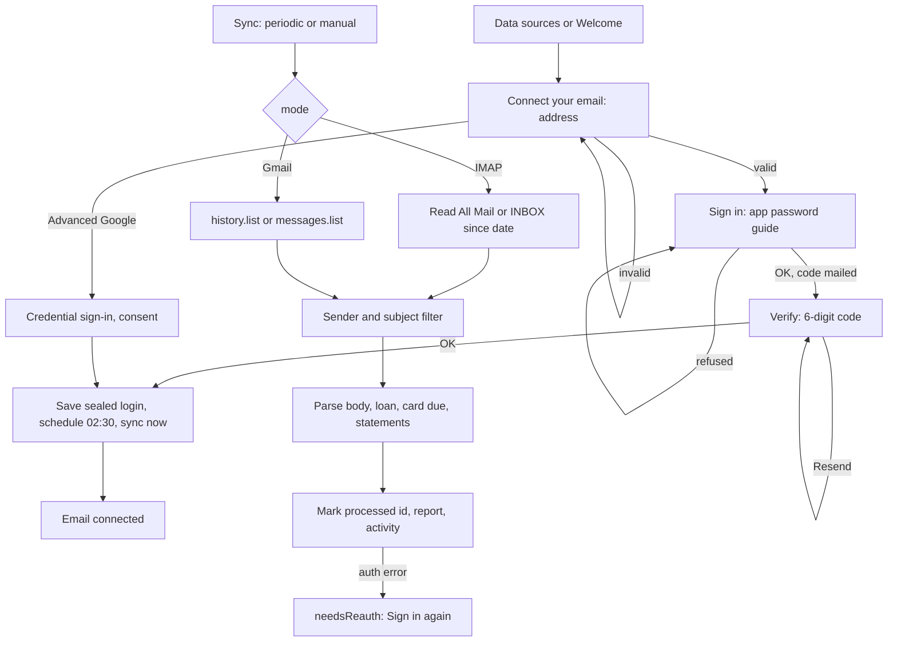

# Email Ingestion

| Field | Value |
|---|---|
| Feature ID | F-03 |
| Status | In progress (Phase 2: IMAP app-password sync, sender whitelist, screen and tests done; Gmail OAuth/API, verification code, attachments, multi-account and scheduling NOT built) |
| Priority | P1 |
| Phase | 2 |
| Last Updated | 2026-10-21 |

## 1. Description

Email ingestion reads the user's bank alert emails and statement attachments straight from their own mailbox, on the phone, with no server. It connects with an email address and an app password (or, as an advanced option, Google sign-in), pulls only mail from approved senders and hands the text to the parser and statement importer. It exists so payments that arrive by email, and card or bank statements, reach the ledger without manual entry.

## 2. What This Feature Will Do

- Connects one or more mailboxes using an email address and a provider app password.
- Proves ownership by mailing a 6-digit code to the user's own address before saving the login.
- Offers an optional Google sign-in with read-only Gmail access.
- Guides the user through creating an app password for each common provider.
- Stores logins sealed on the device and wipes them on sign-out.
- Reads only mail from approved bank, registrar, broker and lender senders, or with statement-like subjects.
- Lets the user edit the approved sender list and reset it to defaults.
- Converts email bodies and attachments (PDF and spreadsheets) to text.
- Passes bank alerts to the parser and attachments to the statement importer.
- Syncs every night at 02:30 and on demand, picking up only mail since the last sync.
- Skips emails already processed and retries on network errors.
- Asks the user to sign in again when the login stops working.
- Lets the user choose how much history to read (7 to 365 days).
- Shows status, last sync and result on the Email card, with counts only and no mail content in logs.

### 2.1 Inputs

- User: email address, app password, 6-digit verification code, sender list edits, history setting, sync toggle.
- Mailbox mail over IMAP, or the Gmail service for Google sign-in.
- Triggers: after connecting, nightly run, sync button, history change.

### 2.2 Processing

1. Check the address and pick the mail server for its provider.
2. Sign in, mail a verification code to the user's own address and check it (limited attempts, 10 minutes).
3. Save the sealed login only after the code is correct, then start a sync.
4. Fetch only recent mail, filter by approved senders or statement-like subject, then read the body.
5. Turn the body into text (plain text, or HTML converted) and pick statement attachments.
6. Send the text to the [Parsing engine](06_transaction_parsing_engine.md) and attachments to [Statement import](05_statement_import.md); loan and card-due results are recorded.
7. Save each email's outcome so it is not read again, then write a count-only report.

### 2.3 Outputs

- Transactions added through the ledger, merged with SMS versions by [Dedup and review](07_dedup_review.md).
- Statements and their totals for [Statement import](05_statement_import.md).
- The Email card on Data sources: status, last sync, result line, senders editor, connect and remove actions.
- An activity entry per sync with mode, counts, duration and error name only.

### 2.4 Out of Scope

- Parsing and statement extraction: [Parsing engine](06_transaction_parsing_engine.md), [Statement import](05_statement_import.md).
- Duplicate rules: [Dedup and review](07_dedup_review.md).
- Notification channels and the Home sync pill visuals.
- Microsoft or Yahoo sign-in (not built) and account aggregator.

## 3. Behaviour in Existing App

Source: analysis Part C section 1, Part A 2.9 (Data sources, EmailConnectDialog), 4.1, and Kotlin under `hisaab_apk/email/src/main/kotlin/com/hisaab/email/` (`E/`) and `app/.../ui/settings/EmailConnect.kt`, `AppPasswordGuide.kt`, `ui/more/DataSourcesScreen.kt`.

### 3.1 Two connection modes (`E/sync/GmailSettings.kt:22`: `enum MailConnection { NONE, GOOGLE, IMAP }`)

IMAP is the default product path since 1.1.0; Google sign-in is the "advanced option".

| Aspect | IMAP (app password) | Gmail API (Google sign-in) |
|---|---|---|
| Engine | `ImapSyncEngine` | `GmailSyncEngine` |
| Transport | JavaMail `imaps` (TLS), host from `MailServers.forAddress` | Ktor to `https://gmail.googleapis.com/gmail/v1/users/me` |
| Auth | address + app password, verified by a 6-digit code | Credential Manager + `AuthorizationClient`, scope `gmail.readonly` |
| Inboxes | multiple (`logins()` loop) | one (`ACCOUNT` key) |
| First sync | whole look-back window | `messages.list` with `{from:(...) subject:"..."} newer_than:Nd` |
| Later syncs | re-read from `lastSync - 1 day` (`OVERLAP_MS`), skip processed ids | `users.history.list` from stored `historyId`, `historyTypes=messageAdded`, `maxResults=500` |
| History expiry | n/a | HTTP 404 -> `HistoryExpiredException` -> `FALLBACK_FULL` bounded by days since last sync + 1, clamped `1..lookbackDays` |
| Sender filter | client side after envelope fetch (`SenderAllowList.allows`) | server side in query on full sync; client side on incremental |
| Concurrency | sequential | 8 parallel `messages.get` (`MAX_CONCURRENT_FETCHES`), page size 100 |
| Retry | WorkManager retry | 429/5xx exponential backoff `500 ms << attempt`, 3 retries; 401 refresh once then `AuthRequiredException`; 403 -> auth required |

### 3.2 IMAP details

Server table (`E/imap/MailServers.kt:21-52`), IMAP port default 993, address regex `^[A-Za-z0-9._%+\-]+@([A-Za-z0-9\-]+\.)+[A-Za-z]{2,}$`:

| Domains | Provider label | IMAP host | SMTP (send-to-self) | App-password URL |
|---|---|---|---|---|
| gmail.com, googlemail.com | Gmail | imap.gmail.com | smtp.gmail.com:465 SSL | https://myaccount.google.com/apppasswords |
| outlook.com, hotmail.com, live.com, msn.com, outlook.in, hotmail.co.in | Outlook | outlook.office365.com | smtp-mail.outlook.com:587 STARTTLS | https://account.live.com/proofs/AppPassword |
| yahoo.com, yahoo.co.in, yahoo.in, ymail.com, rocketmail.com | Yahoo Mail | imap.mail.yahoo.com | smtp.mail.yahoo.com:465 | provider page |
| icloud.com, me.com, mac.com | iCloud Mail | imap.mail.me.com | smtp.mail.me.com:587 STARTTLS | provider page |
| zoho.com, zohomail.com, zohomail.in | Zoho Mail | imap.zoho.com | smtp.zoho.com:465 | provider page |
| rediffmail.com | Rediffmail | imap.rediffmail.com | smtp.rediffmail.com:465 | none |
| aol.com | AOL Mail | imap.aol.com | smtp.aol.com:465 | provider page |
| any other | generic | `imap.<domain>` | `smtp.<domain>:465` SSL | none |

- JavaMail session (`E/imap/MailClient.kt:172-182`): protocol `imaps`, `ssl.checkserveridentity = true`, connect and read timeout 20,000 ms, `partialfetch=false`.
- Folder: the folder carrying IMAP attribute `\All` (Gmail "All Mail", any language) else `INBOX`; opened `READ_ONLY`.
- Query: `ReceivedDateTerm(GE, Date(since))` (server compares dates only), then ONE envelope+UID fetch for all hits, then bodies decoded only for messages passing `accept(from, subject)`. Per-message decode failures are swallowed (`runCatching`).
- Message id: `imap:<Message-ID header>`, else `imap:uid:<uid or messageNumber>`. `receivedAt = receivedDate ?: sentDate ?: 0`.
- Attachments: at most `MAX_PDFS = 5` per mail.
- Re-read window: next sync starts at `lastSync - 1 day` (date-only comparison means up to a day of overlap each run, intentional); already-processed ids are skipped.
- Look-back: settings `lookbackDays`, choices `7, 30, 90, 180, 365`, default 90 (shared with SMS). Increasing it clears the sync position (full re-read).

### 3.3 Connect flow and verification code (IMAP)

`E/imap/MailConnector.kt:23-55`, `E/imap/MailVerification.kt`:

1. `signInAndSendCode(email, password)`: lower-case + trim email, strip spaces from the app password, `checkLogin` (IMAP connect + close). Wrong password -> `MailAuthException`.
2. Mail a 6-digit code to the user's own address via SMTP (`sendToSelf`, from-name "DhanKosh"). Subject `DhanKosh verification code: <code>`; body says it expires in 10 minutes. This proves the address is the user's and that the login can both send and receive.
3. `verify(typed)`; on `OK` the login is saved (`MailAccountStore.save`) and `settings.connected(email, IMAP)`; the caller then runs `GmailScheduler.schedulePeriodic` and `GmailScheduler.syncNow`.

Code rules: `SecureRandom.nextInt(900_000) + 100_000` (always 6 digits); kept only in memory as SHA-256 of `"email|code"`; TTL 10 minutes; max 5 wrong tries; typed input filtered to digits; constant-time compare. Results `OK, WRONG, EXPIRED, TOO_MANY_ATTEMPTS, NONE`.

Management: `signOut()` wipes all stored logins and the Keystore key, clears account state (transactions stay); `remove(email)` drops one login and switches sync off if none remain.

### 3.4 EmailConnectDialog (`ui/settings/EmailConnect.kt:145`, `AppPasswordGuide.kt`)

AlertDialog, steps `ConnectStep { ADDRESS, SIGN_IN, CODE, DONE }`:

| Step | Title | Content | Buttons |
|---|---|---|---|
| ADDRESS | "Connect your email" | "DhanKosh reads bank alert emails and statements from your inbox, on this phone only." + InfoButton "Connecting email"; field "Email address"; hint "Next you'll sign in with an app password, not your normal one. It takes about a minute, and we'll show you exactly where to get it."; optional text button "Advanced: Google sign-in (needs a Google Cloud OAuth client)" shown only when `onUseGoogle != null` (not on Welcome) | Cancel / Continue |
| SIGN_IN | "Sign in to {provider}" | `AppPasswordGuide` for the provider; field "App password" with supporting text "Spaces are fine: paste it exactly as shown." and a "Paste" button | Back / "Sign in & send code" |
| CODE | "Verify your email" | info "We sent a 6-digit code to {email}. Check your inbox (and spam)."; field "6-digit code" (digits only, max 6); "Resend code" -> "A new code is on its way to {email}." | Back / Verify (enabled at 6 digits) |
| DONE | "Email connected" | "{email} is verified. DhanKosh is fetching bank emails from the look-back period now, then checks every hour." | Done |

Errors: "Enter a full email address, like name@gmail.com"; "Enter the app password"; "That code doesn't match. Check the latest email from DhanKosh."; "The code expired. Tap Resend code."; "Too many wrong tries. Tap Resend code for a new one."; "Sign in again to get a code."; "Sign-in was refused ({detail}). {provider} needs an app password here, not your normal password."; "Could not reach the mail server. Check your internet connection.". A busy flag shows a `LinearProgressIndicator` and blocks repeat taps. Back calls `connector.cancel()`. The text "checks every hour" conflicts with the nightly schedule (Open Questions).

App-password guide text (`AppPasswordGuide.kt`, steps numbered, each with an optional link):

- Gmail: turn on 2-Step Verification (link `https://myaccount.google.com/signinoptions/twosv`); open App passwords, name it "DhanKosh", Create; copy the 16-letter password.
- Outlook: open Advanced security options and turn on Two-step verification first (Microsoft hides App passwords until it is on; link `https://account.live.com/proofs/manage/additional`); then create a new app password; work/school admins may have disabled app passwords.
- Yahoo Mail / AOL Mail: Account security, Generate app password, name "DhanKosh".
- iCloud Mail: Sign-In and Security, App-Specific Passwords, +, name "DhanKosh".
- Zoho Mail: Security, App passwords, Generate new password, name "DhanKosh".
- Generic: open provider security settings; create an app password or allow IMAP; if the provider has no app passwords the normal password may work.
- Preamble: "An app password is a separate password just for DhanKosh. Your normal password stays private, and you can revoke this one any time." Button "Open {provider} app passwords".

### 3.5 Gmail OAuth flow (`E/auth/GmailAuthManager.kt`)

- Optional Credential Manager sign-in only when `BuildConfig.GOOGLE_WEB_CLIENT_ID` (from `local.properties`) is non-blank; otherwise the account picker inside `authorize()` is used.
- `AuthorizationClient.authorize` with scope `gmail.readonly`; if `hasResolution()` the result is `NeedsConsent(pendingIntent)`, then `completeConsent` (UI uses `StartIntentSenderForResult`; `AppLockGate.skipNextLock()` before launching).
- No refresh token is stored. Access token lifetime assumed 55 minutes (`TOKEN_LIFETIME_MS`), refreshed with a 2-minute margin by silent re-authorize; if a resolution is needed -> `settings.setNeedsReauth(true)`.
- `signOut` revokes at `https://oauth2.googleapis.com/revoke`, wipes token + key, clears Credential state.

### 3.6 Credential storage and sealing

- `KeystoreSecret` (`E/auth/KeystoreSecret.kt`): AES-256-GCM key in AndroidKeyStore under an alias, no padding, 12-byte IV prefix, 128-bit tag, Base64 NO_WRAP. `open()` returns null if the key was reset (e.g. device lock removed). `deleteKey()` makes ciphertext permanently unreadable.
- Aliases: `hisaab.mail.password` (IMAP passwords, `MailAccountStore`), `hisaab.gmail.token` (`TokenStore`), `hisaab.statement.passwords` (statement store, see 05).
- `MailAccountStore`: DataStore `mail_account`; one string-set entry per account as `email` + `\u001F` + `sealed`; reads a legacy single `email`/`password` pair as the first account.
- `TokenStore`: DataStore `gmail_tokens`, keys `token` (sealed) and `expires_at`.
- Passwords are "used for the call and never logged"; the sync run log stores counts, timing and error class only (never mail content).

### 3.7 Sender / domain whitelist

- Setting `senders` (set of lower-case addresses or domains). Default = `registry.defaultEmailSenders` = every bank parser's `emailSenders` + `STATEMENT_SENDERS` (100+ domains).
- `STATEMENT_SENDERS` (`ParserRegistry.kt:87-102`):
  - Registrars/depositories: camsonline.com, kfintech.com, karvy.com, nsdl.co.in, nsdl.com, cdslindia.com, cdslstatement.com, kfintech.net, camsonline.co.in, cdslindia.co.in, cdsl.co.in.
  - Brokers/apps: icicidirect.com, icicisecurities.com, hdfcsec.com, kotaksecurities.com, indmoney.com, zerodha.com, zerodha.net, groww.in, upstox.com, angelone.in, dhan.co, kuvera.in, paytmmoney.com, etmoney.com, mfcentral.com, bsestarmf.in, mfuindia.com, scripbox.com, fisdom.com.
  - EPF/NPS: epfindia.gov.in, epfo.gov.in, umang.gov.in, nps-proteantech.in, proteantech.in, npstrust.org.in, npscra.nsdl.co.in, kfintech-cra.com, camsnps.com.
  - Card issuers and neo-banks without a dedicated parser: sbicard.com, americanexpress.co.in, aexp.com, rblbank.com, indusind.com, indusind.bank.in, hsbc.co.in, sc.com, onecard.in, getonecard.app, slicepay.in, sliceit.com, jupiter.money, fi.money, scapia.cards, uni.cards, bobfinancial.com, federalbank.co.in, aubank.in, canarabank.com, unionbankofindia.co.in, citibank.com, dbs.com, paytmbank.com, bajajfinserv.in.
  - Lenders: propelld.com, adityabirlacapital.com, abcd.adityabirlacapital.com, tatacapital.com, credila.com, avanse.com, incred.com, smfgindiacredit.com, homecredit.co.in, kreditbee.in, navi.com, poonawallafincorp.com, hdbfs.com.
- Bank domains per core parser (from analysis Part B): hdfcbank.net, hdfcbank.com, hdfcbank.bank.in; icicibank.com, icici.bank.in, icicibank.bank.in; alerts.sbi.co.in, sbi.co.in, sbicard.com, sbi.bank.in; axisbank.com, axis.bank.in, axisbank.bank.in; kotak.com, kotak.bank.in, kotakbank.com; idfcfirstbank.com, idfcfirst.bank.in, idfcbank.com; yesbank.in, yes.bank.in, yesbank.bank.in; bankofbaroda.com, bankofbaroda.co.in, bobcard.co.in, bankofbaroda.bank.in; pnb.co.in, pnb.bank.in, pnbindia.in; aubank.in, au.bank.in. Payment apps: phonepe.com, noreply@phonepe.com, googlepay-noreply@google.com, payments-noreply@google.com, noreply-payments@pay.google.com, pay.google.com, paytm.com, paytm.in, cred.club, mobikwik.com, amazonpay.in, freecharge.in, super.money. About 55 listed banks add more domains via `IndianBanks`.
- Matching: `SenderAllowList.allows(from, subject)` = any `SenderKeys.candidates(from)` is in the set, OR the subject looks like a statement (2.8). Email key candidates: the address inside `<...>` (else the whole string), lower-cased, then each domain suffix with at least one dot: `alerts@hdfcbank.net` -> [`alerts@hdfcbank.net`, `hdfcbank.net`]; `x@alerts.sbi.co.in` -> [`x@alerts.sbi.co.in`, `alerts.sbi.co.in`, `sbi.co.in`, `co.in`].
- Editing: Data sources "Bank senders" dialog (`SendersDialog`): multiline list, one address or domain per line; "A domain matches every address at it."; buttons Defaults / Cancel / Save. `setSenders` lower-cases/trims and calls `forgetPosition` so older mail from new senders is re-read; `resetSenders` removes the override.

### 3.8 Statement-by-subject filter

`ParserRegistry.STATEMENT_SUBJECTS` literals feed the Gmail query as `subject:"..."` OR-clauses: "Consolidated Account Statement", "NPS Transaction Statement", "PRAN", "EPF Passbook", "Member Passbook", "SIP installment", "SIP instalment", "units allotted", "allotment of units", "Statement of Transaction", "NPS contribution", "Holdings statement", "mutual fund statement", "Holdings report", "Balance statement", "Portfolio statement", "Holdings", "Portfolio report", "Fixed Deposit", "Term Deposit", "Recurring Deposit", "Deposit advice", "PPF statement", "Public Provident Fund", "portfolio summary".

Client-side regex `STATEMENT_SUBJECT` (case-insensitive) used by IMAP and incremental Gmail:

```text
consolidated\s+account\s+statement|\bCAS\b|\bNPS\b.{0,40}statement|\bPRAN\b|
\bEPF\b.{0,30}(?:passbook|statement)|member\s+passbook|
\bSIP\b.{0,60}\b(?:instal+ment|processed|successful|allot+ed)|
\bunits?\s+(?:have\s+been\s+)?allot+ed|allotment\s+of\s+units|
statement\s+of\s+transactions?|\bNPS\b.{0,40}(?:contribution|holding|transaction)|
\bholdings?\b|portfolio\s+(?:holdings|report)|
(?:balance|portfolio|investment)\s+(?:statement|report)|mutual\s+fund\s+statement|
(?:fixed|term|recurring)\s+deposit|deposit\s+advice|\bPPF\b.{0,30}statement|
public\s+provident\s+fund|portfolio\s+summary
```

The two paths are not identical (regex is broader: bare `\bCAS\b`, `\bholdings?\b`).

### 3.9 Sync schedule and settings

- Periodic: WorkManager unique periodic `gmail-sync-periodic`, every 1 day, first run at the next 02:30 local, constraints `NetworkType.CONNECTED` + `requiresBatteryNotLow`, exponential backoff 30 s, `ExistingPeriodicWorkPolicy.UPDATE` (replaced an old hourly job).
- On demand: unique one-time `gmail-sync-now`, `REPLACE`. Home refresh = `syncAll()` = SMS `scanRecent(14)` + `GmailScheduler.syncNow` (if connected and enabled) + budget/upcoming checks + `retryLocked` for statements.
- Failure handling: `AuthRequiredException` / `MailAuthException` -> set `needsReauth`, fail (Data sources shows "Sign in again"); `IOException` -> `retry()` up to `MAX_ATTEMPTS = 5`.
- Progress `KEY_EMAILS_READ`; success `KEY_SUMMARY`; `notifier.onTransactionsChanged()` if `report.parsed > 0`.
- Report string: `"<mode>: N emails, M transactions (a new, b merged, c to review) in Xs"`; modes `FULL, INCREMENTAL, FALLBACK_FULL, DISABLED`.
- Dedup of already-seen mail: `ProcessedEmailEntity(id, time, outcome)`, outcomes `PARSED / REJECTED / SKIPPED`; IMAP never writes `SKIPPED` (filters before fetching).
- `readPdfStatements` defaults true (IMAP DI hard-codes true). HTTP client Ktor, request timeout 30 s, connect 15 s, `expectSuccess=false`.

### 3.10 Per-message pipeline (same shape in both engines)

1. `registry.parse(body, from, receivedAt, EMAIL)` -> bank-alert transaction.
2. If none: `registry.loanStatus(...)` (lender message or FD/RD/PPF status) -> loan status sink.
3. Always: `registry.cardDue(...)` -> card-due sink (statement generated, bill due, payment ack; not a transaction).
4. If still no transaction and a statement handler exists: `pdf.readEmail(...)` (MF order, INDmoney summary, EPF, NPS mail).
5. If `readPdf`: for each attachment `pdf.read(bytes, StatementMeta("EMAIL", "<msgId>#pdf<i>", from, subject, filename, receivedAt, emailText))` (see [Statement import](05_statement_import.md)).

Outcome stored as REJECTED when no transaction came out of steps 1, 4 and 5 (loan and card-due outputs do not count as PARSED).

### 3.11 MIME and HTML handling

- Gmail: `MimeParser.extract` walks the `payload` tree. First `text/plain` and first `text/html` without a filename are kept; any part with a filename that is `application/pdf`, `.pdf`, a spreadsheet name or (spreadsheet MIME with no dot in the name) is an attachment; other attachments are ignored. Charset from the part `Content-Type` by `charset="?([\w.:-]+)"?`, default UTF-8. base64url decode.
- IMAP: recursive walk of `multipart/*` and `message/rfc822`; filename decoded with `MimeUtility.decodeText`; charset via `javaCharset`.
- Body choice (both): `text/plain` if trimmed length >= 30 (`MIN_PLAIN_LENGTH`), else HTML converted, else short plain, else Gmail `snippet` / empty.
- `htmlToText` (Jsoup): remove `script, style, head`; newline marker before `p, div, tr, li, h1-h6, table` and after `br`; a space after `td, th`; trim each line; collapse blank lines. Purpose: keep field boundaries for regex parsers.
- Attachments accepted: PDF (`application/pdf` or `.pdf`), spreadsheets by name `\.(xlsx|xlsm|xls|csv)$` or MIME (`application/vnd.ms-excel`, `text/csv`, `application/csv`, `text/comma-separated-values`, OOXML sheet, macro-enabled sheet). IMAP also requires a filename or ATTACHMENT disposition for the spreadsheet branch. Default name `statement.pdf` / `statement.xls`. Type decided from bytes first (`%PDF` in first 1024 bytes, `PK\x03\x04` XLSX, OLE magic `D0 CF 11 E0 A1 B1 1A E1` XLS, `.csv` or text-looking, then `.pdf` name). Gmail path has no 5-attachment cap.

### 3.12 Data sources "Email" card (`ui/more/DataSourcesScreen.kt`)

Status chip: Not connected / Sign in again / Paused / Connected; last synced time; toggle (enabled); "Connect email"; per-address Remove; "Add another email"; "Bank senders" editor; "Disconnect email" / "Sign out" confirm dialog. Google sign-in uses the consent intent flow; `AppLockGate.skipNextLock()` before every external launch. Changing "History to read" re-reads email as well as SMS.

## 4. User Stories

- US-03-01: As a user I connect my Gmail with an app password and a code, without a Google Cloud project.
- US-03-02: As a user with several inboxes I add more than one address.
- US-03-03: As a user I want to be told exactly where to create an app password for my provider.
- US-03-04: As a user I edit the list of bank senders and reset to defaults.
- US-03-05: As a user I want CAS / NPS / EPF statement emails picked up by subject even from unknown senders.
- US-03-06: As a user I want emails read once only, and a sync that does not drain the battery.
- US-03-07: As a user I want to sign out and have my stored passwords wiped (my transactions stay).
- US-03-08: As a user whose app password was revoked I see "Sign in again".

## 5. Functional Requirements (FR-03-01 ...)

| ID | Requirement |
|---|---|
| FR-03-01 | Validate the address with the regex in 2.2; map the domain to a `MailServer` per the table; unknown domains default to `imap.<domain>` / `smtp.<domain>:465`. |
| FR-03-02 | Sign in via IMAP over TLS (port 993, server identity check on, 20 s timeouts) using lower-cased email and the app password with spaces removed; map auth failures to a distinct "sign-in refused" error. |
| FR-03-03 | After a successful login send a 6-digit code to the user's own address via SMTP (subject `DhanKosh verification code: <code>`), TTL 10 minutes. |
| FR-03-04 | Generate codes with a CSPRNG in 100000..999999; keep only a SHA-256 of `email|code` in memory; max 5 wrong attempts; constant-time compare; return OK / WRONG / EXPIRED / TOO_MANY_ATTEMPTS / NONE; support Resend. |
| FR-03-05 | Only after OK: store the account (password sealed with a hardware-backed key), mark connected with mode IMAP, schedule the periodic sync and start an immediate sync. |
| FR-03-06 | Support multiple IMAP accounts; remove one; switch email sync off when none remain; sign out wipes all stored logins and the key. |
| FR-03-07 | Provide the per-provider app-password guide (Gmail, Outlook, Yahoo/AOL, iCloud, Zoho, generic) with deep links. |
| FR-03-08 | Optionally support Google sign-in with scope `gmail.readonly`; no refresh token stored; access token 55 min with 2 min refresh margin; revoke on sign-out; set `needsReauth` when silent re-auth fails. |
| FR-03-09 | IMAP sync reads the `\All` folder else INBOX, read-only, using a date-only `since`, one envelope fetch, client-side sender filter, then body decode only for allowed mail. |
| FR-03-10 | Incremental IMAP sync starts at `lastSync - 1 day`, skips processed message ids, and treats `imap:<Message-ID>` (fallback `imap:uid:<n>`) as the id. |
| FR-03-11 | Gmail sync: full via `messages.list` with sender and subject query bounded by `newer_than:Nd`; incremental via `history.list`; on 404 fall back to a bounded full sync; 8 parallel fetches; retry/backoff as in 2.1. |
| FR-03-12 | Apply `SenderAllowList.allows(from, subject)`; senders default to registry defaults; the user list overrides; "Defaults" resets; saving a changed list forgets sync position so older mail is re-read. |
| FR-03-13 | Statement-subject detection: literal list for Gmail server query, regex for IMAP and Gmail incremental (2.8). |
| FR-03-14 | Run the per-message pipeline of 2.10 in order and record the outcome PARSED / REJECTED / SKIPPED in the processed-emails store; loan or card-due output alone is REJECTED. |
| FR-03-15 | Extract body: plain if trimmed length >= 30 else HTML-to-text (rules in 2.11) else short plain else snippet. Preserve line/field boundaries from HTML. |
| FR-03-16 | Select attachments per 2.11 (PDF and spreadsheets, max 5 per IMAP mail, default names), sniff type from bytes, and pass bytes plus `StatementMeta` to the statement importer. |
| FR-03-17 | Schedule a unique periodic sync every 24 h at the next 02:30 local with network-connected and battery-not-low constraints, backoff 30 s, replacing older schedules; plus a unique on-demand sync. |
| FR-03-18 | On auth failure set `needsReauth` and stop; on IO failure retry up to 5 attempts; record an activity entry with mode, counts, duration and error class only. |
| FR-03-19 | Look-back setting 7/30/90/180/365 (default 90), shared with SMS; raising it clears the sync position. |
| FR-03-20 | Never log mail content, passwords or tokens; sync log holds counts, timing and error class names. |
| FR-03-21 | Report string `"<mode>: N emails, M transactions (a new, b merged, c to review) in Xs"` is shown on the Email card and in the activity log. |
| FR-03-22 | Data sources Email card exposes status, last sync, toggle, connect/add/remove, senders editor and disconnect confirmation as in 2.12. |

## 6. Non-Functional Requirements (performance, battery, privacy, offline)

- Network: only the user's own mail server (or Gmail API) and, for the code, the same server's SMTP. No third-party servers. TLS only (cleartext disabled), certificate identity checked.
- Battery: one scheduled run per day at night plus manual; constraints connected and battery-not-low; sequential IMAP; no push/IDLE.
- Performance: one envelope fetch per sync window; decode bodies only for allowed senders; Gmail 8 concurrent fetches; HTTP timeouts 30 s request, 15 s connect.
- Privacy: app passwords and tokens sealed (AES-256-GCM, hardware-backed key); never logged; attachment bytes kept only in app-private not-backed-up storage (see 05); activity log counts only.
- Offline: connect and sync need network; everything already ingested works offline. Failures are non-fatal and retried.
- Storage: processed-email ids table bounded by retention policy (Open Questions).

## 7. UI / Screens & User Flow (screen list + flow diagram)

| # | Screen / element | Kotlin source |
|---|---|---|
| 1 | EmailConnectDialog step ADDRESS | `ui/settings/EmailConnect.kt:145` |
| 2 | EmailConnectDialog step SIGN_IN with AppPasswordGuide | `ui/settings/AppPasswordGuide.kt` |
| 3 | EmailConnectDialog step CODE | same |
| 4 | EmailConnectDialog step DONE | same |
| 5 | Info dialog "Connecting email" (`Info.EMAIL`) | `ui/components/InfoButton.kt:46` |
| 6 | Data sources: Email SourceCard (status, last synced, toggle, buttons) | `ui/more/DataSourcesScreen.kt` (email item) |
| 7 | Data sources: per-address Remove, "Add another email" | same |
| 8 | SendersDialog (Bank senders: multiline editor, Defaults / Cancel / Save) | same |
| 9 | Disconnect / Sign out confirmation AlertDialog | same |
| 10 | Google consent (system) | Android Credential / Authorization UI |
| 11 | Home SyncPill "Reading email · n" | `ui/home/HomeScreen.kt:318` |



Reference GIFs (each file Status: Pending, not yet captured):

-  (Status: Pending, not yet captured)
-  (Status: Pending, not yet captured)
-  (Status: Pending, not yet captured)
-  (Status: Pending, not yet captured)
-  (Status: Pending, not yet captured)
-  (Status: Pending, not yet captured)
-  (Status: Pending, not yet captured)
-  (Status: Pending, not yet captured)
-  (Status: Pending, not yet captured)

## 8. Data Models (Dart entities + fields + types)

```dart
enum MailConnection { none, google, imap }
enum ConnectStep { address, signIn, code, done }
enum VerifyResult { ok, wrong, expired, tooManyAttempts, none }
enum SyncMode { full, incremental, fallbackFull, disabled }
enum EmailOutcome { parsed, rejected, skipped }

@freezed
class MailServer with _$MailServer {
  const factory MailServer({
    required String provider,
    required String imapHost,
    @Default(993) int imapPort,
    required String smtpHost,
    required int smtpPort,
    required bool smtpSsl,          // true = implicit TLS 465, false = STARTTLS 587
    String? appPasswordUrl,
  }) = _MailServer;
}

@freezed
class MailLogin with _$MailLogin {
  const factory MailLogin({
    required String email,          // lower-case
    required String sealedPassword, // base64(iv(12) || ciphertext || tag(16))
  }) = _MailLogin;
}

@freezed
class EmailSettings with _$EmailSettings {
  const factory EmailSettings({
    @Default(MailConnection.none) MailConnection connection,
    @Default(false) bool enabled,
    @Default(false) bool needsReauth,
    @Default(90) int lookbackDays,       // 7|30|90|180|365
    String? googleAccount,
    int? lastSyncAt,
    String? lastReport,
    String? historyId,                   // Gmail only
    @Default(<String>{}) Set<String> senders, // empty = defaults
  }) = _EmailSettings;
  const EmailSettings._();
  bool get connected => connection != MailConnection.none;
}

@freezed
class EmailConnectState with _$EmailConnectState {
  const factory EmailConnectState({
    @Default(ConnectStep.address) ConnectStep step,
    @Default('') String email,
    MailServer? server,
    @Default(false) bool busy,
    String? error,
    String? info,
  }) = _EmailConnectState;
}

@freezed
class RawEmail with _$RawEmail {
  const factory RawEmail({
    required String id,                  // imap:<Message-ID> | imap:uid:<n> | Gmail id
    required String from,                // display name + <address>
    required String subject,
    required String body,                // already text
    required int receivedAt,             // epoch ms
    @Default(<EmailAttachment>[]) List<EmailAttachment> attachments,
  }) = _RawEmail;
}

@freezed
class EmailAttachment with _$EmailAttachment {
  const factory EmailAttachment({
    required String fileName,
    required Uint8List bytes,
  }) = _EmailAttachment;
}

@freezed
class EmailSyncReport with _$EmailSyncReport {
  const factory EmailSyncReport({
    required SyncMode mode,
    required int emails,
    required int parsed,
    required int inserted,
    required int merged,
    required int flagged,
    required int millis,
    String? error,
  }) = _EmailSyncReport;
}
```

## 9. Database Tables / Changes

```dart
class ProcessedEmails extends Table {
  TextColumn get messageId => text()();                 // PK
  IntColumn get processedAt => integer()();             // epoch ms
  TextColumn get outcome => text()();                   // PARSED | REJECTED | SKIPPED (DUPLICATE, ERROR also seen in schema docs)
  IntColumn get transactionId => integer().nullable()();
  @override
  Set<Column> get primaryKey => {messageId};
}
```

Existing schema (analysis Part B 1.3): `processed_emails(messageId TEXT PK, processedAt INTEGER, outcome TEXT (PARSED, REJECTED, DUPLICATE, ERROR), transactionId INTEGER?)`; the sync engine writes PARSED / REJECTED / SKIPPED (Open Questions).

Non-table state (existing DataStores; port to secure storage / settings store):

| Store / key | Type | Notes |
|---|---|---|
| `mail_account` DataStore, one string-set entry per account `email\u001Fsealed` | sealed | alias `hisaab.mail.password`; legacy single `email`/`password` pair read as first account |
| `gmail_tokens`: `token` (sealed), `expires_at` | sealed | alias `hisaab.gmail.token` |
| `GmailSettingsStore`: `enabled`, `needsReauth`, `connection` (GOOGLE/IMAP), `lookbackDays` (default 90), `senders` (set), `historyId`, last sync info | settings | `LOOKBACK_CHOICES = 7,30,90,180,365` |
| statement `emailText` (cap 4,000 chars) | in `statements` table | see [Statement import](05_statement_import.md) |

Writes to other tables: `transaction_sources` (source `EMAIL`, `sourceMessageId` = email id, `subject` column, `sender` = From, `rawText` capped 20,000) via ingest ([Transactions ledger](08_transactions_ledger.md), [Dedup and review](07_dedup_review.md)).

## 10. Business Rules & Logic (regex, parsing rules, algorithms, thresholds)

- Address regex: `^[A-Za-z0-9._%+\-]+@([A-Za-z0-9\-]+\.)+[A-Za-z]{2,}$`.
- Verification code: `100000 + rand.nextInt(900000)`; stored `sha256("$email|$code")`; TTL 600 s; max wrong tries 5; digits-only input; constant-time compare.
- IMAP overlap: next `since = lastSync - 24h`; server compares dates, so effective window is date-granular.
- Timeouts: IMAP/SMTP 20 s; Gmail HTTP request 30 s, connect 15 s.
- Retry: IO errors -> up to 5 attempts; WorkManager backoff exponential from 30 s. Gmail: 429/5xx backoff `500ms << attempt` x3; 401 refresh once.
- Gmail token: assume 55 min life, refresh when within 2 min of expiry.
- Body selection: `plainTrimmedLength >= 30 ? plain : (html != null ? htmlToText(html) : (plain.isNotEmpty ? plain : snippet))`.
- HTML to text: strip `script, style, head`; add line break before `p, div, tr, li, h1..h6, table`, after `br`; add a space after `td, th`; trim lines; drop blank runs.
- Email trim for parsing (done in the parser): cap 3000 chars; cut at first footer phrase found at offset >= 40 (see doc 06).
- Attachment cap 5 (IMAP); accepted types PDF and `xlsx|xlsm|xls|csv`; byte sniff order: `%PDF` (first 1024 bytes) > `PK\x03\x04` > OLE magic > `.csv`/text heuristic (no NUL, < 2% control chars in first 2048 bytes) > `.pdf` name.
- Allow-list: `candidates(from).any(senders.contains) || statementSubject.hasMatch(subject)`.
- Look-back values `{7,30,90,180,365}`, default 90; raising it clears position; editing senders clears position.
- Outcome rule: REJECTED if no transaction from steps 1, 4, 5 of the pipeline, even if loan/card-due produced output.
- Nightly delay: next 02:30 local, same helper as SMS.
- Privacy rule: sync log entries hold counts, mode, duration, error class only.

## 11. Platform / Native Requirements (permissions, channels, background work)

- Permissions: `INTERNET`, `ACCESS_NETWORK_STATE`. No mail permission (own credentials). Network security: cleartext off, system CAs only.
- Flutter packages: `enough_mail` (IMAP/SMTP, MIME decoding), `googleapis` + `google_sign_in` (Gmail API, scope `https://www.googleapis.com/auth/gmail.readonly`), `html` (HTML to text; replaces Jsoup), `flutter_secure_storage` (sealing; on Android use encryptedSharedPreferences backed by Keystore AES-GCM), `workmanager` (daily 02:30 job and one-time job), `crypto`, `url_launcher` (open app-password pages), `connectivity_plus` (optional).
- `workmanager` constraints: `NetworkType.connected`, `requiresBatteryNotLow: true`, `backoffPolicy: exponential`, 30 s; unique names `gmail-sync-periodic` (UPDATE) and `gmail-sync-now` (REPLACE).
- Headless Dart isolate must be able to read the sealed stores and the Drift database (use a shared database file with `NativeDatabase.createInBackground` and a single-writer lock).
- Before launching external URLs or Google consent set the app-lock skip flag (see Security feature).
- iOS: `enough_mail` works; background fetch is limited (BGTaskScheduler); sync on foreground and opportunistically. Gmail sign-in uses the iOS client id.
- Google OAuth client id and `GOOGLE_WEB_CLIENT_ID` come from build config, never committed.

## 12. Dependencies (other features → link to their memory file; packages)

Features:

- [Transaction parsing engine](06_transaction_parsing_engine.md): `registry.parse`, `loanStatus`, `cardDue`, `defaultEmailSenders`, `isStatementSubject`.
- [Statement import](05_statement_import.md): attachments, `readEmail`, locked-statement handling.
- [Dedup and review](07_dedup_review.md) and [Transactions ledger](08_transactions_ledger.md): ingest, sources.
- [Onboarding and permissions](01_onboarding_permissions.md): hosts the connect dialog on first run.
- [SMS ingestion](02_sms_ingestion.md): shared look-back, shared nightly time, Home refresh.
- [Notification ingestion](04_notification_ingestion.md): sibling source.
- Settings (Data sources), Security (app lock skip), Activity log, Home sync: separate features.

Packages: listed in section 11, plus `freezed`, `drift`, `flutter_riverpod`, `collection`.

## 13. Folder Location (lib/features/<name>/...)

```text
lib/features/email_ingestion/
  data/
    imap/
      mail_servers.dart               // provider table, address regex
      imap_client.dart                // enough_mail wrapper
      imap_sync_engine.dart
      mail_connector.dart             // signInAndSendCode, verify, resend, cancel
      mail_verification.dart          // code store, TTL, attempts
    gmail/
      gmail_api.dart                  // googleapis wrapper, backoff
      gmail_auth_manager.dart
      gmail_sync_engine.dart
    mime/
      mime_extractor.dart
      html_to_text.dart
      attachment_sniffer.dart
    stores/
      keystore_secret.dart            // sealing helper
      mail_account_store.dart
      token_store.dart
      email_settings_store.dart
      processed_emails_dao.dart       // Drift DAO
    sync/
      email_sync_scheduler.dart       // workmanager
      email_sync_worker.dart
  domain/
    entities/ (mail_server, mail_login, email_settings, raw_email, email_attachment, email_sync_report)
    sender_allow_list.dart
    statement_subjects.dart
    usecases/ (connect_imap, verify_code, sync_email, edit_senders, sign_out)
  presentation/
    email_connect_dialog.dart
    app_password_guide.dart
    senders_dialog.dart
    email_source_card.dart            // used inside Data sources
    providers/
```

## 14. Edge Cases & Error Handling

- Wrong app password: `MailAuthException` -> "Sign-in was refused (...). {provider} needs an app password here, not your normal password."
- User pastes the app password with spaces: stripped silently.
- Code email lands in spam: info text says check spam; Resend available.
- Code expires after 10 min or after 5 wrong tries: distinct messages; Resend issues a new code.
- Offline during connect: "Could not reach the mail server. Check your internet connection."; no partial state saved.
- Back from CODE to SIGN_IN calls cancel and clears the pending code.
- Outlook with two-step verification off: App passwords hidden; guide step 1 explains.
- Workspace/school accounts with app passwords disabled: guide warns; no OAuth fallback (Open Questions).
- App password revoked later: next sync gets auth failure -> `needsReauth`; card shows "Sign in again"; transactions stay.
- Gmail history id expired (404): fallback full sync bounded `1..lookbackDays`.
- Message without Message-ID: id falls back to UID.
- Decode failure for one message: swallowed; message not marked processed so it is retried (verify in Flutter).
- Huge mailbox: date-bounded query, sender filter before body fetch, attachment cap 5.
- Two inboxes forwarding the same mail: same bank email arrives twice with different ids; dedup merges by reference/hash ([Dedup and review](07_dedup_review.md)).
- Keystore key reset (device lock removed): sealed values unreadable; treat as signed out and ask to reconnect.
- User removes the last inbox: email sync switched off; periodic job cancelled.

## 15. Test Cases (unit / widget / integration + sample fixtures)

| ID | Type | Covers | Case |
|---|---|---|---|
| TC-03-01 | unit | FR-03-01 | `forAddress('a@gmail.com').imapHost == 'imap.gmail.com'`; `@outlook.in` -> Outlook STARTTLS 587; `@mycorp.in` -> `imap.mycorp.in`, SMTP 465; address `a@b` invalid; `a b@x.com` invalid. |
| TC-03-02 | unit | FR-03-04 | Code is 6 digits; WRONG on mismatch; 6th attempt after 5 wrong -> TOO_MANY_ATTEMPTS; after 10 min -> EXPIRED; with no pending code -> NONE; correct code -> OK once. |
| TC-03-03 | unit | FR-03-02 | Password `abcd efgh ijkl mnop` is sent as `abcdefghijklmnop`; email lower-cased/trimmed. |
| TC-03-04 | integration | FR-03-03, FR-03-05 | Fake IMAP/SMTP: sign in sends mail with subject `DhanKosh verification code: NNNNNN`; verify OK saves sealed login, schedules periodic and one-off sync. |
| TC-03-05 | unit | FR-03-06 | Remove one of two logins keeps sync on; removing the last turns it off; sign-out deletes the key (sealed data unreadable). |
| TC-03-06 | unit | FR-03-09, FR-03-10 | IMAP engine with fake folders: picks `\All` over INBOX; `since = lastSync - 1d`; bodies fetched only for allowed senders; id `imap:<id>` else `imap:uid:7`. |
| TC-03-07 | unit | FR-03-12 | `allows('HDFC Bank InstaAlerts <alerts@hdfcbank.net>', 'x')` true by `hdfcbank.net`; `allows('x@alerts.sbi.co.in','x')` true via `sbi.co.in`; unknown sender with subject "Consolidated Account Statement" true; unknown sender with subject "Hi" false. |
| TC-03-08 | unit | FR-03-12 | Saving a new sender list clears the stored position; Defaults removes the override. |
| TC-03-09 | unit | FR-03-13 | Subject regex matches "Your NPS Transaction Statement", "CAS - Jan", "SIP instalment processed", "EPF passbook", "Holdings report"; does not match "Your OTP". |
| TC-03-10 | unit | FR-03-15 | Plain text of 29 chars + html -> html used; plain 30+ chars used; html `<p>Rs.450.00</p><td>a</td><td>b</td>` yields line break before p and a space after each td. |
| TC-03-11 | unit | FR-03-16 | Attachment sniffer: bytes starting `%PDF` -> pdf even if named `.dat`; `PK\x03\x04` -> xlsx; OLE magic -> xls; `.csv` text -> csv; 6 PDFs in one IMAP mail -> only first 5 forwarded. |
| TC-03-12 | unit | FR-03-14 | Pipeline: alert email -> PARSED; lender status only -> REJECTED; statement email with PDF parsed -> PARSED; unknown -> REJECTED; already-processed id skipped. |
| TC-03-13 | unit | FR-03-11 | Gmail engine with fake API: history 404 -> mode FALLBACK_FULL with days clamp `1..lookback`; 429 retries x3; 401 refreshes once then throws auth-required. |
| TC-03-14 | unit | FR-03-17, FR-03-18 | Scheduler registers unique periodic with 02:30 initial delay, network+battery constraints; auth failure sets `needsReauth` and does not retry; IOException retries to 5. |
| TC-03-15 | unit | FR-03-19 | Raising lookback 30 -> 90 clears the position; lowering does not. |
| TC-03-16 | unit | FR-03-20 | Log output for a failed login contains no password and no mail body. |
| TC-03-17 | widget | FR-03-07, FR-03-22 | Dialog steps, busy progress, error texts; guide per provider; "Advanced: Google sign-in" hidden when callback null; card status chips (Not connected / Sign in again / Paused / Connected). |
| TC-03-18 | unit | FR-03-21 | Report string `"INCREMENTAL: 12 emails, 3 transactions (2 new, 1 merged, 0 to review) in 4s"`. |

Fixtures (synthetic): HDFC UPI email `From: HDFC Bank InstaAlerts <alerts@hdfcbank.net>`, body `Dear Customer,\n\nRs.450.00 has been debited from account **1234 to VPA swiggy@icici SWIGGY on 25-09-26.\n\nYour UPI transaction reference number is 526812345678.\n\nIf you did not authorize this transaction, please report it immediately ...`; PhonePe receipt `Payment receipt. Paid to Ravi Kumar. Amount ₹250. Transaction ID T2610101234567890. UTR 526812340020. Debited from HDFC Bank XX1234. Date 10 Oct 2026`; CAS email with PDF attachment bytes stub.

## 16. Acceptance Criteria

- AC-03-01: A user can connect a Gmail address using an app password and a mailed code; a wrong code three times then correct succeeds, six wrong fails (FR-03-02 to FR-03-05; TC-03-02, TC-03-04).
- AC-03-02: After connecting, bank alert emails from whitelisted senders appear as transactions and are merged with their SMS twins (FR-03-09, FR-03-12, FR-03-14; TC-03-06, TC-03-07, TC-03-12).
- AC-03-03: Emails are never parsed twice; a second sync reads nothing new (FR-03-10, FR-03-14; TC-03-06, TC-03-12).
- AC-03-04: Statement emails from unknown senders with statement-like subjects are picked up (FR-03-13; TC-03-09, TC-03-07).
- AC-03-05: PDF/XLS/CSV attachments reach the statement importer with correct type (FR-03-16; TC-03-11).
- AC-03-06: Credentials are sealed and absent from logs; sign-out wipes them (FR-03-06, FR-03-20; TC-03-05, TC-03-16).
- AC-03-07: The daily job is scheduled at 02:30 with constraints and manual sync works (FR-03-17; TC-03-14).
- AC-03-08: A revoked password shows "Sign in again" and keeps existing transactions (FR-03-18; TC-03-14, TC-03-17).
- AC-03-09: Editing the sender list and resetting to defaults works and triggers a re-read (FR-03-12; TC-03-08).
- AC-03-10: The Google path (if shipped) handles history expiry and token refresh (FR-03-08, FR-03-11; TC-03-13).

## 17. Open Questions

1. Polling cadence mismatch: the DONE text says "then checks every hour" but the scheduler is daily at 02:30 (`PeriodicWorkRequestBuilder(1, DAYS)`); FEATURES.md says "automatic nightly email sync"; the v2 spec says 15 min to hourly. Which should Flutter implement? (Analysis Part A open question 1, Part C 8.)
2. `SenderKeys.candidates(from)` implementation for display-name + `<address>` headers was not read (Part C open question 1); behaviour above is from doc comments and examples.
3. `MimeParser.LINE` marker constant appears as a plain space in the extracted source; the real marker is probably a special character. Flutter's HTML-to-text must use an explicit newline.
4. Is the Gmail API path still offered in the UI? Existing connect dialog shows it only when `onUseGoogle != null`; Welcome passes null. Confirm whether to port Gmail OAuth at all (needs a Google Cloud project; `gmail.readonly` is a restricted scope requiring verification for distribution).
5. Outlook/Yahoo OAuth not built; app passwords only. Microsoft requires two-step verification first; school/work accounts often cannot create app passwords. Accept?
6. Gmail server query uses only the literal subject list while IMAP/incremental use the broader regex: intentional or a gap?
7. `processed_emails` outcomes: schema docs list PARSED/REJECTED/DUPLICATE/ERROR, the engine writes PARSED/REJECTED/SKIPPED. Retention (growth) policy is not defined.
8. Per-message decode failures are swallowed; unknown whether the message id is still recorded (which would skip it forever).
9. Statement bytes handling and the 4,000-char `emailText` cap belong to [Statement import](05_statement_import.md); confirm the boundary.
10. iOS background fetch limits make a nightly 02:30 job unreliable; acceptable to sync on app open only on iOS?

## 18. Implementation Notes

Landed 2026-10-21 (Phase 2, IMAP app-password only). Gmail OAuth/API is NOT built.

FR status:

| FR | Status | Where |
|---|---|---|
| FR-03-01 | Done (presets Gmail, Outlook, Yahoo, iCloud, Other; Zoho/AOL/Rediff fall to Other = `imap.<domain>`) | `domain/entities/email_account.dart` |
| FR-03-02 | Done (TLS, 20 s timeout, spaces stripped, auth/network/tls mapped to `AuthFailure`/`NetworkFailure`/`TlsFailure` in `core/errors/failure.dart`) | `data/enough_mail_imap_client.dart` |
| FR-03-03, 03-04 | Not built (no SMTP verification code; Test connection signs in instead) | - |
| FR-03-05 | Partial: password only in `SecureStore` (key `email_app_password`, wipe = empty value); no immediate scheduling | `data/secure_email_credential_store.dart` |
| FR-03-06 | Partial: one account; disconnect wipes password and settings, transactions stay | `usecases/manage_email_account.dart` |
| FR-03-07 | Done, concise (steps and link per preset) | `EmailProvider.steps` |
| FR-03-08, 03-11 | Not built (Gmail API) | - |
| FR-03-09 | Done: `\All` folder else INBOX (EXAMINE), `SINCE d-Mon-yyyy`, one envelope fetch, filter, then body | `EnoughMailImapClient.fetchSince` |
| FR-03-10 | Done: `since = lastSync - 1 day`, ids `imap:<Message-ID>` else `imap:uid:<n>`, processed skipped | `usecases/sync_email.dart` |
| FR-03-12 | Done: defaults = registry list, user-added extras, any change clears the cursor; statement subjects always pass | `domain/sender_whitelist.dart` |
| FR-03-13 | Done for IMAP (regex from parser_core `isStatementSubject`) | - |
| FR-03-14 | Partial: body to `IngestMessage` with `Source.email`; outcome PARSED / REJECTED stored; loan status, card-due and attachments not wired | `processed_emails` |
| FR-03-15 | Done (own pure-Dart HTML-to-text, no `html` package) | `domain/email_text.dart` |
| FR-03-16 | Not built (attachments) | - |
| FR-03-17 | Not scheduled here: entry point `EmailSyncRunner.run()` (provider `emailSyncRunnerProvider`) for the lead's workmanager task | `usecases/email_sync_runner.dart` |
| FR-03-18 | Done: auth sets `needsReauth` and keeps cursor and ids; `retryable` only for network; a message that throws is not marked and the cursor stays | `SyncEmail` |
| FR-03-19 | Reads shared `history_days` (default 90); raising it does not yet clear the cursor | `EmailSettingsStore` |
| FR-03-20 | Done: no bodies, passwords or server text in reports, failures or logs | - |
| FR-03-21 | Done (`full` / `incremental` mode) | `EmailSyncReport.summary` |
| FR-03-22 | Partial: route `/settings/email` (provider picker, login, Test connection, Save, Sync now with progress, senders, Disconnect), entry tile in More; no Data sources card or enable toggle | `presentation/email_settings_screen.dart` |

Decisions and deviations:
- Schema v2 adds `processed_emails` (`messageId` PK, `processedAt`, `outcome`, `transactionId?`); `onUpgrade` creates it for v1 databases, no other table touched.
- Non-secret state lives in the settings table as strings: `email_address`, `email_provider`, `email_imap_host`, `email_imap_port`, `email_last_sync`, `email_last_report`, `email_needs_reauth`, `email_custom_senders` (JSON list). Cleared values are empty strings.
- `SecureStore` has no delete; wipe writes an empty string.
- `SyncEmail` takes an `IngestEmail` function; `lib/app/di/email_providers.dart` binds it to `IngestMessage.detail(..., source: Source.email, messageId)`. SMS and email of one payment end as one transaction with two sources (dedup in the ledger).
- The use case reads at most 300 allowed emails per sync.

Tests: `test/features/email_ingestion/sync_email_test.dart` (TC-03-01, 03-03, 03-06, 03-07, 03-08, 03-12, 03-16, 03-18 equivalents plus SMS+email dedup), `email_text_and_client_test.dart` (TC-03-10, error mapping), `email_settings_screen_test.dart` (TC-03-17 subset), `test/core/db/migration_v1_v2_test.dart`.

Not done: Gmail API and OAuth, mailed verification code, multiple accounts, attachments and statement import, loan status and card-due from email, nightly 02:30 job and retry wiring (lead), Home sync pill, GIFs, raising look-back clearing the cursor.

## 19. Change Log (date | change | reason)

| Date | Change | Reason |
|---|---|---|
| 2026-10-17 | Created from hisaab_apk 2.9.8 analysis | Initial |
| 2026-10-19 | Restructured to the 19-section standard (Description, What This Feature Will Do, Implementation Notes added); Last Updated bumped | Audit Gate (Prompt 2, Part A) |
| 2026-10-21 | Phase 2 email ingestion landed | Phase 2 |
| 2026-10-21 | Nightly job (02:30, shared with the SMS catch-up in `smsNightlyTask`) now runs `EmailSyncRunner`; retry only when `retryable`. Runs only while the nightly job is registered (SMS reading on) | FR-03-17 scheduling |
