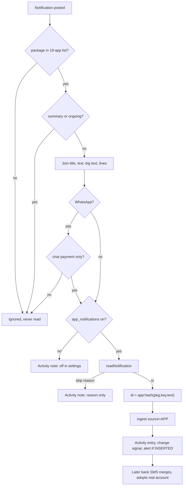

# Notification Ingestion

| Field | Value |
|---|---|
| Feature ID | F-04 |
| Status | Existing |
| Priority | P1 |
| Phase | 2 |
| Last Updated | 2026-10-19 |

## 1. Description

Notification ingestion reads payment notifications from a fixed list of 19 known payment and bank apps and turns them into transactions, only after the user opts in. Many small UPI payments get no bank SMS, but the payment app always shows a notification, so this fills that gap. Notifications from every other app are ignored, and WhatsApp chats are never read.

## 2. What This Feature Will Do

- Reads notifications only from the 19 known payment and bank apps and ignores all others without reading them.
- Works only when the user grants notification access and turns on the in-app setting (off by default).
- Ignores group summaries and ongoing notifications.
- Reads WhatsApp only for payment notifications, never chat messages.
- Rejects non-payment notifications such as offers and reminders.
- Extracts the payee or payer, UPI id, bank, last 4 digits, reference and channel from the text.
- Treats a payment that looks like a credit card bill as a transfer, not spend.
- Gives each notification a fixed identity so a repeat post is ignored.
- Adds the payment to the ledger, to be merged with a later SMS or email for the same payment.
- Never creates accounts from notifications; links to an existing account or a remembered payee account.
- Adopts the account from a later bank message when the notification row has none.
- Remembers which account a payee uses and repairs orphan notification rows.
- Shows On, Needs access or Off on the Data sources card and warns when app notifications are off.
- Logs counts and generic skip reasons only, never notification text.

### 2.1 Inputs

- Each notification posted by an allowed app, as it appears on the phone.
- User actions: grant system notification access, toggle the in-app setting, choose an account for a payee.

### 2.2 Processing

1. Check the app is on the allow-list and that access and the setting are both on.
2. Skip summaries, ongoing notifications and WhatsApp chats.
3. Build the text from the notification parts, removing blanks and repeats.
4. Reject non-payment text, then clean promos and balance text and require a payment signal and an amount.
5. Extract payee, UPI id, bank, last 4, reference and channel; use the post time as the transaction time.
6. Pass it to the ledger, linking to an existing account where bank and digits match.
7. Record an activity entry with counts and a generic reason.

### 2.3 Outputs

- New or merged transactions marked as coming from an app ([Transactions ledger](08_transactions_ledger.md)).
- A new-transaction notification for each added payment.
- The Data sources card state and warning row.
- A stored payee-to-account memory.
- Activity entries with counts only.

### 2.4 Out of Scope

- General parsing rules: [Parsing engine](06_transaction_parsing_engine.md); duplicate merging: [Dedup and review](07_dedup_review.md).
- New-transaction notification content and channels (Notifications and alerts feature).
- Account detail screens and the "Remember for payee" screen: [Transactions ledger](08_transactions_ledger.md).
- iOS, which has no notification listener.

## 3. Behaviour in Existing App

Source: analysis Part A 4.4, 4.5, 2.9, 5; Part B 6.9, 7.3; Kotlin `app/.../notify/PaymentNotificationListener.kt` and `parser-core/.../FreeTextParser.kt`.

### 3.1 Listener and opt-in

- `PaymentNotificationListener : NotificationListenerService`, bound by `BIND_NOTIFICATION_LISTENER_SERVICE` (exported, guarded by that permission). The user must grant "notification access" in system settings (`Settings.ACTION_NOTIFICATION_LISTENER_SETTINGS`); `hasAccess(context)` = package name is in `NotificationManagerCompat.getEnabledListenerPackages`. Sideloaded installs may need "Allow restricted settings" first.
- In addition the in-app setting `app_notifications` (default FALSE) must be on. When access exists but the setting is off, every payment-app notification only records an activity note ("app notifications are off in settings", read=1, relevant=0).
- Data sources card "Payment-app notifications": status On / Needs access / Off; the toggle sets `appNotificationsEnabled` and, if system access is missing, opens the notification-listener settings (`AppLockGate.skipNextLock()` first). A warning row appears when app notifications are off: "App notifications are off. UPI payments from PhonePe, GPay and others without a bank SMS won't be tracked." with a "Turn on" action. Detail text: "UPI payments from GPay, PhonePe, Paytm and others that send no bank SMS. Bank apps such as YONO SBI are read too." `hasAccess` is re-read on every resume.

### 3.2 The 19 packages (`PAYMENT_APPS`, 20 map keys: WhatsApp has two)

| Package | Display name |
|---|---|
| `com.google.android.apps.nbu.paisa.user` | Google Pay |
| `com.phonepe.app` | PhonePe |
| `net.one97.paytm` | Paytm |
| `in.org.npci.upiapp` | BHIM |
| `com.dreamplug.androidapp` | CRED |
| `in.amazon.mShop.android.shopping` | Amazon Pay |
| `com.mobikwik_new` | MobiKwik |
| `com.naviapp` | Navi |
| `money.super.payments` | super.money |
| `com.freecharge.android` | Freecharge |
| `com.sbi.upi` | BHIM SBI Pay |
| `com.sbi.lotusintouch` | YONO SBI |
| `com.snapwork.hdfc` | HDFC Bank |
| `com.csam.icici.bank.imobile` | ICICI iMobile |
| `com.axis.mobile` | Axis Mobile |
| `com.msf.kbank.mobile` | Kotak Bank |
| `com.samsung.android.spay` | Samsung Wallet |
| `com.samsung.android.spaymini` | Samsung Pay Mini |
| `com.whatsapp`, `com.whatsapp.w4b` | WhatsApp Pay (two packages, one product) |

UPI apps set (affects default channel): PhonePe, Google Pay, Paytm, BHIM, BHIM SBI Pay, CRED, super.money, Navi, WhatsApp Pay, Amazon Pay, MobiKwik. If channel detection returns OTHER and the app is in this set, channel becomes UPI.

### 3.3 `onNotificationPosted` flow

1. `PAYMENT_APPS[sbn.packageName]` else return (never read).
2. Drop notifications with `FLAG_GROUP_SUMMARY` or `FLAG_ONGOING_EVENT`.
3. Concatenate, trimmed, non-empty, distinct, in this order: `EXTRA_TITLE`, `EXTRA_TITLE_BIG`, `EXTRA_TEXT`, `EXTRA_BIG_TEXT`, `EXTRA_SUB_TEXT`, `EXTRA_INFO_TEXT`, `EXTRA_SUMMARY_TEXT`, then each of `EXTRA_TEXT_LINES`.
4. WhatsApp guard: for `com.whatsapp` / `com.whatsapp.w4b` read only if `isChatPayment` (2.4).
5. On the app scope: if `appNotificationsEnabled` is false, log a skip and stop.
6. `FreeTextParser.readNotification(appName, parts, sbn.postTime)` returns a transaction or a short generic skip reason (2.5). Skip reasons are logged as activity notes: read=1, relevant=0, `note = reason`. The notification text is never logged.
7. Id = `"app:" + hex(first 16 bytes of SHA-256("<package>|<sbn.key>|<joined text with \n>"))`. The same notification re-posted/updated has the same key and text, so it is not ingested twice.
8. `repository.ingest(IncomingMessage(tx, id, raw, sourceName = "APP"))`. One `NOTIFICATIONS` activity entry (read=1, relevant=1, added/merged/review/skipped by outcome).
9. If the outcome is not ALREADY_PROCESSED: `notifier.onTransactionsChanged()`. Then `NewTransactionNotifier.onIngested(outcome, "APP", id)` (alert only for INSERTED).

### 3.4 WhatsApp guard (`isChatPayment`)

A WhatsApp notification is read only when ALL hold:

- `notification.category != CATEGORY_MESSAGE`;
- `extras` does not contain `EXTRA_MESSAGES` (no conversation style);
- channel id (API 26+) is empty or does not contain "chat" (case-insensitive);
- at least one line of the joined text matches `CHAT_PAYMENT`:

```text
^\s*(?:you\s+(?:have\s+)?(?:paid|sent|received)
  |payment\s+(?:of|to|from|successful|received|sent|completed)
  |(?:₹|rs\.?|inr)\s?[\d,]+(?:\.\d{1,2})?\s+(?:paid|sent|received))
```

(case-insensitive). Conversations are never read.

### 3.5 Rejection and cleaning rules (`FreeTextParser.readNotification`)

Input segments: each field split on `[\r\n]+|\s[•·|]\s|[•·]`, normalised (`TextNormalizer`), then split into sentences with `(?<!\b(?:Mr|Mrs|Ms|Dr|Smt|Shri|Sri)\.)(?<=[.!?])\s+`, trimmed, distinct. `whole` = segments joined with `" . "`.

Checks in order (skip reason in quotes):

| # | Rule | Regex / condition (case-insensitive) | Reason |
|---|---|---|---|
| 1 | length | `whole.length < 8` (`MIN_LENGTH`) | `too short` |
| 2 | OTP | `\botp\b\|one[\s-]?time\s+pass\|verification\s+code\|\bcvv\b\|\bupi\s+pin\b\|\bpin\b` | `otp or security text` |
| 3 | failed/pending | `\b(?:fail(?:ed\|ure\|s)?\|declined\|unsuccessful\|not\s+successful\|could\s*n[o']?t\|cancel(?:l)?ed\|rejected\|reversed\|pending\|processing\|in\s+progress\|refund\s+(?:initiated\|in\s+progress)\|will\s+be\s+(?:refunded\|credited)\|timed?\s*out\|on\s+hold\|bank\s+server\|try\s+again)\b` | `failed or pending payment` |
| 4 | request/reminder/due | `\b(?:requested\|requesting\|payment\s+request\|collect\s+request\|requests?\s+(?:you\|money)\|remind(?:er\|s)?\|due\|overdue\|expir(?:es\|ing\|ed)\|valid\s+(?:till\|until)\|bill\s+(?:is\s+)?generated\|scheduled\|upcoming\|will\s+be\s+(?:debited\|deducted\|charged)\|set\s*up\s+autopay)\b` | `request, reminder or due notice` |
| 5 | per-sentence drop | `PROMO`, `UI_TEXT`, `CALL_TO_PAY` (below); balance tail stripped from the rest; bare amounts get "INR" | `offer or promotion` if nothing is left |
| 6 | payment wording | `SIGNAL` must match | `no payment wording` |
| 7 | amount | `AmountExtractor.extract` > 0 | `no amount` |
| 8 | own transfer | `TypeClassifier` says TRANSFER but not a recognised card bill | `own transfer or card bill` |

Sentence-drop regexes:

- `PROMO`: `\b(?:cash\s*back|rewards?|scratch(?:\s*card)?|offers?|coupons?|vouchers?|won|win|claim|refer(?:ral)?|earn(?:ed|s)?|bonus|discount|get\s+up\s*to|lucky|spin|\d+\s*points?)\b|\d+\s*%|\d\s*off\b|\boff\s+on\b|\bflat\s+(?:₹|rs|inr)`
- `CALL_TO_PAY`: `\b(?:pay\s+(?:now|again|later|bill)|recharge\s+now|set\s*up\s+autopay|pay\s+(?:₹|rs\.?|inr)\s*\d)`
- `UI_TEXT`: `^(?:view|tap|know|check|learn|download|track|explore|open|see|click|share|rate|swipe|repay|invite|enjoy|thank|split|add\s+(?:money|to))\b|\b(?:tap|click|swipe)\s+to\b`
- `BALANCE_TAIL` (cut to end of sentence): `(?:[,;(\-]\s*)?\b(?:(?:avl|avail|available|total|closing|wallet|new|updated|remaining)\.?\s+)*(?:bal(?:ance)?|limit)\b.*$`

`SIGNAL` (credit group `cr`, debit group `db`):

```text
(?<cr>\b(?:(?:sent|paid)\s+you|received|credited
   |refund(?:ed)?\s+(?:of\s+\S+\s+\S+\s+)?(?:processed|credited|successful)
   |money\s+received|payment\s+received)\b)
|(?<db>\b(?:paid|sent|debited|spent|transferred|deducted|charged|purchased|money\s+sent
   |payment\b(?!.{0,60}?\breceived\b).{0,60}?\b(?:successful|done|completed|made|sent)
   |(?:recharge|bill)(?:\s+(?:payment\s+)?of\s+INR\s*[\d,.]+)?\s+(?:is\s+)?(?:successful|done|completed|paid))\b)
```

Type = CREDIT if group `cr` matched else DEBIT.

Bare-amount helper (`addCurrency`): unless text already has `\b(?:INR|USD|EUR|GBP|AED|SGD)\s*\d`, insert "INR" in `\b(paid|sent|received|debited|credited|spent|payment\s+of|bill\s+of|recharge\s+of|you)\s+NUM\b` (not followed by `%`, days, hours, mins, messages, times) and in `^NUM\s+(paid|sent|received|debited|credited)\b`, with `NUM = (\d[\d,]*(?:\.\d{1,2})?)`.

### 3.6 Payee, bank, reference, time

- Candidate names: debit: `\bpaid\s+(?!you\b|INR)NAME\s+INR\s*\d`, `\bto\s+NAME END`, `\bat\s+NAME END`; credit: `^NAME\s+(?:has\s+)?(?:sent|paid)\s+you\b`, `\bfrom\s+NAME END`. `NAME = ([A-Za-z0-9][A-Za-z0-9 &'*_\-./@]{1,50}?)`; `END` = lookahead of connector words (via, using, on, dated, from, ref, refno, utr, upi, for, at, with, txn, transaction, successfully, successful, id, a/c, account, bank, is, was, has, through, thru, date, time, status, amount, debited, credited, reference) or `[,;:(!]` or end. Trailing noise `(?:\s+(?:via|using|on|upi|through|thru|ref|utr)\b.*|\s*\(.*)$` removed. Rejected candidates: length < 2, `NOT_NAME` (`^(?:your|you|my|a/c|ac|acct|account|bank|the|a|an|card|wallet|upi|inr|view|see|check|know|get|earn|avoid|us|me|self)\b|^x+\d`), generic UI phrases, no letters. A candidate that contains a VPA (`\b[a-z0-9][\w.\-]{1,}@[a-z][a-z0-9]{1,20}\b`) becomes (rest as name if >= 2 letters, vpa lower-cased).
- Fallback names for debits with no payee: `\b(electricity|water|gas|broadband|postpaid|mobile|dth|phone|internet|insurance)\s+bill\b` -> "<Kind> bill"; `\b(?:mobile\s+|dth\s+|fastag\s+)?recharge\b` -> "Recharge".
- Bank in text (first match wins): HDFC Bank, ICICI Bank, SBI (`\bSBI\b|state\s+bank`), Axis Bank, Kotak Mahindra Bank, IDFC FIRST Bank, Yes Bank, Bank of Baroda (`\bBank\s+of\s+Baroda\b|\bBoB\b`), Punjab National Bank (`\bPNB\b|Punjab\s+National`), AU Small Finance Bank, IndusInd Bank, Federal Bank, Canara Bank, Union Bank of India, HSBC, RBL Bank. Otherwise the app name becomes `bankName`.
- Account: `AccountExtractor.extract(text)` (last 4 and kind) if the text carries one.
- Reference: `UTR = \b(?:utr|rrn|upi\s+ref(?:erence)?(?:\s+(?:no|id))?)\W{0,4}(\d{10,22})\b` (the 12-digit UTR the bank repeats beats the app's own id), else `ReferenceExtractor`.
- Time: the notification post time, never explicit (dates inside notifications are usually offer or validity dates).
- Confidence 0.55. Source `APP`, `sender` = app name, `messageTimestamp` = post time.
- Card bill: a DEBIT whose text or payee reads as a card bill (`CardBill.inText`, `paidToCard`, `isPayee`) is kept as TRANSFER with merchant label "Credit card bill" (unless the payee itself is the issuer name), so it shows but is never spend.
- Category/merchant normalisation: `MerchantNormalizer` ([Transaction parsing engine](06_transaction_parsing_engine.md)).

### 3.7 Adopt-account-from-bank-SMS rule (ingest side)

Notification rows usually have no account digits. In `TransactionRepository.ingestInTransaction`:

1. `ensureAccount`: an APP-source row NEVER creates an account (its "bank" may be just the app's name). It only points at an existing account via `existingAccountOf(bank, last4, kind)`: exact `(bankName, last4)`, else among non-merged accounts of the same kind with `last4Match`, the single one whose bank name is prefix-compatible (alphanumerics lower-cased, either is a prefix of the other); otherwise none.
2. If still account-less, the "Remember for {payee}" choice applies: `payeeAccounts[keyOf(merchant, upiId)]` (key = `(merchant ?: upiId).trim().lowercase()`, length >= 2) -> that account if it still exists.
3. When a later bank SMS or email merges INTO this row (DuplicateMatcher says Duplicate), `adopt = accountId != null && incoming.source != APP && (existing.accountId == null || existing.accountLast4 == null)`; if true the stored row takes `accountId`, `bankName` and `accountKind` from the bank message (a guessed account is replaced by the real one); otherwise `existing.accountId ?: accountId` is kept. Balances and card limits then go to the account the row ends on.
4. When the user sets the account by hand in Transaction detail ("Remember for {payee}"), `setAccount(txId, accountId, remember)` updates account, last4, kind and bank, and stores the payee key in `payeeAccounts` (persisted as SharedPreferences `payee_accounts`).
5. Repair job `reattributeAppRows()` (safe to repeat, run once as `app_rows_v1`): for APP-only, non-review, account-less rows find a bank-side row within +-36 h (amount range `amt..amt+99` paise when the app amount is a whole rupee), same direction, with at least one non-APP source and no APP source; exact amount gap <= 30 min, rounded amount gap <= 4 h (and < 1 day); references compatible; merchants agree; nearest wins; fold app row into it (`mergedWith`, keep the bank's exact amount), reassign sources, delete the app row.

Dedup rules specific to APP (rounded amounts, loose source set `{APP, SCREENSHOT, MANUAL}`) are in [Dedup and review](07_dedup_review.md).

### 3.8 Samples (`NotificationLayoutsTest`, title / body fields separate)

Accepted:

| App | Title | Text | Result |
|---|---|---|---|
| PhonePe | Payment successful | ₹250 paid to Ravi Kumar | DEBIT 250.00, merchant "Ravi Kumar", UPI |
| PhonePe | Paid ₹250 | to Ravi Kumar | DEBIT 250.00 |
| PhonePe | asha@ybl sent you ₹500 | (none) | CREDIT 500.00, upiId `asha@ybl` |
| Google Pay | You paid Ravi Kumar ₹250 | Tap to view | DEBIT 250.00 (UI text dropped) |
| PhonePe | AutoPay | ₹199 paid to Netflix via AutoPay | DEBIT 199.00, channel AUTO_DEBIT |
| CRED | Credit card bill paid | ₹5,000 paid towards your HDFC Bank Credit Card | TRANSFER, merchant "Credit card bill", bank HDFC Bank |

Skipped:

| App | Title | Text | Reason |
|---|---|---|---|
| PhonePe | Payment failed | ₹250 to Ravi Kumar could not be paid | failed or pending payment |
| Google Pay | You've won ₹50 cashback! | Scratch your card now | offer or promotion |
| BHIM | 123456 is your OTP to pay ₹500 | | otp or security text |
| PhonePe | Scheduled payment | ₹199 will be debited tomorrow for Netflix | request, reminder or due notice |
| PhonePe | Ravi Kumar requested ₹500 | Pay now | request, reminder or due notice |

## 4. User Stories

- US-04-01: As a user I want my small UPI payments tracked even when my bank sends no SMS.
- US-04-02: As a user I want to opt in explicitly and see which apps are read.
- US-04-03: As a user I never want my WhatsApp chats read, only WhatsApp Pay payments.
- US-04-04: As a user I do not want offers, OTPs, requests and failed payments recorded.
- US-04-05: As a user I want the payment-app entry to merge with the later bank SMS and take the real account.
- US-04-06: As a user I can set which account a payee normally uses and have it remembered.
- US-04-07: As a user I want a card-bill payment from CRED to show as a transfer, not spending.

## 5. Functional Requirements (FR-04-01 ...)

| ID | Requirement |
|---|---|
| FR-04-01 | Provide a notification-listener service that reads only notifications whose package is in the 19-package allow-list (section 2.2); all other notifications are ignored without reading their content. |
| FR-04-02 | Require both system notification access and the in-app `app_notifications` setting (default false). With access but setting off, record an activity note and ingest nothing. |
| FR-04-03 | Ignore group-summary and ongoing notifications. |
| FR-04-04 | Build the notification text from title, big title, text, big text, sub text, info text, summary text and text lines, trimmed, non-empty, de-duplicated, in that order. |
| FR-04-05 | For WhatsApp packages read a notification only if it is not message-category, has no messages extra, its channel id does not contain "chat" and a line matches the chat-payment regex; never read conversations. |
| FR-04-06 | Apply the rejection rules of section 2.5 in the stated order and record only the generic skip reason (never the text). |
| FR-04-07 | Drop promo, UI-text and call-to-pay sentences, strip balance tails and insert "INR" before bare amounts, then require a payment SIGNAL and a positive amount. |
| FR-04-08 | Extract payee/payer, UPI id, bank, last 4, reference (UTR preferred) and channel per section 2.6; default channel UPI for UPI apps; time = post time, not explicit; confidence 0.55; source APP; bank name = detected bank else app name. |
| FR-04-09 | A debit that reads as a card bill is kept as TRANSFER with merchant "Credit card bill" and never counts as spend. |
| FR-04-10 | Compute the message id as `"app:" + hex16(SHA256(package|key|text))`; a repeat post of the same notification must be a no-op. |
| FR-04-11 | Ingest with source name APP; write one NOTIFICATIONS activity entry per read (relevant 0 or 1); emit a change signal for any outcome except already-processed; trigger the new-transaction alert for INSERTED only. |
| FR-04-12 | APP-source rows MUST NOT create accounts; they may link to an existing account by bank+last4 or unique prefix-compatible digits match, or by the remembered payee account. |
| FR-04-13 | When a bank message merges into a row whose account is null or whose last4 is null and the incoming source is not APP, adopt the bank message's account, bank name and kind. |
| FR-04-14 | Support `setAccount(txId, accountId, remember)` and persist the payee-to-account map across restarts; load it into the repository at startup. |
| FR-04-15 | Provide a repeatable repair that folds orphan APP-only rows into bank-side rows using the windows in section 2.7(5). |
| FR-04-16 | Data sources card shows On / Needs access / Off, a toggle, opens system listener settings when access is missing, and re-reads access on resume; show the warning row when disabled. |
| FR-04-17 | Never persist or log notification text; the activity log holds counts and generic reasons only. |
| FR-04-18 | The skip-lock flag is set before opening system notification-listener settings. |

## 6. Non-Functional Requirements (performance, battery, privacy, offline)

- Privacy first: opt-in only, 19-app allow-list, chat guard, no text logging, no network. Nothing in a skipped notification is stored.
- Battery: event-driven service, no polling; parsing is regex over a few short strings (target < 5 ms per notification).
- Reliability: the OS may kill or unbind the listener; on rebind nothing needs replay because notifications that matter will also appear as SMS/email, and merge handles late arrivals. Request rebind (`requestRebind`) after process restarts.
- Offline: fully offline.
- Locale: English patterns only (Hindi/regional notification text is not parsed; Open Questions).
- Testability: parser is a pure function of (appName, parts, postTime) so it can be tested without Android.

## 7. UI / Screens & User Flow (screen list + flow diagram)

| # | Screen / element | Kotlin source |
|---|---|---|
| 1 | Data sources: "Payment-app notifications" SourceCard (On / Needs access / Off, toggle) | `ui/more/DataSourcesScreen.kt:301` |
| 2 | Data sources: amber warning row "App notifications are off..." with "Turn on" | `DataSourcesScreen.kt:202` |
| 3 | System "Notification access" settings page (opened from the toggle) | Android `ACTION_NOTIFICATION_LISTENER_SETTINGS` |
| 4 | Transaction detail: Account/Card picker dialog with "Remember for {payee}" checkbox | `ui/transactions/TransactionDetailScreen.kt` (owned by [Transactions ledger](08_transactions_ledger.md)) |
| 5 | Activity log rows, filter pill "Notifications", note "Skipped: {reason}" | `ui/more/ActivityLogScreen.kt:142` |
| 6 | New-transaction notification with category actions (produced after ingest) | `notify/NewTransactionNotifier.kt` |



Reference GIFs (each file Status: Pending, not yet captured):

-  (Status: Pending, not yet captured)
-  (Status: Pending, not yet captured)
-  (Status: Pending, not yet captured)
-  (Status: Pending, not yet captured)
-  (Status: Pending, not yet captured)
-  (Status: Pending, not yet captured)

## 8. Data Models (Dart entities + fields + types)

```dart
@freezed
class PaymentAppNotification with _$PaymentAppNotification {
  const factory PaymentAppNotification({
    required String packageName,
    required String key,                 // StatusBarNotification.key
    required int postTime,               // epoch ms
    required List<String> parts,         // already distinct, trimmed, non-empty
    @Default(false) bool isGroupSummary,
    @Default(false) bool isOngoing,
    String? category,                    // Notification.category
    @Default(false) bool hasMessagesExtra,
    String? channelId,
  }) = _PaymentAppNotification;
}

@freezed
class NotificationRead with _$NotificationRead {
  const factory NotificationRead({
    ParsedTransaction? tx,               // see doc 06
    String? skipReason,                  // generic, never the text
  }) = _NotificationRead;
}

enum NotificationSkip {
  tooShort('too short'),
  otp('otp or security text'),
  failed('failed or pending payment'),
  reminder('request, reminder or due notice'),
  promo('offer or promotion'),
  noSignal('no payment wording'),
  noAmount('no amount'),
  ownTransfer('own transfer or card bill'),
  settingOff('app notifications are off in settings'),
  notUnderstood('not understood');
  const NotificationSkip(this.text);
  final String text;
}

@freezed
class PaymentApp with _$PaymentApp {
  const factory PaymentApp({
    required String packageName,
    required String displayName,
    @Default(false) bool isUpiApp,
    @Default(false) bool isChatApp,
  }) = _PaymentApp;
}

@freezed
class NotificationSourceStatus with _$NotificationSourceStatus {
  const factory NotificationSourceStatus({
    @Default(false) bool enabled,        // app_notifications
    @Default(false) bool hasAccess,      // listener bound/allowed in system
  }) = _NotificationSourceStatus;
  // On = enabled && hasAccess; Needs access = enabled && !hasAccess; Off = !enabled
}

typedef PayeeAccountMap = Map<String, int>; // key = (merchant ?? upiId).trim().toLowerCase(), value = accountId
```

`ParsedTransaction` and `TransactionDraft` are defined in [Transaction parsing engine](06_transaction_parsing_engine.md).

## 9. Database Tables / Changes

No table owned. Uses:

- `transactions` / `transaction_sources` (source `APP`, `sourceMessageId = app:<hex32>`, `sender` = app display name, `rawText` = the joined notification text, kept up to 20,000 chars: note that raw text IS stored in the source row, only the logs never contain it).
- `deleted_messages` tombstones (a deleted APP row is not re-ingested).
- `accounts` (read only here).
- Settings keys: `app_notifications` (bool, default false), `payee_accounts` (existing app: SharedPreferences map payee key -> accountId; Flutter: `payee_accounts` table below).

```dart
class PayeeAccounts extends Table {
  TextColumn get payeeKey => text()();      // lower-cased merchant or UPI id, length >= 2
  IntColumn get accountId => integer()();   // soft reference to accounts.id
  @override
  Set<Column> get primaryKey => {payeeKey};
}
```

## 10. Business Rules & Logic (regex, parsing rules, algorithms, thresholds)

- Package allow-list: exact string match (section 2.2). Chat apps: `com.whatsapp`, `com.whatsapp.w4b`.
- Id: `sha256_utf8("$package|$key|$joinedText")` first 16 bytes hex, prefix `app:`; `joinedText` joins parts with `\n`.
- Rejection order and regexes: section 2.5 (all `IGNORE_CASE`, Unicode off).
- Minimum text length 8; confidence 0.55; time = post time, `hasExplicitTime = false`.
- Type from SIGNAL group; transfer text without a card-bill indicator is dropped; card bill debit -> TRANSFER, merchant "Credit card bill".
- Channel: detected channel; if OTHER and app is a UPI app -> UPI.
- Account guard: APP rows never create accounts; link by `(bank, last4)` or unique prefix match; remembered payee fallback; adopt rule at merge (FR-04-13).
- Payee key: `(merchant ?? upiId).trim().lowercase()`, min length 2.
- Reattribution windows: 36 h search; same-amount gap <= 30 min; rounded gap <= 4 h and < 24 h; amount range `amt..amt+99` paise for whole-rupee app amounts.
- Logging: reasons only; text never logged.

## 11. Platform / Native Requirements (permissions, channels, background work)

Android only.

- Manifest: service `<service android:name=".PaymentNotificationListener" android:permission="android.permission.BIND_NOTIFICATION_LISTENER_SERVICE" android:exported="true">` with intent filter `android.service.notification.NotificationListenerService`. No runtime permission; user enables it in system settings. Sideloaded builds may need "Allow restricted settings".
- Flutter: implement the service natively in Kotlin (a Flutter plugin) because Dart cannot host a `NotificationListenerService`. Options: the `notification_listener_service` package, or a custom plugin. Required behaviour: package allow-list filtering in Kotlin BEFORE sending any content to Dart; forward `{packageName, key, postTime, title, titleBig, text, bigText, subText, infoText, summaryText, textLines[], flags, category, hasMessages, channelId}` over an EventChannel or run a headless Dart entrypoint when the app process is not running.
- MethodChannel `dhankosh/notifications`: `hasAccess`, `openListenerSettings`, `requestRebind`.
- Re-check access on every app resume (WidgetsBindingObserver).
- Set the app-lock skip flag before opening system settings.
- iOS: not possible; the card is hidden.
- Samsung/OEM background limits can unbind the listener; use `NotificationListenerService.requestRebind(ComponentName)`.

## 12. Dependencies (other features → link to their memory file; packages)

Features:

- [Transaction parsing engine](06_transaction_parsing_engine.md): `FreeTextParser`, extractors, `MerchantNormalizer`, `CardBill`, `TransactionHasher`.
- [Dedup and review](07_dedup_review.md): ingest, rounded app match, merge.
- [Transactions ledger](08_transactions_ledger.md): account picker, tables, change signal.
- [SMS ingestion](02_sms_ingestion.md), [Email ingestion](03_email_ingestion.md): sibling sources that merge with APP rows.
- [Onboarding and permissions](01_onboarding_permissions.md): POST_NOTIFICATIONS is a different permission from listener access.
- Activity log, Notifications and alerts, Data sources, Security (app lock): separate features.

Packages: `notification_listener_service` (or custom plugin), `crypto`, `freezed`, `drift`, `flutter_riverpod`, `app_settings` / `android_intent_plus`.

## 13. Folder Location (lib/features/<name>/...)

```text
lib/features/notification_ingestion/
  data/
    notification_channel.dart            // MethodChannel + EventChannel client
    notification_listener_source.dart
    payee_account_store.dart             // Drift DAO for payee_accounts
  domain/
    entities/ (payment_app_notification, notification_read, payment_app, notification_source_status)
    payment_apps.dart                    // the 19-package map
    whatsapp_guard.dart                  // isChatPayment
    notification_parser.dart             // readNotification (calls doc 06 extractors)
    notification_ids.dart
    usecases/ (handle_notification, set_account_remember, reattribute_app_rows)
  presentation/
    notification_source_card.dart        // Data sources card
    notification_warning_row.dart
    providers/
android/app/src/main/kotlin/.../notify/
  PaymentNotificationListener.kt         // allow-list filter + forward
```

## 14. Edge Cases & Error Handling

- Same notification updated several times (progress to success): same key, differing text yields different ids; "pending/processing" updates are skipped; the final "successful" update is ingested once.
- Notification posted twice with identical key and text: same id, `ALREADY_PROCESSED`.
- Group summary and ongoing: ignored.
- App pays a bill: "Electricity bill of ₹1,200 paid successfully" -> merchant "Electricity bill".
- Amount-less success ("Payment successful"): `no amount` skip.
- Promo with a payment sentence in the same notification: promo sentence dropped, payment kept.
- "Avl bal Rs 4,000" tail: stripped so it is not read as the amount.
- WhatsApp chat saying "paid 500 to Asha": message category/messages extra -> skipped.
- App renamed package or new app (e.g. new UPI app): not read until added to the list (Open Questions).
- Access revoked while setting on: card shows "Needs access"; nothing ingested.
- Bank SMS arrives first, notification later: notification merges as Duplicate into the bank row (APP source cannot overwrite account).
- Notification arrives first, SMS later: SMS merges and adopts the real account (FR-04-13).
- Rounded amounts (app shows ₹250, bank says 250.37): handled by the rounded app match in doc 07.
- Locale: non-English notification text produces `no payment wording` skips.
- A user deletes an APP row: tombstone prevents re-adding on repost.

## 15. Test Cases (unit / widget / integration + sample fixtures)

| ID | Type | Covers | Case |
|---|---|---|---|
| TC-04-01 | unit | FR-04-01 | Allow-list contains exactly 20 package keys mapping to 19 display names; unknown package returns null and no content is read. |
| TC-04-02 | unit | FR-04-02 | Setting off -> activity note `app notifications are off in settings`, no ingest call. |
| TC-04-03 | unit | FR-04-03, FR-04-04 | Summary/ongoing ignored; parts joined distinct in order title, titleBig, text, bigText, sub, info, summary, lines. |
| TC-04-04 | unit | FR-04-05 | WhatsApp: category MESSAGE -> skip; messages extra -> skip; channel `chat_messages` -> skip; line "You paid ₹500 to Asha" on a non-chat channel -> read; line "Payment of ₹500 successful" read; "Hi, paid ₹500?" -> skip. |
| TC-04-05 | unit | FR-04-06 | Each rejection fixture from section 2.8 yields the listed reason; OTP fixture beats failed; failed beats reminder (order). |
| TC-04-06 | unit | FR-04-07, FR-04-08 | `("PhonePe","Payment successful","₹250 paid to Ravi Kumar")` -> DEBIT 25000 paise, merchant "Ravi Kumar", channel UPI, source APP, confidence 0.55, not explicit, bankName "PhonePe". |
| TC-04-07 | unit | FR-04-08 | `("PhonePe","asha@ybl sent you ₹500",null)` -> CREDIT 50000, upiId `asha@ybl`. |
| TC-04-08 | unit | FR-04-08 | AutoPay fixture -> channel AUTO_DEBIT, merchant "Netflix", amount 19900. |
| TC-04-09 | unit | FR-04-09 | CRED fixture -> TRANSFER, merchant "Credit card bill", bankName "HDFC Bank". |
| TC-04-10 | unit | FR-04-07 | "Paid ₹250 to Ravi. Avl bal Rs 4,000" -> amount 250 (balance tail stripped); "Pay now ₹1,299" sentence dropped. |
| TC-04-11 | unit | FR-04-08 | UTR beats app transaction id: text with `UTR 526812340020` yields reference `526812340020`. |
| TC-04-12 | unit | FR-04-10 | Same package+key+text twice -> same id; changed text -> different id; id format `app:` + 32 hex. |
| TC-04-13 | integration | FR-04-11 | Ingest outcome INSERTED triggers one NOTIFICATIONS entry (added=1) and the new-transaction alert; ALREADY_PROCESSED triggers entry (skipped=1) and no change signal. |
| TC-04-14 | integration | FR-04-12, FR-04-13 | APP row without account; later bank SMS (same amount, within 30 min) merges; row now has bank account and bank name; APP-first and SMS-first orders both converge to one row. |
| TC-04-15 | unit | FR-04-12 | `existingAccountOf('PhonePe','1234',ACCOUNT)` with two accounts `HDFC Bank 1234` and `ICICI Bank 1234` returns null (not unique/prefix-compatible); with only one, still requires prefix compatibility. |
| TC-04-16 | unit | FR-04-14 | `setAccount(remember: true)` persists payee key; a new APP row for the same payee gets that account; restart keeps the map. |
| TC-04-17 | integration | FR-04-15 | `reattributeAppRows` folds an account-less APP row into the bank row within 30 min and keeps the bank's exact paise; does not fold rows when references differ. |
| TC-04-18 | widget | FR-04-16 | Card states On / Needs access / Off; warning row visible when off; toggle opens listener settings when access missing. |
| TC-04-19 | unit | FR-04-17 | Logs and activity entries never contain the notification text (assert on captured logger). |

Fixtures: all rows of section 2.8, plus WhatsApp notifications with `category=msg`, `channelId='individual_chat_defaults'`.

## 16. Acceptance Criteria

- AC-04-01: With access and the setting on, a PhonePe "Paid ₹250 to Ravi Kumar" notification creates one transaction and one new-transaction alert (FR-04-01, FR-04-02, FR-04-08, FR-04-11; TC-04-06, TC-04-13).
- AC-04-02: OTP, failed, scheduled, requested and promo notifications create nothing (FR-04-06, FR-04-07; TC-04-05).
- AC-04-03: Other apps' notifications are never read; WhatsApp chats are never read (FR-04-01, FR-04-05; TC-04-01, TC-04-04).
- AC-04-04: Setting off or access missing creates nothing and Data sources shows the right state (FR-04-02, FR-04-16; TC-04-02, TC-04-18).
- AC-04-05: The same payment seen as notification and bank SMS yields one row with the bank account, in either arrival order (FR-04-12, FR-04-13; TC-04-14).
- AC-04-06: A CRED card-bill payment shows as a transfer and is excluded from spend (FR-04-09; TC-04-09).
- AC-04-07: Re-posted notifications do not duplicate (FR-04-10; TC-04-12).
- AC-04-08: "Remember for payee" is honoured after restart (FR-04-14; TC-04-16).
- AC-04-09: Logs hold no notification text (FR-04-17; TC-04-19).

## 17. Open Questions

1. Only 19 packages are read (analysis Part A open question 10). Should more bank apps (IDFC, Yes, BoB, PNB, Federal, etc.) or other wallets (Airtel Thanks, Jupiter, slice, Fi) be added for Flutter? Should the list be a remote/bundled JSON (the v2 spec proposes `notification_packages` in the sender registry)?
2. Raw notification text is stored in `transaction_sources.rawText` (needed for split/reparse) although logs never contain it. Confirm this is acceptable privacy-wise for payment-app text.
3. English-only patterns: Hindi or other-language notifications produce skips. Is localisation of the signal/promo words desired?
4. `FAILED` includes "will be credited" so "refund will be credited" is skipped; and `SIGNAL` credit includes "credited": ordering means refund-credited notifications (e.g. "Refund credited ₹500") are accepted. Verify with real samples.
5. The `\bpin\b` OTP rule rejects any text containing the word "pin" (e.g. a payee named "Pin Code Cafe"). Keep as is?
6. Samsung Wallet/Pay Mini packages are listed but no sample layouts exist in the corpus; behaviour untested.
7. iOS has no equivalent; the v2 spec mentions a Shortcuts bridge only for SMS.
8. A rebind strategy after OEM kills is not present in the existing code; add `requestRebind`?

## 18. Implementation Notes

N/A - not built yet. Filled during the build (decisions, deviations).

## 19. Change Log (date | change | reason)

| Date | Change | Reason |
|---|---|---|
| 2026-10-17 | Created from hisaab_apk 2.9.8 analysis | Initial |
| 2026-10-19 | Restructured to the 19-section standard (Description, What This Feature Will Do, Implementation Notes added); Last Updated bumped | Audit Gate (Prompt 2, Part A) |
