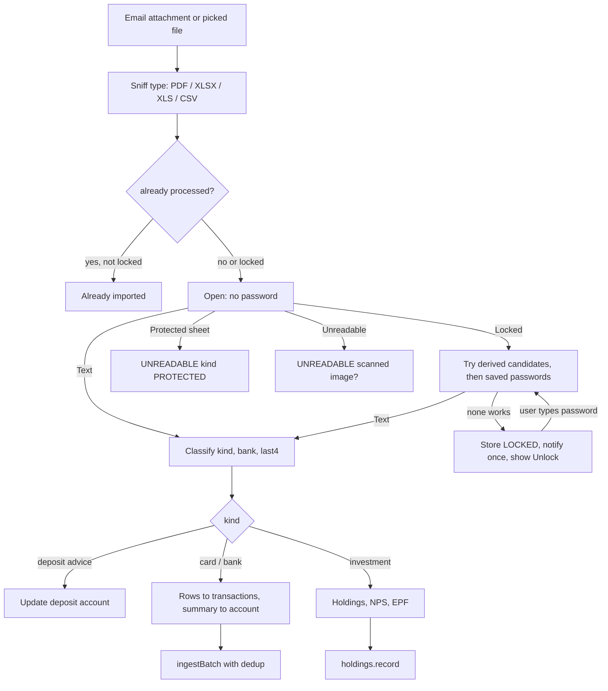

# Statement Import

| Field | Value |
|---|---|
| Feature ID | F-05 |
| Status | Existing |
| Priority | P1 |
| Phase | 3 |
| Last Updated | 2026-10-19 |

## 1. Description

Statement import reads bank, credit card and investment statements (PDF, Excel and CSV) entirely on the phone, whether they arrive as email attachments or are picked from the phone's storage. It turns statement rows into ledger transactions, pulls out totals and holdings, and opens password-protected PDFs by trying passwords built from the user's own details. It exists so older payments, card dues, balances and investments are captured even when no SMS or alert was received.

## 2. What This Feature Will Do

- Imports a PDF, Excel or CSV statement picked by the user or received as an email attachment.
- Reads each file only once and works out its type from the file itself.
- Reads PDF text on the phone and tells apart readable, locked, protected and unreadable files.
- Classifies content as deposit advice, investment, credit card, bank or other.
- Turns statement rows into transactions that merge with SMS and email records of the same payments.
- Extracts totals such as card total due, minimum due, due date, limit, and bank opening and closing balances.
- Updates account balances and card limits from statement totals, only moving forward in time.
- Extracts holdings (mutual funds, stocks, ETFs, NPS, EPF, bonds, gold) for the portfolio.
- Updates deposit accounts (PPF, RD, FD) from deposit statements without adding transactions.
- Tries no password, then passwords derived from the user's details, then saved passwords.
- Keeps statements it cannot open as locked and notifies the user once.
- Lets the user unlock a statement by entering a password and remembers it if asked.
- Stores identity details and passwords sealed on the device, never shown again.
- Lists statements with status, supports delete and opens a statement detail view.

### 2.1 Inputs

- Files: PDF, XLSX, XLS or CSV from the phone's storage, or attachments from [Email ingestion](03_email_ingestion.md).
- Email bodies without attachments: mutual fund orders, INDmoney summaries, EPF and NPS mails.
- User: identity details, bank unlock details, saved passwords, a typed password for a locked statement.
- Triggers: file pick, incoming email attachment, new password or details saved, Home refresh.

### 2.2 Processing

1. Identify the file type from its bytes and skip it if already read.
2. Extract text (PDF) or convert sheet columns to lines (Excel, CSV).
3. If locked, try candidate passwords in order; if all fail, keep it locked and notify.
4. Classify the content and detect the bank or card.
5. Parse transaction rows and send them to the ledger, which merges matches ([Dedup and review](07_dedup_review.md)).
6. Extract totals and holdings and apply them to the account.
7. Save the statement record and keep the file in private storage.

### 2.3 Outputs

- Transactions in the ledger ([Transactions ledger](08_transactions_ledger.md)).
- Card-due notices and balance updates for accounts.
- Holdings for the portfolio.
- A statements list and a detail screen showing added versus matched counts and the effect on the account.
- A one-time locked-statement notification with issuer and file name only.

### 2.4 Out of Scope

- Portfolio, net worth and holdings screens (Portfolio feature); account and card screens (Accounts feature).
- Core parsing engine: [Parsing engine](06_transaction_parsing_engine.md); duplicate rules: [Dedup and review](07_dedup_review.md); email transport: [Email ingestion](03_email_ingestion.md).
- The app's own CSV transactions backup (Security and backup feature).
- OCR of scanned statements, which is not supported.

## 3. Behaviour in Existing App

Source: analysis Part C section 2 and Part A 2.6; Part B 6.9 and 2.2. Kotlin: `email/.../statement/StatementProcessor.kt` (`E/statement`), `parser-core/.../statement/*` (`S/`), `app/.../ui/invest/StatementsScreen.kt`, `StatementDetailScreen.kt`.

### 3.1 Entry points and storage

- Email attachment: any PDF/XLS/XLSX/CSV attachment on a mail from an allowed sender or with a statement-looking subject goes to `StatementProcessor.read(bytes, StatementMeta)`. There is no separate "is this a statement" gate on attachments; content is classified after text extraction. Statement key for email attachments: `"<msgId>#pdf<i>"`.
- File picked on the phone: `importFile` (Statements screen "Import a statement (PDF, Excel or CSV)", `OpenDocument` with MIME types pdf, ms-excel, xlsx, csv, plain) builds `StatementMeta("FILE", "file:" + sha, "File on this phone", ...)`.
- Email body without attachment: `readEmail` (MF order, INDmoney summary, EPF, NPS mails), see 2.9.
- Same file is read once: `existing != null && existing.status != LOCKED` returns empty.
- Bytes are kept in app-private, never-backed-up storage: `noBackupFilesDir/statements/<sha256-16>.<ext>` (ext from byte sniffing, default pdf) and locked ones in `noBackupFilesDir/locked-statements/<sha256-16>.pdf`. Holdings found are also written to a sidecar `<sha-of-key>.holdings` TSV (kind, name, id, units, value, invested, asOf) so the detail page can show them. Statements read before version 1.10 were not kept and cannot be re-read (`canReread` false).
- `StatementMeta(source, key, sender, subject, fileName, receivedAt, emailText)`; `emailText` is capped at `EMAIL_TEXT_CAP = 4000` chars because the email often says what the password is.

### 3.2 Detection and classification (`StatementParser.parse`, `S/StatementParser.kt`)

Header = first `HEADER_LINES = 40` lines after normalisation (non-breaking spaces to spaces, trim, drop empty lines).

- `isCard` = `\bcredit\s+cards?\b|\bcard\s+statement\b|\bminimum\s+(?:amount|payment)\s+due\b|\btotal\s+(?:amount|payment)\s+due\b|\bcredit\s+limit\b|\bnew\s+balance\b`.
- Bank name from 13 regexes (HDFC, ICICI, SBI/State Bank/SBI Card, Axis, Kotak -> "Kotak Mahindra Bank", IDFC -> "IDFC FIRST Bank", Yes, IndusInd, American Express, HSBC, RBL, AU Small Finance, Federal, India Post/department of posts, Standard Chartered), else the sender display name, else "Statement".
- `last4` = first group of `MASKED_NUMBER` (4 alternatives) else `AccountExtractor.extract(header)`.
- `StatementKind` decision order:
  - Deposit statements short-circuit first (`depositKind`): not if card or `SAVINGS_STATEMENT`; PPF (`public provident fund|PPF account/a/c/statement/passbook`), RD (`recurring deposit|RD account...`), FD advice (`(fixed|term) deposit (advice|receipt|confirmation|certificate|statement...)|deposit advice|FD advice...|TDR|FDR`). They yield deposit status only (no transactions), see 2.8.
  - INVESTMENT if holdings found, or `INVESTMENT_STATEMENT` in header (`consolidated account statement|\bCAS\b|demat|holding statement|portfolio|mutual fund|\bfolio\b|US stocks|statement of transaction|\bPRAN\b|\bNPS\b`), or `INVESTMENT_SENDER` (camsonline, kfintech, karvy, nsdl, cdsl, indmoney, zerodha, groww, upstox, angelone, dhan.co, kuvera, icicidirect, icicisecurities, hdfcsec, kotaksecurities, paytmmoney, etmoney, mfcentral, proteantech, npscra, kfintech-cra, camsnps, npstrust).
  - CREDIT_CARD if `isCard`.
  - BANK if rows found or `BANK_STATEMENT` (`account statement|statement of account|savings account|current account`).
  - else OTHER.
- Issuer naming for locked/unreadable files (`guessIssuer`, regex list over sender + subject + filename): hdfc, icici, `sbi\s*card|sbicard` -> SBI Card, `\bsbi\b|state bank`, axis, kotak, idfc, indusind, amex, hsbc, `\brbl`, `yes\s*bank`, camsonline/`\bcams\b`, kfintech|karvy, nsdl, cdsl, indmoney, zerodha, groww, onecard; fallback sender display name if it has no `@`.

### 3.3 PDF text extraction

PdfBox-Android `PDFTextStripper` with `sortByPosition = true`. `open(bytes, password)` returns `Text | Locked | Protected | Unreadable`: `InvalidPasswordException` -> Locked; `IOException`/`RuntimeException` -> Unreadable. Lazy init. On-device only. Scanned images have no text and are Unreadable ("It may be a scanned image").

### 3.4 Password candidates and store

Orchestration `StatementProcessor.openWithSaved`:

1. Spreadsheet kinds -> `SpreadsheetExtractor.open` (no passwords; password-protected workbook -> `Protected`).
2. PDF opened with no password; if not Locked, return.
3. Bank key from `BankKeys.of("<issuer> <sender> <subject> <filename>")`; account ids = all accounts if bank unknown, else accounts whose `BankKeys.of(bankName)` matches.
4. `passwords.attempts(cardLast4s, ids, combos = bank != null)` tried in order; first `Text` wins; else Locked.

`StatementPasswordStore.attempts`: no bank-specific details -> `PasswordGuesser.candidates(me, last4s)`; else `PasswordGuesser.forBanks(me, banks, last4s, combos)`; then append user-saved passwords; `distinct()`.

`PasswordGuesser` (`S/PasswordGuesser.kt`):

- Caps: `MAX = 240` (candidates), `MAX_WITH_BANKS = 300`. Anything shorter than 4 chars is dropped.
- Inputs: `Identity(name, dob, pan, phone, altName, altPhone, email)` (email stored, not used); `BankIdentity(customerId, accountNumber, ifsc, names, phones, emails)`.
- `BankKeys` (17-18 keys): hdfc, icici, axis, hsbc, sbi, kotak, yes, idfc, indusind, baroda, pnb, federal, canara, union, rbl, scb, amex, au, by regex over bank name or sender.
- `exactForms(bank)`: customer ID as typed and alphanumerics-only; account number and its last 4/5/6/8 digits; IFSC upper and lower.
- `candidates` order:
  1. PAN upper and lower (CAS from CAMS/KFintech/NSDL/CDSL, NPS, tax docs).
  2. For each 4-letter prefix (from first, last and joined name parts of name then altName; first 4 letters; de-duplicated case-insensitively) in UPPER / lower / Capitalised: `+ddmm`, `+ddmmyy`, `+ddmmyyyy`, `+cardLast4`, `+last 4 of each phone`, `+birth year`.
  3. For each card last4: `ddmmyyyy+l4` (SBI Card), `ddmm+l4`, `l4+ddmm`.
  4. Pure date forms: `ddmm, ddmmyyyy, ddmmyy, yyyymmdd, mmddyyyy, mmdd, yyyy`.
  5. Phones (10 digits, last 10 of up to two): full, last 4/5/6.
  6. PAN+DOB: `PAN+ddmmyyyy` (upper and lower), `PAN[0..5]+ddmm`.
  7. `phone[-4:]+ddmm` and `ddmm+phone[-4:]`.
- `forBanks`: exact forms for every bank account first; if `combos`, per-account combination guesses using the account's own names/phones before the profile's; then profile-only guesses.
- Documented formats: HDFC/Axis card = NAME+DDMM; ICICI/Kotak = name+DDMM; SBI Card = DDMMYYYY + last 4 of card; CAS = PAN; NPS/bank = DOB or customer details.
- Sealed storage (DataStore `statement_passwords`, Keystore alias `hisaab.statement.passwords`): saved passwords (label + sealed), identity (7 fields name, dob ISO, PAN, phone, altName, altPhone, email, `\u001F` separated, append-only field order), per-account details (customerId, accountNumber, ifsc, name, mobile, email). Account name/mobile/email fall back to the profile's when empty (`effective`).
- Locked statement flow: stored locked PDF, notify once via `LockedStatementNotifier` when first seen (title/issuer + filename only, never figures; id 4000 + statementId; deep link `hisaab://statements?unlock=<id>`), `unlock(id, password, remember, label)`, `retryLocked()` after a password is added, at sign-in of new details, and on Home refresh.

### 3.5 Transaction-row parsing (card and bank PDFs / sheets), `StatementParser.rows`

- A row = line with `LEADING_DATE` `^\s*(\d{1,2}[/.-]\d{1,2}[/.-]\d{2,4}|\d{1,2}[\s-][A-Za-z]{3}[a-z]*[\s,-]+\d{2,4})` and at least one `AMOUNT` `(\d{1,3}(?:,\d{2,3})*\.\d{2}|\d+\.\d{2})\s*(Cr|CR|Dr|DR|C|D)?\b`.
- `SKIP_ROW` lines (opening/closing balance, b/f, c/f, total, minimum amount, amount due, payment due, credit limit, statement date, reward, points) are skipped; an `OPENING` row seeds `previousBalance`.
- Date window: reject dates after `received + 1 day` or before `received - 2 years`.
- Description = text between the date and the first amount, a `SECOND_DATE` removed, trimmed of `-|` and spaces; must be >= 2 chars.
- Bank rows with >= 2 amounts: amount = second to last, balance = last. Card rows: last amount, no balance.
- Direction: card + `CARD_PAYMENT` words (`payment received|thank you|bbps payment|autopay|auto debit payment|neft payment|payment -`) -> TRANSFER; `Cr/C` -> CREDIT; `Dr/D` -> DEBIT; else balance up/down vs previous balance; else `CREDIT_WORDS` (refund, reversal, reversed, cashback, credit, interest credit, salary, neft cr, imps cr, by transfer, deposit) -> CREDIT; else DEBIT.
- Output `ParsedTransaction`: `source = STATEMENT`, `confidence = 0.7`, `hasExplicitTime = false`, time = noon IST of the date, `transactionHash = TransactionHasher.hash(amount, type, last4, date, null)`; merchant via `MerchantNormalizer`, channel via `ChannelDetector`. `amount <= 0` dropped.
- Stored as `IncomingMessage(tx, "stmt:<key>:<i>", "<line>\n\nFrom <file>", sourceName = "STATEMENT")`, so re-reads are idempotent through the normal ingest dedup.
- `DATE_FORMATS` (English, case-insensitive): `d/M/uuuu, d-M-uuuu, d.M.uuuu, d/M/uu, d-M-uu, d.M.uu, d MMM uuuu, d-MMM-uuuu, d MMM uu, d-MMM-uu, d MMM, uuuu, d MMMM uuuu, uuuu-M-d`.

### 3.6 CSV / XLSX / XLS column mapping (`SpreadsheetExtractor`, `SpreadsheetLines`)

Sheets are converted to the same text lines and parsed by the same parser.

- XLSX: zip + XML pull parser (no Apache POI): `xl/sharedStrings.xml`, `xl/styles.xml`, `xl/workbook.xml`, `xl/worksheets/sheetN.xml`; per-entry cap 40 MB, total cap 80 MB; sheets sorted by number; a blank row is inserted between sheets (ends a holdings table). Date cells detected from style number-format ids `14..22`, `45..47` and custom formats containing d/y/m; rendered `dd/MM/yyyy` from the 1899-12-30 epoch.
- XLS: JExcelApi, encoding `Cp1252`, date cells rendered from GMT midnight; `PasswordException` -> Protected; `BiffException` -> Unreadable.
- Encrypted OOXML saved as OLE (`EncryptionInfo` UTF-16LE in the first 1 MiB) -> `Protected` (recorded `status = UNREADABLE`, `kind = PROTECTED`; message "protected spreadsheet. Save it without a password and import it again."). Password-protected sheets cannot be opened.
- CSV: UTF-8 strict, falls back to windows-1252; delimiter = the most frequent of `, ; \t |` in the first 20 lines; BOM stripped; quoted cells and `""` supported.
- Numbers rendered without exponent (`BigDecimal.stripTrailingZeros().toPlainString`).
- Bank-statement sheets: header row = first row with >= 3 `HEADER_WORDS` (date, narration, description, particulars, details, remarks, withdrawal, deposit, debit, credit, amount, balance, chq, cheque, ref). Column roles by header regex: BALANCE, DATE, DEBIT (debit/withdrawal/dr/paid out/money out), CREDIT, AMOUNT (amount/amt/transaction amount/inr/value). Rows formatted: debit -> `"%.2f Dr"`, credit -> `"%.2f Cr"`, negative amount -> Dr, `Cr/Dr` suffix honoured, zero in an unused debit/credit column blanked, date serial 20,000..80,000 -> `dd/MM/yyyy`. Cells joined with two spaces.
- Holdings sheets (detected by `HoldingColumns.isHeader` or `isHoldingsHeader`): cells kept apart with separator `¦` (`HoldingSheet.SEP`), blank row = table end.
- Attachment type is decided from bytes first (`%PDF` in first 1024 bytes, `PK\x03\x04` = XLSX, OLE magic `D0 CF 11 E0 A1 B1 1A E1` = XLS, `.csv` name or text-looking, then `.pdf` name).

### 3.7 Summary totals (card dues and bank totals), `StatementParser.summary`

Scans the first `SUMMARY_LINES = 120` lines. Labels (`SUMMARY_LABELS`):

| Label | Matches |
|---|---|
| `total` | total/amount due/payable/outstanding, new balance, closing balance due, bare "amount due" (look-behinds exclude minimum/past/overdue) |
| `min` | minimum amount/payment due |
| `due_date` | due date / payment due date |
| `limit` | credit limit (excluding "available") |
| `stmt_date` | statement date |
| `period` | statement period (takes the end date) |
| `cash_limit` | cash limit |
| `available` | available limit |
| `opening` | opening / previous (statement) balance |
| `closing` | closing balance not followed by "due" |
| `debits` | total debits / withdrawals |
| `credits` | total credits / deposits |

Layouts handled: value on the same line after the label; several labels on one line with values between; a label block (up to `LABEL_BLOCK = 8` lines) followed by value lines in the same order; a `Cr` amount on total/min counts as 0. Table header lines (`TABLE_HEADER`: narration, particulars, description, chq, cheque, value dt, txn date, tran date) are not read as summary. Dates: `CardFigures.parse(s, ref, forward)`: year-less dates are resolved relative to the statement date (due date forward: next year if > 30 days before ref; statement date backward: previous year if > 30 days after). Amount regex handles Rs/INR/rupee sign/backtick, Indian grouping, Cr/Dr; `minor()` rejects values outside `0..1_000_000_000_000` paise.

`StatementSummary(totalDue, minDue, dueDate, creditLimit, statementDate, opening, closing, debits, credits, available)` is saved on the statement row and applied to the account:

`transactions.applyStatementToAccount(bank, last4, kind, closingBalance, creditLimit, totalDue, available, at, reconcile = msgs.isEmpty())`:

- Closing balance preference: summary `closing`, else the last row's balance.
- CARD available limit = `available ?: (creditLimit - (totalDue ?: 0)).coerceAtLeast(0)`; ACCOUNT balance = `closingBalance`. Both only move forward in time (`balanceUpdatedAt <= at` guard).
- `at` = statement date 23:59 IST, else latest row time, else received time.
- `reconcile` is true only when the statement had no rows (totals only), to reveal missing transactions; otherwise gaps are filled by the stored rows.

Mail-body card dues (not PDFs): `CardDueParser` (`S/CardDue.kt`): requires the word "card"; `last4` from `(?:[x*]{2,}[\s-]?|ending (with|in|no)?|no.?|number )(\d{4})`; issuer from the sender's parser or 13 bank regexes (HDFC, ICICI, SBI, Axis, Kotak, IDFC, Yes, IndusInd, Amex, HSBC, RBL, AU, Federal, Standard Chartered); MIN `min(imum) (amt|amount|payment)? (due|payable) ... <amt>`, TOTAL `total (amount|amt|payment)? (due|payable|outstanding)` / `amount due|payable` / `total amt` (not followed by due) / `total dues` / `new balance` / `outstanding balance|amount` / `bill amount`; a number needs a currency sign, paise or thousands separator (so "02" in a date is never an amount); `DUE_DATE` (`due date|due on|due by|pay by|payable by|on or before`), `STATEMENT_DATE` (`(statement|bill) (dated|date|generated on|generated for|of)`); a statement notice needs total or min, the word statement/bill/due and (total or due date); otherwise unless failed/declined, a payment acknowledgement `payment of Rs X ... (received|credited|posted|successful|made|paid)` with a last4 yields `CardDue(paymentMinor)`. Year-less dates take the year nearest the message date. CHANGELOG 2.9.8: reaches the right card even with "Axis"/"Axis Bank" spelling, masked/missing card number, `|` separators.

Card-due rows are stored in the same `statements` table (kind `CREDIT_CARD`/`CARD_PAYMENT`/`CARD_OVERRIDE`) with keys `carddue:<bank>:<last4 or "any"+total>:<day>`, `cardpay:<bank>:<last4>:<day>:<amount>`, `cardovr:<bank lower>:<last4>`; a row is skipped when the key exists and (it is a payment, or the existing row already has a total, or the new one has no total). Position maths (`CardDues.position`): billed = bill total minus payments since the statement day; unbilled = card spends after the statement day; estimated bill when no new statement; constants `STALE_DAYS = 35`, `WINDOW_DAYS = 60`, `DUE_GAP_DAYS = 19` (clamp 10..30). Full algorithm in analysis Part B 2.2; the Accounts feature owns the card UI.

### 3.8 Holdings extraction and deposits (`StatementParser.holdings`, `HoldingSheet`, `HoldingTable`, `HoldingLines`, `HoldingColumns`, `HoldingProfiles`, `NpsStatement`, `EpfPassbook`)

Order:

1. `HoldingSheet.read` (cell-separated spreadsheet) using `HoldingProfiles.platformOf(sender)`.
2. EPF passbook (`EpfPassbook.isEpf`).
3. Text pass over lines, ISIN-based:
   - CAMS/KFintech CAS: scheme line with `ISIN\s*:\s*([A-Z]{2}[A-Z0-9]{9}\d)` then a `Closing Unit Balance` line; units (`CLOSING_UNITS`), NAV (`NAV on <date>: ...`), market value (`(market value|valuation) on <date>: INR x`), cost (`(total )?cost value ... x`); figures joined from up to 3 lines; value falls back to `round(units*nav*100)`; the same ISIN in two folios is summed; scheme code prefix `^[A-Z0-9]{2,12}-` removed; `fromClosing` rows win over table rows.
   - NSDL/CDSL demat and broker tables: a line containing an ISIN (`\b([A-Z]{2}[A-Z0-9]{9}\d)\b`, case-sensitive) with no leading date; `HoldingLines.read(before, after)`; wraps onto the next 2 lines if not "consistent"; a short scheme name takes the previous line (`INF...` or non-empty `before`).
   - `kindOf(isin, name)`: ETF (`\bETF\b|\bBEES\b`) -> ETF; `INF` prefix -> MUTUAL_FUND; bond words (`bond|debenture|NCD|SGB`) -> BOND; `gold` -> GOLD; else STOCK.
   - Foreign ISINs (not `IN...`): converted at the statement's USD rate (`USD_RATE`, accepted only within `40.0..200.0`), else omitted.
   - Only holdings with `valueMinor > 0` kept.
4. NPS Statement of Transaction (`NpsStatement.isNps`) appended.
5. If nothing found: `HoldingTable.read` (Groww-style tables without ISINs, USD tables).

`asOf` date: first line in the first 120 whose label matches `AS_ON` (`holdings|statement|valuation|portfolio|balances ... as on/of/at <date>`), accepted only within `[received - 6 months, received + 1 day]`, else `receivedAt`; stamped at noon IST.

`HoldingLines.read`: trailing run of numbers/dashes/%/currency tokens; a leading all-digit token >= 6 chars among the figures is a folio, dropped; tries units at the first or second number; looks for `units x price = value` within `max(1.5% of value, Rs 1)`; right-most such pair is the value, an earlier pair (units x avg cost) or an in-between figure `< 20 x value` is "invested"; otherwise units = first, value = last, `consistent = false`. Name: part before `#` for CDSL names ("RELIANCE INDUSTRIES LIMITED#EQUITY SHARES"), serial number removed.

`HoldingTable`: header found by label regexes (INVESTED, VALUE, AVG_PRICE, PRICE, UNITS, PCT, RETURNS); header may wrap onto the next line; needs VALUE plus (INVESTED or UNITS); rejects headers containing decimal numbers; per row the figures are aligned to columns by exhaustive search scored: `invested + returns = value` (+6, tolerance `max(1, 1%)`), `units x NAV = value` (+6, 1.5%), `units x avg = invested` (+4), penalties for unassigned tokens; `toks.size > 12` -> null. Ids: `US:<ticker>` for dollar tables, ISIN if present, `STOCK:<normalised name>` for stocks, `MF:<normalised scheme>` for funds. USD tables use `usdRate`, otherwise rows are left out. A `TOTAL` row ends the table.

`HoldingColumns`: 17 fields (NAME, SYMBOL, ISIN, AMC, CATEGORY, SUB_CATEGORY, FOLIO, SOURCE, UNITS, AVG_PRICE, INVESTED, CURRENT, PRICE, GAIN, GAIN_PCT, XIRR, AS_OF). Header normalised by `key()` (lower-case, parenthesised text dropped unless it contains `%` -> "pct", `%` -> "pct", non-alphanumerics removed), looked up in `SYNONYMS` (e.g. UNITS: units, closingunitbalance, quantity, qty, netqty, shares; INVESTED: investedvalue, buyvalue, totalcost, valueatcost; CURRENT: currentvalue, marketvalue, curval, valuation, closingvalue), then `FRAGMENTS` (first entry `null` list ignores long-term, pledged, collateral, discrepant, day change, today's, weight, allocation). First column per field wins. `isHeader`: >= 3 known fields, a name/symbol/ISIN, a way to compute current value (CURRENT, or UNITS+PRICE, or INVESTED+GAIN), no `$`/USD header, no header cell > 60 chars; a table of dated transactions without CURRENT is not a holding.

`HoldingSheet.read` per row: name (NAME or SYMBOL), units, gain, `current = CURRENT ?: units x PRICE ?: INVESTED + GAIN`, `invested = INVESTED ?: units x AVG_PRICE ?: current - gain` (must be > 0), ISIN validated `^[A-Z]{2}[A-Z0-9]{9}\d$`; kind: GOLD (commodity/gold/silver in category, or fundish + commodity name, not INE), ETF, MUTUAL_FUND (`INF`, folio, AMC, or fund words), else STOCK; id = ISIN, else `STOCK:<name>` or `MF:<name>`; same id summed; platform from a SOURCE column or sender; `number()` accepts `₹`, `Rs`, brackets as negative, `Cr/Dr`, ignores `%` and placeholders (`-`, NA, N/A, NIL, NULL).

`HoldingProfiles`: 17 documented layouts, `verified = true` only for Groww MF, Groww stocks, Zerodha Console. Unverified (usual export, matched by header names): Zerodha Coin, Kuvera, INDmoney, Paytm Money, ET Money, Upstox, Angel One, Dhan, ICICI Direct, HDFC Securities, Kotak Securities, MFCentral, CAMS, KFintech.

`NpsStatement`: requires `PRAN` and one of NPS/national pension/pension fund/CRA/PFRDA in the first 60 lines; tier from "Tier I/II"; labels CONTRIBUTION, WITHDRAWAL, GAIN, VALUE, RETURN (XIRR ignored); scheme rows `SCHEME E/C/G/A` with `<units> <NAV> <value>` via `consistentValue`; one holding per tier `NPS:<last4>` or `NPS:<last4>:T2`; `invested = contribution - withdrawal`, else `value - gain`.

`EpfPassbook`: needs `Employees' Provident Fund|EPFO|member passbook` and `Member ID`; value = sum of last up-to-3 figures on the "Closing Balance" row (employee, employer, pension; may wrap to the next line); invested = value minus the sum of "Int. Updated" rows (excluding opening rows); id `EPF:<member id alnum, uppercase>` (same key as EPFO SMS), name `EPF ••<last4>`, kind EPF; dates and `MMYYYY` month codes stripped before number extraction.

Deposit statements (PPF, RD, FD advice) produce no transactions; they update a deposit account via `applyLoanStatus`: balance = summary closing, else last running balance, else "deposit/principal amount", else stated outstanding; maturity/instruction from `DepositParser.info`; account number from `DepositParser.numbered`.

Holdings persisted: `holdings.record(r.holdings, "STATEMENT")`; unique `identifier`; previous value kept for change display.

### 3.9 Email-body investment parsing (`StatementProcessor.readEmail`)

In order: INDmoney `PortfolioSummary` (aggregate holdings `AGG:INDMONEY:<US|MF|STOCKS>`, replaced once real holdings are known); `MfOrderParser` (SIP/lumpsum confirmation: scheme, folio, amount, units, NAV, date within [received-45d, received+1d]; ignores failed, redemption, reminders); EPF mail (`EPF_MAIL = epfindia|epfo|umang|\bEPF\b.{0,40}\bpassbook\b|passbook\s+balance`); NPS mail (`NPS_MAIL = \bPRAN\b|\bNPS\b|npscra|proteantech|npstrust|kfintech-cra|camsnps`). MF order dedup key `identifier|date|amountMinor|units` in SharedPreferences `mf-orders` (cap `MAX_ORDER_KEYS = 500`); the transaction is suppressed if a DEBIT/INVESTMENT with the same amount exists in `[order.date - 3d, order.date + 2d]`. Investment transaction: type INVESTMENT, category INVESTMENT, channel AUTO_DEBIT if SIP else OTHER, confidence 0.8, bankName = platform. `MfOrderParser.PLATFORMS`: Groww, Zerodha Coin, Kuvera, INDmoney, Paytm Money, ET Money, CAMS, KFintech, Upstox, Angel One, Dhan, MF Central, BSE StAR MF, MF Utility, Scripbox, Fisdom.

#### 3.9.1 Holdings side effects of the email-body pipeline (`StatementProcessor.kt:129-163`)

Exact order in `readEmail` (runs on `Dispatchers.Default`):

1. `PortfolioSummary.parse` non-empty: `holdings.record(snapshots, "EMAIL")`, return no transactions (:131-134).
2. `mfParser.parse` returns null: `head = from + subject + first 2000 chars`; if `EPF_MAIL` matches: `InvestmentParser.parseEmail(subject + body)` snapshot recorded with `holdings.record(listOf(it), "EMAIL")`, return nothing (:137-141); else if `NPS_MAIL` does not match return nothing; else `nps.read(...)` (NPS contribution or value; see [Portfolio](16_portfolio.md) 3.12) returns at most one INVESTMENT message (:143-144).
3. MF order found: key `identifier|date|amountMinor|units`; skip if in `mf-orders` set; `at` = `receivedAt` if the order date equals the received date (IST) else order date 12:00 IST; call `holdings.recordMfOrder(order, at)` (adds units and invested to the fund holding, value = units x NAV; see [Portfolio](16_portfolio.md) 3.11); store the key (cap 500); if no amount return nothing; suppress the INVESTMENT transaction when a DEBIT/INVESTMENT with the same amount exists in [order.date - 3 d, order.date + 2 d] (:145-159). Note the holding is updated even when the transaction is suppressed.
4. Investment transaction (`investment`, :163+): type and category INVESTMENT, bankName = platform, merchant = scheme name first 60 chars, channel AUTO_DEBIT if SIP else OTHER, source EMAIL, confidence 0.8, no balance, `hasExplicitTime = (at == receivedAt)`, hash `TransactionHasher.hash(amount, INVESTMENT, null, order.date, null)`, message id `<messageId>#mf`.
5. `holdings.record` (steps 1 and 2) ends with `dedupe()`; `recordMfOrder` and `recordNpsContribution` do not (`HoldingRepository.kt:69` vs :109-168); `dedupe()` also runs at every app start.

#### 3.9.2 `MfOrderParser` (`parser-core/.../statement/MfOrderParser.kt`)

`parse(text, subject, sender, receivedAt)` returns `MfOrder(platform, schemeName, folio?, amountMinor?, units?, nav?, date, isSip)` or null (:37-57). Body = subject + newline + text; normalised (NBSP to space; `₹`, `INR`, `Rs` followed by optional `.` and spaces all become `Rs. `; per-line whitespace collapsed and trimmed, :98-101); `flat` = body with newlines as spaces. Gates, all on `flat`, all must pass in this order (case-insensitive via `rx`):

- ABOUT_FUNDS: `\bmutual\s+funds?\b|\bfund\b|\bSIP\b|\bNAV\b|\bfolio\b|\bunits?\b` (:107).
- PURCHASE: `\bSIP\b|systematic\s+investment|\bpurchase\b|\binvest(?:ment|ed)?\b|\border\b|\bunits?\s+(?:have\s+been\s+|are\s+|were\s+)?(?:allotted|alloted|allocated|credited)\b|\ballotment\b|\blumpsum\b` (:108).
- NOT_DONE must NOT match: `\b(?:failed|failure|unsuccessful|rejected|cancel+ed|cancel+ation|could\s+not|couldn't|insufficient|bounced?|skipped|paused|reminder|upcoming|due\s+(?:on|tomorrow|today)|will\s+be\s+(?:debited|deducted)|scheduled\s+for|mandate\s+(?:registration|setup|approved))\b` (:110).
- REDEMPTION must NOT match: `\bredeem(?:ed)?\b|\bredemption\b|\bwithdrawal\b|\bswitch[\s-]?out\b|\bSWP\b|\bsell\s+order\b` (:111).
- DONE: `\bsuccess(?:ful(?:ly)?)?\b|\bprocessed\b|\ballot+ed\b|\ballotment\b|\ballocated\b|\bconfirm(?:ed|ation)\b|\bexecuted\b|\bcompleted\b|\bplaced\b|\bcredited\b|\binvested\b` (:109).
- `isSip` = `\bSIP\b|systematic\s+investment` (:112).

Scheme (`scheme(body)`, null => no order, :59-68): first, per line, `SCHEME_LABEL` (:114) = `(?:(?:^|[|,;]\s*)(?:scheme|fund)(?:\s+name)?\s*[:\-]|\b(?:scheme|fund)\s+name\s*[:\-]?)\s*(.+?)` lazily up to a lookahead of `\s+(?:folio|amount|units?|nav|transaction|txn|date|order|plan\s+type|option\s*:)\b`, or `\s*[|;]`, or end. Then over `flat`, `SCHEME_SENTENCES` in order (:115-120): (a) `(?:SIP(?: instalment(s))? | investment | order | purchase | invested)(?: of Rs. <n>)? (?:for|in|into) (?:the )?(.+?)` up to `has|have|is|was|were|under|with|on|at|via|through|of Rs|for Rs|folio`, or `( , ; !`, or sentence end; (b) `units? (?:of|in) (.+?)` up to `has|have|is|was|were|under|with|on|at|folio`, `( , ; !`, or sentence end. First candidate passing `clean` wins. `clean` (:70-76): remove `TRAILING_JUNK` (`\s*(?:-\s*)?(?:folio.*|\(.*)$`), collapse spaces, trim `- , . : | space " '`, remove `LEADING_JUNK` (`^(?:your|the|a|an)\s+`); reject if length < 6 or > 120 or no `SCHEME_WORD` (`\b(?:fund|funds|plan|growth|ETF|FoF|IDCW|index|scheme|bees)\b`).

Numbers (`num` strips commas; `DEC` = `([\d,]*\d\.\d+|\d[\d,]*)`, `AMT` = `([\d,]+(?:\.\d{1,2})?)(?![\d.])`):

- Units: `UNITS_LABEL` = `\bunits?(?:\s+(?:allotted|alloted|allocated|credited|purchased|bought))?\s*(?:\(\s*no\.?\s*\))?\s*[:\-]?\s*DEC`, else `UNITS_AFTER` = `DEC\s+units?\b`; kept only if > 0 (:46, :56).
- NAV: `\bNAV\b(?:\s*\(\s*Rs\.\s*\))?(?:\s+(?:per\s+unit|of|at|is|was|applied|allotted))*\s*[:\-]?\s*(?:Rs\.\s*)?DEC`, must be > 0 (:127, :47).
- Amount (first non-empty group of the first matching regex): `AMOUNT_LABEL` (`[investment|sip|order|purchase|instalment|transaction|gross|net] amount [invested|paid|debited] [(Rs.)] [:-] Rs. AMT`, or `amount [invested|paid] [(Rs.)] [:-] [Rs.] AMT`), else `AMOUNT_OF` (`\b(?:of|for|worth)\s+Rs\.\s*AMT`), else `AMOUNT_ANY` (`Rs\.\s*AMT` not followed by `per unit` or `/unit`); parsed by `Money.parse` to paise. Fallback when none: `round(units x nav x 100)` if both known (:48-50). If amount and units are both null, no order.
- Folio: `\bfolio(?:\s+(?:no\.?|number|#))?\s*[:\-]?\s*([\d/]{5,})`, trailing `/` and `.` trimmed (:131, :55).
- Date: `DATE_LABELLED` = `\b(?:allotment|nav|transaction|trade|order|txn|investment|purchase|processing|instalment|sip)\s+date\s*[:\-]?\s*D`, else `DATE_ON` = `\b(?:on|dated)\s+D`, where D accepts `d/m/y`, `d-m-y`, `d.m.y`, `yyyy-mm-dd`, `d[st|nd|rd|th] Mon yyyy`, `Mon d, yyyy`; parsed with formats `d/M/uuuu, d-M-uuuu, d.M.uuuu, d/M/uu, d-M-uu, uuuu-MM-dd, d MMM uuuu, d-MMM-uuuu, d MMM uu, d-MMM-uu, d MMMM uuuu, d-MMMM-uuuu, MMM d uuuu, MMMM d uuuu` (commas and ordinal suffixes removed first, :78-82, :132-139); accepted only in [received - 45 d, received + 1 d], else the received date (:53-54).
- Platform `platformOf(sender, text)` (:148-154): first `PLATFORMS` key contained in the lower-cased sender, else in the lower-cased flat text, else sender display name before `<` (quotes trimmed), else "Mutual fund". Keys: groww, zerodha (Zerodha Coin), kuvera, indmoney, paytmmoney / paytm money, etmoney / et money, camsonline (CAMS), kfintech / karvy (KFintech), upstox, angelone, dhan, mfcentral, bsestarmf, mfuindia, scripbox, fisdom.
- Identifier `MF:` + `normaliseScheme(name)`: lower case, `&` -> " and ", non `[a-z0-9 ]` -> space, drop words in `STOP_WORDS` = direct, dir, plan, growth, gr, g, option, opt, fund, the, scheme, dp, gw, mf, mutual, join with single spaces (:86-94). (Note: narrower than `HoldingMatch.STOP`.)
- `SENDER_DOMAINS` whitelist: groww.in, zerodha.com, zerodha.net, kuvera.in, indmoney.com, paytmmoney.com, etmoney.com, camsonline.com, kfintech.com, mfcentral.com, bsestarmf.in, mfuindia.com, scripbox.com, fisdom.com.

#### 3.9.3 `PortfolioSummary` (INDmoney portfolio email, `parser-core/.../statement/PortfolioSummary.kt`)

`parse(text, subject, sender, receivedAt)` returns `HoldingSnapshot`s or empty (:36-63):

- Gate: `head = subject + " " + first 1500 chars`; require `indmoney` in `sender + head` AND `IS_SUMMARY` in head: `\bportfolio\b.{0,40}\b(?:summary|update|snapshot|report|overview)\b|\b(?:weekly|monthly|daily)\s+(?:portfolio|wealth|net\s*worth)\b|\bnet\s*worth\s+(?:summary|update|report)\b` (:28).
- Lines: NBSP to space, trim, drop empty. As-of: `AS_ON` (`\bas\s+(?:on|of)\s*:?\s*<date>`, three date shapes) found in `head`, parsed by `DepositParser.parseDate`, accepted within [received - 31 d, received + 1 d], stored at 12:00 in the config zone; else `receivedAt` (:41-43).
- Class labels (line must START, after non-word characters, with): US = `US stock(s)|US equity/equities|global stock(s)` -> kind STOCK, name "US stocks (INDmoney)"; MF = `mutual fund(s)|MF(s)` -> MUTUAL_FUND, "Mutual funds (INDmoney)"; STOCKS = `indian stock(s)|IND stock(s)|stock(s)|equity/equities|shares` -> STOCK, "Indian stocks (INDmoney)". First matching class per line in the order US, MF, STOCKS; one holding per class (later lines for a class already read are skipped) (:23-27, :49-50).
- Header order: the first line that has an INVESTED word (`invested|investment|cost`) and a CURRENT word (`current|value|worth|market`) but no amount is a table header; `currentFirst` = the CURRENT word appears before the INVESTED word (default false) (:45-46).
- Block: the label line; while it has < 2 amounts and the next line is within 4 lines after the label and is not itself a class label, append it (an HTML table read as text) (:52-57). Amount regex `(?:₹|Rs.?|INR)\s*([\d,]+(?:\.\d{1,2})?)` (:30).
- Figures (`figures`, :66-76): none => skip the class; label-based: `invested` = first amount after an INVESTED word, `current` = first amount after a CURRENT word; if both exist and differ, use them; else one amount => (invested null, value = that amount); else positional with the first two amounts: `currentFirst` ? (invested = second, value = first) : (invested = first, value = second).
- Output `HoldingSnapshot(kind, name, "AGG:INDMONEY:<US|MF|STOCKS>", units null, value, invested, asOf)`. Recording and replacement by itemised holdings: [Portfolio](16_portfolio.md) 3.10-3.11.

### 3.10 Reconciliation

- Holdings check (`HoldingsCheck`): reads stated "Total Investments / Invested value / Total cost" and "Current (portfolio/market) value / Portfolio value / Market value / Total value" in a label row over a figures row or "label  figure" rows (lines <= 160 chars, not table headers). `mismatch = |stated - rowsSum| > 100 paise` for invested or value; null if no totals are stated; missing figures are never invented. In the existing app the result is only logged ("Holdings differ from the statement's totals ..."); rows are recorded regardless.
- Account balance: totals-only statements trigger `reconcile = true`; `BalanceReconciler` / gap detection (CHANGELOG 2.6.0 "Notification when a statement shows a different balance", 2.9.5 "untracked payments detected from the next stated balance").
- Statement rows vs SMS/email rows: dedup by `TransactionHasher.hash(amount, type, last4, date, null)` plus the fuzzy statement rules (36 h window, no review for statements) in [Dedup and review](07_dedup_review.md).

### 3.11 Statements UI (`ui/invest/StatementsScreen.kt:167`, `StatementDetailScreen.kt:118`)

- Statements list: top bar "Statements"; pinned button "Import a statement (PDF, Excel or CSV)" with progress bar; sections LOCKED (red), "Credit card statements", "Bank statements", "Holdings statements", "Other statements"; rows with status icon (PARSED check, LOCKED lock, else error), `{bank or sender name} · {date time}`, counts ("{n} transactions", "{n} holdings"), status text ("Nothing found in it", "Protected spreadsheet: save it without a password, then import it", "Couldn't be read (maybe a scanned image)"), "Unlock" button on locked rows, delete icon ("Remove from list"); locked rows show `EmailHint` (subject + email text, 4 lines, "Show full email" / "Show less"); empty "No statements yet."; kinds `KIND_OVERRIDE` and `KIND_PAYMENT` rows are hidden from the list. Deep link `hisaab://statements?unlock={id}` auto-opens the unlock dialog once if still LOCKED.
- UnlockDialog: title "Unlock statement", file name, EmailHint (6 lines), "PDF password" field (masked), Unlock (enabled when non-empty) / Cancel; unlocking always remembers the password (`keep = true`, no visible checkbox).
- AddPasswordDialog "Add a statement password" (label "Label, e.g. HDFC credit card or CAS", password, Save) exists but `addingPassword` is never set true: unreachable.
- Snackbar messages: "Read {file}: {n} transactions and {m} holdings"; "{file} needs a password. Tap Unlock."; "Read {file}, but found no transactions or holdings in it."; "{file} is a protected spreadsheet. Save it without a password and import it again."; "Couldn't read {file}. It may be a scanned image."; "Already imported."; "That password didn't open {file}."; "The PDF is no longer on the phone. Import it again."; "Password saved. It opened {n} locked statement(s)."; "Password saved."; "Opened {n} statement(s) with your saved passwords."; "No saved password opens the remaining statements."; "Something went wrong: {error}".
- StatementDetail: header (logo, bank ••last4, kind · dated); summary card (credit card: Total amount due, Minimum due, Pay by, credit limit, "Due in n days" if 0..10, available limit; bank: closing balance, Money in/out, opening; holdings: value, invested, holdings count, gain/loss); "{added} added from this statement · {matched} matched SMS or email already in DhanKosh"; account-effect line; "Read again" (only when `canReread`); "{n} holdings updated. See them in Portfolio"; holdings list; email section (collapsible, selectable text); transactions list.
- Per-account unlock details: `BankDetailsSection` in the account edit sheet (Customer ID <= 20 alnum, account number <= 24, IFSC <= 11 upper, name/mobile/email inheriting the profile, "Also save to profile", "Encrypted on this phone. Used only to open your statements.", Save then retries locked statements).

### 3.12 Limits and failure modes

PDF: any `RuntimeException` -> Unreadable; locked with no matching password -> stored LOCKED, user notified once. Spreadsheet: XLSX entry 40 MB / total 80 MB; OOM caught -> Unreadable; password-protected xls/xlsx -> Protected. Row filters: 2-year look-back, +1 day future; `amount <= 0` dropped; description < 2 chars dropped. Header windows: 40 lines (kind/bank/last4), 120 lines (summary and as-of), 60 lines (NPS), 40 lines (EPF). Holdings: `HoldingTable.align` skips rows with more than 12 figure tokens; USD tables without a rate are omitted; ISIN rows whose `INF` name is < 3 chars after joining are dropped. Status values `PARSED, EMPTY, LOCKED, UNREADABLE`.

## 4. User Stories

- US-05-01: As a user I import a bank/credit-card/CAS PDF from my phone and see what was read.
- US-05-02: As a user my emailed statements are picked up automatically and unlocked without typing passwords.
- US-05-03: As a user I enter a password once for a locked statement and it is remembered for the next ones.
- US-05-04: As a user I see my card's total due, minimum due, due date and limit after a statement arrives.
- US-05-05: As a user I see my holdings update from CAS and broker sheets.
- US-05-06: As a user I want statement rows not to duplicate transactions I already have from SMS.
- US-05-07: As a user I am told clearly when a file is a protected spreadsheet or scanned image.
- US-05-08: As a user I can remove a statement from the list and re-read it.

## 5. Functional Requirements (FR-05-01 ...)

| ID | Requirement |
|---|---|
| FR-05-01 | Import a PDF/XLSX/XLS/CSV chosen by the user, or received as an email attachment; classify by sniffing bytes (section 2.6). A file is processed once per key (`file:<sha>` or `<msgId>#pdf<i>`); re-import returns "Already imported." unless the stored status is LOCKED. |
| FR-05-02 | Extract PDF text on device with position sorting; distinguish Text / Locked / Protected / Unreadable. |
| FR-05-03 | Classify content: deposit advice (PPF/RD/FD) first, then investment, credit card, bank, other, using the regexes and sender lists of section 2.2; determine bank name and last4 from the first 40 lines. |
| FR-05-04 | Parse transaction rows per section 2.5 (date window, amount, direction rules, noon-IST timestamp, confidence 0.7, STATEMENT source, hash without reference) and ingest them as messages with ids `stmt:<key>:<i>`. |
| FR-05-05 | Convert XLSX/XLS/CSV to text lines using the column-role mapping and formats of section 2.6 and reuse the same parser. Report protected spreadsheets as UNREADABLE with kind PROTECTED. |
| FR-05-06 | Extract summary totals from the first 120 lines (section 2.7) and persist them on the statement row. |
| FR-05-07 | Apply statement totals to the account (card available limit, bank closing balance) moving forward in time only; `reconcile = true` only when no rows were found. |
| FR-05-08 | Record card-due notices, payment acknowledgements and manual overrides in the statements table with the key formats of section 2.7. |
| FR-05-09 | Password strategy: try no password; then derived candidates (section 2.4) in order up to 240 (300 with bank details), then user-saved passwords; first success wins. |
| FR-05-10 | Store identity, per-account bank unlock details and saved passwords sealed with a hardware-backed key; show them as "Encrypted on this phone" and never display them again. |
| FR-05-11 | When all candidates fail, store the PDF in the locked area, create a LOCKED row with issuer guess and the email text (cap 4000), notify once (issuer + filename only), and show it in a red LOCKED section with an Unlock action. |
| FR-05-12 | `unlock(id, password, remember, label)` retries that statement; on success remember the password and retry other locked statements; messages for wrong password / missing file as in 2.11. |
| FR-05-13 | `retryLocked()` runs after a new password or identity/bank details are saved and on Home refresh. |
| FR-05-14 | Extract holdings per section 2.8 (CAS, NSDL/CDSL, broker tables/sheets, NPS, EPF), keep only value > 0, sum duplicate ISINs, convert USD at the statement rate within 40..200 else omit, stamp noon IST with as-of rules. |
| FR-05-15 | Persist holdings with identifier uniqueness and previous value; keep a sidecar of holdings per statement for the detail page. |
| FR-05-16 | Parse MF order / INDmoney summary / EPF / NPS email bodies without attachments, deduplicating MF orders by key and suppressing a duplicate investment transaction within [-3 d, +2 d]. |
| FR-05-23 | Email-body pipeline shall run in the order and with the holdings side effects of 3.9.1 (INDmoney aggregates recorded; EPF mail recorded; NPS via `NpsContributions`; MF order updates the fund holding via `recordMfOrder` even when the transaction is suppressed). |
| FR-05-24 | `MfOrderParser` shall apply the gates, scheme, units, NAV, amount, folio, date and platform rules of 3.9.2, including the amount fallback units x NAV and the date window [received - 45 d, received + 1 d]. |
| FR-05-25 | `PortfolioSummary` shall apply the detection gate, class labels, as-of window (31 days) and labelled/positional figure logic of 3.9.3, producing `AGG:INDMONEY:<US\|MF\|STOCKS>` snapshots. |
| FR-05-17 | Update deposit accounts (PPF/RD/FD) from deposit statements without creating transactions. |
| FR-05-18 | Compute the holdings-total mismatch (> 100 paise) and surface it (existing app only logs; see Open Questions). |
| FR-05-19 | Statements list groups, status icons, counts, hides CARD_PAYMENT/CARD_OVERRIDE rows, supports delete, and handles the `hisaab://statements?unlock=<id>` deep link once. |
| FR-05-20 | Statement detail shows summary card variants, added vs matched counts, account effect, "Read again" when the stored file exists, holdings list, email section and transactions. |
| FR-05-21 | Keep statement bytes in app-private, non-backed-up storage named by SHA-256 prefix; never upload. |
| FR-05-22 | Enforce limits: XLSX 40 MB per entry / 80 MB total; amount > 0; description >= 2 chars; dates within [received-2y, received+1d]. |

## 6. Non-Functional Requirements (performance, battery, privacy, offline)

- Performance: a 10-page statement PDF parsed in under 3 s (v2 spec target); run extraction and parsing in a background isolate; never on the UI isolate.
- Memory: stream XLSX entries with caps; avoid loading very large PDFs fully when avoidable.
- Privacy: PAN, DOB, names, customer IDs, account numbers, passwords sealed (AES-256-GCM, Keystore/Keychain); PDFs in no-backup storage; no network; notifications show issuer and filename only, never figures; logs hold counts only.
- Battery: parsing happens on ingest events (email sync, user import); no polling.
- Offline: fully offline.
- Determinism: statement row ids and hashes are stable so re-reads are idempotent.
- Security: the guess space is limited (<= 300) and local; no brute force.

## 7. UI / Screens & User Flow (screen list + flow diagram)

| # | Screen / dialog / sheet | Kotlin source |
|---|---|---|
| 1 | Statements list (sections, import button, progress) | `ui/invest/StatementsScreen.kt:167` |
| 2 | Android file picker (OpenDocument) | system |
| 3 | UnlockDialog "Unlock statement" | `StatementsScreen.kt:304` |
| 4 | AddPasswordDialog (unreachable) | `StatementsScreen.kt:326` |
| 5 | EmailHint expandable (subject + email text) | `StatementsScreen.kt:~280-300` |
| 6 | Snackbar messages (import result) | `StatementsScreen.kt:153` |
| 7 | Statement detail (card / bank / holdings variants) | `ui/invest/StatementDetailScreen.kt:118` |
| 8 | Locked-statement notification (opens unlock) | `notify/StatementNotifications.kt` |
| 9 | Bank details section "Statement unlock details" (account edit sheet) | `ui/accounts/BankDetailsSheet.kt` |
| 10 | Profile "For locked statements" card (alt name/mobile, DOB, PAN) | `ui/profile/ProfileScreen.kt` (owned by Profile; see [Onboarding and permissions](01_onboarding_permissions.md)) |



Reference GIFs (each file Status: Pending, not yet captured):

-  (Status: Pending, not yet captured)
-  (Status: Pending, not yet captured)
-  (Status: Pending, not yet captured)
-  (Status: Pending, not yet captured)
-  (Status: Pending, not yet captured)
-  (Status: Pending, not yet captured)
-  (Status: Pending, not yet captured)
-  (Status: Pending, not yet captured)
-  (Status: Pending, not yet captured)

## 8. Data Models (Dart entities + fields + types)

```dart
enum StatementStatus { parsed, locked, empty, unreadable }
enum StatementKind { creditCard, bank, investment, other, protected_, cardPayment, cardOverride }
enum StatementSource { email, file, sms, manual }
enum PdfOpenKind { text, locked, protected_, unreadable }
enum StatementFileKind { pdf, xlsx, xls, csv, unknown }

@freezed
class StatementMeta with _$StatementMeta {
  const factory StatementMeta({
    required String source,          // 'EMAIL' | 'FILE'
    required String key,             // '<msgId>#pdf<i>' | 'file:<sha>'
    required String sender,
    String? subject,
    required String fileName,
    required int receivedAt,
    String? emailText,               // cap 4000
  }) = _StatementMeta;
}

@freezed
class Statement with _$Statement {
  const factory Statement({
    @Default(0) int id,
    required String key,             // unique
    required String source,
    required String sender,
    String? subject,
    required String fileName,
    required int receivedAt,
    required StatementStatus status,
    @Default(0) int transactionCount,
    @Default(0) int holdingCount,
    String? filePath,
    String? bankName,
    String? last4,
    required int processedAt,
    String? kind,                    // CREDIT_CARD, BANK, INVESTMENT, OTHER, PROTECTED, CARD_PAYMENT, CARD_OVERRIDE
    int? totalDueMinor,
    int? minDueMinor,
    int? dueEpochDay,
    int? creditLimitMinor,
    int? statementEpochDay,
    int? openingMinor,               // also card override: outstanding
    int? closingMinor,               // also card override: unbilled
    int? debitsMinor,                // also CARD_PAYMENT: amount paid
    int? creditsMinor,
    int? availableMinor,
    String? emailText,
  }) = _Statement;
}

@freezed
class StatementSummary with _$StatementSummary {
  const factory StatementSummary({
    int? totalDue, int? minDue, DateTime? dueDate, int? creditLimit,
    DateTime? statementDate, int? opening, int? closing,
    int? debits, int? credits, int? available,
  }) = _StatementSummary;
}

@freezed
class ParsedHolding with _$ParsedHolding {
  const factory ParsedHolding({
    required String kind,            // EPF, MUTUAL_FUND, STOCK, ETF, NPS, PPF, BOND, GOLD, FD, OTHER
    required String name,
    required String identifier,      // ISIN | EPF:<member> | NPS:<last4>[:T2] | MF:<scheme> | STOCK:<name> | US:<ticker> | AGG:INDMONEY:<class>
    double? units,
    int? valueMinor,
    int? investedMinor,
    required int asOf,
    String? note,
  }) = _ParsedHolding;
}

@freezed
class Identity with _$Identity { /* see 01_onboarding_permissions.md section 8 */
  const factory Identity({required String name, DateTime? dob, String? pan,
    String? phone, String? altName, String? altPhone, String? email}) = _Identity;
}

@freezed
class BankIdentity with _$BankIdentity {
  const factory BankIdentity({
    required int accountId,
    String? customerId,              // <= 20 alnum
    String? accountNumber,           // <= 24
    String? ifsc,                    // <= 11, upper
    String? name, String? mobile, String? email,   // fall back to profile
  }) = _BankIdentity;
}

@freezed
class SavedPassword with _$SavedPassword {
  const factory SavedPassword({required String label, required String sealed}) = _SavedPassword;
}

@freezed
class StatementReadResult with _$StatementReadResult {
  const factory StatementReadResult({
    required Statement statement,
    @Default(<IncomingMessage>[]) List<IncomingMessage> messages,
    @Default(<ParsedHolding>[]) List<ParsedHolding> holdings,
    HoldingsCheck? check,
  }) = _StatementReadResult;
}

@freezed
class HoldingsCheck with _$HoldingsCheck {
  const factory HoldingsCheck({int? statedInvested, int? statedValue, required int rowsInvested, required int rowsValue, required bool mismatch}) = _HoldingsCheck;
}

sealed class UnlockResult { /* Opened(Statement) | WrongPassword | Missing */ }
```

`IncomingMessage` and `ParsedTransaction` are defined in [Transaction parsing engine](06_transaction_parsing_engine.md) and [Dedup and review](07_dedup_review.md).

## 9. Database Tables / Changes

```dart
class Statements extends Table {
  IntColumn get id => integer().autoIncrement()();
  TextColumn get key => text().unique()();                 // index_statements_key
  TextColumn get source => text()();                       // EMAIL | FILE | SMS | MANUAL
  TextColumn get sender => text()();
  TextColumn get subject => text().nullable()();
  TextColumn get fileName => text()();
  IntColumn get receivedAt => integer()();
  TextColumn get status => text()();                       // PARSED | LOCKED | EMPTY | UNREADABLE
  IntColumn get transactionCount => integer()();
  IntColumn get holdingCount => integer()();
  TextColumn get filePath => text().nullable()();
  TextColumn get bankName => text().nullable()();
  TextColumn get last4 => text().nullable()();
  IntColumn get processedAt => integer()();
  TextColumn get kind => text().nullable()();              // CREDIT_CARD | BANK | INVESTMENT | OTHER | PROTECTED | CARD_PAYMENT | CARD_OVERRIDE
  IntColumn get totalDueMinor => integer().nullable()();
  IntColumn get minDueMinor => integer().nullable()();
  IntColumn get dueEpochDay => integer().nullable()();
  IntColumn get creditLimitMinor => integer().nullable()();
  IntColumn get statementEpochDay => integer().nullable()();
  IntColumn get openingMinor => integer().nullable()();
  IntColumn get closingMinor => integer().nullable()();
  IntColumn get debitsMinor => integer().nullable()();
  IntColumn get creditsMinor => integer().nullable()();
  IntColumn get availableMinor => integer().nullable()();
  TextColumn get emailText => text().nullable()();
}
```

Existing migration history for the table: v3-4 created (`key` unique), v4-5 added kind/totalDue/minDue/dueEpochDay/creditLimit/statementEpochDay, v9-10 added opening/closing/debits/credits/available, v10-11 added `emailText`.

Holdings written (table owned by the Portfolio feature; columns for reference): `holdings(id PK, kind, name, identifier UNIQUE, units REAL?, valueMinor?, investedMinor?, asOf?, source (SMS|EMAIL|STATEMENT|MANUAL), note?, updatedAt, previousValueMinor?, previousAsOf?)`.

Overloaded columns (kept for parity; Flutter may prefer separate tables, see Open Questions): CARD_OVERRIDE row: billed in `totalDueMinor`, min due in `minDueMinor`, due day in `dueEpochDay`, unbilled in `closingMinor`, outstanding in `openingMinor`, set time in `processedAt`. CARD_PAYMENT row: `debitsMinor` = amount paid, `statementEpochDay` = day acknowledged.

Settings/stores: sealed `statement_passwords` (saved passwords, identity, per-account details); `mf-orders` set (max 500 keys); NPS contribution key set (max 500, `nps|<pran4>|<tier>|<date>|<amount>`).

Files: `noBackupFilesDir/statements/<sha256-16>.<ext>`, `.../locked-statements/<sha256-16>.pdf`, `<sha-of-key>.holdings` sidecar.

Transactions written via ingest: `transaction_sources(source = 'STATEMENT', sourceMessageId = 'stmt:<key>:<i>', sender, rawText = '<line>\n\nFrom <file>')`.

## 10. Business Rules & Logic (regex, parsing rules, algorithms, thresholds)

- Row recognition, direction and time: section 2.5. Constants: confidence 0.7, noon IST, date window [-2 y, +1 d], `HEADER_LINES = 40`, `SUMMARY_LINES = 120`, `LABEL_BLOCK = 8`.
- Sheet mapping: header row has >= 3 header words; roles by regex; formats `%.2f Dr` / `%.2f Cr`; serial 20,000..80,000 -> date.
- Totals and application: section 2.7; `at` timestamps; reconcile only when no rows.
- Card position (`CardDues.position`) key points: `STALE_DAYS = 35`, `WINDOW_DAYS = 60`, `DUE_GAP_DAYS = 19`, gap clamp 10..30; covered bill = `billed = max(0, bill.totalDue - paidSince(statementDay))`, `minDue` only if billed > 0, `unbilled = net(flow after statementDay)`; otherwise estimated bill from the expected statement day; otherwise outstanding = `limit - available`. A real bill that arrives after a manual override replaces the override; overrides are reduced by later payments and dropped when billed <= 0.
- Password order: none, PAN, name-prefix combos, card last4 combos, date forms, phones, PAN+DOB, phone+ddmm, then saved passwords; caps 240/300; length >= 4.
- Holdings thresholds: value > 0; USD rate within 40..200; as-on window [received - 6 months, received + 1 day]; unit/price consistency tolerance `max(1.5% of value, Rs 1)`; table scoring weights +6/+6/+4; max 12 figure tokens.
- MF order window: date within [received - 45 d, received + 1 d]; suppress investment transaction if same-amount DEBIT/INVESTMENT within [-3 d, +2 d].
- Holdings mismatch threshold: > 100 paise.
- Identity fields: PAN `[A-Z]{5}[0-9]{4}[A-Z]`; customer ID <= 20 alnum; account number <= 24; IFSC <= 11 upper.
- Statement status lifecycle: LOCKED -> PARSED/EMPTY on unlock; UNREADABLE is terminal (kind PROTECTED for protected sheets).
- Email text kept per locked statement: 4000 chars.

## 11. Platform / Native Requirements (permissions, channels, background work)

- No extra permissions; file access via the system document picker (`file_picker` / `OpenDocument`), no storage permission.
- Flutter packages:
  - PDF text: no pure-Dart extractor with PdfBox parity. Options: `syncfusion_flutter_pdf` (commercial licence terms apply) with `PdfTextExtractor` and password support; or a thin native Android plugin wrapping PdfBox-Android (`com.tom_roush:pdfbox-android`) exposing `extractText(bytes, password, sortByPosition)`; on iOS use PDFKit. Decide in Open Questions.
  - XLSX/XLS/CSV: `excel` (XLSX only), `archive` + `xml` for a streaming XLSX reader (to match caps), `csv` for CSV; XLS (BIFF) needs a native or `spreadsheet_decoder` alternative.
  - Sealing: `flutter_secure_storage`; hashing: `crypto`; storage: `path_provider` (`getApplicationSupportDirectory` for non-backed-up files; mark excluded from backup on iOS).
  - Notifications: `flutter_local_notifications` for the locked-statement notice (channel `statements`, id 4000 + statementId).
- Background: statement processing triggered from email sync workers or the UI isolate; heavy parsing in `Isolate.run`.
- Android manifest: `android:allowBackup="false"` and data-extraction rules excluding all domains so statements/DB never go to cloud backup.
- Deep link: `hisaab://statements?unlock=<id>` via `go_router`/App Links.

## 12. Dependencies (other features → link to their memory file; packages)

Features:

- [Email ingestion](03_email_ingestion.md): attachment delivery, `readEmail`, sender whitelist.
- [Transaction parsing engine](06_transaction_parsing_engine.md): `TransactionHasher`, `MerchantNormalizer`, `ChannelDetector`, `AccountExtractor`, `CardDueParser`, `InvestmentParser`, `DepositParser`.
- [Dedup and review](07_dedup_review.md): statement rows vs SMS/email (36 h, no review), `ingestBatch`.
- [Transactions ledger](08_transactions_ledger.md): transactions written; account balance application.
- [Onboarding and permissions](01_onboarding_permissions.md): Identity capture.
- [SMS ingestion](02_sms_ingestion.md): card-due SMS writes to the same table.
- Portfolio (holdings), Accounts/Cards (card position UI, bank details), Notifications and alerts, Profile, Security: separate features.

## 13. Folder Location (lib/features/<name>/...)

```text
lib/features/statements/
  data/
    statement_dao.dart                  // Drift DAO for statements
    statement_file_store.dart           // statements/ and locked-statements/, sidecars
    statement_password_store.dart       // sealed identity, bank details, saved passwords
    pdf_text_extractor.dart             // native bridge / syncfusion
    spreadsheet_extractor.dart          // xlsx/xls/csv -> lines
    statement_repository_impl.dart
  domain/
    entities/ (statement, statement_meta, statement_summary, parsed_holding, bank_identity, saved_password)
    parser/
      statement_parser.dart             // classify, rows, summary
      spreadsheet_lines.dart
      password_guesser.dart
      card_due_parser.dart              // shared with sms/email
      holding_lines.dart
      holding_table.dart
      holding_columns.dart
      holding_sheet.dart
      holding_profiles.dart
      nps_statement.dart
      epf_passbook.dart
      holdings_check.dart
      mf_order_parser.dart
      portfolio_summary.dart
    card_dues.dart                      // position(), overrides (shared with accounts feature)
    usecases/ (import_statement, read_statement, unlock_statement, retry_locked, delete_statement, apply_statement_to_account)
  presentation/
    statements_screen.dart
    statement_detail_screen.dart
    widgets/ (unlock_dialog.dart, email_hint.dart, statement_row.dart, summary_cards.dart)
    providers/
```

## 14. Edge Cases & Error Handling

- Wrong password typed: "That password didn't open {file}."; the statement stays LOCKED.
- PDF deleted from storage before unlock: "The PDF is no longer on the phone. Import it again."
- Scanned PDF (no text): UNREADABLE, "It may be a scanned image." (no OCR).
- Protected XLS/XLSX: UNREADABLE + PROTECTED; instruct to save without a password.
- Statement with no rows but totals: EMPTY or PARSED with 0 rows; `reconcile = true` reveals gaps.
- Statement spanning years with year-less dates: `CardFigures.parse` forward/backward rules.
- Two-folio same ISIN: summed.
- USD table without rate: omitted.
- Holdings mismatch: rows kept, mismatch logged.
- Same statement from two inboxes: same file sha -> same key only for FILE; email keys differ by message id, so a duplicate statement mail produces duplicate statement rows but the same `stmt:` message ids differ too; dedup of the transactions relies on hash (Open Questions).
- Large XLSX (> 40 MB entry): OOM caught -> Unreadable.
- Time zone: statement dates are IST dates at noon.
- Card statement paid within the PDF ("payment received"): row typed TRANSFER, never spend.
- Locked statement already notified: no repeat notification.
- Identity changed later: `retryLocked` re-tries all locked statements.
- Re-read of a kept statement after parser improvements ("Read again"): only when `filePath` exists.
- Statements for an account the user has not seen via SMS: the account is created by ingest from last4 + bank (non-APP source), subject to the own-phone-number guard.

## 15. Test Cases (unit / widget / integration + sample fixtures)

| ID | Type | Covers | Case |
|---|---|---|---|
| TC-05-01 | unit | FR-05-01, FR-05-05 | Byte sniffing: `%PDF` bytes named `.xls` -> pdf; `PK\x03\x04` -> xlsx; OLE magic -> xls; CSV text -> csv; encrypted OOXML OLE -> protected. |
| TC-05-02 | unit | FR-05-03 | Classification fixtures: Axis credit card header -> CREDIT_CARD, bank "Axis Bank"; "Consolidated Account Statement" -> INVESTMENT; "Statement of account ... savings account" -> BANK; PPF passbook -> deposit; unknown -> OTHER. |
| TC-05-03 | unit | FR-05-04 | Card row `12/09/26 SWIGGY BANGALORE 1,234.50` -> DEBIT 123450 paise, noon IST 2026-09-12, confidence 0.7, not explicit; `PAYMENT RECEIVED THANK YOU 5,000.00 Cr` -> TRANSFER; bank row with balance up -> CREDIT; rows before received-2y or after received+1d dropped. |
| TC-05-04 | unit | FR-05-04 | `skip` lines (opening balance, total, reward points) produce no rows; opening balance seeds direction inference for the next row. |
| TC-05-05 | unit | FR-05-05 | Bank sheet with columns Date/Narration/Withdrawal/Deposit/Balance becomes lines with `Dr`/`Cr`; Excel serial 45940 -> `dd/MM/yyyy`; CSV with `;` delimiter and BOM; windows-1252 fallback. |
| TC-05-06 | unit | FR-05-06 | Summary: "Total Amount Due 12,345.00 / Minimum Amount Due 620.00 / Payment Due Date 05-10-26 / Credit Limit 2,00,000.00" -> totals in paise; label-block layout; `Cr` total counts as 0; year-less due date picks the next year when > 30 days behind. |
| TC-05-07 | unit | FR-05-07 | `applyStatementToAccount` card: available = limit - totalDue floor 0; older `at` does not overwrite newer balance; reconcile only when no rows. |
| TC-05-08 | unit | FR-05-08 | Card due key formats and skip rule (existing total wins; payments only once). |
| TC-05-09 | unit | FR-05-09 | PasswordGuesser with Identity(name 'Asha Rao', dob 1990-05-14, pan 'ABCDE1234F', phone 98xxxxxx10) and card last4 1234: candidate list contains `ABCDE1234F`, `ASHA1405`, `asha1405`, `Asha14051990`, `140519901234`, `14051990`, `1405`, phone full/last4/5/6; list size <= 240; all items length >= 4; with bank details <= 300 and exact forms first. |
| TC-05-10 | integration | FR-05-09, FR-05-11, FR-05-12 | Locked PDF (stub) with unmatched passwords -> LOCKED row, one notification (issuer + filename), email text stored (<= 4000); unlock with right password -> PARSED, password remembered, other locked statements retried. |
| TC-05-11 | unit | FR-05-14 | CAS fixture: scheme with ISIN and Closing Unit Balance -> units/NAV/value, cost -> invested; two folios same ISIN summed; USD row with rate 83 accepted and rate 20 rejected. |
| TC-05-12 | unit | FR-05-14 | Groww MF sheet columns (name, units, invested, current) -> holdings; `kindOf` ETF/MF/BOND/GOLD/STOCK cases; value 0 dropped. |
| TC-05-13 | unit | FR-05-14 | NPS statement with PRAN -> `NPS:1234`, tier II -> `NPS:1234:T2`; EPF passbook closing row sums 3 figures; id `EPF:<member>`. |
| TC-05-14 | unit | FR-05-16 | MF order email "Your SIP instalment of ₹5,000 for Parag Parikh Flexi Cap Fund Direct Growth has been processed successfully." -> order; second identical email ignored; matching INVESTMENT debit within window suppresses the extra transaction. |
| TC-05-15 | unit | FR-05-17 | FD advice -> deposit status with rate/maturity; zero transactions. |
| TC-05-16 | unit | FR-05-18 | HoldingsCheck mismatch only when |stated - sum| > 100 paise; null when no totals stated. |
| TC-05-17 | integration | FR-05-04, FR-05-01 | Importing the same file twice -> "Already imported."; statement rows matching existing SMS transactions merge (reported as matched). |
| TC-05-18 | widget | FR-05-19, FR-05-20 | Statements list groups and status icons; LOCKED rows first in red with Unlock; hidden kinds not shown; deep link opens unlock dialog once; snackbar strings per status. |
| TC-05-19 | unit | FR-05-21, FR-05-22 | Files stored under no-backup dir named by sha prefix; XLSX entry > 40 MB rejected; amount 0 row dropped; description length 1 dropped. |
| TC-05-20 | unit | FR-05-10 | Identity round-trip through sealed store; field order append-only; email field present but unused by guesser. |
| TC-05-21 | unit | FR-05-24 | MfOrderParser gates: reminder, failed, redemption, no DONE word each return null; labelled "Scheme Name: ... Folio" line wins over sentence patterns; amount fallback units x NAV; date outside window falls back to received date; `platformOf` sender then text then display name. |
| TC-05-22 | unit | FR-05-25 | PortfolioSummary: non-INDmoney sender returns empty; labelled invested/current; positional with `currentFirst` header; figures on following lines; one amount gives value only; as-of older than 31 days falls back to received. |
| TC-05-23 | integration | FR-05-23 | MF order email updates the fund holding even when a matching bank debit suppresses the transaction; EPF mail and INDmoney summary record holdings and return no transactions. |

Fixtures: use synthetic text PDFs generated in tests (card statement text block, bank statement table, CAS snippet, NPS/EPF snippets); never real statements. Example card row lines and summary lines are given in the analysis (Part C 2.4 to 2.8); anonymised names only (Asha Rao, Ravi Kumar, Acme Corp).

## 16. Acceptance Criteria

- AC-05-01: Importing a card statement PDF creates transactions that merge with existing SMS records and updates total due, minimum due, due date and limit (FR-05-03, FR-05-04, FR-05-06, FR-05-08; TC-05-02, TC-05-03, TC-05-06, TC-05-17).
- AC-05-02: A locked statement opens automatically when a derived or saved password works; otherwise it is shown as LOCKED with one notification (FR-05-09, FR-05-11; TC-05-09, TC-05-10).
- AC-05-03: Entering a correct password unlocks that statement and retries all other locked ones (FR-05-12, FR-05-13; TC-05-10).
- AC-05-04: Bank statements update the account's closing balance only forward in time and totals-only statements reveal gaps (FR-05-07; TC-05-07).
- AC-05-05: CAS/broker/NPS/EPF statements update holdings with correct kinds, units, values and as-of dates (FR-05-14, FR-05-15; TC-05-11, TC-05-12, TC-05-13).
- AC-05-06: Protected spreadsheets and scanned PDFs are reported with the right message (FR-05-05, FR-05-02; TC-05-01, TC-05-18).
- AC-05-07: Re-reading never duplicates transactions or holdings (FR-05-01, FR-05-04; TC-05-17).
- AC-05-08: Statements, identity and passwords never leave the device and are excluded from backups (FR-05-10, FR-05-21; TC-05-19, TC-05-20).
- AC-05-09: Holdings mismatch above Rs 1 is detected (FR-05-18; TC-05-16).
- AC-05-10: Deposit advices update deposit accounts without transactions (FR-05-17; TC-05-15).

## 17. Open Questions

1. PDF text extraction in Flutter: PdfBox-Android parity needs a native plugin or a licensed Dart library (Syncfusion). Which? (Part C implies PdfBox `sortByPosition`.)
2. Holdings mismatch is only logged in the existing app (Part C open question 3); should Flutter show a visible reconciliation tick / "Rs X unexplained" (the v2 spec proposes it)?
3. The `statements` table is overloaded for card dues, payments and overrides with column reuse (Part B open question 9). Separate tables in Flutter or keep for parity with the Android DB?
4. The exact statement-row vs SMS/email merge rule inside `ingestBatch` (hash with null reference, 36 h, `sameAccount || accountless`) is documented in [Dedup and review](07_dedup_review.md) but was verified only through the matcher; confirm on real statements.
5. `PasswordGuesser`, `HoldingColumns.SYNONYMS`, `HoldingProfiles.ALL` headers were summarised, not enumerated (Part B open question 10); port from source when implementing.
6. The "remember the working password pattern" idea from the v2 spec is not implemented (the app retries every pattern each time). Add?
7. The AddPasswordDialog is unreachable; should a way to add a saved password without a locked statement exist?
8. Duplicate statement emails (same PDF in two mails or two inboxes) get different keys (`<msgId>#pdf<i>`); transactions dedup via hash but statement rows and holdings may double-count counts. Confirm acceptable.
9. Password-protected spreadsheets cannot be opened; accept, or support OOXML Agile decryption?
10. `KIND_PAYMENT` vs `CARD_PAYMENT` naming in the UI filter versus table docs (analysis mentions both); confirm constant names.
11. PDF statements read before 1.10 were not kept; irrelevant for a fresh Flutter install but relevant if a data import from the Android DB is planned.

## 18. Implementation Notes

N/A - not built yet. Filled during the build (decisions, deviations).

## 19. Change Log (date | change | reason)

| Date | Change | Reason |
|---|---|---|
| 2026-10-17 | Created from hisaab_apk 2.9.8 analysis | Initial |
| 2026-10-19 | Restructured to the 19-section standard (Description, What This Feature Will Do, Implementation Notes added); Last Updated bumped | Audit Gate (Prompt 2, Part A) |
| 2026-10-19 | Added 3.9.1 holdings side effects of the email-body pipeline, 3.9.2 MfOrderParser rules, 3.9.3 PortfolioSummary rules; FR-05-23..25, TC-05-21..23 | Audit Gate gap, scan_2 |
