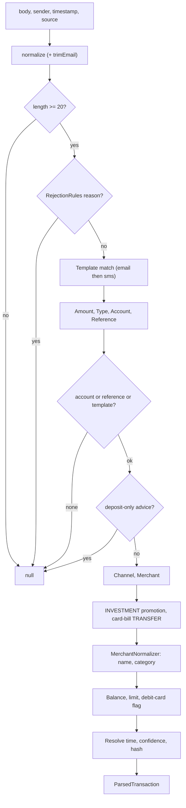

# Transaction Parsing Engine

| Field | Value |
|---|---|
| Feature ID | F-06 |
| Status | In progress (Phase 1: SMS/email/notification path done; statements pending) |
| Priority | P0 |
| Phase | 1 |
| Last Updated | 2026-10-21 |

## 1. Description

The parsing engine is an offline, predictable library that turns raw financial text and its sender into a structured transaction, or rejects it. The text can be a bank SMS or email, a payment-app notification, screenshot text or a statement line. Every way of bringing data into the app uses it, so one set of rules decides what counts as a payment.

## 2. What This Feature Will Do

- Cleans raw text into one consistent line, with all rupee spellings unified.
- Works out the sender identity from an SMS header or an email address.
- Finds the right bank, lender or payment-app rules for a sender, with a generic fallback for bank-looking senders.
- Rejects messages that are not real payments, such as offers, reminders and OTPs, in a fixed order.
- Extracts amount, direction (money in or out), account digits, balance, limit, reference, date and channel.
- Cleans merchant names and looks them up in a merchant directory to suggest a category.
- Recognises credit card bill payments and marks them as transfers, not spend.
- Marks debits that look like investments as investments.
- Tells debit cards from credit cards and reads balance or limit accordingly.
- Reads lender messages (EMI receipts, loan status), deposit status, card-due notices and investment SMS.
- Reads draft details from screenshot text and from payment-app notifications.
- Computes the fixed fingerprint used to detect duplicates.
- Guesses account and account type for each parsed payment.
- Is checked by a sample set of real-style messages that must stay at or above 98% accuracy with no false payments.

### 2.1 Inputs

- Message text, sender, time received and source (SMS, email, notification, screenshot or statement line).
- Bundled lists of banks, lenders, payment apps, card issuers and merchants.
- Called each time a message arrives or a statement or screenshot is read, by the ingestion features.

### 2.2 Processing

1. Clean the text and work out the sender key.
2. Find the matching bank, lender or payment-app rules, or the generic fallback.
3. Apply the rejection rules in order; stop if the message is not a payment.
4. Extract the amount, direction, account, balance, reference, date and channel.
5. Clean the merchant name and derive a category.
6. Apply special handling for card bills, investments, loans, deposits and card dues.
7. Compute the fingerprint and return the result, or a rejection.

### 2.3 Outputs

- A parsed transaction, or a loan status, deposit status, card-due notice or holding snapshot, or a rejection, returned to the caller.
- The duplicate-detection fingerprint used by [Dedup and review](07_dedup_review.md).
- Results used by [SMS ingestion](02_sms_ingestion.md), [Email ingestion](03_email_ingestion.md), [Notification ingestion](04_notification_ingestion.md), [Statement import](05_statement_import.md) and screenshot fill in [Transactions ledger](08_transactions_ledger.md).

### 2.4 Out of Scope

- Duplicate, merge and ingest decisions: [Dedup and review](07_dedup_review.md); storage: [Transactions ledger](08_transactions_ledger.md).
- Reading statement files and their row layouts: [Statement import](05_statement_import.md).
- Capturing messages (SMS, email, notifications).
- Tax, loan maths and analytics (other features).

## 3. Behaviour in Existing App

Source: analysis Part B section 6 (parser) and 7.1 (hash), Part C 1.6; Kotlin under `hisaab_apk/parser-core/src/main/kotlin/com/hisaab/parser/` (`PC/`). All regexes below are Java `Pattern.CASE_INSENSITIVE` unless noted ("rx"). Quality gate in the existing tests: `CorpusAccuracyTest` requires >= 98% field accuracy over amount/type/account/ref/merchant/balance/date, 0 negative leaks, and identical SMS/email hashes for the same transaction.

### 3.1 Entry points

`ParserRegistry.parse(body, sender, timestamp, source)` (`registry/ParserRegistry.kt:76-79`): `resolve(sender)` (HashMap keyed by sender key) else the fallback `GenericBankParser` if `canHandle(sender)`; returns null if none. Other registry calls: `accepts(sender)` (the SMS pre-filter: known sender or generic bank-looking), `loanStatus(...)` (lender status, or FD/RD/PPF deposit status), `cardDue(...)` (card statement / payment notice), `defaultEmailSenders`, `isStatementSubject(subject)`.

Registry construction order (`default()`): 10 core bank parsers, 16-17 lender parsers (`Lenders.ALL` has 17 entries), `PaymentAppParser`, then the `IndianBanks` list (each listed bank only gets headers/domains not already taken), fallback `GenericBankParser`. Duplicate claims of a key throw at construction.

### 3.2 Text normalisation (`text/TextNormalizer.kt`, `Rx.kt`)

- `normalize(raw)`: one pass: drop `\r` and zero-width chars (U+200B, U+200C, U+200D, U+2060, U+FEFF, U+00AD); runs of space/tab/NBSP/VT/FF collapse to one space; a `\n` (line break) becomes `". "` unless the previous char is one of `.!?:,;` (then a single space); then currency spellings are replaced: regex `(?:₹|\bRs\.?|\bINR\.?)\s*[:.]?\s*(?=-?\d)` -> `"INR "`. Result is one line.
- `trimEmail(normalized)` (EMAIL only): cap at 3000 chars; cut at the first match of `EMAIL_FOOTER` that starts at offset >= 40: `\b(?:if you (?:did not|have not|haven't|do not)|if this (?:transaction|txn) (?:was|is) not|in case you have not|this is an? (?:system|computer|auto)|please do not reply|disclaimer|warm regards|regards,|thank you for banking|to unsubscribe|never share your|for any (?:queries|query|clarification))`.
- `Guarded(pattern, needles...)`: runs the regex only if the lower-cased text contains at least one needle (pure speed guard; every match must contain a needle). Port as a small wrapper class.
- All regexes are ASCII-oriented; `\b`, `\d`, `\w`, `\s` are ASCII in Java. Dart `RegExp` is compatible for every construct used (named groups, lookahead, lookbehind, lazy quantifiers); set `caseSensitive: false`, never `unicode: true` unless tested.

### 3.3 Sender registry and sender keys

`SenderKeys.candidates(sender)`:

- Email (contains `@`): `address` = text inside `<...>` else the whole string, trimmed and lower-cased; candidates = `[address, domain, parentDomain, ...]` for each suffix that still contains a dot: `alerts@hdfcbank.net` -> `[alerts@hdfcbank.net, hdfcbank.net]`; `x@alerts.sbi.co.in` -> `[x@alerts.sbi.co.in, alerts.sbi.co.in, sbi.co.in, co.in]` (the bare TLD is never added; a subdomain therefore matches a registered parent domain).
- SMS: single key `smsHeader(sender)` = `upper(sender).split('-')`, strip non-alphanumerics from each part, drop empty parts; if >= 2 parts and `parts[0].length <= 2` -> `parts[1]` else `parts[0]` (empty -> ""). `VM-HDFCBK-S` -> `HDFCBK`; `AX-ICICIB-T` -> `ICICIB`.
- `BaseBankParser.senderKeys` = upper-cased SMS headers + lower-cased email domains; `canHandle(sender, body)` = any candidate in the set.
- `GenericBankParser.canHandle` (fallback): last candidate key; for email the key must contain `bank`; for SMS the header must be in `CARD_ISSUERS` (`AMEXIN AMEXCC INDUSB INDUSL HSBCIN HSBCCC SCBNKS STANCB ONECRD BOBFIN BOIIND SIBSMS PAYTMB SLCEIT UNIONB RBLCRD DBSIND CITIIN IDBIIN FEDSMS`) or match `(?:BK|BNK|BANK|BNKK|CRD)$|BANK|CARD`. Bank name = raw SMS header or capitalised domain label. Unclaimed senders such as `VM-AMAZON` are rejected.

### 3.4 The base pipeline (`bank/BaseBankParser.kt`, `MIN_LENGTH = 20`)

1. `text = normalize(body)`; for EMAIL `trimEmail`. If `text.length < 20` -> null.
2. `RejectionRules.shouldReject` (2.6) -> null.
3. Templates: EMAIL tries `emailTemplates + smsTemplates` (first match wins); SMS only `smsTemplates`. A `Template(pattern, type?, kind?)` has named groups `amt, cur, acct, merchant, vpa, ref, bal`; `AMT = \d[\d,]*(?:\.\d{1,2})?`.
4. Amount: template `amt`(+`cur`) else `AmountExtractor.extract`; none -> null.
5. Type: `TypeClassifier.classify(text, templateType, lower)`; null -> null.
6. Account: template `acct` last 4 chars, else `AccountExtractor.extract(text, type)`; kind = template kind, else extracted kind, else ACCOUNT. Reference = `ReferenceExtractor.normalize(templateRef ?: extract)`.
7. Drop if `last4 == null && reference == null && no template hit` ("almost always marketing").
8. Drop if `DepositParser.aboutDepositOnly(text, last4)` (the message is a deposit status, see `depositStatus`).
9. `ChannelDetector.detect`. Raw merchant: template merchant/vpa else `MerchantExtractor.extract(text, type, lower)`.
10. If DEBIT and (`TypeClassifier.looksLikeInvestment` or `MerchantNormalizer.categoryOf(raw) == INVESTMENT`) -> INVESTMENT.
11. If DEBIT and `CardBill.isBill(text, raw.name, raw.vpa)` -> TRANSFER.
12. `MerchantNormalizer.normalize(raw, type, channel, text)` -> display name + category.
13. Balance: template `bal` (signed) else `BalanceExtractor.balance`. For CARD kind: `limit = BalanceExtractor.limit(...)`, else the balance when the text matches `\bcredit\s+card\b|\bBLOCK\s+CC\b` and not `\bdebit\s+card\b|\bBLOCK\s+DC\b`. `isDebitCard` = CARD and (text has `debit card|BLOCK DC` or (balance present, no limit, not credit-card text)). Stored `balanceMinor` = null for a credit card, else the balance.
14. Time (`resolveTime`): date from `DateTimeExtractor`; if none -> message timestamp, not explicit. A date after `msgDate + 1 day` or before `msgDate - 45 days` (`maxBackdateDays`, `ParserConfig`) is ignored (message timestamp, not explicit). With a time in the text -> `date + time` in IST, explicit. Same day as the message -> message timestamp, not explicit. Otherwise the date at the message's own time of day, not explicit.
15. Confidence: 0.5, +0.15 last4, +0.15 reference, +0.10 merchant name, +0.10 template hit, cap 1.0.
16. Hash = `TransactionHasher.hash(amount, type, last4, date(IST), reference)` (2.12).
17. `bankName = bankNameFor(sender)`; `upiId = raw.vpa?.lowercase()`; `source`, `sender`, `messageTimestamp = timestamp` carried.

`ParserConfig`: `zone = Asia/Kolkata`, `maxBackdateDays = 45`.

`ParsedTransaction` fields: `amountMinor, currency, type, bankName, accountLast4, accountKind, merchant, upiId, referenceNumber, channel, balanceMinor, availableLimitMinor, transactionTime, hasExplicitTime, category, source, sender, messageTimestamp, confidence, transactionHash, isDebitCard`. Enums: `Source { SMS, EMAIL, APP, SCREENSHOT, MANUAL, STATEMENT }`, `TransactionType { DEBIT, CREDIT, TRANSFER, INVESTMENT }` (`direction`: DEBIT/INVESTMENT -> "OUT", CREDIT -> "IN", TRANSFER -> "XFER"), `AccountKind { ACCOUNT, CARD }`, `Channel { UPI, IMPS, NEFT, RTGS, CARD, ATM, AUTO_DEBIT, OTHER }`, `Category` (27, see 2.10).

### 3.5 Bank parsers with templates (10 core banks)

All templates run on normalised text (one line, `INR `, line breaks as `. `). `A` = `$AMT`.

| Bank | SMS headers | Email domains |
|---|---|---|
| HDFC Bank | HDFCBK HDFCBN HDFCCC | hdfcbank.net hdfcbank.com hdfcbank.bank.in |
| ICICI Bank | ICICIB ICICIT ICICIO | icicibank.com icici.bank.in icicibank.bank.in |
| SBI | SBIINB SBIUPI CBSSBI ATMSBI SBIPSG SBICRD SBIBNK | alerts.sbi.co.in sbi.co.in sbicard.com sbi.bank.in |
| Axis Bank | AXISBK AXISMR AXISCC | axisbank.com axis.bank.in axisbank.bank.in |
| Kotak Mahindra Bank | KOTAKB KOTAKM KMBLTD | kotak.com kotak.bank.in kotakbank.com |
| IDFC FIRST Bank | IDFCFB IDFCBK | idfcfirstbank.com idfcfirst.bank.in idfcbank.com |
| Yes Bank | YESBNK YESBKK YESBK | yesbank.in yes.bank.in yesbank.bank.in |
| Bank of Baroda | BOBTXN BOBSMS BOBCRD BOBCMS | bankofbaroda.com bankofbaroda.co.in bobcard.co.in bankofbaroda.bank.in |
| Punjab National Bank | PNBSMS PNBBNK PUNBNK | pnb.co.in pnb.bank.in pnbindia.in |
| AU Small Finance Bank | AUBANK AUSFBL AUBNKK | aubank.in au.bank.in |

Templates (verbatim; `(?<amt>A)` etc. are named groups; `D`=DEBIT, `C`=CREDIT, `CARD`=account kind CARD):

- HDFC SMS: `Sent\s+INR\s*(?<amt>A)\.?\s+From\s+HDFC\s+Bank\s+A/C\s+[x*]*(?<acct>\d{4})\.?\s+To\s+(?<merchant>.+?)\.?\s+On\s+\d{2}/\d{2}/\d{2}\.?\s+Ref\s+(?<ref>\d{9,14})` (D); `NEFT\s+Cr-[A-Z]{4}0[A-Z0-9]{6}-(?<merchant>[^-]+?)-[^-]*-(?<ref>[A-Z0-9]{12,22})`. HDFC email: `Credit\s+Card\s+ending\s+(?<acct>\d{4})\s+for\s+INR\s*(?<amt>A)\s+at\s+(?<merchant>.+?)\s+on\s` (D, CARD); `INR\s*(?<amt>A)\s+has\s+been\s+debited\s+from\s+account\s+[x*]*(?<acct>\d{4})\s+to\s+VPA\s+(?<vpa>\S+)\s+(?<merchant>.+?)\s+on\s` (D).
- ICICI SMS: `Acct\s+XX(?<acct>\d{3,4})\s+debited\s+(?:for|with)\s+INR\s*(?<amt>A)\s+on\s+[\w-]+;\s*(?<merchant>.+?)\s+credited\.\s*(?:UPI|IMPS|RRN)\s*:?\s*(?<ref>\d{9,14})` (D); `INR\s*(?<amt>A)\s+spent\s+(?:using|on)\s+ICICI\s+Bank\s+Card\s+XX(?<acct>\d{4})\s+on\s+[\w-]+\s+on\s+(?<merchant>.+?)\.(?:\s|$)` (D, CARD). Email: `Credit\s+Card\s+XX(?<acct>\d{4})\s+has\s+been\s+used\s+for\s+a\s+transaction\s+of\s+INR\s*(?<amt>A)` (D, CARD).
- SBI SMS: `A/C\s+X(?<acct>\d{4})\s+debited\s+by\s+(?<amt>A)\s+on\s+date\s+\S+\s+trf\s+to\s+(?<merchant>.+?)\s+Refno\s+(?<ref>\d{9,14})` (D); `A/c\s+X(?<acct>\d{4})-credited\s+by\s+INR\s*(?<amt>A)\s+on\s+\S+\s+transfer\s+from\s+(?<merchant>.+?)\s+Ref\s+No\s+(?<ref>\d{9,14})` (C). Email: `SBI\s+Credit\s+Card\s+ending\s+(?<acct>\d{4})\s+for\s+INR\s*(?<amt>A)\s+at\s+(?<merchant>.+?)\s+on\s` (D, CARD).
- Axis SMS (new layout): `Spent\s+INR\s*(?<amt>A)\.?\s+Axis\s+Bank\s+Card\s+no\.?\s+XX(?<acct>\d{4})\.?\s+[0-9-]+\s+[0-9:]+\s*(?:IST)?\.?\s+(?<merchant>.+?)\.?\s+Avl\s+(?:Credit\s+)?Limit` (D, CARD); old: `Spent\.?\s+Card\s+no\.\s+XX(?<acct>\d{4})\.\s+INR\s*(?<amt>A)\.\s+[\d-]+\s+[\d:]+\.\s+(?<merchant>[^.]+?)\.\s+Avl` (D, CARD). Email: `INR\s*(?<amt>A)\s+was\s+spent\s+on\s+your\s+Axis\s+Bank\s+Credit\s+Card\s+no\.\s+XX(?<acct>\d{4})\s+at\s+(?<merchant>.+?)\s+on\s` (D, CARD).
- Kotak SMS: `Sent\s+INR\s*(?<amt>A)\s+from\s+Kotak\s+Bank\s+AC\s+X(?<acct>\d{4})\s+to\s+(?<vpa>\S+?)\s+on\s+[\d-]+\.\s*UPI\s+Ref\s*:?\s*(?<ref>\d{9,14})` (D); `Received\s+INR\s*(?<amt>A)\s+in\s+your\s+Kotak\s+Bank\s+AC\s+X(?<acct>\d{4})\s+from\s+(?<vpa>\S+?)\s+on\s` (C). Email: `Kotak\s+Credit\s+Card\s+xx(?<acct>\d{4})\s+has\s+been\s+used\s+for\s+INR\s*(?<amt>A)\s+at\s+(?<merchant>.+?)\s+on\s` (D, CARD).
- IDFC SMS: `debited\s+by\s+INR\s*(?<amt>A)\s+on\s+\S+\s+for\s+(?:UPI\s+txn|IMPS|NEFT)\s+to\s+(?<merchant>.+?)\.(?:\s|$)` (D). Email: `INR\s*(?<amt>A)\s+has\s+been\s+debited\s+from\s+your\s+account\s+XX+(?<acct>\d{4})\s+towards\s+UPI\s+payment\s+to\s+(?<merchant>.+?)\s+on\s` (D).
- Yes SMS: `INR\s*(?<amt>A)\s+debited\s+from\s+YES\s+BANK\s+A/c\s+XX(?<acct>\d{4})\s+on\s+\S+\s+for\s+(?:UPI|IMPS|NEFT)\s+to\s+(?<merchant>.+?)\.(?:\s|$)` (D). Email: `YES\s+BANK\s+Credit\s+Card\s+XX(?<acct>\d{4})\s+has\s+been\s+used\s+for\s+INR\s*(?<amt>A)\s+at\s+(?<merchant>.+?)\s+on\s` (D, CARD).
- BoB SMS: `INR\s*(?<amt>A)\s+Dr\.?\s+from\s+A/C\s+[x*]*(?<acct>\d{3,4})\s+and\s+Cr\.?\s+to\s+(?<vpa>\S+?)\.\s` (D); `INR\s*(?<amt>A)\s+Cr\.?\s+to\s+A/C\s+[x*]*(?<acct>\d{3,4})\s+from\s+(?<vpa>\S+?)\.\s` (C); `INR\s*(?<amt>A)\s+spent\s+on\s+your\s+BOBCARD\s+ending\s+(?<acct>\d{4})\s+at\s+(?<merchant>.+?)\s+on\s` (D, CARD). Email: `BOBCARD\s+ending\s+(?<acct>\d{4})\s+has\s+been\s+used\s+for\s+INR\s*(?<amt>A)\s+at\s+(?<merchant>.+?)\s+on\s` (D, CARD).
- PNB SMS: `debited\s+INR\s*(?<amt>A)\s+on\s+\S+\s+by\s+(?:UPI|IMPS)\s+Ref\s+(?<ref>\d{9,14})\s+to\s+(?<merchant>.+?)\.(?:\s|$)` (D); `credited\s+INR\s*(?<amt>A)\s+on\s+\S+\s+by\s+(?:UPI|IMPS)\s+Ref\s+(?<ref>\d{9,14})\s+from\s+(?<merchant>.+?)\.(?:\s|$)` (C). Email: `PNB\s+Credit\s+Card\s+XX(?<acct>\d{4})\s+has\s+been\s+used\s+for\s+INR\s*(?<amt>A)\s+at\s+(?<merchant>.+?)\s+on\s` (D, CARD).
- AU SMS: `INR\s*(?<amt>A)\s+debited\s+from\s+AU\s+(?:Small\s+Finance\s+)?Bank\s+A/c\s+XX(?<acct>\d{4})\s+on\s+\S+\s+via\s+(?:UPI|IMPS|NEFT)\s+to\s+(?<merchant>.+?)\.(?:\s|$)` (D). Email: `AU\s+Bank\s+Credit\s+Card\s+XX(?<acct>\d{4})\s+has\s+been\s+used\s+for\s+INR\s*(?<amt>A)\s+at\s+(?<merchant>.+?)\s+on\s` (D, CARD).

`ListedBankParser` (no templates; shared extractors only; display name + header/domain sets):

| Bank | SMS headers | Domains |
|---|---|---|
| Central Bank of India | CENTBK CBOIND CBINBK CENTRL CBISMS | centralbank.co.in centralbankofindia.co.in |
| Bank of Maharashtra | MAHABK BOMSMS MAHBNK BOMBNK MAHABN | bankofmaharashtra.in |
| Canara Bank | CANBNK CANARA CANBKS CNRBNK CANBSM | canarabank.com canarabank.in |
| Union Bank of India | UNIONB UBINBK UBISMS UNIBNK | unionbankofindia.co.in unionbankofindia.bank.in |
| Bank of India | BOIIND BOIBNK BOISMS BOIBKS | bankofindia.co.in |
| Indian Bank | INDBNK INDIAN INDBKS INDSMS | indianbank.in indianbank.co.in |
| Indian Overseas Bank | IOBCHN IOBBNK IOBSMS IOBANK | iob.in |
| UCO Bank | UCOBNK UCOBKS UCOSMS UCOBAN | ucobank.com |
| Punjab & Sind Bank | PSBANK PSBIND PSBSMS PSBBNK | psbindia.com |
| IDBI Bank | IDBIBK IDBIIN IDBISM | idbibank.in idbi.co.in |
| IndusInd Bank | INDUSB INDUSL | indusind.com indusind.bank.in |
| Federal Bank | FEDBNK FEDSMS FEDBKS | federalbank.co.in |
| South Indian Bank | SIBSMS SIBBNK SIBANK | southindianbank.com |
| Karur Vysya Bank | KVBANK KVBSMS KVBBNK | kvb.co.in |
| City Union Bank | CUBANK CUBSMS CUBBNK | cityunionbank.com |
| CSB Bank | CSBANK CSBSMS CSBBNK | csb.co.in |
| DCB Bank | DCBBNK DCBSMS DCBANK | dcbbank.com |
| Tamilnad Mercantile Bank | TMBANK TMBSMS TMBBNK | tmb.in |
| Jammu & Kashmir Bank | JKBANK JKBSMS JKBBNK | jkbank.com |
| Dhanlaxmi Bank | DHANBK DLXBNK DHNLXM | dhanbank.com |
| Nainital Bank | NTLBNK NAINBK NAINTL | nainitalbank.co.in |
| Karnataka Bank | KTKBNK KARBNK KBLSMS | karnatakabank.com |
| RBL Bank | RBLBNK RBLCRD RBLSMS | rblbank.com |
| Bandhan Bank | BANDHN BDNBNK BNDHAN | bandhanbank.com |
| Equitas Small Finance Bank | EQUTAS EQSFBL EQUITS | equitasbank.com |
| Ujjivan Small Finance Bank | UJJSFB UJVNSB UJJIVN | ujjivansfb.in |
| Jana Small Finance Bank | JANASF JANABK JANASM | janabank.com |
| Suryoday Small Finance Bank | SURYDY SURYOD | suryodaybank.com |
| Utkarsh Small Finance Bank | UTKSFB UTKRSH | utkarsh.bank |
| ESAF Small Finance Bank | ESAFSF ESAFBK | esafbank.com |
| Capital Small Finance Bank | CAPSFB CAPITL | capitalbank.co.in |
| HSBC | HSBCIN HSBCCC HSBCBK | hsbc.co.in |
| Standard Chartered | SCBNKS STANCB SCBANK | sc.com |
| Citibank | CITIIN CITIBK CITIBN | citibank.com citi.com |
| DBS Bank | DBSIND DBSBNK | dbs.com |
| Paytm Payments Bank | PYTMPB PAYTMB PAYTMP | paytmbank.com |
| Airtel Payments Bank | AIRBNK APBLTD AIRPBL | airtelbank.com |
| India Post Payments Bank | IPPBNK IPPBSM IPPBLT | ippbonline.com |
| Fino Payments Bank | FINOPB FINOBK | finobank.com |
| Jio Payments Bank | JIOPBL JIOPAY | jiopaymentsbank.com |
| Nagrik Sahakari Bank | NAGRIK NAGRIKB NAGRKB NSBANK NSBLTD NSBGWL NSBMPL NSBIDR NSBAHM NGRKSB NAGSBK NSBSMS | nagriksahakaribank.com nagrikbank.com nagriksahkaribank.com |
| Saraswat Bank | SARBNK SARSWT SRSWAT | saraswatbank.com |
| Cosmos Bank | COSMOS COSBNK COSMBK | cosmosbank.com |
| SVC Bank | SVCBNK SVCBAN | svcbank.com |
| Abhyudaya Bank | ABHYUD ABHYBK | abhyudayabank.co.in |
| TJSB Sahakari Bank | TJSBNK TJSBSM | tjsb.in |
| Bharat Co-operative Bank | BCBLTD BHARBK | bharatbank.com |
| Kalupur Commercial Co-operative Bank | KALUPR KALPUR | kalupurbank.com |
| NKGSB Co-operative Bank | NKGSBK NKGSBB | nkgsb.co.in |
| Janata Sahakari Bank | JSBLTD JANSBK | janatabank.com |
| Apna Sahakari Bank | APNABK APNSBK | apnabank.co.in |

(51 listed banks; the registry rejects a header or domain already claimed, so overlaps such as `INDUSB`/`UNIONB` appearing in both the listed banks and `CARD_ISSUERS` must be checked when porting.)

Lenders (`Lenders.ALL`, 17; every account under these bank names is auto-typed LOAN):

| Lender | SMS headers | Email domains |
|---|---|---|
| Propelld | PROPLD PRPLDF PROPEL PRPELD PRPLDS | propelld.com |
| Aditya Birla Capital | ABCLTD ABCFIN ABCAPL ABCDAP ADBIRL ABFLTD ABHFLT | adityabirlacapital.com abcd.adityabirlacapital.com |
| Bajaj Finance | BAJAJF BAJFIN BAJAJL BFLEMI | bajajfinserv.in bajajfinance.in |
| Tata Capital | TATACP TATCAP TCLOAN | tatacapital.com |
| HDFC Credila | CREDLA CREDIL HCREDL | credila.com hdfccredila.com |
| Avanse | AVANSE AVNSFS | avanse.com |
| InCred | INCRED INCRDF | incred.com |
| SMFG India Credit | SMFGIN SMFGIC FULRTN FULTON | smfgindiacredit.com fullertonindia.com |
| Home Credit | HOMECR HCINDA HMCRDT | homecredit.co.in |
| KreditBee | KRDBEE KBEEIN KREDTB | kreditbee.in |
| Navi | NAVIFN NAVILN NAVIAP | navi.com |
| Poonawalla Fincorp | POONAW PFLTDL PFLLON | poonawallafincorp.com |
| HDB Financial | HDBFSL HDBFIN HDBFSS | hdbfs.com |
| L&T Finance | LTFINC LNTFIN LTFSMS | ltfs.com |
| Hero FinCorp | HEROFC HEROFN | herofincorp.com |
| Cholamandalam Finance | CHOLAF CHOLAL | chola.murugappa.com |
| Mahindra Finance | MMFSLT MAHFIN MMFINL | mahindrafinance.com |

Payment apps (`PaymentAppParser`): SMS headers `PHNEPE PHONPE PHONEP CREDCL MOBIKW`; email domains `phonepe.com, noreply@phonepe.com, googlepay-noreply@google.com, payments-noreply@google.com, noreply-payments@pay.google.com, pay.google.com, paytm.com, paytm.in, cred.club, mobikwik.com, amazonpay.in, freecharge.in, super.money`. App name from the sender substring (PhonePe, Google Pay, Paytm, CRED, MobiKwik, Amazon Pay, Freecharge, super.money, else "UPI app"). Body parsing is `FreeTextParser.readNotification` (documented in [Notification ingestion](04_notification_ingestion.md) section 2.5), confidence 0.55.

Email statement whitelist (`STATEMENT_SENDERS`) and `STATEMENT_SUBJECTS`/`isStatementSubject` are listed in [Email ingestion](03_email_ingestion.md) section 2.7 and 2.8.

### 3.6 Rejection rules (`rules/RejectionRules.kt`), evaluated in this order; the first hit returns its reason

Definitions (all `rx`, case-insensitive; `Guarded` needles in brackets):

- `PAST_MOVEMENT`: `\b(?:debited|credited|spent|withdrawn|deposited|received|sent|paid|deducted|transferred|refunded|reversed|charged|(?:has\s+been|was)\s+used)\b`.
- `OTP_WORD` [otp, password, verification, security, passcode]: `\b(?:otp|one[\s-]time[\s-]password|verification\s+code|security\s+code|passcode)\b`.
- `OTP_CODE`: `(?:otp|code|password)\s*(?:is|:|-)?\s*\d{4,8}\b|\b\d{4,8}\s+is\s+(?:your\s+|the\s+)?(?:otp|one[\s-]time|code|verification)|\b(?:otp|code)\s+for\b|\buse\s+(?:otp\s+)?\d{4,8}\b|\b(?:otp|code)\b.{0,100}?\bis\s*:?\s*\d{4,8}\b`.
- `FAILED` [fail, declin, unsuccess, success, could, reject, insufficient, pin, returned, dishono, bounce]: `\b(?:failed|failure|declined|unsuccessful|not\s+successful|could\s+not\s+be\s+(?:processed|completed)|(?:has\s+been|was|is)\s+rejected|insufficient\s+(?:funds|balance|bal)|incorrect\s+pin|invalid\s+pin|returned\s+unpaid|dishonou?red|bounced)\b`; `REVERSAL` = `\b(?:reversed|refunded|reversal|refund)\b`; `CREDITED` = `\bcredited\b`.
- `FUTURE` [will, scheduled, upcoming]: `\bwill\s+be\s+(?:auto[\s-]?)?(?:debited|deducted|charged|credited|processed|presented|paid|transferred)\b|\b(?:is\s+scheduled|scheduled\s+(?:for|on)|upcoming)\b`.
- `MANDATE_SETUP` [mandate, auto, standing, nach]: `\b(?:e-?mandate|mandate|auto[\s-]?pay|standing\s+instruction|e-?nach)\b.{0,80}?\b(?:registered|created|set\s*up|setup|activated|approved|revoked|cancelled|canceled|modified|paused)\b|\b(?:set\s*up|created|registered|activated)\s+(?:an?\s+|your\s+)?(?:e-?mandate|mandate|auto[\s-]?pay)\b`.
- `COLLECT` [request]: `\b(?:has\s+requested|requested\s+(?:money|INR|payment)|collect\s+request|payment\s+request)\b`.
- `PROMO` [approved, apply, eligible, avail, get up, limited, offer, click, congratulations]: `\b(?:pre[\s-]?approved|apply\s+now|you\s+are\s+eligible|eligible\s+for|avail\s+(?:now|the\s+offer)|get\s+up\s*to|limited[\s-]period|exclusive\s+offer|special\s+offer|click\s+here|congratulations)\b`.
- `DUE` [due, min, bill, statement, pay, reminder]: `\b(?:is\s+due|due\s+(?:on|by|date)|payment\s+due|(?:amount|amt)\s+due|min(?:imum)?\.?\s+(?:amount|amt)|overdue|bill\s+(?:is\s+)?generated|statement\s+(?:is\s+)?(?:generated|ready)|statement\s+for|pay\s+now|payment\s+reminder|gentle\s+reminder|reminder)\b`; `SETTLED` = `\b(?:debited|credited|spent|withdrawn|deposited|received)\b`.
- `BALANCE_ONLY` [bal]: `\b(?:available|avl\.?|avbl\.?|account|a/c|closing|ledger)\s+bal(?:ance)?\b.{0,60}?\b(?:is|:)\s*(?:rs\.?|inr|₹)`; `IF_CLAUSE` = `\bif\s+you[^.]*`; `ACTIVITY` = `\b(?:using|used|purchase|transaction|txn|payment)\b`.

Order and conditions (`reasonFor`):

1. `otp`: `OTP_WORD` and (`OTP_CODE` or no `PAST_MOVEMENT`).
2. `failed`: `FAILED` unless (`REVERSAL` and `CREDITED`).
3. `future`: `FUTURE`.
4. `mandate`: `MANDATE_SETUP`.
5. `collect`: `COLLECT`.
6. `promo`: `PROMO`.
7. `reminder`: `DUE` and not `SETTLED`.
8. `balance`: `BALANCE_ONLY` and, after removing `IF_CLAUSE` text, neither `PAST_MOVEMENT` nor `ACTIVITY`.

Lender parsers treat `future`, `reminder`, `balance` as "soft" (still yield a loan status). Card due/statement messages are rejected as transactions by rule 7 but read separately by `CardDueParser` (2.13).

### 3.7 Field extractors (`extract/`)

- Amount (`AmountExtractor`): `\b(INR|USD|EUR|GBP|AED|SGD|AUD|CAD|JPY|CHF|SAR|QAR)\s*(\d[\d,]*(?:\.\d{1,2})?)` over the text; skip a match when the 45 chars before it match `(?:bal(?:ance)?|lmt|limit|due|outstanding)\b[^0-9]{0,30}$`; first accepted wins; fallback `\b(?:debited|credited)\s+(?:by|for|with)\s+(\d[\d,]*(?:\.\d{1,2})?)\b` (currency INR). `Money.parse`: strip commas and trailing dot, `BigDecimal` x100 rounded HALF_UP to whole paise, must be > 0 and <= 1,000,000,000,000 paise (Rs 10,000 crore), currency upper-cased. `parseSigned` accepts a leading `-` and zero.
- Balance (`BalanceExtractor`): `(?:\b|(?<=avl)|(?<=avbl))bal(?:ance)?\b[^0-9]{0,40}?\b(?:INR)\s*(-?\d[\d,]*(?:\.\d{1,2})?)` (signed). Limit: `\b(?:lmt|limit)\b[^0-9]{0,30}?\bINR\s*(\d[\d,]*(?:\.\d{1,2})?)`.
- Account (`AccountExtractor`): candidates in this order, each number once (no overlaps):
  1. `LABELLED`: `(?:\b(a/c|ac|acct|account)|(card))(?:\s*(?:no|number|num)\.?)?(?:\s*(?:ending|ends)(?:\s+(?:with|in))?)?\s*[:.\-]?\s*(?:\d{0,6}[x*#.][x*#.\s]*)?(\d{3,6})\b` -> last 4 of the digits; kind CARD if the "card" group matched or the word `card` appears in the 15 chars before the match.
  2. `MASKED`: `(?<![\w*])[x*]{2,}(\d{3,4})\b` (kind CARD if the text contains `\bcard\b`).
  3. `SHORT_ENDING`: `\b(card|a/c|ac|acct|account)(?:\s*(?:no|number|num)\.?)?\s+(?:ending|ends)(?:\s+(?:with|in))?\s*[x*]*(\d{2})\b` (two digits, e.g. SBI Corporate card 96).
  - Reject a candidate if it is a phone/VPA: digits followed within 40 chars by `^[\w.\-]*@[a-z]`, or (bare masked only) preceded within 30 chars by `(?:\b(?:mobile|mob|phone|ph|cell|cellphone|contact|call|whatsapp|registered|upi\s+id|vpa|(?:sms|msg)\s+to)\b[\s:.\-#]*(?:(?:no|number|num|is|linked|of|with)\b[\s:.\-#]*){0,3}|\+91[\s\-]?|\b91-)$`.
  - Reject if it is the other party: preceded (30 chars) by `BENEFICIARY_BEFORE` `\b(?:benef\w*|bene|payee|recipient|in\s+favou?r\s+of)\s*[:\-]?\s*(?:the\s+)?(?:[\w'’]+\s+){0,2}$`; or, with a known type, by `TO_BEFORE` `\bto\s+(?:the\s+)?(?:(?!from\b)[\w'’]+\s+){0,2}$` (debit/transfer) or `PAYER_BEFORE` `\b(?:from|by|remitter|sender)\s+(?:the\s+)?(?:[\w'’]+\s+){0,2}$` (credit), unless the matched cue contains `\b(?:your|ur|own|self)\b`. First surviving candidate wins; if the only number is the other party's the result is null.
- Type (`TypeClassifier.classify(text, hint, lower)`), order: `TRANSFER` regex [payment, self, own account, between your, towards, card bill]: `\bpayment\b.{0,60}?\breceived\b.{0,60}?card\b|\breceived\s+(?:your\s+)?payment\b.{0,70}?card\b|\bpayment\b.{0,60}?\b(?:credited|posted|reflected)\b.{0,60}?\bcredit\s+card\b|\bcredit\s+card\b.{0,40}?\bpayment\b.{0,40}?\b(?:credited|posted|reflected|received)\b|\bthank\s+you\s+for\s+(?:your\s+|the\s+)?payment\b|\bself[\s-]transfer\b|\bown\s+account\b|\bbetween\s+your\s+(?:own\s+)?accounts\b|\btowards\s+(?:your\s+)?(?:[A-Za-z]+\s+){0,3}credit\s+card\b|\b(?:credit\s+card|cc)\s+(?:bill\s+)?payment\b|\bcard\s+bill\b` -> TRANSFER (wins even over a template hint); then template `hint`; then `OUTGOING` [credited, transfer, sent, remitted]: `\bcredited\s+(?:in)?to\s+(?:the\s+)?(?:beneficiary|benef\w*|bene|payee|recipient)\b|\bcredited\s+(?:in)?to\s+(?:[A-Za-z.]+\s+){0,3}[A-Za-z.]+['’]s\s+(?:a/c|acct|account|bank)\b|\btransfer\s+of\s+INR\s*[\d,.]+\s+to\s+(?:a/c|acct|account|beneficiary)\b|\btransfer\b.{0,40}?\bto\s+(?:a/c|acct|account|beneficiary)\b.{0,60}?\bsuccess|\b(?:sent|transferred|remitted)\s+to\s+(?:a/c|acct|account|beneficiary|benef\w*|payee)\b` -> DEBIT; then verbs: `DEBIT` = `\b(?:debited|debit\s+(?:by|for|of|alert)|spent|withdrawn|withdrawal|paid|sent|purchased?|deducted|charged|transferred\s+to|txn\s+of|used\s+(?:for|at|on)|thank\s+you\s+for\s+using|(?:transaction|trxn|txn)\s+(?:of\s+)?(?:INR|USD|EUR|GBP|AED|SGD)|transaction\s+alert\s+on\s+(?:your\s+)?(?:\w+\s+){0,4}card|made\s+a\s+(?:transaction|purchase|payment))\b`, `CREDIT` = `\b(?:credited|credit\s+(?:by|of|alert|with)|received|deposited|refund(?:ed)?|reversed|reversal)\b`; the earlier verb wins (credit searched only in the text up to `debitStart + 12`); none -> null.
  - `looksLikeInvestment` [needles mutual, mf, sip, zerodha, groww, upstox, kuvera, iccl, clearing, cams, kfin, smallcase, angel, paytm, ppf, nps]: `\b(?:mutual\s+fund|MF|SIP|zerodha|groww|upstox|kuvera|iccl|indian\s+clearing|nse\s+clearing|clearing\s+corp|cams|kfin(?:tech)?|smallcase|angel\s+one|paytm\s+money|ppf|nps)\b`.
- Channel (`ChannelDetector`), priority: ATM `\bATM\b|\bcash\s+withdrawal\b|\bwithdrawn\b` > AUTO_DEBIT `\b(?:ACH|NACH|ECS|mandate|auto[\s-]?pay|standing\s+instruction)\b` > UPI `\bUPI\b|\bVPA\b|@(?:ok\w+|ybl|ibl|axl|paytm|upi|icici|hdfcbank|sbi|axisbank|apl|ptyes|ptsbi|pthdfc|ptaxis|kotak|idfcbank)\b` > IMPS `\bIMPS\b` > NEFT `\bNEFT\b` > RTGS `\bRTGS\b` > CARD (text contains "card") > OTHER.
- Reference (`ReferenceExtractor`): `SLASHED` `\b(?:UPI|IMPS|NEFT|RTGS)/(?:[A-Z0-9]{2,4}/)?([A-Z0-9]{9,22})/`; else `LABELLED` `\b(?:UPI\s*transaction\s*reference\s*(?:number|no\.?)|(?:UPI|IMPS|NEFT|RTGS)(?:\s*Ref(?:erence|\.)?)?(?:\s*(?:No|Number|ID)\.?)?|RRN|UTR(?:\s*No\.?)?|Refno|Ref(?:erence)?(?:\s*(?:No|Number|ID)\.?|\s*#)?|(?:Txn|Trxn|Transaction)\s*(?:ID|No\.?|Number|Ref(?:erence)?(?:\s*No\.?)?))\s*(?:is\s*)?[:.\-#]?\s*\(?\s*([A-Z0-9]{6,22})\b`; a candidate must have >= 5 digits, else retry the search from the next character (so "UPI transaction ID 5268..." still finds the later label). `normalize`: keep alphanumerics, upper-case, require length >= 6.
- Date/time (`DateTimeExtractor`): ISO `\b(20\d{2})[-/:](\d{1,2})[-/:](\d{1,2})(?:[\sT:]+(\d{1,2}):(\d{2})(?::(\d{2}))?)?`; DMY `\b(\d{1,2})[-/.](\d{1,2})[-/.](\d{4}|\d{2})\b`; `D_MON_Y` `\b(\d{1,2})[-\s/]?(jan|feb|...|dec)[a-z]*\.?[-\s/,]*(\d{4}|\d{2})\b`; `MON_D_Y` `\b(jan|...|dec)[a-z]*\.?\s+(\d{1,2}),?\s+(\d{4})\b`; `TIME` `\b([01]?\d|2[0-3]):([0-5]\d)(?::([0-5]\d))?(?:\s*([ap])\.?m\b\.?)?`. The EARLIEST date in the text wins (each later pattern only searches the text before the best match so far). Years must be 2000..2099 (2-digit = 20xx). Time: the ISO's, else a time within 30 chars after the date, else the first time anywhere; am/pm converted.
- Merchant (`MerchantExtractor.extract(text, type)`), constants: `BODY = [A-Z0-9][A-Z0-9 &'*_\-/@.]{0,50}?`, `END = (?=\s+(?:on|dated|ref|refno|rrn|utr|upi|imps|neft|via|for|using|with|avl|avbl|bal|not|if|from|at|thru|through|and|txn|info|call|is|has|was)\b|\s*[.,;:(|!]|\s+-|$)`, `NOT_A_NAME = (?!(?:your|you|the|a/c|ac|acct|account|card|mobile|vpa|beneficiary|neft|imps|upi|rtgs|inr|usd|a|an|block|dispute|report|ur|u|inform|avoid|know)\b)`. Order: `SLASHED` `\b(?:UPI|IMPS|NEFT|RTGS)/(?:[A-Z0-9]{2,4}/)?[A-Z0-9]{9,22}/([^/]+?)(?=/|\s+(?:Not|Avl|Axis|If)\b|\.(?:\s|$)|$)`; `VPA_WITH_NAME` `\b(?:to|from|by)\s+VPA\s+([\w.\-]+@[\w.\-]+?)(?:\s+(BODY))?END` (vpa + name); `BENEFICIARY` `\bbeneficiary(?:\s+name)?\s*[:\-]\s*(BODY)END`; then CREDIT: `FROM` (`\b(?:from|by)\s+NOT_A_NAME(BODY)END`), `INFO` (`\bInfo\s*[:\-]\s*(.{2,60}?)(?=\.\s|\s+Avl\b|\s+The\b|$)`), `VPA` (`\b([a-z0-9][\w.\-]{1,}@[a-z][a-z0-9]{1,20})\b(?!\.[a-z])`), `ACH` (`\b(?:ACH|NACH|ECS)(?:[\s\-]*(?:DR|D|CR))?[\s\-/]+([A-Z][A-Z0-9 &.'\-]+?)(?=/|-\d|\.(?:\s|$)|\s+Avl\b|$)`); other types: `AT` (`\bat\s+NOT_A_NAME(BODY)END`), `VPA`, `INFO`, `ACH`, `TO` (`\b(?:trf\s+to|transferred\s+to|paid\s+to|sent\s+to|to)\s+NOT_A_NAME(BODY)END`), `TOWARDS` (`\btowards\s+NOT_A_NAME(BODY)END`); then (non-credit) `DATE_ON` `\b\d{1,2}[-/ ](?:\d{1,2}|[A-Za-z]{3})[-/ ]\d{2,4}\s+on\s+NOT_A_NAME(BODY)END`; then `AFTER_DATE` (merchant on its own sentence right after a date/time, must not contain a 5+ digit run, must not start with avl/not/sms/if/call/limit/bal/upi/ref/... ). A candidate is valid if after trimming `- / . ` it has >= 2 chars, >= 2 consecutive letters, and is not a generic UI phrase (`GenericPhrases`: view details, view detail, view, details, view receipt, view transaction, view statement, view more, click here, click, know more, check balance, tap to view, tap here, download, pay now, learn more, track order, explore, open app, open, see details, see more, show details, view order, check now, get started, shop now, register now, apply now, unsubscribe). A VPA inside the merchant string becomes `upiId`.

### 3.8 Merchant normalisation and category (`merchant/MerchantNormalizer.kt`, `MerchantDirectory.kt`)

`normalize(raw, type, channel, fullText)`:

1. `channel == ATM && type == DEBIT` -> merchant "ATM", category CASH.
2. Clean the raw name (`clean`): upper-case; if it contains `@` treat as VPA (step 3); if not an IFSC (`[A-Z]{4}0[A-Z0-9]{6}`) and it matches `^([A-Z]{3,}?)(?:IND|INDIA|IN)?\d{4,}$` keep the letters (UBERIND13513699 -> UBER); split on `/` and `|` (and on `-` when some part is code-like); choose the first segment that is not `CODE_LIKE` (`^(?:.*\d{4,}.*|[A-Z]{4}0[A-Z0-9]{6}|[X*\d\s]+|P2[AMP]|[A-Z]{2}\d+)$`) and not only noise words; replace `[^A-Z0-9&' ]+` with spaces; drop leading `NOISE_PREFIX` words (ACH NACH ECS TP D DR CR UPI IMPS NEFT RTGS POS VPA MMT BIL INF TO FROM BY SI MANDATE AUTOPAY PAYMENT TXN TRF TRANSFER PAY CMS ATD ONL VIN) and trailing `NOISE_SUFFIX` words while more than one word remains (PVT LTD PRIVATE LIMITED LLP INC CO UPI PAYMENTS PAYMENT); result needs >= 2 chars and a letter.
3. VPA to name (`fromVpa`): local part split on `. _ -`, dropping `VPA_NOISE` (UPI PAY PAYTM RAZORPAY RZP BHARATPE PAYU CASHFREE MERCHANT OKAXIS OKICICI), trailing digits trimmed, words >= 2 chars.
4. Directory lookup: multi-word keys match as phrases (longest first, substring of the upper-cased name); single-word keys must equal a token ("OLA" does not match "COCA COLA"). Display = directory name, else Title Case (`KEEP_UPPER` = ATM IRCTC LIC KFC HP BP SBI HDFC ICICI IDFC PNB AU NSE BSE; other words lower-cased then capitalised).
5. Category: TRANSFER -> TRANSFER; INVESTMENT -> INVESTMENT; CREDIT -> SALARY if `\b(?:SALARY|SAL\s+CR|PAYROLL)\b` in the upper-cased full text, REFUND if the text contains "refund" or "revers" (any case), else INCOME; otherwise directory category; otherwise `categoryByKeyword(tokens)`; otherwise OTHER.

`categoryOf(raw)` (used to promote DEBIT to INVESTMENT) = directory category of the cleaned name.

Directory (`MerchantDirectory.entries`, key words are upper-case; display name and category). Port as a bundled JSON asset `assets/parser/merchant_directory.json` (`[{keys:[...], name, category}]`):

| Category | Entries (keys -> display) |
|---|---|
| GROCERIES | "SWIGGY INSTAMART"/INSTAMART -> Swiggy Instamart; "BIGBASKET"/"BIG BASKET"/"INNOVATIVE RETAIL" -> BigBasket; BLINKIT/GROFERS -> Blinkit; ZEPTO/KIRANAKART -> Zepto; DMART/"AVENUE SUPERMARTS" -> DMart; JIOMART -> JioMart |
| FOOD | SWIGGY/BUNDL -> Swiggy; ZOMATO; EATSURE/FAASOS -> EatSure; DOMINOS/JUBILANT -> Domino's; MCDONALDS/MCDONALD -> McDonald's; KFC; STARBUCKS; HALDIRAM/HALDIRAMS -> Haldiram's |
| TRANSPORT | UBER/UBERIND/"UBER INDIA" -> Uber; OLA/OLACABS/OLAMONEY/"ANI TECHNOLOGIES" -> Ola; RAPIDO/ROPPEN -> Rapido; BLUSMART/"BLU SMART" -> BluSmart; "NAMMA YATRI"/NAMMAYATRI -> Namma Yatri; MERU; FASTAG -> FASTag; METRO/DMRC/BMRCL -> Metro |
| FUEL | HPCL/"HINDUSTAN PETROLEUM" -> HPCL; BPCL/"BHARAT PETROLEUM" -> BPCL; IOCL/"INDIAN OIL" -> Indian Oil |
| SHOPPING | AMAZON/AMZN -> Amazon; FLIPKART; MYNTRA; AJIO; MEESHO; NYKAA; CROMA; DECATHLON; IKEA; "ADITYA BIRLA FASHION" |
| BILLS | AIRTEL/"BHARTI AIRTEL" -> Airtel; JIO/"RELIANCE JIO" -> Jio; VODAFONE/"VODAFONE IDEA" -> Vi; BSNL; BESCOM/"TATA POWER"/"ADANI ELECTRICITY"/MSEDCL/TNEB -> Electricity; "TATA PLAY"/TATASKY -> Tata Play |
| ENTERTAINMENT | NETFLIX; SPOTIFY; HOTSTAR/JIOHOTSTAR/"NOVI DIGITAL" -> JioHotstar; "PRIME VIDEO"; BOOKMYSHOW/BIGTREE -> BookMyShow; PVR/INOX -> PVR INOX; YOUTUBE |
| TRAVEL | IRCTC; MAKEMYTRIP/MMT -> MakeMyTrip; GOIBIBO; CLEARTRIP; INDIGO/INTERGLOBE -> IndiGo; "AIR INDIA"; REDBUS -> redBus; OYO; IXIGO -> ixigo |
| HEALTH | APOLLO; PHARMEASY -> PharmEasy; 1MG/"TATA 1MG" -> Tata 1mg; NETMEDS; MEDPLUS -> MedPlus; CULTFIT/"CULT FIT"/CUREFIT -> cult.fit |
| EDUCATION | UDEMY; COURSERA; UNACADEMY |
| INVESTMENT | ZERODHA; GROWW; UPSTOX; KUVERA; ICCL/"INDIAN CLEARING" -> ICCL; SMALLCASE -> smallcase; "ADITYA BIRLA SUN LIFE"/ABSLMF/ABSLAMC -> Aditya Birla Sun Life MF; "TATA CAPITAL SECURITIES"/"TATA SECURITIES" -> Tata Securities; TATA MUTUAL FUND family (TATA MF, TATAMF, TATA ASSET MANAGEMENT, TATA AMC, TATA SMALL CAP, TATA DIGITAL INDIA, TATA NIFTY, TATA ELSS, TATA BANKING, TATA FLEXI, TATA LARGE, TATA MID, TATA ARBITRAGE, TATA LIQUID, TATA MONEY MARKET, TATA BALANCED, TATA HYBRID, TATA EQUITY, TATA INDEX) -> Tata Mutual Fund |
| INSURANCE | LIC/"LIFE INSURANCE CORPORATION"; POLICYBAZAAR; ACKO; "HDFC ERGO"/HDFCERGO; "ICICI LOMBARD"; "STAR HEALTH"; "NIVA BUPA"/"MAX BUPA" -> Niva Bupa; "CARE HEALTH"/"RELIGARE HEALTH" -> Care Health; "ADITYA BIRLA HEALTH"/ABHICL; "MANIPAL CIGNA" -> ManipalCigna; "TATA AIG"; "BAJAJ ALLIANZ"; "GO DIGIT"/GODIGIT/"DIGIT INSURANCE" -> Digit Insurance; "RELIANCE GENERAL"; "NEW INDIA ASSURANCE"; "MAX LIFE"/"AXIS MAX LIFE" -> Axis Max Life; "HDFC LIFE"; "SBI LIFE"; "ICICI PRU"/"ICICI PRUDENTIAL LIFE" -> ICICI Prudential Life; "TATA AIA"; "KOTAK LIFE"; "ADITYA BIRLA SUN LIFE INSURANCE"/ABSLI -> Aditya Birla Sun Life Insurance |
| EMI_LOAN | "BAJAJ FINANCE"/"BAJAJ FINSERV"/BAJAJFINANCE/BAJAJFIN -> Bajaj Finance; PROPELLD; "ADITYA BIRLA FINANCE"/"ADITYA BIRLA CAPITAL"/"ADITYA BIRLA HOUSING"/ADITYABIRLA/"ADITYA BIRLA"/ABFL/ABHFL -> Aditya Birla Capital; "TATA CAPITAL"/TATACAPITAL -> Tata Capital (only Tata Capital lends); CREDILA/"HDFC CREDILA" -> HDFC Credila; AVANSE; INCRED -> InCred; SMFG/FULLERTON -> SMFG India Credit; "HOME CREDIT"/HOMECREDIT; KREDITBEE/KRAZYBEE -> KreditBee; "NAVI FINSERV"/NAVIFINSERV/"NAVI TECHNOLOGIES" -> Navi; POONAWALLA -> Poonawalla Fincorp; "HDB FINANCIAL"/HDBFS/HDBFSL -> HDB Financial; "L&T FINANCE"/LTFS/"LNT FINANCE" -> L&T Finance; "HERO FINCORP"/HEROFINCORP; "CHOLAMANDALAM INVESTMENT"/"CHOLAMANDALAM FINANCE"/"CHOLA FINANCE" -> Cholamandalam Finance; "MAHINDRA FINANCE"/"MAHINDRA AND MAHINDRA FIN"/MMFSL -> Mahindra Finance (names match `Lenders` so EMI debits link to loans) |
| RENT | NOBROKER -> NoBroker |

Keyword fallback (token equals): FOOD RESTAURANT CAFE PIZZA BURGER BIRYANI BAKERY FOODS KITCHEN DHABA SWEETS; GROCERIES SUPERMARKET GROCERY GROCERIES MART KIRANA FRESH; FUEL PETROL FUEL FUELS PETROLEUM; TRANSPORT CAB CABS TAXI PARKING TOLL; HEALTH HOSPITAL CLINIC PHARMACY MEDICAL MEDICALS CHEMIST DIAGNOSTICS LAB LABS; EDUCATION SCHOOL COLLEGE UNIVERSITY ACADEMY TUITION FEES; BILLS ELECTRICITY RECHARGE BROADBAND BILL BILLDESK GAS WATER DTH; TRAVEL HOTEL HOTELS AIRLINES AIRWAYS TRAVELS TOURS RAILWAY; INSURANCE INSURANCE PREMIUM; EMI_LOAN EMI LOAN FINANCE; RENT RENT; INVESTMENT MUTUAL SIP MF SECURITIES BROKING CAPITAL; ENTERTAINMENT MOVIES CINEMA CINEMAS GAMING.

### 3.9 Card-bill recognition (`rules/CardBill.kt`)

Label constant `"Credit card bill"`. `BANKS = (?:axis|hdfc|icici|sbi|kotak|idfc|yes|rbl|indusind|amex|citi|hsbc|au|bob|pnb|federal|standard\s+chartered|sc)`.

- `inText(text)` [needles credit, cc, card, cred, dreamplug]: `\b(?:credit\s*card|cc)\s*(?:bill|bil|dues?|payment|pymt|pmt|repayment|outstanding)\b|\bcard\s+(?:bill|dues?)\s+(?:payment|paid|pymt)\b|\btowards\s+(?:your\s+)?(?:[A-Za-z&.]+\s+){0,3}credit\s*card\b|\bto\s+(?!your\b)(?:[A-Za-z&.]+\s+){0,3}credit\s*card\s+(?:no\.?\s*)?(?:x+|\*+)\d{4}\b|\b$BANKS\s*(?:bank\s+)?(?:credit\s+)?card\s+(?:bill|payment|pymt|dues?)\b|\bbank\s+(?:ltd|limited)\.?\s+(?:credit\s+)?cards?\b|\b(?:axis|hdfc|icici|sbi|kotak|idfc|yes|rbl|indusind|amex|au)(?:cc|creditcard)\b|\b(?:billdesk|bbps|bil)\W{0,3}(?:cc|credit\s*card)\b|\bcred\s*club\b|\bcred\.club\b|\bdreamplug\b`.
- `isPayee(name, upiId)`: normalised name (`[^a-z0-9&.* ]+` to space, collapse spaces, lower) matches `NAME`: `^(?:[a-z&.]+\s+){0,4}credit\s*cards?(?:\s+(?:bill|payment|payments|dues?|no\.?|x+\d*|\*+\d*|\d{4}))*$|^(?:[a-z&.]+\s+){0,2}(?:cc|card)\s+(?:bill|payment|payments|dues?)(?:\s+\d{4})?$|^(?:$BANKS)\s*(?:cc|creditcard)$|^(?:sbi\s+cards?(?:\s+(?:and\s+payment\s+services|payment|payments))?|sbi\s*card)$|^cred(?:\s+club)?$|^dreamplug(?:\s+technologies)?$|^(?:card\s*payment|cardpayment|cc\s*payment)$|^[a-z&.]+(?:\s+[a-z&.]+){0,2}\s+bank\s+(?:ltd|limited)\.?\s+(?:credit\s+)?cards?$`; or UPI-id local part tokens (split on `. _ - +`, trailing digits trimmed) include one of `creditcard cardpayment cardpay ccpay ccbill cardbill ccpayment axiscc hdfccc icicicc sbicc kotakcc idfccc yescc rblcc indusindcc amexcc aucc sbicard credclub`, or contain `cc` beside an issuer token, or start `cred`,`club`.
- `paidToCard(text)`: `\b(?:paid|sent|payment)\b.{0,40}?\bto\s+(?!your\b)(?:[A-Za-z&.]+\s+){0,3}credit\s*cards?\b`.
- `isBill(text, name, upiId, onCard)` = `inText(text) || (!onCard && isPayee(name, upiId))` (a card cannot pay its own bill).
- `mark(tx, rawText)`: a DEBIT for which `isBill(...)` holds becomes TRANSFER, category TRANSFER, merchant `merchant ?: "Credit card bill"`. Idempotent.

### 3.10 Category taxonomy (27) and subcategories

`Category` enum name -> label: FOOD "Food & Dining", GROCERIES "Groceries", TRANSPORT "Transport", FUEL "Fuel", SHOPPING "Shopping", BILLS "Bills & Utilities", ENTERTAINMENT "Entertainment", TRAVEL "Travel", HEALTH "Health", EDUCATION "Education", RENT "Rent", INSURANCE "Insurance", EMI_LOAN "EMI & Loans", INVESTMENT "Investment", CASH "Cash Withdrawal", SUBSCRIPTIONS "Subscriptions", PERSONAL_CARE "Personal Care", HOUSEHOLD "Household", GIFTS "Gifts", DONATIONS "Donations", TAXES "Taxes", FEES "Bank Fees & Charges", SALARY "Salary", INCOME "Income", REFUND "Refund", TRANSFER "Transfer", OTHER "Other". Picker groups: Food & drink; Shopping & lifestyle; Transport & travel; Home & bills; Health & education; Money; Income; Other. Colours/icons are in the Theme feature (analysis Part A 6.1).

Subcategories (`SH/insight/Subcategories.kt`; the per-subcategory regexes are in [Categorization](09_categorization.md) section 3.3; first sub whose regex matches `"<merchant> <upiId>"` wins; used = user's saved, else guess, else the category's single no-pattern sub, else "Other"):

- FOOD: Food delivery (`swiggy|zomato|uber\s*eats|eatsure|box8|faasos|rebel\s*foods|magicpin`), Cafes & coffee, Fast food, Bakery & desserts, Bars & nightlife, Restaurants
- GROCERIES: Quick commerce, Supermarket, Dairy, Fruits & vegetables, Kirana
- TRANSPORT: Cabs & rides (`\buber\b|\bola\b|olacabs|ani\s*technologies|rapido|roppen|blusmart|meru|namma\s*yatri`), Metro & bus, Parking & tolls, Vehicle service
- FUEL: Petrol & diesel, EV charging, CNG
- SHOPPING: Online shopping, Fashion, Electronics, Home & furniture, Sports & fitness gear, Books & stationery
- BILLS: Mobile recharge, Electricity, Broadband & DTH, Gas cylinder, Water, Society maintenance
- ENTERTAINMENT: Movies, Events & shows, Gaming, Outings
- TRAVEL: Cabs, Flights, Trains, Hotels & stays, Bus, Travel booking
- HEALTH: Medicines, Doctor & hospital, Lab tests, Fitness, Personal care, Eye care
- EDUCATION: Courses & coaching, School & college fees, Books
- RENT: House rent, PG & hostel
- INSURANCE: Life insurance, Health insurance, Vehicle insurance
- EMI_LOAN: Home loan, Car loan, Education loan, Card EMI, Personal loan
- INVESTMENT: Mutual funds, Stocks, PPF/EPF/NPS, FD & RD, Gold
- SUBSCRIPTIONS: Streaming, Music, Cloud & apps, News & reading, Memberships
- PERSONAL_CARE: Salon & spa, Cosmetics & skincare
- HOUSEHOLD: Home services, Domestic help, Laundry, Home supplies
- GIFTS: Flowers & cakes, Gifts (no pattern); DONATIONS: Religious, Charity (no pattern)
- TAXES: Income tax (`income\s*tax|\bitd\b|\btds\b|advance\s*tax|incometax`), GST, Property tax
- FEES: Interest & late fees, Card fees, Bank charges (no pattern); CASH: ATM withdrawal (no pattern)
- No subcategories: SALARY, INCOME, REFUND, TRANSFER, OTHER (always "Other")

Each sub has an icon key (Material-style: `delivery_dining`, `local_cafe`, `fastfood`, `bolt`, `local_taxi`, `local_gas_station`, `shopping_bag`, `smartphone`, `movie`, `flight`, `medication`, `school`, `home`, `favorite`, `pie_chart`, `live_tv`, `receipt_long`, `atm`, ...). The complete regex per subcategory (`Subcategories.kt:18-147`) is NOT enumerated in the analysis and must be copied from source (Open Questions).

### 3.11 Account and type inference at ingest (`SH/repo/AccountGuess.kt`, `ensureAccount`)

- CARD: debit-card flag -> DEBIT_CARD; `(prepaid|forex) card` -> PREPAID_CARD; `credit card` or has available limit -> CREDIT_CARD; else null.
- ACCOUNT: lender bank (`Lenders.isLender`) -> LOAN; `(RD|recurring deposit) (a/c|account|ac|no)` -> RD; `(FD|fixed deposit|term deposit|deposit) (a/c|account|ac|no)` -> FD; `PPF (a/c|account|ac)` -> PPF; `loan (a/c|account|ac)` -> LOAN; else null.
- Network (cards only): `rupay`, `visa`, `master\s*card`, `amex|american express`, `diners`.
- `ensureAccount`: no last4 -> no account; APP-source rows never create an account ([Notification ingestion](04_notification_ingestion.md) section 2.7); an existing untyped account is upgraded to DEBIT_CARD (debit-card flag) or LOAN (lender); a new account is not created when its last4 is in `phoneLast4s` (the user's own phone tails) unless forced; `INSERT OR IGNORE` on unique `(bankName, last4)`.

### 3.12 Hash (`hash/TransactionHasher.kt`)

```text
key = "<amountMinor ~/ 100>.<amountMinor % 100 zero-padded to 2>"   // e.g. "250.00"
    + "|" + type.direction          // OUT | IN | XFER (DEBIT and INVESTMENT both OUT)
    + "|" + (accountLast4 ?? "")
    + "|" + yyyy-MM-dd of transactionTime in Asia/Kolkata
    + "|" + (referenceNumber ?? "")
hash = lower-case hex(SHA-256(UTF-8(key)))
```

Lender EMI parse and statement rows use the same function (statement rows pass `reference = null`).

### 3.13 Lender, deposit, card-due, investment parsers

- Lender (`LenderParser`): EMI receipt = DEBIT on the loan account (ACCOUNT kind), category EMI_LOAN, merchant = lender name, confidence 0.9 with loan last4 else 0.7, time = message timestamp (not explicit), `balanceMinor = outstanding(text)`. Requires `PAID` (`\b(?:EMI|instal+ment|repayment|payment|INR\s*A)\b.{0,80}?(?<!\bbe )(?<!\bnot )\b(?:received|paid|debited|deducted|collected|realised|realized|cleared)\b` OR `\b(?:received|debited|deducted|collected)\b.{0,40}?\b(?:towards|for|against)\b.{0,20}?\b(?:EMI|loan|instal+ment|LAN)\b` OR `\breceived\s+(?:your\s+|the\s+)?(?:EMI|instal+ment|repayment|payment)\b` OR `\bthank(?:s|\s+you)\s+for\s+(?:your\s+|the\s+|making\s+(?:the\s+)?)?(?:EMI\s+)?(?:re)?payment\b`) and no `DISBURSED` (`\b(?:disbursed|disbursal|disbursement)\b`). Rejection reasons future/reminder/balance are "soft". Amount: `\b(?:EMI|instal+ment|repayment|payment)\s+(?:amount\s+)?(?:of\s+|:\s*|-\s*)?INR\s*(A)`, else the first `\bINR\s*(A)` whose preceding 40 chars do not match `outstanding|principal|balance|\bbal\b|\bPOS\b|loan\s+(?:of|amount)|sanction|disburs|limit|overdue|charges?\b`. Loan number: `\b(?:loan\s+(?:a/c|ac|acct|account|id|no|number)|LAN|agreement|contract)\b\.?\s*(?:(?:no|number|ending(?:\s+(?:with|in))?)\b\.?\s*)?[:\-#]?\s*([A-Z0-9*]*\d[A-Z0-9]{2,})|\b(?:for|towards|on|against)\s+(?:your\s+)?loan\s+([A-Z0-9*]*\d[A-Z0-9]{2,})`; last4 = last 4 chars; if the tail contains `X` use the digits after the last `X` (min 3). Outstanding: `\b(?:outstanding|balance\s+principal)\b(?!\s+(?:EMI|dues?|instal))(?:\s+(?:principal|loan|amount|balance))*.{0,40}?\bINR\s*(A)` or `\bPOS\b\s*(?:is\s*|of\s*)?[:\-]?\s*INR\s*(A)`. Disbursal principal: `\b(?:loan|loan\s+amount|sanctioned\s+amount)\s+(?:of\s+)?INR\s*(A)|\bINR\s*(A)\b.{0,40}?\bdisburs|\bdisburs\w*\b.{0,30}?\bINR\s*(A)`. `status(body, ts, source)` returns `LoanStatus(lender, last4, principal, outstanding, at)` for disbursals, outstanding figures and reminders ("Congratulations! loan disbursed" is accepted although `promo` matches).
- Deposits (`DepositParser`, `Deposits.kt`): see [Statement import](05_statement_import.md) 2.8 for statement advices and the rules: FD/RD/PPF numbered by `(PPF|public provident fund)`, `(RD|recurring deposit)`, `(FD|FDR|fixed deposit|term deposit|TD|SDR|MIS)` followed by an account number with 3+ digits (last 4, or digits after the X mask); needs a context word (booked, opened, created, placed, renewed, maturity, balance, interest, instalment, deposited, credited, received, closed, liquidated); excluded when OTP/failed/offer/"book now"/loan against/overdraft; fields: maturity date (`matur... (date) ... <date>`), maturity amount, rate `(@|at|rate ...)(\d{1,2}(\.\d{1,2})?)%` accepted 0.5..20.0 (stored in bps), action (renew all / renew principal when interest paid out / payout / null), closed (`has been matured|closed|prematurely closed|liquidated|redeemed`, "matured ... credited", "proceeds ... credited", PPF "account closed"); FD outstanding = principal (first INR amount not labelled maturity/interest/balance/proceeds/limit/penalty/charges), RD/PPF outstanding only from a stated balance; bank name "India Post" for `DOP|IPPB|INDPST|INDPOS|POSTAL` headers.
- Card due (`CardDueParser`): rules in [Statement import](05_statement_import.md) 2.7. `registry.cardDue(body, sender, ts)` returns `CardDue(bank, last4?, totalMinor?, minMinor?, dueDate?, statementDate?, paymentMinor?)`.
- Investments (`InvestmentParser`, `MfOrderParser`, `PortfolioSummary`, `EpfPassbook`, `NpsStatement`): SMS senders accepted by `InvestmentParser.accepts` = `EPFO*`, `EPFIND`, `UMANGB`, any header with NPS or PRAN, `PFRDA*`, CRA headers `NSDLPR NSDLCR NSDLNP PROTEN PRTEAN PROTNC KFINTN KFNCRA KFCRA KCRA KCRANP CAMSNP CAMSCR`. EPF: `passbook balance against <member id> is INR x`; contribution `contribution of INR x ... received|credited|deposited`; identifier `EPF:<member id alnum upper>` (default `EPF:default`). NPS: value `PRAN ...(\d{4}) ... (holding|balance|value|corpus) ... INR x` (or reversed), identifier `NPS:<last4>` / `NPS:<last4>:T2`; contributions need NPS/PRAN context + a done word (credited/allotted/received/...) and none of failed/pending/reminder/will be/...; date within [received-45d, received+1d]; key `nps|<pran4>|<tier>|<date>|<amount>` de-duplicates SMS+email via a stored set (max 500). MF orders: SIP/purchase confirmations with scheme/amount/units/NAV/folio/date (details in [Statement import](05_statement_import.md) 2.9); identifier `MF:<normalised scheme>` (lower-case, stop words direct/plan/growth/option/fund/... removed).

### 3.14 `FreeTextParser.draft` (screenshot OCR) vs notification

`draft(raw, timestamp)`: normalise; `AmountExtractor.extract` (null -> null); `TypeClassifier.classify` (may be null); `AccountExtractor.extract`; `ChannelDetector`; `MerchantExtractor.extract(type ?: DEBIT)` + `MerchantNormalizer`; time via `resolveTime`: a date in the text more than 1 day after `now` falls back to `now`; the result is a `TransactionDraft(amountMinor?, currency, type?, merchant (UI phrases cleaned), upiId, reference (normalised), bankName (first of 16 bank regexes), last4, accountKind, channel, category, time, hasExplicitTime)` for the user to confirm in the Add transaction screen ([Transactions ledger](08_transactions_ledger.md)). `toParsed(draft, type, source, sender, ts, confidence = 0.9)` builds a `ParsedTransaction` (`bankName = draft.bankName ?? sender`, `balanceMinor = null`).

### 3.15 Sample messages (masked/synthetic; corpus received 25 Sep 2026 12:00 IST)

SMS bank, savings (UPI, NEFT, ATM, ACH):

1. `VM-HDFCBK` `Sent Rs.250.00\nFrom HDFC Bank A/C *1234\nTo SWIGGY\nOn 25/09/26\nRef 526812345678\nNot You?\nCall 18002586161/SMS BLOCK UPI to 7308080808` -> DEBIT 250.00, a/c 1234, ref 526812345678, merchant "Swiggy", date 2026-09-25, channel UPI.
2. HDFC NEFT credit `Update! INR 5,000.00 deposited in HDFC Bank A/c XX1234 on 01-SEP-26 for NEFT Cr-CITI0000001-ACME CORP-XXXXXX-CITIN52026090112345. Avl bal INR 52,340.50. Cheque deposits in A/C are subject to clearing` -> CREDIT, ref CITIN52026090112345, merchant "Acme Corp", balance 52,340.50.
3. HDFC ATM `Rs.2,000.00 withdrawn from HDFC Bank A/c XX1234 at ATM MUMBAI ANDHERI on 12SEP26 14:35. Avl Bal Rs.8,450.00` -> DEBIT, merchant "ATM", category CASH, channel ATM.
4. HDFC ACH investment `UPDATE: INR 999.00 debited from HDFC Bank XX1234 on 05-SEP-26. Info: ACH D- TP ACH ZERODHA-1234567. Avl bal:INR 23,410.00` -> INVESTMENT, merchant "Zerodha", channel AUTO_DEBIT.
5. SBI UPI `Dear UPI user A/C X1234 debited by 250.0 on date 25Sep26 trf to SWIGGY Refno 526812345678. If not u? call 1800111109. -SBI`; SBI credit `Dear SBI User, your A/c X1234-credited by Rs.5000 on 20Sep26 transfer from JOHN DOE Ref No 526312345678 -SBI`.
6. Axis `INR 250.00 debited\nA/c no. XX1234\n25-09-26, 10:15:32\nUPI/P2M/526812345678/SWIGGY\nNot you? SMS BLOCKUPI Cust ID to 919951860002\nAxis Bank`.
7. ICICI 3-digit account `ICICI Bank Acct XX123 debited for Rs 240.00 on 23-Sep-26; SWIGGY credited. UPI:526612345678. Call 18002662 for dispute. SMS BLOCK 123 to 9215676766.`; credit `Dear Customer, Acct XX123 is credited with Rs 5,000.00 on 20-Sep-26 from JOHN DOE. UPI:526312345678-ICICI Bank.`
8. Kotak `Sent Rs.300.00 from Kotak Bank AC X1234 to swiggy@icici on 25-09-26.UPI Ref 526812345678. Not you, https://kotak.com/KBANKT/Fraud` (merchant from VPA).
9. HDFC UPI fused VPA `Rs.120.00 debited from a/c **1234 on 23-09-26 to VPA zomato-order@ptybl(UPI Ref No 526612349876).`

SMS cards:

10. HDFC credit-card spend `Rs.1500.00 spent on HDFC Bank Card x5678 at AMAZON PAY INDIA on 2026-09-24:18:22:10. Not You? To Block+Reissue Call 18002586161/SMS BLOCK CC 5678 to 7308080808` -> DEBIT CARD; with limit `Rs.349.00 spent via HDFC Bank Card xx5678 at UBER INDIA on 2026-09-20:22:01:45 Avl Lmt: Rs 1,23,456.00` -> `availableLimitMinor = 12,345,600`, `balanceMinor = null`.
11. Debit-card cash `Withdrawn Rs.10000 From HDFC Bank Card x2139 At +NALLAGANDLA 3 On 2026-09-20:14:20:34 Bal Rs.573096.22 Not You? Call 18002586161/SMS BLOCK DC 2139 to 7308080808` -> CARD, `isDebitCard`, channel ATM, category CASH, balance 573,096.22.
12. Axis card `Spent\nCard no. XX5678\nINR 1,299.00\n22-09-26 18:44:02\nAMAZON\nAvl Lmt INR 98,701.00\nNot you? SMS BLOCK 5678 to 919951860002\nAxis Bank`.
13. SBI Corporate card, 2-digit ending, foreign currency `USD200.00 was spent on your SBI Corporate Card number ending with 96 at ANTHROPIC on 01/10/26. Available Credit Limit: Rs.59,165.07, If this trxn. wasn't done by you, call 18605003000` -> USD 20000 minor, a/c "96", limit 59,165.07.
14. Card bill payment (TRANSFER) `Payment of Rs 12,345.00 received towards your HDFC Bank Credit Card XX5678 on 18-09-26.`; bank side `Rs 12,345.00 debited from A/c XX1234 on 05-09-26 towards your HDFC Bank Credit Card XX5678. Avl Bal Rs 40,000.00` -> TRANSFER.

Email:

15. HDFC UPI email, sender `HDFC Bank InstaAlerts <alerts@hdfcbank.net>`: `Dear Customer,\n\nRs.450.00 has been debited from account **1234 to VPA swiggy@icici SWIGGY on 25-09-26.\n\nYour UPI transaction reference number is 526812345678.\n\nIf you did not authorize this transaction, please report it immediately ...\n\nWarm Regards,\nHDFC Bank` (footer cut at "If you did not").
16. HDFC card email `Dear Card Member,\nThank you for using your HDFC Bank Credit Card ending 5678 for Rs 1,500.00 at AMAZON PAY INDIA on 24-09-2026 18:22:10.\nAuthorization code:- 012345\nAfter the above transaction, the available balance on your card is Rs 98,500.00`.
17. ICICI card email `Dear Customer,\nYour ICICI Bank Credit Card XX9012 has been used for a transaction of INR 1,499.00 on Sep 22, 2026 at 18:10:05. Info: AMAZON PAY IN.\nThe Available Credit Limit on your card is INR 88,501.00`.

Payment-app receipt email `PhonePe <noreply@phonepe.com>`: `Payment receipt. Paid to Ravi Kumar. Amount ₹250. Transaction ID T2610101234567890. UTR 526812340020. Debited from HDFC Bank XX1234. Date 10 Oct 2026` -> DEBIT 250, merchant "Ravi Kumar", a/c 1234, ref 526812340020.

Lender/deposit/card-due/investment: Propelld `VM-PROPLD-S` `Dear Customer, EMI of Rs.12,345 for your loan a/c no. XXXX1234 has been received on 05-10-2026. Thank you. - Propelld` -> DEBIT 12,345 on loan a/c 1234 EMI_LOAN; disbursal `Congratulations! Loan of Rs 2,00,000 has been disbursed to your account. Loan A/c XXXX5678. - Propelld` -> `LoanStatus(principal = outstanding = 2,00,000, last4 = 5678)`. FD booking `VM-HDFCBK` `Your FD No. XXXXXXXX5678 for INR 1,00,000.00 has been booked on 24-09-2026 for 1 year at 7.10% p.a. Maturity date: 24-09-2027. Maturity amount INR 1,07,281.00. It will be auto renewed on maturity. -HDFC Bank` -> deposit status FD, 710 bps, maturity 2027-09-24, RENEW_ALL, not a transaction. Axis card statement `VK-AXISBK-S` `Your statement for Axis Bank Credit Card no. XX4821 is generated.\nDue on: 30-10-26\nTotal amt: INR  Dr. 5432.10\nMin amt due: INR  Dr. 109.00\nPay at axis.bank.in/ccpaynow ...` -> `CardDue(total 5432.10, min 109.00, due 2026-10-30)`; `parse` returns null. EPF `Dear Member, your passbook balance against MH/BAN/0012345/000/0001234 is Rs. 2,56,250/-. Contribution of Rs. ...`; NPS `Your NPS a/c PRAN XXXXXXXX1234 holding value as on 23-09-2026 is Rs. 4,56,789.12.`; MF order email (subject "SIP instalment processed", sender `Groww <noreply@groww.in>`) `Your SIP instalment of ₹5,000 for Parag Parikh Flexi Cap Fund Direct Growth has been processed successfully.`

Negatives that MUST be rejected: OTP `123456 is your OTP for txn of INR 1,500.00 at AMAZON on HDFC Bank card ending 5678. Valid for 5 mins. Do not share OTP with anyone.`; promo `Get a Personal Loan of up to Rs.40 lakh, pre-approved for you! Apply now: hdfcbk.io/x7Yt. T&C apply`; declined `Transaction of Rs.500.00 on HDFC Bank Card x5678 at FLIPKART has been declined due to insufficient balance.`; statement reminder `HDFC Bank Credit Card XX5678 statement: Total Amt Due Rs.12,345.00, Min Amt Due Rs.620.00, due by 05-10-26. Pay now: hdfcbk.io/pay`; mandate `E-mandate for Rs.1,500.00 for SIP with ZERODHA has been registered successfully on HDFC Bank A/c XX1234.`; future debit `Rs.599.00 will be debited from HDFC Bank A/c XX1234 on 01-10-26 towards NETFLIX mandate.`; collect `RAHUL SHARMA has requested Rs.500.00 from you via UPI on ICICI Bank iMobile. Approve or decline in the app.`

## 4. User Stories

- US-06-01: As a user I want every real bank alert recognised, regardless of bank, so nothing is missing.
- US-06-02: As a user I never want OTPs, promos, reminders, failed or future payments to show up as spending.
- US-06-03: As a user I want clean merchant names and sensible categories without effort.
- US-06-04: As a user I want credit-card bill payments and my own transfers excluded from spend.
- US-06-05: As a developer I want the parser pure and testable against a golden corpus with a >= 98% accuracy gate.
- US-06-06: As a maintainer I want new banks, lenders and merchants added as data, not code.

## 5. Functional Requirements (FR-06-01 ...)

| ID | Requirement |
|---|---|
| FR-06-01 | `TextNormalizer.normalize` produces the canonical one-line form with `INR ` for every rupee spelling and `". "` for line breaks (rules in 2.2); `trimEmail` caps 3000 chars and cuts at the first footer phrase at offset >= 40. |
| FR-06-02 | `SenderKeys` produce the SMS header key and the email candidate list exactly as in 2.3. |
| FR-06-03 | The registry resolves a sender to a parser, falls back to the generic parser only for bank-looking senders, and refuses duplicate key claims at construction (test-time failure). |
| FR-06-04 | `accepts(sender)` is true for registered keys and generic bank-looking headers; the SMS pre-filter relies on it (see [SMS ingestion](02_sms_ingestion.md)). |
| FR-06-05 | The base pipeline follows the exact step order of 2.4, including the 20-char minimum, template precedence (email templates before SMS templates), and the "no account, no reference, no template" marketing drop. |
| FR-06-06 | Rejection rules apply in the order and with the regexes of 2.6; lender parsers treat `future`, `reminder`, `balance` as soft. |
| FR-06-07 | Implement all extractors per 2.7: amount (currency allow-list, non-transaction context window, HALF_UP rounding, ceiling Rs 10,000 crore), balance/limit, account (labelled/masked/short, phone/VPA/other-party rejection), type (transfer-first, outgoing wording, earlier-verb-wins), channel priority, reference (>= 5 digits, min length 6), date/time (earliest date, 2000..2099, 45-day back-date window), merchant (ordered patterns, validity rules). |
| FR-06-08 | Port the 10 core bank template sets verbatim and the 51 listed banks and 17 lenders as data; sender and domain sets must match the tables. |
| FR-06-09 | Merchant normalisation follows 3.8 (ATM shortcut, cleaning, VPA names, directory phrase-then-token lookup, Title Case with KEEP_UPPER, category derivation incl. SALARY/REFUND/INCOME). The directory is a bundled data file. |
| FR-06-10 | Card-bill recognition (2.9): `inText`, `isPayee`, `paidToCard`, `isBill` (with `onCard`), `mark`, label `Credit card bill`; applied in the parser (DEBIT -> TRANSFER) and again at ingest. |
| FR-06-11 | Investment promotion: a DEBIT that looks like an investment (keyword list or directory category) becomes INVESTMENT. |
| FR-06-12 | Debit-card versus credit-card detection and balance/limit semantics as in 2.4 step 13. |
| FR-06-13 | Compute the transaction hash with the exact key layout of 2.12 (IST date, direction not type, 2-digit paise). |
| FR-06-14 | Account and type guessing at ingest (2.11): types, networks, lender-bank LOAN typing, own-number guard, APP-source no-create rule. |
| FR-06-15 | Lender parser (EMI receipt as DEBIT on loan account; loan status for disbursal/outstanding/reminder), deposit status (FD/RD/PPF), card-due notices and investment SMS parsers produce the outputs described in 2.13. |
| FR-06-16 | `FreeTextParser.draft` and `readNotification` follow 2.14 and [Notification ingestion](04_notification_ingestion.md). |
| FR-06-17 | The category taxonomy (27) and subcategory catalogue are shared constants; subcategory guess uses the first matching regex over `"<merchant> <upiId>"`. |
| FR-06-18 | A golden corpus (fixtures 2.15 plus new ones) runs in CI: >= 98% field accuracy (amount, type, account, ref, merchant, balance, date), zero leaks of the negative set, identical SMS/email hash for the same transaction. |
| FR-06-19 | The engine is pure Dart (no Flutter, no I/O, no platform channels), deterministic for fixed inputs and zone, safe to call from any isolate. |
| FR-06-20 | Regex behaviour parity is verified: every Java construct used (named groups, lookbehind, lazy quantifiers, case-insensitive) is tested on Dart `RegExp`, including `.` not matching newlines (normalised text has none). |
| FR-06-21 | Performance: a typical message parses in under 1 ms median on a mid-range phone; `Guarded` pre-checks are retained. |

## 6. Non-Functional Requirements (performance, battery, privacy, offline)

- Offline, no network, no logging of message bodies; error strings carry only class names.
- Parallel-safe: no global mutable state except immutable compiled regexes and static data.
- Speed: precompiled `RegExp` instances in `static final`; `Guarded` needle checks before heavy patterns; text lower-cased once.
- Memory: directory and bank tables loaded once from bundled JSON.
- Accuracy: regression corpus is the safety net; every parser fix adds a fixture.
- Data-driven: banks, lenders, domains, directory entries and subcategory regexes live in versioned JSON so updates do not require code changes (v2 spec direction).

## 7. UI / Screens & User Flow (screen list + flow diagram)

The engine has no end-user screens. One developer tool exists in the Android app: **ParserBenchRoute** "Test the parser" (`ui/bench/ParserBenchScreen.kt:77`; SMS/EMAIL chips, sender default `VM-HDFCBK`, message text, "Parse", result card with all parsed fields + parse micros, or rejection reasons "Sender ... is not a known bank...", "Rejected as {reason}...", "No transaction found..."; test tags `bench-body`, `bench-parse`, `bench-result`), unreachable from the UI in 2.9.8. Recommend a debug-only equivalent behind a developer flag.

| # | Screen | Source |
|---|---|---|
| 1 | Parser bench (debug) | `ui/bench/ParserBenchScreen.kt:77` |
| 2 | Review / Add transaction show parser output (owned by [Dedup and review](07_dedup_review.md), [Transactions ledger](08_transactions_ledger.md)) | n/a |



Reference GIFs (each file Status: Pending, not yet captured):

-  (Status: Pending, not yet captured)
-  (Status: Pending, not yet captured)

## 8. Data Models (Dart entities + fields + types)

```dart
enum Source { sms, email, app, screenshot, manual, statement }
enum TransactionType { debit, credit, transfer, investment }
enum AccountKind { account, card }
enum Channel { upi, imps, neft, rtgs, card, atm, autoDebit, other }
enum Category { food, groceries, transport, fuel, shopping, bills, entertainment, travel, health,
  education, rent, insurance, emiLoan, investment, cash, subscriptions, personalCare, household,
  gifts, donations, taxes, fees, salary, income, refund, transfer, other }

extension TransactionTypeX on TransactionType {
  String get direction => switch (this) {
        TransactionType.debit || TransactionType.investment => 'OUT',
        TransactionType.credit => 'IN',
        TransactionType.transfer => 'XFER',
      };
}

@freezed
class ParsedTransaction with _$ParsedTransaction {
  const factory ParsedTransaction({
    required int amountMinor,
    required String currency,            // 'INR', 'USD', ...
    required TransactionType type,
    required String bankName,
    String? accountLast4,                // 2..4 chars
    required AccountKind accountKind,
    String? merchant,
    String? upiId,                       // lower-case
    String? referenceNumber,             // upper-case alnum, len >= 6
    required Channel channel,
    int? balanceMinor,                   // null for credit cards
    int? availableLimitMinor,
    required int transactionTime,        // epoch ms
    required bool hasExplicitTime,
    required Category category,
    required Source source,
    required String sender,
    required int messageTimestamp,
    required double confidence,          // 0..1
    required String transactionHash,     // hex sha256
    @Default(false) bool isDebitCard,
  }) = _ParsedTransaction;
}

@freezed
class Money with _$Money {
  const factory Money({required int minor, required String currency}) = _Money;
}

@freezed
class RawMerchant with _$RawMerchant {
  const factory RawMerchant({String? name, String? vpa}) = _RawMerchant;
}

@freezed
class NormalizedMerchant with _$NormalizedMerchant {
  const factory NormalizedMerchant({String? name, required Category category}) = _NormalizedMerchant;
}

@freezed
class AccountRef with _$AccountRef {
  const factory AccountRef({required String last4, required AccountKind kind}) = _AccountRef;
}

@freezed
class DateTimeParts with _$DateTimeParts {
  const factory DateTimeParts({DateTime? date, TimeOfDayParts? time}) = _DateTimeParts;
}

@freezed
class Template with _$Template {
  const factory Template({
    required String pattern,             // compiled once, case-insensitive
    TransactionType? type,
    AccountKind? kind,
  }) = _Template;
}

@freezed
class TransactionDraft with _$TransactionDraft {
  const factory TransactionDraft({
    int? amountMinor, required String currency, TransactionType? type, String? merchant,
    String? upiId, String? reference, String? bankName, String? last4,
    required AccountKind accountKind, required Channel channel, required Category category,
    required int time, required bool hasExplicitTime,
  }) = _TransactionDraft;
}

@freezed
class LoanStatus with _$LoanStatus {
  const factory LoanStatus({
    required String lender, required String last4,
    int? principalMinor, int? outstandingMinor, required int at, DepositInfo? deposit,
  }) = _LoanStatus;
}

@freezed
class CardDue with _$CardDue {
  const factory CardDue({
    String? bank, String? last4, int? totalMinor, int? minMinor,
    DateTime? dueDate, DateTime? statementDate, int? paymentMinor,
  }) = _CardDue;
}

@freezed
class HoldingSnapshot with _$HoldingSnapshot {
  const factory HoldingSnapshot({
    required String kind, required String name, required String identifier,
    double? units, int? valueMinor, int? investedMinor, required int asOf,
    int? contributionMinor, String? platform,
  }) = _HoldingSnapshot;
}

@freezed
class ParserConfig with _$ParserConfig {
  const factory ParserConfig({
    @Default('Asia/Kolkata') String zone,   // use package:timezone or fixed +05:30 offset
    @Default(45) int maxBackdateDays,
  }) = _ParserConfig;
}

abstract interface class BankParser {
  String get bankName;
  Set<String> get senderKeys;
  bool canHandle(String sender, String body);
  ParsedTransaction? parse(String body, String sender, int timestamp, Source source);
}

class ParserRegistry {
  ParsedTransaction? parse(String body, String sender, int ts, Source source);
  bool accepts(String sender);
  LoanStatus? loanStatus(String body, String sender, int ts, Source source);
  CardDue? cardDue(String body, String sender, int ts);
  Set<String> get defaultEmailSenders;
  bool isStatementSubject(String subject);
}
```

## 9. Database Tables / Changes

The engine has no tables. Data-driven inputs (bundled assets, versioned):

| Asset | Content |
|---|---|
| `assets/parser/sender_registry.json` | `[{name, kind: bank|lender|app|issuer, smsHeaders[], emailDomains[], templates?}]`, schema version |
| `assets/parser/merchant_directory.json` | entries of 3.8 |
| `assets/parser/subcategories.json` | per category: `[{name, icon, regex?}]` |
| `assets/parser/statement_senders.json` | `STATEMENT_SENDERS`, `STATEMENT_SUBJECTS` |

Consumers persist the output in `transactions` / `transaction_sources` (see [Transactions ledger](08_transactions_ledger.md)): columns written from `ParsedTransaction`: `amountMinor, currency, type, bankName, accountLast4, accountKind, merchant, upiId, referenceNumber, channel, balanceMinor, availableLimitMinor, timestamp (=transactionTime), hasExplicitTime, category, transactionHash, confidence`; source row: `source, sourceMessageId, sender, parsedHash (=transactionHash), rawText (<= 20,000), receivedAt (=messageTimestamp), subject`.

## 10. Business Rules & Logic (regex, parsing rules, algorithms, thresholds)

Consolidated constants:

- `MIN_LENGTH = 20` (bank messages); notifications 8; EMAIL cap 3000 chars; footer offset >= 40.
- Amount: currency allow-list INR/USD/EUR/GBP/AED/SGD/AUD/CAD/JPY/CHF/SAR/QAR; non-transaction context window 45 chars; ceiling 1,000,000,000,000 paise; HALF_UP.
- Reference min length 6, min digits 5; account digits 3..6 (last 4), 2-digit endings allowed.
- Date window: not after `msgDate + 1 day`, not before `msgDate - 45 days`; years 2000..2099; IST.
- Confidence: base 0.5 +0.15 last4 +0.15 ref +0.10 merchant +0.10 template (cap 1.0); lender 0.9/0.7; notification 0.55; statement 0.7; MF order 0.8; screenshot `toParsed` default 0.9.
- Hash key layout (2.12).
- Merchant display: Title Case, KEEP_UPPER set, directory first.
- Category precedence: TRANSFER > INVESTMENT > CREDIT rules (SALARY, REFUND, INCOME) > directory > keyword > OTHER.
- Rejection order (2.6) and soft set for lenders.
- Channel priority ATM > AUTO_DEBIT > UPI > IMPS > NEFT > RTGS > CARD > OTHER.
- Debit/credit verb precedence: earlier verb wins; credit searched only up to `debitStart + 12`.
- Investment promotion and card-bill transfer rules.
- Debit-card heuristics: text `debit card|BLOCK DC`, or balance present with no limit and no credit-card wording.
- Sender registry conflicts: construction-time error.
- IST zone for all date bucketing; Dart: use `package:timezone` ('Asia/Kolkata') or a fixed `Duration(hours: 5, minutes: 30)` (India has no DST).

## 11. Platform / Native Requirements (permissions, channels, background work)

- None. Pure Dart package, e.g. `packages/parser_core/` inside the workspace, with `dart test` and no Flutter imports. Used from Flutter isolates (`Isolate.run`) and from background isolates started by WorkManager.
- Dependencies: `crypto` (SHA-256), `collection`, `meta`; `timezone` or manual IST offset; optionally `freezed_annotation`.
- Regex portability notes: Dart lookbehind is supported on VM and AOT; use `RegExp(pattern, caseSensitive: false)`; escape `{` in Dart raw strings carefully; named groups use `(?<name>...)` and `match.namedGroup('name')`; Java `₹` escapes must be written as `\u{20B9}` or the literal rupee sign.

## 12. Dependencies (other features → link to their memory file; packages)

Consumers: [SMS ingestion](02_sms_ingestion.md), [Email ingestion](03_email_ingestion.md), [Notification ingestion](04_notification_ingestion.md), [Statement import](05_statement_import.md) (shares extractors, hash, merchant normaliser, card-due and deposit parsers), [Dedup and review](07_dedup_review.md) (consumes `ParsedTransaction`, hash), [Transactions ledger](08_transactions_ledger.md) (screenshot OCR draft, category taxonomy). Onboarding supplies the own-number guard ([Onboarding and permissions](01_onboarding_permissions.md)).

Packages: `crypto`, `collection`, `timezone` (optional), `freezed`, `test`.

## 13. Folder Location (lib/features/<name>/...)

```text
packages/parser_core/                      // pure Dart
  lib/
    parser_core.dart
    src/
      model/ (source.dart, transaction_type.dart, channel.dart, category.dart, parsed_transaction.dart, money.dart)
      text/ (text_normalizer.dart, guarded.dart)
      registry/ (sender_keys.dart, parser_registry.dart, bank_parser.dart, base_bank_parser.dart, generic_bank_parser.dart)
      bank/ (banks.dart, indian_banks.dart, lenders.dart, lender_parser.dart, payment_app_parser.dart, deposits.dart)
      extract/ (amount_extractor.dart, balance_extractor.dart, account_extractor.dart, type_classifier.dart,
                channel_detector.dart, reference_extractor.dart, date_time_extractor.dart, merchant_extractor.dart, generic_phrases.dart)
      merchant/ (merchant_normalizer.dart, merchant_directory.dart, subcategories.dart)
      rules/ (rejection_rules.dart, card_bill.dart)
      hash/ (transaction_hasher.dart)
      statement/ (card_due.dart, investment_parser.dart, mf_order_parser.dart)   // statement text parsers live in the statements feature
      free_text/ (free_text_parser.dart)
  assets/ (sender_registry.json, merchant_directory.json, subcategories.json)
  test/ (corpus/*.json, per-module tests, corpus_accuracy_test.dart)
lib/features/parsing/                      // thin Flutter-side wrapper
  data/parser_registry_provider.dart       // loads assets, builds registry
  domain/ (parse_message.dart use case)
```

## 14. Edge Cases & Error Handling

- Empty/blank sender or body: null, never throws.
- Non-ASCII digits or Devanagari numerals: not recognised (ASCII regexes); message dropped.
- Message with two amounts (amount + balance + limit): context window skips balance/limit/due; first remaining amount wins.
- Amount in USD etc.: stored with currency; INR value computed later (forex).
- Template hit with missing amount: falls back to the generic extractor.
- Credit-card alert whose "Avl bal" is a limit: balance suppressed for credit cards; limit set.
- Debit-card cash withdrawal: CARD kind with the linked bank account's balance (`isDebitCard`).
- Own-account transfer wording ("self transfer", "between your accounts") -> TRANSFER; direction inferred later by ingest/dedup.
- Beneficiary-credited wording ("credited to Beneficiary A/c XX9876") is a DEBIT from the user's view.
- Account number that is actually a phone number or VPA digits: rejected.
- Two-digit card endings (SBI Corporate) accepted only via `SHORT_ENDING`.
- UPI ids with fused names (`zomato-order@ptybl`): merchant derived from the local part, noise words dropped.
- Merchant strings with glued order numbers (UBERIND13513699): cleaned.
- Date in text older than 45 days or in the future: ignored, message time used.
- Template regex catastrophic backtracking: patterns are lazy but bounded by `.{0,N}`; keep `Guarded` checks; add a per-message length cap if a perf test fails.
- Sender claimed twice: startup assertion.
- Unknown bank header not ending BK/BNK/BANK/CRD: rejected unless in the registry (known limitation).
- Language: English only.
- Reparse jobs (after parser improvements) re-run stored raw text through the registry (see [Dedup and review](07_dedup_review.md) repair jobs).

## 15. Test Cases (unit / widget / integration + sample fixtures)

| ID | Type | Covers | Case |
|---|---|---|---|
| TC-06-01 | unit | FR-06-01 | `normalize('Rs. 1,500.00 debited\nA/c XX1')` -> `INR 1,500.00 debited. A/c XX1`; `₹250`, `Rs250`, `INR.250` all become `INR 250`; zero-width chars removed; line break after `.` becomes a single space. |
| TC-06-02 | unit | FR-06-01 | `trimEmail` cuts at "If you did not" when offset >= 40 and ignores an earlier match; caps at 3000 chars. |
| TC-06-03 | unit | FR-06-02 | `smsHeader` vectors (`VM-HDFCBK-S`, `AX-ICICIB-T`, `HDFCBK`, `JD-AB`, `A-B-CDE`); email candidates for `HDFC Bank InstaAlerts <alerts@hdfcbank.net>` and `x@alerts.sbi.co.in`. |
| TC-06-04 | unit | FR-06-03 | Registry build throws when two parsers claim the same header; real registry builds; `resolve('VM-HDFCBK-S')` is the HDFC parser; `VM-AMAZON` unresolved. |
| TC-06-05 | unit | FR-06-04, FR-06-08 | `accepts` true for every header/domain in the tables of 2.5; false for `VM-AMAZON`, `JD-PIZZA`. |
| TC-06-06 | unit | FR-06-06 | One test per rejection reason with the corpus negatives; OTP rescued when past movement present and no code pattern; failed-but-reversed-and-credited is accepted; reminder with `debited` is accepted. |
| TC-06-07 | unit | FR-06-07 | Amount: `Avl bal INR 52,340.50 ... INR 5,000.00 deposited` picks 5,000.00; `USD200.00` -> USD 20000; `12345678901234.00` rejected by ceiling; `0.00` rejected. |
| TC-06-08 | unit | FR-06-07 | Account: `to A/c XX5678` on a debit is skipped, `from A/c XX9999` on a credit skipped, `to your A/c XX1234` kept; `Mobile XXXXXX6810` skipped; `XXXXXX6810@ybl` skipped; `ending with 96` -> `96`. |
| TC-06-09 | unit | FR-06-07 | Type: payee-side wording ("credited to Beneficiary A/c XX9876") -> DEBIT; "Payment of Rs 12,345.00 received towards your HDFC Bank Credit Card XX5678" -> TRANSFER; template hint overridden by TRANSFER regex; debit verb before credit verb -> DEBIT. |
| TC-06-10 | unit | FR-06-07 | Channel priority fixtures (ATM beats UPI; mandate beats UPI; `@ybl` implies UPI; card word -> CARD). |
| TC-06-11 | unit | FR-06-07 | Reference: slashed `UPI/P2M/526812345678/SWIGGY`; labelled `Ref No 526812345678`; "UPI transaction ID 5268..." retry; value with < 5 digits ignored; normalisation drops punctuation and requires length >= 6. |
| TC-06-12 | unit | FR-06-07 | Date/time: `25/09/26`, `25-Sep-2026`, `25Sep26`, `2026-09-25:10:15:32`, `Sep 25, 2026`; earliest date wins; time within 30 chars after date; 01/01/1999 rejected; date 50 days old falls back to message time. |
| TC-06-13 | unit | FR-06-07 | Merchant: SLASHED, VPA_WITH_NAME, BENEFICIARY, `at AMAZON PAY INDIA on`, `trf to SWIGGY Refno`, `Info: ACH D- TP ACH ZERODHA-1234567`, AFTER_DATE card layout; generic UI phrase rejected. |
| TC-06-14 | unit | FR-06-08 | Each core-bank template fixture of 2.15 parses to the expected amount/type/account/ref/merchant/balance/date. |
| TC-06-15 | unit | FR-06-09 | Normaliser: `UBERIND13513699` -> Uber; `ACH D- TP ACH ZERODHA-1234567` -> Zerodha (INVESTMENT); `swiggy.upi@axisbank` -> Swiggy; `NEFT/CITIN520.../ACME CORP` -> Acme Corp; `OLA` does not match `COCA COLA`; `SWIGGY INSTAMART` beats `SWIGGY`; credit with `SALARY` -> SALARY; credit with `refund` -> REFUND; ATM debit -> ATM/CASH. |
| TC-06-16 | unit | FR-06-10 | `CardBill.isBill` fixtures: "towards your HDFC Bank Credit Card XX5678", payee "CRED", `creditcard@icici`, "Credit Card Cafe" on a card debit is not a bill; `mark` idempotent; label default. |
| TC-06-17 | unit | FR-06-11 | `ACH ... ZERODHA` debit -> INVESTMENT; `SIP` text -> INVESTMENT; plain Swiggy debit stays DEBIT. |
| TC-06-18 | unit | FR-06-12 | HDFC credit card spend with `Avl Lmt` -> limit set, balance null; debit-card withdrawal -> `isDebitCard`, balance 573,096.22; credit-card email with "available balance on your card" -> limit. |
| TC-06-19 | unit | FR-06-13 | Hash golden: `hash(25000, debit, '1234', 2026-09-25, '526812345678')` equals the SHA-256 of `250.00|OUT|1234|2026-09-25|526812345678`; DEBIT vs INVESTMENT equal; `5` paise formatted `0.05`. |
| TC-06-20 | unit | FR-06-14 | `AccountGuess` vectors: debit-card flag -> DEBIT_CARD; "forex card" -> PREPAID_CARD; lender bank -> LOAN; "FD a/c" -> FD; network detection. |
| TC-06-21 | unit | FR-06-15 | Lender: Propelld EMI and disbursal fixtures; `will be debited` EMI reminder yields status not transaction; deposit FD booking -> `DepositInfo`; Axis statement SMS -> `CardDue` and `parse == null`; EPF/NPS SMS -> holdings. |
| TC-06-22 | unit | FR-06-16 | `draft('Paid Rs 250 to Ravi Kumar on 25-09-26 UPI Ref 526812345678', now)` yields amount, DEBIT, merchant, reference; future date > 1 day falls back to now. |
| TC-06-23 | integration | FR-06-18 | Golden corpus: >= 98% field accuracy, 0 negative leaks, SMS and email of the same transaction hash identically (HDFC UPI SMS vs email fixture). |
| TC-06-24 | unit | FR-06-20 | Regex parity suite: representative regexes run on Java-generated expected matches stored as fixtures; includes lookbehind patterns and named groups. |
| TC-06-25 | perf | FR-06-21 | 10,000 mixed messages parse within a budget (e.g. < 2 s on CI desktop). |
| TC-06-26 | unit | FR-06-17 | Subcategory guess: "Swiggy" -> Food delivery, "Uber" -> Cabs & rides, "ITD TDS" -> Income tax; user-saved sub beats guess; single no-pattern sub fallback. |

Fixture source: all samples in 2.15 (already anonymised: digits 1234/5678, refs 5268..., names Swiggy, John Doe, Acme Corp, Ravi Kumar, Asha Rao); corpus files under `packages/parser_core/test/corpus/*.json` with fields `sender, body, receivedAt, source, expected{...}`.

## 16. Acceptance Criteria

- AC-06-01: All 17 positive samples in 2.15 parse to their documented fields; all 7 negatives return null (FR-06-05, FR-06-06, FR-06-08; TC-06-06, TC-06-14, TC-06-23).
- AC-06-02: Corpus accuracy >= 98% with 0 negative leaks (FR-06-18; TC-06-23).
- AC-06-03: SMS and email versions of one payment produce identical hashes when fields agree (FR-06-13; TC-06-19, TC-06-23).
- AC-06-04: Card-bill payments and self transfers are TRANSFER, never spend (FR-06-10; TC-06-09, TC-06-16).
- AC-06-05: Merchants are cleaned and categorised per the directory and keyword rules (FR-06-09; TC-06-15, TC-06-26).
- AC-06-06: Credit-card and debit-card balance/limit semantics hold (FR-06-12; TC-06-18).
- AC-06-07: Lender EMIs, deposits and card-due messages produce the right non-transaction or transaction outputs (FR-06-15; TC-06-21).
- AC-06-08: Registry data (banks/lenders/domains) matches the tables and has no duplicate claims (FR-06-03, FR-06-08; TC-06-04, TC-06-05).
- AC-06-09: The package has no Flutter imports and passes `dart test` (FR-06-19; CI).
- AC-06-10: Regex parity with the Kotlin implementation is demonstrated on the shared fixture set (FR-06-20; TC-06-24).

## 17. Open Questions

1. `MerchantDirectory.kt` aliases beyond the table in 3.8 should be copied programmatically from source (analysis Part B open question 11); the directory in 3.8 was read in full from source. Subcategory regexes (`Subcategories.kt:18-147`) are enumerated in [Categorization](09_categorization.md) section 3.3.
2. The listed-bank tables were read in full from `IndianBanks.kt` (51 banks); overlaps with `CARD_ISSUERS` (`INDUSB`, `UNIONB`, `RBLCRD`, `SIBSMS`, ...) and the core banks must be resolved when building the registry (construction throws on duplicates). Confirm how the Kotlin registry avoids this (`IndianBanks` skips already-taken keys).
3. `DepositParser` (`bank/Deposits.kt`, 164 lines), `CardDueParser` regex bodies, `InvestmentParser`, `MfOrderParser` and `PortfolioSummary` were summarised from the analysis, not enumerated regex-by-regex here; port from source (Part B open question 10).
4. The v2 spec drops DLT `-P` promotional sender suffixes; the existing key function does not (it takes the second part after a 2-char prefix, so `VM-HDFCBK-P` still maps to `HDFCBK`). Should promotional `-P` senders be rejected?
5. Unknown bank headers not ending in BK/BNK/BANK/CRD and not registered are rejected; accepted limitation or add a user-extendable sender list?
6. Non-English (Hindi/regional) alerts are not supported.
7. IST is assumed everywhere; foreign-number or roaming messages with other zone dates are not handled.
8. `Template` set covers one or two message shapes per bank; real-world coverage depends on the generic extractors (design intent). Do we want a continuously growing corpus and a user "report a message" flow (privacy implications)?
9. `TypeClassifier` credit scope uses `debitStart + 12` overlap; confirm there is no regression test relying on a different value.
10. Corpus files (`parser-core/src/test/kotlin/.../corpus`) should be exported to JSON for reuse by the Dart tests; only a subset of messages is quoted in the analysis.

## 18. Implementation Notes

Phase 1 Dart port of the Kotlin `parser-core` SMS, email and notification path, in `app/packages/parser_core/` (pure Dart: no Flutter, no `dart:io`; `dart:convert` only for the SHA-256 input). Public API (`lib/parser_core.dart`): `ParseResult parse(Source source, String sender, String body, int receivedAt, {ParserRegistry? registry})`, a sealed `ParseResult` = `Parsed(transaction)` | `Rejected(reason)` (the rule that fired: `otp`, `failed`, `future`, `mandate`, `collect`, `promo`, `reminder`, `balance`, or a notification skip reason) | `NotATransaction(reason)` (unknown sender, too short, no amount, no direction, no account or reference, deposit advice). `Source.sms` / `email` go through `ParserRegistry.standard()`; `Source.app` through `FreeTextParser.readNotification` (sender = app name); screenshot, manual and statement return `NotATransaction`. `ParserRegistry.parse/parseDetailed`, `loanStatus`, `accepts`, `isKnownSender`, `defaultEmailSenders`, `isStatementSubject`, `FreeTextParser.draft/fromNotification/readNotification`, `TransactionHasher`, `DuplicateMatcher.decide` and the extractors are exported too.

Layout (one concept per file, as section 13): `src/text` (rx, Guarded, text_normalizer), `src/extract` (money, amount, balance, account, type_classifier, channel_detector, reference, date_time, merchant, generic_phrases), `src/rules` (rejection_rules, card_bill), `src/hash` (transaction_hasher, own sha256), `src/registry` (sender_keys, bank_parser, parser_registry), `src/bank` (base_bank_parser, banks, indian_banks, lender_parser, loan_status, deposits, payment_app_parser, generic_bank_parser), `src/template`, `src/merchant` (merchant_normalizer, merchant_directory, subcategories + generated data files), `src/free_text`, `src/dedup` (see [Dedup and review](07_dedup_review.md)), `src/util` (civil date/time, string helpers), `src/parse.dart` (entry point), `src/parse_result.dart`.

Decisions and deviations:
- Model is `lib/src/model/model.dart` (single file, as it already existed); `ParsedTransaction` gained `copyWith`, `==`, `hashCode`.
- Zone: `ParserConfig.utcOffset` (default +05:30, IST has no DST) and `maxBackdateDays` (45) replace `java.time.ZoneId`; `CivilDate` / `CivilTime` replace `LocalDate` / `LocalTime`. No timezone package.
- Money is `int` paise; `Money.parse` reads decimal text exactly (BigInt, half-up past two decimals, Rs 10,000 crore ceiling); no `double` anywhere in the engine. Deposit rates are parsed to basis points exactly.
- SHA-256 is implemented in `src/hash/sha256.dart` (no new dependency); verified against the standard vectors and against Python `hashlib` for the key `250.00|OUT|1234|2026-09-25|526812345678`.
- Data assets are Dart const data, not JSON files (a pure package cannot load Flutter assets): `merchant_data.dart` (115 directory rows, 13 keyword rows), `subcategory_data.dart` (22 categories, 86 sub-categories), `indian_banks.dart` (51 banks), `lender_parser.dart` (17 lenders), `banks.dart` (10 core parsers, 29 templates), sender and subject lists in `parser_registry.dart`. They were generated from the Kotlin source by script and are the parity baseline. The test corpus is likewise Dart const lists under `test/corpus/`, not JSON.
- Regex: `rx()` is `RegExp(caseSensitive: false)`; Java group indexes are reproduced (the labelled-number group of `AccountExtractor` always ends the match, so its range is derived from the match end). Dart's `List.sort` is not stable, so the two places where Kotlin relies on a stable sort (directory phrases, dedup candidates) sort with an index tie-break.
- Java `Regex.matches` is `rxFull` (anchored); `DepositParser.parseDate` replaces `DateTimeFormatter` (same 14 patterns, English month names, a day past the month end is clamped like the Java smart resolver).
- `BankParser.parseDetailed` is new (reason for non-transactions); `parse` is kept as `parseDetailed(...).transaction`. `LoanStatus`, `DepositInfo` and `DuplicateMatcher` types have value equality so tests can compare them.
- `dedup`: `DedupDecision` is `Duplicate | PossibleDuplicate | NewTransaction`; `DedupLookup` methods are `Future`-based; source sets use the upper-case keys `SMS`, `EMAIL`, `APP`, ... (`sourceKey`).
- Analysis options: `lines_longer_than_80_chars`, `prefer_interpolation_to_compose_strings`, `missing_whitespace_between_adjacent_strings` and `avoid_equals_and_hash_code_on_mutable_classes` are off in `packages/parser_core/analysis_options.yaml` (regex strings ported verbatim; value classes without `@immutable`).

FR status:

| FR | Status | Where / tests |
|---|---|---|
| FR-06-01..07 | Done | `text_normalizer_test`, `parser_registry_test`, `rejection_rules_test`, `extractors_test`, `account_attribution_test` (TC-06-01..13) |
| FR-06-08 | Done | 10 core parsers, 51 listed banks, 17 lenders; `bank_parsers_test` (219 tests), `feedback_cases_test`, `merchant_normalizer_test` (counts) |
| FR-06-09, 11 | Done | `merchant_normalizer_test`, `bank_parsers_test` (TC-06-15, 17) |
| FR-06-10 | Done | `card_bill_test` (TC-06-16) |
| FR-06-12 | Done | `feedback_cases_test`, `card_alerts_test` (93 cases), `card_spend_test` (TC-06-18) |
| FR-06-13 | Done | `hash_test` (TC-06-19) |
| FR-06-14 | Not in parser_core | account and type guessing at ingest belongs to the accounts feature |
| FR-06-15 | Partial | lender EMI and loan status, FD/RD/PPF deposit status done (`lender_parser_test`, `deposit_messages_test`, TC-06-21); card-due notices, investment SMS, EPF/NPS pending (Phase 3, `statement/`) |
| FR-06-16 | Done | `FreeTextParser`; `notification_layouts_test` (61 layouts + 12 receipts), `payment_app_amounts_test`, `feedback_cases_test` (TC-06-22) |
| FR-06-17 | Done | `Subcategories`; `subcategories_test` (TC-06-26) |
| FR-06-18 | Done for the 10-bank corpus | `corpus_accuracy_test`: 940/940 fields (100%), 0 negative leaks, SMS/email hash equality (TC-06-23, AC-06-02, AC-06-03). New fixtures still to be added as real messages are masked and contributed |
| FR-06-19 | Done | no Flutter imports; `parse_api_test` determinism |
| FR-06-20 | Done | `regex_parity_test` (TC-06-24); parity is mainly proven by the ported Kotlin suites passing unchanged |
| FR-06-21 | Partial | `Guarded` kept; 10,000 corpus messages parse in about 1.7 s in the JIT on a desktop (about 0.17 ms each), asserted under 10 s (TC-06-25); device timing pending |

Tests: 598 pass, 0 skipped (`dart test` in `packages/parser_core`), `dart analyze` and `dart format` clean. Ported from Kotlin: HDFC, ICICI, SBI, Axis, Kotak, IDFC, Yes, BoB, PNB and AU corpus contracts, `CorpusAccuracyTest`, `SmsToTransactionTest`, `FeedbackCasesTest`, `ExtractorsTest`, `AccountAttributionTest`, `CardBillTest`, `DepositMessagesTest`, `LenderParserTest`, `NotificationLayoutsTest`, `CardAlertsTest`, `CardSpendTest`, `PaymentAppAmountsTest`, `DuplicateMatcherTest`, `TransactionHasherTest`, `MerchantNormalizerTest`, `ParserRegistryTest`, `RejectionRulesTest`, `TextNormalizerTest`. New: `regex_parity_test`, `parse_api_test`, `subcategories_test`, more Money/SHA-256/date vectors. Corpus messages were reviewed for real personal data: only invented names, masked accounts (XX1234) and public bank helpline numbers appear; nothing needed masking.

Not ported (Phase 3, statements feature): `SmsToTransactionTest` statement-row test; `statement/` (StatementParser, CardDue and `ParserRegistry.cardDue`, holdings, InvestmentParser, MfOrderParser, PortfolioSummary, PasswordGuesser, NPS, EPF) and their tests (`StatementParserTest`, `CardDuesTest`, `CasHoldingsTest`, `FundEmailsTest`, `HoldingPlatformsTest`, `HoldingsSheetTest`, `MfOrderParserTest`, `NpsAndGrowwHoldingsTest`, `StatementToHoldingsTest`, `BankIdentityGuessTest`, `PasswordGuesserTest`). Kotlin `ParserPerformanceTest` is replaced by the 10,000-message test in `parse_api_test`. The thin Flutter wrapper `lib/features/parsing/` is not built yet.

## 19. Change Log (date | change | reason)

| Date | Change | Reason |
|---|---|---|
| 2026-10-17 | Created from hisaab_apk 2.9.8 analysis | Initial |
| 2026-10-19 | Restructured to the 19-section standard (Description, What This Feature Will Do, Implementation Notes added); Last Updated bumped | Audit Gate (Prompt 2, Part A) |
| 2026-10-19 | Listed-bank count corrected to 51 (matches table); subcategory regexes now link to 09 section 3.3; stale section refs 2.8/2.10 updated | Audit Gate gap, scan_N |
| 2026-10-21 | Phase 1 Dart port landed in app/packages/parser_core | Phase 1 |
