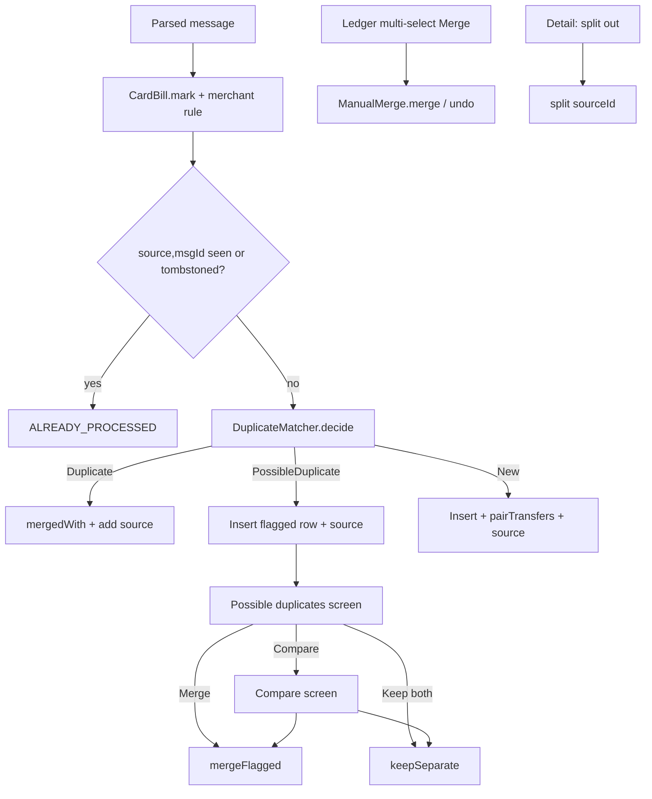

# Dedup & Review (Duplicate Matcher, Possible Duplicates, Compare, Merge / Split, Manual Merge)

| Field | Value |
|---|---|
| Feature ID | F-07 |
| Status | In progress (Phase 1: matcher and data layer done; Review screen basic; manual merge via ledger multi-select; Compare and split pending) |
| Priority | P0 |
| Phase | 1 |
| Last Updated | 2026-10-27 |

## 1. Description

One real payment usually reaches the app several times: a bank SMS, a bank email, a payment-app notification, a statement row, a screenshot or a hand entry. Dedup and review makes sure each payment becomes one ledger row. It decides for every incoming message whether it is a duplicate, a possible duplicate for the user to judge, or new, and it keeps balances, budgets, loans and tax income from counting a payment twice.

## 2. What This Feature Will Do

- Computes a fixed fingerprint for each payment from amount, direction, account digits, date and reference.
- Merges an incoming message into an existing row when the reference, fingerprint or close match agrees.
- Inserts a message as a flagged possible duplicate when the match is uncertain.
- Treats payment-app amounts rounded to whole rupees as matches within a short window.
- Merges statement rows into matching SMS or email rows without raising a review.
- Fills gaps in a merged row (paise, merchant, account digits, time, balance, category) from the new message.
- Ignores a message already processed, so re-reading the inbox changes nothing.
- Excludes flagged rows from balances, loans, recurring items and tax income until the user decides.
- Shows a Possible duplicates screen listing each flagged pair with the reason.
- Shows a Compare screen with differing values highlighted.
- Lets the user keep both rows or merge them into one.
- Lets the user merge several picked rows by hand, with undo.
- Splits a wrongly merged source message back into its own transaction.
- Remembers deleted messages so they are not added again.
- Reports counts of added, merged, flagged and skipped messages.

### 2.1 Inputs

- Each parsed incoming transaction from SMS, email, notifications, statements, screenshots or manual entry.
- User actions: Compare, Keep both, Merge, manual merge of selected rows, split, undo, delete.

### 2.2 Processing

1. Compute the fingerprint and look for stored rows with the same reference, fingerprint or a close amount in a time window.
2. Decide: duplicate (merge), possible duplicate (insert flagged with a reason) or new (insert).
3. When merging, fill missing details and keep every contributing message.
4. Save the whole batch in one step and skip messages already processed or deleted.
5. For user decisions, merge, keep separate, split or manually merge and update the rows.
6. Return the added, merged, flagged and skipped counts.

### 2.3 Outputs

- One ledger row per payment, with all its messages attached ([Transactions ledger](08_transactions_ledger.md)).
- Flagged rows and the Possible duplicates and Compare screens.
- The count report shown by the ingestion features.
- Deleted-message memory that blocks re-adding.

### 2.4 Out of Scope

- Parsing messages: [Parsing engine](06_transaction_parsing_engine.md).
- Reading SMS, email and notifications: [SMS ingestion](02_sms_ingestion.md), [Email ingestion](03_email_ingestion.md), [Notification ingestion](04_notification_ingestion.md).
- Statement row extraction: [Statement import](05_statement_import.md).
- Ledger views and bulk-action screens: [Transactions ledger](08_transactions_ledger.md).
- Duplicate account and loan detection cards: [Accounts Management](13_accounts_management.md), [Loans](15_loans.md).
- Transfer pairing details, which live in the ledger file.

## 3. Behaviour in Existing App

Sources: analysis Part B 7 (all of 7.1-7.4), Part B 2.3, Part A 2.3 (Review, Compare), Part B 1.1/1.2; Kotlin `parser-core/.../hash/TransactionHasher.kt:17-34`, `parser-core/.../dedup/DuplicateMatcher.kt:60-135`, `shared/.../repo/TransactionRepository.kt` (`ingestInTransaction` 172-261, `mergeFlagged`, `keepSeparate`, `split`, `reattributeAppRows`), `shared/.../repo/Merge.kt:13-34`, `shared/.../repo/ManualMerge.kt`, `app/.../ui/review/ReviewScreen.kt:95` (`ReviewRoute`) and `:174` (`CompareRoute`).

### 3.1 Hash (`TransactionHasher.hash`)

```text
key  = "<amountMinor/100>.<amountMinor%100 zero padded to 2>"      e.g. "250.00"
     + "|" + type.direction            // OUT, IN or XFER   (DEBIT and INVESTMENT both OUT)
     + "|" + (accountLast4 ?: "")
     + "|" + yyyy-MM-dd of the transaction time in IST (Asia/Kolkata)
     + "|" + (referenceNumber ?: "")
hash = lower-case hex( SHA-256( UTF-8(key) ) )
```

Masked sample: amount 25000 paise, DEBIT, last4 `1234`, 2026-09-25, ref `526812345678` => key `250.00|OUT|1234|2026-09-25|526812345678`. SMS and email share a hash only when all five parts agree; when only one carries the reference the fuzzy rules (2.3) catch them. The date uses the resolved transaction time (explicit printed time else message arrival).

### 3.2 Outcomes

`Duplicate(existingId, reason in REFERENCE | HASH | FUZZY)` = merge; `PossibleDuplicate(existingId, reasonText)` = insert flagged; `New` = insert. Constants: `WINDOW_MILLIS = 30 min`, `REVIEW_WINDOW_MILLIS = 12 h`, `STATEMENT_WINDOW_MILLIS = 36 h`, `ROUNDED_WINDOW_MILLIS = 4 h`. Loose sources = `{APP, SCREENSHOT, MANUAL}`. Storage lookups: by reference, by hash (including hashes of already-merged messages via `transaction_sources.parsedHash`), by amount in a time window, by amount range in a time window.

### 3.3 Decision procedure (`DuplicateMatcher.decide`)

1. Reference: incoming has a reference and a stored row has the same reference, same `amountMinor` and same direction => `Duplicate(REFERENCE)`.
2. Hash: stored `transactionHash == hash` or any source `parsedHash == hash`.
   - Incoming has no reference and the incoming source name is already among the stored row's sources => `PossibleDuplicate("Same amount, account and day, no reference number")` (same source twice could be two purchases; this is the same-source review rule).
   - Otherwise `apart = |stored.time - incoming.time| > 30 min` and `dated = incoming is STATEMENT or stored has a STATEMENT source`. Unless (`apart && !dated && (incoming ref null || stored ref null)`) => `Duplicate(HASH)`. Hours apart with a missing reference falls through to fuzzy.
3. Fuzzy: candidates = stored rows with same `amountMinor` and direction within +-36 h, nearest first. For each `c` (`gap = |c.time - tx.time|`):
   - skip when both references exist and differ; skip when both have accounts that differ (`last4Match` = equal or one ends with the other, e.g. "123" vs "0123");
   - `sameMerchant` = both non-null and equal ignoring case; `crossSource` = incoming source not in c's sources; `close = gap <= 30 min`; `loose` = incoming source in loose set or any of c's sources is; `accountless` = either account null;
   - statement involved (incoming STATEMENT or c has STATEMENT): `Duplicate(FUZZY)` if `crossSource && gap <= 36 h && (sameAccount || accountless)`, else skip (statements never raise a review);
   - skip if `gap > 12 h`;
   - first matching rule: `close && crossSource && (sameAccount || sameMerchant)` => Duplicate(FUZZY) at once; `close && crossSource && loose && accountless && merchantsAgree` => Duplicate(FUZZY); (if a review candidate was already chosen ignore the rest); `close && (sameAccount || sameMerchant)` => review "Same amount and account|merchant within 30 minutes"; `close && crossSource && (!loose || merchantsAgree)` => review "Same amount from SMS and email within 30 minutes"; `crossSource && sameAccount` (within 12 h) => review "Same amount and account on the same day, from SMS and email".
4. Rounded app amounts (`roundedAppMatch`): incoming APP with whole-rupee amount searches stored amounts `(amt+1)..(amt+99)` paise; incoming non-APP with a paise amount searches the amount truncated to whole rupees; within +-36 h, same direction, incoming source not in stored sources, and (incoming APP => stored has a non-APP source; incoming non-APP => stored is APP-only); same local day or within 4 h; accounts compatible (either null or `last4Match`); references compatible (either null or equal); `merchantsAgree`; nearest wins => `Duplicate(FUZZY)`.
5. Else the remembered review candidate => `PossibleDuplicate`, otherwise `New`.

`merchantsAgree(a,b)`: true if either is null or a generic UI phrase; else compare lower-cased alphanumerics (containment = agree); else true if they share a word of >= 3 letters.

### 3.4 What ingest does with the decision (`ingestInTransaction`, one immediate write transaction per batch)

1. `CardBill.mark(parsed, rawText)`: a DEBIT paying a card becomes TRANSFER (see [Transactions Ledger](08_transactions_ledger.md) 2.7 for the transfer rules).
2. Apply a merchant rule (category).
3. `(source, sourceMessageId)` already in `transaction_sources` or in `deleted_messages` => `ALREADY_PROCESSED` (skipped).
4. `decide`; `accountId = ensureAccount(...)`. A non-Duplicate decision is upgraded to `Duplicate(FUZZY)` when `manualLegFor` finds a hand-entered transfer leg (36 h, same account, amount, direction, nearest). An APP-source row without account takes a remembered payee account (`payee_accounts`).
5. Duplicate: load the stored row, `mergedWith(tx)` (2.5); a real account on a non-APP message fills a stored row lacking `accountId`/`accountLast4`; outcome `MERGED`; balance/limit update goes to the account the row ends on.
6. PossibleDuplicate: insert a new row with hash `"<hash>#<SOURCE>:<messageId>"`, `needsReview = true`, `duplicateOfId = candidate`, `reviewReason`; outcome `FLAGGED_FOR_REVIEW`.
7. New: insert; if insert returns -1 (unique hash race) load by hash and merge (`MERGED`), else `INSERTED`. On INSERTED add the card-bill note when set and run `pairTransfers`.
8. Always insert a `transaction_sources` row (rawText capped at 20,000) so a rescan is idempotent.
9. Apply balance/limit to the account (with a gap check first, see [Accounts Management](13_accounts_management.md)).

`IngestReport(inserted, merged, flagged, skipped)` is returned to the caller (SMS/email features show it as "a new, b merged, c to review").

### 3.5 Merge rules (`TransactionEntity.mergedWith(ParsedTransaction)`, `Merge.kt:13-34`)

Keep stored values, fill gaps from the message:

- `amountMinor`: replaced only if stored is a whole rupee, incoming has paise, same rupee part and same currency (app rounding).
- `merchant` (`betterMerchant`): incoming replaces stored only if stored is "weak" (contains `@`, more than half digits, or a generic UI phrase) and incoming is not weak.
- `upiId`, `referenceNumber`, `balanceMinor`, `availableLimitMinor`: stored `?:` incoming. `accountLast4`: the longer ("0123" over "123").
- `type`: DEBIT becomes INVESTMENT if incoming says INVESTMENT.
- `category`: replaces stored only when stored is OTHER or INCOME and incoming is neither.
- `timestamp`: explicit printed time beats arrival time; if the incoming states a balance/limit, is not a STATEMENT and the chosen time is after the incoming time by <= 30 min, use the incoming time (so a payment is not applied on top of a balance that already includes it). `hasExplicitTime` OR-ed, `confidence` max.
- Row-to-row (`mergedWith(TransactionEntity)`): same fill-the-gap idea plus `accountId`, `note`.

### 3.6 Review screens (`ReviewScreen.kt`)

- **ReviewRoute "Possible duplicates"** (`:95`): top bar title plus info button; pinned explanatory text; one card per flagged pair: reason text, both `TransactionRow`s, both source `MessageView`s collapsed to 4 lines, buttons Compare / Keep both / Merge. Empty: `EmptyState(DoneAll, "All clear", "Nothing needs a decision.")`. Reached from the Home notices sheet ("{n} possible duplicate(s)"), the Transactions "Needs review" banner and the `review` route.
- **CompareRoute "Compare"** (`:174`): table rows Amount, When, Merchant, Account, Channel, Reference, Balance after, Category, Reported by; differing values tinted `tertiary`; hint text; both messages; buttons "Keep both" / "Merge into one".
- Actions: `mergeFlagged(id)` merges the flagged row into its `duplicateOfId` target, moves its sources and deletes it (if the target vanished it only clears the flag); `keepSeparate(id)` clears `needsReview`, `duplicateOfId`, `reviewReason`.

### 3.7 Split and manual merge

- `split(transactionId, sourceId)`: re-parses the stored source's `rawText` through the registry, inserts it as a new transaction with hash `"<hash>#split:<sourceId>"` and moves that source; needs >= 2 sources. Offered on Transaction detail as "Not the same transaction: split it out" ([Transactions Ledger](08_transactions_ledger.md)).
- Manual merge (`ManualMerge.merge(ids >= 2)`): ranks rows by (real non-generic merchant, explicit time, has reference, has account, earliest `createdAt`, lowest id), keeps the best and folds the others in (`fold`: paise filling when amounts differ by < 100 paise and keeper is whole; bank name/kind from the other when keeper has no account; explicit time; category only if keeper is OTHER; subcategory/customCategory fill); reassigns their sources; deletes them WITHOUT tombstones (so messages remain visible and splittable). `undo(result)` restores the originals (snackbar "Merged into one payment." + Undo).
- Deleting transactions writes tombstones `(source, messageId)` for every source (chunks of 900) so a rescan never brings them back.
- Repair jobs (idempotent): `reparseStored`, `restoreMissingAccounts`, `reattributeAppRows` (fold account-less APP rows into the bank's row: amount range for a whole-rupee app amount, same direction, 4 h for rounded amounts else 30 min, references/merchants compatible), `reclassifyCardBills`, `importTransactions` (CSV: skip rows whose hash exists).

## 4. User Stories

- US-07-01: As a user, I never see the same payment twice when my bank sends an SMS and an email.
- US-07-02: As a user, when the app is unsure it shows me both rows and lets me merge or keep both.
- US-07-03: As a user, I can compare the two rows field by field before deciding.
- US-07-04: As a user, I can merge several selected rows into one and undo it.
- US-07-05: As a user, I can split a message out of a transaction that wrongly combined two payments.
- US-07-06: As a user, a payment-app notice with a rounded amount merges with the bank's exact amount.
- US-07-07: As a user, a transaction I deleted does not return when messages are re-read.

## 5. Functional Requirements (FR-07-01 ...)

- FR-07-01: The system shall compute the hash exactly as in 2.1 (amount with 2-digit paise, direction OUT/IN/XFER, last4, IST date, reference).
- FR-07-02: The system shall return `Duplicate(REFERENCE)` for same reference + amount + direction.
- FR-07-03: The system shall apply the hash rules of 2.3 step 2 including the same-source review reason and the 30-minute/dated/missing-reference fall-through.
- FR-07-04: The system shall apply the fuzzy candidate rules of 2.3 step 3 with windows 30 min / 12 h / 36 h and the three review reasons.
- FR-07-05: Statement-related candidates shall merge within 36 h on same/missing account and never raise a review.
- FR-07-06: The system shall apply the rounded payment-app rule (4 h / same local day, whole-rupee vs paise, +1..+99 paise range).
- FR-07-07: Ingest shall follow the nine steps of 2.4 inside one write transaction per batch and be idempotent per `(source, sourceMessageId)`.
- FR-07-08: Flagged rows shall be stored with hash `"<hash>#<SOURCE>:<messageId>"`, `needsReview`, `duplicateOfId`, `reviewReason`, and be excluded from balances, loans, recurring, tax income, insights and totals.
- FR-07-09: Merge shall follow the field rules of 2.5 (paise fill, weak merchant, longer last4, explicit time, balance-time rule, category fill).
- FR-07-10: The Possible duplicates screen shall list each flagged pair with reason, both rows, both messages and the actions Compare / Keep both / Merge, with the "All clear" empty state.
- FR-07-11: The Compare screen shall show the nine comparison rows with differing values highlighted and actions Keep both / Merge into one.
- FR-07-12: `mergeFlagged` and `keepSeparate` shall behave as in 2.6.
- FR-07-13: `split` shall create a new transaction from a source's raw text with hash suffix `#split:<sourceId>` and require >= 2 sources.
- FR-07-14: Manual merge of >= 2 rows shall pick the keeper by the ranking in 2.7, fold fields, reassign sources, delete others without tombstones and support undo.
- FR-07-15: Deleting rows shall write tombstones for all their sources; deleted messages shall be skipped by ingest.
- FR-07-16: Ingest shall return counts inserted/merged/flagged/skipped.
- FR-07-17: Flagged-row and merged-source display shall use the shared MessageView (Copy text, Show all / Show full email / Show less, "The original text wasn't kept for this one."), specified in [Transactions Ledger](08_transactions_ledger.md) FR-08-20.

## 6. Non-Functional Requirements (performance, battery, privacy, offline)

- Pure Dart matcher with injected storage lookups so it can be golden-tested against the Kotlin corpus; no network.
- A batch of 5,000 messages (first SMS scan) shall ingest in one transaction per batch without UI jank (run in an isolate, batch commits).
- Indices on `referenceNumber`, `(amountMinor, accountLast4, timestamp)` and `transaction_sources.parsedHash` must exist so lookups stay O(log n).
- Privacy: raw message text stays in the encrypted DB (cap 20,000 chars); hashes are not reversible; nothing leaves the phone.
- Idempotent: re-reading the same inbox changes nothing.

## 7. UI / Screens & User Flow (screen list + flow diagram)

| # | Screen | Source | Notes |
|---|---|---|---|
| 1 | Possible duplicates | `ui/review/ReviewScreen.kt:95` | Route `review`; info button; Compare / Keep both / Merge |
| 2 | Compare | `ui/review/ReviewScreen.kt:174` | Table with tinted differences |
| 3 | Merge confirm + undo snackbar (ledger multi-select) | `ui/transactions/TransactionsScreen.kt` | Owned by [Transactions Ledger](08_transactions_ledger.md) |
| 4 | Split link on Transaction detail | `ui/transactions/TransactionDetailScreen.kt:95` | Owned by ledger file |
| 5 | Home notice "{n} possible duplicate(s)" | `ui/home/HomeScreen.kt` (`NotificationsSheet`) | Entry point |



Reference GIFs:

-  (Status: Pending, not yet captured)
-  (Status: Pending, not yet captured)

## 8. Data Models (Dart entities + fields + types)

```dart
enum DuplicateReason { reference, hash, fuzzy }
enum TxSource { sms, email, csv, manual, app, screenshot, statement, notification }  // Source.name values

sealed class DedupDecision {}
class DuplicateOf extends DedupDecision { final int existingId; final DuplicateReason reason; }
class PossibleDuplicateOf extends DedupDecision { final int existingId; final String reasonText; }
class NewTransaction extends DedupDecision {}

@freezed class IncomingTx {   // projection of ParsedTransaction used by the matcher
  int amountMinor; String currency; TxType type; String? accountLast4; AccountKind kind;
  String? merchant; String? referenceNumber; DateTime time; bool hasExplicitTime; TxSource source; String hash;
}

enum IngestOutcome { inserted, merged, flaggedForReview, alreadyProcessed }
@freezed class IngestReport { int inserted; int merged; int flagged; int skipped; }

abstract class DedupStore {   // lookups the matcher needs
  Future<StoredTx?> byReference(String ref, int amountMinor, Direction d);
  Future<StoredTx?> byHashOrParsedHash(String hash);
  Future<List<StoredTx>> byAmountWindow(int amountMinor, Direction d, DateTime from, DateTime to);
  Future<List<StoredTx>> byAmountRangeWindow(int minMinor, int maxMinor, Direction d, DateTime from, DateTime to);
}
```

Constants: `kDupWindow = Duration(minutes: 30)`, `kReviewWindow = Duration(hours: 12)`, `kStatementWindow = Duration(hours: 36)`, `kRoundedWindow = Duration(hours: 4)`, `kLooseSources = {app, screenshot, manual}`, `kRawTextCap = 20000`.

## 9. Database Tables / Changes

No table is owned exclusively; the feature uses these (full definitions in [Transactions Ledger](08_transactions_ledger.md) section 9):

- `transactions`: `transactionHash` (UNIQUE), `needsReview` (default false), `duplicateOfId` (soft ref, no FK), `reviewReason`, `referenceNumber`, `accountLast4`, `timestamp`, `hasExplicitTime`, `confidence`, `createdAt`.
- `transaction_sources` (definition owned by [Transactions Ledger](08_transactions_ledger.md) section 9; plan.md labels it owner 07, but 08 owns it): `parsedHash` (index), `sourceMessageId`, `rawText`, UNIQUE `(source, sourceMessageId)`; special ids `xfer-out:<uuid>`, `xfer-in:<uuid>`, `stmt:<statementKey>:<row>`, derived ids with `#` (`<id>#nps`, `...#split:<n>`).
- `deleted_messages`: composite PK `(source TEXT, messageId TEXT)`, `deletedAt INTEGER` (tombstones). Full Drift table block owned by [Transactions Ledger](08_transactions_ledger.md) section 9.
- `processed_emails`: `messageId` PK, `processedAt`, `outcome` (PARSED, REJECTED, DUPLICATE, ERROR), `transactionId` (owned by [Email Ingestion](03_email_ingestion.md)).
- Indices needed: UNIQUE `transactionHash`; `(amountMinor, accountLast4, timestamp)`; `referenceNumber`; `timestamp`; `accountId`; `needsReview`; `transaction_sources(parsedHash)`.
- Flagged-row hash form: `"<hash>#<SOURCE>:<messageId>"`; split form `"<hash>#split:<sourceId>"`; manual transfer `manual-xfer:<uuid>:out|in`.

## 10. Business Rules & Logic (regex, parsing rules, algorithms, thresholds)

Constants: 30 min / 12 h / 36 h / 4 h; rounded range `+1..+99` paise; paise fill tolerance `< 100` paise; merchant-agree word length >= 3; raw text cap 20,000; tombstone chunk 900; `last4Match` = equal or one endsWith the other.

Pseudocode of `decide`:

```text
decide(tx):
  if tx.ref != null and store.byReference(tx.ref, tx.amount, tx.dir) != null -> Duplicate(REFERENCE)
  s = store.byHashOrParsedHash(tx.hash)
  if s != null:
     if tx.ref == null and tx.source in s.sources -> review = "Same amount, account and day, no reference number"
     else:
        apart  = |s.time - tx.time| > 30min
        dated  = tx.source == STATEMENT or STATEMENT in s.sources
        if !(apart && !dated && (tx.ref == null || s.ref == null)) -> Duplicate(HASH)
  review = null
  for c in candidates(amount, dir, +-36h) sorted by gap:
     if both refs exist and differ: continue
     if both have account and !last4Match: continue
     statement involved -> if crossSource && gap<=36h && (sameAccount||accountless) return Duplicate(FUZZY) else continue
     if gap > 12h: continue
     if close && crossSource && (sameAccount || sameMerchant) return Duplicate(FUZZY)
     if close && crossSource && loose && accountless && merchantsAgree return Duplicate(FUZZY)
     if review != null: continue
     review = first of: close&&(sameAccount||sameMerchant) -> "Same amount and account|merchant within 30 minutes";
                        close&&crossSource&&(!loose||merchantsAgree) -> "Same amount from SMS and email within 30 minutes";
                        crossSource&&sameAccount -> "Same amount and account on the same day, from SMS and email"
  if roundedAppMatch(tx) != null return Duplicate(FUZZY)
  return review != null ? PossibleDuplicate(review) : New
```

Worked examples (masked):

1. HDFC SMS `Sent Rs.250.00 ... From HDFC Bank A/C *1234 ... Ref 526812345678` then HDFC email with the same ref 20 min later => `Duplicate(REFERENCE)`; row keeps one record, two sources.
2. Two SMS from the same bank, same amount 250.00, same account, same day, no reference, at 10:00 and 10:20 => second flagged: "Same amount, account and day, no reference number" (same source).
3. SMS 250.00 at 10:00 and bank email 250.00 at 10:10 (no reference) => hash equal, not apart => `Duplicate(HASH)`.
4. Bank SMS stored as 250.37, then a PhonePe notification `₹250` (APP, no account) arrives: amounts differ so exact rules miss; rounded rule searches 250.01..250.99, finds the SMS row within 4 h, merchants agree => `Duplicate(FUZZY)`; the stored 250.37 is kept. If the app notice came first (250.00) the later SMS 250.37 replaces the whole-rupee amount (same rupee part).
5. Statement row 2,000.00 posted on 25 Sep (no time) vs ATM SMS 2,000.00 on 24 Sep 14:35, same last4 => gap < 36 h, cross-source, same account => `Duplicate(FUZZY)`, no review.
6. SMS and email 14 h apart, same amount/account, no reference => gap > 12 h => New (documented limitation, Open Question 3).

## 11. Platform / Native Requirements (permissions, channels, background work)

- None native. Runs in the Dart ingestion isolate used by SMS/email/notification workers; DB writes through `TransactionRepository` ([Transactions Ledger](08_transactions_ledger.md)).
- The Home notice and Transactions banner count `needsReview` rows; there is no dedicated notification for duplicates.

## 12. Dependencies (other features → link to their memory file; packages)

- [Transaction Parsing Engine](06_transaction_parsing_engine.md): produces `ParsedTransaction`, `CardBill.mark`, `TransactionHasher` inputs.
- [SMS Ingestion](02_sms_ingestion.md), [Email Ingestion](03_email_ingestion.md), [Notification Ingestion](04_notification_ingestion.md), [Statement Import](05_statement_import.md): callers of ingest.
- [Transactions Ledger](08_transactions_ledger.md): repository, tables, manual merge UI, transfer pairing.
- [Accounts Management](13_accounts_management.md): `ensureAccount`, balance/limit application, gap check.
- [Credit Cards](14_credit_cards.md): card bill payments classified as TRANSFER.
- [Loans](15_loans.md): excludes needs-review rows.
- Packages: `crypto` (SHA-256), `drift`, `riverpod`, `freezed`, `intl` / `timezone` (IST date).

## 13. Folder Location (lib/features/<name>/...)

```text
lib/features/dedup_review/
  data/datasources/dedup_store_drift.dart
  data/repositories/review_repository_impl.dart
  domain/entities/dedup_decision.dart, incoming_tx.dart, ingest_report.dart
  domain/usecases/decide_duplicate.dart, merge_parsed_into_stored.dart, merge_flagged.dart,
                  keep_separate.dart, split_source.dart, manual_merge.dart
  presentation/review_screen.dart, compare_screen.dart, widgets/review_pair_card.dart
lib/core/hash/transaction_hasher.dart
```

## 14. Edge Cases & Error Handling

- Unique hash race on insert (-1): load by hash and merge instead of failing.
- Flagged target deleted before decision: `mergeFlagged` only clears the flag.
- Same message rescanned: `(source, sourceMessageId)` exists => skipped; deleted messages are tombstoned.
- Fuzzy candidates with different references or different accounts are never merged.
- Account "123" vs "0123" (ICICI 3-digit) treated as the same account; the longer last4 wins on merge.
- Manual transfer legs: a later bank message within 36 h is folded into the leg.
- Foreign-currency rows hash on `amountMinor` in their own currency.
- Split with one source is refused.
- Manual merge never writes tombstones so the user can split later; deleting does.
- Dates for hashing always IST, regardless of device zone.

## 15. Test Cases (unit / widget / integration + sample fixtures)

Unit:

- TC-07-01 (FR-07-01): hash vectors (`250.00|OUT|1234|2026-09-25|526812345678`, no ref, no last4, XFER, DEBIT vs INVESTMENT equal).
- TC-07-02 (FR-07-02): reference rule across SMS/email.
- TC-07-03 (FR-07-03): hash rule: same-source review, 30-minute, hours-apart with missing ref, statement dated.
- TC-07-04 (FR-07-04): fuzzy table (close/crossSource/loose/accountless/merchantsAgree combinations, 12 h limit, differing refs, differing accounts).
- TC-07-05 (FR-07-05): statement vs SMS within 36 h, no review.
- TC-07-06 (FR-07-06): rounded app match both directions, 4 h and same-day, outside range.
- TC-07-07 (FR-07-09): merge field rules (paise fill, weak merchant, category fill, time/balance rule, longer last4).
- TC-07-08 (FR-07-13, FR-07-14): split and manual merge/undo; keeper ranking.
- TC-07-09 (FR-07-15): tombstones block re-ingest; manual merge leaves none.
- TC-07-10 (FR-07-07, FR-07-16): ingest of corpus duplicates gives expected inserted/merged/flagged/skipped; identical SMS/email hashes for the same transaction.

Widget:

- TC-07-11 (FR-07-10): Possible duplicates card contents and empty state.
- TC-07-12 (FR-07-11): Compare highlights differing fields.

Integration:

- TC-07-13 (FR-07-08, FR-07-12): flagged row is excluded from balance/totals; Merge removes it, Keep both includes it.

Fixtures: corpus samples 1-17 of the analysis (Part B 8), HDFC UPI SMS + email pair, PhonePe `Paid ₹250 to Ravi Kumar` with bank SMS, ATM withdrawal + statement row.

## 16. Acceptance Criteria

- AC-07-01: Hash vectors match the Kotlin implementation (FR-07-01; TC-07-01).
- AC-07-02: Every decision on the corpus equals the Kotlin result (FR-07-02..06; TC-07-02..06, TC-07-10).
- AC-07-03: Merged rows follow the fill rules and keep all sources (FR-07-09; TC-07-07).
- AC-07-04: Review screens work with Merge / Keep both / Compare and excluded totals (FR-07-08, FR-07-10..12; TC-07-11..13).
- AC-07-05: Split, manual merge, undo and tombstones behave as specified (FR-07-13..15; TC-07-08, TC-07-09).
- AC-07-06: Re-reading an inbox is idempotent (FR-07-07; TC-07-10).

## 17. Open Questions

1. `CARD_PAIR_WINDOW` is 5 days in code but "3 days" in a comment (analysis Part B Open Question 1); owned by [Transactions Ledger](08_transactions_ledger.md).
2. Whether the 12 h review window is intended; the KDoc says "later the same day" (Part B Open Question 13).
3. A cross-source copy arriving more than 12 h later with same amount/account is treated as New (e.g. late email); confirm acceptable.
4. `transaction_sources.source` documentation lists four values but code writes SMS, EMAIL, CSV, MANUAL, APP, SCREENSHOT, STATEMENT (and notification app rows as APP); confirm no other values (Part B Open Question 8).
5. Whether the Flutter hash should keep `type.direction` collapsing DEBIT and INVESTMENT (kept for CSV/backup compatibility).
6. Whether dedup statistics ("c to review") should be surfaced beyond the SMS scan summary.

## 18. Implementation Notes

Phase 1 data layer. Code: `features/dedup_review/domain/{dedup_policy,merge_rules}.dart` (pure Dart), ingest and `mergeFlagged`/`keepSeparate`/`watchReviewPairs`/`watchReviewCount` in `features/transactions_ledger/data/transaction_repository_impl.dart`. Tests: `test/features/dedup_review/dedup_policy_test.dart`, `test/features/transactions_ledger/transaction_repository_test.dart`.

Done: FR-07-02..06 (reference, hash incl. same-source review and the 30 min / dated / missing-reference fall-through, fuzzy windows 30 min / 12 h / 36 h with the three review reasons, statement rule, rounded payment-app rule; TC-07-02..06), FR-07-07 (ingest steps 2-9, idempotent per `(source, sourceMessageId)`; TC-07-10 data side), FR-07-08 (flagged hash `"<hash>#<SOURCE>:<messageId>"`, excluded from balances and totals; TC-07-13), FR-07-09 (`mergeInto`, TC-07-07), FR-07-12 (`mergeFlagged`, `keepSeparate`), FR-07-15/16 (tombstones skip ingest, `IngestReport` counts; TC-07-09 tombstone half).

Pending: FR-07-01 (hash is computed by the parser; parser_core's `TransactionHasher` owns TC-07-01), FR-07-10/11/17 (screens), FR-07-13 split and FR-07-14 manual merge/undo, `manualLegFor`, `reattributeAppRows`, `payee_accounts` remembered account.

Deviations: the repository loads nearby rows once (`DedupCandidate` list) and `DedupPolicy` serves them to parser_core's `DuplicateMatcher` through an in-memory `DedupLookup` (reconciled 2026-10-21, see Reconciliation note). Flagged rows are not offered as match candidates. The "same local day" test of the rounded rule uses the IST day (deterministic) instead of the device zone. `mergeFlagged` fills gaps row-to-row and moves sources but does not re-apply a stated balance.

Matcher in parser_core (Phase 1): `app/packages/parser_core/lib/src/dedup/` holds `DuplicateMatcher.decide(tx, lookup, {utcOffset})` as pure async logic over a `DedupLookup` interface (`byReference`, `byHash`, `potentialDuplicates`, `potentialDuplicatesInRange`), with `StoredTransaction`, `MatchReason` and the sealed `DedupDecision` (`Duplicate`, `PossibleDuplicate`, `NewTransaction`); `sourceKey(Source)` gives the upper-case source keys. It is a line-for-line port of the Kotlin matcher (FR-07-02..06) and `TransactionHasher` (FR-07-01, byte-identical, own SHA-256). Tests (`test/duplicate_matcher_test.dart`, `test/hash_test.dart`, 20 + 5): all 18 Kotlin `DuplicateMatcherTest` scenarios (TC-07-02..06) plus same-source review, helper and hash vectors (TC-07-01), and the Kotlin `TransactionHasherTest`. The app-side `DedupPolicy` is now an adapter over this matcher.

Phase 1 UI. Code: `features/dedup_review/presentation/dedup_review_screen.dart`, route `/review` (opened by the review banner on the Transactions tab). Tests: `test/features/dedup_review/review_screen_test.dart`.

UI done: FR-07-10 basic (one card per flagged row, New beside Existing with merchant, amount, time, bank and the review reason), FR-07-12 (Merge via `mergeFlagged`, disabled when the target is gone; Keep separate via `keepSeparate`; "Nothing to review" empty state).

Deferred: full Compare view and source messages, FR-07-11 sheet details, FR-07-13 split, FR-07-14 manual merge/undo, FR-07-17 shared MessageView, undo snackbar.

Reconciliation note (2026-10-21, Phase 1 hardening): done. The ledger has ONE matcher, parser_core's `DuplicateMatcher` (Kotlin parity). `DedupPolicy.decide` is now `Future<DedupDecision>` and only adapts: `DedupCandidate` -> `StoredTransaction` (sources via `sourceKey`, empty reference treated as none), an in-memory `DedupLookup` over the candidate list loaded once by the repository (`byHash` also matches hashes of messages already merged into a row, as before), and the matcher's `Duplicate/PossibleDuplicate/NewTransaction` -> `DedupDuplicate/DedupPossible/DedupNew`. The old 200-line rule copy was deleted; `DedupPolicy.windowMillis` etc. and `last4Match`/`merchantsAgree` delegate to the matcher. No behavioural test failed: all 13 dedup policy tests (now `async`, `await policy.decide`) and the ledger tests pass unchanged apart from that. Known differences, all toward Kotlin parity: merchant "generic" phrases now come from parser_core `GenericPhrases` (UI captions such as "view details"), so names like "payment" or "UPI" no longer count as agreeing with any merchant (Kotlin behaviour; no test depended on it); equal-distance candidates keep storage order (stable sort) instead of an unstable sort.

2026-10-22: manual merge of selected rows is `TransactionRepository.mergeRows` (oldest kept, sources moved), reached from Transactions multi-select (see [Transactions](08_transactions_ledger.md)). Compare view and split remain deferred.

## 19. Change Log (date | change | reason)

| Date | Change | Reason |
|---|---|---|
| 2026-10-17 | Created from hisaab_apk 2.9.8 analysis | Initial |
| 2026-10-19 | Linked `deleted_messages` and `transaction_sources` to 08 as definition owner; FR-07-17 (shared MessageView) | Audit Gate gap, scan_3, scan_6 |
| 2026-10-19 | Restructured to the 19-section standard (Description, What This Feature Will Do, Implementation Notes added); Last Updated bumped | Audit Gate (Prompt 2, Part A) |
| 2026-10-21 | Phase 1 data layer landed (`DedupPolicy` (reference/hash/fuzzy/rounded rules), merge rules, flagged-row actions) | Phase 1 |
| 2026-10-21 | Phase 1 Dart port landed in app/packages/parser_core: DuplicateMatcher and TransactionHasher | Phase 1 |
| 2026-10-21 | Phase 1 UI landed | Phase 1 |
| 2026-10-21 | Phase 1 pipeline wiring + UI landed (matcher reconciliation deferred, note only) | Phase 1 |
| 2026-10-21 | Phase 1 hardening: background SMS, nightly scan, off-isolate parse, dedup reconcile | Phase 1 |
| 2026-10-22 | Ledger: transfer/EMI pairing, calendar+merchant views, bulk actions, rules screen | Hardening |
| 2026-10-27 | Audit: matcher and 30-minute rule confirmed done; split and Compare confirmed not built | Kotlin parity audit |
