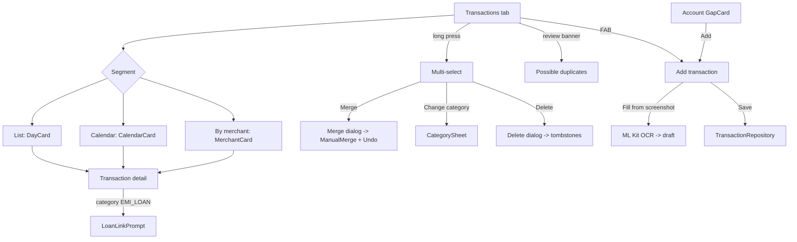

# Transactions Ledger (List / Calendar / By merchant, Detail, Add, Screenshot OCR, Bulk Actions, Transfers, Repository)

| Field | Value |
|---|---|
| Feature ID | F-08 |
| Status | In progress (data layer, core UI, transfer/EMI pairing, Calendar, By merchant, multi-select done; OCR, gaps, own-transfer form, split pending) ; 2026-10-27 parity: By category, Card/Account chips, payee-account map and own-transfer form done; 2026-10-27 parity: screenshot OCR fill done (FR-08-26); gaps, own-transfer and split are other items |
| Priority | P0 |
| Phase | 1 |
| Last Updated | 2026-10-27 |

## 1. Description

The ledger holds every parsed or typed payment as a row, together with the messages that produced it. It owns the Transactions tab, the transaction detail screen and the Add transaction screen, and it is the only place payments are written. It exists so the user has one trustworthy list of money in, out and moved, where transfers and credit card bill payments never count as spend or income.

## 2. What This Feature Will Do

- Shows the Transactions tab in List, Calendar and By merchant views with income, expenses and net totals.
- Searches by merchant, bank, note, reference, UPI id, category or amount.
- Filters by type (income, spends, investments, transfers) and by source (SMS, email, statement, app, manual).
- Shows a banner for payments needing review and opens them on tap.
- Lets the user select several rows to merge, change category or delete.
- Shows a detail screen with all fields, the source messages, and options to edit category, sub-category, account and note.
- Lets the user add a payment by hand as spent, received or transfer between own accounts.
- Fills the Add form from a screenshot using on-device text reading.
- Records transfers between own accounts as two linked entries.
- Classifies own-account transfers and credit card bill payments as transfers, outside spend and income.
- Pairs transfers and loan EMI payments after each new entry.
- Detects untracked balance changes and hands them to the Add screen to be explained.
- Remembers deleted payments so they do not return on a rescan.
- Keeps an amount in rupees for foreign currency payments.
- Accepts every write from other features through one entry point only.

### 2.1 Inputs

- Parsed transactions from [SMS ingestion](02_sms_ingestion.md), [Email ingestion](03_email_ingestion.md), [Notification ingestion](04_notification_ingestion.md) and [Statement import](05_statement_import.md).
- Manual entries, screenshot images, CSV imports and loan or category changes from other features.
- User actions: search, filter, select, edit, add, delete, merge.

### 2.2 Processing

1. Receive incoming payments and let [Dedup and review](07_dedup_review.md) decide whether to merge, flag or add.
2. Save each batch in one step, with its source messages.
3. Classify transfers and card bill payments and pair matching legs.
4. Keep the rupee value up to date for foreign currency.
5. Group, filter and total rows for the chosen view and period, leaving out rows needing review.
6. Apply edits, merges and deletions, writing deleted-message memory.

### 2.3 Outputs

- The Transactions tab, detail and Add screens.
- Stored payments and their source messages.
- Totals and rows used by other features, with transfers and review rows excluded from spend and income.
- Prompts to link a loan when an EMI payment is categorised ([Loans](15_loans.md)).

### 2.4 Out of Scope

- Duplicate matching and review screens: [Dedup and review](07_dedup_review.md).
- Parsing messages: [Parsing engine](06_transaction_parsing_engine.md).
- Category screens and rules: [Categorization and Rules](09_categorization.md).
- CSV export screen: [Backup and Export](24_backup_export.md).
- Book and period sheets: [Search and Filters](20_search_filters.md).
- Account balance maths and the gap card: [Accounts Management](13_accounts_management.md); loan prompt internals: [Loans](15_loans.md).
- Business invoices and Account Aggregator (v2 only).

## 3. Behaviour in Existing App

Sources: analysis Part A 2.3, 4.9, 4.10; Part B 1.1, 1.2, 1.6, 2.1, 2.3, 2.4, 7.3, 7.4; Kotlin `app/.../ui/transactions/TransactionsScreen.kt:85`, `TransactionsViewModel.kt`, `TransactionViews.kt` (`DayCard`, `CalendarCard`, `MerchantCard`), `TxSummaryStrip.kt`, `TransactionDetailScreen.kt:95`, `ui/add/AddTransactionScreen.kt:260`, `shared/.../repo/TransactionRepository.kt`, `repo/ManualMerge.kt`, `insight/BalanceGaps.kt`, `repo/UntrackedGapFinder.kt`, `ui/accounts/GapCard.kt:89`, `GapTracker.kt:23`, `shared/.../db/TransferLegs.kt`.

### 3.1 Transactions tab (`TransactionsRoute`)

- Top bar "Transactions" with a Bills icon (`EventRepeat`, opens [Recurring Transactions](12_recurring_transactions.md)); FAB add (hidden while selecting).
- Fixed controls: `SearchBox` (44 dp, placeholder "Search merchant, amount, note…", match-count badge, clear), `TxFilters` row: dropdown chips Type, Bank (logos; "HDFC" and "HDFC Bank" merged through `Brands.forBank(name).name`), Source; plus `BookPeriodChips(showBook=false)` ([Search & Filters](20_search_filters.md)); removable pills for an account or category scope that arrived through route args.
- LazyColumn items in order: `kpi` card (`TxSummaryStrip`: Income / Expenses / Net; "{n} transactions . {period}" and "Out includes investments"), `review` banner (when `reviewCount > 0`, selects REVIEW), `segments` (List / Calendar / By merchant), then the content.
- Type chips (`TxKind`): All, Income, Spends, Investments, Transfers; `REVIEW` ("Needs review") has no chip (only the banner selects it). Source chips (`TxSource`): SMS, Email, Statement, App (APP + NOTIFICATION), Manual (shown only when some row has none of the others).
- Empty states `EmptyState(ReceiptLong, "Nothing here")` for search miss, filter miss and empty period (text includes the period label).
- **List view**: one `DayCard` per day (header "Today" / "Yesterday" / "EEE, d MMM yyyy", with net and out). **Calendar view**: `CalendarCard` month grid limited to the period, a per-day value (spend / income / transfers / investments / flagged, by selected kind); tapping a day shows its `DayCard`, else `CalendarDayHint`. **By-merchant view**: `MerchantCard` per `merchant ?: bankName`, sorted by gross, expandable to its rows.
- Route args: `accountId` expands to merged children (`mergedIntoId`), `category` filters, `month` calls `ViewFilterStore.setMonth` once in the VM init.
- Search (`TransactionsViewModel.matchesSearch`, line 188), debounce 120 ms: matches merchant, bank, note, reference, upiId, category label, or amount-prefix on whole-rupee digits.
- Multi-select: long-press toggles; top bar becomes "{n} selected" with Select all, Merge (>= 2), Change category, Delete; `BackHandler` clears selection. Dialogs: `CategorySheet` "Category for {n} transactions" ([Categorization & Rules](09_categorization.md)); AlertDialog "Merge into one payment?" (snackbar "Merged into one payment." + Undo; logic in [Dedup & Review](07_dedup_review.md)); AlertDialog "Delete {n} transactions?" ("won't come back on a rescan" = tombstones). Choosing EMI_LOAN triggers `LoanLinkPrompt` ([Loans](15_loans.md)).

### 3.2 Transaction detail (`TransactionDetailRoute`, `TransactionDetailScreen.kt:95`)

Top bar "Transaction" + delete (AlertDialog "Delete this transaction?"). Body: avatar (merchant logo or category badge + bank badge), merchant (or category), signed amount; Category card and Sub-category card (rows open `CategorySheet` then `SubcategorySheet`; "Sub-category (automatic)" when guessed); fields card: Type, "In rupees" (foreign currency: `≈ ₹x` or "Add a rate in Settings › Forex rates", see [Forex Rates](23_forex_rates.md)), When, Account/Card (tappable: AlertDialog account picker with "Remember for {payee}" checkbox, writes `payee_accounts`), Channel (if not OTHER), UPI id, Reference, Balance after, Limit left, Flagged (review reason); Note field with inline Save; "Messages (n)" list of `MessageView` source cards (SMS / Email / App / Screenshot / Manual / CSV / Statement) with "Not the same transaction: split it out" when more than one. Changing a category calls `repository.setCategory` (learns a merchant rule). EMI_LOAN prompts `LoanLinkPrompt`.

### 3.3 Add transaction (`AddTransactionRoute`, `AddTransactionScreen.kt:260`)

- Top bar "Add transaction". Card "Fill from a screenshot": photo picker `PickVisualMedia.ImageOnly`; ML Kit `TextRecognizerOptions.DEFAULT_OPTIONS` (Latin, bundled, offline) -> `FreeTextParser.draft(text, now)` (see [Transaction Parsing Engine](06_transaction_parsing_engine.md)). States: scanning progress bar; "No amount found in that screenshot. Fill the details in yourself."; "Filled in from the screenshot. Check the details, then save."; error "Couldn't read that image: …". Account guess: account whose `last4` endsWith the draft last4 (and same bank if known). OCR never sets type INVESTMENT.
- Segmented Spent / Received / Transfer (or the three gap choices Payment / Transfer to my account / Money received when opened from a gap). Amount (₹ or currency prefix, decimal keyboard), Paid to / From (Transfer: From + To account pickers, From restricted to bank accounts), Category card -> `CategorySheet`, Account dropdown ("None (cash or other)"), date + time pickers (`DatePickerDialog`, `TimeInput`), reference caption, Note, "Save transaction".
- After save: "Done" button; if the save merged with an existing row it shows "This matched a transaction already recorded, so the two were merged."; an EMI_LOAN debit with merchant >= 2 chars asks `LoanLinkPrompt`. Sources: `Source.MANUAL` or `Source.SCREENSHOT` (OCR text kept as source text); sender "Cash / other" when no account.
- Gap mode: amber card "Untracked change . {summary}", candidate rows "Looks like: … [Assign]" (assigns existing account-less rows), the last choice per account is remembered (`untracked_gaps.choices`).

### 3.4 Bulk actions

Select all, Change category (applies `setCategory` per row, learning rules as per [Categorization & Rules](09_categorization.md)), Merge (`ManualMerge.merge`), Delete (`deleteTransactions` with tombstones in chunks of 900, FK cascade removes sources). Snackbars carry Undo for merge.

### 3.5 `TransactionRepository` - the single write path

Every writer calls it: `ingestInTransaction` / `ingestBatch` (SMS, email, notification, statement rows; algorithm in [Dedup & Review](07_dedup_review.md) 2.4), `addManual`, `addOwnTransfer`, `setCategory`, `setNote`, `setAccount`, `deleteTransactions`, `mergeFlagged`, `keepSeparate`, `split`, `ManualMerge.merge/undo`, `importTransactions` (CSV), `reparseStored`, `restoreMissingAccounts`, `reattributeAppRows`, `reclassifyCardBills`, `applyStatementToAccount`, `applyLoanStatus`, `applyDeposit`, `updateBalance`. All DB writes of a batch run in one immediate transaction; UI never writes tables directly. The two INR triggers (2.9) run in SQL or the Flutter equivalent computes `inrMinor` before each write.

### 3.6 Balance effects (used by ledger rows)

Signed effect per row: CREDIT `+inrMinor`; DEBIT and INVESTMENT `-inrMinor`; TRANSFER on a CARD `+inrMinor` (bill payment frees limit); TRANSFER on a bank account via `TransferLegs.SIGNED_SQL` (source `xfer-out:%` => `-`, `xfer-in:%` => `+`, note `Credit card bill%` => `-`, else 0 = unclear). Needs-review rows and rows with null `inrMinor` are excluded. Detailed balance rules live in [Accounts Management](13_accounts_management.md).

### 3.7 Transfers and card-bill exclusion

TRANSFER rows are excluded from spend and income everywhere. Where classification happens:

1. Parser: `TypeClassifier` TRANSFER regex (card "payment received", self transfer, own account); `BaseBankParser` converts a bank DEBIT to TRANSFER when `CardBill.isBill(text, merchant, vpa)`; payment-app notifications paying a card are TRANSFER with merchant "Credit card bill".
2. Ingest: `CardBill.mark` turns any DEBIT whose text/payee reads as a card bill into TRANSFER/Category.TRANSFER, merchant `merchant ?: "Credit card bill"`; bank-side row gets note `"Credit card bill payment"` (`CARD_BILL_NOTE`).
3. `pairTransfers(id)` after each INSERT (not for merges): opposite type, same `amountMinor`, within +-2 hours, different non-null `accountId`, both kind ACCOUNT => both TRANSFER with note "Self transfer between your accounts"; a bank DEBIT within +-`CARD_PAIR_WINDOW` (5 days) of a same-amount TRANSFER on a CARD or with note "Credit card bill..." => TRANSFER, note "Credit card bill payment"; else `pairEmi`; a card-side TRANSFER ("payment received") pulls the nearest same-amount bank DEBIT (kind ACCOUNT) within the window.
4. `pairEmi`: same amount within +-3 days; one side on a LOAN account with category EMI_LOAN, the other a DEBIT on a non-loan account with EMI_LOAN or channel AUTO_DEBIT => the loan-account side becomes TRANSFER with note "EMI also debited from your bank account" (the bank debit stays the spend).
5. Manual transfers `addOwnTransfer`: two TRANSFER rows (out leg on `from`, in leg on `to`; one may be missing), hash `manual-xfer:<uuid>:out|in`, source MANUAL, `sourceMessageId = xfer-out:<uuid>` / `xfer-in:<uuid>`, merchants "To <account label>" / "From <account label>"; a later bank message matching a leg (same account, amount, direction, within 36 h, nearest) is folded into the leg (`manualLegFor`).
6. `reclassifyCardBills()` sweep re-runs classification over stored data and pairs every card-side payment.
7. Rules never re-file transfers (`ruleFor` returns null for TRANSFER; rule `applyToPast` has `type != 'TRANSFER'`).

Spend definitions: `MonthSpend` (spend = DEBIT with category != TRANSFER; refund = CREDIT with category REFUND subtracts; income = CREDIT not TRANSFER/REFUND; INVESTMENT not spend) versus Room aggregates (DEBIT+INVESTMENT as spent, CREDIT as income incl. refunds). A port must pick the right one per screen (see [Expense Tracking](10_expense_tracking.md), [Income Tracking](11_income_tracking.md)).

### 3.8 Untracked gap detection and hand-off

`BalanceGaps.detect` (`MIN_GAP_MINOR = 100`, `MIN_SHARE_BPS = 50`, `MAX_AGE_MS = 90 days`, `MAX_UNKNOWN_TRANSFERS = 6`, history 240 days): per liquid, non-hidden, non-merged, non-linked account compute members (account + linked debit cards + merged accounts); usable rows = `!needsReview && duplicateOfId == null && accountId != null`; for each consecutive pair of rows that state a balance (cards: `availableLimitMinor`) skip if `t2 <= t1`, older than 90 days, or a manual balance was set in `(t1, t2]`; expected `B2 = B1 + sum(window)` (CREDIT +, DEBIT/INVESTMENT -, card TRANSFER +, account TRANSFER by direction map else unknown; null `inrMinor` aborts); `gap = B2 - expected`; with unknown transfers try every sign combination, null result if any unknown; significant when `|gap| >= max(100, (|gap| + sum|amounts|) * 50 / 10000)`. Emits `UntrackedGap(accountId, fromTime, toTime, deltaMinor, balanceBefore, balanceAfter, card)` keyed `"accountId|fromTime|toTime"`, skipped if dismissed, sorted by `toTime` desc.

Hand-off to Add transaction: `GapPrefill.of(gap, lastChoice)` picks choices (out and card: PAYMENT only; out: PAYMENT or TRANSFER; in: RECEIVED or TRANSFER), default TRANSFER for a card limit that rose else the first choice, prefill time `toTime - 60 s`. `GapCandidates.find(gap, rows)` suggests up to 3 account-less INR non-TRANSFER rows (max 14 oldest in window, right direction) whose amount (single or sum of 2-3) is within 100 paise of `|delta|`. The GapCard on the account detail screen is owned by [Accounts Management](13_accounts_management.md); DataStore `untracked_gaps` keys `dismissed`, `notified`, `choices` (`"<accountId>=<GapChoice>"`).

### 3.9 INR value triggers

`transactions.inrMinor` is maintained by triggers `transactions_inr_insert` and `transactions_inr_update` (AFTER UPDATE OF amountMinor, currency, accountId, timestamp), not in the exported schema JSON, created by `ForexSql.install`: `inrMinor = amountMinor` when currency INR, else `ROUND(amountMinor * inrPerUnit * (1 + markupBps/10000.0))` with the nearest-day rate (`ABS(r.day - istDay)` minimal, `istDay = (timestamp + 19,800,000) / 86,400,000`); no rate => NULL. See [Forex Rates](23_forex_rates.md) and [Credit Cards](14_credit_cards.md).

### 3.10 MessageView (shared original-message card)

Shared component used by Transaction detail (this feature), [Dedup & Review](07_dedup_review.md) (flagged-row sources) and [Statement Import](05_statement_import.md) (statement sources). Source: `ui/components/MessageView.kt:57-140`.

- Header: 36 dp circle (EMAIL: first letter of sender name; other sources: icon by source: SMS, EMAIL, CSV, APP, SCREENSHOT, MANUAL, STATEMENT), title by source ("SMS · {sender}", sender name for email, "{sender} notification", "From a screenshot", "Added by you", "Imported from CSV", "Statement · {sender}"), subtitle "<sender address> · <date time>" (`MessageView.kt:77-80`, `142-152`).
- "Copy text" icon button (visible only when `rawText` exists) copies the full raw text to the clipboard (`MessageView.kt:88-92`).
- EMAIL shows the subject then a divider; other sources show the text in a chat-bubble shape; STATEMENT text is monospace.
- Collapsed to 10 lines (`collapsedLines`) when the text has more than 10 lines or more than 700 chars; toggle label "Show all" (SMS and others), "Show full email" (EMAIL), "Show less" when expanded (`MessageView.kt:108-136`). Text is selectable.
- No stored text (`rawText` null): "The original text wasn't kept for this one." and no copy button (`MessageView.kt:102-104`).

### 3.11 Transactions calendar captions and colour

Calendar segment (`TransactionsScreen.kt:225-244`): the day value is the sum of rupees per local day; with kind ALL only spends are summed. Caption by kind: ALL and Expense "Daily spend", Income "Daily income", Transfer "Daily transfers", Investment "Daily investments", Review "Flagged amounts by day". Cell colour is the positive colour for Income and the accent colour for every other kind.


## 4. User Stories

- US-08-01: As a user, I see every payment grouped by day, with income, expenses and net for the period.
- US-08-02: As a user, I can switch to a calendar or a by-merchant view of the same data.
- US-08-03: As a user, I can search by merchant, amount, note, reference or category and filter by type, bank and source.
- US-08-04: As a user, I can open a transaction, change its category, account and note and see which messages it came from.
- US-08-05: As a user, I can add a cash payment or an own-account transfer by hand.
- US-08-06: As a user, I can fill the form from a payment screenshot.
- US-08-07: As a user, I can select several rows to merge, recategorise or delete.
- US-08-08: As a user, my card bill payments and own transfers never count as spending.
- US-08-09: As a user, when the balance moved without a recorded payment I can add it from the gap card.

## 5. Functional Requirements (FR-08-01 ...)

- FR-08-01: The Transactions tab shall show the KPI strip, review banner, List / Calendar / By merchant segments and the controls of 2.1.
- FR-08-02: List view shall group by local day with headers Today / Yesterday / "EEE, d MMM yyyy" and net/out per day.
- FR-08-03: Calendar view shall render a month grid limited to the period with a per-day value for the selected kind and show the tapped day's rows.
- FR-08-04: By-merchant view shall group by `merchant ?: bankName`, sort by gross and expand to rows.
- FR-08-05: Type chips All / Income / Spends / Investments / Transfers and source chips SMS / Email / Statement / App / Manual shall filter rows; REVIEW is selectable only through the banner.
- FR-08-06: Search shall match merchant, bank, note, reference, upiId, category label and whole-rupee amount prefix with 120 ms debounce and a match-count badge.
- FR-08-07: Route args `accountId` (with merged children), `category`, `month` shall scope the list with removable pills.
- FR-08-08: Long-press shall enter multi-select with Select all, Merge, Change category, Delete and back-to-clear.
- FR-08-09: Delete shall write tombstones for every source and ask confirmation "Delete {n} transactions?".
- FR-08-10: Transaction detail shall show all fields of 2.2, allow editing category, sub-category, account (with "Remember for payee") and note, list source messages and offer split when > 1 source.
- FR-08-11: Add transaction shall support Spent / Received / Transfer, all fields of 2.3, validation, merge feedback and the EMI_LOAN loan prompt.
- FR-08-12: Screenshot fill shall run offline OCR (Latin) through the free-text parser, show the four states and guess the account by last4.
- FR-08-13: Own transfers shall create two linked TRANSFER legs with `xfer-out` / `xfer-in` source ids and fold later bank messages into matching legs (36 h).
- FR-08-14: Card bill payments and own-account transfers shall be TRANSFER, excluded from spend/income, classified by the rules of 2.7.
- FR-08-15: `pairTransfers` and `pairEmi` shall run after each insert using the windows 2 h / 5 days / 3 days.
- FR-08-16: The untracked gap detector and the Add-transaction gap mode (choices, prefill, candidates, remembered choice) shall follow 2.8.
- FR-08-17: All writes shall go through `TransactionRepository` in one write transaction per batch; no feature may write `transactions` or `transaction_sources` otherwise.
- FR-08-18: `inrMinor` shall be maintained on insert and on update of amountMinor/currency/accountId/timestamp and recomputed when rates or markups change.
- FR-08-19: Needs-review rows shall be excluded from balances, totals and from list segments other than REVIEW (except the review banner count).
- FR-08-20: The shared MessageView shall offer a "Copy text" action (full raw text to clipboard) only when raw text exists, collapse text over 10 lines or 700 chars with "Show all" / "Show full email" (email) / "Show less", and show "The original text wasn't kept for this one." when no text is stored (see 3.10; shared with [Dedup & Review](07_dedup_review.md) and [Statement Import](05_statement_import.md)).
- FR-08-21: The Transactions calendar shall caption by kind ("Daily spend", "Daily income", "Daily transfers", "Daily investments", "Flagged amounts by day") and colour Income cells with the positive colour, all other kinds with the accent colour (see 3.11).
- FR-08-22: `deleted_messages` tombstones (owned by this feature, see section 9) shall be written on transaction delete and checked at ingest; inserts ignore duplicates.
- FR-08-23: Rows are tagged Card or Account in the list; the filter bar offers All / Accounts / Cards; a By category segment groups spends by category with card and account together, a subtotal split (Account x, Card y) and card refunds as a negative Refund group; the summary strip shows Income / Expenses (cash basis, ADR-0011) / Net, the card purchases figure and a one-line basis note.
- FR-08-24: The detail account picker offers "Remember for this payee"; the payee-to-account map (settings key `payee_account:<merchant key>`, no schema change) files later ingested rows of that payee under the chosen account.
- FR-08-25: The Add screen has a Transfer mode (From, To, amount, date, note) that writes both legs through `TransactionRepository.addOwnTransfer`; a transfer into a card writes the bank leg with the card bill note so it counts once as a payment (FR-10-19).
- FR-08-26: Add transaction shall offer "Fill from a screenshot": pick an image, read it on device with ML Kit Latin text recognition (`google_mlkit_text_recognition`, bundled model, offline), parse with `FreeTextParser.draft`, fill the form for review (amount, type, payee, reference, category, date, account guessed by last digits and bank) and never save by itself. States: scanning bar, "No amount found in that screenshot. Fill the details in yourself.", "Filled in from the screenshot. Check the details, then save.", "Couldn't read that image."

## 6. Non-Functional Requirements (performance, battery, privacy, offline)

- List with 50,000 rows scrolls at 60 fps: Drift queries stream with day-grouped pagination, no full in-memory sort.
- Search latency < 150 ms after debounce on 50,000 rows (indexed columns and a `LIKE` over merchant/note).
- Offline: OCR uses the bundled Latin model, no network; amounts masked when `hide_amounts` is on ([Security & Privacy](25_security_privacy.md)).
- Privacy: raw text capped at 20,000 chars per source; screenshot image is not stored, only recognised text.
- Atomic writes; undo for merge held in memory for the snackbar duration.

## 7. UI / Screens & User Flow (screen list + flow diagram)

| # | Screen | Source | Notes |
|---|---|---|---|
| 1 | List view | `ui/transactions/TransactionsScreen.kt:85`, `TransactionViews.kt` (`DayCard`) | Default segment |
| 2 | Calendar view | `TransactionViews.kt` (`CalendarCard`, `CalendarDayHint`) | Month grid |
| 3 | By-merchant view | `TransactionViews.kt` (`MerchantCard`) | Expandable cards |
| 4 | Multi-select + dialogs | `TransactionsScreen.kt` | Category sheet, Merge dialog, Delete dialog |
| 5 | Transaction detail | `TransactionDetailScreen.kt:95` | Account picker, messages, split |
| 6 | Add transaction | `ui/add/AddTransactionScreen.kt:260` | Spent / Received / Transfer, gap mode |
| 7 | Fill from screenshot | `AddTransactionScreen.kt:184` (`scan`) | Photo picker + OCR states |
| 8 | KPI strip, review banner, filters | `TxSummaryStrip.kt`, `TransactionsScreen.kt` | Parts of screen 1 |



Reference GIFs:

-  (Status: Pending, not yet captured)
-  (Status: Pending, not yet captured)
-  (Status: Pending, not yet captured)
-  (Status: Pending, not yet captured)
-  (Status: Pending, not yet captured)
-  (Status: Pending, not yet captured)
-  (Status: Pending, not yet captured)

## 8. Data Models (Dart entities + fields + types)

```dart
enum TxType { debit, credit, transfer, investment }
enum AccountKind { account, card }
enum Channel { upi, imps, neft, rtgs, card, atm, autoDebit, other }
enum TxKind { all, income, spends, investments, transfers, review }
enum TxSourceFilter { sms, email, statement, app, manual }
enum LedgerView { list, calendar, merchant }

@freezed class LedgerTx {
  int id; int amountMinor; String currency; TxType type; String bankName; String? accountLast4; AccountKind accountKind;
  int? accountId; String? merchant; String? upiId; String? referenceNumber; Channel channel;
  int? balanceMinor; int? availableLimitMinor; DateTime timestamp; bool hasExplicitTime;
  Category category; String? subcategory; int? customCategoryId; String transactionHash; double confidence;
  bool needsReview; int? duplicateOfId; String? reviewReason; String? note; DateTime createdAt; int? inrMinor;
}

@freezed class TxSourceRow {
  int id; int transactionId; String source; String sourceMessageId; String sender; String parsedHash;
  String? rawText; DateTime receivedAt; String? subject;
}

@freezed class LedgerFilter {
  TxKind kind; Set<String> banks; Set<TxSourceFilter> sources; String query; int? accountId; String? category;
  // book + period come from the global ViewFilter ([20](20_search_filters.md))
}

@freezed class AddTxDraft {
  TxType type; int? amountMinor; String currency; String? payee; int? fromAccountId; int? toAccountId;
  Category? category; DateTime when; String? reference; String? note; bool fromScreenshot; String? ocrText;
}

@freezed class UntrackedGap {
  int accountId; DateTime fromTime; DateTime toTime; int deltaMinor; int balanceBefore; int balanceAfter; bool card;
  String get key => '$accountId|${fromTime.millisecondsSinceEpoch}|${toTime.millisecondsSinceEpoch}';
}
enum GapChoice { payment, transfer, received }
```

## 9. Database Tables / Changes

```dart
class Transactions extends Table {
  IntColumn  get id => integer().autoIncrement()();
  IntColumn  get amountMinor => integer()();
  TextColumn get currency => text()();                              // "INR", "USD"
  TextColumn get type => text()();                                  // DEBIT|CREDIT|TRANSFER|INVESTMENT
  TextColumn get bankName => text()();
  TextColumn get accountLast4 => text().nullable()();               // 2-4 chars
  TextColumn get accountKind => text()();                           // ACCOUNT|CARD
  IntColumn  get accountId => integer().nullable().references(Accounts, #id, onDelete: KeyAction.setNull)();
  TextColumn get merchant => text().nullable()();
  TextColumn get upiId => text().nullable()();                      // lower-cased VPA
  TextColumn get referenceNumber => text().nullable()();            // upper alnum, min length 6
  TextColumn get channel => text()();                               // UPI|IMPS|NEFT|RTGS|CARD|ATM|AUTO_DEBIT|OTHER
  IntColumn  get balanceMinor => integer().nullable()();
  IntColumn  get availableLimitMinor => integer().nullable()();
  IntColumn  get timestamp => integer()();                          // epoch ms
  BoolColumn get hasExplicitTime => boolean()();
  TextColumn get category => text()();
  TextColumn get transactionHash => text().unique()();
  RealColumn get confidence => real()();
  BoolColumn get needsReview => boolean().withDefault(const Constant(false))();
  IntColumn  get duplicateOfId => integer().nullable()();           // no FK
  TextColumn get reviewReason => text().nullable()();
  TextColumn get note => text().nullable()();
  IntColumn  get createdAt => integer()();
  TextColumn get subcategory => text().nullable()();
  IntColumn  get customCategoryId => integer().nullable()();        // category then OTHER
  IntColumn  get inrMinor => integer().nullable()();                // trigger/code maintained
}

class TransactionSources extends Table {
  IntColumn  get id => integer().autoIncrement()();
  IntColumn  get transactionId => integer().references(Transactions, #id, onDelete: KeyAction.cascade)();
  TextColumn get source => text()();      // SMS|EMAIL|CSV|MANUAL|APP|SCREENSHOT|STATEMENT
  TextColumn get sourceMessageId => text()();
  TextColumn get sender => text()();
  TextColumn get parsedHash => text()();
  TextColumn get rawText => text().nullable()();   // cap 20,000
  IntColumn  get receivedAt => integer()();
  TextColumn get subject => text().nullable()();
  @override List<Set<Column>> get uniqueKeys => [{source, sourceMessageId}];
}
```

**Table ownership**: this file owns the definitions of `transactions`, `transaction_sources` and `deleted_messages` (plan.md labels `transaction_sources` as owner 07; the definition is here, 07 only references it).

```dart
// Source: Entities.kt:227-228, created in MIGRATION_2_3 (HisaabDatabase.kt:69-71). Tombstones so a deleted message is never re-ingested.
class DeletedMessages extends Table {
  TextColumn get source => text()();        // SMS|EMAIL|CSV|MANUAL|APP|SCREENSHOT|STATEMENT, same domain as transaction_sources.source
  TextColumn get messageId => text()();     // same ids as transaction_sources.sourceMessageId (incl. xfer-out:, stmt:, '#' derived)
  IntColumn  get deletedAt => integer()();  // epoch millis
  @override Set<Column> get primaryKey => {source, messageId};   // composite PK is the only index; lookup is (source, messageId)
}
```

Purpose: ingest rule 3 in [Dedup & Review](07_dedup_review.md) skips any `(source, messageId)` found here (`ALREADY_PROCESSED`). Written by delete (FR-08-09) with `INSERT OR IGNORE` (`Daos.kt:317-325`); manual merge never writes tombstones.

Indices: UNIQUE `transactionHash`; `(amountMinor, accountLast4, timestamp)`; `referenceNumber`; `timestamp`; `accountId`; `needsReview`; on sources `(transactionId)`, `(parsedHash)`. Related tables used here: `deleted_messages`, `forex_rates` (`currency`, `day`, `inrPerUnit`), `accounts` ([Accounts Management](13_accounts_management.md)). DataStores/prefs: `untracked_gaps` (`dismissed`, `notified`, `choices`), SharedPreferences `payee_accounts`, `view_filter.book`. Triggers (Drift custom statements installed on every open with `IF NOT EXISTS`): `transactions_inr_insert`, `transactions_inr_update` (AFTER UPDATE OF amountMinor, currency, accountId, timestamp). Migrations v1-v15 history applies to an import path from the old Room DB; a fresh Flutter DB starts at its own schema version 1 (Open Question 6).

## 10. Business Rules & Logic (regex, parsing rules, algorithms, thresholds)

Constants: display uses the device zone (`Periods.zone`), hashing uses IST. Search debounce 120 ms; amount-prefix search on whole rupees; raw text cap 20,000; tombstone chunk 900; `pairTransfers` own-account window +-2 h; `CARD_PAIR_WINDOW` 5 days; `pairEmi` +-3 days; manual leg fold 36 h; gap constants in 2.8; EMI loan prompt needs merchant length >= 2; loan "prepayment" tagging belongs to [Loans](15_loans.md).

Masked samples: own transfer: user adds Transfer 5,000.00 From `HDFC ••1234` To `ICICI ••123` => legs `TRANSFER` merchant "To ICICI ••123" (`xfer-out:<uuid>`) and "From HDFC ••1234" (`xfer-in:<uuid>`). Card bill: bank SMS `Rs 12,345.00 debited from A/c XX1234 on 05-09-26 towards your HDFC Bank Credit Card XX5678` => TRANSFER with note "Credit card bill payment"; card SMS `Payment of Rs 12,345.00 received towards your HDFC Bank Credit Card XX5678` => card-side TRANSFER; pairing marks both.

Worked examples:

1. Gap: HDFC balance 52,340.50 (10 Sep), SMS debit 1,000, next stated balance 50,000.00 (12 Sep) => expected 51,340.50, gap -1,340.50 (>= max(100, (1340.50+1000)*0.5%=11.7)) => `UntrackedGap(delta -134050)` with choices [PAYMENT, TRANSFER], prefill time `toTime - 60 s`.
2. Search "250" matches amount 250.xx rows (whole-rupee prefix) and merchants containing "250".
3. Own transfer then bank SMS debit 5,000.00 within 36 h on the same account => folded into the out leg, no new row.
4. EMI: loan-account row 12,345 (EMI_LOAN) and bank debit 12,345 two days later with AUTO_DEBIT => loan-account side becomes TRANSFER "EMI also debited from your bank account".

## 11. Platform / Native Requirements (permissions, channels, background work)

- Photo picker (Android `PickVisualMedia`, Flutter `image_picker`/`photo_manager` without storage permission), no camera permission.
- ML Kit text recognition through `google_mlkit_text_recognition` (Latin), models bundled.
- No network or other runtime permissions; ingest workers (other features) call the repository from a background isolate, so the Drift DB must be opened with a shared connection / isolate-safe executor.
- Optional notification for new transactions and gaps is owned by [Alerts & Reminders](21_alerts_reminders.md) (`transaction_notifications`).

## 12. Dependencies (other features → link to their memory file; packages)

- [Dedup & Review](07_dedup_review.md): ingest decision, review actions, manual merge/split.
- [Transaction Parsing Engine](06_transaction_parsing_engine.md): `ParsedTransaction`, `FreeTextParser.draft`.
- [Categorization & Rules](09_categorization.md): CategorySheet, `setCategory` rule learning.
- [Accounts Management](13_accounts_management.md): accounts, balances, GapCard, `ensureAccount`.
- [Credit Cards](14_credit_cards.md): card TRANSFER semantics, limits. [Loans](15_loans.md): LoanLinkPrompt, EMI pairing.
- [Search & Filters](20_search_filters.md): Book/Period state. [Forex Rates](23_forex_rates.md): `inrMinor`. [Backup & Export](24_backup_export.md): CSV import calls `importTransactions`. [Expense Tracking](10_expense_tracking.md), [Income Tracking](11_income_tracking.md), [Analytics](18_analytics.md): consumers.
- Packages: `drift`, SQLCipher via the `sqlite3` build hook, `riverpod`, `freezed`, `go_router`, `intl`, `google_mlkit_text_recognition`, `image_picker`, `uuid`, `crypto`.

## 13. Folder Location (lib/features/<name>/...)

```text
lib/features/transactions/
  data/datasources/transaction_dao.dart, source_dao.dart, deleted_message_dao.dart, forex_sql.dart
  data/repositories/transaction_repository_impl.dart
  domain/entities/ledger_tx.dart, tx_source_row.dart, ledger_filter.dart, add_tx_draft.dart, untracked_gap.dart
  domain/usecases/pair_transfers.dart, pair_emi.dart, add_manual_tx.dart, add_own_transfer.dart, delete_transactions.dart,
                  find_untracked_gaps.dart, gap_prefill.dart, gap_candidates.dart, match_search.dart
  domain/repositories/transaction_repository.dart
  presentation/transactions_screen.dart, tx_filters.dart, tx_summary_strip.dart, day_card.dart, calendar_card.dart,
               merchant_card.dart, transaction_detail_screen.dart, add_transaction_screen.dart, widgets/message_view.dart
  presentation/providers/ledger_provider.dart, add_transaction_provider.dart
lib/core/db/tables/transactions.dart, transaction_sources.dart
```

## 14. Edge Cases & Error Handling

- Save with amount 0 or empty: blocked, inline error; decimal amounts parsed with `,` removed, max 2 decimals (foreign currency uses its own minor units).
- OCR finds no amount: message "No amount found in that screenshot. Fill the details in yourself."; OCR exception: "Couldn't read that image: …".
- Save that merges with an existing row: show the merge notice, no duplicate row.
- Foreign currency without a rate: "In rupees" shows "Add a rate in Settings › Forex rates"; `inrMinor` NULL so the row is excluded from totals and gap windows.
- Deleting the last source of a split: refused. Deleting a transaction tombstones every message.
- Filters yielding nothing: "Nothing here"; period with no data includes the period label.
- Transfer legs with one side missing (external account) remain valid.
- Merchant null: group under bank name in By-merchant view.
- Selection mode: back press clears selection before navigating.
- Gap detection ignores accounts hidden, merged, linked (debit cards) or non-liquid.
- Timezone: hash date IST; display zone is the device zone.
- MessageView with `rawText` null: empty-state text, no "Copy text" (FR-08-20). Long email: "Show full email" then "Show less".
- `deleted_messages` insert is idempotent (`OnConflictStrategy.IGNORE`); re-adding the same tombstone is a no-op (FR-08-22).

## 15. Test Cases (unit / widget / integration + sample fixtures)

Unit:

- TC-08-01 (FR-08-06): `matchesSearch` over merchant/bank/note/reference/upiId/category/amount prefix.
- TC-08-02 (FR-08-14, FR-08-15): `pairTransfers` own-account (2 h), card bill (5 days), card-side payment, `pairEmi` (3 days).
- TC-08-03 (FR-08-13): `addOwnTransfer` legs, hashes, and fold of a later bank message.
- TC-08-04 (FR-08-16): `BalanceGaps.detect` table: gap with and without unknown transfers, 90-day age, manual balance in window, significance threshold; `GapPrefill`, `GapCandidates` sums of 1-3 rows.
- TC-08-05 (FR-08-18): `inrMinor` for INR, USD with rate and markup 350 bps, no rate => null.
- TC-08-06 (FR-08-17): repository writes only via transaction; ingest batch rolls back on failure.
- TC-08-07 (FR-08-09): `deleteTransactions` writes tombstones, cascades sources, chunking at 900.
- TC-08-08 (FR-08-19): review rows excluded from list totals and balances.

Widget:

- TC-08-09 (FR-08-01..05): tab shows KPI strip, banner, segments, empty states, type/source chips.
- TC-08-10 (FR-08-08): multi-select app bar and dialogs.
- TC-08-11 (FR-08-10): detail fields, account picker with remember checkbox, split link visibility.
- TC-08-12 (FR-08-11, FR-08-12): Add transaction modes, OCR states (mock recogniser), merged notice.

Integration:

- TC-08-13 (FR-08-11, FR-08-16): open Add from a gap card, choose Payment, save, gap disappears.
- TC-08-14 (FR-08-14): ingest card bill SMS pair, both rows TRANSFER and absent from spend totals.
- TC-08-15 (FR-08-20, FR-08-21): widget test: MessageView copy button writes full raw text; collapse threshold 10 lines / 700 chars; labels per source; empty state.
- TC-08-16 (FR-08-21): calendar caption and colour per kind (Income uses positive colour).
- TC-08-17 (FR-08-22): `DeletedMessages` PK `(source, messageId)` ignores duplicates; ingest skips a tombstoned message.
- TC-08-18 (FR-08-23): `groupByCategory` merges card and account food spends (10,000 + 25,000) with a -5,000 card refund group; widget test taps Category segment and sees the Account/Card split and `sum_card`.
- TC-08-19 (FR-08-24): after `setAccount(..., rememberPayee: true)` a new row of the same merchant lands on that account.
- TC-08-20 (FR-08-25): Transfer mode saves `addOwnTransfer(1 -> 2, 50025)`; a transfer to a card counts 55,000 as a card payment in `watchTotals`.

Fixtures: corpus samples 1-14 (Part B 8), HDFC bill payment pair, own-transfer JSON, OCR texts for PhonePe/GPay screenshots (masked).

## 16. Acceptance Criteria

- AC-08-01: The three views, filters, search and KPIs behave as specified (FR-08-01..07; TC-08-01, TC-08-09).
- AC-08-02: Multi-select actions work with tombstones and undo (FR-08-08, FR-08-09; TC-08-07, TC-08-10).
- AC-08-03: Detail and Add screens meet 2.2-2.3 including OCR (FR-08-10..12; TC-08-11, TC-08-12).
- AC-08-04: Transfers and card bills never count as spend/income (FR-08-13..15; TC-08-02, TC-08-03, TC-08-14).
- AC-08-05: Gaps are detected and handed off exactly as Kotlin (FR-08-16; TC-08-04, TC-08-13).
- AC-08-06: Single write path and INR maintenance hold (FR-08-17..19; TC-08-05, TC-08-06, TC-08-08).

## 17. Open Questions

1. `CARD_PAIR_WINDOW` is 5 days in code but "3 days" in a comment (Part B Open Question 1); the code value is used here.
2. Two spend definitions coexist (`MonthSpend` vs Room aggregates); which screens use which must be confirmed per screen ([Expense Tracking](10_expense_tracking.md)).
3. Ties in the nearest-day forex rate selection are undefined (`LIMIT 1` without ORDER BY).
4. CSV import marks rows with `Source.SMS` and sender "csv"; Flutter may use a CSV source value (importer note: `note` is exported but not re-imported).
5. The Add-transaction FAB was removed from Home; confirm adding stays only on the Transactions tab.
6. Whether the Flutter DB must import the Room v15 file (and decode triggers/overloaded tables) or start fresh with CSV restore.
7. `Source` values written by code (APP, SCREENSHOT, STATEMENT) vs documented four; confirm complete list.
8. Calendar view day value for REVIEW kind (flagged) is only partially captured.

## 18. Implementation Notes

Phase 1 data layer (domain + data only; no UI yet). Code: `lib/core/db/tables/{transactions,transaction_sources,deleted_messages}.dart`, `features/transactions_ledger/{domain,data}` (`transaction_repository.dart`, `transaction_repository_impl.dart`, `ledger_tx.dart`, `ledger_filter.dart`, `ingest.dart`), provider `transactionRepositoryProvider` in `app/di/providers.dart`. Tests: `test/features/transactions_ledger/transaction_repository_test.dart`.

Done: FR-08-17 (one DB transaction per batch, rollback tested, TC-08-06), FR-08-19 (review rows excluded from totals, balances and lists except the REVIEW kind, TC-08-08), FR-08-22 (tombstones written on delete, checked at ingest, TC-08-17), FR-08-09 data side (tombstones for every source, chunks of 900, TC-08-07), FR-08-05/06/07 data side (kind, source, bank, account with merged children, category, period filters; search over merchant, bank, note, reference, UPI id, category label, whole-rupee amount prefix, TC-08-01; the 120 ms debounce is UI), FR-08-10 data side (`setCategory`, `setSubcategory`, `setNote`, `setAccount`, `sourcesOf`), FR-08-11 data side (`addManual`, source MANUAL). Period totals follow `MonthSpend` (spent = DEBIT not TRANSFER; refunds and investments separate; income = CREDIT not TRANSFER/REFUND).

Pending: FR-08-01..04, 08, 11 (screen), 12, 16, 20, 21 (UI/OCR/gaps); FR-08-13 (`addOwnTransfer` and leg folding), FR-08-14/15 (`pairTransfers`, `pairEmi`, `CardBill.mark`); FR-08-18 (`inrMinor` is set to the amount for INR and NULL otherwise, no forex triggers yet); manual merge/undo, split, CSV import, repair jobs.

Deviations: column names are Drift snake_case (`amount_minor`), not Room camelCase, so an import from the Room file needs a column map (Open Question 6); folder is `features/transactions_ledger` (the existing skeleton) not `features/transactions`; enums come from `package:parser_core` and are stored as `SNAKE_UPPER` text; `source_message_id` uniqueness on `transaction_sources` doubles as the processed-id set (no extra table).

Phase 1 UI. Code: `features/transactions_ledger/presentation/{transactions_ledger_screen,ledger_summary_strip,ledger_tx_tile,transaction_detail_screen,add_transaction_screen}.dart`, `domain/day_groups.dart` (`groupByDay`, `summarize`, `dayLabel`). Routes `/transactions` (tab, composed in `app/ledger_shell.dart`), `/transaction/:id`, `/transactions/add`. Tests: `test/features/transactions_ledger/{ledger_screen_test,transaction_detail_test}.dart` (fakes in `test/support/fake_ledger.dart`).

UI done: FR-08-01 (summary strip Income/Expenses/Net with "{n} transactions . {period}", review banner; segments only List), FR-08-02 (day cards Today / Yesterday / "EEE, d MMM yyyy" with Out per day), FR-08-05 (type chips; source chips deferred), FR-08-06 and FR-08-07 via [Search & Filters](20_search_filters.md), FR-08-09 (confirm "Delete 1 transaction?", tombstones), FR-08-10 (category, note, source messages with Copy text; sub-category, account change and split deferred), FR-08-11 (Spent / Received, amount, payee, account, category, date, reference, note, merge/review snackbar; Transfer mode, EMI_LOAN prompt deferred), FR-08-20 basic (raw text capped at 10 lines, Copy text; "Show all" deferred). Amounts honour hide-amounts.

Deferred UI: FR-08-03 Calendar view, FR-08-04 By-merchant view, FR-08-08 multi-select, FR-08-12 screenshot OCR, FR-08-16 gaps, FR-08-21 calendar captions, source chips, account-scope pills from route args. Screen GIFs not captured.

Deviation: features cannot import each other's presentation, so `app/ledger_shell.dart` composes the tab (search header from search_filters) and binds the category sheet into the detail screen via a `CategoryPicker` callback.

2026-10-22 hardening. Done: FR-08-13 data side (`addOwnTransfer`: two TRANSFER legs, `xfer-out:`/`xfer-in:` MANUAL sources, later bank message within 36 h folds into the leg; no account balance move yet), FR-08-14/15 (`domain/transfer_pairing.dart` pure `TransferPairing.pair`, run by the repository after each INSERT, not merges or flagged rows: own accounts 2 h, card bill 5 days, card-side payment pulls nearest bank debit, EMI via `EmiPairing` 3 days; both legs become TRANSFER so spend/income totals skip them; bank-parser TRANSFER rows get the note "Credit card bill payment"), FR-08-03/21 (`LedgerCalendarView`, month grid inside the filter period, caption by kind), FR-08-04 (`LedgerMerchantView`), FR-08-08 (long-press multi-select, select all, bulk category via shell-bound picker, Merge via `mergeRows` into the oldest row, Delete with confirm and tombstones), account and sub-category edit on detail (FR-08-10). Tests: `test/features/transactions_ledger/{transfer_pairing_test,ledger_views_test,transaction_detail_test}.dart`.

Still deferred: own-transfer form in the Add screen, `reclassifyCardBills` sweep, FR-08-12 OCR, FR-08-16 gaps, split, undo for bulk delete, source chips. GIFs not captured.

- 2026-10-27: Screenshot OCR (FR-08-12, FR-08-26): ports `TextRecognizerPort` and `ScreenshotSource` (domain/ocr_port.dart), `ScreenshotFillService` (domain/screenshot_fill.dart), `MlkitTextRecognizer`, `FilePickerScreenshotSource` (data), `OcrFillCard` (presentation), providers `app/di/ocr_providers.dart`; hooked into `AddTransactionScreen` by one card and `_applyFill`. The row is saved through `addManual` (source MANUAL); keeping the screenshot source and OCR text is deferred (needs a repository parameter). ML Kit adds roughly 10 MB per ABI to the APK. Tests `screenshot_fill_test.dart` with a fake OCR port.

## 19. Change Log (date | change | reason)

| Date | Change | Reason |
|---|---|---|
| 2026-10-17 | Created from hisaab_apk 2.9.8 analysis | Initial |
| 2026-10-19 | Added `DeletedMessages` table block and table-ownership note; MessageView (3.10, FR-08-20); calendar captions/colour (3.11, FR-08-21); FR-08-22; TC-08-15..17 | Audit Gate gap, scan_3, scan_5, scan_6 |
| 2026-10-19 | Restructured to the 19-section standard (Description, What This Feature Will Do, Implementation Notes added); Last Updated bumped | Audit Gate (Prompt 2, Part A) |
| 2026-10-21 | Package `sqlcipher_flutter_libs` replaced by the `sqlite3` 3.x SQLCipher build hook | Package obsolete after sqlite3 3.x; see ADR-0003 |
| 2026-10-21 | Phase 1 data layer landed (tables transactions, transaction_sources, deleted_messages; `TransactionRepository` ingest/edit/delete/read streams) | Phase 1 |
| 2026-10-21 | Phase 1 UI landed | Phase 1 |
| 2026-10-22 | Ledger: transfer/EMI pairing, calendar+merchant views, bulk actions, rules screen | Hardening |
| 2026-10-27 | Audit: List, Calendar, By merchant, multi-select merge, filters confirmed done; screenshot OCR, split, account change with Remember, brand logos, own-transfer form and gap card confirmed not built | Kotlin parity audit |
| 2026-10-27 | Card/Account tag and chips, By category segment, cash-basis summary strip, Remember for this payee, own-transfer Add mode (FR-08-23..25) | Kotlin parity, ADR-0011 |
| 2026-10-27 | Screenshot OCR (FR-08-12, FR-08-26): ports `TextRecognizerPort` and `ScreenshotSource` (domain/ocr_port.dart), `ScreenshotFillService` (domain/screenshot_fill.dart), `MlkitTextRecognizer`, `FilePickerScreenshotSource` (data), `OcrFillCard` (presentation), providers `app/di/ocr_providers.dart`; hooked into `AddTransactionScreen` by one card and `_applyFill` | Kotlin parity |
