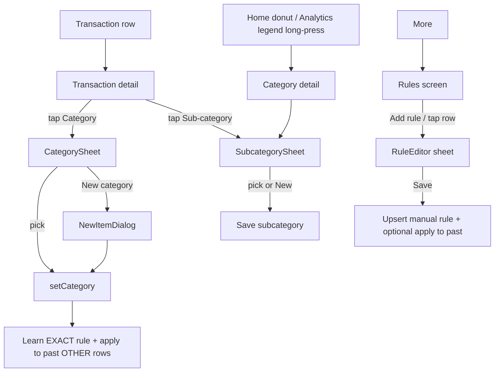

# Categorization (Categories, Sub-categories, Rules, Brand Logos)

| Field | Value |
|---|---|
| Feature ID | F-09 |
| Status | Existing |
| Priority | P0 |
| Phase | 1 (core ledger + SMS; rule editor and category detail finish in Phase 4) |
| Last Updated | 2026-10-19 |

## 1. Description

Every transaction gets exactly one category (27 built-in, or one the user creates) and optionally a sub-category. Categories are filled in automatically from a merchant list and keywords, and the user can always correct them. A correction teaches a rule so the same merchant is filed correctly next time. The same feature also picks the bank, payment-app and merchant logos shown across the app.

## 2. What This Feature Will Do

- Defines 27 built-in categories, each with a name, colour, icon and picker group.
- Recognises a merchant from a raw payment description using a built-in merchant list.
- Assigns a starting category and sub-category to each new transaction.
- Lets the user change a category or sub-category on one transaction or on many at once.
- Learns a rule from each category correction and applies it to future transactions.
- Lets the user create, edit and delete their own merchant rules, with a live count of past transactions each rule would change.
- Applies a rule to past transactions on request.
- Lets the user create custom categories and sub-categories with their own name, icon and colour.
- Shows a Category detail screen with a month stepper, sub-category chart and transactions.
- Shows a category picker grouped by type, with search and a New category option.
- Picks a logo for each bank, payment app or merchant, with a letter fallback when none matches.

### 2.1 Inputs

- Raw merchant text, sender and message type from each parsed transaction (every incoming transaction).
- User category and sub-category changes on a transaction, singly or in bulk.
- User-created rules, custom categories and custom sub-categories.
- Bank, payment-app or merchant names that need a logo.

### 2.2 Processing

1. Cleans the raw merchant text into a short merchant name and looks it up in the merchant list.
2. Chooses a starting category from the merchant list, then keywords, then Other; cash withdrawals, transfers, investments and credits follow their own rules.
3. Applies the best matching user rule, if any, to every new transaction except transfers.
4. Guesses a sub-category from the merchant, unless the user has chosen one.
5. On a user correction, clears the old sub-category and saves or updates a learned rule for that merchant.
6. On request, applies a rule to matching past transactions.

### 2.3 Outputs

- Each transaction shows its category, sub-category and logo.
- Stored: custom categories and sub-categories, manual rules and learned rules.
- The Rules screen lists the user's own rules and the learned rules separately, with Undo on removal.
- [Expense Tracking](10_expense_tracking.md) and [Income Tracking](11_income_tracking.md) receive the category of every transaction for their totals.

### 2.4 Out of Scope

- Does not calculate spend or income totals or budgets; see [Expense Tracking](10_expense_tracking.md).
- Does not remove duplicate rows; see [Dedup & Review](07_dedup_review.md).
- Does not handle notification setup (notifications feature).
- Does not translate category labels (i18n feature); labels here are the English names.
- Does not include newer ideas such as tags, split transactions, rules with many condition fields or merchant category codes.

## 3. Behaviour in Existing App

Source: `analysis/existing_app_analysis.md` Part A 2.3/2.9/6.1, Part B 2.7/6.6/6.8; Kotlin `parser-core/.../merchant/MerchantNormalizer.kt`, `MerchantDirectory.kt`, `shared/.../insight/Subcategories.kt`, `app/.../ui/theme/Theme.kt`, `ui/components/CategorySheet.kt`, `ui/category/*`, `ui/more/RulesScreen.kt`, `ui/components/AppLogos.kt`, `BankLogo.kt`.

### 3.1 Built-in category taxonomy (27, `Category` enum in `parser-core/.../model/Model.kt:53-81`)

| Enum | Label | Colour (hex) | Picker group | Spend group (`LedgerMath.group`) |
|---|---|---|---|---|
| FOOD | Food & Dining | E8704A | Food & drink | Lifestyle |
| GROCERIES | Groceries | 7CB342 | Food & drink | Essentials |
| TRANSPORT | Transport | 3F88C5 | Transport & travel | Essentials |
| FUEL | Fuel | 8D6E63 | Transport & travel | Essentials |
| SHOPPING | Shopping | D64E8C | Shopping & lifestyle | Lifestyle |
| BILLS | Bills & Utilities | 5C6BC0 | Home & bills | Essentials |
| ENTERTAINMENT | Entertainment | AB47BC | Shopping & lifestyle | Lifestyle |
| TRAVEL | Travel | 26A69A | Transport & travel | Lifestyle |
| HEALTH | Health | EF5350 | Health & education | Essentials |
| EDUCATION | Education | 42A5F5 | Health & education | Essentials |
| RENT | Rent | 795548 | Home & bills | Essentials |
| INSURANCE | Insurance | 78909C | Health & education | Essentials |
| EMI_LOAN | EMI & Loans | FFA726 | Money | Essentials |
| INVESTMENT | Investment | 2E7D32 | Money | Other |
| CASH | Cash Withdrawal | 9E9D24 | Money | Other |
| SUBSCRIPTIONS | Subscriptions | 7E57C2 | Shopping & lifestyle | Lifestyle |
| PERSONAL_CARE | Personal Care | EC407A | Shopping & lifestyle | Lifestyle |
| HOUSEHOLD | Household | A1887F | Home & bills | Essentials |
| GIFTS | Gifts | E53935 | Shopping & lifestyle | Lifestyle |
| DONATIONS | Donations | FF7043 | Shopping & lifestyle | Lifestyle |
| TAXES | Taxes | 546E7A | Money | Essentials |
| FEES | Bank Fees & Charges | 8E7CC3 | Money | Essentials |
| SALARY | Salary | 00897B | Income | Other |
| INCOME | Income | 43A047 | Income | Other |
| REFUND | Refund | 29B6F6 | Income | Other |
| TRANSFER | Transfer | 90A4AE | Money | Other |
| OTHER | Other | 9E9E9E | Other | Other |

Picker group order (`CategoryGroup`, `Theme.kt:230`): Food & drink, Shopping & lifestyle, Transport & travel, Home & bills, Health & education, Money, Income, Other.

Spend groups (Essentials / Lifestyle / Other) feed the Analysis monthly stacked bars; FIXED categories used by the forecast are RENT, BILLS, EMI_LOAN, INSURANCE, SUBSCRIPTIONS, TAXES, EDUCATION (see [Expense Tracking](10_expense_tracking.md)).

### 3.2 Merchant normalisation and automatic category inference (parser side)

`MerchantNormalizer.normalize` (order):

1. `channel == ATM && type == DEBIT` gives merchant "ATM", category CASH.
2. Clean the raw name: upper-case; `@` means VPA; strip glued order numbers (`^([A-Z]{3,}?)(?:IND|INDIA|IN)?\d{4,}$`, e.g. `UBERIND13513699` becomes `UBER`) unless an IFSC (`[A-Z]{4}0[A-Z0-9]{6}`); split on `/`, `|` and code-like `-`; take the first segment that is not code-like (`^(?:.*\d{4,}.*|IFSC|[X*\d\s]+|P2[AMP]|[A-Z]{2}\d+)$`) and not only noise; replace non `[A-Z0-9&' ]` with space; drop leading noise prefixes (`ACH NACH ECS TP D DR CR UPI IMPS NEFT RTGS POS VPA MMT BIL INF TO FROM BY SI MANDATE AUTOPAY PAYMENT TXN TRF TRANSFER PAY CMS ATD ONL VIN`) and trailing noise suffixes (`PVT LTD PRIVATE LIMITED LLP INC CO UPI PAYMENTS PAYMENT`, only while more than one word remains); result must be >= 2 chars with a letter.
3. VPA to name: local part split on `. _ -`, drop noise words (`UPI PAY PAYTM RAZORPAY RZP BHARATPE PAYU CASHFREE MERCHANT OKAXIS OKICICI`) and trailing digits, words >= 2 chars.
4. Directory lookup (`MerchantDirectory`): multi-word keys match as phrases (longest first), single-word keys must equal a whole token ("OLA" must not match "COCA COLA"). Display = directory name, else Title Case (keep-upper set: ATM IRCTC LIC KFC HP BP SBI HDFC ICICI IDFC PNB AU NSE BSE).
5. Category: TRANSFER stays TRANSFER; INVESTMENT stays INVESTMENT; CREDIT becomes SALARY if text has `SALARY|SAL CR|PAYROLL`, REFUND if text contains "refund" or "revers", else INCOME; otherwise directory category; otherwise keyword category; otherwise OTHER.

Merchant directory (`MerchantDirectory.kt:13-147`, key list -> display name -> category). Keys are upper-case; keys with a space are phrases:

| Category | Entries (display name: keys) |
|---|---|
| GROCERIES | Swiggy Instamart: SWIGGY INSTAMART, INSTAMART; BigBasket: BIGBASKET, BIG BASKET, INNOVATIVE RETAIL; Blinkit: BLINKIT, GROFERS; Zepto: ZEPTO, KIRANAKART; DMart: DMART, AVENUE SUPERMARTS; JioMart: JIOMART |
| FOOD | Swiggy: SWIGGY, BUNDL; Zomato: ZOMATO; EatSure: EATSURE, FAASOS; Domino's: DOMINOS, JUBILANT; McDonald's: MCDONALDS, MCDONALD; KFC; Starbucks; Haldiram's: HALDIRAM, HALDIRAMS |
| TRANSPORT | Uber: UBER, UBERIND, UBER INDIA; Ola: OLA, OLACABS, OLAMONEY, ANI TECHNOLOGIES; Rapido: RAPIDO, ROPPEN; BluSmart: BLUSMART, BLU SMART; Namma Yatri: NAMMA YATRI, NAMMAYATRI; Meru; FASTag: FASTAG; Metro: METRO, DMRC, BMRCL |
| FUEL | HPCL: HPCL, HINDUSTAN PETROLEUM; BPCL: BPCL, BHARAT PETROLEUM; Indian Oil: IOCL, INDIAN OIL |
| SHOPPING | Amazon: AMAZON, AMZN; Flipkart; Myntra; AJIO; Meesho; Nykaa; Croma; Decathlon; IKEA; Aditya Birla Fashion: ADITYA BIRLA FASHION |
| BILLS | Airtel: AIRTEL, BHARTI AIRTEL; Jio: JIO, RELIANCE JIO; Vi: VODAFONE, VODAFONE IDEA; BSNL; Electricity: BESCOM, TATA POWER, ADANI ELECTRICITY, MSEDCL, TNEB; Tata Play: TATA PLAY, TATASKY |
| ENTERTAINMENT | Netflix; Spotify; JioHotstar: HOTSTAR, JIOHOTSTAR, NOVI DIGITAL; Prime Video: PRIME VIDEO; BookMyShow: BOOKMYSHOW, BIGTREE; PVR INOX: PVR, INOX; YouTube |
| TRAVEL | IRCTC; MakeMyTrip: MAKEMYTRIP, MMT; Goibibo; Cleartrip; IndiGo: INDIGO, INTERGLOBE; Air India: AIR INDIA; redBus; OYO; ixigo |
| HEALTH | Apollo; PharmEasy; Tata 1mg: 1MG, TATA 1MG; Netmeds; MedPlus; cult.fit: CULTFIT, CULT FIT, CUREFIT |
| EDUCATION | Udemy; Coursera; Unacademy |
| INVESTMENT | Zerodha; Groww; Upstox; Kuvera; ICCL: ICCL, INDIAN CLEARING; smallcase; Aditya Birla Sun Life MF: ADITYA BIRLA SUN LIFE, ABSLMF, ABSLAMC; Tata Securities: TATA CAPITAL SECURITIES, TATA SECURITIES; Tata Mutual Fund: TATA MUTUAL FUND, TATA MF, TATAMF, TATA ASSET MANAGEMENT, TATA AMC and scheme-name prefixes (TATA SMALL CAP, TATA DIGITAL INDIA, TATA NIFTY, TATA ELSS, TATA BANKING, TATA FLEXI, TATA LARGE, TATA MID, TATA ARBITRAGE, TATA LIQUID, TATA MONEY MARKET, TATA BALANCED, TATA HYBRID, TATA EQUITY, TATA INDEX) |
| INSURANCE | LIC: LIC, LIFE INSURANCE CORPORATION; Policybazaar; Acko; HDFC ERGO; ICICI Lombard; Star Health; Niva Bupa: NIVA BUPA, NIVABUPA, MAX BUPA; Care Health: CARE HEALTH, CAREHEALTH, RELIGARE HEALTH; Aditya Birla Health: ADITYA BIRLA HEALTH, ABHICL; ManipalCigna; Tata AIG; Bajaj Allianz; Digit Insurance: GO DIGIT, GODIGIT, DIGIT INSURANCE; Reliance General; New India Assurance; Axis Max Life: MAX LIFE, MAXLIFE, AXIS MAX LIFE; HDFC Life; SBI Life; ICICI Prudential Life: ICICI PRU, ICICIPRU, ICICI PRUDENTIAL LIFE; Tata AIA; Kotak Life; Aditya Birla Sun Life Insurance: ADITYA BIRLA SUN LIFE INSURANCE, ABSLI |
| EMI_LOAN | Bajaj Finance: BAJAJ FINANCE, BAJAJ FINSERV, BAJAJFINANCE, BAJAJFIN; Propelld; Aditya Birla Capital: ADITYA BIRLA FINANCE/CAPITAL/HOUSING, ADITYABIRLA, ADITYA BIRLA, ABFL, ABHFL; Tata Capital: TATA CAPITAL, TATACAPITAL; HDFC Credila: CREDILA, HDFC CREDILA; Avanse; InCred; SMFG India Credit: SMFG, FULLERTON; Home Credit: HOME CREDIT, HOMECREDIT; KreditBee: KREDITBEE, KRAZYBEE; Navi: NAVI FINSERV, NAVIFINSERV, NAVI TECHNOLOGIES; Poonawalla Fincorp: POONAWALLA; HDB Financial: HDB FINANCIAL, HDBFS, HDBFSL; L&T Finance: L&T FINANCE, LTFS, LNT FINANCE; Hero FinCorp: HERO FINCORP, HEROFINCORP; Cholamandalam Finance: CHOLAMANDALAM INVESTMENT/FINANCE, CHOLA FINANCE; Mahindra Finance: MAHINDRA FINANCE, MAHINDRA AND MAHINDRA FIN, MMFSL |
| RENT | NoBroker |

Lender display names deliberately equal the lender-parser names so an EMI debit links to its loan (see [Loans](15_loans.md)). Only Tata Capital is a lender among the Tata names.

Keyword fallback (single token equal to the word, first token hit wins):

| Category | Tokens |
|---|---|
| FOOD | RESTAURANT CAFE PIZZA BURGER BIRYANI BAKERY FOODS KITCHEN DHABA SWEETS |
| GROCERIES | SUPERMARKET GROCERY GROCERIES MART KIRANA FRESH |
| FUEL | PETROL FUEL FUELS PETROLEUM |
| TRANSPORT | CAB CABS TAXI PARKING TOLL |
| HEALTH | HOSPITAL CLINIC PHARMACY MEDICAL MEDICALS CHEMIST DIAGNOSTICS LAB LABS |
| EDUCATION | SCHOOL COLLEGE UNIVERSITY ACADEMY TUITION FEES |
| BILLS | ELECTRICITY RECHARGE BROADBAND BILL BILLDESK GAS WATER DTH |
| TRAVEL | HOTEL HOTELS AIRLINES AIRWAYS TRAVELS TOURS RAILWAY |
| INSURANCE | INSURANCE PREMIUM |
| EMI_LOAN | EMI LOAN FINANCE |
| RENT | RENT |
| INVESTMENT | MUTUAL SIP MF SECURITIES BROKING CAPITAL |
| ENTERTAINMENT | MOVIES CINEMA CINEMAS GAMING |

### 3.3 Sub-category catalogue (`Subcategories.kt:18-147`)

A sub-category is chosen per transaction: user value (`transactions.subcategory`), else the first built-in sub-category whose regex (case-insensitive) matches `"<merchant> <upiId>"`, else the category's single pattern-less sub-category, else "Other". Categories with no sub-categories (SALARY, INCOME, REFUND, TRANSFER, OTHER) always show "Other". Format: name (icon key): regex. A dash means no pattern (fallback entry).

FOOD:

- Food delivery (delivery_dining): `swiggy|zomato|uber\s*eats|eatsure|box8|faasos|rebel\s*foods|magicpin`
- Cafés & coffee (local_cafe): `starbucks|\bcafe|caf[eé]\b|coffee|\bccd\b|chaayos|chai|third\s*wave|blue\s*tokai`
- Fast food (fastfood): `mcdonald|domino|\bkfc\b|pizza|burger|subway|wow\s*momo`
- Bakery & desserts (bakery_dining): `bakery|bakers|cake|ice\s*cream|baskin|theobroma|naturals\s*ice`
- Bars & nightlife (local_bar): `\bbar\b|\bpub\b|brew|liquor|wines?\b|beer`
- Restaurants (restaurant): `restaurant|dhaba|bistro|kitchen|biryani|dining|eatery|hotel`

GROCERIES:

- Quick commerce (bolt): `blinkit|grofers|zepto|kiranakart|instamart|bb\s*now|dunzo`
- Supermarket (local_grocery_store): `d\s*-?mart|avenue\s*supermart|reliance\s*(fresh|smart|retail)|spencer|star\s*bazaar|more\s*retail|bigbasket|jiomart|nature'?s\s*basket`
- Dairy (egg): `milk|dairy|amul|mother\s*dairy|country\s*delight|milkbasket|nandini`
- Fruits & vegetables (eco): `fruit|vegetable|sabzi|farm`
- Kirana (storefront): `kirana|general\s*store|provision|traders`

TRANSPORT:

- Cabs & rides (local_taxi): `\buber\b|\bola\b|olacabs|ani\s*technologies|rapido|roppen|blusmart|meru|namma\s*yatri`
- Metro & bus (directions_subway): `metro|dmrc|bmrcl|\bbest\b|bmtc|dtc|ksrtc|msrtc`
- Parking & tolls (local_parking): `parking|fastag|\btoll|netc`
- Vehicle service (car_repair): `service\s*cent|garage|tyre|car\s*wash|motors`

FUEL:

- Petrol & diesel (local_gas_station): `hpcl|bpcl|iocl|indian\s*oil|indianoil|bharat\s*petroleum|hindustan\s*petroleum|hp\s*pay|petrol|diesel|shell|nayara|fuel`
- EV charging (ev_station): `charging|ez\s*charge|statiq|chargezone|\bev\b`
- CNG (propane): `\bcng\b|indraprastha\s*gas|\bigl\b|mahanagar\s*gas`

SHOPPING:

- Online shopping (shopping_bag): `amazon|amzn|flipkart|meesho|snapdeal|shopsy`
- Fashion (checkroom): `myntra|ajio|zara|h\s*&\s*m|\bmax\b|pantaloons|westside|lifestyle|uniqlo|bata|puma|nike|adidas|tata\s*cliq|trends`
- Electronics (devices): `croma|reliance\s*digital|vijay\s*sales|apple|samsung|\bmi\b|xiaomi|oneplus|boat`
- Home & furniture (chair): `ikea|pepperfry|urban\s*ladder|home\s*centre|wakefit`
- Sports & fitness gear (sports_cricket): `decathlon|sports`
- Books & stationery (menu_book): `book|stationery|crossword|sapna`

BILLS:

- Mobile recharge (smartphone): `\bjio\b|airtel|\bvi\b|vodafone|idea|bsnl|recharge|prepaid|postpaid`
- Electricity (electric_bolt): `electric|bescom|tata\s*power|adani\s*electricity|msedcl|mahadiscom|bses|torrent\s*power|tneb|tangedco|cesc|power`
- Broadband & DTH (router): `broadband|fib(er|re)|act\s*fibernet|hathway|excitel|tata\s*play|dish\s*tv|d2h|xstream|sun\s*direct`
- Gas cylinder (propane_tank): `indane|hp\s*gas|bharat\s*gas|\blpg\b|gas\s*booking`
- Water (water_drop): `water|jal\s*board`
- Society maintenance (apartment): `maintenance|society|mygate|nobrokerhood|apartment`

ENTERTAINMENT:

- Movies (movie): `\bpvr\b|\binox\b|bookmyshow|bigtree|cinepolis|cinema|movie`
- Events & shows (confirmation_number): `event|concert|insider|district|ticket`
- Gaming (sports_esports): `steam|playstation|xbox|game|dream11|\bmpl\b|winzo`
- Outings (attractions): `wonderla|imagica|park|museum|zoo|bowling|smaaash`

TRAVEL:

- Cabs (local_taxi): same as Cabs & rides plus `savaari|outstation`
- Flights (flight): `indigo|interglobe|air\s*india|vistara|spicejet|akasa|airline|airways`
- Trains (train): `irctc|railway|\brail\b`
- Hotels & stays (hotel): `\boyo\b|hotel|airbnb|treebo|fabhotel|\btaj\b|marriott|booking\.com|agoda|resort|zostel`
- Bus (directions_bus): `redbus|abhibus|zingbus|volvo`
- Travel booking (luggage): `makemytrip|make\s*my\s*trip|goibibo|cleartrip|yatra|ixigo|easemytrip`

HEALTH:

- Medicines (medication): `pharmeasy|netmeds|\b1mg\b|apollo\s*pharm|medplus|pharma|chemist|medical|druggist|wellness\s*forever`
- Doctor & hospital (local_hospital): `hospital|clinic|doctor|\bdr\.?\s|practo|fortis|manipal|max\s*health|narayana|aster|medanta|apollo`
- Lab tests (biotech): `\blab|diagnostic|thyrocare|lal\s*path|metropolis|redcliffe|healthians|orange\s*health`
- Fitness (fitness_center): `cult|gym|fitness|yoga|healthify`
- Personal care (spa): `salon|spa\b|parlour|grooming`
- Eye care (visibility): `lenskart|optical|optician|eye`

EDUCATION:

- Courses & coaching (school): `udemy|coursera|byju|unacademy|upgrad|vedantu|physics\s*wallah|course|coaching|classes|academy`
- School & college fees (account_balance): `school|college|university|institute|fees|tuition`
- Books (menu_book): `book|kindle`

RENT:

- House rent (home): `rent|nobroker|housing|landlord`
- PG & hostel (bed): `\bpg\b|hostel|co-?living|stanza|zolo|colive`

INSURANCE:

- Life insurance (favorite): `\blic\b|life|term|max\s*life|hdfc\s*life|icici\s*pru|sbi\s*life|tata\s*aia`
- Health insurance (health_and_safety): `health|star\s*health|care\s*health|niva\s*bupa|hdfc\s*ergo|aditya\s*birla\s*health`
- Vehicle insurance (directions_car): `motor|car\s*insurance|bike\s*insurance|two\s*wheeler|acko|go\s*digit|\bdigit\b`

EMI_LOAN:

- Home loan (home): `home\s*loan|housing\s*loan|hfc`
- Car loan (directions_car): `car\s*loan|auto\s*loan|vehicle\s*loan`
- Education loan (school): `education\s*loan`
- Card EMI (credit_card): `\bemi\b|card`
- Personal loan (payments): `personal\s*loan|loan|bajaj\s*fin|navi|kreditbee|moneyview|slice`

INVESTMENT:

- Mutual funds (pie_chart): `mutual|\bsip\b|cams|kfin|kuvera|\bcoin\b|\bmf\b|amc`
- Stocks (show_chart): `zerodha|upstox|angel|dhan|groww|stock|\bnse\b|\bbse\b|indmoney|iccl|nsccl`
- PPF, EPF & NPS (savings): `\bppf\b|\bepf\b|\bnps\b|provident|pension`
- FD & RD (account_balance): `fixed\s*deposit|recurring\s*deposit|\bfd\b|\brd\b`
- Gold (diamond): `gold|\bsgb\b|safegold|augmont`

SUBSCRIPTIONS:

- Streaming (live_tv): `netflix|prime\s*video|hotstar|jiocinema|sonyliv|zee5|youtube|aha|voot`
- Music (music_note): `spotify|gaana|saavn|apple\s*music|wynk`
- Cloud & apps (cloud): `google\s*(one|storage|play)|icloud|dropbox|microsoft|office|chatgpt|openai|adobe|notion|claude|anthropic|canva`
- News & reading (newspaper): `times|hindu|express|kindle\s*unlimited|audible|economist|newspaper`
- Memberships (card_membership): `prime|flipkart\s*plus|swiggy\s*one|zomato\s*gold|membership`

PERSONAL_CARE:

- Salon & spa (content_cut): `salon|spa\b|parlour|urban\s*company|urbanclap|looks|naturals|lakme|jawed`
- Cosmetics & skincare (face): `nykaa|purplle|mamaearth|sugar|cosmetic|beauty|minimalist`

HOUSEHOLD:

- Home services (handyman): `urban\s*company|urbanclap|plumb|electrician|carpenter|pest|repair`
- Domestic help (cleaning_services): `maid|cook|driver|help|cleaning`
- Laundry (local_laundry_service): `laundry|dry\s*clean|washing`
- Home supplies (kitchen): `utensil|hardware|household`

GIFTS: Flowers & cakes (local_florist): `fnp|ferns|igp|flower|bloom`; Gifts (redeem): no pattern.
DONATIONS: Religious (temple_hindu): `temple|mandir|gurudwara|church|mosque|masjid|devasthan|trust`; Charity (volunteer_activism): no pattern.
TAXES: Income tax (receipt_long): `income\s*tax|\bitd\b|\btds\b|advance\s*tax|incometax`; GST (request_quote): `\bgst\b`; Property tax (house): `property\s*tax|municipal|nagar\s*nigam|bbmp|mcgm`.
FEES: Interest & late fees (warning): `late|penalty|interest|finance\s*charge|overdue`; Card fees (credit_card): `annual\s*fee|joining\s*fee|card\s*fee|renewal`; Bank charges (account_balance): no pattern.
CASH: ATM withdrawal (atm): no pattern.

### 3.4 Custom categories and sub-categories

- Tables `custom_categories(id, name, icon, colorArgb, createdAt)` and `custom_subcategories(id, parent, name, icon, createdAt)` with UNIQUE `(parent, name)`; `parent` is a built-in enum name ("FOOD") or `custom:<id>`.
- A transaction in a custom category stores `category = OTHER` and `customCategoryId = <id>`; the route key for the Category detail screen is `custom:<id>`.
- Created from the `CategorySheet` "New category" tile (`NewItemDialog`: name, 10 colour swatches with the first 6 shown, 6-column icon grid from `IconLibrary.pickable`) and from `CategoryDetail` "Add a sub-category" (sub-categories have no colour).
- Custom categories are NOT usable for budgets (budget PK is the built-in enum) and are excluded from loan payment detection (`customCategoryId == null` filter in `Loans.isPayment`).
- Home "Spend by category" donut takes custom categories out of the built-in ones they were filed under (`CategoryLook.of(custom)` vs `CategoryLook.of(category)`).

### 3.5 Category pickers

- `CategorySheet` (`components/CategorySheet.kt:44`): ModalBottomSheet, search field, 4-column grid grouped by `CategoryGroup`; optional "Your categories" section and "New category" tile; filter by label or translated label.
- `SubcategorySheet`: lists built-in subs of the category, user subs, "New" tile; the detail screen shows "Sub-category (automatic)" while the sub is only guessed.
- Spend-only variant used by the Budget dialog: excludes SALARY, INCOME, REFUND, TRANSFER and already-budgeted categories.

### 3.6 Merchant rules (More > Rules, `ui/more/RulesScreen.kt:131`)

Two kinds in one table `merchant_rules`:

- Learned (`manual = 0`): created when the user changes a transaction category (single or bulk). EXACT match, category only, no sub-category.
- Yours (`manual = 1`): created or edited in the Rule editor. EXACT or CONTAINS, with category, optional sub-category, optional custom category.

Rules screen: intro text; empty card "No rules yet"; two cards "Your rules · n" and "Learned · n"; each row has the category icon, title, a "Yours" or "Learned" tag and "{match label} -> Category > Sub". Remove shows a snackbar with Undo. ExtendedFAB "Add rule".

RuleEditor (ModalBottomSheet): match toggle Exact/Contains; text field (minimum 2 chars, `MIN_KEY`); hint "Replaces the existing rule for {name}"; category via `CategorySheet` including user categories; sub-category pills plus New; checkbox "Also apply to past transactions (n)" with a live count (`MerchantRuleDao.observeMatchCount`); Delete/Cancel/Save.

### 3.7 Learning from edits and application order

- Key: `MerchantRuleEntity.keyOf(merchant, upiId) = (merchant ?: upiId).trim().lowercase()`, length >= 2.
- `TransactionRepository.setCategory(ids, category)`: update the rows (clears `subcategory` and `customCategoryId`); for each non-TRANSFER row's key not already covered by a manual rule, upsert an EXACT learned rule and run `applyToUncategorised` (set the category on past rows where `category = 'OTHER'`, type in DEBIT/CREDIT/INVESTMENT and `LOWER(TRIM(merchant)) = key OR (merchant IS NULL AND LOWER(TRIM(upiId)) = key)`).
- Manual rule save (`saveRule(rule, previousKey, applyToPast)`): upsert with `manual = 1`; when `applyToPast`, `MerchantRuleDao.applyToPast` sets category, subcategory and customCategoryId on all non-TRANSFER rows that match exactly (merchant or UPI id) or by `LIKE %text% ESCAPE '\'` (with `% _ \` escaped by `likeOf`). A recategorisation never overwrites a manual rule.
- At ingest (repo 166-170, 181-183): TRANSFER never receives a rule. Best rule: manual EXACT, else manual CONTAINS with the longest key, else the learned EXACT rule found by primary key. The rule sets `category`; its sub-category and customCategoryId are written onto the new row (`filed()`). On a MERGE into an existing row the rule's sub-category follows only if the row has no sub-category/custom category and its category equals the incoming one (`keepsOwn`, repo 206).
- Matching (`matches`, Entities.kt:169): EXACT compares trimmed lower-cased merchant OR upiId to the key; CONTAINS tests the key as a substring of `"<merchant> <upiId>".lowercase()`.
- Payee-to-account memory (`payee_accounts` SharedPreferences) is a related but separate memory owned by [Accounts Management](13_accounts_management.md).
- New-transaction notification actions (up to 3 category buttons: the user's most used categories for that type in the last 90 days, then defaults credit SALARY, REFUND, INCOME, TRANSFER; debit FOOD, GROCERIES, SHOPPING, TRANSPORT, BILLS; never the current or OTHER) call `setCategory` and so also teach a rule. Notification wiring itself is owned by the notifications feature.

### 3.8 Category detail screen (`ui/category/CategoryDetailScreen.kt:121`)

Route `category/{key}?month={month}`; key is the enum name or `custom:<id>`; month `YYYY-MM`. Month stepper (cannot go past the current month); donut of sub-category shares (shades of the category colour); per-sub rows expandable to their transactions; "Add a sub-category" outlined button; list of the user's sub-categories with delete; empty text "Nothing spent on {category} in {month}.". Reached from the Home categories donut, the Analytics legend (long-press) and the month sheet.

### 3.9 Brand logos (`ui/components/AppLogos.kt`, `BankLogo.kt`)

- 140 bundled `.webp` files in `assets/logos/`. Keys: 1mg acko adobe airbnb airindia airtel ajio amazon amazonpay amex anthropic apollo apple au audible axis bandhan bhim bigbasket blinkit bob boi booking bookmyshow box8 bpcl burgerking canara canva ccd citi cleartrip coursera cred croma decathlon delhivery digit dmart dominos easemytrip eatsure equitas federal flipkart freshtohome gaana github goibibo google gpay groww haldirams hdfc hdfclife healthifyme hotstar hpcl hsbc icici idbi idfc ikea indianbank indigo indmoney indusind instamart iob iocl irctc ixigo jio jiomart jupiter kfc kotak kuvera lenskart lic linkedin makemytrip mcdonalds meesho microsoft myntra netflix netmeds notion nykaa ola onecard openai oyo paytm pepperfry pharmeasy phonepe pizzahut pnb policybazaar porter practo primevideo pvr rapido razorpay rbl redbus relianceretail sbi sbicard scb shell shoppersstop slice sonyliv spicejet spotify starbucks steam swiggy tatacliq uber udemy unacademy union upstox urbancompany vi vistara yatra yes youtube zee5 zepto zerodha zomato zoom zoomcar.
- Resolution: ordered regex rule lists, case-insensitive, first match wins. `BANKS` (30 rules, `sbicard` first, then hdfc, icici, axis, hsbc, `sbi|yono`, kotak, yes, idfc, indusind, bob, pnb, au, federal, canara, union, rbl, scb, amex, onecard, boi, iob, indianbank, idbi, citi, bandhan, equitas, jupiter, slice), then `MERCHANTS`/`SPECIFIC`/`GENERIC` lists. Order matters: specific brands before broad names (instamart before swiggy, amazonpay before amazon, google/apple/microsoft last). Invariant: `AppLogos.allKeys()` equals the set of files.
- Rendering: decode with `BitmapFactory`, `LruCache(64)`. Fallbacks in `Brands`/`BrandMark`: `LogoPaths` Simple-Icons SVG paths (HDFC, ICICI, Axis, HSBC, Visa, Mastercard, Amex, Diners, Discover, JCB, Paytm, PhonePe, Google Pay; CC0, v16.33.0) tinted, else a gradient monogram tile (brand colour pairs in `Brands.BANKS`; unknown banks get a stable palette colour from `hashCode`).
- Badges: `CardNetwork` badge at the corner of card avatars (VISA, MASTERCARD, AMEX, DINERS, DISCOVER, JCB, RUPAY, MAESTRO, UNIONPAY), `TypeCode` badge (FD/RD/PPF/Loan), a "B" business badge. Bank name equivalence in the transaction filter: `Brands.forBank(name).name` merges "HDFC" and "HDFC Bank".
- `LogoPaths` vs the ~140 WebP logos (`LogoPaths.kt:1-6`, `BankLogo.kt:114-134`): two separate sources. WebP (`assets/logos/<key>.webp`, keys from `AppLogos`) are full-colour raster logos for banks, payment apps and merchants. `LogoPaths` are vector fallbacks for brands in `Brands.BANKS` / `forNetwork`, mainly card networks that have no WebP (Visa, Mastercard, Diners, Discover, JCB) plus HDFC, ICICI, Axis, HSBC, Amex and payment apps. `BrandMark` order: WebP via `AppLogos.bank(name)` then `AppLogos.merchant(name)` on a bordered tile; else `brand.path` vector on a tinted tile (10% light / 16% dark alpha, icon 58% of tile, colour lifted 45% toward white in dark theme); else monogram gradient tile. RuPay, Maestro and UnionPay have no vector and use a monogram. Flutter: parse the path strings with `path_drawing` or `flutter_svg`; no run-time download.
- Transaction row avatar: merchant logo if one resolves, else a category badge (category colour + icon) with a bank badge.

## 4. User Stories

- US-09-01: As a user, I see each new transaction already filed under a sensible category without doing anything.
- US-09-02: As a user, when I change a category I want the app to remember it for that merchant.
- US-09-03: As a user, I can create my own categories and sub-categories with an icon and colour.
- US-09-04: As a user, I can write a rule "merchant contains X goes to category Y" and apply it to history.
- US-09-05: As a user, I can see which rules I created and which were learned, and delete either with Undo.
- US-09-06: As a user, I can drill into a category for a month and see sub-category shares and their transactions.
- US-09-07: As a user, I see recognisable bank and merchant logos next to transactions and accounts.

## 5. Functional Requirements (FR-09-01 ...)

- FR-09-01: The system shall define 27 built-in categories with label, colour, icon, picker group and spend group exactly as in section 2.1.
- FR-09-02: The system shall normalise a raw merchant string (clean, split, noise strip, VPA-to-name) and look it up in the merchant directory (phrases longest-first, single words by whole token) before falling back to Title Case.
- FR-09-03: The system shall infer an initial category in this order: ATM debit => CASH; TRANSFER/INVESTMENT retained; CREDIT => SALARY/REFUND/INCOME by text; directory; keyword fallback; OTHER.
- FR-09-04: The system shall guess a sub-category as the first built-in sub-category (catalogue order) whose regex matches `"<merchant> <upiId>"`; a user-chosen sub-category always wins; otherwise a lone pattern-less sub-category, else "Other".
- FR-09-05: The user shall be able to change a transaction's category (single and bulk) and sub-category from the detail screen and the transactions multi-select.
- FR-09-06: Changing a category shall clear that row's sub-category and custom category, and create or update a learned EXACT rule for the merchant key unless a manual rule exists for it or the row is TRANSFER.
- FR-09-07: A learned rule shall also set the category on past rows where the category is OTHER and the merchant (or UPI id when merchant is null) equals the key.
- FR-09-08: The user shall be able to create, edit and delete manual rules (EXACT or CONTAINS, key >= 2 chars, category, optional sub-category, optional custom category).
- FR-09-09: The Rule editor shall show a live count of past transactions the rule would change and an "Also apply to past transactions" option that rewrites matching non-TRANSFER rows.
- FR-09-10: At ingest the system shall apply the best rule (manual EXACT, then longest manual CONTAINS, then learned EXACT) except to TRANSFER rows, and write the rule's sub-category and custom category.
- FR-09-11: When an incoming message merges into an existing row, the rule's sub-category shall apply only if the row has no own sub-category/custom category and categories are equal.
- FR-09-12: The Rules screen shall list "Your rules" and "Learned" separately with Undo on removal and an empty state.
- FR-09-13: The user shall be able to create custom categories (name, icon, colour) and custom sub-categories (name, icon) under built-in or custom parents; (parent, name) shall be unique.
- FR-09-14: The Category detail screen shall show a month stepper (not beyond the current month), a sub-category donut, expandable sub-rows with transactions, add/delete user sub-categories and the empty text.
- FR-09-15: The system shall resolve a logo for a bank, payment app or merchant name via ordered case-insensitive regex lists with first-match-wins, with SVG-path and monogram fallbacks.
- FR-09-16: The category picker shall group categories by `CategoryGroup`, offer search by label (and translated label), a "Your categories" section and a "New category" tile.
- FR-09-17: Budget category selection shall exclude SALARY, INCOME, REFUND, TRANSFER and categories already budgeted (see [Expense Tracking](10_expense_tracking.md)).
- FR-09-18: Logo choice shall follow this order: (1) bundled WebP by `AppLogos` key (bank rules for a bank name; bank then merchant rules for a merchant); (2) `LogoPaths` vector (single-colour 24x24 Simple Icons path, tinted with the brand colour) when the brand defines one; (3) gradient monogram tile. A bundled WebP always wins over a vector (`BankLogo.kt:114-134`).
- FR-09-19: `LogoPaths` vectors shall be kept for the brands that carry one (HDFC, ICICI, Axis, HSBC, Visa, Mastercard, Amex, Diners, Discover, JCB, Paytm, PhonePe, Google Pay), with the Simple Icons CC0 attribution and trademark note preserved in code comments (`LogoPaths.kt:3-6`).

## 6. Non-Functional Requirements (performance, battery, privacy, offline)

- Offline only: no network call for categorization or logos. Logos are bundled assets (about 140 files).
- Performance: directory lookup O(phrases + tokens); regex lists are precompiled once; sub-category guess is computed lazily at render, not stored. Bulk recategorise and apply-to-past run in one DB transaction and must stay under 1 s for 50,000 rows (target, not verified in the old app).
- Rule application during an SMS batch ingest must not add a per-row DB round trip beyond one primary-key lookup (learned) plus an in-memory list of manual rules.
- Privacy: rules contain merchant names only; nothing is logged with amounts or message text.
- Logo cache bounded (64 decoded bitmaps).
- Accessibility: category colour is never the only signal; icon and label always present.

## 7. UI / Screens & User Flow (screen list + flow diagram)

Screens, dialogs and sheets:

| # | Screen | Kotlin source | Notes |
|---|---|---|---|
| 1 | Rules screen | `ui/more/RulesScreen.kt:131` | Route `rules`, from More > Automation |
| 2 | RuleEditor sheet | `RulesScreen.kt` | Exact/Contains, category, sub, apply to past |
| 3 | CategorySheet | `ui/components/CategorySheet.kt:44` | Grouped 4-col grid, search, New category |
| 4 | SubcategorySheet | `ui/category/CategoryParts.kt` | Built-in + user subs, New |
| 5 | NewItemDialog | `ui/category/CategoryParts.kt` | Name, swatches, icon grid |
| 6 | Category detail | `ui/category/CategoryDetailScreen.kt:121` | Route `category/{key}?month=` |
| 7 | Category rows in Transaction detail | `ui/transactions/TransactionDetailScreen.kt:95` | Category card and Sub-category card |
| 8 | Bulk category sheet "Category for {n} transactions" | `TransactionsScreen.kt:85` | From multi-select |
| 9 | New-transaction notification category buttons | `notify/NewTransactionNotifier.kt`, `CategoryActionReceiver` | Up to 3 actions |
| 10 | Brand logo / monogram avatar | `ui/components/AppLogos.kt`, `BankLogo.kt` | Used in rows and account cards |



Reference GIFs:

-  (Status: Pending, not yet captured)
-  (Status: Pending, not yet captured)
-  (Status: Pending, not yet captured)
-  (Status: Pending, not yet captured)
-  (Status: Pending, not yet captured)
-  (Status: Pending, not yet captured)
-  (Status: Pending, not yet captured)
-  (Status: Pending, not yet captured)
-  (Status: Pending, not yet captured)
-  (Status: Pending, not yet captured)

## 8. Data Models (Dart entities + fields + types)

Freezed-style field lists (amounts are `int` paise elsewhere; none needed here).

```dart
enum Category { food, groceries, transport, fuel, shopping, bills, entertainment, travel, health, education,
  rent, insurance, emiLoan, investment, cash, subscriptions, personalCare, household, gifts, donations,
  taxes, fees, salary, income, refund, transfer, other }

enum CategoryGroup { foodDrink, lifestyle, transportTravel, homeBills, healthEducation, money, income, other }
enum SpendGroup { essentials, lifestyle, other }
enum RuleMatch { exact, contains }

@freezed class CategoryLook { String key; String label; int colorArgb; String iconKey; bool custom; }
// key = enum name ("FOOD") or "custom:<id>"

@freezed class SubcategoryDef { String name; String iconKey; String? pattern; }   // pattern null = fallback sub

@freezed class CustomCategory { int id; String name; String iconKey; int colorArgb; DateTime createdAt; }
@freezed class CustomSubcategory { int id; String parent; String name; String iconKey; DateTime createdAt; }

@freezed class MerchantRule {
  String merchantKey;          // lower-cased name, UPI id or contains-text; PK
  Category category;
  RuleMatch matchType;         // default exact
  String? subcategory;
  int? customCategoryId;
  bool manual;                 // true = "Yours", false = "Learned"
  DateTime updatedAt;
}

@freezed class MerchantDirectoryEntry { List<String> keys; String name; Category category; }

@freezed class CategoryAssignment {  // result of classification
  Category category; int? customCategoryId; String? subcategory; bool subcategoryGuessed;
}

@freezed class LogoMatch { String? assetKey; String? svgBrand; Color? monogramColor; String monogramLetters; }
```

Transaction fields consumed from the ledger table (owned by the ledger feature): `category`, `subcategory`, `customCategoryId`, `merchant`, `upiId`.

## 9. Database Tables / Changes

Drift tables (names kept compatible with the Room schema for a possible import path):

```dart
class MerchantRules extends Table {
  TextColumn get merchantKey => text()();                       // PK
  TextColumn get category => text()();                          // Category enum name
  IntColumn  get updatedAt => integer()();
  TextColumn get matchType => text().withDefault(const Constant('EXACT'))();  // EXACT | CONTAINS
  TextColumn get subcategory => text().nullable()();
  IntColumn  get customCategoryId => integer().nullable()();
  BoolColumn get manual => boolean().withDefault(const Constant(false))();
  @override Set<Column> get primaryKey => {merchantKey};
}

class CustomCategories extends Table {
  IntColumn get id => integer().autoIncrement()();
  TextColumn get name => text()();
  TextColumn get icon => text()();                              // icon-library key
  IntColumn get colorArgb => integer()();
  IntColumn get createdAt => integer()();
}

class CustomSubcategories extends Table {
  IntColumn get id => integer().autoIncrement()();
  TextColumn get parent => text()();                            // "FOOD" or "custom:<id>"
  TextColumn get name => text()();
  TextColumn get icon => text()();
  IntColumn get createdAt => integer()();
  @override List<Set<Column>> get uniqueKeys => [{parent, name}];
}
```

Columns on `transactions` used by this feature: `category TEXT`, `subcategory TEXT NULL`, `customCategoryId INTEGER NULL` (no FK; category becomes `OTHER` when a custom category is set).

Queries needed: rule by key; all rules ordered by manual then name; manual rules list (cached in memory for ingest); `applyToUncategorised(key, category)`; `applyToPast(rule)` with escaped LIKE; `observeMatchCount(rule)` (type != TRANSFER); custom categories/subs CRUD.

Old Room history: merchant_rules added in migration 6-7, extended 12-13; custom tables 9-10 (see [Dedup & Review](07_dedup_review.md) and the ledger feature for the full migration table).

## 10. Business Rules & Logic (regex, parsing rules, algorithms, thresholds)

Rule application algorithm at ingest (pseudocode):

```text
rule = null
if type != TRANSFER:
  manual = manualRules (in memory)
  rule = manual.firstWhere(m.exact && matchesExact(m, tx))
      ?? manual.where(m.contains && key in lower("<merchant> <upiId>")).maxBy(len(key))
      ?? learnedByPk(keyOf(merchant, upiId))
if rule != null:
  tx.category = rule.category
  tx.subcategory = rule.subcategory ; tx.customCategoryId = rule.customCategoryId
  (if rule.customCategoryId != null: tx.category = OTHER)
```

Thresholds and constants:

- `MIN_KEY` for rules: 2 characters.
- Learned rules never override a manual rule key and never touch TRANSFER.
- Learned apply-to-past only rewrites `category = 'OTHER'` rows.
- Manual apply-to-past rewrites every matching non-TRANSFER row.
- Sub-category used (`Subcategories.of`): `subcategory ?? guess ?? singleOrNull(pattern == null).name ?? "Other"`.
- Notification category buttons: top 3 by usage in the last 90 days then defaults (section 2.7).
- Directory: ~120 entries (about 120 key groups); phrase keys sorted by length descending; single-word keys via `putIfAbsent`.
- Logo: `LruCache(64)`; first matching regex wins.

Sample inputs and expected outputs (masked, from the corpus):

| Message / merchant | Category | Sub-category guess |
|---|---|---|
| `UPI/P2M/526812345678/SWIGGY` | FOOD (Swiggy) | Food delivery |
| `AMAZON PAY INDIA` | SHOPPING (Amazon) | Online shopping |
| `UBERIND13513699` | TRANSPORT (Uber) | Cabs & rides |
| `ACH D- TP ACH ZERODHA-1234567` (type INVESTMENT) | INVESTMENT (Zerodha) | Stocks |
| Credit text with `SALARY` | SALARY | (none, "Other") |
| Credit text with "refund" | REFUND | (none) |
| `Withdrawn Rs.10000 ... ATM` | CASH ("ATM") | ATM withdrawal |

## 11. Platform / Native Requirements (permissions, channels, background work)

- No permissions. Pure Dart plus Drift.
- Notification category action buttons need a background-capable notification action handler (Android `BroadcastReceiver` equivalent: `flutter_local_notifications` action callbacks with an isolate entry point that opens the same Drift database). iOS has no equivalent action requirement in the existing app (Android only today).
- Logo assets declared in `pubspec.yaml` under `assets/logos/`.

## 12. Dependencies (other features → link to their memory file; packages)

Features:

- [Dedup & Review](07_dedup_review.md): ingest/merge pipeline that calls rule application and keeps sub-category on merge.
- [Expense Tracking](10_expense_tracking.md): consumes categories for totals, budgets, spend groups.
- [Income Tracking](11_income_tracking.md): SALARY, INCOME, REFUND classification.
- [Loans](15_loans.md): EMI_LOAN category triggers the loan link prompt; lender names align with directory.
- [Accounts Management](13_accounts_management.md): bank logos, card network badges, payee-to-account memory.
- SMS ingestion/parser, ledger/transactions, notifications, analytics, i18n: owned by other memory files (see the memory index).

Packages: `drift`, `freezed_annotation`/`freezed`, `riverpod` (state), `go_router`, `flutter_svg` (fallback logo paths), `characters`; no network packages.

## 13. Folder Location (lib/features/<name>/...)

```text
lib/features/categorization/
  data/
    datasources/merchant_rule_dao.dart, custom_category_dao.dart
    repositories/category_repository_impl.dart, rule_repository_impl.dart
    static/merchant_directory.dart, subcategory_catalog.dart, keyword_categories.dart, logo_rules.dart
  domain/
    entities/category.dart, category_look.dart, merchant_rule.dart, custom_category.dart, subcategory_def.dart
    usecases/classify_merchant.dart, apply_rule.dart, set_category.dart, save_rule.dart, guess_subcategory.dart, resolve_logo.dart
    repositories/category_repository.dart, rule_repository.dart
  presentation/
    rules/rules_screen.dart, rule_editor_sheet.dart
    pickers/category_sheet.dart, subcategory_sheet.dart, new_item_dialog.dart
    detail/category_detail_screen.dart
    widgets/brand_avatar.dart, category_badge.dart
assets/logos/*.webp
```

## 14. Edge Cases & Error Handling

- Rule key shorter than 2 chars: reject in editor and ignore in learning.
- A merchant with null name uses UPI id for the key; both null gives no rule.
- Editing a rule's text changes the primary key: delete the previous key then upsert (`previousKey`), show "Replaces the existing rule for {name}" when the new key exists.
- CONTAINS text containing `%`, `_` or `\` must be escaped for SQL LIKE (or implement the match in Dart).
- Deleting a custom category that transactions use: the old app's behaviour is not confirmed (Open Questions); minimum safe behaviour is to re-file those rows as OTHER.
- Rule category pointing at a deleted custom category: fall back to OTHER.
- Directory single-word keys must not match substrings ("OLA" vs "COCA COLA").
- Bulk change containing TRANSFER rows: rows updated but no rule learned for them.
- Category detail for a month with no spend shows the empty text; stepper cannot move past the current month.
- Logo regex order bugs (e.g. "amazonpay" after "amazon") must be covered by a test.
- Empty search in CategorySheet shows all groups; no results shows no empty group headers.

## 15. Test Cases (unit / widget / integration + sample fixtures)

Unit:

- TC-09-01 (FR-09-01): enum has 27 values; labels, colours and group mapping equal section 2.1.
- TC-09-02 (FR-09-02, FR-09-03): `UBERIND13513699` => merchant "Uber", TRANSPORT; `COCA COLA` does not match OLA.
- TC-09-03 (FR-09-03): ATM debit => "ATM"/CASH; credit text "SALARY" => SALARY; "refund" => REFUND; plain credit => INCOME; unknown merchant with token RESTAURANT => FOOD.
- TC-09-04 (FR-09-04): `Subcategories.of(FOOD, null, "SWIGGY", null) == "Food delivery"`; `of(CASH, null, "ATM", null) == "ATM withdrawal"`; `of(OTHER, ...) == "Other"`; user value wins.
- TC-09-05 (FR-09-06, FR-09-07): changing category of a Swiggy row creates an EXACT learned rule and re-files past OTHER Swiggy rows only.
- TC-09-06 (FR-09-06): no learned rule when a manual rule exists for the key or the row is TRANSFER.
- TC-09-07 (FR-09-10): manual EXACT beats manual CONTAINS beats learned; longest CONTAINS key wins.
- TC-09-08 (FR-09-11): merge keeps an existing row's own sub-category; applies rule sub only when row has none and categories equal.
- TC-09-09 (FR-09-09): `observeMatchCount` excludes TRANSFER and respects LIKE escaping.
- TC-09-10 (FR-09-15): logo resolver: `sbicard` before `sbi`; `instamart` before `swiggy`; `amazonpay` before `amazon`; every asset file has a rule (`allKeys` invariant).
- TC-09-11 (FR-09-13): UNIQUE (parent, name) violation surfaces a user error.

Widget:

- TC-09-12 (FR-09-16): CategorySheet shows 8 groups in order, search filters, New category tile visible when enabled.
- TC-09-13 (FR-09-12): Rules screen shows both cards, Undo restores a removed rule.
- TC-09-14 (FR-09-14): Category detail stepper disabled at current month; empty text.
- TC-09-15 (FR-09-08, FR-09-09): RuleEditor Save disabled below 2 chars; apply-to-past count updates live.

Integration:

- TC-09-16 (FR-09-05, FR-09-06): edit category in detail screen, then ingest a new SMS from the same merchant: it arrives with the new category.
- TC-09-17 (FR-09-17): budget picker excludes SALARY/INCOME/REFUND/TRANSFER.

Fixtures: corpus samples in section 10; golden JSON of the directory (all keys), sub-category catalogue and logo rule order taken verbatim from the Kotlin sources.
- TC-09-18 (FR-09-18, FR-09-19): HDFC resolves to the WebP, not the vector; Visa (network) renders the tinted vector; RuPay renders a monogram; unknown bank gets a stable palette monogram.

## 16. Acceptance Criteria

- AC-09-01: All 27 categories render with the specified label/colour/group in pickers and charts (FR-09-01, FR-09-16; TC-09-01, TC-09-12).
- AC-09-02: Sample corpus merchants resolve to the expected display name and category (FR-09-02, FR-09-03; TC-09-02, TC-09-03).
- AC-09-03: Sub-category guess equals the Kotlin catalogue result for every catalogue regex example, and user value wins (FR-09-04; TC-09-04).
- AC-09-04: After one manual recategorisation the next ingest of that merchant is filed correctly without further input (FR-09-06, FR-09-10; TC-09-05, TC-09-07, TC-09-16).
- AC-09-05: Rules can be created, edited, applied to past rows with an accurate preview count and deleted with Undo (FR-09-08, FR-09-09, FR-09-12; TC-09-09, TC-09-13, TC-09-15).
- AC-09-06: Custom categories and sub-categories can be created and used for filing; they appear in pickers and Category detail (FR-09-13, FR-09-14; TC-09-11, TC-09-14).
- AC-09-07: Logos resolve for all 140 assets and fall back gracefully (FR-09-15; TC-09-10).
- AC-09-08: Budget category list excludes non-spend categories (FR-09-17; TC-09-17).

## 17. Open Questions

1. `CategoryGroup` is in `Theme.kt` while `Category` is in `parser-core`; confirm how TRANSFER (listed under "Money" in the picker) should appear in the picker for user selection (it is selectable in the old picker).
2. Behaviour when a custom category is deleted while transactions or rules reference it is not confirmed in the analysis (needs a source read of `CategoryDao.delete`).
3. Full `MerchantDirectory` alias list is reproduced here from source (about 120 entries); the Kotlin file remains the master copy; confirm no later changes in 2.9.8 patches.
4. `IconLibrary.pickable` icon-key list was not captured (Part A open question 11); needed for the icon grid.
5. Exact `AppLogos` regex per rule (BANKS 30 rules, merchant lists) were summarised, not enumerated; port from `AppLogos.kt`.
6. Learned rules are EXACT and category-only; confirm whether a learned rule should keep the sub-category the user chose, because `setCategory` clears it (this looks intentional but is not documented).
7. The word "hotel" appears in both the FOOD "Restaurants" and the TRAVEL "Hotels & stays" regexes; behaviour depends only on the category already assigned. Confirm acceptable.
8. Material icon key names (e.g. `delivery_dining`) map to Material icons; Flutter needs a matching icon table (`material_symbols_icons` or a manual map).

## 18. Implementation Notes

N/A - not built yet. Filled during the build (decisions, deviations).

## 19. Change Log (date | change | reason)

| Date | Change | Reason |
|---|---|---|
| 2026-10-17 | Created from hisaab_apk 2.9.8 analysis | Initial |
| 2026-10-19 | `LogoPaths` vector logos: FR-09-18, FR-09-19, relation to WebP logos in 3.9, TC-09-18 | Audit Gate gap, scan_5
| 2026-10-19 | Restructured to the 19-section standard (Description, What This Feature Will Do, Implementation Notes added); Last Updated bumped | Audit Gate (Prompt 2, Part A) |
