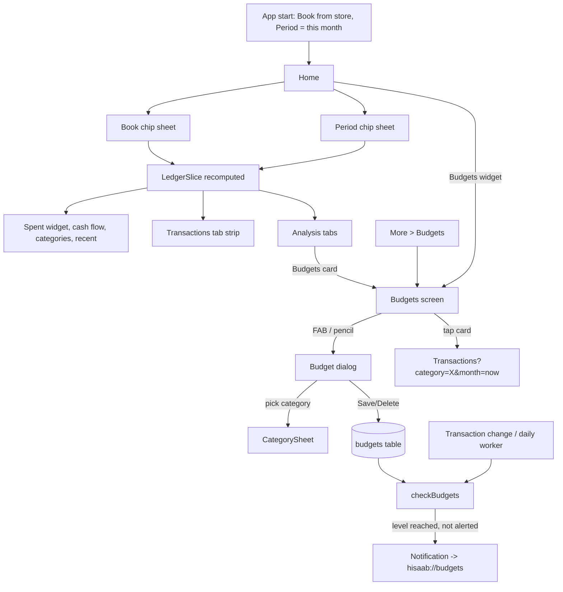

# Expense Tracking (Spend Totals, Book and Period, Budgets)

| Field | Value |
|---|---|
| Feature ID | F-10 |
| Status | In progress (Phase 4: budgets repository, maths, Budgets screen (`/budgets`) and Home budget rings done; global Book/Period filters, spent-widget chart, alert posting, widget and tap-through pending) |
| Priority | P0 |
| Phase | 1 (totals, Book and Period filters, Home spent widget); 4 for Budgets screen, alerts and analytics budget bars |
| Last Updated | 2026-10-21 |

## 1. Description

Expense Tracking answers "how much did I spend?" in one consistent way across Home, Transactions, Analysis, the home-screen widget, budgets and alerts. It defines what counts as spent, applies the global Book and Period filters everywhere, and lets the user set monthly category budgets with alerts. This removes conflicting totals between screens.

## 2. What This Feature Will Do

- Defines what counts as spent and leaves out transfers, rows needing review and duplicates.
- Converts every amount to rupees and flags foreign-currency rows that need a rate.
- Applies the Book filter (Personal, Business or All) to every tab.
- Applies the Period filter (week, month, last month, financial year, last 12 months or custom) to every tab.
- Calculates the previous period for comparison.
- Shows the Home "Spent this month" card with change against the previous period, a cumulative chart and Income, Expenses and Saved tiles.
- Shows the Transactions summary strip with income, expenses, net and count.
- Lets the user set, edit and delete one monthly budget per spendable category.
- Shows budget progress, money left per day and an Over by message on the Budgets screen.
- Notifies the user when a budget reaches their chosen alert level or 100 percent, once per month.
- Shows budget rings on Home and a budgets card on Analysis.
- Shows spent-today and spent-this-month on the Android home-screen widget.

### 2.1 Inputs

- Transactions already stored in the ledger (continuous).
- User choice of Book and Period.
- User-entered budget amounts and alert level (80, 90 or 95 percent).
- Taps on a budget card or ring to open its transactions.

### 2.2 Processing

1. Selects the transactions in the active Book and Period and removes transfers, review rows and duplicates.
2. Converts amounts to rupees and adds up spending using the calculation each screen needs.
3. Works out the previous period and the change against it.
4. Compares each category's spending this month with its budget.
5. Checks budget alerts after every transaction change and once a day.

### 2.3 Outputs

- Spent totals, comparisons and charts on Home, Transactions, Analysis and the Android widget.
- Stored: Book choice, budgets and the alert level.
- Budget alert notifications and budget progress on the Budgets screen, Home and Analysis.
- A filtered Transactions list when a budget is tapped.
- Spend figures go to [Income Tracking](11_income_tracking.md) for savings and to [Recurring Transactions](12_recurring_transactions.md) for forecast inputs.

### 2.4 Out of Scope

- Does not calculate income or savings rate; see [Income Tracking](11_income_tracking.md).
- Does not detect bills or draw the forecast chart; see [Recurring Transactions](12_recurring_transactions.md).
- Does not calculate net worth; see [Portfolio](16_portfolio.md).
- Does not set up notification channels or permissions (notifications feature).
- Does not hide amounts itself (security feature), though every amount shown must obey it.
- Does not include newer ideas such as budget rollover, merchant or tag budgets, quiet hours or a safe-to-spend widget.

## 3. Behaviour in Existing App

Sources: analysis Part A 2.2/2.3/2.5/2.8/4.5, Part B 2.3/2.8/4; Kotlin `ui/ledger/Ledger.kt`, `ui/ledger/FilterChips.kt`, `ui/home/HomeViewModel.kt`, `SpentThisMonth.kt`, `ui/budgets/BudgetsScreen.kt`, `ui/analytics/AnalyticsViewModel.kt`, `AnalyticsBudgets.kt`, `notify/Alerts.kt`, `shared/.../insight/MonthSpend.kt`, `Planning.kt`, `widget/SpendWidget.kt`.

### 3.1 What counts as spend (four coexisting definitions)

Amounts are integer paise in rupee terms (`inrMinor`; `LedgerMath.rupees(t) = inrMinor ?: (currency == "INR" ? amountMinor : 0)`). A foreign transaction without a forex rate counts as 0.

| Where | Definition | Refunds | Investments |
|---|---|---|---|
| `LedgerMath.spent` (Home, Transactions strip, Analysis, categories, merchants, heat map, monthly bars) | `type == DEBIT && category != TRANSFER` | NOT netted; REFUND credits count as income | NOT spend; shown as "Invested" |
| `MonthSpend.compute` (shared module, "Spent this month" maths) | DEBIT and category != TRANSFER; refund = CREDIT with category REFUND subtracted from spend | netted | not spend |
| `Planning.month` / `savings` (savings estimate, insights) | DEBIT sum minus REFUND credits, floored at 0; only `INR`, not `needsReview` | netted | separate `investedMinor` |
| Room aggregates `observeCategoryTotals`, `observeMonthly`, widget `dao.total` (Budgets screen, budget alerts, Android widget) | `type IN ('DEBIT','INVESTMENT')` on `inrMinor` | not netted | counted as spent |

Always excluded from every definition: TRANSFER rows (own-account transfers, card bill payments, EMI mirror on loan account), rows with `needsReview = 1` (flagged possible duplicates), and `duplicateOfId` rows. Credit-card bill payments are shown in lists but never counted as spend or income (see [Dedup & Review](07_dedup_review.md) for transfer pairing).

The Transactions "Out" figure includes investments ("Out includes investments" caption), unlike the Home "Spent" figure.

### 3.2 Global filters (`ViewFilter`, `ViewFilterStore`, `ui/ledger/Ledger.kt`, `ui/ledger/FilterChips.kt`)

- **Book** (`Book`: ALL, PERSONAL, BUSINESS; default ALL; persisted in DataStore `view_filter` key `book`). Membership (`LedgerSource.inBook`): ALL = everything; PERSONAL = `accountId == null` or account usage != BUSINESS; BUSINESS = `accountId != null` and usage == BUSINESS. Usage map includes merged child accounts. The accounts list in the slice is also filtered by book and hidden flag.
- **Period** (`PeriodKind`): THIS_WEEK (Monday to today), MONTH (selected calendar month, steppable back/forward), LAST_MONTH, FY (financial year starting 1 April, `fyStart`), LAST_FY, LAST_12 (11 months back from the first of the month to today), CUSTOM (`DateRangePicker`, defaults first of this month to today). Period/month/custom range are NOT persisted: every launch starts on the current month (`ViewFilter()` default).
- Period chip labels: MONTH "MMM yyyy", FY "FY 2026-27" style (`FY {year}-{(year+1)%100}`), CUSTOM "d MMM - d MMM". Chip sheets: Book sheet (Personal, Business, All books; caption "Applies to every tab."), Period sheet (This week, current Month, Last month, This FY, Last FY, Last 12 months, Custom with "Choose dates"/Apply).
- **Previous period** (`ViewFilter.previous`): for MONTH and LAST_MONTH it is the previous calendar month; otherwise the equal-length window immediately before `from` (`from - days .. from - 1`).
- `LedgerSlice` (what every tab draws from): `txs` in the period, `previous`, `year` (12 months ending with the period's last month, oldest first in `months`), `accounts`, `loaded`. The query window is `min(previous.from, months.first)` to end of `to`. Zone `Periods.zone = ZoneId.systemDefault()` for period maths.
- Transactions tab hides the Book chip (`showBook = false`) and uses the pills Type/Bank/Source plus the Period chip.
- Route arg `month=YYYY-MM` calls `setMonth` once (Home "See all", budgets, month sheet).

### 3.3 Home "Spent this month" widget (`SpentThisMonthWidget`, `SpentThisMonth.kt:154`, key `spent`, default first)

Hero card (palette teal `Hx.palette[2]`):

- Title by period: "Spent this month", "Spent last month", "Spent this week", else "Spent · {period}". Loading text "Loading...".
- Big `AnimatedAmount` 30sp = `LedgerMath.spent(slice.txs)`.
- "Last month: ₹x" line (or "Previous month"/period) and a % chip: `changePercent = (spent - previousSamePeriod) * 100 / previousSamePeriod` (integer), where `previousSamePeriod` is the previous period's cumulative spend at the same elapsed day count; chip is green when spending is less.
- Cumulative line chart this vs previous period (previous is dashed), built by `LedgerMath.cumulative` (day 1..month length, running sum of spend).
- Tiles Income / Expenses / Saved (saved = income - spent).
- Folded list "By account & card": spend grouped by `accountId` (null kept as "Other"), share bars and a "Total" row.
- Empty text "No spending this month." / "No spending in this period.".
- Home items follow the global Book and Period; the widget list is configurable via Customise (see the settings/customise feature).

Other Home widgets that read spend (details in the owning feature): `cashflow` (income, spent, invested, saved), `categories` donut (top 7 + Others, custom categories separated), `recent` (4 rows), `budgets`.

### 3.4 Transactions summary strip (`TxSummaryStrip`)

Income / Expenses / Net cards, "{n} transactions . {period}" and the caption "Out includes investments". Values follow the active type/bank/source filters and the search text.

### 3.5 Budgets

Data: table `budgets(category TEXT PRIMARY KEY, monthlyLimitMinor INTEGER)`. Budgets exist only for the built-in `Category` (no custom categories). One limit per category; the same limit applies every month; it "resets on the 1st". No rollover.

Budgets screen (`BudgetsRoute`, `ui/budgets/BudgetsScreen.kt:110`, route `budgets`, deep link `hisaab://budgets`):

- Top bar "Budgets" (back arrow only when opened with `onBack`), InfoButton with three paragraphs: "A budget is a monthly limit for a category. Set it once: it applies to every month, and resets on the 1st." / "You get an alert when spending reaches your alert level (90% unless you change it) and again at 100%." / "Tap a budget to see every transaction behind it.". ExtendedFAB "Budget".
- Always the CURRENT calendar month (`Periods.range(YearMonth.now)`), independent of the global Period filter. Spent per category = `TransactionDao.observeCategoryTotals(monthStart, monthEnd)` (DEBIT + INVESTMENT, `inrMinor`). Lines sorted by `spent/limit` descending.
- Overview card (primaryContainer, 24dp radius): "{Month yyyy} . {n} days left" where `daysLeft = lengthOfMonth - dayOfMonth + 1`; animated total spent "of {total limit}" and an 8dp progress bar (`spent/limit` clamped 0..1, track 15% alpha).
- `BudgetCard` per category: category badge 42dp, label, percent `(ratio*100).toInt()%`; "{spent with paise} of {limit no paise}"; 6dp bar; line "{left} left . about {left / daysLeft} a day" or "Over by {amount}" (red). Bar colour: over (spent > limit) = error red; `ratio*100 >= alertAt` and not over = amber F29900; else the category colour. Edit pencil opens the dialog; tapping the card opens `transactions?category=<CAT>&month=<current>`.
- Empty state: `EmptyState(Savings, "No budgets yet", "Set a monthly limit for a category. It applies every month, and you'll be alerted before you cross it.")`.
- `BudgetDialog` (AlertDialog "New budget"/"Edit budget"): category card (tap opens `CategorySheet` titled "Budget for which category?"; only when creating; allowed = not in {SALARY, INCOME, REFUND, TRANSFER} and not already budgeted, or the current one when editing), "Monthly limit" field with ₹ prefix, decimal keyboard, support text "Applies every month", `Money.parseInput(amount) > 0` required for Save; stored value shown on edit as whole rupees (`limit / 100`), Delete (red, edit only), Cancel, Save.

Alert threshold: DataStore `app_settings` key `budget_alert_percent`, default **90**, UI choices 80 / 90 / 95 (Notifications & alerts screen segmented control; text "You are also told when a budget is used up."). A second fixed level 100 always applies.

Budget alerts (`AlertsChecker.checkBudgets`, `notify/Alerts.kt`): runs after any transactions change (`TransactionsChangedHub`, mutex-guarded) and in the daily `AlertsWorker`. For the current month, for each budget, for levels `{budgetAlertPercent, 100}` descending (distinct): if `used * 100 >= limit * level` and key `budget:<CATEGORY>:<yyyy-MM>:<level>` is not in `alertedKeys`, post one notification and stop (highest level reached only), then add the key (`alertedKeys` capped to the newest 300). Title "{Category}: budget used up" (level >= 100) or "{level}% of budget used"; body "{used} of {limit} spent. {left} left for {month}." or "{used} spent against {limit}, {over} over."; amounts without paise; tap opens `hisaab://budgets`. Channel `budgets_bills` "Budgets & bills" (importance DEFAULT). Notification posting rules (permission check, channel) belong to the notifications feature.

Home budgets widget (`BudgetsWidget`, key `budgets`, hidden by default): up to 3 progress rings, most used first; ring colour green below 80%, amber from 80%, red from 100% (fixed 80/100 thresholds, not the user alert %); spent = `LedgerMath` spend (DEBIT only) of the Home period grouped by category; limit = the raw monthly limit (not scaled by months); empty state "Set monthly limits..." with a "Set budgets" pill that opens the Budgets route.

Analysis budgets card (`AnalyticsBudgets.kt`, segment Spending, section key `budgets`): bullet bars per category, an "All budgets" total row, a limit tick, a "today's pace" tick (`dayOfMonth / lengthOfMonth`) only for a single current month, legend swatch "≥ {alertPercent}%"; tones green, amber (`used*100 >= alertPercent`), red (>= 100%). In a multi-month period each limit is multiplied by the number of calendar months spanned (`months = MONTHS.between(YearMonth(from), YearMonth(to)) + 1`). `alertPercent` is the setting when within 1..100, else 80 (ViewModel default 80; the setting default is 90, see section 17). Lines sorted by `spent/limit` descending; spent = `LedgerMath` spend by category for the period and book.

### 3.6 Android widget (`widget/SpendWidget.kt`)

Glance widget "DhanKosh spend", 3x2 cells (min 180x110dp, resizable), `updatePeriodMillis = 1_800_000`; shows "Spent today" and "This month" = `dao.total(listOf("DEBIT","INVESTMENT"), start, now)` (the Room-aggregate definition, so investments count); tap opens the app; refreshed on every ingest via `TransactionsChangedHub`; uses `Money.format` so amounts show `₹••••` while the hide-amounts flag is set (default true until settings load).

### 3.7 Analysis spending cards that consume spend (owned by the analytics feature, summarised for totals semantics)

`CategoriesCard` KPIs Spent / Income / Saved-or-Overspent / Per day (`spent / days`, `days = max(1, daysBetween(from, min(to, today)) + 1)`), `MonthlyCard` stacked bars Essentials / Lifestyle / Other (`LedgerMath.group`), `MerchantsCard` top 6 by gross (`merchant ?: bankName`), `WhenCard` heat grid (rows Monday first; columns 6a 9a 12p 3p 6p 9p 12a 3a, `slot = ((hour - 6 + 24) % 24) / 3`, only rows with `hasExplicitTime`), `Compare` current vs previous by category (`pct`: before 0 => +100, now 0 => -100, else `(now-before)*100/before` clamped to -999..999; bars capped at +-50%).

## 4. User Stories

- US-10-01: As a user, I see how much I spent this month, compared with last month, at the top of Home.
- US-10-02: As a user, I switch the whole app between Personal, Business and All books.
- US-10-03: As a user, I choose a period (week, month, FY, last 12 months, custom) once and every tab follows.
- US-10-04: As a user, I set a monthly limit per category and see how much is left per day.
- US-10-05: As a user, I get a notification at my alert level and when the budget is used up.
- US-10-06: As a user, I tap a budget to see the transactions behind it.
- US-10-07: As a user, I never see transfers, own-account moves or card bill payments inflate my spending.

## 5. Functional Requirements (FR-10-01 ...)

- FR-10-01: The system shall compute spend per section 2.1 and expose three named calculators: `ledgerSpent` (DEBIT, not TRANSFER), `netSpent` (minus REFUND credits, floored at 0) and `outflow` (DEBIT + INVESTMENT) so each screen uses the documented one.
- FR-10-02: All totals shall use `inrMinor`; a non-INR row without a rate counts as 0 and is surfaced as "needs a rate" (see the forex settings).
- FR-10-03: TRANSFER rows, `needsReview` rows and `duplicateOfId` rows shall be excluded from all totals.
- FR-10-04: The Book filter (ALL/PERSONAL/BUSINESS, default ALL, persisted) shall be applied to all tabs with the membership rules of section 2.2.
- FR-10-05: The Period filter shall support This week, Month (stepper), Last month, This FY, Last FY, Last 12 months, Custom; it shall reset to the current month on each launch.
- FR-10-06: The system shall compute the previous period as defined in section 2.2 for comparisons.
- FR-10-07: The Home spent widget shall show total, previous-period figure, % change vs the same elapsed days, cumulative this-vs-previous chart, Income/Expenses/Saved tiles and the folded "By account & card" list.
- FR-10-08: The Transactions summary strip shall show Income, Expenses, Net, the count and period label, honouring all filters and search.
- FR-10-09: The user shall be able to create, edit and delete one monthly budget per spendable category (not SALARY, INCOME, REFUND, TRANSFER).
- FR-10-10: The Budgets screen shall always show the current calendar month, sorted by `spent/limit` descending, with overview, per-card percent, amount text, left-per-day (`left / daysLeft`) or "Over by", colour rules and navigation to the category's transactions.
- FR-10-11: Budget alerts shall fire at most once per category per month per level (levels: the user percent and 100), only the highest level reached being notified, with dedupe key `budget:<CAT>:<yyyy-MM>:<level>`.
- FR-10-12: The user alert level shall be selectable as 80, 90 or 95 percent (default 90).
- FR-10-13: Budget alerts shall be re-evaluated after every transaction change and daily.
- FR-10-14: The Home budgets widget shall show up to three rings, most used first, with green/amber/red at 80%/100%, and an empty state with a "Set budgets" action; hidden by default.
- FR-10-15: The Analysis budgets card shall scale limits by the number of months spanned, draw a pace tick only for a single current month, and colour by the alert level.
- FR-10-16: The Android home-screen widget (if shipped) shall show spent-today and spent-this-month using `outflow`, refresh on ingest and honour hide-amounts.
- FR-10-17: Tapping a budget card or Home budget ring shall open Transactions filtered by that category and month.

## 6. Non-Functional Requirements (performance, battery, privacy, offline)

- All computation is local; no network.
- Aggregations run in SQL or on background isolates; Home recompute after an ingest batch under 100 ms for a year of data (about 400 days loaded for plan widgets, 12 months for the slice).
- LedgerSlice is shared (a single provider with a 10 s keep-alive) so tabs do not re-query independently.
- Budget check is mutex-guarded and idempotent; alerts never repeat after a rescan.
- Amounts honour hide-amounts everywhere including notifications bodies (old app shows real amounts in budget notifications; see section 17).
- Battery: budget checks only on change and once a day.

## 7. UI / Screens & User Flow (screen list + flow diagram)

| # | Screen/sheet | Source | Notes |
|---|---|---|---|
| 1 | Book chip sheet | `ui/ledger/FilterChips.kt` | Personal / Business / All books |
| 2 | Period chip sheet and custom `DateRangePicker` | `FilterChips.kt` | 7 periods |
| 3 | Home "Spent this month" widget | `ui/home/SpentThisMonth.kt:154` | Hero card with folded account list |
| 4 | Home Budgets widget | `ui/home/HomeWidgets.kt` | Rings; hidden by default |
| 5 | Transactions summary strip | `ui/transactions/TxSummaryStrip.kt` | Income/Expenses/Net |
| 6 | Budgets screen | `ui/budgets/BudgetsScreen.kt:110` | Route `budgets`, deep link `hisaab://budgets` |
| 7 | Budget dialog (New/Edit budget) | `BudgetsScreen.kt:226` | Plus CategorySheet "Budget for which category?" |
| 8 | Budget info dialog | `InfoButton` | 3 paragraphs |
| 9 | Analysis > Spending > Budgets card | `ui/analytics/AnalyticsBudgets.kt` | Bullet bars with pace tick |
| 10 | Notifications & alerts: budget alert segmented 80/90/95 | `ui/more/AlertsScreen.kt:35` | Setting owned here, screen owned by notifications |
| 11 | Budget alert notification | `notify/Alerts.kt` | Deep link `hisaab://budgets` |
| 12 | Android home widget "DhanKosh spend" | `widget/SpendWidget.kt` | Glance 3x2 |



Reference GIFs:

-  (Status: Pending, not yet captured)
-  (Status: Pending, not yet captured)
-  (Status: Pending, not yet captured)
-  (Status: Pending, not yet captured)
-  (Status: Pending, not yet captured)
-  (Status: Pending, not yet captured)
-  (Status: Pending, not yet captured)
-  (Status: Pending, not yet captured)
-  (Status: Pending, not yet captured)
-  (Status: Pending, not yet captured)
-  (Status: Pending, not yet captured)
-  (Status: Pending, not yet captured)

## 8. Data Models (Dart entities + fields + types)

```dart
enum Book { all, personal, business }
enum PeriodKind { thisWeek, month, lastMonth, fy, lastFy, last12, custom }

@freezed class ViewFilter {
  Book book;                    // persisted
  PeriodKind kind;              // not persisted
  YearMonth month;              // for kind == month
  DateTime? customFrom; DateTime? customTo;
  // derived: (DateTime, DateTime) range; String label; (DateTime, DateTime) previous; bool isMonth
}

@freezed class LedgerSlice {
  ViewFilter filter; DateTime from; DateTime to;
  List<Txn> txs; List<Txn> previous; List<Txn> year; List<YearMonth> months;
  List<AccountWithActivity> accounts; bool loaded;
}

@freezed class MonthFlow { YearMonth month; int spent; int income; int invested; Map<SpendGroup,int> byGroup; }
@freezed class SpendSummary {
  int spent; int previousSamePeriod; int? changePercent;
  List<int> cumulative; List<int> previousCumulative;
  Map<int?, int> byAccount; int income; int saved;
}

@freezed class Budget { Category category; int monthlyLimitMinor; }          // paise
@freezed class BudgetLine { Category category; int limit; int spent; }       // current month
@freezed class BudgetUse { Category category; int limit; int spent; double fraction; }
@freezed class BudgetSummary { List<BudgetUse> lines; int months; int alertPercent; double? pace; }

@freezed class BudgetAlertState { Set<String> alertedKeys; }   // capped to newest 300
```

Settings (DataStore equivalents, `shared_preferences` or Drift settings table): `budget_alert_percent` int default 90; `alerted_keys` string set.

## 9. Database Tables / Changes

```dart
class Budgets extends Table {
  TextColumn get category => text()();                   // Category enum name, PK
  IntColumn  get monthlyLimitMinor => integer()();
  @override Set<Column> get primaryKey => {category};
}
```

Reads from `transactions` (owned by the ledger): columns `type, category, customCategoryId, inrMinor, amountMinor, currency, timestamp, accountId, needsReview, duplicateOfId, hasExplicitTime, merchant, bankName`. Required queries:

- `observeBetween(fromMs, toMs)` for the slice (indexed on `timestamp`).
- `observeCategoryTotals(from, to)`: `SELECT category, SUM(inrMinor) AS total FROM transactions WHERE type IN ('DEBIT','INVESTMENT') AND inrMinor IS NOT NULL AND timestamp BETWEEN ? AND ? GROUP BY category ORDER BY total DESC` (`Daos.kt:84-89`). It has NO `needsReview` filter and no `duplicateOfId` filter in Kotlin; parity keeps it that way (corrected 2026-10-19; Flutter may add `needsReview = 0` only as a deliberate deviation recorded in 17).
- `total(types, from, to)` for the widget.

`view_filter` DataStore: key `book` (string enum name). The `budgets` table exists from schema v1 (`shared/schemas/com.hisaab.shared.db.HisaabDatabase/1.json:442`); no migration creates it (corrected 2026-10-19; previously said migration 7-8).

## 10. Business Rules & Logic (regex, parsing rules, algorithms, thresholds)

Key algorithms:

```text
rupees(t)   = t.inrMinor ?? (t.currency == 'INR' ? t.amountMinor : 0)
isSpend(t)  = t.type == DEBIT && t.category != TRANSFER
isIncome(t) = t.type == CREDIT && t.category != TRANSFER           // includes REFUND here
isInvest(t) = t.type == INVESTMENT
spent       = sum(rupees where isSpend)

changePercent = previousSamePeriod == 0 ? null : (spent - previousSamePeriod) * 100 ~/ previousSamePeriod
previousSamePeriod = previousCumulative[min(elapsedDays, len) - 1]

fyStart(d)  = DateTime(d.month >= 4 ? d.year : d.year - 1, 4, 1)
heatSlot    = ((hour - 6 + 24) % 24) ~/ 3        // 0..7 -> 6a,9a,12p,3p,6p,9p,12a,3a
perDay      = spent ~/ max(1, days(from, min(to, today)) + 1)

budgetColor(used, limit, alert):  used > limit -> red; used*100 >= alert*limit -> amber; else category colour
dailyLeft   = (limit - spent) ~/ daysLeft;  daysLeft = lengthOfMonth - dayOfMonth + 1
analyticsLimit = monthlyLimit * monthsSpanned
paceTick    = single current month ? dayOfMonth / lengthOfMonth : null
alertLevels = distinct([userPercent, 100]) sorted desc; first level with used*100 >= limit*level and key not alerted => notify, add key, stop
```

Constants: alert choices 80/90/95; default 90; always a 100 level; Home budget ring thresholds 80/100; Analytics default `alertPercent` fallback 80 when the stored value is outside 1..100; `RECENT = 4` rows on Home; Home donut top 7 + Others; `alertedKeys` cap 300; Budgets excluded categories SALARY, INCOME, REFUND, TRANSFER.

Sample (masked) alert: limit 10,000 for FOOD, spent 9,000 on 12 Oct, user level 90: used*100 = 900,000 >= 10,000*100*0.9 (1,000,000*0.9 = 900,000) true, so one alert "Food & Dining: 90% of budget used"; at 10,000 a second alert "budget used up"; no repeats the same month.

## 11. Platform / Native Requirements (permissions, channels, background work)

- Notification permission (Android 13+ `POST_NOTIFICATIONS`), channel `budgets_bills` "Budgets & bills" importance DEFAULT, deep link `hisaab://budgets` (go_router deep link plus Android intent filter host `budgets`).
- Daily background job `daily-alerts` (WorkManager periodic, 1 day, KEEP) runs `checkBudgets`; Flutter equivalent: `workmanager` plugin; also trigger after each ingest in the foreground/background isolate.
- Android home-screen widget: Glance in the old app; Flutter equivalent `home_widget` package with a native widget (optional, Phase 5).
- iOS: no widget/WorkManager equivalence assumed (the old app is Android-only).

## 12. Dependencies (other features → link to their memory file; packages)

- [Categorization](09_categorization.md): categories, spend groups, colours, CategorySheet.
- [Income Tracking](11_income_tracking.md): income tiles, saved, cash flow.
- [Recurring Transactions](12_recurring_transactions.md): bills feeding forecast and "safe to spend".
- [Accounts Management](13_accounts_management.md): account usage (Personal/Business) for Book membership, "By account & card".
- [Dedup & Review](07_dedup_review.md): needsReview and transfer exclusion.
- Others (see index): ledger/transactions list, notifications, settings/customise, analytics, security (hide amounts), forex.
- Packages: `drift`, `riverpod`, `freezed`, `fl_chart` (cumulative line, donut, bullet bars), `intl` (en_IN formatting), `workmanager`, `flutter_local_notifications`, `go_router`, `shared_preferences`, `home_widget` (optional).

## 13. Folder Location (lib/features/<name>/...)

```text
lib/features/expense_tracking/
  data/
    datasources/budget_dao.dart, spend_queries.dart, view_filter_store.dart
    repositories/budget_repository_impl.dart, ledger_slice_repository_impl.dart
  domain/
    entities/view_filter.dart, ledger_slice.dart, budget.dart, budget_use.dart, spend_summary.dart
    usecases/compute_spend.dart, build_slice.dart, previous_period.dart, check_budgets.dart, save_budget.dart
    repositories/budget_repository.dart, ledger_slice_repository.dart
  presentation/
    filters/book_chip.dart, period_chip.dart, date_range_dialog.dart
    home/spent_this_month_widget.dart, budgets_widget.dart
    budgets/budgets_screen.dart, budget_card.dart, budget_dialog.dart
    providers/view_filter_provider.dart, ledger_slice_provider.dart, budgets_provider.dart
```

## 14. Edge Cases & Error Handling

- Previous period zero: no % chip (avoid divide by zero); chart shows only this period.
- Day 31 vs shorter months: cumulative lists are sized per month length; `previousSamePeriod` index clamps to the previous month's length.
- Foreign spend without rate counts as 0 and the Forex screen shows "N need a rate"; totals must not show NaN.
- Budget with limit 0 or negative is rejected (Save disabled); analysis lines filter `limit > 0`.
- Budget for a category the user later stops using remains visible with 0 spent.
- Changing a transaction's category moves it between budgets immediately (reactive).
- Custom categories are stored as OTHER, so they count under "Other" budget spend; they cannot be budgeted.
- Budgets screen is always the current month even when the Period chip is another month; this is intentional (Open Questions 3 for confirmation).
- Notification denied or disabled: checks still run and mark keys as alerted only when the post succeeds (old app marks even if posting was a no-op; flag as Open Question 6).
- Period "Last 12 months" starts at the first of the month 11 months ago, not 365 days.
- Clock/timezone: uses the device timezone, not IST, for periods (balance and maturity use IST elsewhere).
- Book PERSONAL includes rows with no account (cash/manual).

## 15. Test Cases (unit / widget / integration + sample fixtures)

Unit:

- TC-10-01 (FR-10-01, FR-10-03): fixture of DEBIT 250, DEBIT TRANSFER 5,000 (card bill), DEBIT needsReview 300, INVESTMENT 1,000, CREDIT 5,000: `ledgerSpent` = 250, `outflow` = 1,250, `netSpent` = 250.
- TC-10-02 (FR-10-01): DEBIT 1,000 and CREDIT REFUND 400 gives `netSpent` 600; refund larger than spend floors at 0.
- TC-10-03 (FR-10-02): USD row with `inrMinor = null` contributes 0; with rate 83.10 and markup 350 bps contributes `round(amount*83.10*1.035)`.
- TC-10-04 (FR-10-04): book membership truth table (null account, personal, business, merged child).
- TC-10-05 (FR-10-05, FR-10-06): previous-period for MONTH (previous calendar month), THIS_WEEK (7 days before), FY, CUSTOM (equal length).
- TC-10-06 (FR-10-05): `fyStart(2026-03-31) == 2025-04-01`; `fyStart(2026-04-01) == 2026-04-01`; label "FY 2026-27".
- TC-10-07 (FR-10-07): cumulative for a 30-day month; `changePercent` integer division; null for zero previous.
- TC-10-08 (FR-10-10): `dailyLeft` on 20 Oct with left 3,100 (daysLeft 12) = 258.
- TC-10-09 (FR-10-11, FR-10-12): alert at 90 then 100, key dedupe, highest level only, new month re-arms, level changed to 80 fires at 80.
- TC-10-10 (FR-10-15): 3-month period scales limit x3; pace tick null for last month.
- TC-10-11 (FR-10-09): budget category list excludes SALARY, INCOME, REFUND, TRANSFER and already-budgeted ones.

Widget:

- TC-10-12 (FR-10-07): Home spent widget loading, empty, populated, hidden amounts.
- TC-10-13 (FR-10-10): Budget card colours: green below alert, amber at alert, red over; "Over by" text.
- TC-10-14 (FR-10-14): Home budgets widget shows 3 rings max, ordered by usage; empty state button navigates.
- TC-10-15 (FR-10-04, FR-10-05): Book and Period sheets update every tab; period resets after app restart; book persists.

Integration:

- TC-10-16 (FR-10-11, FR-10-13): ingest an SMS that pushes FOOD past 90%: exactly one notification; rescan does not repeat.
- TC-10-17 (FR-10-17): tapping a budget opens Transactions filtered to category and current month.

Fixtures: use corpus samples from [Dedup & Review](07_dedup_review.md) and masked amounts above; golden outputs from the Kotlin `LedgerMath` and `MonthSpend` unit tests.

## 16. Acceptance Criteria

- AC-10-01: Spent figure on Home equals `ledgerSpent` for the selected Book and Period and excludes transfers, card-bill payments and flagged duplicates (FR-10-01, FR-10-03; TC-10-01, TC-10-02).
- AC-10-02: Foreign-currency spends use rupee values and never produce NaN or inflated totals (FR-10-02; TC-10-03).
- AC-10-03: Book and Period apply to every tab; book persists, period resets (FR-10-04, FR-10-05; TC-10-04, TC-10-05, TC-10-06, TC-10-15).
- AC-10-04: Previous-period comparison matches the Kotlin behaviour for month and non-month periods (FR-10-06, FR-10-07; TC-10-05, TC-10-07).
- AC-10-05: Budgets can be created, edited, deleted and show correct percent, left-per-day and colours (FR-10-09, FR-10-10; TC-10-08, TC-10-11, TC-10-13).
- AC-10-06: Alerts fire once per level per month at the user level and at 100% (FR-10-11, FR-10-12, FR-10-13; TC-10-09, TC-10-16).
- AC-10-07: Home budgets widget and Analysis budgets card follow their rules (FR-10-14, FR-10-15; TC-10-10, TC-10-14).
- AC-10-08: Budget navigation opens the correct filtered Transactions list (FR-10-17; TC-10-17).
- AC-10-09: Android widget (when shipped) shows `outflow` for today and the month (FR-10-16; manual device test).

## 17. Open Questions

1. Four spend definitions coexist (section 2.1): Home/Transactions use DEBIT only; Budgets screen, budget alerts and the Android widget use DEBIT + INVESTMENT; `MonthSpend`/`Planning` net out refunds. Should the Flutter app unify on one definition (recommended: `ledgerSpent` plus an explicit "Invested" line) or keep the old per-screen behaviour?
2. Budget alert default: setting default 90 but `BudgetSummary` fallback 80 and Home rings fixed at 80; confirm 90 is canonical (carried from analysis Part A open question 2).
3. The Budgets screen ignores the global Period/Book and always shows the current calendar month (all books); confirm intent. `observeCategoryTotals` does not exclude `needsReview` rows in Kotlin (`Daos.kt:84-89`), so flagged rows count in Budgets screen category spend; confirm whether Flutter should exclude them (FR-08-19 excludes them elsewhere).
4. Home budget rings do not scale the limit by months while the Analysis card does; confirm Home should be single-month only.
5. "About {daily} a day" uses `left / daysLeft` with `daysLeft = lengthOfMonth - dayOfMonth + 1` (includes today); confirm.
6. Alert key is recorded even when notifications are disabled or posting is swallowed (`SecurityException`); confirm whether the new app should only record on success.
7. Notification bodies show real amounts even when "Hide amounts" is on (default true); confirm privacy expectation.
8. `Periods.zone` uses the system default zone while parsing and balances use IST; confirm the Flutter app uses one policy (recommend `Asia/Kolkata` for FY/day buckets or device zone consistently).
9. Safe-to-spend maths remain in `HomeViewModel` (`(base - spent - reservedBills) / daysLeft`, base = budget total else income) though not displayed; port or drop (analysis open question 5).
10. The Home "Spent" widget total for non-month periods labels "Previous month/period"; exact label rules for FY/custom were not captured.

## 18. Implementation Notes

Phase 4 data/domain layer (no UI). Table `budgets` (schema v4; it is NOT in the Flutter v1 schema, so v3 -> v4 creates it). Code: `lib/core/db/tables/budgets.dart`; `lib/features/expense_tracking/domain/{budget,budget_math,spend_calc,budget_repository}.dart`, `data/budget_repository_impl.dart`; providers `budgetRepositoryProvider`, `budgetsProvider` in `lib/app/di/phase4_providers.dart`. Tests: `test/features/phase4/{phase4_logic,phase4_repositories}_test.dart`.

FR status done (data/domain): FR-10-01..03 (`SpendCalc`), 06 (`changePercent` only), 09 (`BudgetRepository.save/delete`, excluded categories rejected), 10 (maths: `BudgetMath.sortedUse/dailyLeft/band`), 11 (`BudgetMath.pendingAlert`, key format, cap const), 12 (`normaliseAlertPercent`), 14 (`ringBand`), 15 (`analyticsLimit`, `paceTick`). Pending: FR-10-04, 05, 07, 08, 13, 16, 17 (filters, slice, UI, alert posting, widget).

Decisions: alert default is 90 everywhere; `normaliseAlertPercent` falls back to 90 (not the Kotlin 80) when the stored value is outside 1..100 (open question 2 resolved). `categoryTotals` keeps Kotlin parity (no `needsReview`/duplicate filter, priced `inrMinor` only).

API for UI agents:

```dart
abstract interface class BudgetRepository {
  Stream<List<Budget>> watchAll();  Future<List<Budget>> all();
  Future<void> save(Category category, int monthlyLimitMinor);   // ArgumentError if excluded or <= 0
  Future<void> delete(Category category);
  Future<Map<Category, int>> categoryTotals(int fromMs, int toMs);
  Stream<Map<Category, int>> watchCategoryTotals(int fromMs, int toMs);
}
BudgetMath.sortedUse(List<Budget>, Map<Category,int> spent, {int months = 1}) -> List<BudgetUse>
BudgetMath.band(used, limit, alertPercent) -> BudgetBand;  ringBand(used, limit)
BudgetMath.daysLeft(y, m, dayOfMonth);  dailyLeft(limit, spent, daysLeft) -> int?  // null when over
BudgetMath.pendingAlert({budget, usedMinor, alertPercent, yearMonth, alerted}) -> BudgetAlertHit?  // key budget:<CAT>:<yyyy-MM>:<level>
SpendCalc.ledgerSpent / netSpent / outflow (Iterable<LedgerTx>) -> int;  unpricedCount;  changePercent(spent, prev)
```

UI (Phase 4): `lib/features/expense_tracking/presentation/{expense_tracking_screen,budget_widgets}.dart` (route `/budgets` in `router.dart`), Home `dashboard_home/presentation/home_budget_widgets.dart` (`HomeBudgetsCard`), view state in `lib/app/di/budget_providers.dart` (`budgetMonthProvider`, `budgetAlertPercentProvider`, `budgetUsesProvider(month)`, `monthCategorySpendProvider`). Tests: `test/features/expense_tracking/budgets_screen_test.dart`.

FR UI done: FR-10-09 (add/edit/delete sheet, excluded categories not offered), FR-10-10 (month nav incl. past months, overview, percent, left per day or "Over by", bands from the alert percent setting, pace tick, spent-by-category list), FR-10-12 (read from settings), FR-10-14 (Home rings, tap opens `/budgets`; always shown, with "Set budgets" empty state, instead of hidden-by-default until the Home widget customiser exists). Deferred: FR-10-04/05/07/08/13/16/17 (global filters, cumulative chart and by-account list, alert posting, Android widget, tap-through to filtered Transactions), an in-screen alert-percent selector (owned by the alerts screen), info dialog.

Alert dedupe keys live in `AlertedKeyStore` ([21](21_alerts_reminders.md)); the alert percent is `SettingKeys.budgetAlertPercent`.

## 19. Change Log (date | change | reason)

| Date | Change | Reason |
|---|---|---|
| 2026-10-17 | Created from hisaab_apk 2.9.8 analysis | Initial |
| 2026-10-19 | Corrected: `budgets` table is in schema v1, not migration 7-8; `observeCategoryTotals` has no `needsReview` filter (open question 3 updated) | Audit Gate gap, scan_3
| 2026-10-19 | Restructured to the 19-section standard (Description, What This Feature Will Do, Implementation Notes added); Last Updated bumped | Audit Gate (Prompt 2, Part A) |
| 2026-10-21 | Phase 4 data layer landed | Phase 4 |
| 2026-10-21 | Phase 4 UI landed | Phase 4 |
