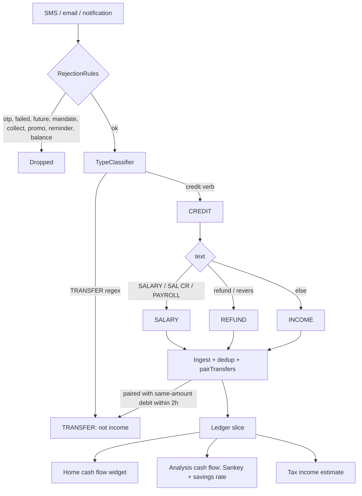

# Income Tracking (Detection, Classification, Cash Flow, Savings Rate)

| Field | Value |
|---|---|
| Feature ID | F-11 |
| Status | In progress (Phase 4: classification helpers, cash-flow and savings-rate maths, income queries done; Home cash-flow widget, Analysis segment and savings outlook UI pending) |
| Priority | P0 |
| Phase | 1 (credit detection and classification at ingest, Home cash-flow widget); 4 for Analysis cash-flow segment and savings sparkline |
| Last Updated | 2026-10-21 |

## 1. Description

Income Tracking recognises money coming in, such as salary, interest, dividends, rent and refunds, and keeps non-income credits like own-account transfers and card bill payments out of it. It shows income against spending as cash flow and a savings rate. This tells the user how much they earn and how much they keep.

## 2. What This Feature Will Do

- Detects incoming-money messages and records them as credits.
- Labels each credit as Salary, Refund or Income.
- Ignores one-time passwords, failed, future, reminder, promotional and balance-only messages.
- Keeps card bill payment acknowledgements, own-account transfers and EMI mirrors out of income.
- Calculates income for the active Book and Period.
- Shows the Home cash-flow card with Income, Spent, Invested, Saved and the savings rate.
- Shows a Best in n months note when the savings rate beats every other month.
- Shows the Analysis cash-flow view with a Sankey chart of where income went.
- Shows the savings-rate chart once at least 2 months have income.
- Sorts income text into salary, interest, deposit interest, dividend, rent and other for the tax estimate.
- Estimates a full year of income when fewer than 12 months of data exist.
- Lets the user change a credit's category and learns a rule from it.
- Estimates yearly savings from recent months plus EPF and NPS growth.

### 2.1 Inputs

- Incoming bank messages and notifications, parsed as they arrive.
- Transactions already in the ledger, for totals and charts.
- User category changes on a credit.
- Active Book and Period filters.

### 2.2 Processing

1. Reads each message to decide whether money came in.
2. Rejects non-money messages and sets aside transfers and card payments.
3. Assigns Salary, Refund or Income from the message text.
4. Adds up credits in the active Book and Period, in rupees.
5. Compares income with spending and investing to work out saved money and the savings rate.
6. Sorts income text into types and scales to a year where data is short.

### 2.3 Outputs

- The Home cash-flow card and the Analysis cash-flow and savings-rate views.
- Stored: credit transactions with their category.
- A yearly income estimate by type for the tax feature.
- A savings figure for [Expense Tracking](10_expense_tracking.md) and its Home spent card.
- A flag asking for a forex rate when a foreign-currency credit has none.

### 2.4 Out of Scope

- Does not calculate tax slabs, deductions or sharing (tax feature).
- Does not calculate spend totals; see [Expense Tracking](10_expense_tracking.md).
- Does not match transfer pairs; see [Dedup & Review](07_dedup_review.md).
- Does not draw the forecast chart or 30-day cash projection; see [Recurring Transactions](12_recurring_transactions.md).
- Does not include newer ideas such as GST or receivables, client receipts, FIRE or goal planning, or more income categories.

## 3. Behaviour in Existing App

Sources: analysis Part A 2.2/2.5, Part B 2.3/4/5.2/6.5/6.6/7, Part C 1.9; Kotlin `parser-core/.../extract/TypeClassifier.kt`, `merchant/MerchantNormalizer.kt`, `rules/RejectionRules.kt`, `rules/CardBill.kt`, `shared/.../repo/TransactionRepository.kt` (pairTransfers), `shared/.../insight/TaxIncome.kt`, `Planning.kt`, `app/.../ui/ledger/Ledger.kt`, `ui/home/HomeViewModel.kt`, `HomeWidgets.kt`, `ui/analytics/AnalyticsViewModel.kt`, `AnalyticsSegments.kt`.

### 3.1 How a message becomes income (parse time)

`TypeClassifier.classify(text, templateType, lower)`:

1. TRANSFER regex (guarded, case-insensitive) wins even over a template hint: `payment .{0,60}? received .{0,60}? card`, `received (your )?payment .{0,70}? card`, `payment .. (credited|posted|reflected) .. credit card`, `credit card .. payment .. (credited|posted|reflected|received)`, `thank you for (your|the)? payment`, `self[ -]transfer`, `own account`, `between your (own )?accounts`, `towards (your )?(<up to 3 words>) credit card`, `(credit card|cc) (bill )?payment`, `card bill`.
2. A template type hint wins next.
3. OUTGOING wording is read as DEBIT even though it says "credited": `credited (in)?to (the )?(beneficiary|benef\w*|bene|payee|recipient)`, `credited to <name>'s (a/c|acct|account|bank)`, `transfer of INR x to (a/c|acct|account|beneficiary)`, `(sent|transferred|remitted) to (a/c|acct|account|beneficiary|benef|payee)`.
4. DEBIT verbs: `debited|debit (by|for|of|alert)|spent|withdrawn|withdrawal|paid|sent|purchased?|deducted|charged|transferred to|txn of|used (for|at|on)|thank you for using|...`. CREDIT verbs: `credited|credit (by|of|alert|with)|received|deposited|refund(ed)?|reversed|reversal`. The earlier verb wins; credit is searched only up to 12 chars after the first debit start.

Rejections that keep a message from becoming income (`RejectionRules`, in this order): `otp`, `failed` (unless it has both a reversal word and "credited"), `future` ("will be credited"), `mandate`, `collect` ("requested money"), `promo`, `reminder` (unless a movement word is present), `balance` (a balance-only alert such as "Avl bal INR x" is not a credit; CHANGELOG 1.13.0 "balance-only alerts not credits").

Merchant for credits (`MerchantExtractor`): `FROM` (from|by), `INFO`, VPA, `ACH` patterns; sender name becomes the merchant (for example `JOHN DOE`, `ACME CORP`, `CITIN52...` reference carried in `ref`).

Category for a CREDIT (`MerchantNormalizer.normalize`, step 5):

- text contains `SALARY|SAL CR|PAYROLL` => SALARY;
- text contains "refund" or "revers" => REFUND;
- otherwise INCOME.

(Directory categories do not apply to credits; a credit from "Swiggy" is still INCOME unless the text says refund.)

Merchant rules (see [Categorization](09_categorization.md)) can override the category after this step (e.g. a rule "acme corp" => SALARY), except for TRANSFER.

Sample messages (masked, from the corpus):

- `Update! INR 5,000.00 deposited in HDFC Bank A/c XX1234 on 01-SEP-26 for NEFT Cr-CITI0000001-ACME CORP-XXXXXX-CITIN52026090112345. Avl bal INR 52,340.50.` => CREDIT 5,000.00, ref `CITIN52026090112345`, merchant "Acme Corp", category INCOME (SALARY if the text carried "SALARY").
- `Dear SBI User, your A/c X1234-credited by Rs.5000 on 20Sep26 transfer from JOHN DOE Ref No 526312345678 -SBI` => CREDIT 5,000, merchant "John Doe", INCOME.
- `Dear Customer, Acct XX123 is credited with Rs 5,000.00 on 20-Sep-26 from JOHN DOE. UPI:526312345678-ICICI Bank.` => CREDIT, 3-digit account "123".
- `Received INR 500 in your Kotak Bank AC X1234 from ...@ybl on 25-09-26. UPI Ref 526...` => CREDIT with VPA-derived name.
- PhonePe notification `("PhonePe", "asha@ybl sent you ₹500", null)` => CREDIT 500, confidence 0.55 (notification-read).
- Payment received on a credit card: `Payment of Rs 12,345.00 received towards your HDFC Bank Credit Card XX5678 on 18-09-26.` => TRANSFER (NOT income).

### 3.2 What is excluded from income

| Credit | Result | Where |
|---|---|---|
| Card bill payment acknowledgement (card side) | TRANSFER | `TypeClassifier` TRANSFER regex; `CardBill` |
| Opposite leg of an own-account transfer | TRANSFER (note "Self transfer between your accounts") | `pairTransfers`: DEBIT+CREDIT same amount, within +-2 h, different non-null accountId, both kind ACCOUNT |
| Manual own transfer "in" leg | TRANSFER | `addOwnTransfer` (`xfer-in:<uuid>`) |
| EMI mirror on loan account | TRANSFER (note "EMI also debited from your bank account") | `pairEmi` |
| Refund | CREDIT with category REFUND: income by `LedgerMath` (kept as income), subtracted from spend by `MonthSpend`/`Planning.month`, excluded from salary/other lines of the tax estimate | see 2.4 and 2.6 |
| Possible duplicate | row with `needsReview = 1` | excluded from all totals until resolved ([Dedup & Review](07_dedup_review.md)) |
| Reimbursement text (`reimburs|refund|reversal|cashback`) | not counted as salary in the tax estimate | `TaxIncome.estimate` |
| Credits with no resolvable INR value (`inrMinor == null`) | counted as 0 | `LedgerMath.rupees` |

Credit-card statements and notices never create income. `isIncome(t) = type == CREDIT && category != TRANSFER`.

### 3.3 Income aggregation (`LedgerMath`, `ui/ledger/Ledger.kt:198`)

```text
isIncome(t)  = t.type == CREDIT && t.category != TRANSFER
income(txs)  = sum(rupees(t) for t in txs if isIncome(t))
invested(txs)= sum(rupees(t) where type == INVESTMENT)
monthly(txs, months) -> MonthFlow(month, spent, income, invested, byGroup)
```

Note: `LedgerMath.income` INCLUDES REFUND credits and any other non-transfer credit (interest, dividend, rent, cashback). `Planning.month` income EXCLUDES REFUND and nets refunds against spend (used for the savings outlook, see [Expense Tracking](10_expense_tracking.md) section 2.1).

### 3.4 Analysis cash-flow classification (`AnalyticsMath.build`, `AnalyticsViewModel.kt:146-152`)

For every income row (`LedgerMath.isIncome`):

- category SALARY => `salary`;
- category REFUND OR merchant text contains "interest" (case-insensitive) => `refunds` (labelled "Refunds & interest");
- everything else => `otherIncome`.

Sankey (`CashFlowSegment`): inputs Salary / Other income / Refunds & interest; outputs Essentials / Lifestyle / Other (spend groups) / Invested / Saved (`max(0, income - spent - invested)`).

### 3.5 Home cash-flow widget (`CashFlowWidget`, key `cashflow`)

- `CashFlow(income, spent, invested)`: `saved = income - spent - invested`; `rate = income > 0 ? saved * 100 / income (integer) : null`.
- Title "{period} cash flow"; action "Analyse ›" opens the Analysis tab. KPI row Income (green), Spent, Invested (accent), Saved (green or red when negative; compact money). If `income > 0`: `SplitBar` of spent / invested / max(saved, 0) as shares of income, then "Savings rate x%" (green when >= 0) and optionally "best in {n} months". Else hint "No income recorded in this period.".
- "Best in n months" (`bestRateOf`): only when the period is a calendar month and this month's rate is strictly greater than every other month in the 12-month window that had income, and at least 2 other months exist; value = number of others + 1. Other months' rate = `(income - spent - invested) * 100 / income` (integer).

### 3.6 Analysis cash-flow segment (`AnalyticsSegments.kt:46`)

- Card "Where your income went": empty note "No income recorded in {period}. Once a salary or other credit arrives, this shows where it went."; KPI row Income / Spent / Invested / "Left over" or "Shortfall" (abs value, warn colour when negative); Sankey; when saved < 0 note "Spending and investing exceeded income by {amount}.".
- Card "Income vs spend · savings rate": needs at least 2 months with income in the last 12 (else note "Needs at least two months with income in the last 12."). `savingsRates` = for each month with income > 0, `(income - spent) * 100 / income` as float clamped to -100..100 (NOTE: does not subtract invested). Shows last month's % ("{n}% saved in {month}"), sparkline (green when average >= 0), first/last month labels and "avg {pct}% . {n} months"; caption "Share of each month's income not spent. Months without income are left out."

### 3.7 Savings outlook (`Planning.savings`, used by insights and the plan snapshot)

- `Planning.month`: income = CREDIT, not REFUND, INR, not needsReview; spent = DEBIT minus REFUND credits, floored at 0; invested = INVESTMENT. `savedMinor = income - spent` (SIPs count as saved here); `rate = saved / income`.
- Average saved over the last up-to-3 complete months that have any income or spend; EPF/NPS growth per month = `(valueNow - previousValue) / max(1, (asOf - previousAsOf) / 30 days)` summed (floored at 0); `yearlyEstimate = (average + pfNps) * 12`.

### 3.8 Income text classification for the tax estimate (`TaxIncome.estimate`)

Live rows: not `needsReview`, no `duplicateOfId`. Period clipped to `[firstTransactionDay, today]`. Candidate rows: CREDIT, category != TRANSFER, in period.

- Salary: category SALARY and text (merchant + note + upiId) NOT matching `reimburs|refund|reversal|cashback`; when the period is under 12 months and a salary exists: `salary = salarySoFar + latestMonthSalary * (12 - months)`.
- Other income: rows with category INCOME classified by text in this order: excluded words (skip) => dividend `dividend|\bdiv\b` => interest `\binterest\b|\bint\.?\s?(pd|paid|cr|credit)\b|\bint\b` (and if also `\bfd\b|fixed deposit|\brd\b|recurring|deposit` it is deposit interest, not savings interest) => rent `\brent\b` => other. Each bucket scales `v * 12 / months` when estimated. `savingsInterest = interest - depositInterest`; slab-rate "other income" = interest + dividends + other; rent is separate.
- `months` = months in the clipped period (inclusive); if the period is still running (`end == today && end < to`) and `today.day < lengthOfMonth - 2`, the current month is not counted; clamp 0..12; `estimated = months < 12`.

Details of the tax calculation belong to the tax feature.

### 3.9 Plan-level income items

User-added recurring income (RecurringSheet "Income", e.g. a salary on day 1) and detected EMI/insurance items appear in Bills and the 30-day cash projection as INCOME (green, shown with `Upcoming.Kind.INCOME`). Only user-added items can be income; detection never infers recurring income (`Planning.recurring` uses DEBIT/INVESTMENT only). See [Recurring Transactions](12_recurring_transactions.md).

### 3.10 Notification buttons for credits

New-transaction notification on a credit offers category buttons from the user's most used credit categories (last 90 days), then defaults SALARY, REFUND, INCOME, TRANSFER (never the current category or OTHER). Title "₹x received from {who}". Owned by notifications; the category change teaches a rule ([Categorization](09_categorization.md)).

## 4. User Stories

- US-11-01: As a user, my salary credit shows up as income without me tagging it.
- US-11-02: As a user, money I move between my own accounts and card bill payments never inflate my income.
- US-11-03: As a user, I see how much of my income I spent, invested and saved this period.
- US-11-04: As a user, I see my savings rate and when it is my best month.
- US-11-05: As a user, I see where my income came from and where it went (Sankey).
- US-11-06: As a user, I can recategorise a credit (e.g. from INCOME to SALARY) and have it remembered.
- US-11-07: As a user, interest and dividends are recognised for my tax estimate.

## 5. Functional Requirements (FR-11-01 ...)

- FR-11-01: The parser shall classify a message as CREDIT using the TypeClassifier rules (TRANSFER regex first, template hint, OUTGOING exceptions, earlier verb wins).
- FR-11-02: The system shall assign SALARY when the text matches `SALARY|SAL CR|PAYROLL`, REFUND when it contains "refund" or "revers", otherwise INCOME for CREDIT rows.
- FR-11-03: The system shall never classify as CREDIT messages rejected by OTP, failed, future, mandate, collect, promo, reminder or balance-only rules.
- FR-11-04: Credits that are card bill payment acknowledgements, own-account transfer legs or EMI mirrors shall be TRANSFER and excluded from income.
- FR-11-05: `income` shall be the sum of `inrMinor` of non-TRANSFER, non-review CREDIT rows in the active Book and Period.
- FR-11-06: The Home cash-flow widget shall show Income, Spent, Invested, Saved (`income - spent - invested`), a split bar, savings rate (integer percent) and the empty hint when income is 0.
- FR-11-07: "Best in n months" shall appear only for a calendar-month period when the rate beats every other income month of the 12-month window and at least 2 others exist.
- FR-11-08: The Analysis cash-flow segment shall show KPI row, Sankey (Salary / Other income / Refunds & interest to Essentials / Lifestyle / Other / Invested / Saved) and the shortfall note.
- FR-11-09: The Analysis savings-rate card shall require at least 2 months with income, plot `(income - spent) * 100 / income` clamped -100..100, and show last-month %, average and range labels.
- FR-11-10: The system shall classify income text into salary, interest, deposit interest, dividend, rent and other using the order and regexes of section 2.8, excluding reimbursement/refund/reversal/cashback words from salary.
- FR-11-11: When fewer than 12 months of data exist the estimate shall be marked estimated: salary continues at the latest month's pay, other buckets scaled by 12/months.
- FR-11-12: Changing a credit's category shall be possible from the transaction detail and notification buttons and shall learn a merchant rule (via [Categorization](09_categorization.md)).
- FR-11-13: Savings outlook shall average saved over up to the last three complete months and add EPF/NPS monthly growth, yielding a yearly estimate.
- FR-11-14: A non-INR credit without a rate shall count as 0 income and be flagged for a forex rate.

## 6. Non-Functional Requirements (performance, battery, privacy, offline)

- Offline; classification is rule-based (no AI, no network).
- Parse + classify must stay within the old budget (under 1 ms per SMS target; 500-SMS batch parallelised).
- Sankey and sparklines compute from the cached 12-month slice; no extra queries.
- Privacy: no income amounts in logs; widgets obey hide-amounts.
- Deterministic: same input always gives the same category (needed for corpus golden tests).

## 7. UI / Screens & User Flow (screen list + flow diagram)

| # | Screen/sheet | Source | Notes |
|---|---|---|---|
| 1 | Home cash-flow widget | `ui/home/HomeWidgets.kt:229` (`CashFlowWidget`) | Key `cashflow` |
| 2 | Analysis > Cash flow segment: "Where your income went" card | `ui/analytics/AnalyticsSegments.kt:46` | Sankey |
| 3 | Analysis > Cash flow: "Income vs spend . savings rate" card | `AnalyticsSegments.kt` | Sparkline |
| 4 | Transactions Income filter chip and summary strip | `ui/transactions/TransactionsScreen.kt:85` | Type chips All/Income/Spends/Investments/Transfers |
| 5 | Transaction detail category sheet for credits | `ui/transactions/TransactionDetailScreen.kt:95` | SALARY/INCOME/REFUND/TRANSFER |
| 6 | New-transaction notification (received) | `notify/NewTransactionNotifier.kt` | Category buttons |
| 7 | Tax centre income card (consumer) | `ui/more/TaxScreen.kt` | Owned by tax feature |



Reference GIFs:

-  (Status: Pending, not yet captured)
-  (Status: Pending, not yet captured)
-  (Status: Pending, not yet captured)
-  (Status: Pending, not yet captured)
-  (Status: Pending, not yet captured)
-  (Status: Pending, not yet captured)
-  (Status: Pending, not yet captured)

## 8. Data Models (Dart entities + fields + types)

```dart
enum TxType { debit, credit, transfer, investment }

@freezed class CashFlow {
  int income; int spent; int invested;           // paise
  // derived: int saved => income - spent - invested; int? rate => income > 0 ? saved * 100 ~/ income : null
}

@freezed class IncomeBreakdown { int salary; int otherIncome; int refundsAndInterest; }

@freezed class MonthSavings {
  YearMonth month; int incomeMinor; int spentMinor; int investedMinor;
  // savedMinor => incomeMinor - spentMinor ; rate => savedMinor / incomeMinor
}

@freezed class SavingsOutlook {
  MonthSavings? lastMonth; int averageMonthlyMinor; int pfNpsMonthlyMinor;
  // yearlyEstimateMinor => (averageMonthlyMinor + pfNpsMonthlyMinor) * 12
}

@freezed class SavingsRatePoint { YearMonth month; double percent; }   // clamped -100..100

@freezed class TaxIncomeEstimate {
  int salary; int interest; int depositInterest; int savingsInterest;
  int dividends; int rent; int other; int months; bool estimated;
  // otherIncome (slab-rate line) => interest + dividends + other
}

enum IncomeBucket { salary, dividend, depositInterest, savingsInterest, rent, other, excluded }
```

Transaction fields used: `type, category, merchant, upiId, note, inrMinor, timestamp, accountId, needsReview, duplicateOfId`.

## 9. Database Tables / Changes

No new tables. All income figures are derived from `transactions` (owned by the ledger feature). Requirements:

- Index on `(type, timestamp)` or the existing `timestamp` index to read the 12-month slice.
- No stored income field; classification is stored in `transactions.category` (SALARY / INCOME / REFUND / TRANSFER).
- `holdings.previousValueMinor/previousAsOf` (portfolio feature, [Portfolio](16_portfolio.md)) are read for EPF/NPS growth in the savings outlook.

Drift helper query shapes:

```dart
// income in range (rupees)
SELECT COALESCE(SUM(inrMinor),0) FROM transactions
 WHERE type='CREDIT' AND category!='TRANSFER' AND needsReview=0 AND duplicateOfId IS NULL
   AND timestamp BETWEEN ? AND ?;
```

Old DB history: `inrMinor` added in migration 11-12; REFUND/SALARY/INCOME are `Category` enum names stored as TEXT.

## 10. Business Rules & Logic (regex, parsing rules, algorithms, thresholds)

Classification constants:

- Credit verb regex: `credited|credit (by|of|alert|with)|received|deposited|refund(ed)?|reversed|reversal`.
- Salary text: `SALARY|SAL CR|PAYROLL` (case-insensitive, applied to the whole normalised text).
- Refund text: contains "refund" or "revers".
- Tax-estimate regexes: excluded `reimburs|refund|reversal|cashback`; dividend `dividend|\bdiv\b`; interest `\binterest\b|\bint\.?\s?(pd|paid|cr|credit)\b|\bint\b`; deposit hint `\bfd\b|fixed deposit|\brd\b|recurring|deposit`; rent `\brent\b`.
- Transfer pairing window for own-account credits: +-2 hours; amount must be equal; different accounts; both kind ACCOUNT.
- Savings rate: Home `(income - spent - invested) * 100 / income` integer; Analysis sparkline `(income - spent) * 100 / income` float clamped -100..100; Planning rate `saved / income`.
- "Best in n months": needs >= 2 other income months in the 12-month window.
- Sparkline requires >= 2 months with income in 12.
- Estimation: `months` clamp 0..12; skip the current month when `today.day < lengthOfMonth - 2` and the period is still running.

Examples (masked):

| Input | Output |
|---|---|
| `...credited by Rs.50000 ... SALARY ACME CORP` | CREDIT 50,000, SALARY |
| `Interest credited Rs 120 on SB A/c XX1234` (merchant text contains "interest") | CREDIT, INCOME; Sankey "Refunds & interest"; tax bucket interest (savings interest) |
| `Refund of Rs 499 processed ... AMAZON` | CREDIT, REFUND |
| Income 60,000, spent 35,000, invested 10,000 | saved 15,000, Home rate 25% |
| Same month in Analysis sparkline | `(60,000-35,000)/60,000` = 41.7% |

## 11. Platform / Native Requirements (permissions, channels, background work)

- Needs the same sources as the ledger: `READ_SMS`, `RECEIVE_SMS`, notification listener, email (IMAP/Gmail); no extra permission for income.
- Classification runs inside the SMS background worker/isolate; it must not depend on UI state.
- No platform channels specific to income.

## 12. Dependencies (other features → link to their memory file; packages)

- [Dedup & Review](07_dedup_review.md): duplicates, transfer pairing, review rows.
- [Categorization](09_categorization.md): SALARY/INCOME/REFUND categories, rules, learning.
- [Expense Tracking](10_expense_tracking.md): spend, Book/Period filters.
- [Recurring Transactions](12_recurring_transactions.md): manual recurring income items.
- [Portfolio](16_portfolio.md): EPF/NPS values for savings outlook; [Credit Cards](14_credit_cards.md): card payment acknowledgement as TRANSFER.
- SMS/email/notification parsers, tax centre, analytics (see index).
- Packages: `drift`, `freezed`, `riverpod`, `fl_chart` plus a custom `CustomPainter` for Sankey, `intl`.

## 13. Folder Location (lib/features/<name>/...)

```text
lib/features/income_tracking/
  data/
    datasources/income_queries.dart
    repositories/income_repository_impl.dart
  domain/
    entities/cash_flow.dart, income_breakdown.dart, savings_outlook.dart, tax_income_estimate.dart
    usecases/compute_cash_flow.dart, classify_income_text.dart, compute_savings_rate.dart, best_rate_months.dart, estimate_tax_income.dart
    repositories/income_repository.dart
  presentation/
    home/cash_flow_widget.dart
    analysis/cash_flow_segment.dart, income_sankey.dart, savings_rate_card.dart
    providers/cash_flow_provider.dart
lib/core/parser/credit_classifier.dart   // shared with parser feature (TypeClassifier port)
```

## 14. Edge Cases & Error Handling

- Salary paid as "credited to beneficiary" style text may be read as DEBIT; the OUTGOING exceptions must not fire on "credited ... to your account".
- A refund credited as plain INCOME if the text lacks "refund"/"revers": the user can recategorise.
- A credit from yourself on another account within +-2 h becomes TRANSFER only when both accounts are known and kind ACCOUNT; a credit from an unknown own account stays INCOME until the user edits.
- Dividend or interest credited by a bank to a savings account counts as INCOME (not SALARY) and is bucketed by text only for tax.
- Months with zero income: excluded from the savings-rate series and from "best in" comparison.
- Income 0 in the period: widgets show hints, rate is null (never divide by zero).
- Negative saved: Saved KPI red, Sankey "Saved" output 0, shortfall note.
- Foreign-currency credits without a rate count as 0.
- Refund after the spend month: Analysis counts it as income of the refund month while `MonthSpend` would net it (definition difference, Open Question 1).
- Duplicate email/SMS credit: merged via dedup; income counted once.
- Needs-review credit excluded until the user keeps or merges it.

## 15. Test Cases (unit / widget / integration + sample fixtures)

Unit:

- TC-11-01 (FR-11-01, FR-11-03): the corpus credits above classify as CREDIT; OTP, promo, collect-request, future-debit and balance-only messages are rejected.
- TC-11-02 (FR-11-02): `SALARY` text => SALARY; "Refund processed" => REFUND; neutral credit => INCOME.
- TC-11-03 (FR-11-01, FR-11-04): "Payment of Rs 12,345.00 received towards your HDFC Bank Credit Card XX5678" => TRANSFER; "credited to beneficiary" => DEBIT.
- TC-11-04 (FR-11-04): debit 5,000 on A and credit 5,000 on B within 2 h, both ACCOUNT => both TRANSFER with note; 3 h apart => unchanged.
- TC-11-05 (FR-11-05, FR-11-14): income sum excludes TRANSFER, needsReview and null-inr rows.
- TC-11-06 (FR-11-06): income 60,000, spent 35,000, invested 10,000 => saved 15,000, rate 25; income 0 => rate null.
- TC-11-07 (FR-11-07): best-rate truth table (needs >= 2 other months; strict greater; month periods only).
- TC-11-08 (FR-11-09): sparkline clamp, 1 month => empty note, 2 months => chart.
- TC-11-09 (FR-11-10, FR-11-11): tax buckets for `Interest on FD`, `Dividend`, `Rent received`, `Salary reimbursement`; estimation with 5 months salary and latest 80,000 => `sofar + 80,000 * 7`.
- TC-11-10 (FR-11-13): savings outlook average of last 3 complete months; PF/NPS growth floors at 0.
- TC-11-11 (FR-11-08): Sankey node values sum to income when saved >= 0; shortfall note when saved < 0.

Widget:

- TC-11-12 (FR-11-06): cash-flow widget empty, normal, negative saved, hidden amounts.
- TC-11-13 (FR-11-08, FR-11-09): analysis cash-flow segment renders cards and notes.

Integration:

- TC-11-14 (FR-11-01..04, FR-11-12): ingest SMS fixtures end to end; recategorise a credit to SALARY; next credit from the same merchant arrives as SALARY.

Fixtures: corpus samples in section 2.1 (HDFC NEFT, SBI, ICICI 3-digit, Kotak VPA, PhonePe notification) and negative samples (OTP, promo, collect request, future debit, mandate, balance-only).

## 16. Acceptance Criteria

- AC-11-01: Each sample credit ingests as the expected category and amount; negative samples produce no row (FR-11-01, FR-11-02, FR-11-03; TC-11-01, TC-11-02).
- AC-11-02: Card-bill acknowledgements and own-account legs never appear in income (FR-11-04; TC-11-03, TC-11-04).
- AC-11-03: Income total, Saved and savings rate on Home match the documented formulas for the selected Book and Period (FR-11-05, FR-11-06; TC-11-05, TC-11-06, TC-11-12).
- AC-11-04: "Best in n months" appears only under the stated conditions (FR-11-07; TC-11-07).
- AC-11-05: Analysis cash-flow segment shows Sankey and savings-rate card with correct empty states (FR-11-08, FR-11-09; TC-11-08, TC-11-11, TC-11-13).
- AC-11-06: Tax-input buckets match the documented regexes and estimation (FR-11-10, FR-11-11; TC-11-09).
- AC-11-07: Savings outlook yearly estimate equals `(avg + pfNps) * 12` (FR-11-13; TC-11-10).
- AC-11-08: Recategorising a credit sticks and is learned (FR-11-12; TC-11-14).
- AC-11-09: Non-INR credit without a rate shows as needing a rate and does not distort totals (FR-11-14; TC-11-05).

## 17. Open Questions

1. Income definition differs by place: `LedgerMath.income` (Home, Analysis) includes REFUND and interest/dividend credits; `Planning.month` excludes REFUND and nets it against spend. Which does the Flutter app use for "Income" and for the savings rate?
2. Savings rate differs: Home subtracts investments (`income - spent - invested`), the Analysis sparkline and `Planning` do not. Unify or keep?
3. Interest classification in Analysis uses `merchant contains "interest"` only (not note/text), while the tax estimate searches merchant + note + upiId with a richer regex; confirm whether Analysis should use the tax classifier.
4. Dividend, rent and interest have no dedicated category (they are INCOME); a Flutter taxonomy might add them, but that changes the shared category set (see [Categorization](09_categorization.md)).
5. FEATURES.md says "income collected from tracked credits: salary, interest, dividends, rent and other income; refunds, own-account transfers and reimbursements are left out"; confirm that "left out" applies only to the tax estimate and not to Home/Analysis income totals (code suggests so).
6. A credit from the user's own other account that is not yet known (account not created) remains INCOME; confirm acceptable or whether to prompt the user.
7. The 2-hour pairing window for own-account transfers is short for NEFT/IMPS delays; confirm intent (analysis Part B 2.3 states 2 h; card bill payments use 5 days).
8. Recurring income detection is absent (only manual items); confirm it should not be added.
9. Whether `Planning.month`'s INR-only filter should apply to the cash-flow figures (they use `inrMinor`) is not stated.

## 18. Implementation Notes

Phase 4 data/domain layer (no UI). No new tables (section 9). Code: `lib/features/income_tracking/domain/{income_classifier,cash_flow,income_repository}.dart`, `data/income_repository_impl.dart`; provider `incomeRepositoryProvider`. Tests: `test/features/phase4/phase4_{logic,repositories}_test.dart`.

FR status done: FR-11-02 (`IncomeClassifier.creditCategory`), 05 (`incomeBetween`), 06 (`CashFlow.savedMinor/ratePercent`), 07 (`CashFlowMath.bestInMonths`), 09 (`savingsRateSeries`), 10 (`IncomeClassifier.bucketOf`, TC-11-09 order), 11 (`estimateYearMinor`, `scaleToYear`). Already in earlier phases: FR-11-01, 03, 04 (parser/ledger). Pending: FR-11-08, 12, 13, 14 (Sankey, category change UI, outlook, forex flag UI).

Months are IST (`strftime` on `timestamp + 19,800,000`). Income queries exclude TRANSFER, `needsReview` and duplicate rows and use `inr_minor` (0 when unpriced).

API for UI agents:

```dart
abstract interface class IncomeRepository {
  Future<int> incomeBetween(int fromMs, int toMs);
  Future<CashFlow> cashFlow(int fromMs, int toMs);               // income/spent/invested, saved, ratePercent?
  Future<List<MonthFlow>> monthlyFlows(int fromMs, int toMs);    // oldest first, yearMonth 'yyyy-MM'
  Stream<List<MonthFlow>> watchMonthlyFlows(int fromMs, int toMs);
}
CashFlowMath.savingsRateSeries(List<MonthFlow>) -> List<SavingsRatePoint>   // empty when < 2 income months
CashFlowMath.bestInMonths(int rate, List<int> otherRates) -> int?
IncomeClassifier.creditCategory(String text) -> Category;  bucketOf({category, merchant, note, upiId}) -> IncomeBucket
```

## 19. Change Log (date | change | reason)

| Date | Change | Reason |
|---|---|---|
| 2026-10-17 | Created from hisaab_apk 2.9.8 analysis | Initial |
| 2026-10-19 | Restructured to the 19-section standard (Description, What This Feature Will Do, Implementation Notes added); Last Updated bumped | Audit Gate (Prompt 2, Part A) |
| 2026-10-21 | Phase 4 data layer landed | Phase 4 |
