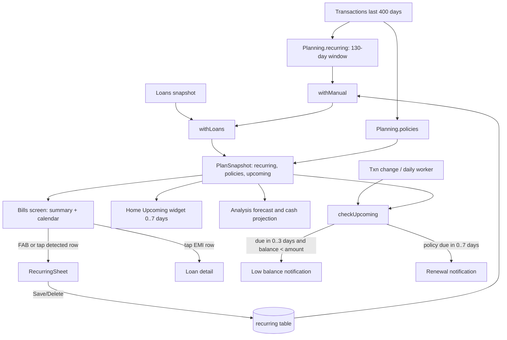

# Recurring Transactions (Detection, Bills & Insurance Calendar, Low-Balance Alerts)

| Field | Value |
|---|---|
| Feature ID | F-12 |
| Status | In progress (Phase 4: items store, detection, next-due maths, Bills screen with calendar, add/edit/delete/confirm sheet and loan EMIs in bills done; Home Upcoming, policies, short flag, alerts, EMI pairing pending) |
| Priority | P1 |
| Phase | 4 (recurring + analytics); detection functions are pure and can be built in Phase 1 for the Home Upcoming widget |
| Last Updated | 2026-10-21 |

## 1. Description

Recurring Transactions finds the payments that repeat, such as rent, EMIs, subscriptions, SIPs and insurance premiums, from transactions already on the phone. The user can add their own regular payments and incomes too. It shows everything on a calendar, lists what is due soon, and warns before a payment if the paying account cannot cover it.

## 2. What This Feature Will Do

- Detects monthly repeating payments from the last few months of transactions.
- Works out each item's usual amount, usual day, last paid date and next due date.
- Lets the user add, edit and delete their own regular expenses and incomes, monthly or yearly.
- Replaces a detected item with a user item of the same name.
- Shows every active loan EMI in the bills list and opens the loan when tapped.
- Detects insurance policies, whether monthly or yearly, and their renewal dates.
- Shows the Bills & insurance screen with a summary, a month calendar and per-day filtering.
- Shows the next 7 days of payments on Home.
- Marks an upcoming payment as short when the paying account's balance is lower than the amount.
- Notifies the user up to 3 days before a payment the account cannot cover.
- Notifies the user up to 7 days before a yearly policy renews.
- Keeps the bank debit as the spend and treats the loan-account mirror of an EMI as a transfer.

### 2.1 Inputs

- Transactions already in the ledger (continuous).
- User-entered regular items: name, amount, monthly or yearly, day, category and account.
- Loan data from [Loans](15_loans.md) and account balances from [Accounts Management](13_accounts_management.md).

### 2.2 Processing

1. Groups recent payments by merchant and keeps those that repeat on similar days with similar amounts.
2. Works out each item's next due date, adjusting for short months.
3. Merges user items, detected items and loan EMIs into one list.
4. Compares due payments with the paying account's balance.
5. Checks for alerts after every transaction change and once a day, once per item and due date.

### 2.3 Outputs

- The Bills & insurance screen, the Home Upcoming list and its calendar.
- Stored: the user's regular items.
- Low-balance and renewal notifications.
- Recurring commitments for the Analysis forecast, via [Expense Tracking](10_expense_tracking.md).

### 2.4 Out of Scope

- Does not remind about credit card dues or Mark paid; see [Credit Cards](14_credit_cards.md).
- Does not detect loans or build repayment schedules; see [Loans](15_loans.md).
- Does not send budget alerts; see [Expense Tracking](10_expense_tracking.md).
- Does not draw the Analysis forecast charts (analytics feature).
- Does not create transactions from the user's regular items.
- Does not include newer ideas such as price-hike or unused-subscription detection, weekly or other periods, or bill prediction.

## 3. Behaviour in Existing App

Sources: analysis Part A 2.2/2.8/4.5, Part B 3 and 4, Part C 5.5; Kotlin `shared/.../insight/Planning.kt`, `shared/.../db/Recurring.kt`, `app/.../ui/plan/PlanSource.kt`, `BillsScreen.kt`, `RecurringEditor.kt`, `notify/Alerts.kt`, `ui/home/HomeViewModel.kt`, `HomeWidgets.kt`, `ui/analytics/AnalyticsViewModel.kt`.

### 3.1 Detection algorithm (exact, `Planning.recurring`, `Planning.kt:89-114`)

Input: transactions (the plan snapshot loads about 400 days: `since = today - 400 days`), `today`, zone.

1. Filter: `type in {DEBIT, INVESTMENT}`, `!needsReview`, `currency == "INR"`, local date `>= today - 130 days`.
2. Group by `key(t) = (merchant ?: upiId).trim().lowercase()`, kept only when the key length is >= 2 (rows with null key are dropped).
3. For each group: `median` = element at index `size / 2` of the ascending `amountMinor` list (upper median for even sizes). `similar` = rows with `|amount - median| <= median / 5` (integer division, within 20%), sorted by timestamp.
4. `months` = distinct year-months of `similar`; require `months.size >= 2` (two payments in the same month do not qualify).
5. `days` = day-of-month of each similar row; require `max(days) - min(days) <= 6` (no wrap-around across month ends: payments on the 30th and the 2nd are not recognised).
6. `last` = latest similar row; require its date `>= today - 45 days`.
7. Output `Recurring(name = last.merchant ?: last.upiId ?: "Payment", amountMinor = last.amountMinor (the LATEST amount, not the median), dayOfMonth = median of days (index size/2 of the sorted list), category = last.category, accountId = last.accountId, lastPaid = lastDate, nextDue = (month of lastDate + 1).atDay(min(day, monthLength)), occurrences = similar.size)`.
8. Sorted ascending by `nextDue`.

No yearly or weekly detection, no minimum amount; frequency is always monthly. Detection never produces income (only DEBIT/INVESTMENT rows are read).

### 3.2 User-added items and merge (`Planning.withManual`)

- Table `recurring` rows (`RecurringEntity`) become `Recurring` with `manualId`, `income`, `yearly`. They never create transactions ("A reminder and a plan. The real payment is still recorded from your SMS or email, so it is never counted twice.").
- Next date: monthly = this month's day if `>= today`, else next month; yearly = `month` (default current month, coerced 1..12) in this year if `>= today`, else next year; the day is clamped to the month length (`min(dayOfMonth, lengthOfMonth)`).
- A user item replaces a detected item with the same lower-cased name; result sorted by `nextDue`.
- A detected item can be corrected: tapping a detected row opens `RecurringSheet` as a prefill; saving creates a user item with that name (replacing the detected one).

### 3.3 Loans into bills and EMI pairing (`Planning.withLoans`, `TransactionRepository.pairEmi`)

- For each non-closed loan with `emiMinor`, `emiDay` and `nextDue`: tag the FIRST untagged non-income recurring item where `name == loan.name` (ignore case) OR (`category == EMI_LOAN` AND `|amount - emi| <= emi / 5` AND `|dayOfMonth - emiDay| <= 6`) with `loanKey`. If none matches, add a synthetic item: name = `loan.name` (detected loans) or `"<name> EMI"`, category EMI_LOAN, amount = EMI, dayOfMonth = EMI day, `nextDue = loan.nextDue`, `occurrences = loan.trackedCount`, `loanKey` set, accountId = loan's paying account.
- Tapping a recurring row that has a `loanKey` opens the loan detail (`loan/<id>` or `loan/-1?emi=<key>`) instead of the editor.
- Ingest-time EMI pairing (`pairEmi`, repo 359-372): a bank DEBIT and a loan-account row with the same amount within +-3 days (one on a LOAN account with category EMI_LOAN, the other on a non-loan account with category EMI_LOAN or channel AUTO_DEBIT) => the loan-account side becomes TRANSFER with note "EMI also debited from your bank account"; the bank debit stays the spend. This keeps an EMI from being detected twice or counted as spend twice.
- The Home tone for EMI items is amber; calendar mark EMI uses `Hx.palette[4]`.

### 3.4 Insurance policies (`Planning.policies`, `Planning.kt:176-190`)

- Rows: category INSURANCE and type not CREDIT/TRANSFER, grouped by trimmed merchant (default "Insurance").
- `monthly` when the group has >= 2 distinct payment months and some consecutive pair is exactly 1 month apart (`ChronoUnit.MONTHS.between == 1`), else yearly.
- `nextDue = lastDate + 1 month` (monthly) or `+ 1 year` (yearly); `premiumMinor = last.amountMinor`; `accountId = last.accountId`.
- Kind by regex on `"$insurer ${note}"`, first match in this order: HEALTH `health|mediclaim|star\s|niva|bupa|care\s|cigna|aditya birla health`; LIFE `\blife\b|term|\blic\b|pru|aia|max life`; MOTOR `motor|car\b|bike|two.?wheeler|vehicle|\bauto\b`; else OTHER (labels Health, Life / term, Car / bike, General).
- Only non-monthly (yearly) policies become `Upcoming` INSURANCE items; monthly premiums are already caught as recurring payments if the merchant repeats.

### 3.5 Upcoming list (`PlanSource`, `ui/plan/PlanSource.kt`)

`Upcoming(name, amountMinor, due, kind in {RECURRING, INSURANCE, INCOME, EMI}, account, short)`:

- Recurring items: kind INCOME if `income`; EMI if `loanKey != null` or category EMI_LOAN; else RECURRING.
- `payingAccount(id)` = account (after following `mergedInto`), then its `linkedAccountId` (debit card to bank account) if any.
- `short` = not income, and the paying account is a bank ACCOUNT of a liquid type with a known `currentBalanceMinor < amount`.
- Yearly policies append INSURANCE items (short false).
- Filter `due >= today`, sorted by `due`. Snapshot also holds `recurring`, `policies`, `savings` ([Income Tracking](11_income_tracking.md)) and `insights` (below).
- `PlanSnapshot` is shared by Home, Bills and Analytics; recomputed whenever transactions, accounts, holdings or loans change; computed on a background dispatcher.

### 3.6 Bills & insurance screen (`BillsRoute`, `ui/plan/BillsScreen.kt:100`, route `bills`, deep link `hisaab://bills`)

- Top bar "Bills & insurance", FAB "Add a regular payment" opens `RecurringSheet`.
- Summary card: "Due in 30 days" = sum of upcoming items with `daysLeft in 0..30` and "{n} payment(s)"; "Every month" = sum of ALL recurring amounts ("in regular payments").
- `BillsCalendar` (month at a time, remembered via saveable state, arrows "Previous month"/"Next month"; Monday-first weekday header M T W T F S S): each day shows its day number (bold when it has events, red when any event is short of funds), a ring around today, and up to four dots (distinct marks): Payment (primary), EMI (`palette[4]`), Income (credit green), Insurance (tertiary). Legend: Payment, EMI, Income, Insurance. Tap a marked day to filter the list below to that day (tap again to clear); the list shows dot, day number, name, amount (+ prefix and green for income, red when short); tapping a row with a `Recurring` opens the editor (or the loan if `loanKey != null`).
- Events per month (`eventsIn`): each recurring item appears on `min(dayOfMonth, monthLength)` of EVERY month shown (monthly), yearly items only in the month of `nextDue`; policies: monthly ones on `nextDue.dayOfMonth` every month, yearly ones only in the `nextDue` month. Mark = INCOME / EMI (loanKey or category EMI_LOAN) / PAYMENT; policies INSURANCE.
- Empty state (only when loaded and no recurring and no policies): `EmptyState(EventRepeat, "Nothing found yet", "Repeats appear after two months of payments.")`.
- Composables `UpcomingRow`, `RecurringRow`, `PolicyRow` exist (date badge, "Today/Tomorrow/In n days", "renewal"/"EMI" suffix, account label, "Low balance: {amount}") and are reused by Home; the current Bills screen body shows only the summary and the calendar.

### 3.7 RecurringSheet (`ui/plan/RecurringEditor.kt:71`)

ModalBottomSheet (skip partially expanded). Title "Add a recurring payment or income" or "Edit recurring". Fields: Expense/Income segmented (switching to Income changes the default category SUBSCRIPTIONS to SALARY); Name (label "Name (e.g. Netflix, Rent, Car EMI)" or "From (e.g. Salary, Rent received)"); Amount (₹, decimal; `Money.parseInput > 0`); Every month / Every year; Day (1..31, two digits, error when invalid); for yearly a Month dropdown (default current month, or `nextDue.month` of an existing/prefill item); Category card (opens `CategorySheet`, default SUBSCRIPTIONS); "Paid from"/"Paid into" account dropdown ("Any account" default; excludes hidden and merged-into accounts); hint for expenses "With an account set, you're warned 3 days before if its balance is too low."; Delete (user items only), Cancel, Save (enabled when name non-blank, amount > 0, day valid). Save writes `RecurringEntity(id = existing.manualId ?: 0, name.trim(), amountMinor, income, frequency MONTHLY|YEARLY, dayOfMonth, month if yearly, category, accountId, createdAt = now)`.

Home previously had a Recurring sheet trigger via an unused `addingRecurring` flag (dead code, not ported).

### 3.8 Home Upcoming widget (`UpcomingWidget`, key `upcoming`)

Title "Upcoming · 7 days", action "Calendar ›" (opens `bills`). Items: `plan.upcoming` with `daysLeft in 0..7`, first 5 shown; each row: date badge (day number + 3-letter month), name, subtitle `"Due today" | "Tomorrow" | "In n days"` joined with the paying account label and "short of funds"; amount right-aligned (`+` and green for income). Tone colour (`DueTone`): INCOME green; INVEST (category INVESTMENT) accent; EMI amber (category EMI_LOAN, kind EMI or INSURANCE); CARD red (paying account is a non-debit card, or the name contains "card"); OTHER default. Empty hint "Nothing due in the next 7 days.". Statement-based credit-card dues are NOT part of `plan.upcoming`; they appear in the Home "Credit card dues" widget ([Credit Cards](14_credit_cards.md)).

### 3.9 Alerts (`AlertsChecker.checkUpcoming`, `notify/Alerts.kt:90-125`)

Runs after transactions change (via the changed hub) and in the daily `AlertsWorker` (periodic `daily-alerts`, 1 day, KEEP). Loads transactions of the last 400 days, rebuilds recurring = `withManual(recurring(txs), manual)` (loans not added here) and filters expenses only (`!income`):

- Low balance: `days = nextDue - today`, only `0..3`. Paying account = the item's account resolved through `mergedInto` then `linkedAccountId`; must be a bank ACCOUNT with a known `currentBalanceMinor`; alert when `balance < amount`. Key `bill:<name>:<nextDue>` (once). Title "{name} {amount} due today | tomorrow | in {days} days"; body "{account} ••{last} has {balance}. Add {amount - balance} so it doesn't bounce."; amounts without paise; tap `hisaab://bills`.
- Insurance renewal: yearly policies with `days in 0..7`; key `renewal:<insurer>:<nextDue>` (once). Title "{Kind} insurance renews today" or "... renews in {days} days"; body "{insurer}: last premium {amount} on {date}. Renew in time to stay covered."
- Notification channel `budgets_bills` "Budgets & bills" (importance DEFAULT; description "Budget limits, payments due from a low balance, and insurance renewals"). Keys are stored in `alerted_keys` (shared with budget alerts, capped to 300). Notifications first check `areNotificationsEnabled()` and swallow `SecurityException`.
- Items with no account set never alert.

### 3.10 Insights fed by recurring (`Planning.insights`, shown in Home Insights widget; cooperating detail in the analytics feature)

Third insight (INFO): when recurring (non-income) is non-empty: "N regular payments, Rs X a month" where the subscription count = items whose category is SUBSCRIPTIONS, ENTERTAINMENT or BILLS. The other four insights (pace vs last month at >= 10% difference, category drift >= Rs 500 over a 3-month average, biggest expense, weekend share >= 45%) are listed in [Expense Tracking](10_expense_tracking.md) scope notes; max 5 insights.

### 3.11 Forecast use (Analysis, owned by the analytics feature)

- `cash()` (30-day cash balance, current month only): start = sum of liquid account balances; for each recurring item, every monthly occurrence (or one yearly) between today and today+30 adds `+amount` for income or `-amount` for expenses; items paid from a non-debit credit card are skipped (a card's charges reach the bank only when the bill is paid); yearly policies from `upcoming` kind INSURANCE added as outflows; daily series `bal += events[i] - dailyRate`; reports the lowest point ("Shortfall of ₹x around {date}").
- `forecast()` (month-end spend): FIXED categories (RENT, BILLS, EMI_LOAN, INSURANCE, SUBSCRIPTIONS, TAXES, EDUCATION) are added on their due days from `plan.upcoming` (non-income, in the same month and not before today); fan chart low 80% / high 120% of the discretionary daily rate.

## 4. User Stories

- US-12-01: As a user, my rent, EMIs and subscriptions are found automatically after two months.
- US-12-02: As a user, I can add a regular payment or income myself, monthly or yearly.
- US-12-03: As a user, I see all bills, EMIs, incomes and insurance renewals on a month calendar.
- US-12-04: As a user, I am warned 3 days ahead if the account that pays a bill will not have enough balance.
- US-12-05: As a user, I am told a week ahead when an insurance policy renews.
- US-12-06: As a user, I see what is due in the next 7 days on Home.
- US-12-07: As a user, I can correct a wrongly detected item by editing it.
- US-12-08: As a user, my loan EMIs always appear in the bills list.

## 5. Functional Requirements (FR-12-01 ...)

- FR-12-01: The system shall detect monthly recurring payments per section 2.1 (130-day window, key >= 2 chars, upper median, 20% band, >= 2 distinct months, day spread <= 6, last paid within 45 days).
- FR-12-02: Each detected item shall carry latest amount, median day of month, category and account of the latest row, last paid date, next due date and occurrences.
- FR-12-03: The user shall be able to add, edit and delete recurring items (expense/income, name, amount, monthly/yearly, day 1..31, month for yearly, category, account) from the Bills screen.
- FR-12-04: A user item with the same lower-cased name as a detected item shall replace it; user items never create transactions.
- FR-12-05: Next-due dates shall be computed per section 2.2 with day clamping.
- FR-12-06: Every non-closed loan with EMI, EMI day and next due shall appear as a bill, tagged onto a matching recurring item or added synthetically (section 2.3), and tapping it shall open the loan.
- FR-12-07: The system shall detect insurance policies (monthly vs yearly, kind by regex, next due) per section 2.4.
- FR-12-08: The Upcoming list shall mark an item `short` when the paying bank account's known balance is below the amount.
- FR-12-09: The Bills screen shall show the summary card (due in 30 days, every month), the month calendar with dots and legend, per-day filtering, and the empty state.
- FR-12-10: The calendar shall place monthly items on every month and yearly items only in their due month, clamping the day to the month length.
- FR-12-11: The Home Upcoming widget shall list up to 5 items due in 0..7 days with tone colours, "short of funds", and a "Calendar" action.
- FR-12-12: The system shall alert once per item and due date when a monthly expense due in 0..3 days exceeds the paying account's known balance (key `bill:<name>:<nextDue>`).
- FR-12-13: The system shall alert once per policy and due date for yearly policies due in 0..7 days (key `renewal:<insurer>:<nextDue>`).
- FR-12-14: Checks shall run after transaction changes and daily, never repeat after a rescan, and respect the notification-enabled state.
- FR-12-15: EMI pairing shall keep the bank debit as the spend and turn the loan-account mirror into a TRANSFER (same amount within +-3 days).
- FR-12-16: The plan snapshot shall be computed off the main thread and shared by Home, Bills and Analysis.

## 6. Non-Functional Requirements (performance, battery, privacy, offline)

- Offline, pure functions over local data; unit-testable without Flutter.
- Snapshot recompute for 400 days of data under 50 ms on a mid-range device (old app target "cheap on every refresh").
- Debounce recompute (the old app shares a flow with a 10 s keep-alive).
- Battery: alerts are evaluated on change and once per day; no exact alarms.
- Privacy: alert bodies contain names and amounts; honour hide-amounts where policy requires (Open Question 7).
- Calendar renders 6 weeks x 7 cells without jank (use a fixed grid).

## 7. UI / Screens & User Flow (screen list + flow diagram)

| # | Screen/sheet | Source | Notes |
|---|---|---|---|
| 1 | Bills & insurance screen | `ui/plan/BillsScreen.kt:100` | Route `bills`, deep link `hisaab://bills`; from More > Plan, Home Upcoming, Transactions top bar icon |
| 2 | Summary card | `BillsScreen.kt:127` | Due in 30 days / Every month |
| 3 | BillsCalendar (month grid + day list + legend) | `BillsScreen.kt:240-` | Dots: Payment, EMI, Income, Insurance |
| 4 | RecurringSheet (add/edit) | `ui/plan/RecurringEditor.kt:71` | ModalBottomSheet |
| 5 | Category sheet (reused) | `ui/components/CategorySheet.kt:44` | From RecurringSheet |
| 6 | Account dropdown (inside sheet) | `RecurringEditor.kt` | Any account default |
| 7 | Month dropdown (yearly) | `RecurringEditor.kt` | 12 months |
| 8 | Empty state "Nothing found yet" | `BillsScreen.kt` | Needs two months of repeats |
| 9 | Home Upcoming widget | `ui/home/HomeWidgets.kt:303` | 7 days, up to 5 |
| 10 | Upcoming / Recurring / Policy rows | `BillsScreen.kt` | Reusable row widgets |
| 11 | Low balance and renewal notifications | `notify/Alerts.kt` | Channel Budgets & bills |
| 12 | Loan detail (target of EMI row) | `ui/loans/LoansScreen.kt:453` | Owned by [Loans](15_loans.md) |



Reference GIFs:

-  (Status: Pending, not yet captured)
-  (Status: Pending, not yet captured)
-  (Status: Pending, not yet captured)
-  (Status: Pending, not yet captured)
-  (Status: Pending, not yet captured)
-  (Status: Pending, not yet captured)
-  (Status: Pending, not yet captured)
-  (Status: Pending, not yet captured)
-  (Status: Pending, not yet captured)

## 8. Data Models (Dart entities + fields + types)

```dart
enum RecurringFrequency { monthly, yearly }
enum InsuranceKind { health, life, motor, other }          // labels: Health, Life / term, Car / bike, General
enum UpcomingKind { recurring, insurance, income, emi }
enum CalendarMark { payment, income, insurance, emi }
enum DueTone { card, emi, invest, income, other }

@freezed class Recurring {
  String name; int amountMinor; int dayOfMonth; Category category; int? accountId;
  DateTime? lastPaid; DateTime nextDue; int occurrences;
  int? manualId;              // set for user-added
  bool income;                // only user-added
  bool yearly;
  String? loanKey;            // "a<id>" or "e<payeeKey>"
}

@freezed class RecurringEntity {          // persisted user item
  int id; String name; int amountMinor; bool income;
  RecurringFrequency frequency; int dayOfMonth; int? month;   // 1..12 for yearly
  Category category; int? accountId; DateTime createdAt;
}

@freezed class Policy {
  String insurer; InsuranceKind kind; int premiumMinor; bool monthly;
  DateTime lastPaid; DateTime nextDue; int? accountId;
}

@freezed class Upcoming {
  String name; int amountMinor; DateTime due; UpcomingKind kind;
  AccountWithActivity? account; bool short;
  // int daysLeft => due - today
}

@freezed class PlanSnapshot {
  List<Recurring> recurring; List<Policy> policies; List<Upcoming> upcoming;
  SavingsOutlook? savings; List<Insight> insights; bool loaded;
}

@freezed class DueItem { Upcoming upcoming; DueTone tone; }
@freezed class DayEvent { DateTime date; String name; int amountMinor; CalendarMark mark; bool short; Recurring? recurring; }
```

## 9. Database Tables / Changes

```dart
class RecurringItems extends Table {              // Room table name: recurring
  IntColumn  get id => integer().autoIncrement()();
  TextColumn get name => text()();
  IntColumn  get amountMinor => integer()();
  BoolColumn get income => boolean()();
  TextColumn get frequency => text()();            // 'MONTHLY' | 'YEARLY'
  IntColumn  get dayOfMonth => integer()();         // 1..31
  IntColumn  get month => integer().nullable()();   // 1..12 for yearly
  TextColumn get category => text()();
  IntColumn  get accountId => integer().nullable()();   // soft ref to accounts.id, no FK
  IntColumn  get createdAt => integer()();
}
```

Settings store: `alerted_keys` (string set, capped 300) shared with budgets; keys `bill:<name>:<nextDue ISO date>` and `renewal:<insurer>:<nextDue>`.

No table for detected items or policies: both are derived on the fly. Reads: `transactions` (type, merchant, upiId, amountMinor, timestamp, category, accountId, needsReview, currency, note), `accounts` (balances, linkedAccountId, mergedIntoId), loans snapshot ([Loans](15_loans.md)). Old Room migration: table `recurring` added in 7-8.

`AccountDao.referenceCount` counts recurring items on an account; an account with recurring items or linked cards must not be hard-deleted without a warning ([Accounts Management](13_accounts_management.md)).

## 10. Business Rules & Logic (regex, parsing rules, algorithms, thresholds)

Constants: lookback window 130 days; recency 45 days; amount band `median / 5` (20%); day spread 6; min distinct months 2; key length 2; loan match band 20% and 6 days; upcoming horizon Home 7 days, bills summary 30 days, low-balance 3 days, renewal 7 days; `EMI` pairing window 3 days; plan load 400 days; alerted keys cap 300.

Dart sketch:

```dart
List<Recurring> detect(List<Txn> txs, DateTime today) {
  final from = today.subtract(const Duration(days: 130));
  final rows = txs.where((t) => (t.type == debit || t.type == investment) && !t.needsReview
      && t.currency == 'INR' && !localDate(t).isBefore(from));
  final groups = groupBy(rows, key);                       // (merchant ?? upiId).trim().toLowerCase(), len >= 2
  final out = <Recurring>[];
  for (final g in groups.values) {
    final amounts = g.map((t) => t.amountMinor).toList()..sort();
    final median = amounts[amounts.length ~/ 2];
    final similar = g.where((t) => (t.amountMinor - median).abs() <= median ~/ 5).toList()
      ..sort((a, b) => a.timestamp.compareTo(b.timestamp));
    if (similar.map(yearMonth).toSet().length < 2) continue;
    final days = similar.map((t) => localDate(t).day).toList()..sort();
    if (days.last - days.first > 6) continue;
    final last = similar.last;
    if (localDate(last).isBefore(today.subtract(const Duration(days: 45)))) continue;
    final day = days[days.length ~/ 2];
    out.add(Recurring(name: last.merchant ?? last.upiId ?? 'Payment', amountMinor: last.amountMinor, dayOfMonth: day,
        category: last.category, accountId: last.accountId, lastPaid: localDate(last),
        nextDue: nextMonthDay(localDate(last), day), occurrences: similar.length));
  }
  return out..sort((a, b) => a.nextDue.compareTo(b.nextDue));
}
```

Worked example (masked): Netflix 649.00 on 5 Aug, 5 Sep, 5 Oct (today 12 Oct) => median 64,900, similar 3, months 3, day spread 0, last paid 7 days ago => Recurring(name "Netflix", amount 64,900, day 5, lastPaid 5 Oct, nextDue 5 Nov, occurrences 3). A gym fee on the 30th and then the 2nd fails the spread rule (28 > 6).

Low-balance example: rent 25,000 due 14 Oct from HDFC ••1234 with balance 18,000 on 12 Oct => alert "Rent ₹25,000 due in 2 days" / "HDFC Bank ••1234 has ₹18,000. Add ₹7,000 so it doesn't bounce."

## 11. Platform / Native Requirements (permissions, channels, background work)

- Android: `POST_NOTIFICATIONS` (13+), channel `budgets_bills`; deep link `hisaab://bills` (intent filter host `bills`).
- Daily background task `daily-alerts` (Flutter: `workmanager` periodic task, 1 day, constraint-free); the task opens the Drift DB in a background isolate, runs the pure functions, posts via `flutter_local_notifications`.
- No exact alarms, no foreground service.
- iOS (future): background fetch is best effort; alerts may be delayed.

## 12. Dependencies (other features → link to their memory file; packages)

- [Loans](15_loans.md): loan snapshot for `withLoans`; opening loan detail.
- [Accounts Management](13_accounts_management.md): balances, merged/linked resolution, account picker.
- [Credit Cards](14_credit_cards.md): card dues are separate; card-paid items are skipped in the cash projection.
- [Categorization](09_categorization.md): categories, CategorySheet.
- [Expense Tracking](10_expense_tracking.md): budgets alerts share `alerted_keys`; forecast uses recurring.
- [Income Tracking](11_income_tracking.md): savings outlook in the snapshot; manual income items.
- [Dedup & Review](07_dedup_review.md): `pairEmi` and `needsReview` exclusion.
- Packages: `drift`, `riverpod`, `freezed`, `go_router`, `workmanager`, `flutter_local_notifications`, `intl`, `table_calendar` (optional; the old calendar is a custom grid, a hand-rolled grid is recommended to match dots and legend).

## 13. Folder Location (lib/features/<name>/...)

```text
lib/features/recurring/
  data/
    datasources/recurring_dao.dart
    repositories/recurring_repository_impl.dart, plan_repository_impl.dart
  domain/
    entities/recurring.dart, recurring_entity.dart, policy.dart, upcoming.dart, plan_snapshot.dart
    usecases/detect_recurring.dart, with_manual.dart, with_loans.dart, detect_policies.dart,
             build_upcoming.dart, check_upcoming_alerts.dart, save_recurring.dart
    repositories/recurring_repository.dart, plan_repository.dart
  presentation/
    bills/bills_screen.dart, bills_calendar.dart, bills_summary_card.dart, upcoming_row.dart, policy_row.dart
    editor/recurring_sheet.dart
    home/upcoming_widget.dart
    providers/plan_provider.dart
```

## 14. Edge Cases & Error Handling

- Day 29..31 in short months: clamp to month length for next due and calendar placement.
- Yearly item with `month` null: use the current month at creation.
- Merchant name changes slightly between months (e.g. "NETFLIX" vs "Netflix.com"): detection keys on lower-cased trimmed names only, so they stay separate; user can add a manual item.
- Same merchant paid twice in one month: months count stays 1, no detection.
- One outlier amount (annual fee) in a group: dropped from `similar` if outside 20%.
- Paid-from account merged or debit-card linked: resolve to the bank account; if unresolved or no balance known, no alert.
- Paying account is a credit card: no low-balance alert (`kind != ACCOUNT`); item skipped in 30-day projection.
- A detected item whose real payments stop for > 45 days disappears automatically.
- User item without an account never alerts.
- Duplicate loan items: a synthetic loan item is added only when no existing item matches.
- Notification permission denied: nothing is posted but keys are still added (old behaviour; Open Question 6).
- Timezone: dates use the device zone.

## 15. Test Cases (unit / widget / integration + sample fixtures)

Unit:

- TC-12-01 (FR-12-01, FR-12-02): Netflix example => one Recurring with amount of the latest row and day 5.
- TC-12-02 (FR-12-01): rejects groups with 1 month, with day spread 7, with last payment 46 days ago, with currency != INR, with needsReview.
- TC-12-03 (FR-12-01): upper median for even sizes; amounts outside 20% excluded from `similar` and amount uses latest similar row.
- TC-12-04 (FR-12-05): next due monthly on the 31st in February; yearly in a past month rolls to next year.
- TC-12-05 (FR-12-04): manual item with the same name (different case) hides the detected one.
- TC-12-06 (FR-12-06): `withLoans` tags by name, by category+band+day, and appends synthetic items named "X EMI" for manual loans.
- TC-12-07 (FR-12-07): policies: monthly vs yearly, kind regex order (a "star health" premium is HEALTH), default insurer "Insurance".
- TC-12-08 (FR-12-08): `short` only for liquid bank accounts with known balance below amount; none for cards or unknown balance.
- TC-12-09 (FR-12-12): alert fires in 0..3 days only, key dedupe, no alert when balance >= amount.
- TC-12-10 (FR-12-13): renewal alert for yearly policies due in 0..7 days only.
- TC-12-11 (FR-12-15): EMI pairing within 3 days makes the loan-account row TRANSFER; outside 3 days leaves both.

Widget:

- TC-12-12 (FR-12-09, FR-12-10): calendar shows dots per mark, monthly item every month, yearly only in due month, day filter toggles.
- TC-12-13 (FR-12-03): RecurringSheet validation (name, amount > 0, day 1..31), Income toggle default category switch, Delete only for user items.
- TC-12-14 (FR-12-11): Upcoming widget limits to 5, tone colours, empty hint.

Integration:

- TC-12-15 (FR-12-14, FR-12-16): ingest a rent debit, run the daily task: a single notification, a second run posts nothing.

Fixtures: three monthly transactions for Netflix/rent/SIP; an insurance yearly premium; a loan with EMI 12,345 on day 5.

## 16. Acceptance Criteria

- AC-12-01: Detection output equals the Kotlin `Planning.recurring` on the shared fixtures, including rejection cases (FR-12-01, FR-12-02; TC-12-01..03).
- AC-12-02: User items can be added, edited, deleted, monthly or yearly, and replace detected duplicates (FR-12-03, FR-12-04, FR-12-05; TC-12-04, TC-12-05, TC-12-13).
- AC-12-03: Loan EMIs always appear in Bills and open the loan (FR-12-06; TC-12-06).
- AC-12-04: Insurance policies and renewals behave per section 2.4 (FR-12-07; TC-12-07, TC-12-10).
- AC-12-05: Bills screen and calendar match the described behaviour (FR-12-09, FR-12-10; TC-12-12).
- AC-12-06: Home shows the 7-day list with tones and short-of-funds (FR-12-08, FR-12-11; TC-12-08, TC-12-14).
- AC-12-07: Low-balance and renewal alerts fire once at the right time and never repeat (FR-12-12, FR-12-13, FR-12-14; TC-12-09, TC-12-10, TC-12-15).
- AC-12-08: EMI is not counted twice (FR-12-15; TC-12-11).

## 17. Open Questions

1. Detection uses the upper median and a non-wrapping day spread (analysis Part B open question 7); a payment on the 30th and the 2nd is missed. Keep for parity or fix (wrap-aware)?
2. FEATURES.md says Upcoming includes "card dues" but the code builds `plan.upcoming` from recurring/EMI/insurance/income only; card dues appear in the separate Home card widget. Confirm intended.
3. `checkUpcoming` builds recurring WITHOUT loans (`withLoans` is not applied), so loan EMIs without a repeating detection do not trigger low-balance alerts, while the calendar and Home do include them. Confirm.
4. Monthly insurance policies produce no renewal alerts (only yearly ones); confirm.
5. `UpcomingRow`, `RecurringRow`, `PolicyRow` exist but the current Bills screen body shows only the summary and calendar; confirm whether list sections are intended to return.
6. Alert keys are added even when notifications are disabled (post is skipped); confirm desired behaviour.
7. Alert bodies show real amounts regardless of hide-amounts; confirm privacy policy.
8. Calendar shows monthly detected items on every month including past months (not only after the first occurrence); confirm.
9. The "short" flag ignores amounts in transit (pending credits) and the cash projection; confirm acceptable.
10. Detection key is `(merchant ?: upiId)`; the same merchant paid from two accounts yields one item with the latest row's account; confirm.

## 18. Implementation Notes

Phase 4 UI (2026-10-21): route `/bills` (`RecurringTransactionsScreen`), `RecurringSheet`, `BillsCalendar`, `BillsTile` (More tab, embedded via `SettingsDataSourcesScreen.billsTile`; Home can reuse `BillsTile` or push `/bills` for its "Calendar" action). Wiring `lib/app/di/bills_providers.dart` (`billsProvider` = detect + `withManual` + loans). Pure helpers in `domain/bills_view.dart` (`withLoans`, `paid`, `dueIn30`, `everyMonth`). UI done: FR-12-03, 04, 06 (loan tagged by same name else synthetic row; tap opens `/loans/<key>`), 09 (summary, calendar, dots, legend, day filter, empty state), 10. Tests `test/features/bills_loans/bills_loans_screens_test.dart` (TC-12-12 partly, TC-12-13 partly). Detected items stay computed: "confirm" saves a user item of the same name (replaces it per FR-12-04); there is no dismiss or stored paid state (memory 9). "Paid" = last paid this month and next due in a later month. Deferred: policies (FR-12-07) and insurance rows, `short` (FR-12-08), Home Upcoming widget (FR-12-11), alerts (FR-12-12..14), EMI pairing wiring (FR-12-15), off-main-thread plan (FR-12-16), account picker in the sheet (existing account id is kept on edit), category-default switch on the Income toggle.

Phase 4 data/domain layer (no UI). Table `recurring` (Drift class `RecurringItems`, schema v4). Detected items stay derived (no table). Code: `lib/features/recurring_transactions/domain/{recurring,recurring_detector,recurring_repository}.dart`, `data/recurring_repository_impl.dart`; providers `recurringRepositoryProvider`, `recurringItemsProvider`. Tests: `test/features/phase4/phase4_{logic,repositories}_test.dart`.

FR status done: FR-12-01, 02 (`RecurringDetector.detect`, Netflix example), 03 (repository CRUD with validation), 04 (`withManual`), 05 (`nextDueOf`, clamping), 10 (`occursOn`). Pending: FR-12-06 (loans), 07 (policies), 08, 09, 11, 12..14 (alerts, S2 decision logic), 15, 16 and all UI.

Deviation: detection reads `LedgerTx` and IST dates (UTC-midnight `DateTime`s); the Kotlin window, 20% band (`median ~/ 5`), 6-day spread (non-wrapping, parity), 45-day recency are unchanged. No stored "dismissed/confirmed/paid" state (not in memory 9).

API for UI agents:

```dart
RecurringDetector.detect(List<LedgerTx> txs, DateTime today) -> List<Recurring>   // today = IST date at UTC midnight
RecurringDetector.withManual(List<Recurring>, List<RecurringItem>, DateTime today) -> List<Recurring>
RecurringDetector.nextDueOf(RecurringItem, DateTime today);  occursOn(Recurring, DateTime date) -> bool
abstract interface class RecurringRepository {
  Stream<List<RecurringItem>> watchAll();  Future<List<RecurringItem>> all();
  Future<int> add(RecurringDraft d);  Future<void> update(int id, RecurringDraft d);  // ArgumentError if d.validate() != null
  Future<void> delete(int id);  Future<int> countForAccount(int accountId);
}
```

## 19. Change Log (date | change | reason)

| Date | Change | Reason |
|---|---|---|
| 2026-10-17 | Created from hisaab_apk 2.9.8 analysis | Initial |
| 2026-10-19 | Restructured to the 19-section standard (Description, What This Feature Will Do, Implementation Notes added); Last Updated bumped | Audit Gate (Prompt 2, Part A) |
| 2026-10-21 | Phase 4 data layer landed | Phase 4 |
| 2026-10-21 | Phase 4 UI landed | Phase 4 |
