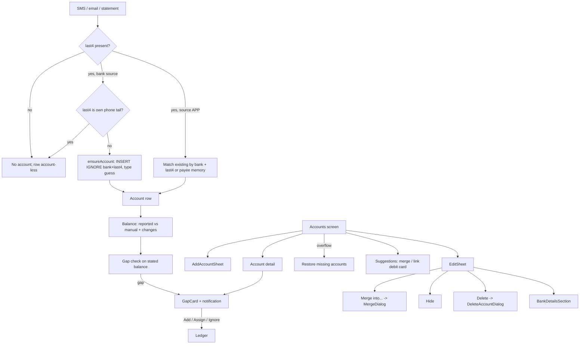

# Accounts Management (Accounts, Cards, Deposits, Merge/Hide/Delete, Balances, Untracked Gaps)

| Field | Value |
|---|---|
| Feature ID | F-13 |
| Status | In progress (Phase 1 data layer and basic UI; tabs, edit fields, suggestions, gaps pending) |
| Priority | P0 |
| Phase | 1 (account creation from messages, balances, lists); 2 for debit-card link, merge and gap detection; 3 for statement unlock details |
| Last Updated | 2026-10-21 |

## 1. Description

Accounts Management keeps the list of bank accounts, cards, wallets, deposits and loan accounts that transactions belong to. It keeps a current balance for each from bank messages, typed balances and transaction movements, and lets the user tidy the list. It also spots money that moved with no message, so the books stay in step with reality.

## 2. What This Feature Will Do

- Creates an account from a bank message when the last 4 digits are known.
- Works out the account type (debit card, loan and so on) from the evidence in messages.
- Attaches payment-app notifications to an existing account without creating a new one.
- Shows Accounts, Cards, and Deposits & loans tabs with counts, following the Book filter.
- Lets the user add an account or card by hand and warns about duplicates.
- Lets the user rename an account and change its colour, type, usage and balance.
- Calculates each account's balance from bank-stated figures, typed figures and transactions.
- Suggests merging duplicate accounts and linking debit cards, and lets the user merge and undo.
- Lets the user hide, show again, delete and restore accounts.
- Hides a matured FD or RD automatically when it pays out to an account.
- Stores statement unlock details per account and retries locked statements on save.
- Detects untracked balance changes and offers Add transaction, Assign or Ignore.
- Notifies the user of balance updates and untracked changes, with daily limits.
- Shows an account detail screen with balance, charts and transactions.

### 2.1 Inputs

- Bank messages, notifications and statements that carry account details and balances (continuous).
- User actions on the Accounts screen: add, edit, merge, hide, delete, restore.
- User-typed balances, nicknames and unlock details.

### 2.2 Processing

1. Reads the account number tail and bank from each message and finds or creates the account.
2. Sets the account type from the message evidence.
3. Updates the balance, letting the newest stated or typed figure win and marking estimates.
4. Looks for duplicate accounts and for balance changes with no matching transaction.
5. Applies user actions such as merge, hide and delete without losing data unless the user chooses.

### 2.3 Outputs

- The Accounts screen, account detail screen and untracked-change card.
- Stored: accounts, balances, merges, hidden state and unlock details.
- Balance-updated and untracked-change notifications.
- Account balances and types for [Credit Cards](14_credit_cards.md), [Loans](15_loans.md) and [Portfolio](16_portfolio.md).

### 2.4 Out of Scope

- Does not calculate credit card bills; see [Credit Cards](14_credit_cards.md).
- Does not hold loan terms or schedules; see [Loans](15_loans.md).
- Does not show the FD or RD maturity calendar or net worth; see [Portfolio](16_portfolio.md).
- Does not match transfer pairs; see [Dedup & Review](07_dedup_review.md).
- Does not read statements or guess passwords (statements feature).
- Does not manage forex rates.

## 3. Behaviour in Existing App

Sources: analysis Part A 2.4/3.1/6.1, Part B 1.4/2.1/2.4/6.7, Part C 2.3; Kotlin `ui/accounts/AccountsScreen.kt`, `AccountForms.kt`, `AccountDetailScreen.kt`, `BankDetailsSheet.kt`, `GapCard.kt`, `GapTracker.kt`, `CardBill.kt`, `shared/.../db/Entities.kt`, `Daos.kt`, `shared/.../repo/TransactionRepository.kt`, `AccountGuess.kt`, `UntrackedGapFinder.kt`, `shared/.../insight/BalanceGaps.kt`, `shared/.../db/TransferLegs.kt`.

### 3.1 Account creation and typing (ingest side)

`TransactionRepository.ensureAccount` (repo 296-315):

- No `last4` on the message => no account.
- APP-source rows (payment-app notifications) NEVER create an account; they attach to an existing one by exact bank + last4, or by digits with a unique same-kind bank-prefix match (`existingAccountOf`, repo 286-293), else stay account-less and wait for the bank message to adopt them. A remembered payee account (`payee_accounts` map) is applied to account-less APP rows.
- A new account is not created when its last4 is in `phoneLast4s` (last 4 digits of the user's own numbers: profile phone, identity phone/altPhone, digits >= 10) unless forced.
- `INSERT IGNORE` on UNIQUE `(bankName, last4)`. `last4` may be 2-4 characters (ICICI prints 3, SBI Corporate 2).
- An existing untyped account gets DEBIT_CARD (when the message is a debit-card message) or LOAN (when at a known lender). Lender accounts are auto-typed LOAN (`Lenders.isLender`).

Type guess from message text (`AccountGuess`, case-insensitive):

- CARD: debit-card flag => DEBIT_CARD; `(prepaid|forex) card` => PREPAID_CARD; `credit card` or has an available limit => CREDIT_CARD; else null.
- ACCOUNT: lender bank => LOAN; `(RD|recurring deposit) (a/c|account|ac|no)` => RD; `(FD|fixed deposit|term deposit|deposit) (a/c|account|ac|no)` => FD; `PPF (a/c|account|ac)` => PPF; `loan (a/c|account|ac)` => LOAN; else null (untyped).
- Network (cards only): `rupay`, `visa`, `master\s*card`, `amex|american express`, `diners`.

Account types (`AccountType`, Entities.kt:201-214): SAVINGS, CURRENT, SALARY, NRE, NRO, WALLET, FD, RD, PPF, LOAN, CREDIT_CARD, DEBIT_CARD, PREPAID_CARD. `liquid = false` for FD, RD, PPF, LOAN. Card networks: VISA, MASTERCARD, RUPAY, AMEX, DINERS, DISCOVER, JCB, MAESTRO, UNIONPAY. Account kind: ACCOUNT, CARD. Usage: PERSONAL, BUSINESS.

### 3.2 Accounts screen (`AccountsRoute`, `ui/accounts/AccountsScreen.kt:287`, route `accounts?tab={tab}`)

- Top bar "Accounts" with overflow "Restore missing accounts" (snackbar "Restored {n} accounts"). `PrimaryTabRow`: Accounts / Cards / Deposits & loans, each with a count. FAB add opens `AddAccountSheet`. Opened from the Home header bank icon, More > Accounts & cards, Portfolio holdings/maturity (tab arg 0/1/2).
- Lists follow the global Book chip (`ALL` shows everything; PERSONAL/BUSINESS filter by `usage`).
- Partition (`AccountsViewModel.state`): Accounts tab = not hidden, kind ACCOUNT, `accountType?.liquid != false`; Cards tab = not hidden, kind CARD; Deposits & loans tab = not hidden, kind ACCOUNT, `liquid == false` (FD, RD, PPF, LOAN); hidden list = hidden ones; accounts merged into another are excluded from every list (the DAO query hides rows whose `mergedIntoId` points to an existing account).
- Per tab extra cards: duplicate-merge suggestion cards ("Possible duplicate card/account", buttons Merge / Not duplicates), balance summary card ("In your bank accounts", "Plus ₹x in deposits, PPF and loans"), deposit summary (Deposits / Loans), debit-card link suggestion ("Link this debit card?" Link / Not now).
- Account card: avatar (brand logo, card network badge, type code badge FD/RD/PPF/Loan, "B" business badge), name (`nickname ?: bank`), "type . ••last4", "linked to ..." line for debit cards, maturity line for FD/RD, credit-card bill block ("Min ₹", "Unbilled", "Limit left ... est.", right figure = balance / limit left / billed, due label), gap dot (untracked change), edit pencil. Hidden section "Hidden (n)" with "Show again". Empty states "No accounts yet", "No cards yet", "No deposits or loans".
- Account types for loans open the loan tracker (`onOpenLoan`) instead of the account chart.

AddAccountSheet (`AccountForms.kt:115`): segmented Card / Account; bank text with 10 quick chips (HDFC Bank, SBI, ICICI Bank, Axis Bank, Kotak Mahindra Bank, IDFC FIRST Bank, Yes Bank, Bank of Baroda, Punjab National Bank, AU Small Finance Bank); last 4 digits (error "Already in your list." when `(bank, last4)` exists, because `insert` returns -1); type chips; network chips (cards); optional balance, or available limit for credit cards (hidden for debit cards). New accounts added while the Business book is selected get usage BUSINESS. A typed balance is stored as `manualBalanceMinor` with `manualBalanceAt = now`.

### 3.3 EditSheet (`AccountsScreen.kt:630`, also hosted from the detail screen via `AccountEditHost`)

Fields: nickname; "Used for" Personal/Business; type chips; FD/RD maturity date and action (`MaturityFields`: CREDIT (closes at maturity), RENEW_PRINCIPAL, RENEW_ALL); card forex markup % (0..20, else error; hint "Include GST: 3.5% + 18% = 4.13%."; stored as bps `round(percent*100)`; on change `ForexDao.recompute()`); network chips; debit-card account link (list of bank accounts); balance / available-limit field plus "Remove the balance I set"; colour swatches (8 colours or none); `BankDetailsSection`; merged accounts list with Unmerge; "Merge into..."; Hide; Delete; Cancel; Save.

`save` (AccountsViewModel): rename + colour; usage; type (+ network only for cards); `link(accountId)` only when type is DEBIT_CARD else null; maturity day/action only for FD/RD, then `closeMatured(todayEpochDay)`; forex markup (cards); balance: `clearBalance` => `setManualBalance(null, null)`, else a parsed amount => `setManualBalance(amount, now)`.

### 3.4 Merge, unmerge, hide, delete, restore

- Merge ("visual merge", `mergedIntoId`): `merge(source, target)` = `repointMerged(source.id, target.id)` (anything that was shown with source follows it) then `setMergedInto(source.id, target.id)`. Display only: no transaction, message or setting changes and the source keeps receiving its own transactions. Totals, lists and balances of the target include the source (balance SQL follows `mergedIntoId` one hop plus linked account of a merged child). `MergeDialog` "Merge into {name}?" confirms. Unmerge (`setMergedInto(id, null)`) restores.
- Duplicate suggestions (`duplicates`, per Book list): group visible accounts by `(bankName.trim().lowercase(), kind)`; for each pair: skip if both have a type and types differ; require `sameNumber(a.last4, b.last4)` = either is "odd" (blank, length not 2..4 or non-digit) or the last `min(len)` digits are equal; target = the one with a proper number, else more transactions (`compareValuesBy({ !oddNumber }, { transactionCount })`); a source is merged only once. "Not duplicates" is remembered for the session only (in memory).
- Debit-card link suggestions (`suggestions`): cards with no `linkedAccountId` that are debit cards (or untyped with a stated balance); candidates = liquid accounts at the same bank; reason "The balance in this card's SMS matches this account." when the card's latest balance equals an account's; else "It's your only {bank} account." when exactly one; else the most-used account "Your most used {bank} account."; none => no suggestion. Link action: `dao.link(card.id, account.id)` and, if the card was untyped, `setType(DEBIT_CARD)`. "Not now" dismisses for the session.
- Hide: `setHidden(id, true)`; transactions are kept; shown in "Hidden (n)" with "Show again"; hidden accounts leave every list, total, net worth and gap detection.
- Delete (`DeleteAccountDialog`): optional checkbox "Also delete its {n} transactions" => `repo.deleteTransactions(idsForAccount)` writes tombstones so their messages are never read again; then `unmergeChildren(id)`, `delete(id)` and `StatementPasswordStore.removeAccountDetails(id)`. Without the checkbox the transactions stay account-less (FK `ON DELETE SET NULL`).
- Restore missing accounts (`restoreMissingAccounts`, repo 693-): pages through transactions with no account or a vanished account (`orphansAfter`), re-parses a stored SMS/EMAIL source (`rawText`, requires the same amount and bank and a last4), else falls back to the row's own bank + last4; creates the account when needed and attaches (phone-number guard skipped); never deletes or moves transactions; returns how many accounts received transactions.
- Matured deposits: `closeMatured(todayEpochDay)` hides CREDIT-action FD/RD whose `maturityDay <= today`; run at app start and whenever the Accounts screen opens.

### 3.5 Balance computation

Per account three notions (Part B 2.1):

1. Reported: `latestBalanceMinor` / `availableLimitMinor` at `balanceUpdatedAt`; `updateBalance(id, balance, limit, at)` uses COALESCE (null leaves the old value) and applies only when `balanceUpdatedAt IS NULL OR balanceUpdatedAt <= at` (older messages never rewind it); `setLimitFromStatement` has the same guard.
2. User-typed: `manualBalanceMinor` at `manualBalanceAt`.
3. Derived `changeSinceManual` and `changeSinceReported` from `AccountDao.observeWithActivity`.

```text
usesManual(kind, reportedBal, reportedLimit, reportedAt, manual, manualAt):
  false if manual == null or manualAt == null
  true  if reported(limit for CARD, balance for ACCOUNT) == null or reportedAt == null or manualAt >= reportedAt
current = usesManual ? manual + changeSinceManual
        : reported(limit for CARD / balance for ACCOUNT) + changeSinceReported  (null if no reported figure)
balanceIsEstimated = !usesManual && changeSinceReported != 0 && reported != null
isLiquid = kind == ACCOUNT && accountType?.liquid != false && !hidden     // counts toward the Home balance
```

Signed effect of a transaction (both `changeSince*` and `ReconcileDao.netChange`):

```text
CREDIT -> +inrMinor
DEBIT, INVESTMENT -> -inrMinor
TRANSFER on a CARD -> +inrMinor                  // bill payment frees limit
TRANSFER on a bank account -> TransferLegs.SIGNED_SQL:
    has source 'xfer-out:%' -> -inrMinor ; has 'xfer-in:%' -> +inrMinor ;
    note LIKE 'Credit card bill%' -> -inrMinor ; else 0 (direction unknown)
else 0
```

Row filters: `t.accountId = a.id` OR the account is a child (`c.linkedAccountId = a.id`, `c.mergedIntoId = a.id`, or a child's linked account is merged into a); `needsReview = 0`; `inrMinor IS NOT NULL`; `timestamp > manualBalanceAt` (changeSinceManual) or `> balanceUpdatedAt` (changeSinceReported). `changeSinceReported` is forced to 0 for FD, RD, PPF, LOAN. `monthSpent` = DEBIT+INVESTMENT `inrMinor` in `[from,to)` for the account plus children; `transactionCount` counts the account and merged children only. `linkedAccountId` in the result is rewritten to the linked account's `mergedIntoId` when set.

Sources of stated balances: bank SMS/email (accounts and debit cards: a debit-card message states the LINKED bank account's balance and updates that account, repo 253-258), credit-card messages update `availableLimitMinor` (a credit card's "Avl bal" is a limit; stored balance is null for credit cards), statements (`applyStatementToAccount`: CARD available limit = `available ?: (creditLimit - (totalDue ?: 0)).coerceAtLeast(0)`; ACCOUNT balance = `closingBalance`; both only move forward in time).

Stated-balance check (`gapFor`, `BalanceReconciler`): on a new stated balance, flag a `BalanceGap` when `|stated - (previous + net)| > 100` paise (`TOLERANCE_MINOR`), only if `statedAt > previousAt`, `unclear == 0`, `now - statedAt <= 15 days` (`FRESH_MS`), the account is liquid and no newer manual balance exists. The app posts at most one "Balance updated" notification per account per day (`BalanceReconciler.due(lastDay, today)`, prefs `balance-updates`), merged InboxStyle when several: "{what} updated . ₹x not explained . transactions may be missing", id 9000, tap opens the app; follows the `transaction_notifications` setting.

### 3.6 Account detail screen (`AccountDetailScreen.kt:166`, route `account/{id}`, deep link `hisaab://account/{id}`)

Title `nickname ?: "bank ••last4"` with an edit icon (opens the EditSheet). Optional `GapCard`. Header: avatar, type label, balance (with "estimated" marker per `balanceIsEstimated`). Credit cards additionally show the figures block and due actions ([Credit Cards](14_credit_cards.md)). Range segmented 6 months / Year (year stepper) / All time; Spent and Income figures; two-line smooth chart (tap a month to read); empty text "Nothing moved in this period."; "See transactions" => `transactions?accountId=<id>` (expands to merged children via `mergedIntoId`).

### 3.7 Bank unlock details (`BankDetailsSection`, `BankDetailsSheet.kt`)

Collapsible "Statement unlock details" inside the EditSheet: Customer ID (<= 20 alphanumeric), full account number (<= 24), IFSC (<= 11, upper-cased), name / mobile / email (inherit the profile as placeholder "Same as profile . ..."), checkbox "Also save to profile", caption "Encrypted on this phone. Used only to open your statements.", Save (retries locked statements). Stored sealed (Android Keystore AES-256-GCM) per account id in `StatementPasswordStore` (`BankIdentity(customerId, accountNumber, ifsc, names, phones, emails)`); empty name/mobile/email fall back to the profile values (`effective`). Removed when the account is deleted. Password-guess use is described in the statements feature.

### 3.8 Untracked change (gap) detection (`BalanceGaps.kt`, `UntrackedGapFinder.kt`, `GapTracker.kt`, `GapCard.kt`)

Constants: `MIN_GAP_MINOR = 100`, `MIN_SHARE_BPS = 50` (0.5%), `MAX_AGE_MS = 90 days`, `MAX_UNKNOWN_TRANSFERS = 6`, history 240 days (`HISTORY_DAYS`, `WATCH_MS`).

Algorithm (`detect`), per account that is not merged, hidden, linked (debit card) or non-liquid:

1. `members = {a} + debit cards linked to a + accounts merged into a (+ cards linked to those)`.
2. `rows` = usable (`!needsReview && duplicateOfId == null && accountId != null`) transactions of the members sorted by `(timestamp, id)`; `stated` = rows with `availableLimitMinor` (cards) or `balanceMinor` (accounts).
3. For each consecutive pair `(s1, s2)` of stated rows: skip if `t2 <= t1`, or `now - t2 > 90 days`, or a manual balance was set within `(t1, t2]`. Expected `B2 = B1 + sum(window)`, window = every row with `t1 < ts <= t2` (including the stating row): CREDIT `+`, DEBIT/INVESTMENT `-`, TRANSFER on a card `+`, TRANSFER on an account via the direction map (`xfer-out`, `xfer-in`, note "Credit card bill") else "unknown". Any row with null `inrMinor` aborts the window.
4. `gap = B2 - expected`. With unknown-direction transfers every sign combination is tried; if any reading explains the balance, no gap; if there are any unknown transfers the result is null regardless; more than 6 unknown transfers => null.
5. Significant when `|gap| >= max(100, (|gap| + sum(|amounts in window|)) * 50 / 10000)`.
6. Emit `UntrackedGap(accountId, fromTime, toTime, deltaMinor, balanceBefore, balanceAfter, card)`; key `"accountId|fromTime|toTime"`; skip dismissed keys. `moneyLeft = delta < 0`. Sorted by `toTime` descending.

Follow-ups: `GapPrefill.of(gap, lastChoice)`: choices out+card => PAYMENT only; out => PAYMENT or TRANSFER; in => RECEIVED or TRANSFER; default TRANSFER for a card limit that rose, else the first choice; prefill time `toTime - 60 s`. `GapCandidates.find`: from account-less INR rows inside the window with the right direction and not TRANSFER (max 14 oldest), up to 3 suggestions whose amount (single, or sum of 2 or 3 rows) is within 100 paise of `|delta|`.

Gap UI: `GapCard` (amber "Untracked change . {summary}", candidate rows "Assign to {account}"/"Looks like: ... [Assign]" which attach account-less rows to the account, "Add transaction" => route `add?gap=<accountId>_<fromMs>_<toMs>_<deltaMinor>_<card 0/1>`, "Ignore" persisted in DataStore `untracked_gaps` key `dismissed`); gap dot on account cards; Add-transaction gap mode choices Payment / Transfer to my account / Money received, last choice per account stored (`choices` = `"<accountId>=<GapChoice>"`). Notifications (`AlertsChecker.checkGaps`): needs `transaction_notifications`; max 3 per run; only gaps with `toTime` within the last 14 days (`GAP_ALERT_DAYS`); once per gap (`markNotified`, key `gap:<key>`); text "{account}: {amount} left the account with no message. Add it?" / "... came in with no message. Add it?" / for cards "... of limit used with no message. Add it?" / "... of limit freed with no message. Add it?"; title "Untracked change"; tap `hisaab://account/<id>`.

## 4. User Stories

- US-13-01: As a user, accounts and cards appear automatically from my bank messages, but my own mobile number never becomes an account.
- US-13-02: As a user, I can add an account or card by hand, optionally with a balance.
- US-13-03: As a user, I always see a current balance that combines the bank's latest figure and later transactions.
- US-13-04: As a user, I can type my own balance and have later transactions carry it forward.
- US-13-05: As a user, I can rename, colour, retype and mark an account Personal or Business.
- US-13-06: As a user, I can merge duplicate accounts into one display group and unmerge them.
- US-13-07: As a user, I can hide or delete an account (optionally with its transactions) and restore missing ones.
- US-13-08: As a user, I can link my debit card to its bank account.
- US-13-09: As a user, I am told when money moved without a message and can add, assign or ignore it.
- US-13-10: As a user, I can store customer ID, account number and IFSC so my statements open automatically.

## 5. Functional Requirements (FR-13-01 ...)

- FR-13-01: The system shall create an account from a message only when a `last4` exists, the source is not APP, and the digits are not the user's own phone tail; uniqueness on `(bankName, last4)`.
- FR-13-02: The system shall type a new account by `AccountGuess` rules, auto-type lender accounts as LOAN, and type an existing untyped account DEBIT_CARD or LOAN when the evidence arrives.
- FR-13-03: Payment-app notifications shall attach to an existing account (exact or unique-prefix match or remembered payee) and never create one.
- FR-13-04: The Accounts screen shall provide tabs Accounts / Cards / Deposits & loans with counts, filtered by the global Book, excluding hidden and merged-away accounts.
- FR-13-05: The user shall be able to add an account or card (bank, last 4, type, network, optional balance/limit) and receive "Already in your list." for a duplicate.
- FR-13-06: The EditSheet shall edit nickname, usage, type, maturity (FD/RD), forex markup (cards, 0..20%), network, debit-card link, manual balance (with remove), colour and bank unlock details, plus merge, hide and delete actions.
- FR-13-07: Balance shall be computed with the `usesManual` / `current` rules and signed transaction effects of section 2.5, with newer-wins semantics for reported figures and a `balanceIsEstimated` marker.
- FR-13-08: Merge shall be display-only and reversible; merged children's transactions, balances and counts roll into the target.
- FR-13-09: The system shall suggest merging duplicate accounts by the `duplicates` rule and linking debit cards by the `suggestions` rule; "Not duplicates"/"Not now" dismissals last for the session.
- FR-13-10: Hide shall remove an account from lists and totals without deleting data; "Show again" shall restore it.
- FR-13-11: Delete shall remove the account, unmerge its children, remove its unlock details, and optionally delete its transactions with tombstones.
- FR-13-12: "Restore missing accounts" shall rebuild accounts for orphaned transactions without deleting anything and report the count.
- FR-13-13: Matured FD/RD with action CREDIT shall be hidden automatically on or after the maturity day.
- FR-13-14: Bank unlock details shall be stored sealed per account, inherit profile values, be removed on delete, and trigger a retry of locked statements on save.
- FR-13-15: The system shall detect untracked gaps per section 2.8 and expose Add transaction / Assign / Ignore actions, with dismissals persisted.
- FR-13-16: The system shall post at most one balance-updated notification per account per day and at most 3 untracked-gap notifications per run, each gap once, for gaps within 14 days.
- FR-13-17: The account detail screen shall show balance, range charts (6 months / Year / All time), spent and income figures, optional GapCard and "See transactions" including merged children.
- FR-13-18: Added-while-Business-book accounts shall default to usage BUSINESS.

## 6. Non-Functional Requirements (performance, battery, privacy, offline)

- Offline; all maths local. The balance query must handle tens of thousands of transactions per account; use indexes on `(accountId, timestamp)` and cache `AccountWithActivity` as a reactive Drift query.
- Gap detection runs in a background isolate, loads 240 days, and is cheap to re-run after each ingest.
- Privacy: customer ID, account number, IFSC, PAN/DOB sealed with `flutter_secure_storage` (Keychain/Keystore); never logged; masked in UI; excluded from backups; uninstall deletes all.
- Account numbers are stored only as last 2-4 digits (full numbers only inside sealed unlock details).
- Hide-amounts applies to every balance.

## 7. UI / Screens & User Flow (screen list + flow diagram)

| # | Screen/sheet/dialog | Source | Notes |
|---|---|---|---|
| 1 | Accounts screen (tabs Accounts / Cards / Deposits & loans) | `ui/accounts/AccountsScreen.kt:287` | Route `accounts?tab=`; overflow Restore missing accounts |
| 2 | AddAccountSheet | `ui/accounts/AccountForms.kt:115` | Bank chips, last4, type, network, balance |
| 3 | EditSheet | `AccountsScreen.kt:630` | Also from detail via `AccountEditHost` |
| 4 | BankDetailsSection / sheet | `ui/accounts/BankDetailsSheet.kt` | Unlock details |
| 5 | MergeDialog "Merge into {name}?" | `AccountsScreen.kt` | Confirms visual merge |
| 6 | Merge suggestion card | `AccountsScreen.kt` | Merge / Not duplicates |
| 7 | Debit-card link suggestion card "Link this debit card?" | `AccountsScreen.kt` | Link / Not now |
| 8 | DeleteAccountDialog | `AccountsScreen.kt` | "Also delete its {n} transactions" |
| 9 | Hidden (n) section | `AccountsScreen.kt` | Show again |
| 10 | Balance summary / deposit summary cards | `AccountsScreen.kt` | In your bank accounts, Plus deposits |
| 11 | Account detail screen | `ui/accounts/AccountDetailScreen.kt:166` | Route `account/{id}` |
| 12 | GapCard | `ui/accounts/GapCard.kt:89` | Assign / Add transaction / Ignore |
| 13 | Add transaction (gap mode) | `ui/add/AddTransactionScreen.kt:260` | Owned by ledger feature, entered from GapCard |
| 14 | Balance-updated notification | `notify/BalanceNotifications.kt` | Id 9000 |
| 15 | Untracked-change notification | `notify/Alerts.kt` | `hisaab://account/<id>` |
| 16 | Restored accounts snackbar | `AccountsScreen.kt` | "Restored {n} accounts" |



Reference GIFs:

-  (Status: Pending, not yet captured)
-  (Status: Pending, not yet captured)
-  (Status: Pending, not yet captured)
-  (Status: Pending, not yet captured)
-  (Status: Pending, not yet captured)
-  (Status: Pending, not yet captured)
-  (Status: Pending, not yet captured)
-  (Status: Pending, not yet captured)
-  (Status: Pending, not yet captured)
-  (Status: Pending, not yet captured)
-  (Status: Pending, not yet captured)
-  (Status: Pending, not yet captured)
-  (Status: Pending, not yet captured)
-  (Status: Pending, not yet captured)
-  (Status: Pending, not yet captured)
-  (Status: Pending, not yet captured)

## 8. Data Models (Dart entities + fields + types)

```dart
enum AccountKind { account, card }
enum AccountType { savings, current, salary, nre, nro, wallet, fd, rd, ppf, loan, creditCard, debitCard, prepaidCard }
// liquid: false for fd, rd, ppf, loan
enum CardNetwork { visa, mastercard, rupay, amex, diners, discover, jcb, maestro, unionpay }
enum AccountUsage { personal, business }
enum MaturityAction { credit, renewPrincipal, renewAll }

@freezed class Account {
  int id; String bankName; String last4; AccountKind kind; String? nickname; int? colorArgb;
  int? latestBalanceMinor; int? availableLimitMinor; DateTime? balanceUpdatedAt; DateTime createdAt;
  int? manualBalanceMinor; DateTime? manualBalanceAt;
  AccountType? accountType; CardNetwork? cardNetwork; int? linkedAccountId; bool hidden;
  AccountUsage usage; int? maturityDay /*epoch day*/; MaturityAction? maturityAction; int? forexMarkupBps;
  int? loanPrincipalMinor; int? loanRateBps; int? loanTenureMonths; int? loanStartDay; int? mergedIntoId;
}

@freezed class AccountWithActivity {          // projection with derived fields
  Account account;
  int changeSinceManual; int changeSinceReported; int monthSpent; int transactionCount;
  // derived: int? currentBalanceMinor; bool balanceIsEstimated; bool isLiquid; bool isDebitCard; bool isCreditCardRow; bool isLoan; String label
}

@freezed class AccountEdit {
  String nickname; int? color; AccountType? type; CardNetwork? network; int? linkedAccountId;
  String balance; bool clearBalance; AccountUsage usage; int? maturityDay; MaturityAction? maturityAction; String markup;
}
@freezed class NewAccount { AccountKind kind; String bank; String last4; AccountType? type; CardNetwork? network; String balance; }

@freezed class LinkSuggestion { AccountWithActivity card; AccountWithActivity account; String reason; }
@freezed class MergeSuggestion { AccountWithActivity source; AccountWithActivity target; }   // key = (min id, max id)

@freezed class BankIdentity { String customerId; String accountNumber; String ifsc; String name; String mobile; String email; } // sealed per account id

enum GapChoice { payment, transfer, received }
@freezed class UntrackedGap {
  int accountId; DateTime fromTime; DateTime toTime; int deltaMinor; int balanceBefore; int balanceAfter; bool card;
  // key => "$accountId|$fromTime|$toTime"; bool get moneyLeft => deltaMinor < 0
}
@freezed class BalanceGap { int accountId; int statedMinor; int expectedMinor; DateTime statedAt; }
```

## 9. Database Tables / Changes

```dart
class Accounts extends Table {
  IntColumn  get id => integer().autoIncrement()();
  TextColumn get bankName => text()();
  TextColumn get last4 => text()();
  TextColumn get kind => text()();                           // ACCOUNT | CARD
  TextColumn get nickname => text().nullable()();
  IntColumn  get colorArgb => integer().nullable()();
  IntColumn  get latestBalanceMinor => integer().nullable()();
  IntColumn  get availableLimitMinor => integer().nullable()();
  IntColumn  get balanceUpdatedAt => integer().nullable()();
  IntColumn  get createdAt => integer()();
  IntColumn  get manualBalanceMinor => integer().nullable()();
  IntColumn  get manualBalanceAt => integer().nullable()();
  TextColumn get accountType => text().nullable()();
  TextColumn get cardNetwork => text().nullable()();
  IntColumn  get linkedAccountId => integer().nullable()();  // soft ref, no FK
  BoolColumn get hidden => boolean().withDefault(const Constant(false))();
  TextColumn get usage => text().withDefault(const Constant('PERSONAL'))();
  IntColumn  get maturityDay => integer().nullable()();      // epoch day
  TextColumn get maturityAction => text().nullable()();      // CREDIT | RENEW_PRINCIPAL | RENEW_ALL
  IntColumn  get forexMarkupBps => integer().nullable()();   // 350 = 3.5%
  IntColumn  get loanPrincipalMinor => integer().nullable()();
  IntColumn  get loanRateBps => integer().nullable()();
  IntColumn  get loanTenureMonths => integer().nullable()();
  IntColumn  get loanStartDay => integer().nullable()();
  IntColumn  get mergedIntoId => integer().nullable()();     // visual merge, soft ref
  @override List<Set<Column>> get uniqueKeys => [{bankName, last4}];
}
```

Related tables owned elsewhere but used here: `transactions.accountId` (FK to accounts, `ON DELETE SET NULL`), `deleted_messages` (tombstones created by delete-with-transactions), `statements` (applyStatementToAccount), `forex_rates`.

Required queries: `observeWithActivity(monthStart)` (the derived columns via SQL or a Dart reducer over transactions), `observeMerged()`, `updateBalance`, `setLimitFromStatement`, `setManualBalance`, `rename`, `setType`, `link`, `setMaturity`, `closeMatured(today)`, `setHidden`, `setMergedInto`, `repointMerged`, `unmergeChildren`, `referenceCount` (linked cards + recurring items), `idsForAccount`.

Stores: DataStore `untracked_gaps` (`dismissed`, `notified`, `choices`), SharedPreferences `payee_accounts` (payee key => accountId), `balance-updates` (account key => last notified epoch day), sealed per-account unlock details (`StatementPasswordStore`).

Triggers/SQL: the two `inrMinor` triggers ([Dedup & Review](07_dedup_review.md) and the ledger feature) must exist for balance maths because rows with null `inrMinor` are excluded.

Old Room migrations touching accounts: 1-2 manual balance; 2-3 type/network/linked; 6-7 hidden; 8-9 usage; 9-10 colorArgb context; 11-12 maturity/forex markup; 13-14 loan terms; 14-15 mergedIntoId.

## 10. Business Rules & Logic (regex, parsing rules, algorithms, thresholds)

Constants and thresholds:

| Name | Value |
|---|---|
| Balance tolerance (`TOLERANCE_MINOR`) | 100 paise |
| Stated-balance freshness (`FRESH_MS`) | 15 days |
| Gap `MIN_GAP_MINOR` / `MIN_SHARE_BPS` / `MAX_AGE_MS` / `MAX_UNKNOWN_TRANSFERS` | 100 / 50 / 90 days / 6 |
| Gap watch/history window | 240 days |
| Gap notification window / per run | 14 days / 3 |
| Gap candidate assign tolerance | 100 paise; up to 3 suggestions; up to 14 oldest rows |
| Gap prefill time | `toTime - 60 s` |
| Forex markup range | 0..20% (bps = `round(pct * 100)`); GST note 3.5% + 18% = 4.13% |
| Unlock field limits | Customer ID 20 alnum, account no 24, IFSC 11 |
| last4 length | 2 to 4 chars (odd if outside 2..4 or non-digit) |

Duplicate and link rules are in section 2.4. Balance maths in section 2.5.

Worked balance example (masked): reported balance 50,000 at 10:00 (SMS), then a debit of 250 at 11:00 and a credit of 1,000 at 12:00 => `current = 50,000 - 250 + 1,000 = 50,750`, `balanceIsEstimated = true`. The user types 52,000 at 13:00: `usesManual = true` (manualAt >= reportedAt) and later transactions adjust it; a new bank SMS at 14:00 stating 52,100 makes reported newer than manual so the bank figure wins.

Gap example: balance stated 20,000 on 1 Oct, 18,500 on 5 Oct, a recorded debit 500 in between: expected 19,500, gap -1,000, significant (>= max(100, (1,000 + 500) * 50 / 10,000 = 7.5)); card shows "Untracked change"; user assigns an account-less row of 1,000 or adds a payment.

## 11. Platform / Native Requirements (permissions, channels, background work)

- Notification permission and channels (`new_transactions` for balance-updated, `budgets_bills` for untracked change); deep link `hisaab://account/{id}`.
- Secure storage plugin for unlock details (`flutter_secure_storage`, AES via Keystore/Keychain); excluded from cloud backup (`allowBackup=false` equivalent).
- Background: daily `workmanager` task runs `checkGaps` (via the `daily-alerts` job); live ingestion runs the stated-balance check inside the ingest isolate.
- Own phone-number tail guard needs the profile phone and identity phones (profile feature) provided as a provider/stream.

## 12. Dependencies (other features → link to their memory file; packages)

- [Dedup & Review](07_dedup_review.md): ingestion, transfer pairing, `pairEmi`, manual transfer legs, tombstones.
- [Credit Cards](14_credit_cards.md): card figures and overrides; account detail header for cards.
- [Loans](15_loans.md): LOAN accounts, merge/unmerge of loan accounts, loan terms columns.
- [Portfolio](16_portfolio.md): deposits maturity, net worth uses account balances, `closeMatured`.
- [Categorization](09_categorization.md): bank logos, card network badges, payee-to-account memory consumer.
- [Expense Tracking](10_expense_tracking.md): Book filter and usage; [Recurring Transactions](12_recurring_transactions.md): paying account resolution (merged/linked) and low-balance alerts.
- Other features (see index): profile (phone numbers), statements/passwords, forex rates, add-transaction, notifications, security.
- Packages: `drift`, `riverpod`, `freezed`, `go_router`, `flutter_secure_storage`, `shared_preferences`, `workmanager`, `flutter_local_notifications`, `fl_chart`, `flutter_svg`, `intl`.

## 13. Folder Location (lib/features/<name>/...)

```text
lib/features/accounts/
  data/
    datasources/account_dao.dart, gap_store.dart, payee_account_store.dart, bank_details_store.dart
    repositories/account_repository_impl.dart, gap_repository_impl.dart
  domain/
    entities/account.dart, account_with_activity.dart, link_suggestion.dart, merge_suggestion.dart,
             untracked_gap.dart, balance_gap.dart, bank_identity.dart
    usecases/ensure_account.dart, guess_account_type.dart, compute_balance.dart, suggest_duplicates.dart,
             suggest_card_links.dart, merge_account.dart, delete_account.dart, restore_missing_accounts.dart,
             detect_gaps.dart, gap_candidates.dart, close_matured_deposits.dart, check_stated_balance.dart
    repositories/account_repository.dart, gap_repository.dart
  presentation/
    accounts/accounts_screen.dart, account_card.dart, add_account_sheet.dart, edit_sheet.dart,
             bank_details_section.dart, merge_dialog.dart, delete_account_dialog.dart, suggestion_cards.dart
    detail/account_detail_screen.dart, gap_card.dart
    providers/accounts_provider.dart, gaps_provider.dart
```

## 14. Edge Cases & Error Handling

- Two-digit or three-digit last4: stored as given; merge suggestion rules treat 2..4 digit numbers as proper, others as odd.
- User's own mobile number tail would otherwise create a fake account: guard via `phoneLast4s`; "Restore missing accounts" skips the guard because the parser already rejects mobile patterns.
- Duplicate `(bankName, last4)` on add: show "Already in your list."; no overwrite.
- Hiding an account that other accounts link to: linked cards keep the link; hidden accounts excluded from gap detection and totals.
- Deleting an account that has linked cards or recurring items: old app guards via `referenceCount` (shown count); Flutter shall warn the same.
- Merged chain: SQL follows one hop plus "linked account of a merged child"; deeper chains are not handled (Open Questions).
- Manual balance in the future or older than reported: older manual loses (`manualAt >= reportedAt` rule).
- Stale statement rewinding: balances only move forward by `balanceUpdatedAt`.
- Non-INR transactions without `inrMinor` are ignored in balance maths (and abort gap windows).
- FD/RD/PPF/LOAN: `changeSinceReported` forced to 0 because interest moves them without transactions.
- Debit card message states the bank account's balance: update the LINKED account, not the card.
- Unknown-direction transfer legs make gap detection return null rather than guess.
- Gap dismissals and notified keys persist; a changed window creates a new key.
- Business/Personal switch on an account with transactions moves them between Books (derived).

## 15. Test Cases (unit / widget / integration + sample fixtures)

Unit:

- TC-13-01 (FR-13-01): message without last4 creates no account; own-phone-tail last4 creates none; APP source creates none and matches by bank+last4.
- TC-13-02 (FR-13-02): type guess table (debit card flag, prepaid/forex, credit card or limit, RD/FD/PPF/loan wording, lender bank).
- TC-13-03 (FR-13-07): the worked balance example including `usesManual` and newer-bank-wins.
- TC-13-04 (FR-13-07): TRANSFER effects: card +, bank with `xfer-out` -, `xfer-in` +, "Credit card bill" -, unknown 0.
- TC-13-05 (FR-13-07): older stated balance does not rewind a newer one.
- TC-13-06 (FR-13-09): duplicate suggestion cases (same bank/kind, last 3 digits match, odd number, differing types, target choice).
- TC-13-07 (FR-13-09): debit-card link suggestion (balance match, only account, most used, none).
- TC-13-08 (FR-13-08, FR-13-11): merge rolls child's transactions into target; unmerge restores; delete with transactions writes tombstones and unmerges children.
- TC-13-09 (FR-13-13): `closeMatured` hides CREDIT FD/RD with `maturityDay <= today` only.
- TC-13-10 (FR-13-15): gap detection corpus: significant gap, below-threshold gap, window with unknown transfer (null), > 6 unknown (null), manual balance within window (skipped), age > 90 days (skipped).
- TC-13-11 (FR-13-15): `GapPrefill` choices for out, in and card; candidates single and sum-of-2/3 within 100 paise.
- TC-13-12 (FR-13-16): at most 3 gap notifications, each once, only last 14 days; balance notification once per day.
- TC-13-13 (FR-13-14): unlock details sealed round trip, fallback to profile values, removal on delete.

Widget:

- TC-13-14 (FR-13-04, FR-13-05): tabs, counts, Book filter, empty states, duplicate error text.
- TC-13-15 (FR-13-06): EditSheet validation (markup 0..20, balance remove, FD maturity fields only for FD/RD, link list only for DEBIT_CARD).
- TC-13-16 (FR-13-09, FR-13-10): suggestion cards and Hidden section behaviours.
- TC-13-17 (FR-13-17): detail screen ranges, GapCard actions.

Integration:

- TC-13-18 (FR-13-01, FR-13-03): ingest a bank SMS then a PhonePe notification for the same payment: one account, notification adopts it.
- TC-13-19 (FR-13-12): orphaned transactions re-attach through Restore missing accounts.

Fixtures: SMS corpus lines (HDFC `A/c *1234`, ICICI `Acct XX123`, SBI Corporate `ending with 96`, debit-card withdrawal stating the bank balance) from [Dedup & Review](07_dedup_review.md) samples; gap scenario table above.

## 16. Acceptance Criteria

- AC-13-01: Accounts and cards are created from messages per the creation rules and typed per `AccountGuess` (FR-13-01, FR-13-02, FR-13-03; TC-13-01, TC-13-02, TC-13-18).
- AC-13-02: Displayed balances match the Kotlin results for the balance fixtures, with estimated marker and manual-vs-reported precedence (FR-13-07; TC-13-03, TC-13-04, TC-13-05).
- AC-13-03: Accounts screen lists, tabs, add/edit/merge/hide/delete/restore behave as described (FR-13-04, FR-13-05, FR-13-06, FR-13-08, FR-13-10, FR-13-11, FR-13-12; TC-13-08, TC-13-14, TC-13-15, TC-13-16, TC-13-19).
- AC-13-04: Duplicate and debit-card link suggestions follow the stated rules (FR-13-09; TC-13-06, TC-13-07).
- AC-13-05: Matured deposits hide automatically (FR-13-13; TC-13-09).
- AC-13-06: Unlock details are sealed, inherited, and cleaned up (FR-13-14; TC-13-13).
- AC-13-07: Untracked gaps are detected, shown, actionable and notified per limits (FR-13-15, FR-13-16; TC-13-10, TC-13-11, TC-13-12).
- AC-13-08: Account detail shows the described content (FR-13-17, FR-13-18; TC-13-17).

## 17. Open Questions

1. `mergedIntoId` chains: SQL handles one hop plus a child's linked account; can merges chain deeper (A into B into C) and what happens? (Part B 1.6.)
2. "Not duplicates" and "Not now" dismissals are session-only in the old ViewModel (in-memory sets); confirm whether they should persist in the Flutter app.
3. Colour swatch values (8 colours) for accounts and the 10 category swatches were not captured (see [Categorization](09_categorization.md)); need exact ARGB list.
4. Deleting an account with linked cards or recurring items: the old UI calls `referenceCount` but the exact dialog copy was not captured.
5. Which exact types appear in the Add sheet "type chips" for accounts vs cards (all 13 or filtered by kind) was not captured.
6. `Source` for gap-assigned rows and manual transactions entered through gap mode (SOURCE MANUAL, per Part A 2.3) - confirm no additional source value.
7. Account `usage` (Personal/Business) change on an account that was created from the Business book: does it re-file past transactions? Derived from account usage, no data move (assumed).
8. Own-phone guard uses profile and identity phones; behaviour before the profile exists (first run) is not specified.
9. Stated-balance check uses `now - statedAt <= 15 days`; for a historical SMS rescan no notification is produced (assumed intended).
10. Balance-updated notification text says "transactions may be missing" (not per-gap); confirm how it relates to the untracked-change notification (both exist).

## 18. Implementation Notes

Phase 1 data layer. Code: `lib/core/db/tables/accounts.dart`, `features/accounts_management/{domain/account,account_repository}.dart`, `data/account_repository_impl.dart`, provider `accountRepositoryProvider`. Tests: `test/features/accounts_management/account_repository_test.dart`, ensure-account cases in `test/features/transactions_ledger/transaction_repository_test.dart`.

Done: FR-13-01 (no account without last4, phone-digit guard, unique `(bankName, last4)`), FR-13-02 (debit card and credit card typing; lender and text-based `AccountGuess` not ported), FR-13-03 (APP source attaches by exact or unique bank-prefix match, never creates), FR-13-05 data side (`create`, null when already listed; typed balance stored as manual balance), FR-13-07 (`updateBalance` newer-wins with COALESCE; `AccountWithActivity.usesManual`, `currentBalanceMinor`, `balanceIsEstimated`, signed effects incl. card TRANSFER and `xfer-out`/`xfer-in`/card-bill transfer legs, review and null-INR rows excluded), FR-13-08 (display-only merge/unmerge, figures roll up), FR-13-10 (hide/show), FR-13-11 data side (delete unmerges children, clears links, FK nulls transaction accounts; delete transactions first via `TransactionRepository.deleteTransactions(idsForAccount)` for tombstones), rename.

UI (Phase 1): `presentation/accounts_management_screen.dart` (route `/accounts`: Accounts/Cards sections, hidden section with Show again, add FAB; FR-13-04 partial, FR-13-05, FR-13-10), `add_account_sheet.dart` (FR-13-05, "Already in your list."), `account_detail_screen.dart` (route `/accounts/:id`: balance, `~`/estimated flag, month spend, last 10 transactions, menu rename/set type/set balance with remove/hide/delete with confirm; FR-13-06 partial, FR-13-07, FR-13-10, FR-13-11 without transaction deletion, FR-13-17 partial), `account_actions.dart`, `account_tile.dart`, `account_providers.dart`. Tests: `test/features/accounts_management/accounts_screen_test.dart` (TC-13-14 partial, FR-13-05/06/07/10/11), harness `test/support/ui_harness.dart`.

Pending: FR-13-04 Book filtering and count tabs, FR-13-06 edit fields beyond rename/type/manual balance, FR-13-09 suggestions, FR-13-12 restore, FR-13-13 matured deposits, FR-13-14 unlock details, FR-13-15/16 gap detection and notifications, FR-13-17/18 (UI); debit-card link rule, `gapFor` check at ingest.

Deviations: balance maths is Dart + one SQL aggregate per account (`watchWithActivity`), recomputed when accounts, transactions or sources change; the `Account` entity omits maturity, forex markup and loan fields (columns exist in the table).

## 19. Change Log (date | change | reason)

| Date | Change | Reason |
|---|---|---|
| 2026-10-17 | Created from hisaab_apk 2.9.8 analysis | Initial |
| 2026-10-19 | Restructured to the 19-section standard (Description, What This Feature Will Do, Implementation Notes added); Last Updated bumped | Audit Gate (Prompt 2, Part A) |
| 2026-10-21 | Phase 1 data layer landed (tables accounts; `AccountRepository` ensure/create/rename/hide/merge/delete/balance streams) | Phase 1 |
| 2026-10-21 | Phase 1 UI landed | Phase 1 |
