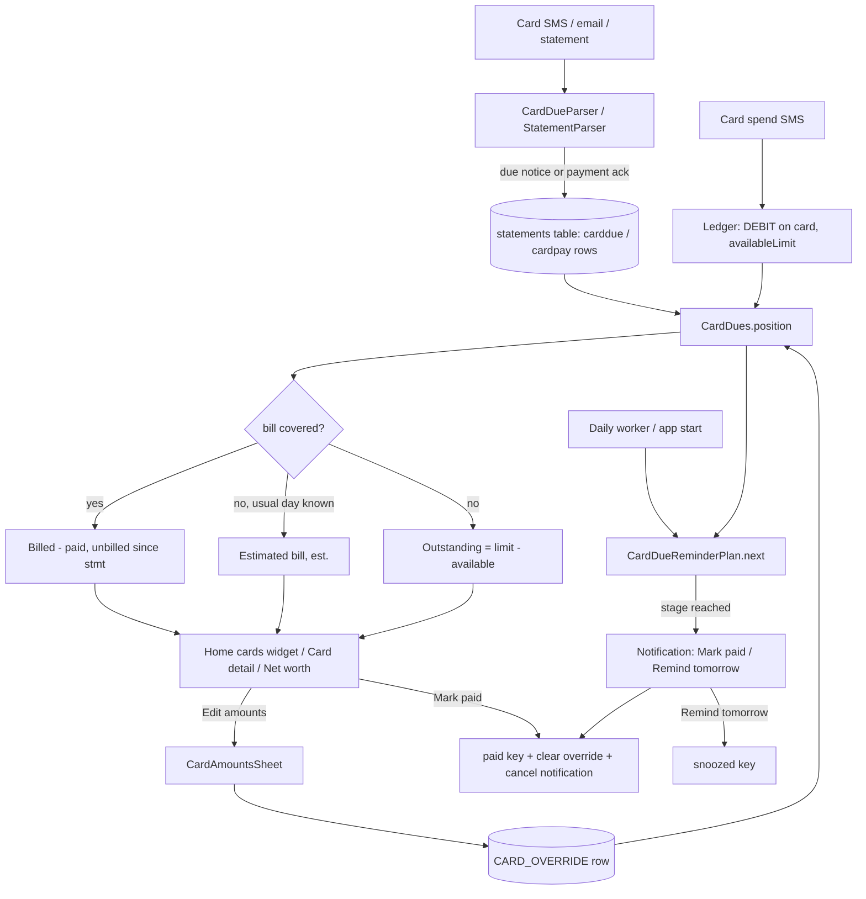

# Credit Cards (Billed, Min Due, Unbilled, Limit, Overrides, Reminders, Forex Markup)

| Field | Value |
|---|---|
| Feature ID | F-14 |
| Status | In progress (Phase 3 data/domain layer and the `CardDueParser` message parser in parser_core done; reminders worker, notification, Home widget, card UI pending) |
| Priority | P0 |
| Phase | 3 (statements + portfolio); card due SMS/email recording can start in Phase 2; reminders in Phase 2 |
| Last Updated | 2026-10-21 |

## 1. Description

Credit Cards shows, for each card, what is owed and when: the billed amount, minimum due, due date, spends since the statement, the limit and the limit left. When no statement arrives it estimates the bill. The user can correct any figure, mark a bill paid, and is reminded before the due date so that a payment is not missed.

## 2. What This Feature Will Do

- Shows the billed amount, minimum due, due date, unbilled spends, credit limit and limit left for each card.
- Records bill and payment messages from SMS, email and statements against the right card.
- Reduces the billed amount by payments made since the statement.
- Estimates the bill from the usual statement day when no statement arrives.
- Lets the user override any figure and reset one or all overrides.
- Discards an override when a newer bill arrives or payments cover it.
- Lets the user mark a bill paid and undo it, without writing to the ledger.
- Notifies the user 5 days and 2 days before, on the due date, and for up to 7 days after.
- Offers Mark paid and Remind tomorrow on the reminder.
- Shows a Home cards card with the total owed and a row per card.
- Shows a card detail screen with a limit-used bar and due actions.
- Applies a per-card forex markup to foreign-currency spends.
- Counts card dues as a liability in net worth.

### 2.1 Inputs

- Credit card bill, due and payment messages from SMS, email and statements.
- Card transactions already in the ledger.
- User edits: override amounts, Mark paid, Remind tomorrow, forex markup (0 to 20 percent).

### 2.2 Processing

1. Matches each message to a card by its last digits and issuer.
2. Works out billed, minimum due, unbilled and limit left from the latest bill, payments and recent spends.
3. Falls back to an estimated bill when no current bill exists.
4. Applies the user's overrides unless a newer bill or payment makes them stale.
5. Sends reminders on the stage plan, skipping cards marked paid or snoozed.

### 2.3 Outputs

- Card figures on the Home widget and the card detail screen.
- Stored: recorded due notices, overrides, paid and snooze marks, forex markup.
- Reminder notifications that open the card page.
- Card limits and dues to net worth in [Portfolio](16_portfolio.md).

### 2.4 Out of Scope

- Does not read statement PDFs or Excel files or handle their passwords (statements feature).
- Does not classify bill payments as transfers or pair them; see [Dedup & Review](07_dedup_review.md).
- Does not create accounts or reconcile balances; see [Accounts Management](13_accounts_management.md).
- Does not manage forex rates or calculate net worth; see [Portfolio](16_portfolio.md).
- Does not treat card EMIs as loans; see [Loans](15_loans.md).
- Does not include newer ideas such as high-utilisation insights, minimum-only-paid insights, due-soon alerts at 3 days or Account Aggregator.

## 3. Behaviour in Existing App

Sources: analysis Part A 2.2/2.4/4.5, Part B 2.2/2.3/2.9/6.9, Part C 2.6; Kotlin `shared/.../repo/CardDues.kt`, `parser-core/.../statement/CardDue.kt`, `app/.../ui/accounts/CardBill.kt`, `CardDueActions.kt`, `CardAmountsSheet.kt`, `AccountDetailScreen.kt`, `ui/home/HomeWidgets.kt` (`CreditCardsWidget`, `CardHomeRow`), `notify/CardDueReminders.kt`, `ui/ledger/NetWorth.kt` (`CardLimit`).

### 3.1 What is a credit card row (`isCreditCardRow`, `CardBill.kt`)

`kind == CARD && !isDebitCard && (accountType == CREDIT_CARD || (accountType == null && availableLimitMinor != null))`. Debit cards carry bank balances, never limits. Only credit cards are listed on Home and in card reminders; "a card of unknown type counts when its alerts show a credit limit".

### 3.2 Figures and `CardPosition` (`CardDues.position`, `CardDues.kt`)

Inputs: `rows` (statement-table rows for that card), `availableMinor` (the card's current available limit = `AccountWithActivity.currentBalanceMinor`), `flow` (card movements `(timestamp, type, inrMinor)` over the last `WINDOW_DAYS = 60` days or since the newest statement date, whichever is older, duplicates ignored), `today`, zone.

Output `CardPosition`: `billedMinor, minDueMinor, dueDay, statementDay, limitMinor, unbilledMinor, outstandingMinor, estimated`, edit flags (`billedEdited`, `minDueEdited`, `dueEdited`, `unbilledEdited`, `outstandingEdited`, `edited`), `calculated` (base position beneath an override), `source` (SMS / EMAIL / STATEMENT / MANUAL), `sourceAtMs`. Derived: `totalMinor = billed + unbilled` when either is known else `outstanding`; `owedMinor = billed if > 0 else outstanding if > 0 else 0`; `limitLeft(limit, available)` = `max(0, limit - totalMinor)` ONLY when billed/unbilled/outstanding was manually edited, else `available`.

Constants: `STALE_DAYS = 35`, `WINDOW_DAYS = 60`, `DUE_GAP_DAYS = 19` (typical statement-to-due days), due-gap clamp `10..30`. Special row kinds in the `statements` table: `CREDIT_CARD` (due notice, `KIND_DUE`), `CARD_PAYMENT` (`debitsMinor` = amount paid, `statementEpochDay` = day acknowledged), `CARD_OVERRIDE` (manual edits).

Helper `net(flow, from, to)` = sum over flow with `from <= ts < to` of `DEBIT: +amount`, `CREDIT: -amount`, others 0, floored at 0.

`basePosition` algorithm:

1. Usable rows (`usable`): status not LOCKED/UNREADABLE and kind not BANK/INVESTMENT; override rows excluded. `carriesBill(r)` = kind not CARD_PAYMENT/CARD_OVERRIDE and (`totalDueMinor` or `dueEpochDay` non-null).
2. A bill row with no `statementEpochDay` gets one: `dueEpochDay - 19`, else the arrival day (`receivedAt` if > 0 else `processedAt`).
3. `bill` = the row with `totalDueMinor != null` newest by `(statementEpochDay, arrival, processedAt)`. `limit` = `creditLimitMinor` of the newest row that has one. `dueDay` = bill's due day. `gap = clamp(due - stmt, 10, 30)` when both known else 19. `statementDay` = bill's statement day or `dueDay - gap`.
4. `paidSince(day)` = `max( sum of TRANSFER flow amounts with ts >= start of day, sum of CARD_PAYMENT rows' debitsMinor with statementEpochDay >= day )`.
5. `stale = dueDay < today - 35 days`. Reference row = newest row with a statement or due date; `refStmt` = its statement day or `due - gap`; `expected = latestStatement(refStmt.dayOfMonth, today)` (latest date <= today with that day-of-month, clamped to month length).
6. `covered = bill != null && !stale && (trust || expected == null || statementDay == null || statementDay >= expected)`.
   - Covered: `billed = max(0, bill.totalDue - paidSince(statementDay))` (when `statementDay` is null: max of all TRANSFER flow and all payment rows); `minDue = bill.minDue` only if `billed > 0`; `unbilled = net(flow since the day after statementDay)`; `source = bill.source` for due notices, else "STATEMENT".
   - Else if `expected != null && refStmt != null` (estimated bill): `prev` = same day-of-month in the month before `expected`; `carried = bill != null && !stale && statementDay != null && statementDay >= prev - 3 days`; `base = carried ? statementDay : prev`; `gross = (carried ? bill.total : 0) + net(flow, base+1, expected+1) - paidSince(base)`. If `gross > 0 || carried`: `billed = max(gross, 0)`, `minDue = null`, `dueDay = expected + gap`, `statementDay = expected`, `unbilled = net(flow since expected+1)`, `estimated = true`.
   - Else outstanding only: if `limit != null && available != null && limit >= available` then `limit - available`; else if the flow has any DEBIT then `net(flow since last TRANSFER timestamp, or 0)`; else null. Returns `CardPosition(limitMinor, outstandingMinor)`.

Manual override (`position`, lines 118-153): override = newest `CARD_OVERRIDE` row (fields: billed in `totalDueMinor`, minDue, due day, unbilled in `closingMinor`, outstanding in `openingMinor`, set time in `processedAt`; an all-null override is ignored; row key `cardovr:<bank lower>:<last4>`).

- A real bill/due row that ARRIVED after the edit replaces the override (`trust = true`; the limit is still filled from older rows).
- Otherwise `paid = max(TRANSFER flow since setAt, CARD_PAYMENT rows on/after the set day)`; `billed = o.billed - paid`; if `billed <= 0` or `outstanding <= 0` the override is dropped and the base is returned. Else base with `billed` (override), `minDue` (override if billed overridden, else `o.minDue ?: base.minDue`), `due` (override or base), `unbilled = o.unbilled + net(flow since setAt)`, `outstanding = o.outstanding - paid + spent`, `source = "MANUAL"`, `calculated = base`.

### 3.3 Recording due messages (`CardDueRecorder.apply`, `CardDues.kt:294-311`)

Source: card statement / due / payment SMS, email body (`CardDueParser.parse`, `parser-core/.../statement/CardDue.kt:127-152`) and statements. Rows are stored in the `statements` table with keys:

- Payments: `cardpay:<bank>:<last4>:<day>:<amount>`.
- Dues: `carddue:<bank>:<last4 or "any"+total>:<day>` where `day` = statement day (or the sent day).
- A row is skipped when the key exists and (it is a payment, or the existing row already has a total, or the new one has no total).
- `CardOverrideStore` writes `cardovr:<bank lower>:<last4>`.

Matching rows to cards (`rowsFor`, `bankMatches`): same last4 and (row bank null or same issuer), or, when the card is the only card of its issuer, rows of that issuer with no last4 or a last4 no known card has. Issuer equality = `BankKeys.of(name)` (hdfc, icici, axis, hsbc, sbi, kotak, yes, idfc, indusind, baroda, pnb, federal, canara, union, rbl, scb, amex, au) else noise-stripped lower name; equal, or one a prefix of the other with minimum length 3. (CHANGELOG 2.9.8: reaches the right card even with "Axis"/"Axis Bank" spelling, masked/missing card number, `|` separators.)

`CardDueParser.parse` (message side): requires the word "card"; `last4` from `(?:[x*]{2,}[\s-]?|ending (with|in|no)?|no.?|number )(\d{4})` (empty if only a product name); issuer from sender or text (HDFC, ICICI, SBI, Axis, Kotak, IDFC, Yes, IndusInd, Amex, HSBC, RBL, AU, Federal, Standard Chartered); min due `min(imum) (amt|amount|payment)? (due|payable) ... <amt>`; total due `total (amount|amt|payment)? (due|payable|outstanding)` / `amount due|payable` / `total amt` (not followed by due) / `total dues` / `new balance` / `outstanding balance|amount` / `bill amount`; due date `(due date|due on|due by|pay by|payable by|on or before) <date>`; statement date `(statement|bill) (dated|date|generated on|generated for|of) <date>`; a statement notice needs a total or min, the word statement/bill/due and (total or due date); otherwise, unless it says failed, a payment acknowledgement `payment of Rs X ... (received|credited|posted|successful|made|paid)` with a last4. Dates without a year take the year nearest the message date (due dates pushed forward when 30+ days behind; statement dates pulled back when 30+ days ahead). `NUMX` requires a currency sign, paise or thousands separators so "02" in a date is never an amount; amounts must lie in `0..1_000_000_000_000` paise.

Sample (masked): `Your statement for Axis Bank Credit Card no. XX4821 is generated. Due on: 30-10-26 Total amt: INR Dr. 5432.10 Min amt due: INR Dr. 109.00` => `CardDue(total 5432.10, min 109.00, due 2026-10-30)`; the registry's transaction parse returns null for it (reminder rule). Payment ack: `Payment of Rs 12,345.00 received towards your HDFC Bank Credit Card XX5678 on 18-09-26.` => CARD_PAYMENT row (and a TRANSFER transaction, see [Dedup & Review](07_dedup_review.md)). Statement PDFs contribute rows through the statements feature ([Portfolio](16_portfolio.md) for the statement screens): total due, min due, due date, credit limit, available limit with `applyStatementToAccount` (CARD available limit = `available ?: (creditLimit - (totalDue ?: 0)).coerceAtLeast(0)`).

### 3.4 Spends, limit and balance on a card

- Card messages state an available limit (`Avl Lmt`/`Available Credit Limit`); it is stored as `availableLimitMinor` on the account with newer-wins semantics; the stored balance of a credit card is null (see [Accounts Management](13_accounts_management.md) for `usesManual`/`current` maths where a card's "balance" is its limit and movements: DEBIT `-`, CREDIT `+`, TRANSFER (bill payment) `+`).
- A manual "available limit" can be typed in AddAccount/EditSheet (stored as `manualBalanceMinor`).
- "Limit used %" bar on the detail screen is red at >= 80%.

### 3.5 Forex markup

`accounts.forexMarkupBps` (e.g. 350 = 3.5%); EditSheet field 0..20% (error otherwise), hint "Include GST: 3.5% + 18% = 4.13%." (3.5 x 1.18 = 4.13). Applies to the rupee value (`inrMinor`) of foreign-currency spends on that card: `CAST(ROUND(amountMinor * inrPerUnit * (1 + markupBps/10000.0)) AS INTEGER)` where `inrPerUnit` is the nearest-day rate row for that currency (`ABS(r.day - istDay)` minimal, `istDay = (timestamp + 19,800,000) / 86,400,000`). No rate => NULL (excluded from totals). Changing the markup does not fire the SQL triggers, so `ForexDao.recompute()` is called on save. Sample: `USD200.00 was spent on your SBI Corporate Card number ending with 96 at ANTHROPIC on 01/10/26. Available Credit Limit: Rs.59,165.07` (2-digit ending; amount in USD minor units).

### 3.6 Card detail figures (`AccountDetailScreen`, `CardSummaryGrid`, `CardDueActions`)

- `CardSummaryGrid`: "Total outstanding" with an "Edit amounts" link and an "Edited" badge, plus a source line (`cardSourceLine`): "From statement . 2 Oct", "From SMS . 2 Oct", "From email . 2 Oct" or "Edited . 10 Oct" (null when figures were worked out; edited uses the edit date, else statement day, else arrival date); "Total limit" / "Limit left (est.)"; variants "Billed to pay", "Unbilled", "Outstanding"; "Limit used %" bar (red >= 80%).
- `CardDueActions(cardId, due, billed)`: nothing without billed > 0 and a due date; label "Overdue" / "Due today" / "Due tomorrow" / "Due in {n} days" (red when overdue, amber within 5 days, muted otherwise) followed by "Mark paid"; once marked: "Marked paid" + "Undo". Marking paid only silences reminders (`paid` key `cardId|dueEpochDay`), cancels the reminder notification and clears manual overrides for that card; it records nothing in the ledger (the real payment still arrives by SMS/email).
- `dueLabel(due, estimated)`: "Pay by 18 Oct . 5 days left" (or "Overdue"), plus " . est." when estimated; colours red < 0 days, amber <= 5 days, muted otherwise.
- `CardAmountsSheet` "Edit amounts" (`CardAmountsSheet.kt:83`): ModalBottomSheet (skip partially expanded) with five fields: Total outstanding (₹) (follows billed + unbilled until typed; typing a total sets unbilled to the remainder when billed or unbilled is known and unbilled is untouched, else it becomes the outstanding figure), Billed amount (₹), Minimum due (₹, optional), Payment due date (read-only field + `DatePickerDialog`, UTC date picker), Unbilled amount (₹). Each shows "Calculated ₹x" (or "Not calculated") and "Reset to calculated" while it differs. Values equal to the calculated ones are not stored (`keep(v, calc)`); invalid input shows "Enter a valid amount."; Save enabled only when the stored four-tuple (+outstanding) changed and is valid; "Reset all to calculated" (shown when `position.edited`) clears the override. Save writes `CardOverride(cardId, billed, minDue, dueEpochDay, unbilled, now, outstanding)` through `CardOverrideStore` (a `CARD_OVERRIDE` statements row).

### 3.7 Home "Credit card dues" widget (`CreditCardsWidget`, key `cards`, `HomeWidgets.kt:468`)

- Source: `NetWorth.cards` (`CardLimit` per credit card from `CardDues.position`; sorted by `availableMinor` descending), the same figures as the card page and net worth.
- Folded by default: header "{n} cards" (or "1 card") with total owed (`sum(owedMinor)`, red) or "No dues" and a chevron; expands to rows; empty hint "No credit cards yet.".
- `CardHomeRow`: avatar with network badge, name + ••last4, one status line, amount at right (`~` prefix when `estimated` and billed), `MarkPaidButton` when billed, unpaid and `days <= 7`.
  - `billed` = `billedMinor > 0`; `outstanding` = outstanding > 0 only if no billed; `unbilled` > 0; due = `dueDay` only if billed; `owed = billed ?: outstanding ?: unbilled`.
  - Amount colour: paid => muted; billed => red; else amber.
  - Status: paid => "Paid"; days < 0 => "Overdue . {d MMM}" (red); 0 => "Due today" (amber); else "Due {d MMM} . {n} days" (amber when <= 5, else muted); else "Unbilled {amount}" (when not amount-only); else "Limit left {amount}"; else none. Amounts under ₹1 crore shown in full rupees else compact.
- Tap opens `account/{id}`.

### 3.8 Reminders (`CardDueReminderPlan`, `CardDueReminderChecker`, `notify/CardDueReminders.kt`)

- Stages `DAYS_5(5)`, `DAYS_2(2)`, `DUE_DAY(0)`, `OVERDUE(-1)`. Only the most urgent reached stage (`days <= offset`, smallest offset) and never a repeat; no reminders once more than 7 days overdue (`OVERDUE_WINDOW = 7`); none if paid or snoozed until a later day; marking a stage sent also marks all earlier (less urgent) stages (`markSent` writes every stage with `offsetDays >= stage.offsetDays`).
- Source of truth for amount/due: `CardDues.position(statements, balance, flow since window, today)`; billed must be > 0 and the due date known, else the notification is cancelled. Runs daily (AlertsWorker), at app start, and after relevant changes; cheap to re-run.
- Notification: channel `budgets_bills`, id `30000 + cardId*3`; title/body "{amount} . pay by {d MMM}." (prefixed "About" when estimated; min due appended when known); actions "Mark paid" (id+1, `CARD_DUE_PAID`) and "Remind tomorrow" (id+2, `CARD_DUE_SNOOZE`) via `CardDueActionReceiver` (not exported); tap opens `hisaab://account/<cardId>`.
- Store (DataStore `card_due_reminders`): `sent` entries `cardId|dueEpochDay|STAGE`, `paid` entries `cardId|dueEpochDay`, `snoozed` entries `cardId|dueEpochDay|untilEpochDay`; entries pruned when the due date is more than 120 days old. Setting `card_due_reminders` (bool, default true) in `app_settings`.

### 3.9 Net worth interplay

Card dues count as a liability in net worth (`cardDue = sum(owedMinor)`, switchable by `LiabilityKind.CARD_DUES`); limits are listed (`CardLimit`) but not counted as assets. FEATURES.md says "Credit cards and their limits are listed but not counted"; the code does count dues as liabilities (Open Question 1; detail in [Portfolio](16_portfolio.md)).

## 4. User Stories

- US-14-01: As a user, I see how much I owe on each credit card, when it is due and how much limit I have left.
- US-14-02: As a user, I see an estimate when my bank did not send the bill yet.
- US-14-03: As a user, I can correct the billed, minimum due, due date and unbilled amounts if they are wrong.
- US-14-04: As a user, I am reminded 5 days and 2 days before the due date, on the due date, and when it is overdue.
- US-14-05: As a user, I can mark a bill paid, or ask to be reminded tomorrow, from the notification.
- US-14-06: As a user, spends in foreign currency on a card use my card's markup.
- US-14-07: As a user, I see all card dues at a glance on Home.

## 5. Functional Requirements (FR-14-01 ...)

- FR-14-01: The system shall list as credit cards only rows satisfying `isCreditCardRow`.
- FR-14-02: The system shall compute `CardPosition` exactly per section 2.2 (covered bill, estimated bill, outstanding-only).
- FR-14-03: Billed shall be reduced by payments since the statement day (TRANSFER flow and CARD_PAYMENT rows, whichever is larger), floored at 0; minimum due only while billed > 0.
- FR-14-04: Unbilled shall equal the net card spend since the day after the statement day (DEBIT adds, CREDIT subtracts, floored at 0).
- FR-14-05: When no current bill exists the system shall estimate a bill from the usual statement day with `estimated = true`, due day `expected + gap`, no minimum due.
- FR-14-06: The system shall record card due notices and payment acknowledgements from SMS/email/statements with the key schemes of section 2.3 and shall match rows to cards by last4/issuer rules.
- FR-14-07: The user shall be able to override total outstanding, billed, minimum due, due date and unbilled via Edit amounts, with Calculated hints, per-field reset and Reset all; equal-to-calculated values shall not be stored.
- FR-14-08: An override shall be discarded when a newer real bill arrives, when payments cover the overridden billed amount, or when Mark paid is used.
- FR-14-09: Mark paid shall silence reminders for that card and due date, cancel its notification, clear overrides and write nothing to the ledger; Undo shall reverse the silence.
- FR-14-10: Reminders shall follow the stage plan of section 2.8 (5 days, 2 days, due day, overdue up to 7 days), skip paid/snoozed, never repeat a stage, and be cancelled when billed or due date is unknown.
- FR-14-11: The notification shall offer Mark paid and Remind tomorrow and open the card page; reminders shall obey the `card_due_reminders` setting.
- FR-14-12: The Home widget shall show the folded total, per-card rows with status lines, amount colours, `~` for estimates and the Mark paid check when due within 7 days.
- FR-14-13: The card detail screen shall show Total outstanding with Edited badge and source line, limit, limit left, billed/unbilled/outstanding variants, limit-used bar and due actions.
- FR-14-14: Limit left shall equal `max(0, limit - total)` when any of billed/unbilled/outstanding is manually edited, else the stated available limit.
- FR-14-15: A per-card forex markup (0..20%) shall be editable and applied to foreign-currency rupee values, with recompute on change.
- FR-14-16: Net worth shall list card limits and count card dues (`owedMinor`) as a liability unless excluded.
- FR-14-17: The card timeline query (`cardFlowSince`) shall return only rows with `inrMinor` not null and `duplicateOfId` null, for the card and accounts merged into it, ordered by timestamp ascending.

## 6. Non-Functional Requirements (performance, battery, privacy, offline)

- Offline, deterministic pure functions (`CardDues` has no I/O) so they can be golden-tested against Kotlin.
- Recompute per card on change; reminders cheap to re-run daily.
- Privacy: notification text carries amounts and card names; the old app shows real amounts (see Open Questions); card last4 only, never full numbers.
- Battery: one daily background job; no exact alarms (use inexact scheduled notifications for "remind tomorrow").
- Reminder actions must work with the app closed.

## 7. UI / Screens & User Flow (screen list + flow diagram)

| # | Screen/sheet | Source | Notes |
|---|---|---|---|
| 1 | Home "Credit card dues" widget | `ui/home/HomeWidgets.kt:468` | Folded rows, Mark paid check |
| 2 | Accounts > Cards tab card rows (bill block) | `ui/accounts/AccountsScreen.kt` | "Min ₹", "Unbilled", "Limit left ... est." |
| 3 | Card detail screen (summary grid, limit bar, due actions) | `ui/accounts/AccountDetailScreen.kt:166` | Route `account/{id}` |
| 4 | CardAmountsSheet "Edit amounts" | `ui/accounts/CardAmountsSheet.kt:83` | Five fields |
| 5 | Payment due DatePickerDialog | `CardAmountsSheet.kt` | Inside sheet |
| 6 | CardDueActions row ("Due in 3 days . Mark paid", "Marked paid . Undo") | `ui/accounts/CardDueActions.kt` | Shown on detail |
| 7 | MarkPaidButton (check icon) | `CardDueActions.kt` | On Home rows |
| 8 | Card bill reminder notification (Mark paid, Remind tomorrow) | `notify/CardDueReminders.kt` | Channel Budgets & bills |
| 9 | EditSheet forex markup field | `AccountsScreen.kt:630` | 0..20%, GST hint |
| 10 | Net worth card limits list | `ui/ledger/NetWorth.kt`, `PortfolioSections.kt` | Owned by [Portfolio](16_portfolio.md) |



Reference GIFs:

-  (Status: Pending, not yet captured)
-  (Status: Pending, not yet captured)
-  (Status: Pending, not yet captured)
-  (Status: Pending, not yet captured)
-  (Status: Pending, not yet captured)
-  (Status: Pending, not yet captured)
-  (Status: Pending, not yet captured)
-  (Status: Pending, not yet captured)

## 8. Data Models (Dart entities + fields + types)

```dart
enum CardDueSource { sms, email, statement, manual }
enum DueStage { days5(5), days2(2), dueDay(0), overdue(-1) }   // offsetDays

@freezed class CardRef { String bankName; String last4; }

@freezed class CardFlow { DateTime timestamp; TxType type; int inrMinor; }   // card movements

@freezed class CardPosition {
  int? billedMinor; int? minDueMinor; DateTime? dueDay; DateTime? statementDay;
  int? limitMinor; int? unbilledMinor; int? outstandingMinor; bool estimated;
  bool billedEdited; bool minDueEdited; bool dueEdited; bool unbilledEdited; bool outstandingEdited;
  CardPosition? calculated; CardDueSource? source; DateTime? sourceAt;
  // derived: int? totalMinor; int owedMinor; int? limitLeft(int? limit, int? available); bool get edited
}

@freezed class CardOverride {
  int cardId; int? billedMinor; int? minDueMinor; int? dueEpochDay; int? unbilledMinor; DateTime setAt; int? outstandingMinor;
}

@freezed class CardDue {                      // parsed from message
  String? issuer; String? last4; int? totalMinor; int? minMinor; DateTime? dueDate; DateTime? statementDate; int? paymentMinor;
}

@freezed class CardStatementRow {             // row of the overloaded statements table
  int id; String key; String kind; /* CREDIT_CARD | CARD_PAYMENT | CARD_OVERRIDE | BANK | INVESTMENT | OTHER */
  String status; String? bankName; String? last4; DateTime receivedAt; DateTime processedAt;
  int? totalDueMinor; int? minDueMinor; int? dueEpochDay; int? creditLimitMinor; int? statementEpochDay;
  int? openingMinor; int? closingMinor; int? debitsMinor; int? creditsMinor; int? availableMinor;
}

@freezed class CardLimit {                    // net worth / Home projection
  int id; String name; String last4; int? availableMinor; int? limitMinor; int? billedMinor; DateTime? statementDay;
  int? unbilledMinor; DateTime? dueDay; CardNetwork? network; int? minDueMinor; int? outstandingMinor; bool estimated; bool availableEstimated;
  // int get owedMinor => billed>0 ? billed : outstanding>0 ? outstanding : 0
}

@freezed class CardDueReminderState { Set<String> sent; Set<String> paid; Set<String> snoozed; }
```

## 9. Database Tables / Changes

The old app overloads the `statements` table. Recommendation for Flutter (Open Question 3): keep a compatible overloaded table for import but add dedicated tables.

```dart
class CardDueNotices extends Table {          // replaces KIND_DUE / CARD_PAYMENT rows
  IntColumn  get id => integer().autoIncrement()();
  TextColumn get key => text().unique()();    // "carddue:<bank>:<last4|any+total>:<day>" or "cardpay:<bank>:<last4>:<day>:<amount>"
  TextColumn get kind => text()();            // DUE | PAYMENT
  TextColumn get source => text()();          // SMS | EMAIL | STATEMENT
  TextColumn get bankName => text().nullable()();
  TextColumn get last4 => text().nullable()();
  IntColumn  get totalDueMinor => integer().nullable()();
  IntColumn  get minDueMinor => integer().nullable()();
  IntColumn  get dueEpochDay => integer().nullable()();
  IntColumn  get creditLimitMinor => integer().nullable()();
  IntColumn  get statementEpochDay => integer().nullable()();
  IntColumn  get availableMinor => integer().nullable()();
  IntColumn  get paymentMinor => integer().nullable()();   // old: debitsMinor on CARD_PAYMENT
  IntColumn  get receivedAt => integer()();
  IntColumn  get processedAt => integer()();
}

class CardOverrides extends Table {           // replaces CARD_OVERRIDE rows
  TextColumn get cardKey => text()();         // "<bank lower>:<last4>", PK
  IntColumn  get billedMinor => integer().nullable()();
  IntColumn  get minDueMinor => integer().nullable()();
  IntColumn  get dueEpochDay => integer().nullable()();
  IntColumn  get unbilledMinor => integer().nullable()();   // old: closingMinor
  IntColumn  get outstandingMinor => integer().nullable()();// old: openingMinor
  IntColumn  get setAt => integer()();                      // old: processedAt
  @override Set<Column> get primaryKey => {cardKey};
}
```

Statement rows for PDFs/sheets (kind CREDIT_CARD, with totals and limit) live in the statements feature table; `CardDues.rowsFor` reads both. Old Room `statements` columns: `kind, totalDueMinor, minDueMinor, dueEpochDay, creditLimitMinor, statementEpochDay, openingMinor, closingMinor, debitsMinor, creditsMinor, availableMinor, emailText, status, bankName, last4, receivedAt, processedAt`. Account columns used: `availableLimitMinor`, `manualBalanceMinor`, `forexMarkupBps`, `accountType`, `cardNetwork`, `linkedAccountId`.

Card movements query: `transactions` for accountId (with merged children) since timestamp, excluding `duplicateOfId` and `needsReview`: `(timestamp, type, inrMinor)` ascending. Preferences: DataStore `card_due_reminders` keys `sent`, `paid`, `snoozed`; `app_settings.card_due_reminders` bool.

## 10. Business Rules & Logic (regex, parsing rules, algorithms, thresholds)

Constants: `STALE_DAYS = 35`, `WINDOW_DAYS = 60`, `DUE_GAP_DAYS = 19`, gap clamp 10..30, estimated-bill window `prev - 3 days`, reminder offsets 5/2/0/-1, `OVERDUE_WINDOW = 7`, Home Mark paid visible when `days <= 7`, due-label amber at <= 5 days, limit-used red at >= 80%, store prune 120 days, notification ids `30000 + cardId*3` (+1 paid, +2 snooze), amounts valid in `0..1_000_000_000_000` paise, forex markup 0..20%.

Reminder plan:

```text
next(now, due, sentStages, paid, snoozedUntil):
  if paid or (snoozedUntil != null and snoozedUntil > now) return null
  days = due - now
  if days < -OVERDUE_WINDOW(7) return null
  stage = DueStage.values.where(days <= s.offsetDays).minBy(s.offsetDays)   // most urgent reached
  if stage == null or stage in sentStages return null
  return stage
```

Worked examples (masked):

1. Covered bill: statement day 5 Oct total due 12,345, min 620, due 24 Oct; payment of 5,000 on 12 Oct (TRANSFER flow) and spends 3,000 since 6 Oct => billed 7,345, min 620, unbilled 3,000 (DEBIT 3,000), `limitLeft = available` (not edited).
2. Estimated bill: last statement day 5 (seen in Sep), no October statement yet, today 12 Oct, Sep bill 10,000 paid in full on 20 Sep, spends 4,000 between 6 Sep and 5 Oct => `expected = 5 Oct`, `prev = 5 Sep`, `carried = true` (stmt 5 Sep >= prev - 3d), `gross = 10,000 + 4,000 - 10,000 = 4,000` => billed 4,000, `estimated`, due `5 Oct + 19 days = 24 Oct`.
3. Override: user edits billed to 8,000; later payment of 8,000 arrives => `billed <= 0`, override dropped.
4. Limit left with override: limit 100,000, billed edited 20,000, unbilled 5,000 => limit left = max(0, 100,000 - 25,000) = 75,000.
5. Reminder: due 24 Oct, today 19 Oct => stage DAYS_5 (once); 22 Oct => DAYS_2 and DAYS_5 marked sent; 24 Oct => DUE_DAY; 25 Oct => OVERDUE; 1 Nov (8 days late) => none.

## 11. Platform / Native Requirements (permissions, channels, background work)

- `POST_NOTIFICATIONS`; channel `budgets_bills`; notification actions with receivers: Flutter `flutter_local_notifications` action callbacks (background isolate handler) for "Mark paid" and "Remind tomorrow"; deep link `hisaab://account/{id}`.
- Daily `workmanager` job `daily-alerts` calls the reminder checker; also run at app start and after ingest.
- "Remind tomorrow" sets `snoozedUntil = today + 1` and must not re-notify earlier than next day's job.
- No extra permissions; SMS/email permissions belong to the ingestion features.
- Android only in the old app; iOS notification actions are optional.

## 12. Dependencies (other features → link to their memory file; packages)

- [Accounts Management](13_accounts_management.md): account rows, available limit, balance maths, forex markup field in EditSheet, detail screen host.
- [Dedup & Review](07_dedup_review.md): TRANSFER classification of card payments, `pairTransfers` card pairing window (5 days), ingest of due messages.
- [Portfolio](16_portfolio.md): net worth card dues/limits; statements list and detail screens.
- [Recurring Transactions](12_recurring_transactions.md): card-paid items excluded from cash projection.
- [Expense Tracking](10_expense_tracking.md): card spends in totals; bill payments excluded.
- Others (see index): statements parsing/passwords, forex rates, notifications, settings (`card_due_reminders` toggle in Alerts screen), i18n.
- Packages: `drift`, `riverpod`, `freezed`, `go_router`, `workmanager`, `flutter_local_notifications`, `intl`, `shared_preferences`.

## 13. Folder Location (lib/features/<name>/...)

```text
lib/features/credit_cards/
  data/
    datasources/card_due_dao.dart, card_override_dao.dart, card_reminder_store.dart
    repositories/card_dues_repository_impl.dart
  domain/
    entities/card_position.dart, card_override.dart, card_due.dart, card_limit.dart, card_flow.dart
    usecases/compute_card_position.dart, record_card_due.dart, rows_for_card.dart, save_card_override.dart,
             mark_card_paid.dart, plan_card_reminder.dart, check_card_reminders.dart, is_credit_card.dart
    repositories/card_dues_repository.dart
  presentation/
    home/credit_cards_widget.dart, card_home_row.dart
    detail/card_summary_grid.dart, card_due_actions.dart, mark_paid_button.dart
    sheets/card_amounts_sheet.dart
    providers/card_bills_provider.dart
lib/core/parser/card_due_parser.dart     // CardDueParser port (shared with SMS/email parsers)
```

## 14. Edge Cases & Error Handling

- Card with no statement and no spends: position has only limit; shows "Limit left" or "No dues".
- Statement older than 35 days past due (`stale`): ignored for billed; estimated path or outstanding only.
- Payment before statement day: `paidSince(statementDay)` only counts payments at or after it.
- Payment recorded both as TRANSFER flow and as a CARD_PAYMENT row: `max` of the two, never the sum.
- Two cards of the same issuer: due rows without last4 attach only when the card is the only one of that issuer (or last4 matches).
- Missing/masked card number in a due message: attach by issuer when unique; else dropped.
- Override with `billed <= 0` or `outstanding <= 0` after payments: dropped.
- Real bill arrives after an edit: edit replaced, but the limit is still read from older rows.
- Estimated bill: no minimum due; marked `est.`/`~`.
- Due day clamps: `latestStatement(day)` clamps to month length (e.g. day 31).
- Overdue beyond 7 days: reminders stop; widget still shows "Overdue".
- Marked paid then a larger bill arrives for the same due date: paid key remains; Undo available (Open Question 5).
- Foreign spend without a rate: counts as 0 in unbilled until a rate exists.
- Hidden or non-credit rows never get reminders; unknown due date cancels the notification.
- Timezone: periods use the device zone (`Periods.zone`).
- `cardFlowSince(accountId, from)` (`Daos.kt:175-181`) returns a card's DEBIT, CREDIT and TRANSFER movements oldest first and filters `inrMinor IS NOT NULL` (rows without a forex rate are skipped) and `duplicateOfId IS NULL` (merged duplicates never double-count); it includes rows of the card and of accounts merged into it (`mergedIntoId = :accountId`) and has no `needsReview` filter. Due and spend maths must apply the same filters (FR-14-17).

## 15. Test Cases (unit / widget / integration + sample fixtures)

Unit (golden against Kotlin `CardDues` tests where available):

- TC-14-01 (FR-14-01): `isCreditCardRow` truth table (credit typed, untyped with limit, untyped without limit, debit, prepaid).
- TC-14-02 (FR-14-02, FR-14-03, FR-14-04): worked example 1.
- TC-14-03 (FR-14-05): worked example 2 (estimated, `est.`, no min due, due = expected + gap).
- TC-14-04 (FR-14-02): outstanding-only variants: limit/available, flow since last TRANSFER, nothing.
- TC-14-05 (FR-14-02): `stale` bill ignored; statement day inferred from `due - 19` and from arrival day.
- TC-14-06 (FR-14-07, FR-14-08): override lifecycle (applies, reduced by payments, dropped at <= 0, replaced by newer bill, cleared by Mark paid).
- TC-14-07 (FR-14-14): limit left with and without edits (worked example 4).
- TC-14-08 (FR-14-06): `CardDueParser` on the Axis statement SMS, HDFC payment ack, SBI Card layout with masked number, "Axis"/"Axis Bank" spelling, `|` separators; year-less date resolution (due forward, statement backward).
- TC-14-09 (FR-14-06): recorder key dedupe rules and `rowsFor` matching (same last4, only-card-of-issuer, no last4).
- TC-14-10 (FR-14-10): reminder plan table (5/2/0/-1, repeat suppression, paid, snoozed, > 7 days overdue, earlier stages marked on send).
- TC-14-11 (FR-14-15): foreign `inrMinor` with markup 350 bps and rounding; recompute on change; missing rate => null.
- TC-14-12 (FR-14-16): net worth card dues = sum of `owedMinor`; excluded when the liability switch is off.

Widget:

- TC-14-13 (FR-14-12): Home widget folded total, "No dues", rows for paid/overdue/today/future/unbilled/limit-left, `~`, Mark paid visibility (`days <= 7`).
- TC-14-14 (FR-14-07): CardAmountsSheet: total-follows-billed+unbilled, per-field Calculated/Reset, Save enabled only when changed and valid, "Reset all", invalid input text.
- TC-14-15 (FR-14-09, FR-14-13): CardDueActions states (hidden without billed/due, label colours, Marked paid/Undo).

Integration:

- TC-14-16 (FR-14-09, FR-14-10, FR-14-11): reminder notification appears at stage; "Mark paid" from the notification clears it and silences later stages; "Remind tomorrow" suppresses until next day.
- TC-14-17 (FR-14-06): ingest the Axis statement SMS fixture then a spend: Home widget shows billed from SMS and unbilled.

Fixtures: Axis statement SMS, HDFC payment ack, ICICI/HDFC card spend emails, SBI Corporate USD spend (all in [Dedup & Review](07_dedup_review.md) corpus), plus the worked examples above as JSON cases.
- TC-14-13 (FR-14-17): card flow excludes a duplicate row and a row with null `inrMinor`; includes a row on an account merged into the card.

## 16. Acceptance Criteria

- AC-14-01: For all fixture cards the position equals the Kotlin results (billed, min due, due day, unbilled, outstanding, estimated, limit left) (FR-14-01..05, FR-14-14; TC-14-01..05, TC-14-07).
- AC-14-02: Card due messages and payment acknowledgements are recorded and matched to the right card (FR-14-06; TC-14-08, TC-14-09, TC-14-17).
- AC-14-03: Edit amounts works with calculated hints, resets and automatic dropping rules (FR-14-07, FR-14-08; TC-14-06, TC-14-14).
- AC-14-04: Mark paid and Undo behave as specified and write nothing to the ledger (FR-14-09; TC-14-15, TC-14-16).
- AC-14-05: Reminders fire at the right stages once each, with working actions, and obey the setting (FR-14-10, FR-14-11; TC-14-10, TC-14-16).
- AC-14-06: Home widget and detail screen show the specified lines and colours (FR-14-12, FR-14-13; TC-14-13, TC-14-15).
- AC-14-07: Forex markup converts foreign spends correctly (FR-14-15; TC-14-11).
- AC-14-08: Net worth reflects card dues and limits as specified (FR-14-16; TC-14-12).

## 17. Open Questions

1. FEATURES.md says "Credit cards and their limits are listed but not counted" in net worth, but `NetWorthSource.compute` counts `sum(owedMinor)` as the "Card dues" liability. Which is intended in Flutter?
2. The Home Upcoming widget has a CARD tone but `plan.upcoming` does not include statement-based card dues; card dues appear only in the Credit card dues widget ([Recurring Transactions](12_recurring_transactions.md) Open Question 2). Should card due dates be added to Upcoming/Bills?
3. The old `statements` table is overloaded (`openingMinor` = outstanding, `closingMinor` = unbilled, `debitsMinor` = payment for override/payment rows); confirm that Flutter uses dedicated tables (section 9) and whether a Room-to-Drift import must decode the old encoding.
4. `CARD_PAIR_WINDOW` for matching card-side payment to bank debit is 5 days in code vs "3 days" in a comment (analysis Part B Open Question 1); carried to [Dedup & Review](07_dedup_review.md).
5. Behaviour when a bill is marked paid and a different (larger) bill for the same due date later arrives is unspecified (paid key remains).
6. Reminder notification text includes real amounts regardless of hide-amounts; confirm privacy policy.
7. `OVERDUE` stage fires only once (the day after due); confirm that a single overdue reminder is intended (spec suggests 5 days, 1 day).
8. Whether `limitLeft` should also consider unbilled when not edited (currently the stated available limit is trusted unless edited) is not stated.
9. `CardLimit.availableEstimated` marks `balanceIsEstimated` ("est." tag); exact UI shown on the Cards tab was only partially captured.
10. `STATEMENT` source rows for cards (PDF) set `limit`/`available`; the accuracy of limit from statements vs SMS when they disagree is not specified (newest by statement day wins for limit).

## 18. Implementation Notes

Phase 3 data/domain layer (no UI). Tables `card_due_notices`, `card_overrides` (schema v3, section 9 as written). Code: `lib/features/credit_cards/domain/{card_models,card_day,card_position,card_matcher,card_notice_keys,card_reminder_plan,card_due_repository,card_due_service,card_due_actions}.dart`, `data/{card_due_repository_impl,card_paid_store_impl,card_flow_source_impl}.dart`; providers in `lib/app/di/phase3_providers.dart`.

FR status done (domain/data): FR-14-01 (`isCreditCardAccount`), 02..05 (`basePosition`/`cardPosition`), 06 (keys, matching, record rule), 07 (override store, `saveEdit` skips equal-to-calculated), 08, 09 (Mark paid stores `cardId|dueEpochDay` in settings key `card_due_paid`, clears the override, writes nothing to the ledger, so no ledger port is needed), 10 (`CardReminderPlan.next/markSent`, pure), 14, 16 (`CardLimit.owedMinor`), 17 (`CardFlowSourceImpl` reads `TransactionRepository.watch(LedgerFilter(accountId, fromMs))`, drops rows without `inrMinor` or with `duplicateOfId`). Pending: FR-14-11, 12, 13, 15 (UI, notification actions, widget, forex markup).

APIs for UI agents:
- `cardLimitsProvider` / `CardDueService.watchCards() -> Stream<List<CardLimit>>` (sorted by available limit desc), `card(int accountId)`. `CardLimit`: `id, name, bankName, last4, position, paid, availableMinor, availableEstimated, network`, getters `limitMinor, billedMinor, unbilledMinor, minDueMinor, outstandingMinor, dueDay (epoch day), estimated, owedMinor, limitLeftMinor`. `CardPosition` has edit flags, `calculated`, `source`, `sourceAtMs`, `totalMinor`, `limitLeft(limit, available)`.
- `CardDueActions.markPaid(CardLimit)`, `undoPaid(CardLimit)`, `saveEdit(CardLimit, {calculated, billedMinor, minDueMinor, dueEpochDay, unbilledMinor, outstandingMinor})`, `resetAll(CardLimit)`.
- `CardDueRepository.recordNotice(NewCardNotice) -> bool` (the SMS/email/statement pipelines call it), `pruneNotices(beforeMs)`.
- `CardReminderPlan.next({today, due, sent, paid, snoozedUntilDay}) -> DueStage?` (days are IST epoch days, `CardDay`).
Rules: an override is replaced when a bill row with `arrivalMs > setAt` exists. Sent/snoozed reminder state is not stored yet (alerts feature). Statement CREDIT_CARD rows (status PARSED) feed positions through `StatementRepository`.
Tests: `test/features/phase3/card_position_test.dart` (worked examples 1 to 5), `phase3_repositories_test.dart` (notices, service, actions).

Message parser (2026-10-21): `CardDueParser` and `CardDue` are ported to `app/packages/parser_core/lib/src/statement/card_due.dart`; app code calls `parseCardDue(body, sender, timestamp)` or `ParserRegistry.cardDue(...)` and gets `CardDue{bank, last4, totalDueMinor, minDueMinor, dueEpochDay, statementEpochDay, paymentMinor, at}` (epoch days via `CivilDate.toEpochDay`) or null; lenders return null and the generic parser reads the issuer from the text. Statement PDFs give `StatementResult.summary` (total/min due, due date, credit limit, available, statement date). FR-14-06 parsing side: tests `card_dues_test` (27 cases, TC-14 parser fixtures from the Kotlin `CardDuesTest`). The pipeline that records the notices stays in the app layer.

## 19. Change Log (date | change | reason)

| Date | Change | Reason |
|---|---|---|
| 2026-10-17 | Created from hisaab_apk 2.9.8 analysis | Initial |
| 2026-10-19 | Named `cardFlowSince` filters (`duplicateOfId IS NULL`, `inrMinor IS NOT NULL`): FR-14-17, edge case, TC-14-13 | Audit Gate gap, scan_3
| 2026-10-19 | Restructured to the 19-section standard (Description, What This Feature Will Do, Implementation Notes added); Last Updated bumped | Audit Gate (Prompt 2, Part A) |
| 2026-10-21 | Phase 3 data layer landed | Phase 3 |
| 2026-10-21 | Phase 3 statement/holdings/card-due parsers ported to parser_core | Phase 3 |
