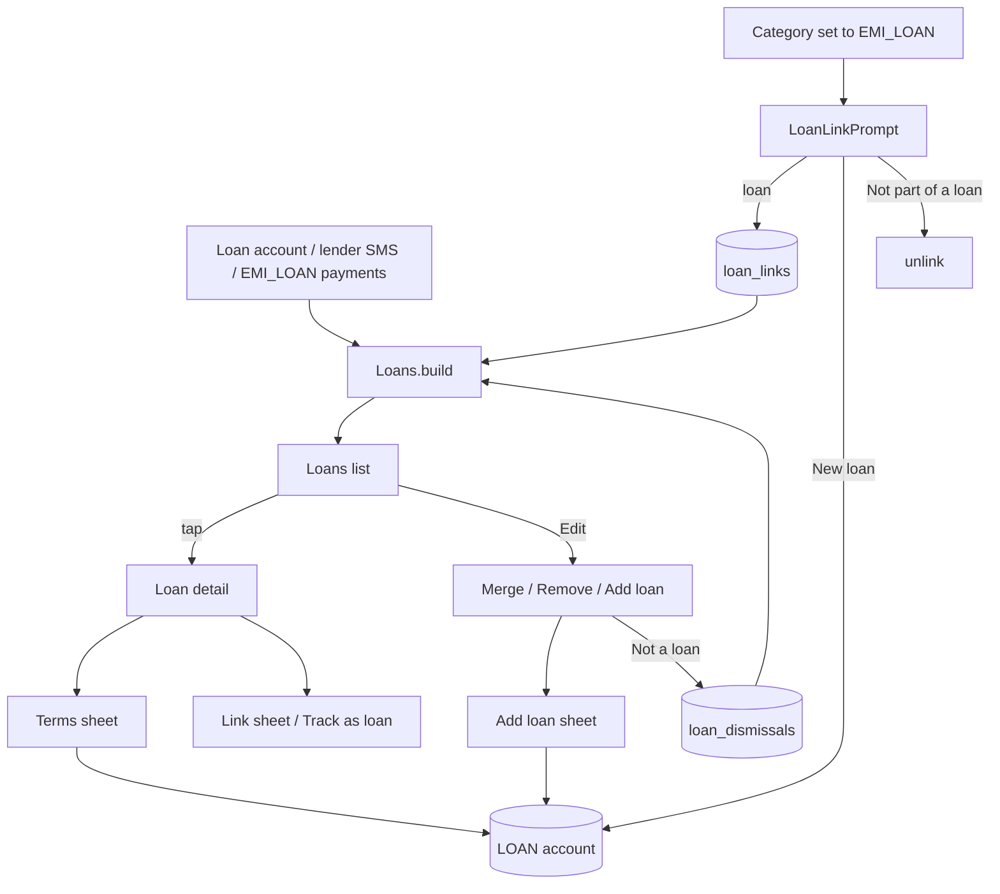

# Loans (Detection, Loans / Loan Detail, Add Loan, Terms, Link, Amortisation, Merge, Not a Loan)

| Field | Value |
|---|---|
| Feature ID | F-15 |
| Status | In progress (domain, link store and core UI done: Loans list, detail with schedule and payoff, add/edit loan, link/unlink, Not a loan; terms editor, link prompt, merge/duplicates UI, lender status wired (FR-15-13) through `ApplyStatementAccounts`; Phase 4 UI items above still pending) |
| Priority | P2 |
| Phase | 4 |
| Last Updated | 2026-10-25 |

## 1. Description

Loans shows every loan the user is repaying, whether it came from a loan account or was detected from regular EMI payments. For each loan it shows the EMI, next due date, amount outstanding, progress and estimated payoff. The user sees all commitments in one place and can fix details by hand.

## 2. What This Feature Will Do

- Lists loan accounts and loans detected from repeating EMI payments together.
- Detects a loan from at least 2 months of EMI payments or a payee the user links.
- Shows the EMI, next due date, outstanding amount, amount repaid, EMIs paid and left, and payoff date.
- Builds a full repayment schedule when the loan terms are known.
- Lets the user add a loan by hand with a day, rate and tenure.
- Lets the user set or clear terms and compares the EMI by those terms with the EMI debited.
- Asks "Which loan is this?" for an unlinked payment and links it to a loan.
- Links silently when the payee is already linked.
- Lets the user mark a detected EMI as Not a loan and optionally delete its payments.
- Suggests merging duplicate loans and lets the user merge and undo.
- Creates or updates loan accounts from lender status messages.
- Tags a payment of more than 120 percent of the EMI as a prepayment.

### 2.1 Inputs

- Payments already in the ledger, especially EMI and loan payments (continuous).
- Lender status messages parsed by [Transaction Parsing Engine](06_transaction_parsing_engine.md).
- User input: new loans, loan terms, payment links, merge and Not a loan choices.

### 2.2 Processing

1. Gathers loan accounts and detects extra loans from repeating EMI payments.
2. Assigns each payment to a loan by account, link or name match.
3. Works out the EMI, outstanding amount, progress and payoff date.
4. Builds the repayment schedule when amount, rate and tenure are known.
5. Checks for duplicate loans and applies the user's links, merges and dismissals.

### 2.3 Outputs

- The Loans screen, Loan detail with its schedule, and the prompts for linking.
- Stored: payment and payee links, Not a loan choices and manual loans.
- Every active loan EMI as a bill in [Recurring Transactions](12_recurring_transactions.md).
- Loan balances as liabilities for [Portfolio](16_portfolio.md).

### 2.4 Out of Scope

- Does not read lender messages; see [Transaction Parsing Engine](06_transaction_parsing_engine.md).
- Does not manage the account list or balances; see [Accounts Management](13_accounts_management.md).
- Does not treat card EMIs as card dues; see [Credit Cards](14_credit_cards.md).
- Does not draw the bills calendar; see [Recurring Transactions](12_recurring_transactions.md).
- Does not calculate net worth; see [Portfolio](16_portfolio.md).
- Does not create transactions; payments stay on their bank accounts.
- Does not include newer ideas such as a prepayment simulator or lender catalogue.

## 3. Behaviour in Existing App

Sources: analysis Part B 2.5 (loans detection and amortisation), Part A 2.7, 2.6 (`PortfolioLoansCard`), 3.1 (DataStores), Part B 6.9 (lender parsers), Part B 2.3 (`pairEmi`); Kotlin `shared/.../insight/Loans.kt`, `shared/.../repo/LoanLinks.kt`, `app/.../ui/loans/LoansScreen.kt:199` (`LoansRoute`), `:453` (`LoanDetailRoute`), `LoanLinkSheet.kt:103`, `LoanLinkStore.kt`, `LoanDismissals.kt`, `LoanSource.kt`, `shared/.../repo/TransactionRepository.kt` (`applyLoanStatus` 378-393, `ensureAccount` 303), `parser-core/.../lender/LenderParser`.

### 3.1 Loan sources

- A loan account: `accounts` row with `accountType = LOAN` (not hidden). Created by the user (AddAccount or Add loan), or automatically: `ensureAccount` auto-types any new account at a known lender (`Lenders.isLender`) as LOAN; `applyLoanStatus` creates the LOAN account for a lender status message (disbursal, EMI received, outstanding), sets principal from a disbursal only when the account has none, and stores the outstanding as the account balance via `updateBalance`.
- Loan account columns: `loanPrincipalMinor`, `loanRateBps` (annual, bps), `loanTenureMonths`, `loanStartDay` (epoch day of first EMI), `mergedIntoId` (visual merge). Loan account balance (`outstanding`) = `|currentBalanceMinor|`, or the latest child's.
- Detected loans: EMI_LOAN payments not claimed by a loan account (2.3).

### 3.2 Payment pool

`pays` = `TransactionDao.observeLoanPayments`: `type != 'CREDIT' && needsReview = 0 && (category = 'EMI_LOAN' OR accountId in LOAN accounts)`, then `isPayment`: not needsReview, not CREDIT, currency INR, category != INVESTMENT, `customCategoryId == null`.

A payment belongs to a loan account when booked on it (or on a merged child), or it is an EMI_LOAN payment booked on a non-loan account and either `LoanLinks` links it (by tx id, or by payee key `keyOf = (merchant ?: upiId).trim().lowercase()`, length >= 2) or, if unlinked, its text names the loan: the loan's last4 (>= 4 chars) appears in merchant/upi/note, or the merchant equals / is a "name " prefix of the nickname or bank name (min length 5).

### 3.3 Detected loans (`Loans.build`)

`Loans.build(accounts, payments, today, zone, dismissed, links, merged)`. Unclaimed EMI_LOAN payments are grouped by `keyOf`, skipped if the key is in `dismissed`, and kept when the payments span >= 2 distinct months (or the key is in `links.manualPayees`) and the latest payment is within 75 days.

### 3.4 `summarise()` per loan

- `distinct()` collapses same-amount payments within 3 days; `median` of amounts; `series` = payments within 20% of the median (`|a - median| <= median/5`).
- `emi` = last series amount, else the computed EMI; `emiDay` = median day-of-month of the series, else the start day; `elapsed` by calendar when terms and start day are set; `paidCount = elapsed ?: series.size`.
- `outstanding = bankOutstanding ?: schedule balance after elapsed`.
- `remaining`: schedule size minus elapsed when no bank figure; else `remainingEmis` from outstanding; else tenure minus series count.
- `nextDue` = EMI day this month if not yet paid this month and not before today, else next month, never before the start day, null when remaining == 0 or outstanding == 0. `payoff = nextDue + (remaining-1) months`.
- `closed = outstanding == 0 || (remaining == 0 && terms != null)`; `progress` by principal repaid, else by EMIs.
- Duplicate loans (`duplicates`): same last4 (>= 3 chars), or no conflicting numbers and same name / 5+ char prefix / same lender name; `into` = the one with terms, then more payments.

### 3.5 `Amortization`

Monthly rate `r = rateBps / 10000 / 12`. `emi = round(P r (1+r)^n / ((1+r)^n - 1))`; zero rate: `ceil(P/n)`. `schedule(terms, emiOverride)` iterates until the balance is 0 (hard cap = tenure + 600): `interest = round(balance * r)`; final instalment when `n == tenure` or `emi >= balance + interest` pays off the rest; stops if the principal part <= 0 and it is not last. `dueOn(first, n)` = first EMI's day-of-month clamped to month length. `elapsed(first, today, max)` = EMIs due on or before today. `remainingEmis(outstanding, emi, rateBps) = ceil(-ln(1 - r*outstanding/emi) / ln(1+r) - 0.01)` (null if `x <= 0` or no EMI).

### 3.6 Screens (`ui/loans/*`)

- **LoansRoute** (`LoansScreen.kt:199`): top bar "Loans" with Edit/Done toggle; FAB "Add loan" only in edit mode; empty `EmptyState(Payments, "No loans yet", ...)`. `LoansHero` (Outstanding, EMIs a month, Loans count, Next EMI); duplicate cards (Merge / Not duplicates); `LoanCard`s (name, "Detected" / "Closed" tags, "EMI ₹x . next d MMM" or "No EMI found yet", outstanding, % repaid bar, "{paid} of {total} EMIs" or "about {n} EMIs left", merge / remove icons in edit mode); section "Detected EMIs".
- **RemoveLoanDialog**: removal of a loan account, or "Not a loan" for a detected EMI; optional "Also delete {n} payments". Merge confirm AlertDialog; `MergeIntoSheet`.
- **AddLoanSheet**: lender, last digits, EMI, EMI day 1-31, amount, rate 0-60% p.a., tenure 1-600 months, first-EMI date; with a tenure an EMI alone is enough (principal = EMI x tenure, rate 0).
- **TermsSheet**: loan amount, rate, tenure, first EMI, live "EMI by these terms" vs "EMI debited"; Clear.
- **LinkSheet** ("Link to a loan") used from the detected-loan card.
- **LoanDetailRoute** (`:453`): `LoanHero` (Outstanding / Repaid; "Not stated by the bank yet" / "As stated by the bank" / "By the repayment schedule"; EMI, Next due, Due); `RepaymentCard` (paid/left bar, EMIs paid, total paid, remaining, principal / interest / total interest, borrowed, rate, payoff, "EMI on the 5th of every month . in Bills & subscriptions"); `DetectedCard` ("Track as loan" / "Link to a loan"); prompt card "Add loan details for payoff date"; merged-loans card; `ScheduleCard` (next EMIs stacked bars principal/interest + collapsible table); `PaymentsCard` (up to 60, "prepayment" tag when an amount > 120% of EMI). Not found: `EmptyState(Payments, "Loan not found")`.
- Portfolio embeds `PortfolioLoansCard` ("Loans . {n}" with `−₹total`, rows -> `loan/<id>`), owned by [Portfolio](16_portfolio.md).

### 3.7 `LoanLinkPrompt` (`LoanLinkSheet.kt:103`)

ModalBottomSheet "Which loan is this?": list of loans, "New loan" (creates an `AccountType.LOAN` account named after the payee), "Not part of a loan". Raised when the user sets category EMI_LOAN on a row (ledger multi-select, detail, Add transaction with merchant >= 2 chars). If the payee is already linked it links silently.

### 3.8 Persistence (DataStore, on device only)

- `loan_links` (`LoanLinkStore`): string sets `tx` (entries `"<txId>:<loanId>"`, `LoanLinks.encodeTx`), `payee` (entries `"<loanId>:<payeeKey>"`, `encodePayee`), `manual` (payee keys the user filed under EMI & Loans; they show from the first payment). `link(txIds, payee, loanId)` adds tx and payee links and the payee to `manual`; `markManual(payee)`; `unlink(txIds, payee)` removes them ("Not part of a loan").
- `loan_dismissals` (`LoanDismissals`): string set `payees` (payee keys declared "Not a loan"); `dismiss(payee)`.

### 3.9 Related behaviour

- `pairEmi` (see [Transactions Ledger](08_transactions_ledger.md) 2.7): a loan-account EMI row and the bank debit of the same amount within +-3 days; the loan-account side becomes TRANSFER with note "EMI also debited from your bank account" so the bank debit is the spend.
- Lender parsers (`LenderParser`, [Transaction Parsing Engine](06_transaction_parsing_engine.md)): Propelld EMI SMS `Dear Customer, EMI of Rs.12,345 for your loan a/c no. XXXX1234 has been received on 05-10-2026. Thank you. - Propelld` => DEBIT 12,345 on loan account 1234, EMI_LOAN. Disbursal `Congratulations! Loan of Rs 2,00,000 has been disbursed to your account. Loan A/c XXXX5678. - Propelld` => `LoanStatus(principal = outstanding = 2,00,000, last4 = 5678)`.
- Recurring detection links an EMI recurring row to a loan through `loanKey` ([Recurring Transactions](12_recurring_transactions.md)); tapping it opens the loan.
- Needs-review rows are excluded from loans. Net worth counts `|loan balance|` as a liability, switchable by `LiabilityKind.LOANS` ([Portfolio](16_portfolio.md)).

## 4. User Stories

- US-15-01: As a user, I see all my loans, total outstanding, EMIs a month and my next EMI.
- US-15-02: As a user, EMIs I pay every month are detected as a loan without my doing anything.
- US-15-03: As a user, I can add a loan by hand with a lender, EMI and optionally amount, rate and tenure.
- US-15-04: As a user, I can see how much of a loan is repaid and when it ends, with a schedule of principal and interest.
- US-15-05: As a user, when I mark a payment as EMI & Loans, I choose which loan it belongs to.
- US-15-06: As a user, I can merge duplicate loans and mark a detected EMI as "Not a loan".

## 5. Functional Requirements (FR-15-01 ...)

- FR-15-01: The system shall list loan accounts (type LOAN, not hidden) and detected loans together on the Loans screen with the hero totals of 2.6.
- FR-15-02: Payments shall be assigned to loans per 2.2 (booked on the account or a merged child; EMI_LOAN linked by tx id or payee; unlinked by last4/name text match).
- FR-15-03: A detected loan shall require >= 2 distinct payment months (or a manual payee), the latest payment within 75 days, and its key not dismissed.
- FR-15-04: `summarise` shall compute emi, emiDay, paidCount, outstanding, remaining, nextDue, payoff, closed and progress per 2.4.
- FR-15-05: `Amortization` shall compute EMI, schedule, `dueOn`, `elapsed` and `remainingEmis` exactly per 2.5 (rounding, 600-extra cap, zero-rate ceil).
- FR-15-06: Add loan shall validate EMI day 1-31, rate 0-60%, tenure 1-600 months; with a tenure an EMI alone shall suffice (principal = EMI x tenure, rate 0).
- FR-15-07: Terms shall edit amount, rate, tenure, first EMI, show live "EMI by these terms" vs "EMI debited", and allow Clear.
- FR-15-08: Loan detail shall show hero, repayment, detected, prompt, merged, schedule and payments cards, with the source label ("Not stated by the bank yet" / "As stated by the bank" / "By the repayment schedule") and the prepayment tag at > 120% of EMI.
- FR-15-09: `LoanLinkPrompt` shall offer existing loans, "New loan" and "Not part of a loan", and auto-link silently when the payee is already linked.
- FR-15-10: Linking shall store tx and payee links and mark the payee manual; unlinking shall remove them (`loan_links`).
- FR-15-11: "Not a loan" shall add the payee key to `loan_dismissals` and optionally delete the payments.
- FR-15-12: Duplicate loans shall be suggested per 2.4 with Merge / Not duplicates, merging via `mergedIntoId` (visual merge) with Unmerge available.
- FR-15-13: Lender status messages shall create/update LOAN accounts (`applyLoanStatus`) and unknown-lender accounts shall auto-type as LOAN for known lenders.
- FR-15-14: Loans shall exclude needs-review rows and non-INR rows.
- FR-15-15: Edit mode shall toggle merge/remove icons and the Add loan FAB.

## 6. Non-Functional Requirements (performance, battery, privacy, offline)

- Pure functions (`Loans.build`, `Amortization`) with no I/O so they can be golden-tested against Kotlin.
- Recompute on stream changes of accounts, payments and link stores only (cheap; a household has < 20 loans).
- Offline; link and dismissal stores are local; payee keys contain merchant names so they are never logged or exported unencrypted.
- Schedule computed lazily when the detail screen opens (cap tenure + 600 rows).

## 7. UI / Screens & User Flow (screen list + flow diagram)

| # | Screen | Source | Notes |
|---|---|---|---|
| 1 | Loans list | `ui/loans/LoansScreen.kt:199` | Hero, duplicates, LoanCards, Detected EMIs, Edit mode |
| 2 | Loan detail | `LoansScreen.kt:453` | Hero, repayment, schedule, payments |
| 3 | Add loan sheet | `LoansScreen.kt` (`AddLoanSheet`) | Lender, EMI, day, amount, rate, tenure, first EMI |
| 4 | Terms sheet | `LoansScreen.kt` (`TermsSheet`) | Live EMI check, Clear |
| 5 | Link sheet ("Link to a loan") | `LoansScreen.kt` (`LinkSheet`) | From DetectedCard |
| 6 | Which loan is this? | `ui/loans/LoanLinkSheet.kt:103` | `LoanLinkPrompt` |
| 7 | Remove / Not a loan dialog, Merge confirm, MergeIntoSheet | `LoansScreen.kt` | Edit mode |
| 8 | Portfolio loans card | `ui/invest/PortfolioSections.kt` (`PortfolioLoansCard`) | Owned by [Portfolio](16_portfolio.md) |



Reference GIFs:

-  (Status: Pending, not yet captured)
-  (Status: Pending, not yet captured)
-  (Status: Pending, not yet captured)
-  (Status: Pending, not yet captured)

(Terms sheet, Link sheet, remove and merge dialogs have no separate screen entry in the screens index; they are captured inside the Loans and Loan detail GIFs.)

## 8. Data Models (Dart entities + fields + types)

```dart
@freezed class LoanTerms { int principalMinor; int rateBps; int tenureMonths; DateTime firstEmi; }

@freezed class LoanPayment { int id; DateTime time; int amountMinor; int? accountId; String? merchant; String? upiId; String? note; }

@freezed class LoanLinks {
  Map<int, int> tx;            // txId -> loanId
  Map<String, int> payee;      // payeeKey -> loanId
  Set<String> manualPayees;
  static String keyOf(String? merchant, String? upiId) => (merchant ?? upiId ?? '').trim().toLowerCase();
}

@freezed class LoanSummary {
  String key;                  // "acct:<id>" or "payee:<key>"
  int? accountId; String name; String? last4; bool detected; bool closed;
  int? emiMinor; int? emiDay; int paidCount; int? totalEmis; int? remainingEmis;
  int? outstandingMinor; OutstandingSource outstandingSource; // none | bank | schedule
  DateTime? nextDue; DateTime? payoff; double progress; LoanTerms? terms;
  List<LoanPayment> payments; List<int> mergedIds;
}
enum OutstandingSource { none, bank, schedule }

@freezed class ScheduleRow { int n; DateTime due; int emiMinor; int principalMinor; int interestMinor; int balanceMinor; }

@freezed class LoanDuplicate { String fromKey; String intoKey; }
```

## 9. Database Tables / Changes

No new loan table: loans live in the `accounts` table of [Accounts Management](13_accounts_management.md) with these columns: `accountType = 'LOAN'`, `loanPrincipalMinor` (int?), `loanRateBps` (int?), `loanTenureMonths` (int?), `loanStartDay` (epoch day int?), `mergedIntoId` (int?, soft ref), plus `latestBalanceMinor`/`manualBalanceMinor` for the outstanding. Payments are rows of `transactions` ([Transactions Ledger](08_transactions_ledger.md)) with `category = 'EMI_LOAN'` or on a LOAN account; index `accountId`.

```dart
// DataStore / key-value (Flutter: shared_preferences with a "loan_links." prefix, or a small Drift table)
class LoanLinkRows extends Table {          // optional Drift replacement of the DataStore string sets
  TextColumn get kind => text()();          // 'tx' | 'payee' | 'manual'
  TextColumn get key  => text()();          // txId or payeeKey
  IntColumn  get loanId => integer().nullable()();   // null for 'manual'
  @override Set<Column> get primaryKey => {kind, key};
}
class LoanDismissalRows extends Table {     // 'loan_dismissals' payees
  TextColumn get payee => text()();
  @override Set<Column> get primaryKey => {payee};
}
```

Old encodings (needed for backup/import): `loan_links.tx` = set of `"<txId>:<loanId>"`; `loan_links.payee` = set of `"<loanId>:<payeeKey>"`; `loan_links.manual` = set of payee keys; `loan_dismissals.payees` = set of payee keys. Migration history for loan columns: v13-14 added the four loan columns, v14-15 `mergedIntoId`.

## 10. Business Rules & Logic (regex, parsing rules, algorithms, thresholds)

Constants: detected loan needs payments in >= 2 distinct months and last payment <= 75 days ago; payment `distinct()` window 3 days; series tolerance 20% of the median; prepayment tag > 120% of EMI; payee key min length 2; last4 match >= 4 chars (text match) / >= 3 chars (duplicate detection); name prefix match min length 5; loan form: EMI day 1-31, rate 0-60%, tenure 1-600 months; schedule cap tenure + 600; payments card shows up to 60; remaining-EMI rounding offset 0.01.

Formulas (Dart):

```dart
int emi(int p, int rateBps, int n) {
  final r = rateBps / 10000 / 12;
  if (r == 0) return (p / n).ceil();
  final f = pow(1 + r, n);
  return (p * r * f / (f - 1)).round();
}
int? remainingEmis(int outstanding, int emi, int rateBps) {
  final r = rateBps / 10000 / 12;
  if (emi <= 0) return null;
  final x = 1 - r * outstanding / emi;
  if (r == 0) return (outstanding / emi).ceil();
  if (x <= 0) return null;
  return (-log(x) / log(1 + r) - 0.01).ceil();
}
```

Worked examples (masked):

1. Terms: P 5,00,000, 10.5% p.a. (1050 bps), 60 months => `r = 0.00875`, EMI = round(500000 * 0.00875 * 1.00875^60 / (1.00875^60 - 1)) = 10,747 (approx); first row interest `round(500000 * 0.00875) = 4,375`, principal 6,372.
2. Detected loan: payments 12,345 on 5 Aug, 5 Sep, 5 Oct to payee "Propelld" with category EMI_LOAN, latest 12 days ago => detected, EMI 12,345, emiDay 5, paidCount 3, next due 5 Nov (if not yet paid this month), no outstanding until terms or bank status.
3. Same-amount duplicates: two payments of 12,345 on 5 Oct and 6 Oct count once (`distinct` within 3 days).
4. Prepayment: payment 25,000 against EMI 12,345 (> 120%) is tagged "prepayment" in `PaymentsCard` and falls outside the 20% series.
5. EMI alone: Add loan with EMI 5,000 and tenure 24 and no amount => principal = 1,20,000, rate 0.

## 11. Platform / Native Requirements (permissions, channels, background work)

- None. Loans are computed on screen open and on data change. Lender SMS ingestion and the daily jobs belong to other features.
- Deep link `hisaab://loan/<id>` is optional (the old app only navigates via route `loan/<id>`); Bills and Portfolio call into the loan route.

## 12. Dependencies (other features → link to their memory file; packages)

- [Accounts Management](13_accounts_management.md): LOAN accounts, merge, hide, balances. [Transactions Ledger](08_transactions_ledger.md): EMI_LOAN payments, `pairEmi`, LoanLinkPrompt triggers, deletion.
- [Transaction Parsing Engine](06_transaction_parsing_engine.md): lender parsers and `LoanStatus`. [Dedup & Review](07_dedup_review.md): needs-review exclusion.
- [Categorization & Rules](09_categorization.md): EMI_LOAN category. [Recurring Transactions](12_recurring_transactions.md): EMI rows with `loanKey`. [Portfolio](16_portfolio.md): loans card and net worth liability. [Credit Cards](14_credit_cards.md): not card EMIs.
- Packages: `drift`, `riverpod`, `freezed`, `go_router`, `shared_preferences` (or drift tables), `fl_chart` (stacked schedule bars), `intl`.

## 13. Folder Location (lib/features/<name>/...)

```text
lib/features/loans/
  data/datasources/loan_link_store.dart, loan_dismissal_store.dart, loan_payment_dao.dart
  data/repositories/loan_repository_impl.dart
  domain/entities/loan_summary.dart, loan_terms.dart, loan_links.dart, schedule_row.dart
  domain/usecases/build_loans.dart, amortization.dart, summarise_loan.dart, find_duplicate_loans.dart,
                  link_payments.dart, dismiss_payee.dart, add_loan.dart, set_loan_terms.dart, merge_loans.dart
  presentation/loans_screen.dart, loan_detail_screen.dart, add_loan_sheet.dart, terms_sheet.dart,
               link_sheet.dart, loan_link_prompt.dart, widgets/loan_card.dart, schedule_card.dart, payments_card.dart
  presentation/providers/loans_provider.dart
```

## 14. Edge Cases & Error Handling

- Loan not found (deleted while open): `EmptyState(Payments, "Loan not found")`.
- No EMI found: card says "No EMI found yet"; no next due.
- Foreign-currency or investment payments are ignored.
- Merged accounts: payments on merged children count for the parent; unmerge restores.
- Terms with rate 0: EMI = ceil(P/n); schedule ends at tenure.
- Tenure absent: `remaining` falls back to `remainingEmis` from outstanding, else null; payoff null.
- Bank outstanding 0 => closed; schedule final instalment when `emi >= balance + interest`.
- Payee already dismissed re-appears only if the user links a payment to it (unlink removes manual, not dismissal; Open Question 3).
- Prompt on a payee with an existing link: silent link, no sheet.
- Delete loan account with payments: dialog offers "Also delete {n} payments"; without it payments remain EMI_LOAN and may re-appear as a detected loan.
- Day 31 EMI in a short month clamps to the month length.

## 15. Test Cases (unit / widget / integration + sample fixtures)

Unit (golden against Kotlin `LoansTest`):

- TC-15-01 (FR-15-05): EMI formula, zero rate, schedule length, final instalment, cap, `dueOn` clamp, `elapsed`, `remainingEmis`.
- TC-15-02 (FR-15-02): payment assignment by account, merged child, link by tx, link by payee, last4 text match, name prefix.
- TC-15-03 (FR-15-03): detection thresholds (1 vs 2 months, 75-day recency, dismissed, manual payee).
- TC-15-04 (FR-15-04): summarise with and without bank figure/terms; series tolerance; distinct; nextDue; payoff; closed.
- TC-15-05 (FR-15-12): duplicate detection by last4, name, prefix, lender; `into` choice.
- TC-15-06 (FR-15-10, FR-15-11): link/unlink/dismiss store round trips and old string encodings.
- TC-15-07 (FR-15-13): lender status creates/updates account; principal only when none.
- TC-15-08 (FR-15-14): needs-review and non-INR rows excluded.

Widget:

- TC-15-09 (FR-15-01, FR-15-15): Loans hero, cards, tags, edit mode, empty state.
- TC-15-10 (FR-15-06, FR-15-07): Add loan validation, EMI-alone rule, Terms live EMI and Clear.
- TC-15-11 (FR-15-08): detail cards, labels, prepayment tag.
- TC-15-12 (FR-15-09): LoanLinkPrompt options and silent auto-link.

Integration:

- TC-15-13 (FR-15-02, FR-15-09): set category EMI_LOAN on three monthly debits, choose "New loan", loan appears with EMI and next due.
- TC-15-14 (FR-15-11): "Not a loan" removes a detected loan and keeps it removed after restart.

Fixtures: Propelld EMI/disbursal SMS (Part B 8 sample 18), three monthly EMI debits JSON, terms worked example 1.

## 16. Acceptance Criteria

- AC-15-01: Amortisation, EMI and remaining-EMI results equal Kotlin for all test vectors (FR-15-05; TC-15-01).
- AC-15-02: Loans and detected loans list correctly with summaries (FR-15-01..04, FR-15-14; TC-15-02..04, TC-15-08, TC-15-09).
- AC-15-03: Add loan, Terms, Link, merge, remove and Not a loan work and persist (FR-15-06, FR-15-07, FR-15-09..12, FR-15-15; TC-15-05, TC-15-06, TC-15-10..14).
- AC-15-04: Detail screen shows all cards and labels (FR-15-08; TC-15-11).
- AC-15-05: Lender messages create/update loan accounts (FR-15-13; TC-15-07).

## 17. Open Questions

1. Whether Flutter keeps `loan_links` / `loan_dismissals` as key-value sets or moves to Drift tables (section 9); both must export/import in backups ([Backup & Export](24_backup_export.md)).
2. `Planning.recurring` EMI rows and loans may disagree on the EMI day (median day spread <= 6, no wrap); not reconciled here.
3. Does "Link to a loan" after "Not a loan" clear the dismissal? Not stated (`link` does not touch dismissals).
4. Exact copy of `RemoveLoanDialog` strings and the `MergeIntoSheet` layout were read only at summary level.
5. Rounding of EMI in the old code is `round` (half away from zero in Kotlin `roundToLong`); confirm identical behaviour in Dart `round()` for .5 cases.
6. Outstanding for merged loans: the latest child's figure is used; confirm how multiple children combine.
7. Prepayment threshold (120%) applies only to labelling, not to schedule recalculation.

## 18. Implementation Notes

Phase 4 UI (2026-10-21): routes `/loans` (`LoansScreen`) and `/loans/:key` (`LoanDetailScreen`, key URL-encoded `acct:<id>` / `payee:<key>`); `LoanCard`, `LoanFormSheet`, `LinkPaymentSheet`, `LoansTile` (More tab via `SettingsDataSourcesScreen.loansTile`). New `LoanAccountRepository` (`domain/loan_account_repository.dart`, `data/loan_account_repository_impl.dart`, reads/writes `accounts` loan columns, no schema change). Wiring `lib/app/di/bills_providers.dart` (`loansStateProvider` = `Loans.build` over accounts, 400-day ledger window, links, dismissals). UI done: FR-15-01 (no hero totals), 04, 05 (schedule list, payoff date, remaining EMIs, total interest), 06 (form uses `Loans.termsFromForm`; EMI is calculated from principal/rate/tenure, first EMI date sets EMI day), 07 partly (edit form, no live EMI comparison or Clear), 08 partly (source label, no prepayment tag), 10 (link a payment or all from a payee; unlink), 11 (Not a loan, Undo list; payments are kept). Links apply to EMI & Loans category payments only (domain rule), so the picker lists those. Tests `test/features/bills_loans/bills_loans_screens_test.dart` (TC-15-09 partly, TC-15-10 partly, TC-15-06 and TC-15-14 via UI). Deferred: FR-15-09 link prompt after categorising, FR-15-12 duplicates/merge UI, FR-15-13, FR-15-15 edit mode, hero totals, Terms Clear, delete loan, prepayment tag.

Phase 4 domain logic (no UI, no persistence). Code in `lib/features/loans/domain/`: `amortization.dart`, `loan_models.dart`, `loan_builder.dart`, `emi_pairing.dart`; shared date helpers in `lib/features/analytics/domain/civil_date.dart` (a "day" is a UTC-midnight `DateTime`; row times bucket at an `offset`, default IST `istOffset`, per memory 18 Open Question 9).

FR status: done in domain: FR-15-01..05 (list/assign/detect/summarise/amortise), FR-15-06 (`Loans.termsFromForm`, `Loans.validEmiDay`), FR-15-08 (source label via `OutstandingSource`, prepayment tag via `Amortization.isPrepayment`), FR-15-10 (`LoanLinks.keyOf/encodeTx/encodePayee/decode`), FR-15-12 (`Loans.duplicates`), FR-15-14. Pending: FR-15-07 UI, FR-15-09, FR-15-11 persistence (link/dismissal stores, S1), FR-15-13 (`applyLoanStatus`), FR-15-15, and every screen.

Public API:
- `Amortization.emi(int principalMinor, int rateBps, int months) -> int`; `schedule(LoanTerms, {int? emiMinor}) -> List<Instalment>`; `dueOn(DateTime first, int n) -> DateTime`; `elapsed(DateTime first, DateTime today, int max) -> int`; `remainingEmis(int outstandingMinor, int emiMinor, int rateBps) -> int?`; `splitPaid(List<Instalment>, int paid) -> ({int principalMinor, int interestMinor})`; `isPrepayment(int amountMinor, int? emiMinor) -> bool`.
- `LoanTerms{principalMinor, rateBps, tenureMonths, DateTime? startDay}`; `Instalment{number, due, emiMinor, interestMinor, principalMinor, balanceAfterMinor}` (the memory `ScheduleRow`).
- `Loans.build({required List<LoanAccount> accounts, required List<LedgerTx> payments, required DateTime today, Set<String> dismissed, LoanLinks links, List<LoanAccount> merged, Duration offset}) -> List<Loan>`; `Loans.summarise(...)`, `Loans.duplicates(List<Loan>, {Set<String> ignored}) -> List<LoanDuplicate>`, `Loans.keyOf(LedgerTx)`, `Loans.isPayment(LedgerTx)`, `Loans.termsOf(LoanAccount)`, `Loans.termsFromForm({principalMinor, emiMinor, rateBps, tenureMonths, firstEmi}) -> LoanTerms?`, `Loans.validEmiDay(int)`.
- `LoanAccount{id, bankName, last4, nickname, hidden, principalMinor, rateBps, tenureMonths, startDay (epoch day), currentBalanceMinor, latestBalanceMinor, balanceUpdatedAt, mergedIntoId}` is the input shape (the repository maps `accounts` rows to it); `Loan` carries the memory `LoanSummary` fields (`key, accountId, name, last4, detected, closed, emiMinor, emiDay, paidCount, totalEmis, remainingEmis, outstandingMinor, outstandingSource, nextDue, payoffDate, progress, terms, payments, mergedIds`) plus `trackedCount, totalPaidMinor, principalPaidMinor, interestPaidMinor, totalInterestMinor, upcoming (12), payingAccountId`.
- `EmiPairing.pair({tx, accountId, txOnLoan, candidates, loanAccountIds}) -> EmiPair?` (`markTransferId`, note "EMI also debited from your bank account"); the ledger repository calls it after each DEBIT insert (FR-08-15).

Decisions: loan keys are `acct:<id>` / `payee:<key>` (memory model), not Kotlin `a<id>` / `e<key>`. Rounding: EMI and monthly interest use `double` math then `round()` (half away from zero = Kotlin `roundToLong` for non-negative values; Open Question 5 closed, all Kotlin vectors match to the paisa). Stable sorts are used where Kotlin sorts are stable. `progress` is a `double` ratio, not money.

Tests: `test/features/loans/loans_test.dart` ports Kotlin `LoansTest` (EMI 867,823 / 888,488 / 1,000,000; schedule sums 100,000,000 principal + 108,277,663 interest, 240 rows, final balance 0; elapsed/dueOn clamp; remainingEmis 180; account + detected scenario; investments/dismissed; links by payee and tx; manual payee; merged child; duplicates) and adds worked examples 2 to 5, 75-day and month thresholds, review/non-INR/custom-category exclusion, closed loan, month-end nextDue, link encodings, add-loan validation, EMI pairing. Covers TC-15-01..05 and TC-15-08 in domain; TC-15-06 encodings only (stores pending), TC-15-07 and widget/integration cases pending.

FR-15-13 done (2026-10-25): lender status messages (disbursal, outstanding) reach `ApplyStatementAccounts.applyDeposits` from `IngestMessage`; principal set only when the account has none, outstanding stored as balance. Test `ingest_capture_gaps_test.dart`.

## 19. Change Log (date | change | reason)

| Date | Change | Reason |
|---|---|---|
| 2026-10-17 | Created from hisaab_apk 2.9.8 analysis | Initial |
| 2026-10-19 | Restructured to the 19-section standard (Description, What This Feature Will Do, Implementation Notes added); Last Updated bumped | Audit Gate (Prompt 2, Part A) |
| 2026-10-21 | Phase 4 data layer landed | Phase 4 |
| 2026-10-21 | Phase 4 domain logic landed | Phase 4 |
| 2026-10-21 | Phase 4 UI landed | Phase 4 |
| 2026-10-25 | Capture gaps closed: MF orders, NPS contributions, deposit and loan status messages | Verification |
