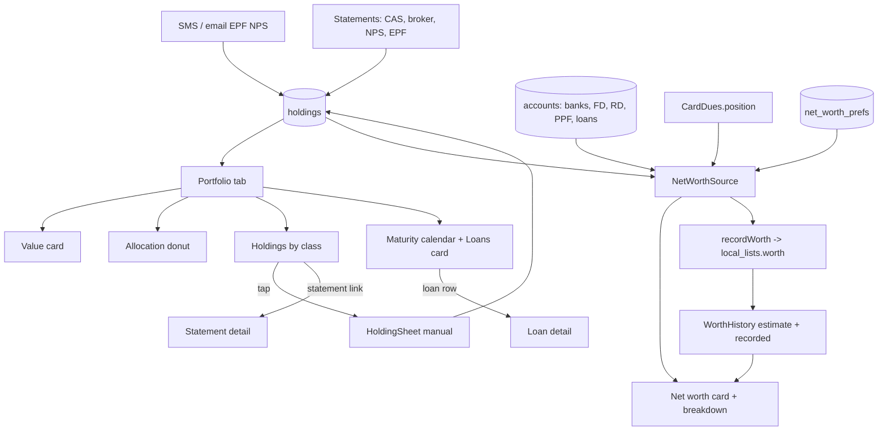

# Portfolio & Net Worth (Holdings, Allocation, Net Worth History, Maturity Calendar, HoldingSheet)

| Field | Value |
|---|---|
| Feature ID | F-16 |
| Status | In progress (Phase 3: data/domain layer and Portfolio tab UI done: net worth hero, history chart, allocation, holdings CRUD, maturities, exclusions; history estimate, MF order/NPS recording pipeline, loans card, sparklines and statement link pending) |
| Priority | P1 |
| Phase | 3 |
| Last Updated | 2026-10-22 |

## 1. Description

Portfolio answers "what do I own and what is it worth?". It shows the value of investments such as mutual funds, stocks, EPF, NPS, PPF, bonds, gold and deposits, how they are split, and a net worth figure with history. This gives the user one view of their wealth without entering everything by hand.

## 2. What This Feature Will Do

- Shows total value, amount invested, gain and return for holdings with a known cost.
- Shows the split of holdings and cash by asset class, and filters the list when a slice is tapped.
- Calculates net worth as assets minus liabilities.
- Lets the user exclude asset classes, liabilities or accounts from net worth.
- Shows a net worth history chart with 1M, 6M, 1Y, 3Y and All ranges.
- Shows a breakdown of net worth by bank, deposits, holdings, loans, card dues and others.
- Lists holdings grouped by asset class with a sparkline and percent gain.
- Lets the user add, edit and delete holdings by hand.
- Records holdings from statements and from EPF and NPS messages, merging sources into one holding.
- Lists FD, RD and PPF maturing in the next 12 months and highlights those due within 30 days.
- Shows a loans card that opens each loan.
- Links a holding to the statement it came from.
- Applies the Book filter, leaving out holdings for Business and business accounts for Personal.

### 2.1 Inputs

- Holdings read from statements (CAS, broker, app exports, NPS, EPF passbook) by [Statement Import](05_statement_import.md).
- EPF and NPS SMS and email.
- Manual holdings entered by the user.
- Account balances, loans and card dues from other features.
- User choices for exclusions, range and the Book filter.

### 2.2 Processing

1. Saves each holding into the existing holding it is the same investment as (same identifier, or the same fund or company under another key, see 3.10), keeping the previous value when it changes.
2. Adds up asset values and liabilities, leaving out what the user excluded.
3. Records one net worth point per day and estimates earlier points.
4. Groups holdings by asset class and builds the allocation split.
5. Finds deposits maturing within a year.

### 2.3 Outputs

- The Portfolio tab with its value, allocation, net worth, holdings and maturity cards.
- Stored: holdings, daily net worth history and exclusion choices.
- Net worth figures for the Home mini figure in [Dashboard (Home)](17_dashboard_home.md).
- Holding details linking back to statements.

### 2.4 Out of Scope

- Does not read statements or handle passwords; see [Statement Import](05_statement_import.md).
- Does not create deposit accounts or edit maturity; see [Accounts Management](13_accounts_management.md).
- Does not calculate credit card amounts; see [Credit Cards](14_credit_cards.md).
- Does not calculate loan amounts; see [Loans](15_loans.md).
- Does not own the Home net worth mini figure; see [Dashboard (Home)](17_dashboard_home.md).
- Does not set section order; see [Theming & Customisation](28_theming_customisation.md).
- Does not include newer ideas such as live prices, XIRR, Account Aggregator or goal planning.

## 3. Behaviour in Existing App

Sources: analysis Part A 2.6, 3.1, 3.2; Part B 1.5 (`holdings`), 2.6 (net-worth history); Part C 2.7, 2.8, 2.9; Kotlin `app/.../ui/invest/InvestmentsScreen.kt:137` (`InvestmentsRoute`), `PortfolioSections.kt` (`ValueCard`, `AllocationCard`, `NetWorthHeroCard`, `WorthBreakdown`, `CardLimits`, `HoldingsCard`, `MaturityCard` line 575, `PortfolioLoansCard`, `RANGES` line 269), `ui/ledger/NetWorth.kt` (`AssetClass` line 43, `PartKind`, `WorthPart`, `NetWorthSource`, `WorthHistory.MONTHS = 36` line 290), `settings/NetWorthPrefs.kt`, `settings/LocalLists.kt` (`recordWorth`), `shared/.../db/Investments.kt:62-81` (`HoldingEntity`), `shared/.../invest/InvestmentParser.kt`, `statement/Holding*.kt`, `EpfPassbook.kt`, `NpsStatement.kt`.

### 3.1 InvestmentsRoute (Portfolio tab)

- Top bar "Portfolio" with a newspaper icon opening `news` ([News, Support & Updates](31_news_support_updates.md)); FAB "Add a holding" opening `HoldingSheet`.
- Empty state `EmptyState(PieChart, "No investments yet", "EPF from EPFO SMS; funds and shares from CAS and broker statements. Or tap + to add one.")`.
- Sections follow `TabLayout.visible("portfolio")` in the saved order; defaults `value`, `allocation`, `networth`, `holdings`, `maturity` (customised in [Theming & Customisation](28_theming_customisation.md)):
  1. `value` - `ValueCard` hero: "PORTFOLIO VALUE", Invested / Gain / Return; note "Gain and return cover holdings with a purchase cost."
  2. `allocation` - donut + legend by `AssetClass`; tapping a slice filters the holdings list.
  3. `networth` - `NetWorthHeroCard` (also reused elsewhere): range `Segmented` 1M / 6M / 1Y / 3Y / All (`RANGES = 30, 182, 365, 1095 days, null`), change chip "▲/▼ amount . range", sparkline, `WorthBreakdown` (stacked bar of `WorthPart`s with folded pins), Assets / Liabilities totals, `CardLimits` folded list (credit card headroom, see [Credit Cards](14_credit_cards.md)); note "Estimated from transactions until {date}; recorded after."
  4. `holdings` - collapsible card per asset class (Equity, Retirement, Debt & FD, Gold, Cash, Others); rows with sparkline and % gain; tapping a holding opens the edit `HoldingSheet`; tapping an account row opens the Accounts tab.
  5. `maturity` - `MaturityCard`: `PortfolioLoansCard` ("Loans . {n}" with `−₹total`, rows open `loan/<id>`, see [Loans](15_loans.md)) and "Maturity calendar . 12 months".

### 3.2 `HoldingKind` and `AssetClass`

`HoldingKind` (UI chips order): MUTUAL_FUND, STOCK, ETF, EPF, NPS, PPF, BOND, GOLD, FD, OTHER (DB lists `EPF, MUTUAL_FUND, STOCK, ETF, NPS, PPF, BOND, GOLD, FD, OTHER`).

`AssetClass.of(kind)`: MUTUAL_FUND, STOCK, ETF => EQUITY ("Equity"); EPF, NPS, PPF => RETIREMENT ("Retirement"); FD, BOND => DEBT ("Debt & FD"); GOLD => GOLD ("Gold"); OTHER => OTHER ("Others"). `CASH` ("Cash") is the class for liquid bank balances. `PartKind`: BANK, DEPOSIT, HOLDING, LOAN, CARD_DUE, OTHERS.

### 3.3 HoldingSheet (add / edit)

Kind chips (`HoldingKind`), name, current value (required), amount invested, units; hint "A newer SMS or statement will update the figures again." for non-manual holdings; Delete on edit. Manual holdings get identifier `manual:<uuid>` and source `MANUAL`. Other fields keep their source (SMS, EMAIL, STATEMENT).

### 3.4 `holdings` table (`HoldingEntity`)

`id` PK auto; `kind`; `name`; `identifier` UNIQUE (ISIN, `EPF:<member>`, `NPS:<last4>[:T2]`, `MF:<scheme>`, `STOCK:<name>`, `US:<ticker>`, `AGG:INDMONEY:<class>`, `manual:<uuid>`); `units REAL?`; `valueMinor?`; `investedMinor?`; `asOf?`; `source` (SMS, EMAIL, STATEMENT, MANUAL); `note?`; `updatedAt`; `previousValueMinor? DEFAULT NULL`; `previousAsOf? DEFAULT NULL` (migration v5-6; used for EPF/NPS growth interpolation and sparklines). `holdings.record(rows, source)` does NOT simply upsert by identifier: it matches by identifier first, then by `HoldingMatch.same` (3.10, 3.11); the same id in one statement is summed by the statement parser before recording. (Corrected 2026-10-19.)

### 3.5 Net worth (`NetWorthSource.compute`, `NetWorth.kt`)

- Assets = liquid bank balances (> 0) + FD / RD balances + PPF + holdings by class (`AssetClass.of`). Liabilities = `|loan balances|` + sum of each credit card's `owedMinor` (from `CardDues.position`, see [Credit Cards](14_credit_cards.md); FEATURES.md says card dues are not counted, code counts them, see Open Questions).
- Book filter: business accounts excluded from the PERSONAL book, holdings excluded from the BUSINESS book.
- Exclusions: DataStore `net_worth_prefs` keys `excluded_classes` (set of `AssetClass.name`), `excluded_liabilities` (`LOANS`, `CARD_DUES`), `excluded_accounts` (ids as strings); everything counts by default; `NetWorthFilter.isDefault`.
- `WorthParts` feed the breakdown bar: BANK, DEPOSIT, HOLDING (per class), LOAN, CARD_DUE, OTHERS.

### 3.6 Net worth history

- Daily recorded point: when the all-books (assets, liabilities) pair changes and one is > 0, `recordWorth` upserts `{day, a, l}` for today (paise) into a JSON array in DataStore `local_lists.worth`, keeping the last 1,100 entries (~3 years).
- Before the first recorded day the history is estimated by walking back from the anchor (first recorded point or today): month-ends for 36 months (`WorthHistory.MONTHS = 36`) plus 26 weekly points, only from the first transaction day on; asset account flows are undone (credits/debits only; investments and transfers leave net worth unchanged), credit-card dues = anchor dues + (payments - spends) clamped >= 0; EPF/NPS growth between previous and latest value is spread linearly.
- Home shows "net worth ~30 days ago" = last point on or before today - 30 days, else the first point if >= 2 points ([Dashboard (Home)](17_dashboard_home.md)).

### 3.7 Maturity calendar (`MaturityCard`)

Accounts of type FD, RD, PPF with `maturityDay` in `[today, today + 365]`, sorted by date. Collapsible "Maturity calendar . 12 months" (collapsed by default, trailing count). Empty: "No deposits mature in the next 12 months." Row: account display name; subtitle "date . maturity action label (or type label)" (`CREDIT`, `RENEW_PRINCIPAL`, `RENEW_ALL`); months-left bar; amber when `days <= 30`; tap opens the Accounts tab. Maturity data comes from deposit messages / manual entry ([Accounts Management](13_accounts_management.md)); `AccountDao.closeMatured(today)` hides CREDIT-action deposits whose maturity has passed.

### 3.8 Holdings from statements (see [Statement Import](05_statement_import.md))

Order inside `StatementParser.holdings`: `HoldingSheet.read` (spreadsheet, `HoldingProfiles.platformOf(sender)`), EPF passbook (`EpfPassbook.isEpf`), text pass over lines (ISIN based), NPS Statement of Transaction (`NpsStatement.isNps`), else `HoldingTable.read` (Groww-style tables without ISINs, USD tables).

- CAMS/KFintech CAS: scheme line with `ISIN\s*:\s*([A-Z]{2}[A-Z0-9]{9}\d)` then `Closing Unit Balance`; units, NAV (`NAV on <date>: ...`), market value (`(market value|valuation) on <date>: INR x`), cost (`(total )?cost value ... x`) joined from up to 3 lines; value falls back to `round(units*nav*100)`; the same ISIN in two folios summed; scheme code prefix `^[A-Z0-9]{2,12}-` removed.
- NSDL/CDSL/broker tables: line with `\b([A-Z]{2}[A-Z0-9]{9}\d)\b` and no leading date; `HoldingLines.read` (trailing numeric run; folio dropped; `units x price = value` within `max(1.5% of value, Rs 1)`).
- `kindOf(isin, name)`: ETF (`\bETF\b|\bBEES\b`); `INF` prefix => MUTUAL_FUND; `bond|debenture|NCD|SGB` => BOND; `gold` => GOLD; else STOCK. Foreign ISINs convert at the statement's USD rate accepted only within `40.0..200.0`, else omitted. Only `valueMinor > 0` kept.
- `HoldingColumns` 17 fields (NAME, SYMBOL, ISIN, AMC, CATEGORY, SUB_CATEGORY, FOLIO, SOURCE, UNITS, AVG_PRICE, INVESTED, CURRENT, PRICE, GAIN, GAIN_PCT, XIRR, AS_OF) with synonyms; `HoldingSheet.read`: `current = CURRENT ?: units x PRICE ?: INVESTED + GAIN`, `invested = INVESTED ?: units x AVG_PRICE ?: current - gain` (> 0); ISIN `^[A-Z]{2}[A-Z0-9]{9}\d$`; id = ISIN else `STOCK:<name>` / `MF:<name>`; `number()` accepts `₹`, `Rs`, brackets as negative, `Cr/Dr`, ignores `%` and placeholders (`-`, NA, N/A, NIL, NULL).
- `HoldingProfiles`: 17 layouts, verified only for Groww MF, Groww stocks, Zerodha Console; unverified: Zerodha Coin, Kuvera, INDmoney, Paytm Money, ET Money, Upstox, Angel One, Dhan, ICICI Direct, HDFC Securities, Kotak Securities, MFCentral, CAMS, KFintech.
- `asOf` date: first of the first 120 lines matching `AS_ON` (`holdings|statement|valuation|portfolio|balances ... as on/of/at <date>`), accepted only within `[received - 6 months, received + 1 day]`, else `receivedAt`; stamped noon IST.
- Persisted with `holdings.record(r.holdings, "STATEMENT")` and a sidecar `<sha-of-key>.holdings` TSV (kind, name, id, units, value, invested, asOf) so the statement detail page can list them.
- Reconciliation (`HoldingsCheck`): stated Total Investments / Current value vs rows sum, mismatch `> 100 paise`; only a log warning, rows recorded regardless.

### 3.9 EPF and NPS from SMS / email (`InvestmentParser`)

- EPF SMS masked sample: `Dear Member, your passbook balance against MH/BAN/0012345/000/0001234 is Rs. 2,56,250/-. Contribution of Rs. ...` => holding id `EPF:<member id alnum uppercase>`, name `EPF ••<last4>`, kind EPF, value 2,56,250.00. Regex `passbook balance against <member> is INR x`, plus `EPF_ALT`; email trigger `EPF_MAIL = epfindia|epfo|umang|\bEPF\b.{0,40}\bpassbook\b|passbook\s+balance`.
- NPS SMS masked sample: `Your NPS a/c PRAN XXXXXXXX1234 holding value as on 23-09-2026 is Rs. 4,56,789.12.` => `NPS:1234` (tier II `NPS:1234:T2`). NPS mail `NPS_MAIL = \bPRAN\b|\bNPS\b|npscra|proteantech|npstrust|kfintech-cra|camsnps`. Contribution accepted only with context + contribution + done words and no NOT_DONE word (failed, pending, reminder, due, ...), date in `[received - 45d, received + 1d]`; key `nps|<last4>|<tier>|<date>|<amountMinor>`. NPS SMS headers `NSDLPR, NSDLCR, NSDLNP, PROTEN, PRTEAN, PROTNC, KFINTN, KFNCRA, KFCRA, KCRA, KCRANP, CAMSNP, CAMSCR`.
- `EpfPassbook` (PDF): needs `Employees' Provident Fund|EPFO|member passbook` and `Member ID`; value = sum of last up to 3 figures of the "Closing Balance" row; invested = value minus sum of "Int. Updated" rows; id `EPF:<member id>` (same key as the SMS). `NpsStatement`: needs `PRAN` and NPS words in first 60 lines; one holding per tier; `invested = contribution - withdrawal` else `value - gain`.
- INDmoney email summary creates aggregate holdings `AGG:INDMONEY:<US|MF|STOCKS>`, replaced once real holdings are known. MF order emails produce an INVESTMENT transaction (unless the bank debit already exists) AND update the fund's holding (units and invested added, value = units x NAV; see 3.11 `recordMfOrder`), with key dedupe `identifier|date|amountMinor|units` ([Statement Import](05_statement_import.md)). NPS contributions: see 3.12. (Corrected 2026-10-19: previously said "not holdings".)

### 3.10 HoldingMatch: when two holdings are one investment (`shared/.../repo/HoldingMatch.kt`)

A CAS (ISIN), a broker table (`MF:<scheme>`, `STOCK:<name>`) and MF order emails (`MF:<scheme>`) name one fund differently; one copy is kept so each investment counts once. `Key(kind, identifier, name)`.

- `normalisedId(id)` (HoldingMatch.kt:38): an id starting `EPF:` and not `EPF:default` becomes `EPF:` + `epfMemberKey(rest)` (letters/digits only, uppercase; `InvestmentParser.kt:101`); so `MH/BAN/0012345/000/0001234` equals `MHBAN00123450000001234`. `EPF_DEFAULT = "EPF:default"` is the id of an EPF balance whose message gave no member id (`InvestmentParser.kt:104`).
- `isAggregate(id)` = prefix `AGG:` (`PortfolioSummary.AGGREGATE`); `aggregateClass(id)` = text after the last `:` (`MF`, `STOCKS`, `US`) (HoldingMatch.kt:42, 130).
- `family(kind)` (HoldingMatch.kt:51-58): MUTUAL_FUND {fund}; ETF {fund, stock}; STOCK and BOND {stock}; GOLD {stock, fund}; any other kind {its own name}.
- `same(a, b)` (HoldingMatch.kt:61-74), in order: (1) normalised ids equal => true; (2) either is an aggregate => false; (3) families do not intersect => false; (4) both ids are ISINs (`^[A-Z]{2}[A-Z0-9]{9}\d$`) => false; (5) kind EPF => true only if either id is `EPF:default`; (6) kind NPS, PPF or FD => false; (7) exactly one id starts `US:` and neither is an ISIN => false; (8) else `sameName(a.name, b.name)`.
- `words(name)` (HoldingMatch.kt:45-49): lower case, `&` -> " and ", non `[a-z0-9 ]` -> space, split on space, drop empties and STOP words, as a set.
- STOP (ignored words, HoldingMatch.kt:20-23): direct, dir, plan, growth, gr, g, option, opt, fund, funds, the, scheme, dp, gw, mf, mutual, ltd, limited, inc, corp, corporation, co, company, equity, shares, share, eq, sh, of, and, a, nse, bse.
- MARKERS (HoldingMatch.kt:26): regular, reg, idcw, dividend, div, payout, reinvestment, bonus, dvr, pp, partly, paid, segregated. The marker words present in each name must be identical sets, else different investments.
- AMC_WORDS (HoldingMatch.kt:29-35): ppfas, hdfc, icici, prudential, sbi, axis, kotak, mahindra, nippon, india, aditya, birla, sun, life, uti, dsp, tata, mirae, asset, franklin, templeton, invesco, motilal, oswal, quant, canara, robeco, edelweiss, hsbc, idfc, bandhan, pgim, baroda, bnp, paribas, lic, union, jm, financial, navi, groww, whiteoak, capital, samco, zerodha, helios, nj, trust, iti, quantum, manulife, shriram, amc, investment, managers, management, company, reliance, l, t, lt, 360, one, old, bridge, trustee.
- `sameName(a, b)` (HoldingMatch.kt:77-86): false if either word set is empty; false if marker sets differ; true if word sets are equal; else with `small` the smaller set and `large` the larger: false unless `small.size >= 2` and `large` contains all of `small`; then true only if every extra word in `large - small` is in AMC_WORDS ("PPFAS Mutual Fund - Parag Parikh Flexi Cap" matches "Parag Parikh Flexi Cap").
- `preferredId(a, b)` (HoldingMatch.kt:89-95): `a` if ISIN; else `b` if ISIN; else if `a` is `EPF:default` => `normalisedId(b)`; if `b` is `EPF:default` => `normalisedId(a)`; else `normalisedId(a)`.
- `duplicates(rows, key)` (HoldingMatch.kt:101-110): walk rows in order, skip aggregates, put each row in the first group whose first member is `same` as it, else start a group; return groups with size > 1.
- `aggregatesCovered(itemised)` (HoldingMatch.kt:116-127): for each non-aggregate key: identifier starts `US:` or is an ISIN not starting `IN` => `US`; kind MUTUAL_FUND => `MF`; kind STOCK or ETF => `STOCKS`. An aggregate whose class is in this set is redundant.

### 3.11 HoldingRepository: `record`, `dedupe`, `recordMfOrder` (`shared/.../repo/HoldingRepository.kt`)

`record(snapshots, source)` (:24-71), per snapshot `s`, reading all holdings fresh each time:

1. If `s` is an aggregate and its class is in `aggregatesCovered(all holdings)`, skip it (:32-34).
2. `existing` = holding with identical identifier, else `match(...)` (:97-100): among holdings written by this batch's complement (rows already written or updated by this batch are excluded, so two similar scheme names in one statement never merge; :29, :35), drop MANUAL source and `manual:` ids, sort by `asOf` descending, first for which `HoldingMatch.same` holds.
3. No `existing`: insert with `identifier = normalisedId(s.identifier)`, `note = s.platform`, given `source` (:36-44).
4. Else id = `preferredId(existing.identifier, s.identifier)`, but kept as `existing.identifier` if another row already has that id (:47-48).
5. If `existing.asOf > s.asOf` (older snapshot): only change the identifier if it improved; ignore the figures (:49-52).
6. Else update: `newer = existing.asOf < s.asOf`; `moved = s.value != null && s.value != existing.value && newer`; `invested = s.investedMinor ?: (s.contributionMinor if newer, added to existing.invested) ?: existing.invested` (an EPFO SMS gives balance and the month's contribution, not total invested); `units = s.units ?: existing.units`; `value = s.value ?: existing.value`; `asOf = s.asOf`; `source` = the new source; `note` = existing note if existing source is MANUAL, else `s.platform ?: existing.note`; if `moved`, `previousValueMinor/previousAsOf` take the old value/asOf, else stay (:53-66). A name the user typed is not overwritten (name is not copied).
7. After the loop, `dedupe()` runs (:69).

`dedupe()` (:78-92), also run on every app start (`HisaabApplication.kt:66`, `appScope.launch { runCatching { holdings.dedupe() } }`): over holdings excluding source MANUAL and `manual:` ids, for each `HoldingMatch.duplicates` group keep `maxWith(statement source first, then latest asOf)`; delete the rest; set the kept row's identifier to `preferredId` folded over the group's ids if it differs. Then delete every aggregate whose class is in `aggregatesCovered`. Returns rows removed.

`recordMfOrder(order, at)` (:109-138), returns false when nothing changed:

- `existing` = `byIdentifier(order.identifier)` else `byFundName` (`match` over all holdings with Key(MUTUAL_FUND, identifier, schemeName), :171-172). `order.identifier` = `MF:` + normalised scheme (05 section 3.9 `normaliseScheme`).
- No existing: insert MUTUAL_FUND, `units = order.units`, `value = round(units x nav x 100)` if both known else `order.amountMinor`, `invested = amountMinor`, `asOf = at`, source EMAIL, note = platform and `folio <n>` joined with " · " (:115-122). Returns true.
- Existing with source STATEMENT and `existing.asOf >= at`: return false (the CAS already counts it) (:124).
- `units = existing.units + order.units` if the order has units, else existing units; `value = round(units x nav x 100)` when units and nav are known and (existing had units or no value), else `existing.value + amount`; `invested = existing.invested + amount` if invested known, else `amountMinor` only when existing has no value or existing source is EMAIL (a statement that gave value without cost keeps invested unknown) (:125-131).
- Update `asOf = max(existing.asOf, at)`, source EMAIL unless MANUAL, `previousValueMinor/previousAsOf` = existing value/asOf always (:132-136).

### 3.12 NPS contributions (`shared/.../repo/NpsContributions.kt`; detection rules in 3.9 and [Transaction Parsing Engine](06_transaction_parsing_engine.md))

- `read(body, sender, receivedAt, messageId, source, subject)` (:35-42): `InvestmentParser.npsContribution(body, receivedAt)`; if none, record `npsValue` (a holding value) via `holdings.record(..., source.name)` and return null; else `contribute`.
- `contribute` (:45-59): `claim(c.key)` first; returns null if already seen (same contribution by SMS and email, or a rescan). Key `nps|<last4>|<tier>|<date>|<amountMinor>`. `at` = `receivedAt` if the contribution date equals the received date (IST), else the contribution date at 12:00 IST. Calls `recordNpsContribution(c, at)`. The INVESTMENT transaction is suppressed if `findPotentialDuplicates(amount, date - 4 days 00:00 IST, date + 2 days 00:00 IST)` has any DEBIT or INVESTMENT.
- `claim` (:70-77): SharedPreferences file `nps-contributions`, string set `applied`; if the key is present return false; else add it, and if the set exceeds `MAX_KEYS = 500` keep the last 500 of its list (a Set, so the order is the platform's iteration order, not strictly insertion), return true. Synchronized.
- Generated transaction (:61-67): amount = contribution, currency INR, type INVESTMENT, category INVESTMENT, bankName "NPS", accountLast4 null, accountKind ACCOUNT, merchant "NPS Tier II" if tier 2 else "NPS Tier I", no UPI id or reference, channel OTHER, no balance or limit, `transactionTime = at`, `hasExplicitTime = (at == receivedAt)`, source = SMS or EMAIL as received, `messageTimestamp = receivedAt`, confidence 0.8, hash = `TransactionHasher.hash(amount, INVESTMENT, null, c.date, null)`; message id `<messageId>#nps`.
- `recordNpsContribution(c, at)` (HoldingRepository.kt:145-168), returns false when nothing changed: no existing holding (by exact identifier `NPS:<last4>[:T2]`): insert NPS, name `InvestmentParser.npsName(last4, tier)`, value = invested = amount, units null, asOf `at`, source SMS, return true. Existing with source STATEMENT and `asOf >= at`: false. Else `newer = at > existing.asOf`; `invested = existing.invested + amount`, or `amount` only if existing has no value and no invested; `value = existing.value + amount` only if newer; `asOf = at` only if newer; source SMS if newer and not MANUAL; if newer, previous value/asOf shift as in `record`.

## 4. User Stories

- US-16-01: As a user, I see the total value of my investments, what I invested and my gain and return.
- US-16-02: As a user, I see how my wealth splits across equity, retirement, debt, gold, cash and others.
- US-16-03: As a user, I see my net worth now and over time, and can choose what counts.
- US-16-04: As a user, my EPF, NPS, funds and shares update automatically from SMS, email and statements.
- US-16-05: As a user, I can add or correct a holding by hand.
- US-16-06: As a user, I see which deposits mature in the next year.
- US-16-07: As a user, I can get from a holding to the statement that produced it.

## 5. Functional Requirements (FR-16-01 ...)

- FR-16-01: The Portfolio tab shall render the five sections in the saved order, hiding those hidden in Customise, with the empty state when no holdings, deposits or accounts exist.
- FR-16-02: `ValueCard` shall show total value, invested, gain and return over holdings that have a purchase cost, with the stated note.
- FR-16-03: Allocation shall group holdings (and liquid cash) by `AssetClass` and a tapped slice shall filter the holdings list.
- FR-16-04: Net worth shall equal assets minus liabilities per 2.5 with book filter and the three exclusion sets.
- FR-16-05: Net worth history shall record one point per day (last 1,100 kept) and estimate earlier points per 2.6 with the 1M / 6M / 1Y / 3Y / All range control.
- FR-16-06: `WorthBreakdown` shall show parts BANK, DEPOSIT, HOLDING, LOAN, CARD_DUE, OTHERS and Assets / Liabilities totals; CardLimits shall list card headroom without counting it.
- FR-16-07: The holdings card shall group by asset class, show sparkline and % gain per row, open `HoldingSheet` on tap and the Accounts tab for account rows.
- FR-16-08: HoldingSheet shall add, edit and delete holdings with kind, name, required current value, invested and units; manual id `manual:<uuid>`, source MANUAL; show the "newer SMS or statement will update" hint for non-manual.
- FR-16-09: Recording holdings shall update the existing holding that is the same investment (identical identifier, else `HoldingMatch.same`, per 3.10-3.11), ignore snapshots older than the holding's `asOf`, keep `previousValueMinor`/`previousAsOf` when the value changes, never merge two rows written by one batch, never touch MANUAL rows by matching, and sum duplicate ids within one statement. (Corrected: was "upsert by identifier".)
- FR-16-10: EPF and NPS SMS/email/statement parsing shall use the same identifiers (`EPF:<member>`, `NPS:<last4>[:T2]`) so sources merge into one holding.
- FR-16-11: Statement holdings shall be extracted per 2.8 (ISIN rules, `kindOf`, USD rate limit, `asOf` window) and persisted with the sidecar TSV.
- FR-16-12: The maturity card shall list FD/RD/PPF with maturity in the next 365 days, amber at <= 30 days, with the empty text.
- FR-16-13: The Portfolio loans card shall show loans count and total with rows opening `loan/<id>`.
- FR-16-14: Net worth exclusions shall persist in `net_worth_prefs` and be editable from the Portfolio tab / Customise screen.
- FR-16-15: A holding sourced from a statement shall link to its statement ([Statement Import](05_statement_import.md)) and the empty state shall mention statements and SMS.
- FR-16-16: Business book shall exclude holdings; Personal book shall exclude business accounts.
- FR-16-17: Cross-source identity shall follow `HoldingMatch` exactly (3.10): EPF id normalisation, kind families, ISIN-vs-ISIN never equal, NPS/PPF/FD only by id, US vs Indian, STOP / MARKERS / AMC_WORDS name rules, `preferredId` order.
- FR-16-18: `dedupe()` shall run after every `record` and once at every app start; it keeps the statement copy, else the newest, under the preferred id, never touches MANUAL rows, and removes aggregates covered by itemised holdings; aggregate snapshots shall be skipped when their class is already covered.
- FR-16-19: `recordMfOrder` shall add units and invested to the fund holding, set value = units x NAV (else value + amount), skip when a statement holding is dated on or after the order, per 3.11.
- FR-16-20: `recordNpsContribution` shall add the contribution to invested and (when newer) to value, per 3.12, and skip when a statement is dated on or after it.
- FR-16-21: NPS contributions shall be claimed once via the `nps-contributions` / `applied` key set (cap 500) and shall create an INVESTMENT transaction (merchant "NPS Tier I/II", confidence 0.8) unless a DEBIT/INVESTMENT of the same amount exists in [date - 4 d, date + 2 d].

## 6. Non-Functional Requirements (performance, battery, privacy, offline)

- Offline; no live prices (values are as-of the statement/SMS date shown in the UI).
- Net worth recompute only when accounts, holdings, loans or card positions change; history array bounded (1,100 points); history estimate computed lazily on the tab and cached per day.
- Privacy: amounts follow `hide_amounts`; holdings contain no credentials; sidecar TSV stored in the app's private directory.
- Smooth scrolling with sparklines (pre-computed point lists, no per-frame computation).

## 7. UI / Screens & User Flow (screen list + flow diagram)

| # | Screen | Source | Notes |
|---|---|---|---|
| 1 | Portfolio tab (all sections) | `ui/invest/InvestmentsScreen.kt:137`, `PortfolioSections.kt` | value, allocation, networth, holdings, maturity |
| 2 | Add/edit holding (HoldingSheet) | `InvestmentsScreen.kt` (`HoldingSheet`) | Kind chips, name, value, invested, units, Delete |
| 3 | Net worth card (range, breakdown, card limits) | `PortfolioSections.kt` (`NetWorthHeroCard`, `WorthBreakdown`, `CardLimits`) | Section of screen 1 |
| 4 | Maturity calendar + Loans card | `PortfolioSections.kt:575` | Section of screen 1 |
| 5 | Statements list / detail | `ui/invest/StatementsScreen.kt:167`, `StatementDetailScreen.kt:118` | Owned by [Statement Import](05_statement_import.md) |



Reference GIFs:

-  (Status: Pending, not yet captured)
-  (Status: Pending, not yet captured)

## 8. Data Models (Dart entities + fields + types)

```dart
enum HoldingKind { mutualFund, stock, etf, epf, nps, ppf, bond, gold, fd, other }
enum HoldingSource { sms, email, statement, manual }
enum AssetClass { equity, retirement, debt, gold, cash, other }   // labels: Equity, Retirement, Debt & FD, Gold, Cash, Others
enum PartKind { bank, deposit, holding, loan, cardDue, others }
enum LiabilityKind { loans, cardDues }

@freezed class Holding {
  int id; HoldingKind kind; String name; String identifier; double? units; int? valueMinor; int? investedMinor;
  DateTime? asOf; HoldingSource source; String? note; DateTime updatedAt; int? previousValueMinor; DateTime? previousAsOf;
  // gainMinor = valueMinor - investedMinor (only when invested > 0); returnPct = gain / invested
}

@freezed class WorthPart {
  String key; String label; int amountMinor; bool liability; PartKind kind; AssetClass? assetClass;
}

@freezed class NetWorth {
  int assetsMinor; int liabilitiesMinor; int get netMinor => assetsMinor - liabilitiesMinor;
  List<WorthPart> parts; List<CardLimit> cards; List<WorthPoint> history; bool estimatedBeforeRecorded; DateTime? recordedFrom;
}

@freezed class WorthPoint { DateTime day; int assetsMinor; int liabilitiesMinor; }   // paise; stored as {day, a, l}

@freezed class NetWorthFilter {
  Set<String> excludedClasses; Set<LiabilityKind> excludedLiabilities; Set<int> excludedAccountIds;
  bool get isDefault => excludedClasses.isEmpty && excludedLiabilities.isEmpty && excludedAccountIds.isEmpty;
}

@freezed class MaturityItem { int accountId; String name; DateTime date; String label; int daysLeft; int monthsLeft; bool soon; }

@freezed class PortfolioSummary { int valueMinor; int investedMinor; int gainMinor; double? returnPct; Map<AssetClass, int> byClass; }
```

## 9. Database Tables / Changes

```dart
class Holdings extends Table {
  IntColumn  get id => integer().autoIncrement()();
  TextColumn get kind => text()();                       // EPF|MUTUAL_FUND|STOCK|ETF|NPS|PPF|BOND|GOLD|FD|OTHER
  TextColumn get name => text()();
  TextColumn get identifier => text().unique()();        // ISIN | EPF:<member> | NPS:<last4>[:T2] | MF:<scheme> | STOCK:<name> | US:<ticker> | AGG:INDMONEY:<class> | manual:<uuid>
  RealColumn get units => real().nullable()();
  IntColumn  get valueMinor => integer().nullable()();
  IntColumn  get investedMinor => integer().nullable()();
  IntColumn  get asOf => integer().nullable()();         // epoch ms (noon IST for statements)
  TextColumn get source => text()();                     // SMS|EMAIL|STATEMENT|MANUAL
  TextColumn get note => text().nullable()();
  IntColumn  get updatedAt => integer()();
  IntColumn  get previousValueMinor => integer().nullable()();
  IntColumn  get previousAsOf => integer().nullable()();
}

class NetWorthPoints extends Table {                    // replaces the DataStore JSON array local_lists.worth
  IntColumn get day => integer()();                      // epoch day, PK
  IntColumn get assetsMinor => integer()();
  IntColumn get liabilitiesMinor => integer()();
  @override Set<Column> get primaryKey => {day};
}
```

Key-value (shared_preferences, mirrors old DataStores): `net_worth_prefs.excluded_classes`, `.excluded_liabilities` (`LOANS`, `CARD_DUES`), `.excluded_accounts`; `tab_layout.order_portfolio`, `tab_layout.hidden` ("portfolio:<key>"). Old `local_lists.worth` = JSON array of `{day, a, l}` (import path). Accounts columns used: `accountType`, `latestBalanceMinor`, `manualBalanceMinor`, `maturityDay`, `maturityAction`, `usage`, `hidden`, `mergedIntoId` ([Accounts Management](13_accounts_management.md)). `statements` rows and the sidecar `<sha>.holdings` TSV belong to [Statement Import](05_statement_import.md). Index: UNIQUE `identifier`.

## 10. Business Rules & Logic (regex, parsing rules, algorithms, thresholds)

Constants: history range days 30 / 182 / 365 / 1095 / all; `WorthHistory.MONTHS = 36` month-ends + 26 weekly points; recorded history cap 1,100 entries; maturity window 365 days, "soon" at <= 30 days; USD rate accepted `40.0..200.0`; holdings mismatch tolerance 100 paise; `asOf` window `[received - 6 months, received + 1 day]`; EPF/NPS date window `[received - 45d, received + 1d]`; `MAX_ORDER_KEYS = 500`; `ISIN = ^[A-Z]{2}[A-Z0-9]{9}\d$`.

Algorithms:

```text
netWorth(book, filter):
  assets  = sum(liquid bank balances > 0 not excluded)            // class CASH
          + sum(FD/RD/PPF balances)                                // PPF also as holding kind -> avoid double count by account vs holding id
          + sum(holdings value by class not excluded, book != BUSINESS)
  liabilities = (LOANS not excluded) sum(|loan balance|) + (CARD_DUES not excluded) sum(card.owedMinor)
recordWorth(now, assets, liabilities):
  if (assets, liabilities) differs from today's point and (assets > 0 or liabilities > 0): upsert(day=today)
  trim to last 1100
history(range): recorded points  +  estimate before first recorded day (walk back, undo flows)
holdingGain(h) = (h.invested != null && h.invested > 0) ? h.value - h.invested : null
returnPct      = gain / invested * 100
```

Worked examples (masked):

1. Holdings: MF `MF:PARAG PARIKH FLEXI CAP` value 1,20,000 invested 1,00,000; STOCK `INE002A01018` value 50,000 invested 40,000; EPF `EPF:MHBAN00123450000001234` value 2,56,250 (no invested) => Portfolio value 4,26,250; invested 1,40,000 (holdings with cost only); gain 30,000; return 21.4%; allocation Equity 1,70,000, Retirement 2,56,250.
2. Net worth: bank 80,000 + FD 2,00,000 + holdings 4,26,250 = 7,06,250; liabilities loan 3,00,000 + card dues 12,345 = 3,12,345 => net 3,93,905. Excluding CARD_DUES leaves liabilities 3,00,000 => net 4,06,250.
3. History estimate: anchor today; earlier month-end = anchor assets minus later credits plus later debits on liquid accounts; investment and transfer rows do not change it.
4. EPF merge: SMS gives `EPF:MH/BAN/0012345/000/0001234` normalised to alnum uppercase id; the passbook PDF gives the same id => one holding updated by the later `asOf`.
5. Maturity: FD maturing in 20 days => amber row; in 8 months => normal.

## 11. Platform / Native Requirements (permissions, channels, background work)

- None specific to the screen. EPF/NPS SMS arrive through the SMS pipeline ([SMS Ingestion](02_sms_ingestion.md)); statements through file picker / email attachments.
- Daily point recording runs whenever the portfolio screen, Home or the ingest worker recomputes net worth (no separate alarm); optionally call it from the daily `workmanager` job so history has a point even if the app is not opened.
- Charts: `fl_chart` (donut, sparkline, line). Sidecar TSV in app-private storage.

## 12. Dependencies (other features → link to their memory file; packages)

- [Statement Import](05_statement_import.md): holdings extraction, statements list/detail, sidecar TSV. [SMS Ingestion](02_sms_ingestion.md), [Email Ingestion](03_email_ingestion.md): EPF/NPS/MF messages.
- [Accounts Management](13_accounts_management.md): bank, deposit, loan accounts, maturity. [Credit Cards](14_credit_cards.md): card dues and limits. [Loans](15_loans.md): loan balances and card.
- [Dashboard (Home)](17_dashboard_home.md): net worth ~30 days ago. [Theming & Customisation](28_theming_customisation.md): portfolio section order/hide, net worth inclusions. [News, Support & Updates](31_news_support_updates.md): news icon.
- [Search & Filters](20_search_filters.md): Book filter. [Transaction Parsing Engine](06_transaction_parsing_engine.md): investment parsers.
- Packages: `drift`, `riverpod`, `freezed`, `fl_chart`, `go_router`, `shared_preferences`, `intl`, `uuid`.

## 13. Folder Location (lib/features/<name>/...)

```text
lib/features/portfolio/
  data/datasources/holding_dao.dart, net_worth_point_dao.dart, net_worth_prefs_store.dart
  data/repositories/portfolio_repository_impl.dart
  domain/entities/holding.dart, asset_class.dart, worth_part.dart, net_worth.dart, net_worth_filter.dart, maturity_item.dart
  domain/usecases/compute_net_worth.dart, record_worth.dart, estimate_worth_history.dart, summarise_portfolio.dart,
                  record_holdings.dart, save_manual_holding.dart, delete_holding.dart, maturity_items.dart
  presentation/portfolio_screen.dart, widgets/value_card.dart, allocation_card.dart, net_worth_card.dart,
               worth_breakdown.dart, card_limits.dart, holdings_card.dart, maturity_card.dart, portfolio_loans_card.dart
  presentation/holding_sheet.dart
  presentation/providers/portfolio_provider.dart, net_worth_provider.dart
lib/core/parser/investment_parser.dart      // EPF/NPS SMS+email (shared with statements)
```

## 14. Edge Cases & Error Handling

- No holdings and no accounts: `EmptyState(PieChart, "No investments yet", ...)`.
- Holdings without purchase cost: counted in value but not in gain/return (note displayed).
- Holding with `valueMinor` null/0: not listed (only `valueMinor > 0` are kept by statements; manual requires a value).
- Foreign holdings without a USD rate: omitted by the statement parser, nothing shown.
- Same ISIN in two folios: summed. Newer statement/SMS replaces older figures (by `asOf`); manual holdings are overwritten only by the user.
- PPF counted once: as a deposit account balance OR a PPF holding, not both (Open Question 4).
- History with fewer than 2 points: sparkline hidden; "net worth ~30 days ago" absent.
- Estimated history before first transaction day: not generated.
- Hide amounts: all amounts masked as `₹••••`.
- Excluded account counts neither as asset nor liability.
- Maturity date in the past: not listed (closed deposits hidden by `closeMatured`).

## 15. Test Cases (unit / widget / integration + sample fixtures)

Unit:

- TC-16-01 (FR-16-02, FR-16-03): portfolio summary, gain/return only for rows with cost, allocation by class.
- TC-16-02 (FR-16-04, FR-16-16): net worth with book filters and the three exclusion sets (worked example 2).
- TC-16-03 (FR-16-05): `recordWorth` upsert-once-a-day, trim to 1,100; history estimate walking back (flows undone, investment/transfer ignored, card dues clamped >= 0, EPF/NPS linear growth).
- TC-16-04 (FR-16-09): record holdings upsert, previous value shift, duplicate-id sum.
- TC-16-05 (FR-16-10, FR-16-11): CAS fixture (ISIN, closing units, NAV, value, cost), NSDL table line, `kindOf` table (ETF/INF/bond/gold/stock), USD rate bounds, `asOf` window.
- TC-16-06 (FR-16-10): EPF SMS and NPS SMS fixtures to identifiers and values; contribution acceptance rules; EPF passbook closing balance row.
- TC-16-07 (FR-16-12): maturity list, 365-day window, amber threshold, ordering.
- TC-16-08 (FR-16-14): `net_worth_prefs` round trip and `isDefault`.
- TC-16-14 (FR-16-17): `HoldingMatch.same` table: two different ISINs false; ISIN fund vs `MF:` same name true; "Regular" vs "Direct" false; IDCW vs Growth false; "PPFAS Mutual Fund Parag Parikh Flexi Cap" vs "Parag Parikh Flexi Cap" true; single-word small set false; US vs Indian same name false; `EPF:default` vs member id true, two members false; NPS tiers false; aggregate never same.
- TC-16-15 (FR-16-09, FR-16-18): record older snapshot ignored; manual row untouched; two similar schemes in one batch stay separate; dedupe keeps the statement copy and the ISIN id; covered aggregate removed and skipped.
- TC-16-16 (FR-16-19): `recordMfOrder` new fund, existing fund with units and NAV, statement newer returns false, statement without cost leaves invested null.
- TC-16-17 (FR-16-20, FR-16-21): NPS contribution new/existing/stale; second identical contribution not applied; 501st key trims to 500; bank debit within [-4 d, +2 d] suppresses the transaction.

Widget:

- TC-16-09 (FR-16-01): section order and hide, empty state.
- TC-16-10 (FR-16-05, FR-16-06): range Segmented changes sparkline and change chip; breakdown parts and card limits not counted.
- TC-16-11 (FR-16-07, FR-16-08): holdings tap opens HoldingSheet; add/edit/delete; validation (value required); non-manual hint.

Integration:

- TC-16-12 (FR-16-10): ingest EPF SMS then the passbook PDF fixture; one holding, later `asOf` wins.
- TC-16-13 (FR-16-13): loan on the Loans card opens loan detail.

Fixtures: Part B 8 sample 21 (EPF, NPS, MF order), CAS excerpt (masked ISIN `INF000X00000`), Groww stocks sheet header row, EPF passbook closing balance row, net worth worked examples as JSON.

## 16. Acceptance Criteria

- AC-16-01: Value, invested, gain, return and allocation match the examples (FR-16-02, FR-16-03; TC-16-01).
- AC-16-02: Net worth and history follow 2.5-2.6 including exclusions and ranges (FR-16-04..06, FR-16-14, FR-16-16; TC-16-02, TC-16-03, TC-16-08, TC-16-10).
- AC-16-03: Holdings are recorded and merged correctly from statements, SMS, MF order and NPS emails and manual entry (FR-16-08..11, FR-16-17..21; TC-16-04..06, TC-16-11, TC-16-12, TC-16-14..17).
- AC-16-04: Maturity calendar and loans card behave as specified (FR-16-12, FR-16-13; TC-16-07, TC-16-13).
- AC-16-05: Tab sections, empty state and statement links work (FR-16-01, FR-16-07, FR-16-15; TC-16-09, TC-16-11).

## 17. Open Questions

1. FEATURES.md says credit cards are "listed but not counted"; code counts `owedMinor` as a liability (see [Credit Cards](14_credit_cards.md) Open Question 1).
2. Net worth history comes from a partial read (`AssetClass.of`, `Book`, `LedgerMath.rupees` not read; Part B Open Question 5); the exact asset-class assignment of `CASH` (bank balances) and deposits needs confirming against `NetWorthSource`.
3. No user-visible holdings reconciliation UI exists (mismatch is only logged); should Flutter surface it?
4. Possible double counting of PPF as a deposit account and as a PPF holding.
5. `HoldingColumns.SYNONYMS` and `HoldingProfiles.ALL` header lists were not enumerated (Part B Open Question 10); port from source with the Statement Import feature.
6. Whether history points should be stored in Drift (section 9) or kept as a DataStore JSON array for backup compatibility.
7. "Gain and return cover holdings with a purchase cost" - behaviour when invested is 0 vs null.
8. Maturity row tap goes to the Accounts tab, not to the account detail; confirm.
9. Holding sparkline source (`previousValueMinor` vs history) was not fully captured.

## 18. Implementation Notes

Phase 3 data/domain layer (no UI). Tables `holdings`, `net_worth_points` (schema v3, section 9). Exclusions persist as settings keys `nw_excluded_classes|liabilities|accounts` (not `net_worth_prefs`). Code: `lib/features/portfolio/domain/{asset_class,holding,holding_match,holding_merge,holding_repository,net_worth,compute_net_worth,net_worth_repository,net_worth_service,portfolio_summary,maturity_items}.dart`, `data/{holding_repository_impl,net_worth_repository_impl}.dart`; providers in `lib/app/di/phase3_providers.dart`.

FR status done: FR-16-02 (`summarisePortfolio`), 03 (allocation `byClass`), 04 (`computeNetWorth`), 05 (record: one point per day, last 1,100 kept; estimate NOT done), 06 (parts), 08 (add/edit/delete manual), 09, 12 (`maturityItems`), 14 (prefs), 16, 17 (`HoldingMatch`), 18 (`dedupe` after every `record`). Pending: FR-16-01, 07, 10, 11, 13, 15 (UI, parsers), 19..21 (`recordMfOrder`, NPS contributions), history estimate (`estimate_worth_history`), app-start `dedupe()` call.

APIs for UI agents:
- `HoldingRepository`: `record(List<HoldingSnapshot>, HoldingSource) -> int`, `dedupe() -> int`, `addManual({kind, name, valueMinor, investedMinor, units, at}) -> id`, `edit(id, {kind, name, valueMinor, investedMinor, units, at})`, `delete(id)`, `byId`, `list()`, `watch()`.
- `NetWorthService.watch({Book book}) -> Stream<NetWorth>` (`netWorthProvider` for all books), `recordToday(epochDay)`; `computeNetWorth({accounts, holdings, cards, filter, book})` is pure. `NetWorth{assetsMinor, liabilitiesMinor, netMinor, parts, cards}`.
- `NetWorthRepository.recordPoint(day, a, l)`, `watchPoints({sinceDay})`, `points`; `NetWorthPrefsRepository.watch/read/save(NetWorthFilter)`.
- `summarisePortfolio(holdings, {cashMinor})`, `maturityItems(accounts, maturityDays, today)` (the accounts domain has no `maturityDay` yet, so the caller passes a map).
Deviations: PPF deposit accounts are skipped when a PPF holding exists (no double count); Business book excludes holdings only, Personal book excludes business accounts, as written in FR-16-16; `NetWorthFilter` uses enums not strings.
Tests: `test/features/phase3/phase3_repositories_test.dart` (holdings, summary, net worth, prefs, history cap); `test/features/portfolio/portfolio_screen_test.dart` (empty, populated light/dark, add manual, delete, masked).

UI (2026-10-21): `presentation/{portfolio_screen,holding_sheet,exclusions_sheet,net_worth_chart,holding_labels}.dart`, wiring `lib/app/di/portfolio_providers.dart` (`holdings`, `netWorthPoints`, `netWorthFilter`, `maturities`, `portfolioSync`). `/portfolio` tab: net worth hero with change over the range (masked by hide-amounts), fl_chart line with 1M/6M/1Y/3Y/All chips, allocation bar with legend, maturities (amber within 30 days), holdings grouped by kind, add/edit/delete sheet, include/exclude sheet. `portfolioSync` (via `AppLifecycleGate`) runs `dedupe()` once per run and `recordToday` at start and resume. FR-16-01, 03, 05 (chart), 06 (hero totals only), 08, 12, 14 UI done.
Deferred UI: Book filter chips (FR-16-16 UI), breakdown by bank/deposit/loan (FR-16-06 full), sparkline per holding, tap-slice filter, loans card, statement link (FR-16-13), donut (bar used), history estimate.

Parsers (2026-10-21): the holdings snapshot producers are ported to parser_core (`HoldingSnapshot`, `HoldingKind` in `src/model/holding.dart`): `parseStatement(...).holdings` (CAS, NSDL/CDSL, broker tables and sheets, NPS statements, EPF passbooks, USD tables at the statement rate), `parseInvestmentSms/Email` (EPF balance with `contributionMinor`, NPS value), `InvestmentParser.npsContribution` (`NpsContribution.key` is the dedup key), `parseMfOrder` (`MfOrder.identifier` = `MF:<normalised scheme>`) and `parsePortfolioSummary` (`AGG:INDMONEY:<class>`). Identifier schemes: ISIN, `EPF:<member>`, `NPS:<last4>[:T2]`, `MF:`, `STOCK:`, `US:<ticker>`, `AGG:`. `HoldingSnapshot.units` is the only `double`; the app maps these to the domain `HoldingSnapshot` used by `HoldingRepository.record`. Tests: `statement_to_holdings_test`, `cas_holdings_test`, `nps_and_groww_holdings_test`, `holdings_sheet_test`, `holding_platforms_test`, `fund_emails_test`, `mf_order_parser_test` (TC-16 parser fixtures).

Hardening 2026-10-22: statement holdings mismatch (FR-05-18) is surfaced by [Statement import](05_statement_import.md) from parser_core `HoldingsCheck`; no portfolio code changed.

## 19. Change Log (date | change | reason)

| Date | Change | Reason |
|---|---|---|
| 2026-10-17 | Created from hisaab_apk 2.9.8 analysis | Initial |
| 2026-10-19 | Restructured to the 19-section standard (Description, What This Feature Will Do, Implementation Notes added); Last Updated bumped | Audit Gate (Prompt 2, Part A) |
| 2026-10-19 | Added 3.10 HoldingMatch, 3.11 record/dedupe/recordMfOrder, 3.12 NPS contributions; FR-16-17..21, TC-16-14..17. Corrected FR-16-09 ("upsert by identifier"), 2.2 step 1, 3.4 and 3.9 (MF orders also update holdings, not only transactions) | Audit Gate gap, scan_2 |
| 2026-10-21 | Phase 3 data layer landed | Phase 3 |
| 2026-10-21 | Phase 3 statement/holdings/card-due parsers ported to parser_core | Phase 3 |
| 2026-10-21 | Phase 3 Portfolio + Profile UI landed | Phase 3 |
| 2026-10-22 | Statements: balances/limits, detail, mismatch, email attachments, locked alert | Hardening |
