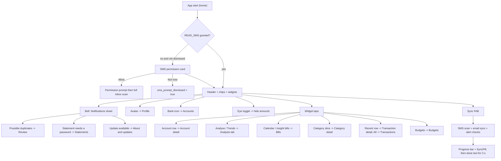

# Dashboard (Home)

| Field | Value |
|---|---|
| Feature ID | F-17 |
| Status | In progress (Phase 1 core Home; widgets, sync, bell, permissions cards pending) |
| Priority | P0 |
| Phase | 1 |
| Last Updated | 2026-10-22 |

## 1. Description

Home is the first screen of the app. It answers "how is my money doing this period?" in one scroll: spending against the previous period, credit-card bills due, cash flow, what is due in the next 7 days, a few plain-language insights, spending by category, the latest transactions and budget progress. It also holds the one-tap "sync everything" button and a bell that lists things needing attention, so the user does not have to open several screens to find out where they stand.

## 2. What This Feature Will Do

- Shows a header with the user's avatar, a time-of-day greeting and name, a hide-amounts toggle, an Accounts shortcut and a notification bell with a count.
- Shows the widgets the user has turned on, in the user's saved order: Spent this month, Credit card dues, Cash flow, Upcoming, Insights, Spend by category, Recent transactions and Budgets (hidden by default).
- Calculates every widget figure for the chosen Book and Period.
- Compares this period's spending with the previous period and shows the change as a percent.
- Shows credit-card dues with a status per card and a Mark paid button for bills due within 7 days.
- Lists up to 5 bills, EMIs, SIPs and income due in the next 7 days and flags those the paying account cannot cover.
- Shows insights as a swipeable carousel that the user can dismiss for the current session.
- Opens the matching detail screen when a widget, row or slice is tapped.
- Lists duplicates to review, statements waiting for a password and an available app update in the bell sheet.
- Shows a card asking for SMS permission, and starts a full inbox scan once permission is granted.
- Asks once for notification permission on first launch.
- Reads new SMS and email on demand with the sync button, shows live progress and then the number of messages read.
- Masks every amount when hide-amounts is on.

### 2.1 Inputs

- Opening the app or the Home tab.
- The global Book and Period choice, set with the two chips ([20_search_filters.md](20_search_filters.md)).
- Widget order and visibility saved in Customise ([28_theming_customisation.md](28_theming_customisation.md)).
- Ledger, accounts, credit-card, budget and recurring-payment data already stored on the phone.
- Taps on the bell, eye toggle, widgets, SMS permission card and sync button.
- Progress reports from the background SMS and email scans.

### 2.2 Processing

1. Load the transactions and accounts for the chosen Book and Period.
2. Work out each widget's figures from that data and from the saved widget order.
3. Show only the widgets the user has made visible; show a placeholder until data has loaded and a short message when a widget has nothing to show.
4. Build the bell notices from the duplicate count, locked statements and update status.
5. When permission is missing and the prompt was not dismissed, show the SMS permission card.
6. When the user taps sync, re-read recent SMS, read email if connected, check budget and upcoming-bill alerts and retry locked statements.
7. Show progress while a scan runs, then the totals read for a few seconds.
8. Send the user to the matching screen when a widget, row or notice is tapped.

### 2.3 Outputs

- The user sees the header, widgets, bell sheet, sync progress and completion text described above.
- The only values stored are the SMS-prompt-dismissed flag and the notification-asked flag; Home itself keeps no financial data.
- Other features receive navigation only: the user is sent to Profile, Accounts, Transactions, Analysis, Bills, Budgets, category screens, Review, Statements and About and updates ([08_transactions_ledger.md](08_transactions_ledger.md), [13_accounts_management.md](13_accounts_management.md), [07_dedup_review.md](07_dedup_review.md), [05_statement_import.md](05_statement_import.md), [31_news_support_updates.md](31_news_support_updates.md)).
- The sync button triggers SMS, email and alert checks owned by other features.

### 2.4 Out of Scope

- Does not edit widget order or visibility (Customise screen and layout store: [28_theming_customisation.md](28_theming_customisation.md)).
- Does not own the Book and Period chips or their stored value ([20_search_filters.md](20_search_filters.md)).
- Does not own insight rules or forecast maths ([18_analytics.md](18_analytics.md)).
- Does not own card bill figures ([14_credit_cards.md](14_credit_cards.md)), recurring detection and the Upcoming list ([12_recurring_transactions.md](12_recurring_transactions.md)) or budgets ([10_expense_tracking.md](10_expense_tracking.md)).
- Does not show net worth (moved to Portfolio: [16_portfolio.md](16_portfolio.md)).
- Does not provide the Android home-screen widget ([30_home_widget.md](30_home_widget.md)).
- Does not carry over the unused recurring-payment sheet trigger, the dead net-worth and safe-to-spend widgets, or the up/down reorder controls on Home.

## 3. Behaviour in Existing App

Source: `hisaab_apk/app/src/main/kotlin/com/hisaab/app/ui/home/` (`HomeScreen.kt`, `HomeViewModel.kt`, `HomeParts.kt`, `HomeWidgets.kt`, `SpentThisMonth.kt`), `settings/TabLayout.kt`, analysis Part A section 2.2 and 3.2.

Screen structure (`HomeScreen.kt:145-267`): a lazy column, 12 dp vertical spacing, bottom padding = tab-bar padding + 140 dp. Items in order:

1. `header` - `HomeHeader`: profile avatar (photo or initials on a green gradient with a gold ring), greeting line, name, optional hint "Tap to set up your profile" (when no name), then three icon buttons: eye (hide/show amounts), bank (opens Accounts), bell with a count badge. Tapping the avatar/name opens Profile.
2. `filters` - `BookPeriodChips` (Book pill + Period pill).
3. `sms` (conditional) - `PermissionCard` when READ_SMS is not granted and `sms_prompt_dismissed` is false: title "Read bank SMS", text "DhanKosh reads SMS only from known bank senders, on this phone. Nothing is uploaded; there is no server.", button "Allow SMS access" (or "Open App settings" when blocked) and "Not now".
4. Widgets from `TabLayout.visible("home")`, each wrapped with `enterOnce(index)` stagger and `animateItem()`.

Overlays: collapsed floating header once `firstVisibleItemIndex > 0` (rounded 28 dp bar, 96% `surfaceContainerHigh`, compact avatar 36 dp, no greeting); opaque status-bar cover; 3 dp linear progress under the status bar while a sync is active; `SyncPill` bottom-start; single FAB bottom-end (sync, `primaryContainer`, icon rotates at 900 ms per turn while syncing, label "Sync everything"/"Syncing"). `onAdd` and `onAddRecurring` params still exist but the add FAB was removed; `RecurringSheet` on Home is only reachable through the unused `addingRecurring` flag (dead).

Greeting (`HomeParts.kt:47`): hour 5-11 "Good morning", 12-16 "Good afternoon", 17-21 "Good evening", otherwise "Good night". Name = `profile.name` else "Welcome".

First composition: on API >= 33 and `notifications_asked == false`, `POST_NOTIFICATIONS` is requested once and the flag set (`HomeViewModel.shouldAskNotifications`). `rememberSmsPermission(onGranted = scanInbox(full = true))` requests `READ_SMS` + `RECEIVE_SMS`, re-checks on every resume, and after a refusal with no rationale shows the blocked text ("Android didn't show the permission prompt. Open App settings, then Permissions, SMS, Allow. If SMS is greyed out, first tap the menu at the top right of App info and choose Allow restricted settings."). Detailed permission flow: [01_onboarding_permissions.md](01_onboarding_permissions.md).

Widget catalogue (default order from `TabLayouts.DEFAULTS["home"]`; section key, label in Customise):

| Key | Label | Composable | Hidden by default |
|---|---|---|---|
| `spent` | Spent this month | `SpentThisMonthWidget` (SpentThisMonth.kt:154) | no |
| `cards` | Credit card dues | `CreditCardsWidget` (HomeWidgets.kt:468) | no |
| `cashflow` | Cash flow | `CashFlowWidget` (:231) | no |
| `upcoming` | Upcoming | `UpcomingWidget` (:303) | no |
| `insights` | Insights | `InsightsWidget` (:355) | no |
| `categories` | Spend by category | `CategoriesWidget` (:400) | no |
| `recent` | Recent transactions | `RecentWidget` (:429) | no |
| `budgets` | Budgets | `BudgetsWidget` (:441) | yes (`HOME_HIDDEN_BY_DEFAULT = {"budgets"}`) |

That is 8 widgets. Legacy keys `networth` (renders nothing: `"networth" -> Unit`) and `safe` (`SafeWidget` exists but is not in the default list) are dead on Home; `NetWorthHeroCard` is reused by Portfolio ([16_portfolio.md](16_portfolio.md)).

Widget details:

- `spent` (hero card). Title by scope: current month "Spent this month", last month "Spent last month", this week "Spent this week", any other "Spent · {period}". While loading shows "Loading…". Big `AnimatedAmount` 30 sp = `MonthSpendResult.spent`. Sub-line "Last month: ₹x" / "Previous month: ₹x" / "Previous period: ₹x" when a previous period exists. Pill "{n}% less|more vs last month|previous month|previous period" (green when `changePercent <= 0`, red otherwise; hidden when `previousSamePeriod == 0`). Two-line cumulative chart (this period solid accent, previous dashed muted, y-axis labels compact top and 0, 110 dp tall, smoothed path). Three tiles Income / Expenses / Saved (Saved uses teal = `Hx.palette[2]`; negative shown with "−"). Folded "By account & card" list: rows per non-hidden account with spend, share bar, tap opens account; remainder "Other" (= total minus listed rows, so rows + Other = total) and "Total". Empty text "No spending this month." / "No spending in this period.". Maths: [10_expense_tracking.md](10_expense_tracking.md) (MonthSpend semantics, repeated in section 10).
- `cards` "Credit card dues". Folded by default (`open` is `rememberSaveable`). Header shows "{n} cards" and the total billed to pay (red) or "No dues". Each row (`CardHomeRow`): avatar, name ••last4, status (Paid / Overdue · date / Due today / Due {date} · n days / Unbilled / Limit left), amount (prefixed `~` when estimated), `MarkPaidButton` when billed, unpaid and due in <= 7 days. Empty "No credit cards yet." Card maths in [14_credit_cards.md](14_credit_cards.md).
- `cashflow` "{period} cash flow", action "Analyse ›" (opens Analysis tab). `KpiRow` Income (green), Spent, Invested (accent), Saved (green/red, signed compact). If income > 0: `SplitBar` of spent/income, invested/income, max(saved,0)/income in red/accent/green, then "Savings rate x%" and, when the period is a calendar month whose rate beats at least 2 other income months of the last 12 (`bestRateOf`), "· best in {n} months". Otherwise hint "No income recorded in this period."
- `upcoming` "Upcoming · 7 days", action "Calendar ›" (opens Bills). Up to 5 items from `plan.upcoming` with `daysLeft in 0..7`. Row: 40 dp date badge (day + 3-letter month), name, subtitle "Due today | Tomorrow | In n days" + "account ••last4" + "short of funds" when the paying account balance < amount, amount right (prefix "+" for income). Colour by `DueTone`: CARD red, EMI/insurance amber, INVEST accent, INCOME green, OTHER default. Tone rule: INCOME kind, else category INVESTMENT, else category EMI_LOAN or kind EMI/INSURANCE, else paying account is a non-debit card or name contains "card", else OTHER. Empty "Nothing due in the next 7 days."
- `insights` title "Insights" or "Insights · {n}". Snap-fling horizontal carousel, each item 86% of the width, 14 dp radius, tag by tone (WARN "Heads up" amber, GOOD "Good news" green, INFO "Pattern" accent), title (max 2 lines), detail (max 3 lines, fixed 54 dp), pills "See transactions" / "See bills" and "Dismiss". Link rule (`linkOf`): title starts with a category label plus a space -> that category's transactions; title contains "regular payment" -> Bills; else Transactions. Dismiss is per session by title (`MutableStateFlow<Set<String>>`, not persisted). Insight engine: [18_analytics.md](18_analytics.md) section 10. Empty "No insights right now."
- `categories` "Spend by category", action "Trends ›" (Analysis). Donut of the top 7 categories plus "Others" (palette last colour), legend with `value*100/total` percent, tap slice or legend opens that category screen (month passed along), centre label "Spent" + compact total. The user's custom categories are separated from the built-in ones they were filed under (`customCategoryId`). Empty "No spending in this period."
- `recent` "Recent", action "All ›" (opens Transactions for the shown month). Last 4 (`RECENT = 4`) transactions of the period by timestamp desc using `TransactionRow(showDate = true)`. Empty "No transactions in this period."
- `budgets` "Budgets", action "Manage ›" when budgets exist. Up to 3 progress rings (60 dp, 6 dp stroke) of the most-used budgets: colour green below 80%, amber at >= 80%, red at >= 100%; label "{spent} of {limit}" compact. Empty: "Set monthly limits for the categories you want to watch." + pill "Set budgets". Budget rules: [10_expense_tracking.md](10_expense_tracking.md).

Notification bell sheet (`NotificationsSheet`, ModalBottomSheet "Notifications"; empty "You're all caught up."). Notices built in `HomeScreen`:

1. Review count > 0: title "{n} possible duplicate(s)", detail "Review and merge", icon ContentCopy, opens Review ([07_dedup_review.md](07_dedup_review.md)).
2. One notice per locked statement: "Statement needs a password", detail = bank name or the sender text before `<`, icon Lock, opens Statements ([05_statement_import.md](05_statement_import.md)).
3. Update available: "DhanKosh {version} is available", detail "Install the update", icon SystemUpdate, `WhatsNewButton`, opens About & updates ([31_news_support_updates.md](31_news_support_updates.md)).

The badge number is the notice count. Rows are 16 dp rounded, tap dismisses the sheet then navigates.

Sync (`HomeViewModel.syncAll`, FAB): `SmsScanScheduler.scanRecent` (14-day re-read, REPLACE) + `GmailScheduler.syncNow` if mail is connected and enabled + `alerts.checkBudgets()` + `alerts.checkUpcoming()` (in `runCatching`) + `statementProcessor.retryLocked()` (statements a new password now opens). Progress comes from WorkManager unique work infos: SMS `SmsScanScheduler.WORK_NAME` (`KEY_SCANNED`, `KEY_FOUND`), email `GmailScheduler.NOW` (`KEY_EMAILS_READ`). `SyncPill` texts: "Reading messages…" / "Reading messages · n", "Reading email…" / "Reading email · n", then for 3 s after both finish "{sms} messages · {mail} emails read", "{sms} messages read" or "{mail} emails read" (counts from the finished run of this session only; email progress is only known when it finishes).

Migration `seedHomeOnce()` runs in `HomeViewModel.init`: first seed removes any saved home order and hides `budgets`; "spent" is placed first; "networth" is removed from the home order. See [28_theming_customisation.md](28_theming_customisation.md) for the store.

Safe-to-spend maths remains in `HomeViewModel.build` though no widget shows it: current month `max(0, base - spent - reservedBills) / daysLeft` with `base = sum of budgets` else income, `reserved` = sum of non-income upcoming items due in the month, `daysLeft = monthLength - today.day + 1`; other periods show `spent / days`.

## 4. User Stories

1. As a user I open the app and see this month's spend against last month so I know if I am overspending.
2. As a user I hide all amounts with one tap so I can open the app in public.
3. As a user I see which credit-card bills are due and mark one paid from Home.
4. As a user I see the next 7 days of bills, EMIs, SIPs and income, and which are short of funds.
5. As a user I swipe through a few plain-language insights and dismiss the ones I have read.
6. As a user I tap the bell to see duplicates to review, statements waiting for a password and an available update.
7. As a user I tap one button to read new SMS and email now and see what was read.
8. As a user I reorder or hide widgets (in Customise) and Home reflects it.

## 5. Functional Requirements (FR-17-01 ...)

1. FR-17-01: Home is the start destination and a tab (route `home`). It shows, in order, the header, the Book/Period chip row, the SMS permission card (conditional) and the visible widgets in saved order.
2. FR-17-02: The header shows avatar (photo else initials of the first two name words, fallback "H"), greeting, name (single line, ellipsis), the hint "Tap to set up your profile" when no name, an eye toggle, a bank icon (opens Accounts) and a bell with badge = notice count (hidden at 0). Tapping avatar/name opens Profile.
3. FR-17-03: Greeting by local hour: 5-11 morning, 12-16 afternoon, 17-21 evening, otherwise night. Name falls back to "Welcome".
4. FR-17-04: When the first list item scrolls off, a compact floating header (no greeting) appears with fade + slide; an opaque status-bar-height cover keeps content from showing behind the status bar.
5. FR-17-05: Widget set, order and visibility come from the tab-layout store (`order_home`, `hidden` entries `home:<key>`); defaults are the 8 keys in section 2 with `budgets` hidden; unknown saved keys are ignored, new keys appended.
6. FR-17-06: `spent` widget renders per section 2: scope-dependent title, animated amount, previous-period line, percent pill (hidden without a previous same-elapsed-days figure), two-line cumulative chart, Income/Expenses/Saved tiles, folded by-account list with "Other" remainder so rows sum to the total.
7. FR-17-07: `cards` widget lists credit cards (folded by default) with total billed, per-card status text per section 2, `~` for estimated amounts, and a Mark-paid button when billed, unpaid and due within 7 days.
8. FR-17-08: `cashflow` widget shows Income/Spent/Invested/Saved, the split bar, savings rate and "best in {n} months" only for a calendar-month period whose rate exceeds every other income month and at least 2 such months exist.
9. FR-17-09: `upcoming` widget shows at most 5 items due in 0-7 days with date badge, tone colour and "short of funds" flag; tap opens Bills.
10. FR-17-10: `insights` widget shows the insights from the plan snapshot minus those dismissed this session, as a snapping carousel with tag, title, detail, link pill and Dismiss.
11. FR-17-11: `categories` widget shows a donut of the top 7 categories plus Others with percent legend; tap opens that category with the month.
12. FR-17-12: `recent` widget shows the 4 latest transactions of the period; "All ›" opens Transactions on that month.
13. FR-17-13: `budgets` widget shows up to 3 rings coloured at 80% (amber) and 100% (red), or the empty state with "Set budgets".
14. FR-17-14: The bell opens a bottom sheet listing notices: duplicates (count > 0), one per locked statement, and update available; empty text "You're all caught up."; tapping a notice closes the sheet and navigates.
15. FR-17-15: When READ_SMS is missing and the prompt was not dismissed, show the SMS permission card; "Not now" persists `sms_prompt_dismissed = true`; when permission is granted a full inbox scan starts.
16. FR-17-16: On first launch (API >= 33) request POST_NOTIFICATIONS exactly once, recording `notifications_asked`.
17. FR-17-17: The sync FAB runs `syncAll` (14-day SMS re-read, email sync if connected and enabled, budget and upcoming alert checks, locked-statement retry) and is ignored while a sync is already active.
18. FR-17-18: While SMS or email sync is active, show a 3 dp progress bar under the status bar and the SyncPill with live counts; for 3 s after completion show the totals read.
19. FR-17-19: All widget figures use the global Book + Period filter and rupee-valued amounts (`inrMinor`), and every amount is masked when hide-amounts is on.
20. FR-17-20: Widgets render nothing or a "Loading…" placeholder until their data has loaded; empty states use the exact texts listed in section 2.
21. FR-17-21: Insight dismissal is session-only (by title) and never persisted.
22. FR-17-22: The first-run Home migration hides `budgets`, places `spent` first and removes `networth` from the saved home order (once).
23. FR-17-23: Home never shows a "Safe to spend" block; no `safe` section key exists in the rebuilt Home (see section 10; backlog: [34_planned_insights_backlog.md](34_planned_insights_backlog.md)).
24. FR-17-24: The More hub per-entry subtitles and footer ("You're all caught up", "DhanKosh v{version}") are owned by [26_settings_data_sources.md](26_settings_data_sources.md) FR-26-23, not by Home.

## 6. Non-Functional Requirements (performance, battery, privacy, offline)

- Performance: widget aggregation runs off the UI thread (`flowOn(Default)`); Home first paint under 400 ms warm; scrolling at 60 fps with 50,000 transactions (data is aggregated, not listed); `WhileSubscribed(5s)` style sharing so streams stop when Home is not visible.
- Battery: no polling; progress is observed from the background-work status, not timers (only the 3 s done-pill delay).
- Privacy: nothing leaves the device. Amounts masked by default (`hide_amounts` default true, so figures never flash at launch). Notices show only bank name or sender, never figures.
- Offline: fully offline; all data is local.
- Accessibility: every icon button has a content description ("Show amounts"/"Hide amounts", "Accounts", "Notifications", "Sync everything"/"Syncing"); respects reduce-motion for stagger and spin; text scale up to the app cap.
- Localisation: every string passes through the translation function with `{named}` placeholders ([29_localization.md](29_localization.md)).

## 7. UI / Screens & User Flow (screen list + flow diagram)

Screens, dialogs and sheets of this feature:

| Screen / sheet | Source (Kotlin) | Notes |
|---|---|---|
| Home (all widgets) | `ui/home/HomeScreen.kt:93,146` | Lazy list, collapsed header, FAB, SyncPill |
| Home header | `ui/home/HomeParts.kt:70` | Avatar, greeting, eye, bank, bell |
| Collapsed header | `ui/home/HomeParts.kt:168` | Floating compact header |
| SMS permission card | `ui/home/HomeScreen.kt:286` | Allow / blocked variant / Not now |
| Notifications sheet | `ui/home/HomeParts.kt:111` | Duplicates, locked statements, update |
| Spent widget (hero) | `ui/home/SpentThisMonth.kt:154` | Chart, tiles, by-account fold |
| Credit card dues widget | `ui/home/HomeWidgets.kt:468` | Folded list, Mark paid |
| Cash flow widget | `ui/home/HomeWidgets.kt:231` | KPIs, split bar |
| Upcoming widget | `ui/home/HomeWidgets.kt:303` | Date badges |
| Insights carousel | `ui/home/HomeWidgets.kt:355` | Snap carousel |
| Spend by category widget | `ui/home/HomeWidgets.kt:400` | Donut + legend |
| Recent widget | `ui/home/HomeWidgets.kt:429` | Last 4 |
| Budgets widget | `ui/home/HomeWidgets.kt:441` | Rings |
| Sync FAB + SyncPill + progress bar | `ui/home/HomeScreen.kt:274,318` | Sync everything |



Reference GIFs (all Status: Pending, not yet captured):

-  (Status: Pending, not yet captured)
-  (Status: Pending, not yet captured)
-  (Status: Pending, not yet captured)
-  (Status: Pending, not yet captured)
-  (Status: Pending, not yet captured)
-  (Status: Pending, not yet captured)
-  (Status: Pending, not yet captured)
-  (Status: Pending, not yet captured)
-  (Status: Pending, not yet captured)
-  (Status: Pending, not yet captured)
-  (Status: Pending, not yet captured)
-  (Status: Pending, not yet captured)
-  (Status: Pending, not yet captured)
-  (Status: Pending, not yet captured)

## 8. Data Models (Dart entities + fields + types)

Freezed-style, in `lib/features/dashboard_home/domain/entities/`. Amounts are `int` paise. `Category` is the shared enum from [09_categorization.md](09_categorization.md).

```dart
@freezed
class HomeState with _$HomeState {
  const factory HomeState({
    @Default(0) int reviewCount,
    @Default(ScanProgress()) ScanProgress scan,
    @Default(false) bool smsPromptDismissed,
    @Default([]) List<LockedStatementNotice> lockedStatements,
    String? displayName,
  }) = _HomeState;
}

@freezed
class ScanProgress with _$ScanProgress {
  const factory ScanProgress({@Default(false) bool running, @Default(0) int scanned, @Default(0) int found}) = _ScanProgress;
}

@freezed
class SyncStatus with _$SyncStatus {
  const SyncStatus._();
  const factory SyncStatus({
    @Default(false) bool smsActive,
    @Default(false) bool mailActive,
    @Default(0) int smsSoFar,
    int? smsRead,
    int? mailRead,
    @Default(0) int mailSoFar,
  }) = _SyncStatus;
  bool get active => smsActive || mailActive;
}

@freezed
class CashFlow with _$CashFlow {
  const CashFlow._();
  const factory CashFlow({required int income, required int spent, required int invested}) = _CashFlow;
  int get saved => income - spent - invested;
  int? get rate => income > 0 ? (saved * 100 ~/ income) : null; // percent, integer division
}

enum DueTone { card, emi, invest, income, other }

@freezed
class DueItem with _$DueItem {
  const factory DueItem({required UpcomingPayment upcoming, required DueTone tone}) = _DueItem;
}

@freezed
class CategoryAmount with _$CategoryAmount {
  const factory CategoryAmount({required CategoryLook look, required int amount}) = _CategoryAmount;
}

@freezed
class BudgetUse with _$BudgetUse {
  const BudgetUse._();
  const factory BudgetUse({required CategoryLook look, required int spent, required int limit}) = _BudgetUse;
  double get fraction => limit > 0 ? spent / limit : 0;
}

@freezed
class SafeToSpend with _$SafeToSpend {
  const factory SafeToSpend({
    required bool current, required int perDay, required int daysLeft,
    required int base, required int spent, required int reserved, required bool fromBudget,
  }) = _SafeToSpend; // NOT part of the rebuilt Home: do not implement (FR-17-23; backlog 34_planned_insights_backlog.md)
}

@freezed
class HomeWidgets with _$HomeWidgets {
  const factory HomeWidgets({
    required ViewFilter filter,
    required YearMonth month,
    required CashFlow cash,
    int? bestRateOf,
    SafeToSpend? safe,
    @Default([]) List<CategoryAmount> categories,
    @Default([]) List<Transaction> recent,        // 4 newest
    @Default([]) List<BudgetUse> budgets,         // up to 3, most used first
    @Default(false) bool hasBudgets,
    @Default([]) List<DueItem> upcoming,          // due in 0..7 days
    @Default([]) List<Insight> insights,
    @Default(false) bool loaded,
  }) = _HomeWidgets;
}

@freezed
class HomeNotice with _$HomeNotice {
  const factory HomeNotice({
    required String title, required String detail, required HomeNoticeKind kind,
    int? statementId, String? version,
  }) = _HomeNotice;
}
enum HomeNoticeKind { duplicates, lockedStatement, updateAvailable }

@freezed
class SpentMonth with _$SpentMonth {
  const factory SpentMonth({
    required MonthSpendResult result, required List<SpendRow> rows,
    required int other, required SpentScope scope, required String periodLabel,
  }) = _SpentMonth;
}
enum SpentScope { thisMonth, lastMonth, pastMonth, thisWeek, other }

@freezed
class SpendRow with _$SpendRow {
  const factory SpendRow({
    required int id, required String name, required String last4,
    required AccountKind kind, AccountType? type, CardNetwork? network,
    required bool business, required int amount,
  }) = _SpendRow;
}

/// Layout of customisable sections; persisted by [28_theming_customisation.md].
@freezed
class TabLayout with _$TabLayout {
  const factory TabLayout({
    @Default({}) Map<String, List<String>> order,   // tab -> ordered keys
    @Default({}) Set<String> hidden,                // "tab:key"
  }) = _TabLayout;
}
```

`MonthSpendResult` is defined in section 8 of [10_expense_tracking.md](10_expense_tracking.md) and mirrors Kotlin `MonthSpendResult` (`spent`, `previousSpent`, `previousSamePeriod`, `income`, `saved`, `thisCum`, `lastCum`, `byAccount`, `days`, `hasPrevious`, computed `changePercent`).

## 9. Database Tables / Changes

Home owns no tables; it reads from (all defined in their own feature files):

- `transactions` (+ `transaction_sources`, [08_transactions_ledger.md](08_transactions_ledger.md)): period sums, recent 4, review count (`needsReview`).
- `accounts` ([13_accounts_management.md](13_accounts_management.md)): by-account rows, card rows, paying account for "short of funds".
- `budgets` ([10_expense_tracking.md](10_expense_tracking.md)); `custom_categories` ([09_categorization.md](09_categorization.md)); `statements` (locked list, [05_statement_import.md](05_statement_import.md)); `recurring`, `holdings` (via the plan snapshot, [12_recurring_transactions.md](12_recurring_transactions.md)).

Settings read/written by Home (Drift `settings` key-value table, replacing DataStore; the table name is owned by [26_settings_data_sources.md](26_settings_data_sources.md) FR-26-25; the `app_settings.` prefix below names the old DataStore group, stored as the key prefix):

| Store / key | Type | Default | Used for |
|---|---|---|---|
| `app_settings.sms_prompt_dismissed` | bool | false | Hide SMS card after "Not now" |
| `app_settings.notifications_asked` | bool | false | Ask POST_NOTIFICATIONS once |
| `app_settings.hide_amounts` | bool | true | Eye toggle |
| `app_settings.display_name`, `profile_photo` | text? | null | Greeting name, avatar |
| `tab_layout.order_home` | csv text | `spent,cards,cashflow,upcoming,insights,categories,recent,budgets` | Widget order |
| `tab_layout.hidden` | string set of `"home:<key>"` | `{"home:budgets"}` after seed | Widget visibility |
| `tab_layout.home_v2_seeded`, `home_spent_added`, `home_networth_left` | bool | false | One-time migrations |

Drift sketch for the key-value store (shared with other features):

```dart
class SettingsTable extends Table {
  TextColumn get key => text()();
  TextColumn get value => text().nullable()();
  @override
  Set<Column> get primaryKey => {key};
}
```

No migration is needed for this feature in the fresh Drift schema v1.

## 10. Business Rules & Logic (regex, parsing rules, algorithms, thresholds)

Constants: `RECENT = 4`; upcoming window 0..7 days, max 5 shown; budgets rings max 3; donut top 7 + Others; insights carousel item width 0.86; done-pill delay 3000 ms; spin 900 ms; greeting hour bands above; default hidden section `budgets`.

Period spend (`MonthSpend.compute`, used by the `spent` widget): spend = DEBIT with category != TRANSFER (not INVESTMENT); refunds (CREDIT with category REFUND) reduce spend (`net`: spend +rupees, refund -rupees); income = CREDIT with category not TRANSFER and not REFUND; `saved = income - spent`. Rupee value = `inrMinor`, else `amountMinor` when currency INR, else 0 ([23_forex_rates.md](23_forex_rates.md)). `thisCum`: running total per day from period start to `min(end, today)`; `lastCum`: whole previous period; `previousSamePeriod = lastCum[min(len(thisCum), len(lastCum)) - 1]`; `changePercent = (spent - previousSamePeriod) * 100 / previousSamePeriod` (integer, only when the denominator > 0). Previous period = previous calendar month for MONTH/LAST_MONTH, else the equal-length period immediately before. By account: group `net != 0` rows by `accountId`, sort descending, drop zero.

Home cash flow (`CashFlow` via `LedgerMath`): income = CREDIT not TRANSFER (refund credits are counted here, see section 17), spent = DEBIT not TRANSFER, invested = INVESTMENT; `rate = saved*100/income`. `bestRateOf` = `others.length + 1` when the period is a calendar month, income > 0, the other months of the last 12 with income number at least 2, and `rate` is strictly greater than every other month's `(income - spent - invested) * 100 / income` (integer).

Category list: DEBIT not TRANSFER rows grouped by custom category id (else built-in category), rupee amounts, drop <= 0, sort desc.

Budgets: `limit > 0` budgets only, `fraction = spent/limit` where spent = this period's spend in that category; sort by fraction desc; take 3; colour: `>= 1.0` red, `>= 0.8` amber, else green (fixed 80% here, not the user's alert percent).

Upcoming tone: see section 2. `short` flag = `!income && payingAccountBalance != null && balance < amount`, where the paying account follows merge then debit-card link, must be a bank account (`ACCOUNT` kind and `liquid != false`).

Safe to spend: NOT part of the rebuilt Home. The block was removed from Home in 2.9.0 but the maths, the `SafeWidget` code and the keys "Safe to spend" / "Safe to spend today" (`HomeWidgets.kt:256-276`, `HomeViewModel.kt:89`, `lang/keys.json`) remain in the Kotlin app. Do not port it as a Home widget or section key; it is tracked as Proposed in [34_planned_insights_backlog.md](34_planned_insights_backlog.md).

Sync-pill state machine: `sawSms`/`sawMail` latch true when each reader is seen active; when no reader is active and either was seen, set done text from the finished outputs (`smsRead`, `mailRead`), clear latches, wait 3 s, clear; active text takes priority (SMS before email).

Sample fixtures (masked): period Oct 2026, today 17 Oct; transactions: DEBIT 1,20,000.00 RENT; DEBIT 2,450.50 FOOD UPI; CREDIT 85,000.00 SALARY; CREDIT 500.00 REFUND; TRANSFER 10,000.00 own account. Expected `MonthSpend`: spent = 120000 + 2450.50 - 500 = 1,21,950.50 (refund nets spend), income = 85,000, saved = -36,950.50.

## 11. Platform / Native Requirements (permissions, channels, background work)

- Permissions requested here: `READ_SMS` + `RECEIVE_SMS` (via the SMS card), `POST_NOTIFICATIONS` once (API 33+).
- Reads WorkManager unique work: `sms-scan` (progress keys `scanned`, `found`; output `scanned`) and `gmail-sync-now` (progress/output `emails_read`). Flutter: platform channel or `workmanager` plus a local progress stream (a `Stream<SyncStatus>` fed by the SMS and email workers through a shared notifier).
- Deep links consumed by Home notices: `hisaab://statements`, none new.
- Window insets: opaque status-bar cover and edge-to-edge layout.
- Haptics: none on Home (tab change haptic belongs to the shell).

## 12. Dependencies (other features → link to their memory file; packages)

Features:

- [20_search_filters.md](20_search_filters.md) (Book + Period chips, `ViewFilterStore`, `LedgerSource` slice)
- [08_transactions_ledger.md](08_transactions_ledger.md), [10_expense_tracking.md](10_expense_tracking.md), [11_income_tracking.md](11_income_tracking.md), [12_recurring_transactions.md](12_recurring_transactions.md), [13_accounts_management.md](13_accounts_management.md), [14_credit_cards.md](14_credit_cards.md), [09_categorization.md](09_categorization.md)
- [18_analytics.md](18_analytics.md) (insight engine), [07_dedup_review.md](07_dedup_review.md) (review count), [05_statement_import.md](05_statement_import.md) (locked list, retry), [02_sms_ingestion.md](02_sms_ingestion.md) and [03_email_ingestion.md](03_email_ingestion.md) (scan/sync triggers), [01_onboarding_permissions.md](01_onboarding_permissions.md) (SMS permission), [28_theming_customisation.md](28_theming_customisation.md) (layout store), [27_profile.md](27_profile.md) (name, photo), [25_security_privacy.md](25_security_privacy.md) (hide amounts), [21_alerts_reminders.md](21_alerts_reminders.md) (alert checks run by sync), [31_news_support_updates.md](31_news_support_updates.md) (update notice).

Packages: `flutter_riverpod` + `riverpod_annotation`, `go_router`, `freezed`, `drift`, `fl_chart` (donut, lines) with custom painters, `workmanager`, `permission_handler`, `intl` (en-IN formatting), `flutter_animate` (stagger, optional).

## 13. Folder Location (lib/features/<name>/...)

```text
lib/features/dashboard_home/
  data/
    datasources/home_aggregates_dao.dart      # Drift queries for period sums, recent, review count
    repositories/home_repository_impl.dart
    sync_status_source.dart                   # maps worker progress to SyncStatus
  domain/
    entities/home_state.dart, home_widgets.dart, cash_flow.dart, due_item.dart, spent_month.dart
    repositories/home_repository.dart
    usecases/build_home_widgets.dart, sync_all.dart, build_notices.dart, greeting.dart
  presentation/
    home_screen.dart
    providers/home_providers.dart             # homeStateProvider, homeWidgetsProvider, syncStatusProvider
    widgets/home_header.dart, collapsed_header.dart, sms_permission_card.dart, notifications_sheet.dart,
            sync_pill.dart, widget_card.dart, spent_widget.dart, cards_widget.dart, cashflow_widget.dart,
            upcoming_widget.dart, insights_widget.dart, categories_widget.dart, recent_widget.dart, budgets_widget.dart
```

## 14. Edge Cases & Error Handling

- No name: greeting row shows "Welcome" and the "Tap to set up your profile" hint; avatar initial "H".
- Loading: `spent` shows "Loading…"; other widgets are skipped until `loaded` to avoid empty-state flicker.
- No previous period (custom range with no prior data) or `previousSamePeriod == 0`: percent pill is omitted.
- `previous` for a running period compares the same elapsed days; a finished period compares the whole previous period.
- Foreign spends without a rate count as 0 until a rate is added ([23_forex_rates.md](23_forex_rates.md)).
- Spend on hidden or merged accounts and on no account is reported under "Other" so the by-account rows sum to the total.
- `bestRateOf` is null for non-month periods and when fewer than 2 other income months exist.
- Budget with limit 0 is ignored. Percent labels cap at 999.
- Sync while already active: FAB tap ignored. Missing SMS permission: the scan fails with `permission` (logged in [22_activity_log.md](22_activity_log.md)); email not connected: only SMS runs.
- POST_NOTIFICATIONS denied: alerts silently do nothing; locked-statement notice still appears in the bell.
- App update notice depends on the updater state being `Available`; no network is needed to render.
- Safe-area: collapsed header must not overlap the status bar cover.

## 15. Test Cases (unit / widget / integration + sample fixtures)

Unit:

1. TC-17-01 (FR-17-03): `greeting` returns morning for 5:00 and 11:59, afternoon for 12:00 and 16:59, evening for 17:00 and 21:59, night for 22:00 and 4:59.
2. TC-17-02 (FR-17-06, FR-17-19): the Oct 2026 fixture in section 10 gives spent 12,195,050 paise, income 8,500,000, saved -3,695,050; refund nets spend.
3. TC-17-03 (FR-17-06): `changePercent` null when `previousSamePeriod == 0`; for spent 5,000 vs same-days previous 4,000 = +25; rows + other == total.
4. TC-17-04 (FR-17-08): `bestRateOf` returns 4 when the current rate 40% beats 3 earlier income months (30, 25, 35), null when only 1 other month, null when the period is not a calendar month.
5. TC-17-05 (FR-17-09): upcoming includes days 0..7 only, max 5, tone mapping (card red, EMI amber, SIP accent, income green) and `short` flag.
6. TC-17-06 (FR-17-13): budget fraction 0.79 green, 0.8 amber, 1.0 red; budgets sorted by fraction desc, top 3.
7. TC-17-07 (FR-17-05, FR-17-22): layout visible(home) with defaults excludes `budgets`; unknown saved keys dropped; new keys appended; migration hides budgets once.
8. TC-17-08 (FR-17-10, FR-17-21): dismissing an insight removes it by title for the session and it returns after provider reset.
9. TC-17-09 (FR-17-18): sync-pill state machine: SMS active -> "Reading messages · 120"; both done -> "412 messages · 3 emails read" for 3 s then null; SMS only -> "412 messages read".

Widget:

10. TC-17-10 (FR-17-14): sheet shows 3 notices for review=2, one locked statement, update 2.9.9; badge "3"; empty shows "You're all caught up."; tapping navigates.
11. TC-17-11 (FR-17-15, FR-17-16): SMS card visible when permission missing and not dismissed; "Not now" hides it and persists; notification permission requested once only across two launches.
12. TC-17-12 (FR-17-02, FR-17-04, FR-17-19): eye toggle masks all amounts ("₹••••"); collapsed header appears after scrolling past the header and hides on return.

Integration:

13. TC-17-13 (FR-17-17): tap sync with a fake SMS repo and connected email: scan and email start, pill appears, FAB ignores a second tap, alert checks run once, done text appears for 3 s.
14. TC-17-14 (FR-17-06, FR-17-11, FR-17-12): ingest 3 SMS fixtures (HDFC debit ₹2,450.50 Swiggy UPI, salary credit, card spend) -> Home spent, category donut and recent list update without manual refresh.

Fixture messages (masked): `HDFC Bank: Rs 2450.50 debited from a/c XX1234 on 17-10-26 to VPA swiggy@icici (UPI Ref 6xxxxxxxx1). Avl bal Rs 45,210.00` ; `Salary credited Rs 85,000.00 to a/c XX1234 on 01-10-26 ... Avl Bal Rs 1,30,210.00`.

## 16. Acceptance Criteria

1. AC-17-01: Given a fresh install after sign-in, Home opens with header, chips, SMS card, and 7 widgets (budgets hidden) in the default order. (FR-17-01, FR-17-05, FR-17-15; TC-17-07, TC-17-11)
2. AC-17-02: Spent widget matches the `MonthSpend` rules including refund netting and "Other" remainder. (FR-17-06, FR-17-19; TC-17-02, TC-17-03)
3. AC-17-03: Cash flow savings rate and "best in n months" appear only under the stated conditions. (FR-17-08; TC-17-04)
4. AC-17-04: Upcoming, categories, recent and budgets widgets show exact empty texts and thresholds from section 2. (FR-17-09 to FR-17-13, FR-17-20; TC-17-05, TC-17-06)
5. AC-17-05: The bell lists duplicates, locked statements and the update notice and navigates correctly. (FR-17-14; TC-17-10)
6. AC-17-06: Sync everything starts both readers, shows progress and the done text for 3 s, and is not re-entrant. (FR-17-17, FR-17-18; TC-17-09, TC-17-13)
7. AC-17-07: Notification permission is asked exactly once; "Not now" persists. (FR-17-15, FR-17-16; TC-17-11)
8. AC-17-08: Hide amounts masks every figure on Home including chart axis labels and notices. (FR-17-19; TC-17-12)
9. AC-17-09: Insight dismissal is session-only. (FR-17-21; TC-17-08)

## 17. Open Questions

1. Cross-widget inconsistency: the `spent` widget uses `MonthSpend` (refunds net against spend, income excludes REFUND) while the Cash flow widget and Analysis use `LedgerMath` (refund credits count as income, spend is not reduced). The same month can show different "Spent" and "Saved" in the two cards. Which definition is canonical in Flutter?
2. The analysis says every widget follows the Book + Period filter, but `plan.insights`, `upcoming`, and the plan snapshot are computed from the last 400 days of all transactions with no Book/Period filter (`PlanSource.kt:62-96`). Should Insights and Upcoming respect the filter?
3. Insights (`Planning.insights`) count all DEBIT rows including category TRANSFER (own transfers, card bill payments) in pace/biggest-expense/weekend rules, unlike spend elsewhere. Intended?
4. Safe-to-spend is calculated in `HomeViewModel` but not displayed (and `safe` is not a default section). Keep the maths for a future widget or drop it? Same for Home presets (`HOME_PRESETS`, `TabLayoutStore.apply`) that no UI calls.
5. Budget ring colour uses a fixed 80% / 100% while alerts and the Analysis budget card use the user's alert percent (80/90/95). Which should the Home ring use?
6. Dead code not ported unless confirmed: `RecurringSheet` trigger on Home, `WidgetEdit` controls, `NetWorthWidget`, `SafeWidget`.
7. Legacy saved layouts may still list `networth`; confirm Flutter simply ignores unknown keys (assumed).
8. Update notice and "What's new" depend on the GitHub updater; a Flutter store build may not have it ([31_news_support_updates.md](31_news_support_updates.md)).
9. Cards widget details (`CardHomeRow`, `MarkPaidButton`) were taken from the analysis; the exact `CardDues.position` inputs belong to [14_credit_cards.md](14_credit_cards.md).

## 18. Implementation Notes

Phase 1 core Home. Code: `features/dashboard_home/domain/home_logic.dart` (`greeting` FR-17-03, `MonthRange`, `liquidBalanceMinor`), `presentation/{dashboard_home_screen,home_providers,home_recent_list,home_accounts_strip}.dart`, shared `lib/shared/providers/amount_masking.dart` (hide-amounts stream + `formatAmount`, FR-17-19). Done: greeting header, eye toggle, Accounts shortcut (`/accounts`), month spent/income/saved card with prev/next month (FR-17-06 basics, no chart/by-account/percent), recent 4 (FR-17-12, tap `/transaction/:id`, All -> Transactions), review notice (count -> `/review`, partial FR-17-14), accounts strip with liquid balance, empty state with Scan SMS -> More. Aggregates come from repositories (`watchTotals`, `watchRecent`, `watchReviewCount`, `watchWithActivity`). Tests: `test/features/dashboard_home/home_screen_test.dart` (TC-17-01, TC-17-12 partial: masking and eye).

Pending: user name/avatar, Book/Period chips, cards, cashflow, upcoming, insights, categories, budgets widgets, bell sheet, SMS and notification permission cards, sync FAB and pill, tab layout store (FR-17-04, 05, 07-11, 13, 15-18, 20-22).

- Hardening 2026-10-22: Home shows `HomeSmsCard` (FR-01-13) above the review notice and in the empty state while SMS access is missing and not dismissed.

## 19. Change Log (date | change | reason)

| Date | Change | Reason |
|---|---|---|
| 2026-10-17 | Created from hisaab_apk 2.9.8 analysis | Initial |
| 2026-10-19 | Restructured to the 19-section standard (Description, What This Feature Will Do, Implementation Notes added); Last Updated bumped | Audit Gate (Prompt 2, Part A) |
| 2026-10-19 | Stated Safe to spend is NOT in the rebuilt Home (FR-17-23, link to 34_planned_insights_backlog.md); More hub subtitles delegated to 26 (FR-17-24); settings key-value table renamed to `settings` to match 26 | Audit Gate gap, scan_5, scan_6 |
| 2026-10-21 | Phase 1 UI landed | Phase 1 |
| 2026-10-21 | Home gained budget rings (`HomeBudgetsCard`) and cash-flow card (`HomeCashFlowCard`) after the spent card, always visible (not yet customisable); see [10](10_expense_tracking.md), [11](11_income_tracking.md) | Phase 4 |
| 2026-10-22 | Hardening: lock skip around system flows, Home SMS card, activity entries | Hardening |
