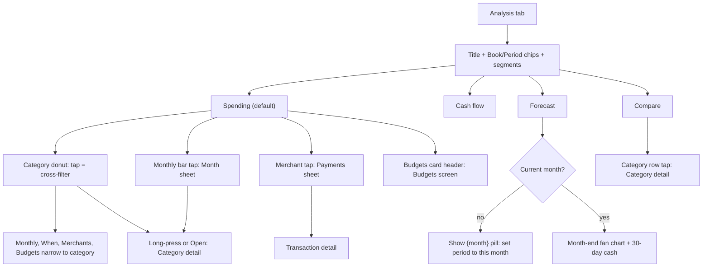

# Analytics

| Field | Value |
|---|---|
| Feature ID | F-18 |
| Status | In progress (domain plus Analysis tab UI: period, four views, donut, trend, heatmap, merchants, budgets, income flow bars, savings rate, forecast, cash projection, compare, insights; Sankey, category-tap filter, layout store, month sheet, recurring plan wiring deferred) |
| Priority | P1 |
| Phase | 4 |
| Last Updated | 2026-10-21 |

## 1. Description

Analytics is the Analysis tab. It explains where the user's money went and where it is heading for the chosen Book and Period, using four views: Spending, Cash flow, Forecast and Compare. It also produces the short plain-language insights shown on Home. It exists so the user can spot overspending, understand their savings rate and see a shortfall coming before it happens.

## 2. What This Feature Will Do

- Shows four views on one tab: Spending, Cash flow, Forecast and Compare, opening on Spending each visit.
- Shows spending by category as a donut with totals, income, saved or overspent and spend per day.
- Filters the other Spending cards to one category when the user taps a slice.
- Shows 12 months of spending split into essentials, lifestyle and other, and opens a month sheet on tap.
- Shows which weekday and time of day the user spends most.
- Lists the top merchants and the payments behind each.
- Shows budget progress for each budgeted category.
- Shows where income went (salary, other income, refunds and interest) across spending groups, investing and saving.
- Calculates the monthly savings rate and its trend.
- Forecasts month-end spend as a range and checks it against the budget.
- Projects the cash balance for the next 30 days and warns of a shortfall.
- Compares this period with the previous one by category.
- Generates up to 5 insights on pace, category drift, regular payments, biggest expense and weekend spending.

### 2.1 Inputs

- Opening the Analysis tab and switching between its four views.
- The global Book and Period choice ([20_search_filters.md](20_search_filters.md)).
- Ledger transactions, accounts and balances, budgets and recurring payments already stored on the phone.
- Taps and long-presses on slices, bars, merchants and category rows.
- Card order and visibility saved in Customise (read only).

### 2.2 Processing

1. Load the ledger slice for the chosen Book and Period, plus the previous period and the last 12 months.
2. Leave out transfers and add up spend and income in rupee-valued amounts.
3. Build the chart data for the selected view, narrowed to a category when one is chosen.
4. For Forecast, estimate the daily everyday-spending rate, add bills still due and compute a low, expected and high month-end figure.
5. For the cash projection, start from known liquid balances, subtract bills and daily spending, add expected income and find the lowest point.
6. For Compare, work out the change per category and sort by size of change.
7. Run the five insight rules in order and keep the first five results.
8. Show a clear message when there is too little data for a card.

### 2.3 Outputs

- The user sees charts, cards, sheets and notes for each view, with amounts masked when hidden.
- Nothing is stored by this feature; all figures are recalculated from the ledger.
- Insights are handed to Home's carousel ([17_dashboard_home.md](17_dashboard_home.md)).
- Taps open the matching category screens ([09_categorization.md](09_categorization.md)), the transaction detail or the Budgets screen ([10_expense_tracking.md](10_expense_tracking.md)).

### 2.4 Out of Scope

- Does not own the Book and Period chips or their store ([20_search_filters.md](20_search_filters.md)).
- Does not create or alert on budgets ([10_expense_tracking.md](10_expense_tracking.md)).
- Does not detect recurring payments or own the Upcoming list ([12_recurring_transactions.md](12_recurring_transactions.md)).
- Does not provide category screens ([09_categorization.md](09_categorization.md)).
- Does not draw the Home insights carousel ([17_dashboard_home.md](17_dashboard_home.md)) or the Customise screen ([28_theming_customisation.md](28_theming_customisation.md)).
- Does not include the proposed Trends and Budgets sub-tabs, the 19-chart catalogue, "View as table" or FIRE and goal forecasts (not in the existing app).

## 3. Behaviour in Existing App

Source: `hisaab_apk/app/src/main/kotlin/com/hisaab/app/ui/analytics/` (`AnalyticsScreen.kt` 422 lines, `AnalyticsSegments.kt` 216, `AnalyticsViewModel.kt` 262, `AnalyticsBudgets.kt` 161), `ui/ledger/Ledger.kt` (`LedgerMath`), `shared/insight/Planning.kt`, `MonthSpend.kt`; analysis Part A 2.5, Part B 4.

`AnalyticsRoute` (`AnalyticsScreen.kt:86`): a scrolling column under the status bar with title "Analysis", `BookPeriodChips`, a `Segmented` control Spending / Cash flow / Forecast / Compare and a 220 ms cross-fade between segments. The segment index is `remember`-ed, not saved: every visit to the tab opens on Spending. A selected category (cross-filter) is `rememberSaveable` by enum name.

Spending segment: cards shown in the order and visibility of `TabLayout.visible("analytics")`, default order `categories`, `monthly`, `merchants`, `budgets`, `when` (labels "Spend by category", "Monthly spend", "Top merchants", "Budgets", "When you spend"). Layout customisation applies only to this segment ([28_theming_customisation.md](28_theming_customisation.md)). When a category is selected a pill "{category} ✕" plus "cross-filter active" appears and monthly, when, merchants and budgets cards narrow to that category.

- `CategoriesCard` "Spend by category": KPI row Spent (red), Income (green), Saved (accent) or Overspent (amber) = `|income - spent|`, Per day; donut 136 dp (16 dp thickness, centre "Spent"); legend of the top 6 with percent `value*100/total` and compact amount; link "All {n} categories" / "Show fewer" expands the rest; hint "Tap to filter the cards below · long-press to open". Tap a slice/legend toggles the cross-filter; long-press (haptic LongPress) opens the category screen with the month when the period is a calendar month or last month. Header action "Open ›" when a category is selected. Empty: "No spending in {period}."
- `MonthlyCard` "Monthly spend · 12 months": stacked bars for the 12 months ending with the period's last month: Essentials / Lifestyle / Other (palette 0, 1, 7), or for a selected category the category vs "Rest" (border colour). Average line = mean of all months except the last (the running one). Tap a bar opens `MonthSheet` (ModalBottomSheet): month total, "▲ n% above avg" / "▼ n% below avg" (vs the mean of the other 11 months, `|diff|*100/avg`), categories sorted by spend with "{pct}% of the month"; tap a category opens its screen for that month. Empty: "No spending in the last 12 months." Legend hint "Tap a bar".
- `WhenCard` "When you spend": 7 weekdays (Mon first) x 8 three-hour slots (labels 6a, 9a, 12p, 3p, 6p, 9p, 12a, 3a) heat grid built from spends with an explicit time only; tap a cell shows "Mon 6p: ₹x · mostly Food" (category suffix only when no cross-filter); a "Peak: Mon–Wed, 6p–9p, mostly Food" line. Empty: "No spends with a time of day in this period."
- `MerchantsCard` "Top merchants": top 6 by total (`merchant ?: bankName`) with bars; tap opens a ModalBottomSheet of up to 60 payments ("Showing the latest 60." when more); tap a payment opens the transaction.
- `BudgetsCard` ([10_expense_tracking.md](10_expense_tracking.md) owns budgets): bullet bars per budgeted category with a limit tick, and a "today's pace" tick only for the current single month; tone green below the alert percent, amber at or above it, red at 100% or more; header action opens Budgets.

Cash flow segment (`CashFlowSegment`): card "Where your income went": empty note "No income recorded in {period}. Once a salary or other credit arrives, this shows where it went." Else KPI row Income, Spent, Invested, Left over (or Shortfall in amber) and a Sankey with inputs Salary, Other income, Refunds & interest and outputs Essentials, Lifestyle, Other, Invested, Saved (`max(saved,0)`); when saved < 0 the note "Spending and investing exceeded income by {amount}." Card "Income vs spend · savings rate": needs at least 2 months with income among the last 12 ("Needs at least two months with income in the last 12."); shows last month's rate with "saved in {month}", sparkline, "avg {pct}% · {n} months", note "Share of each month's income not spent. Months without income are left out."

Forecast segment (`ForecastSegment`): shown only when the period is the current calendar month; otherwise a card "Forecast is for the current month" with the note "It projects this month's spend and your cash for the next 30 days from today." and a pill "Show {month}" (sets the period to this month). Card "Month-end spend forecast": range "₹low – ₹high", "Likely ₹x · within budget (₹b)" or "over budget (₹b) by ₹o" or "no monthly budget set" (red when over), fan chart (actual, expected, range, optional budget line "Budget ₹x"), legend Actual / Expected / Range, note "About ₹r a day in everyday spending, plus ₹b in bills still due." Card "Cash balance · next 30 days": KPI Today, In 30 days, Lowest; sparkline; "Lowest ₹x on {d MMM}"; red box "Shortfall of ₹x around {date}. Move money in before then." when the lowest is negative; note "Liquid bank balances, less {n} bill(s) and ₹r a day of spending, plus {n} expected credit(s)."; empty "No bank balance known yet. Balances are read from bank SMS, or you can set one on an account."

Compare segment (`CompareSegment`): card "{period} vs previous · by category": KPIs this period, previous label, Change (red when spend rose, green when fell, "+"/"−" prefix); rows per category sorted by `|now - before|` desc as `DivergingRow` (percent bar capped at ±50) with "₹before → ₹now"; tap opens the category; note "Green fell, red rose. Bars cap at ±50%. Tap a row to open it." Empty "No spending in either period." Previous label is "MMM yyyy" for month/last-month periods, otherwise "d MMM – d MMM".

Insights engine (`Planning.insights(txs, recurring, today, zone, max = 5)`): consumed by the Home Insights widget ([17_dashboard_home.md](17_dashboard_home.md)); `InsightRow` exists in `HomeParts.kt` "used by Analytics" but no Analysis card shows insights in 2.9.8 (see section 17). Rules in order, then `take(5)`:

1. Pace: spend so far this month (through today's day-of-month) vs the same days last month, both > 0; `pct = (now - last)*100/last` (integer); only if `|pct| >= 10`: "Spending is {pct}% ahead of last month" (WARN) or "Spending is {-pct}% below last month" (GOOD); detail "By day {d} you've spent ₹a, against ₹b by this day last month."
2. Category drift: per category, `avg` = sum of the 3 previous full months / 3 and `now` = this month so far; among categories with `avg > 0` take the one with the largest `now - avg`; only if `now - avg >= 50,000` paise: "{Category label} is above your usual" (WARN), detail "₹now so far this month against a 3-month average of ₹avg."
3. Regular payments: when recurring (non-income) is non-empty: "{n} regular payments, ₹total a month" (INFO); detail "Including {k} subscription(s) and bills worth ₹x." (subs = SUBSCRIPTIONS, ENTERTAINMENT or BILLS) else "Rent, EMIs, SIPs and premiums that come every month."
4. Biggest expense: the largest DEBIT this month: "Biggest expense: ₹x" (INFO), detail "{merchant or category} on {day} {Mon}."
5. Weekend share: `pct = weekendSpend*100/monthSpend`; if `>= 45`: "{pct}% of spending is on weekends" (INFO), detail "Weekends are 2 days in 7, but most of the money goes then."

Inputs for rules: DEBIT, `!needsReview`, currency INR, amounts as raw `amountMinor`. Rupee text format is Indian grouping without paise (`₹1,23,456`).

## 4. User Stories

1. As a user I see where this month's money went by category and tap a slice to filter the other cards to it.
2. As a user I see my last 12 months of spending split into essentials, lifestyle and other, and open any month.
3. As a user I learn which weekday and time of day I spend most.
4. As a user I see my top merchants and their payments.
5. As a user I see how my income split into spending, investing and saving, and my savings rate over time.
6. As a user I see where this month's spend will land and whether my bank balance will run short in the next 30 days.
7. As a user I compare this period with the previous one per category.
8. As a user I get plain-language insights about pace, category drift, regular payments, the biggest expense and weekend spending.

## 5. Functional Requirements (FR-18-01 ...)

1. FR-18-01: The Analysis tab shows title, Book/Period chips and four segments (Spending, Cash flow, Forecast, Compare); it opens on Spending every visit; switching cross-fades over 220 ms.
2. FR-18-02: Spending cards follow the analytics section order and visibility from the layout store (`categories`, `monthly`, `merchants`, `budgets`, `when`; all visible by default).
3. FR-18-03: Spend by category: KPIs (Spent, Income, Saved/Overspent, Per day = `spent / days`), donut over all spend categories, legend of 6 with an expander for the rest, tap = cross-filter toggle, long-press = open category (with month when a calendar month).
4. FR-18-04: The cross-filter narrows Monthly, When, Merchants and Budgets cards to the chosen category and shows a removable pill.
5. FR-18-05: Monthly spend shows 12 months ending with the period's last month as stacked Essentials/Lifestyle/Other bars (or category vs Rest), the average line excluding the latest month, and a month sheet on tap.
6. FR-18-06: When-you-spend builds the weekday x 3-hour grid from spends with an explicit time only, with cell detail and the peak summary (neighbouring days within 60% of the peak widen the range).
7. FR-18-07: Top merchants shows the 6 largest merchants (`merchant ?: bankName`); tapping one lists up to 60 latest payments with the "Showing the latest 60." note.
8. FR-18-08: Budgets card measures each budget against the period spend in its category; limit = monthly limit x calendar months spanned by the period; pace tick only for the current single month; tone thresholds at the alert percent (fallback 80 when outside 1..100) and 100.
9. FR-18-09: Cash flow card shows KPIs (Income, Spent, Invested, Left over/Shortfall), the Sankey with the three income inputs and five outputs, and the shortfall note when `saved < 0`.
10. FR-18-10: Income classification for the Sankey: SALARY category -> Salary; REFUND category or merchant containing "interest" (case-insensitive) -> Refunds & interest; every other income credit -> Other income.
11. FR-18-11: Savings-rate card requires at least 2 months with income among the last 12; rate per month = `(income - spent) * 100 / income`, clamped to -100..100 (investments not deducted); shows latest rate, average (rounded) and month count.
12. FR-18-12: Forecast appears only when the period is the current calendar month; otherwise a "Show {month}" pill switches the global period to this month.
13. FR-18-13: Month-end forecast: `expected[i] = base + billsBy(i) + rate * i` for `i = 0..daysRemaining`; `low` and `high` scale only the discretionary part by 0.8 and 1.2; verdict against the sum of budgets as specified in section 10.
14. FR-18-14: The discretionary daily rate follows section 10 (3-month prior blend, day < 7 uses prior only, FIXED categories excluded).
15. FR-18-15: Cash projection uses liquid accounts with a known balance; subtracts recurring bills, adds recurring incomes, skips non-debit credit-card charges, includes non-monthly insurance premiums, and subtracts the daily rate each day; reports start, end, lowest and its date, bill and income counts; shows the shortfall box when the lowest < 0; shows an empty note when no liquid balance is known.
16. FR-18-16: Compare shows this vs previous period spend with change, and per-category rows sorted by absolute difference, percent per the rule in section 10, bar capped at +-50%, tap opens the category.
17. FR-18-17: Insights engine produces up to 5 insights in the order pace, category drift, regular payments, biggest expense, weekend share with the thresholds in section 10.
18. FR-18-18: All sums are over rupee-valued amounts (`inrMinor`, else `amountMinor` when INR, else 0), exclude TRANSFER-category rows from spend and income, and are masked when amounts are hidden.
19. FR-18-19: Empty and insufficient-data states use the exact texts in section 2; nothing renders until the ledger slice has loaded.
20. FR-18-20: Every chart point or bar that is tappable opens the matching drill-down (category screen, transaction, month sheet) with the month where applicable.
21. FR-18-21: Scope/kind-filtered aggregates (`categoryTotalsFor`, `monthlyFor`, `dailyFor`, `topMerchantsFor`) and `monthlyForAccount` shall follow the exact semantics in section 9 (types, `inrMinor IS NOT NULL`, scope, kind, day and month bucketing, merchant fallback).
22. FR-18-22: The personal/business rule shall treat a transaction with no account as personal; per-account monthly rollups shall include the account, its linked debit cards and accounts merged into it (and cards linked to merged accounts).
23. FR-18-23: The shared chart components listed in section 10 (chart inventory) shall be implemented once under `shared`/`features/analytics/presentation/charts`, with `StackedArea` not ported.

## 6. Non-Functional Requirements (performance, battery, privacy, offline)

- Performance: all aggregation runs off the UI thread in a pure Dart `AnalyticsMath.build` (isolate for large lists); recomputed only when the ledger slice, plan snapshot, budgets or alert percent change; target under 50 ms per chart for 50,000 rows; forecasts under 20 ms.
- Battery: no timers, no polling.
- Privacy: on-device only; amounts masked when hide-amounts is on, including chart labels and tooltips.
- Offline: fully offline.
- Accessibility: charts expose semantic labels (category, amount, percent); long-press has a visible alternative ("Open ›" action); colours never carry meaning alone (arrows and signs accompany red/green).
- Determinism: all date maths in the user's zone (`Periods.zone`, the device zone); ledger day buckets in IST (see [20_search_filters.md](20_search_filters.md) section 17 for the zone question).

## 7. UI / Screens & User Flow (screen list + flow diagram)

| Screen / sheet | Source (Kotlin) | Notes |
|---|---|---|
| Analysis: Spending | `AnalyticsScreen.kt:86,130` | Cross-filter, 5 cards |
| Category donut card | `AnalyticsScreen.kt:158` | Legend, expander |
| Monthly spend card | `AnalyticsScreen.kt:232` | 12 stacked bars |
| Month sheet | `AnalyticsScreen.kt:276` | ModalBottomSheet |
| When you spend card | `AnalyticsScreen.kt:312` | Heat grid |
| Top merchants card and payments sheet | `AnalyticsScreen.kt:352` | 6 merchants, 60 payments |
| Budgets card | `AnalyticsBudgets.kt` | Bullet bars |
| Analysis: Cash flow | `AnalyticsSegments.kt:46` | Sankey, savings rate |
| Analysis: Forecast | `AnalyticsSegments.kt:108` | Fan chart, cash 30 days |
| Forecast not-current-month state | `AnalyticsSegments.kt:109` | "Show {month}" pill |
| Analysis: Compare | `AnalyticsSegments.kt:187` | Diverging bars |



Reference GIFs (all Status: Pending, not yet captured):

-  (Status: Pending, not yet captured)
-  (Status: Pending, not yet captured)
-  (Status: Pending, not yet captured)
-  (Status: Pending, not yet captured)
-  (Status: Pending, not yet captured)
-  (Status: Pending, not yet captured)
-  (Status: Pending, not yet captured)
-  (Status: Pending, not yet captured)
-  (Status: Pending, not yet captured)
-  (Status: Pending, not yet captured)

## 8. Data Models (Dart entities + fields + types)

In `lib/features/analytics/domain/entities/`. Amounts `int` paise; `Category` from [09_categorization.md](09_categorization.md); `YearMonth` is a small value type (`year`, `month`) in `core/`.

```dart
enum SpendGroup { essentials, lifestyle, other }
enum Tone { good, warn, info }

@freezed
class Insight with _$Insight {
  const factory Insight({required String title, required String detail, required Tone tone}) = _Insight;
}

@freezed
class CategoryChange with _$CategoryChange {
  /// percent is +100 for a new category and -100 for one that stopped; otherwise (now-before)*100/before clamped -999..999.
  const factory CategoryChange({required Category category, required int now, required int before, required int percent}) = _CategoryChange;
}

@freezed
class MonthFlow with _$MonthFlow {
  const factory MonthFlow({
    required YearMonth month, required int spent, required int income, required int invested,
    required Map<SpendGroup, int> byGroup,
  }) = _MonthFlow;
}

@freezed
class MerchantSpend with _$MerchantSpend {
  const factory MerchantSpend({required String name, required int total, required int count, required Category category}) = _MerchantSpend;
}

@freezed
class BudgetUse with _$BudgetUse {
  const factory BudgetUse({required Category category, required int limit, required int spent}) = _BudgetUse; // limit = monthly * months
}

@freezed
class BudgetSummary with _$BudgetSummary {
  const BudgetSummary._();
  const factory BudgetSummary({
    @Default([]) List<BudgetUse> lines,
    @Default(1) int months,
    @Default(80) int alertPercent,
    double? pace, // day/daysInMonth for the current single month, else null
  }) = _BudgetSummary;
  int get limit => lines.fold(0, (a, b) => a + b.limit);
  int get spent => lines.fold(0, (a, b) => a + b.spent);
}

@freezed
class Forecast with _$Forecast {
  const factory Forecast({
    required YearMonth month,
    required List<int> actual,      // cumulative, days 1..today
    required List<int> expected,    // index 0 = today
    required List<int> low,
    required List<int> high,
    required int likely, required int lowEnd, required int highEnd,
    required int billsLeft, required int dailyRate,
  }) = _Forecast;
}

@freezed
class CashProjection with _$CashProjection {
  const factory CashProjection({
    required List<int> series,      // 31 values, index 0 = today
    required int start, required int lowest, required DateTime lowestOn,
    required int bills, required int incomes, required int dailyRate,
  }) = _CashProjection;
}

@freezed
class AnalyticsData with _$AnalyticsData {
  const factory AnalyticsData({
    required LedgerSlice slice,
    @Default(0) int spent, @Default(0) int income, @Default(0) int invested, @Default(0) int perDay,
    @Default([]) List<(Category, int)> categories,       // sorted desc, > 0
    @Default({}) Map<SpendGroup, int> groups,
    @Default([]) List<MonthFlow> monthly,                // 12 months
    @Default(0) int salary, @Default(0) int otherIncome, @Default(0) int refunds,
    @Default([]) List<(YearMonth, double)> savingsRates, // months with income
    @Default([]) List<CategoryChange> changes,
    @Default(0) int previousSpent, @Default('') String previousLabel,
    @Default(false) bool isCurrentMonth,
    @Default(0) int budget,                              // sum of monthly limits
    @Default(BudgetSummary()) BudgetSummary budgets,
    Forecast? forecast, CashProjection? cash,
    @Default(false) bool loaded,
  }) = _AnalyticsData;
}
```

`LedgerSlice` (period txs, previous txs, 12-month `year` list, `months`, visible accounts, `loaded`) is defined in [20_search_filters.md](20_search_filters.md). `UpcomingPayment` and `Recurring` in [12_recurring_transactions.md](12_recurring_transactions.md).

## 9. Database Tables / Changes

No tables owned. Reads `transactions` (`timestamp`, `type`, `category`, `amountMinor`, `inrMinor`, `currency`, `merchant`, `bankName`, `accountId`, `hasExplicitTime`, `needsReview`, `customCategoryId`), `budgets` (`category` PK, `monthlyLimitMinor`), `accounts` (balances, kind, type, `usage`), the plan snapshot from recurring/policies, and `app_settings.budget_alert_percent` (default 90; the UI offers 80/90/95; see [21_alerts_reminders.md](21_alerts_reminders.md)). Layout keys `tab_layout.order_analytics` (csv) and hidden entries `analytics:<key>`.

Suggested Drift helpers (no schema change): `TransactionDao.watchBetween(fromMs, toMs)` (the period plus the previous period and the 12-month window in one query: `min(previousFrom, firstOfMonth(11 months before))` to period end), `AccountDao.watchWithActivity()`, `BudgetDao.watchAll()`; existing index `index_transactions_timestamp` is the one that matters.

### Filtered analytics SQL (`TransactionDao`, `Daos.kt:108-172`)

Common filters for `categoryTotalsFor`, `monthlyFor`, `dailyFor`, `topMerchantsFor`: `inrMinor IS NOT NULL AND timestamp BETWEEN :from AND :to`; no `needsReview` and no `duplicateOfId` filter. `scope` in ALL | PERSONAL | BUSINESS: ALL = no filter; PERSONAL = `accountId IS NULL OR accountId IN (accounts WHERE usage = 'PERSONAL')`; BUSINESS = `accountId IN (accounts WHERE usage = 'BUSINESS')`. `kind` in ALL | ACCOUNT | CARD: ALL = no filter, else `accountKind = :kind`.

| Query | Types counted | Returns | Grouping and order |
|---|---|---|---|
| `categoryTotalsFor(from,to,scope,kind)` | DEBIT, INVESTMENT | `category`, `SUM(inrMinor)` | by category, total DESC |
| `monthlyFor(from,to,offsetMillis,scope,kind)` | spent = DEBIT + INVESTMENT; income = CREDIT; TRANSFER ignored | `month` (`strftime('%Y-%m', (timestamp+offset)/1000, 'unixepoch')`), `spent`, `income` | by month, month ASC |
| `dailyFor(from,to,offsetMillis,scope,kind)` | DEBIT, INVESTMENT | `day = (timestamp+offsetMillis)/86400000` (integer epoch day in the zone's offset), `SUM(inrMinor)` | by day, day ASC |
| `topMerchantsFor(from,to,limit,scope,kind)` | DEBIT, INVESTMENT | `COALESCE(merchant, bankName)` as name, `SUM(inrMinor)`, `COUNT(*)` | by name, total DESC, `LIMIT :limit` |
| `monthlyForAccount(accountId,from,to,offsetMillis)` | same spent/income split as `monthlyFor`; no scope/kind | `month`, `spent`, `income` | rows where `accountId = :accountId` OR account's `linkedAccountId = :accountId` (debit cards) OR `mergedIntoId = :accountId` OR `linkedAccountId` in accounts merged into it; month ASC |

`offsetMillis` is the zone's UTC offset at `from` (`Periods.offsetMillis`), so buckets break at local midnight. Call sites: only `monthlyForAccount` is called (`AccountDetailScreen.kt:144`, [Accounts Management](13_accounts_management.md)); the four scope/kind queries have no call site in 2.9.8 (the Analysis screen aggregates the in-memory `LedgerSlice` instead), so port them only for parity or when a scope/kind filter is exposed.

## 10. Business Rules & Logic (regex, parsing rules, algorithms, thresholds)

Definitions (`LedgerMath`, `Ledger.kt:198-252`):

- `rupees(t) = t.inrMinor ?? (t.currency == 'INR' ? t.amountMinor : 0)`.
- `isSpend = type == DEBIT && category != TRANSFER`; `isIncome = type == CREDIT && category != TRANSFER` (refunds included); `isInvest = type == INVESTMENT`.
- Groups (`group(category)`): ESSENTIALS = RENT, BILLS, GROCERIES, TRANSPORT, FUEL, HEALTH, EDUCATION, INSURANCE, EMI_LOAN, HOUSEHOLD, TAXES, FEES; LIFESTYLE = FOOD, SHOPPING, ENTERTAINMENT, TRAVEL, SUBSCRIPTIONS, PERSONAL_CARE, GIFTS, DONATIONS; OTHER = everything else (OTHER, CASH, SALARY, INCOME, REFUND, TRANSFER, INVESTMENT).
- `byCategory`: spend rows grouped by category, sum > 0, sorted desc. `byMerchant`: group by `merchant ?? bankName`, total, count, most frequent category (ties: first max), sorted by total desc.
- `monthly(txs, months)`: per month `MonthFlow` from `spent`, `income`, `invested`, `byGroup`.
- `heat`: for spend rows with `hasExplicitTime`, local time in the user zone, `slot = ((hour - 6 + 24) % 24) ~/ 3` (6-9 -> 0 ... 3-6 -> 7), row = `dayOfWeek - 1` (Monday 0).
- `cumulative(txs, month)`: running spend per day 1..monthLength.

`AnalyticsMath.build`:

- `days = max(1, daysBetween(slice.from, min(slice.to, today)) + 1)`; `perDay = spent ~/ days`.
- Income buckets over `isIncome` rows: SALARY -> salary; REFUND category or merchant containing "interest" (case-insensitive) -> refunds; else other.
- `changes`: union of categories of the period and the previous period; `percent = before == 0 ? 100 : now == 0 ? -100 : clamp((now - before) * 100 ~/ before, -999, 999)`; sorted by `|now - before|` desc. Previous period: previous calendar month for MONTH/LAST_MONTH else the equal-length period just before ([20_search_filters.md](20_search_filters.md)).
- `savingsRates`: from the 12 `MonthFlow` with `income > 0`: `((income - spent) * 100.0 / income).clamp(-100, 100)`.
- `isCurrentMonth = kind == MONTH && month == currentMonth`.
- Budgets: `months = monthsBetween(YearMonth(from), YearMonth(to)) + 1` (min 1); lines = budgets with limit > 0: `limit * months`, spent = period category spend, sorted by `spent/limit` desc; `pace = today.day / monthLength` only if `months == 1`, the month is the current month and `to >= today`; `alertPercent = value in 1..100 ? value : 80`.

FIXED categories (excluded from the daily rate): RENT, BILLS, EMI_LOAN, INSURANCE, SUBSCRIPTIONS, TAXES, EDUCATION.

Discretionary rate (`discretionaryRate(year, today)`, integer division throughout):

1. Spend rows of the 12-month list with category not in FIXED grouped by year-month.
2. `prior` = the 3 months before the current month that have any such spend.
3. `priorRate = sum(rupees over prior months) ~/ sum(lengthOfMonth(m) for m in prior)` (null when `prior` empty).
4. `curRate = currentMonthSum ~/ today.day`.
5. Result: `priorRate == null -> curRate`; `today.day < 7 -> priorRate`; else `(priorRate + curRate) ~/ 2`.

Forecast (`forecast(txs, plan, rate, today)`), only when `isCurrentMonth`:

- `d0 = today.day`, `actual = cumulative(txs, month).take(d0)`, `base = actual.last ?? 0`, `remaining = monthLength - d0`.
- `bills` = plan upcoming items that are not INCOME kind, due in this month and not before today. `billsBy(i) = i == 0 ? 0 : sum(bill.amount where bill.due.day <= d0 + i)`.
- `expected[i] = base + billsBy(i) + rate * i`; `low[i] = base + billsBy(i) + rate * i * 8 ~/ 10`; `high[i] = base + billsBy(i) + rate * i * 12 ~/ 10` for `i = 0..remaining`.
- `likely = expected.last`, `lowEnd = low.last`, `highEnd = high.last`, `billsLeft = billsBy(remaining)`.
- Budget verdict: `budget = sum(all monthly budget limits)`; none -> "no monthly budget set"; `likely <= budget` -> "within budget"; else over by `likely - budget`.

Worked example (today 17 Oct 2026; prior months Jul 31 + Aug 31 + Sep 30 = 92 days with discretionary spend ₹1,38,000; this month discretionary ₹27,200 over 17 days; spent so far ₹60,000; bills left EMI ₹12,000 on the 25th and ₹649 on the 28th): `priorRate = 13,800,000 ~/ 92 = 150,000` paise; `curRate = 2,720,000 ~/ 17 = 160,000`; `rate = (150,000 + 160,000) ~/ 2 = 155,000`; `remaining = 14`; `expected.last = 6,000,000 + 1,264,900 + 155,000*14 = 9,434,900`; `low.last = 6,000,000 + 1,264,900 + 1,736,000 = 9,000,900`; `high.last = 6,000,000 + 1,264,900 + 2,604,000 = 9,868,900`.

Cash projection (`cash`):

1. `liquid` = visible accounts where `isLiquid` and `currentBalanceMinor != null`; none -> null. `start = sum(balances)`; `end = today + 30`.
2. `events[0..30]`. `add(date, amount)` ignores dates before today or after `end`, index = `max(1, daysBetween(today, date))`, counts bills (amount < 0) and incomes.
3. For each recurring item `r` (detected plus manual plus loan EMIs): skip when it is an expense on a non-debit card account (card charges reach the bank only when the bill is paid); else start at `r.nextDue`, add `±amount` each month while `<= end`; yearly items add once.
4. Add each non-monthly insurance upcoming item as `-premium` on its due date.
5. `series[0] = start`; for `i in 1..30`: `bal += events[i] - rate`; `lowest = min(series)`, `lowestOn = today + indexOfMin`.

Insights thresholds: pace `|pct| >= 10`; drift `now - avg >= 50,000` paise (₹500) and `avg > 0`; weekend `pct >= 45`; max 5.

Sample fixtures (masked): see section 15.

### Chart-component inventory (`ui/charts/ProtoCharts.kt`, `Charts.kt`)

| Component | Source | Used by |
|---|---|---|
| DonutChart | `Charts.kt:73` | Analysis spending donut (`AnalyticsScreen.kt:182`); Category detail (`CategoryDetailScreen.kt:155`); Home By category ([17](17_dashboard_home.md)); Portfolio allocation ([16](16_portfolio.md)) |
| Sparkline | `ProtoCharts.kt:52` | Analysis savings rate and cash projection (`AnalyticsSegments.kt:93,162`); Home trends; Portfolio net worth and row trends |
| ProgressRing | `ProtoCharts.kt:72` | Home Safe to spend and Budgets widget ([17](17_dashboard_home.md), [10](10_expense_tracking.md)) |
| StackedMonthBars | `ProtoCharts.kt:91` | Analysis monthly bars (`AnalyticsScreen.kt:252`); Loans ([15](15_loans.md)) |
| Sankey | `ProtoCharts.kt:176` | Analysis Cash flow (`AnalyticsSegments.kt:61`) |
| FanChart | `ProtoCharts.kt:228` | Analysis forecast (`AnalyticsSegments.kt:133`) |
| HeatGrid | `ProtoCharts.kt:277` | Analysis "When you spend" (`AnalyticsScreen.kt:324`) |
| DivergingRow | `ProtoCharts.kt:304` | Analysis period compare (`AnalyticsSegments.kt:207`) |
| StackedArea | `ProtoCharts.kt:144` | DEAD CODE: no call site; do not port |
| GroupedBarChart, AreaLineChart | `Charts.kt:162,233` | No call site found in 2.9.8; do not port unless a screen needs them |

Flutter: `fl_chart` for donut and bars; `CustomPainter` for Sankey, FanChart, HeatGrid, ProgressRing, Sparkline.

## 11. Platform / Native Requirements (permissions, channels, background work)

None native. Haptic feedback on legend long-press (`HapticFeedback.heavyImpact`/`mediumImpact`). Charts drawn in Flutter (`fl_chart` for lines/bars/donut; custom `CustomPainter` for Sankey, heat grid, fan chart, diverging rows). No permissions, no background work; data comes from local database streams.

## 12. Dependencies (other features → link to their memory file; packages)

Features: [20_search_filters.md](20_search_filters.md) (global Book + Period, ledger slice, previous period), [08_transactions_ledger.md](08_transactions_ledger.md) (transactions data), [09_categorization.md](09_categorization.md) (categories, category screen), [10_expense_tracking.md](10_expense_tracking.md) (budgets, spend semantics), [11_income_tracking.md](11_income_tracking.md) (income classification), [12_recurring_transactions.md](12_recurring_transactions.md) (recurring, upcoming, policies), [13_accounts_management.md](13_accounts_management.md) (liquid balances), [14_credit_cards.md](14_credit_cards.md) (card charges excluded from cash), [15_loans.md](15_loans.md) (loan EMIs as recurring), [17_dashboard_home.md](17_dashboard_home.md) (insights carousel), [21_alerts_reminders.md](21_alerts_reminders.md) (alert percent), [28_theming_customisation.md](28_theming_customisation.md) (section layout), [23_forex_rates.md](23_forex_rates.md) (`inrMinor`).

Packages: `fl_chart`, `flutter_riverpod`, `freezed`, `drift`, `intl` (en-IN), `collection`.

## 13. Folder Location (lib/features/<name>/...)

```text
lib/features/analytics/
  data/
    analytics_repository_impl.dart          # combines ledger slice, plan snapshot, budgets, alert percent
  domain/
    entities/analytics_data.dart, forecast.dart, cash_projection.dart, budget_summary.dart, insight.dart, category_change.dart
    usecases/analytics_math.dart            # build, discretionaryRate, forecast, cash, budgetSummary
    usecases/ledger_math.dart               # rupees, isSpend, byCategory, byMerchant, heat, cumulative, group
    usecases/insights_engine.dart           # Planning.insights port
  presentation/
    analytics_screen.dart
    providers/analytics_providers.dart       # segment index (non-persistent), selectedCategory (saveable)
    widgets/spending_segment.dart, categories_card.dart, monthly_card.dart, month_sheet.dart, when_card.dart,
            merchants_card.dart, budgets_card.dart, cash_flow_segment.dart, forecast_segment.dart, compare_segment.dart,
            charts/ (donut, stacked_bars, heat_grid, sankey, fan_chart, diverging_row, sparkline)
```

## 14. Edge Cases & Error Handling

- Ledger not loaded: render nothing (no empty-state flash).
- No income in the period: Cash flow card shows the note only; savings rate card needs >= 2 income months.
- `saved < 0` in Cash flow: Sankey "Saved" is 0 and a shortfall note is shown.
- No budgets: forecast verdict "no monthly budget set"; budgets card lists nothing.
- Forecast when today is day 1: `actual` has 1 point, prior rate used (`today.day < 7`).
- No prior months with spend: rate = current month rate; day 1 with no spend gives 0.
- Bills already paid today are included at `i >= 1` because `billsBy` uses `due.day <= d0 + i` (see section 17).
- Cash projection with only card/non-liquid accounts: null -> empty note.
- Hidden accounts excluded from the account list used for cash.
- Foreign spend without a rate is excluded (0).
- A custom range or FY: Forecast shows the "Show {month}" pill; Compare uses the equal-length previous period; budgets scale by months spanned.
- Category cross-filter applied then period changed: the selection persists (saveable), cards show empty states if the category has no spend.
- Heat grid ignores transactions without an explicit time (e.g. statement rows, date-only sources).
- Percent clamps: category change -999..999; savings rate -100..100; diverging bar +-50.
- Analytics DAO queries ignore `needsReview` and `duplicateOfId` (parity); a row with null `inrMinor` is skipped by every query in section 9.
- A transaction with no account counts in PERSONAL scope and never in BUSINESS scope (FR-18-22).

## 15. Test Cases (unit / widget / integration + sample fixtures)

Unit:

1. TC-18-01 (FR-18-18, FR-18-03): `LedgerMath.spent/income/invested` on the fixture list excludes TRANSFER and uses `inrMinor`; a USD row with `inrMinor = null` adds 0.
2. TC-18-02 (FR-18-14): discretionary rate worked example gives 155,000; day 5 returns prior only (150,000); no prior months returns current rate; a RENT row never affects the rate.
3. TC-18-03 (FR-18-13): forecast worked example gives expected 9,434,900, low 9,000,900, high 9,868,900; verdict "over budget" for budget 90,000.00.
4. TC-18-04 (FR-18-15): cash projection: balances 50,000.00, rate 155,000, one EMI 12,000.00 on day 8 and a salary 85,000.00 on day 15 -> series values, lowest and date; credit-card recurring expense skipped; yearly item counted once.
5. TC-18-05 (FR-18-16): category change rules: new category = +100, stopped = -100, 3,000 vs 2,000 = +50, ordering by absolute difference.
6. TC-18-06 (FR-18-17): insights: pace 9% -> no insight, 10% -> WARN, -10% -> GOOD; drift 49,999 paise -> none, 50,000 -> WARN; weekend 44% none, 45% INFO; at most 5; order stable.
7. TC-18-07 (FR-18-06): `heat` slot mapping: 06:00 -> 0, 08:59 -> 0, 09:00 -> 1, 00:00 -> 6, 03:00 -> 7, 05:59 -> 7; rows without explicit time ignored; peak range widening at 60%.
8. TC-18-08 (FR-18-08): budget summary for a 3-month custom period scales limits x3; pace null; alertPercent 0 falls back to 80; tone thresholds.
9. TC-18-09 (FR-18-10, FR-18-11): income buckets: "Interest credit" merchant -> refunds; savings rates skip months without income and clamp to -100..100.
10. TC-18-10 (FR-18-05): monthly average excludes the last month; month sheet percent above avg uses the mean of the other 11 months.

Widget:

11. TC-18-11 (FR-18-01, FR-18-02): opens on Spending each time; hidden `when` section not rendered; order follows the layout store.
12. TC-18-12 (FR-18-03, FR-18-04): tapping a donut slice toggles the pill and narrows monthly/merchants/when/budgets; long-press opens the category route with `?month=`.
13. TC-18-13 (FR-18-12): custom range on Forecast shows the explanatory card and pill; tapping pill sets current month.
14. TC-18-14 (FR-18-07): merchant sheet lists 60 items max and the "Showing the latest 60." note for 61.

Integration:

15. TC-18-15 (FR-18-09, FR-18-19): ingest salary + spends fixtures -> Cash flow Sankey values equal group sums and "Left over".
16. TC-18-16 (FR-18-20): tapping a month bar -> sheet -> category row -> category screen for that month.

Fixtures (masked): `Salary credited Rs 85,000.00 to a/c XX1234`; `Rs 1,20,000.00 debited a/c XX1234 to VPA landlord@okhdfc (Rent)`; `Rs 2,450.50 debited ... swiggy@icici`; interest `Int.Pd Rs 412.00 credited a/c XX1234`.
- TC-18-17 (FR-18-21, FR-18-22): `categoryTotalsFor`/`monthlyFor`/`dailyFor`/`topMerchantsFor` with scope and kind fixtures; no-account row is personal; `monthlyForAccount` includes linked debit card and merged-account rows; `dailyFor` day bucket flips at local midnight.

## 16. Acceptance Criteria

1. AC-18-01: Segments, ordering and opening on Spending behave as specified. (FR-18-01, FR-18-02; TC-18-11)
2. AC-18-02: Category donut, legend, expander and cross-filter narrow the dependent cards. (FR-18-03, FR-18-04; TC-18-12)
3. AC-18-03: Monthly bars, month sheet, merchants and when-grid reproduce the Kotlin figures on the golden dataset. (FR-18-05, FR-18-06, FR-18-07; TC-18-07, TC-18-10, TC-18-14)
4. AC-18-04: Budgets card tones and scaling match. (FR-18-08; TC-18-08)
5. AC-18-05: Cash flow Sankey and savings rate match, including empty states. (FR-18-09, FR-18-10, FR-18-11; TC-18-09, TC-18-15)
6. AC-18-06: Forecast numbers equal the worked example to the paisa; non-current periods show the pill. (FR-18-12, FR-18-13, FR-18-14; TC-18-02, TC-18-03, TC-18-13)
7. AC-18-07: Cash projection matches, including card-charge skip and shortfall box. (FR-18-15; TC-18-04)
8. AC-18-08: Compare rows and bars match. (FR-18-16; TC-18-05)
9. AC-18-09: Insights fire exactly at the thresholds and in order. (FR-18-17; TC-18-06)
10. AC-18-10: Amounts are rupee-valued, TRANSFER-free and masked when hidden; all drill-downs open with the right month. (FR-18-18, FR-18-20; TC-18-01, TC-18-16)

## 17. Open Questions

1. Spend/income definitions differ between Analysis (`LedgerMath`: refunds count as income, not netted from spend) and the Home Spent widget (`MonthSpend`: refunds net against spend, excluded from income) and `Planning.month` (INVESTMENT excluded; uses raw `amountMinor` and INR only). One canonical definition is needed ([10_expense_tracking.md](10_expense_tracking.md) is the intended owner).
2. Savings rate here is `(income - spent) / income` (investments not deducted) but Home's savings rate deducts investments (`saved = income - spent - invested`). Same label "savings rate", different numbers.
3. Insights are not shown anywhere in Analysis (the `InsightRow` helper "used by Analytics" is unused there) and the insight inputs are not filtered by Book/Period; confirm the Flutter Analysis tab should not show them, or add a card.
4. Insights count all DEBIT rows including TRANSFER-category ones, and use `amountMinor` (INR only) rather than `inrMinor`.
5. Forecast double counts bills that are also in non-FIXED categories (a recurring gym/health payment is in the discretionary rate and added again via `billsBy`). Also `billsBy` includes a bill due today even if already paid and already part of `actual`. Fix or keep parity?
6. Forecast `low`/`high` scale only the discretionary part; the spec text says "low 80% / high 120% of daily rate". Confirm intended.
7. `alertPercent` fallback is 80 here while the stored default is 90 (analysis Part A Open Question 2). Confirm 90 canonical.
8. The 12-month window ends at the period's last month; for a custom range spanning more than 12 months the monthly card covers only the last 12.
9. Time zone: `Periods.zone` is the device zone for all analysis buckets while the parser and ledger day keys use IST; a device not in IST may bucket late-night spends differently.
10. Category percent shown as integer division (truncation toward zero for positives) - confirm no rounding is wanted.
11. Proposed (v2 spec, not existing) Trends and Budgets sub-tabs and the 19-chart catalogue are not part of this feature; add new memory files only when scheduled.

## 18. Implementation Notes

Phase 4 domain logic (no UI, no repository wiring). Code in `lib/features/analytics/domain/`: `ledger_math.dart`, `analytics_models.dart`, `analytics_math.dart`, `civil_date.dart` (shared day helpers, default IST offset per Open Question 9; `YearMonth` is a first-of-month UTC `DateTime`). Budget types are reused from `expense_tracking/domain` (`Budget`, `BudgetUse`, `BudgetSummary`, `BudgetMath`).

FR status: done in domain: FR-18-03 (KPIs, categories), 05 (monthly, `averageExcludingLast`, `monthVsAverage`), 06 (`heat`, `heatPeak`, `peakText`, `topCategoryInCell`), 07 (`topMerchants`, `merchantPayments` 60 cap), 08 (`budgetSummary`), 09/10 (`sankey`, income classification), 11 (`savingsRates`, `savingsSummary`), 13/14 (`forecast`, `discretionaryRate`), 15 (`cash`), 16 (`changes`, `CategoryChange.barPercent`), 17 (`insights`), 18, plus weekly/daily buckets (`weekly`, `daily`) for FR-18-21 semantics on in-memory rows. Pending: FR-18-01/02/04/12/19/20/22/23 (UI, layout store, period state), the SQL-side aggregates of section 9 (repository, S1), and all screens.

Public API:
- `LedgerMath` (all static, paise): `rupees, isSpend, isIncome, isInvest, spent, income, invested, group(Category) -> SpendGroup, byCategory -> List<(Category,int)>, byGroup, byMerchant, topMerchants({n=6}), merchantPayments(txs, name, {limit=60}) -> ({payments, truncated}), monthly(txs, months, {offset}) -> List<MonthFlow>, heat(txs, {offset}) -> List<List<int>> (7x8, Monday first, slots 6a..3a), heatPeak(grid) -> HeatPeak?, peakText, topCategoryInCell, weekly, daily, cumulative(txs, month) -> List<int>, averageExcludingLast, monthVsAverage`.
- `AnalyticsMath.build({required AnalyticsSlice slice, required PlanSnapshot plan, required List<Budget> budgets, required int alertPercent, required DateTime today, Duration offset}) -> AnalyticsData`; `discretionaryRate(year, today)`, `forecast(txs, plan, rate, today) -> Forecast` (`likely/lowEnd/highEnd`, `verdict(budget)`), `cash(slice, plan, rate, today) -> CashProjection?`, `savingsRates`, `savingsSummary`, `sankey(AnalyticsData) -> CashFlowSankey`, `budgetSummary`, `insights(txs, recurring, today, {max=5}) -> List<Insight>`, `rupeeText(int)`, `monthLabel`, `shortDay`.
- Inputs defined here: `AnalyticsSlice{txs, previous, year, months, from, to, kind, month, previousFrom, previousTo, accounts, loaded}`, `CashAccount`, `PlannedPayment`, `UpcomingItem`, `PlanSnapshot` (reduced shapes of memory 12 `Recurring`/`UpcomingPayment`; the wiring agent maps to them).

Decisions: budget `alertPercent` fallback is 90 (`BudgetMath.normaliseAlertPercent`, memory 10 canonical), overriding the Kotlin/FR-18-08 fallback 80 (Open Question 7 closed). Forecast keeps Kotlin parity for Open Questions 5 and 6 (bills double count, 0.8/1.2 scale on the discretionary part only). Insights keep parity for Open Question 4 (all DEBIT rows, raw INR `amountMinor`) and ignore recurring income rows. Savings-rate averages round half up. No time-of-day or anomaly ("unusual spend") analytics exist in memory 18 and none were added.

Tests: `test/features/analytics/analytics_test.dart` (ledger math, IST bucketing, heat slots and peak widening, build KPIs, income classification, compare percent rules and labels, savings summary, budgets x months and pace, the section 10 worked example `priorRate 150,000 / curRate 160,000 / rate 155,000 / likely 9,434,900 / low 9,000,900 / high 9,868,900`, verdicts, cash projection events, insights thresholds incl. boundary values 10%, Rs 500, 45%).

Phase 4 UI: `presentation/analytics_screen.dart` (period segmented This/Last month, four views Spend/Cash/Forecast/Compare) and `analytics_cards.dart` (fl_chart donut, 12-month bars, cash and forecast lines; heatmap as a coloured grid; income flow as bars). Wiring in `lib/app/di/analytics_providers.dart` (`analyticsViewProvider`, `analyticsPeriodChoiceProvider`); `domain/analytics_view.dart` holds `AnalyticsView` and `AnalyticsPeriod`. UI done: FR-18-01 (partial: four views, opens on Spend), 03, 05, 06, 07, 08, 09 (bars), 11, 13, 14, 15, 16, 17.
Deferred: Sankey drawing (bars instead), category-tap filter (FR-18-04), month sheet, custom period (FR-18-12), layout store (FR-18-19/20), recurring/upcoming plan input (forecast and cash use an empty `PlanSnapshot`), time-of-day beyond heat grid, FR-18-22/23.
Tests: `test/features/analytics/analytics_screen_test.dart` (empty, populated light/dark, period change, views).

## 19. Change Log (date | change | reason)

| Date | Change | Reason |
|---|---|---|
| 2026-10-17 | Created from hisaab_apk 2.9.8 analysis | Initial |
| 2026-10-19 | Added analytics SQL semantics (section 9), personal/business rule, chart-component inventory with StackedArea marked dead (section 10); FR-18-21..23, TC-18-17 | Audit Gate gap, scan_3, scan_5, scan_6 |
| 2026-10-19 | Restructured to the 19-section standard (Description, What This Feature Will Do, Implementation Notes added); Last Updated bumped | Audit Gate (Prompt 2, Part A) |
| 2026-10-21 | Phase 4 domain logic landed | Phase 4 |
| 2026-10-21 | Phase 4 UI landed | Phase 4 |
