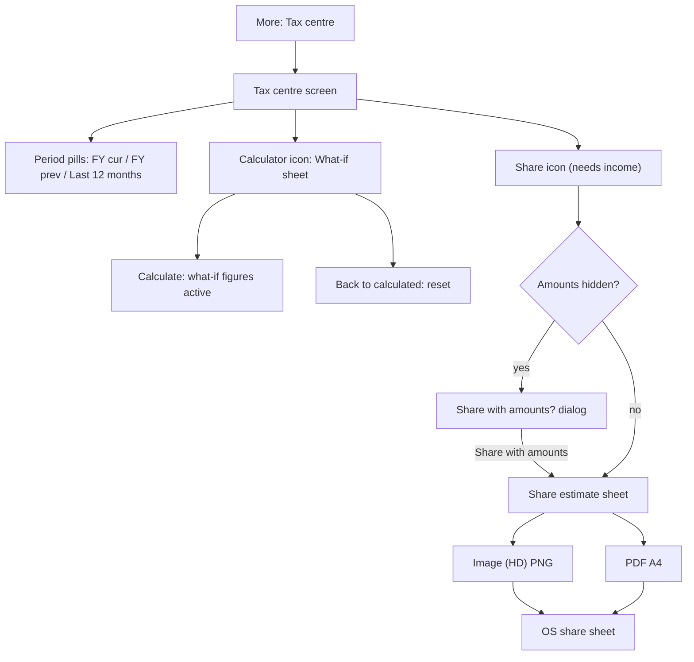

# Tax Centre

| Field | Value |
|---|---|
| Feature ID | F-19 |
| Status | In progress (pure domain done: rules per FY, calculator for both regimes, income estimate, deduction detection, what-if plan, FY labels; UI, share/export and data wiring pending) |
| Priority | P2 |
| Phase | 4 |
| Last Updated | 2026-10-21 |

## 1. Description

The Tax centre estimates a resident individual's Indian income tax for a financial year from what the app has already tracked: salary and other credits, tax-saving investments, insurance premiums and provident-fund growth. It compares the New and Old regimes and recommends the cheaper one. It exists so the user can see what tax they are likely to owe and which regime saves more, and can share the estimate with an accountant. It is an estimate, not tax advice.

## 2. What This Feature Will Do

- Estimates income for this financial year, last financial year or the last 12 months from tracked credits.
- Projects the income to a full year when fewer than 12 months of data exist and says so.
- Splits income into salary, interest, dividends, rent and other.
- Detects tax-saving investments (80C), health insurance premiums (80D) and own NPS contributions.
- Estimates the user's share of provident-fund growth.
- Calculates tax under both the New and Old regimes using the rules of that financial year.
- Recommends the cheaper regime and shows the saving.
- Shows a slab-by-slab breakdown for each regime.
- Lets the user try their own figures in a what-if calculator with a live preview of both regimes.
- Discards what-if figures when the user leaves, so nothing typed is saved.
- Shares the estimate as an HD image or an A4 PDF with a disclaimer.
- Warns before sharing when amounts are hidden on screen.

### 2.1 Inputs

- Opening Tax centre from More.
- The period choice: this financial year, last financial year or last 12 months.
- Tracked income credits, investments, insurance premiums and provident-fund data already on the phone.
- Figures the user types into the what-if calculator, for one visit.
- Taps on Share estimate and the image or PDF option.

### 2.2 Processing

1. Read the credits and investments of the chosen period from the ledger.
2. Classify income, leaving out refunds, transfers, reimbursements and cashback.
3. Project to a full year when the data covers fewer than 12 months.
4. Detect 80C, 80D and NPS amounts and apply their limits for the Old regime.
5. Apply any what-if figures over the calculated ones.
6. Calculate tax for each regime: slabs, standard deduction, rebate, surcharge, cess and capital gains.
7. Compare the two totals and pick the lower.
8. On share, build the image or PDF with real figures and open the system share sheet.

### 2.3 Outputs

- The user sees both regimes side by side, the recommendation, income and deduction cards with their sources, and the slab breakdown.
- A shared PNG or PDF file is written to temporary storage and replaced on the next share.
- Nothing typed in the what-if calculator is stored.
- Other features are only read: holdings and investments ([16_portfolio.md](16_portfolio.md)) and insurance payments ([12_recurring_transactions.md](12_recurring_transactions.md)).

### 2.4 Out of Scope

- Does not track capital-gains lots, reconcile AIS or 26AS, handle advance tax or export an ITR (not in the existing app).
- Does not take salary or TDS entry beyond the what-if calculator.
- Does not take age or senior-citizen inputs (not in the screen today).
- Does not store holdings ([16_portfolio.md](16_portfolio.md)).
- Does not detect insurance payments ([12_recurring_transactions.md](12_recurring_transactions.md)).
- Does not give tax advice; the figures are an estimate.

## 3. Behaviour in Existing App

Source: `app/src/main/kotlin/com/hisaab/app/ui/more/TaxScreen.kt` (649 lines), `TaxWhatIf.kt` (195), `TaxShare.kt` (151), `TaxReport.kt` (380); `shared/src/main/kotlin/com/hisaab/shared/insight/TaxCalculator.kt` (250), `TaxIncome.kt` (96); analysis Part A 2.9 and Part B section 5.

Screen `TaxRoute` (`TaxScreen.kt:336`, scaffold "Tax centre"): top-bar actions What-if calculator (calculator icon) and Share estimate (disabled until there is income). Nothing is drawn until `loaded`.

Period row pills: "FY {cur}" (this financial year), "FY {prev}" (last FY), "Last 12 months" (`TaxPeriod.THIS_FY`, `LAST_FY`, `LAST_12`). `LAST_12` = today minus 12 months plus 1 day to today, using the current FY's rules. Switching period clears what-if figures.

Cards:

1. What-if banner: shown while what-if figures are active ("Based on the figures you entered"); the estimate source line otherwise reads "No income data for this period yet", "Based on 1 month of data · estimated for the full year", "Based on {n} months of data · estimated for the full year" or "Based on 12 months of data".
2. Summary: two `RegimeCard`s (New regime, Old regime) with rows Total tax, Gross income, Capital gains, Deductions, Taxable income, Tax before cess, Rebate 87A, Surcharge, Cess 4%, Effective rate; "Lower" tag on the cheaper; headline "Recommended: {regime}, saves {amount}" or "Both regimes come to the same tax."; "No tax up to {amount} taxable income" helper; tags Estimate / Estimated / What-if; an info button. "Share this estimate" action. Empty: "No salary or income credits found for {fy} yet."
3. Income card: Salary, Interest, Dividends, Rent, Other, Capital gains ("Taxed at special rates" / "Enter in the calculator if you sold equity"), "Gross income used"; each shows "Calculated: {amount}" or the projection line "Projected from {n} months of credits ({amount} so far)" or "None found yet". Explanation: "Collected from salary, interest, dividend, rent and other credits DhanKosh tracked. Refunds, transfers between your accounts and reimbursements are left out." and "Salary credits are what reached your bank, after TDS and PF, so your taxable salary is likely higher. Use the calculator (top right) to try your own figures. What-if figures are not saved."
4. Deductions card ("Deductions · old regime", "From your data"): 80C with a progress bar "{amount} of {limit}" and "80C left {amount}" / "80C used in full" and an items list (PPF deposits, Sukanya Samriddhi, NSC, ELSS tax-saver funds, Life insurance premiums, EPF your share (estimated)); notes "No PPF, ELSS, life cover or EPF payments found this year." and "{amount} of other investments this year does not count for 80C."; 80D ("No health insurance premiums found this year."); NPS 80CCD(1B), Home-loan interest 24(b), HRA exemption / other (old regime only), Employer NPS 80CCD(2) ("Counts in both regimes"); capped values show "You entered {amount}; capped at {cap}" or "Up to {cap} · old regime only".
5. Slab breakdown (collapsible per regime): per slab lower, upper (open-ended top shows "Above {amount}"), rate, taxed part and tax; "No taxable income"; then Capital gains, Rebate 87A, Surcharge, Cess 4%, Total tax. UI slab tables always use the age band BELOW_60.

`TaxEditSheet` (What-if calculator; ModalBottomSheet, skipPartiallyExpanded): intro "Try your own figures for {fy}. Leave a field blank to use what DhanKosh calculated. Nothing here is saved: the calculated estimate comes back when you leave the Tax centre." Fields (label, note), each "₹" prefixed decimal input with placeholder = calculated value, supporting text "Calculated: {amount}" and a "What-if" tag when filled, error "Enter an amount like 150000 or 1234.50", clear icon "Use calculated":

| # | Field | Note | Calculated default |
|---|---|---|---|
| 1 | Annual gross salary | Before TDS and PF, for the whole year | `est.salary` |
| 2 | Interest | Bank and deposit interest, for the whole year | `est.interest` |
| 3 | Dividends | For the whole year | `est.dividends` |
| 4 | Rent received | Before the 30% deduction | `est.rent` |
| 5 | Other income | Freelance, business and the like | `est.other` |
| 6 | Short-term equity gains | Section 111A, taxed at 20% | 0 |
| 7 | Long-term equity gains | Section 112A, taxed at 12.5% above ₹1.25 lakh | 0 |
| 8 | 80C investments | PPF, ELSS, EPF, life cover… capped at ₹1,50,000 · old regime | `c80Calc` |
| 9 | 80D health insurance | Capped at ₹25,000 · old regime | `d80Calc` |
| 10 | NPS 80CCD(1B) | Your own NPS, capped at ₹50,000 · old regime only | `npsDetected` |
| 11 | Home-loan interest 24(b) | Self-occupied house, capped at ₹2,00,000 · old regime only | 0 |
| 12 | HRA exemption / other deductions | Old regime only | 0 |
| 13 | Employer NPS 80CCD(2) | Your employer's NPS share · both regimes | 0 |

Fields 1-7 sit under "Income", 8-13 under "Deductions". A live preview strip shows "New regime" and "Old regime" totals (or "Fix the highlighted values to see the estimate."). Buttons: "Back to calculated" (enabled when anything typed), "Cancel", "Calculate".

`TaxShareFlow` (`TaxShare.kt:60`): if amounts are hidden, an AlertDialog "Share with amounts?" - "Amounts are hidden on screen. The shared estimate will show your real income, deductions and tax figures." [Share with amounts | Cancel]. Then a bottom sheet "Share estimate" with the description "A clean summary of {fy} [with your what-if figures]: income, deductions, both regimes with the slab breakdown, and the recommended regime." and two options: "Image (HD)" - "PNG, 1440 px wide · best for WhatsApp and chats"; "PDF" - "A4 document with selectable text · for email or your CA". Busy spinner per option; failure text "Couldn't create the file. Please try again."

Export (`TaxReport.export`): files `DhanKosh-tax-estimate-<fy>-<yy>.png|pdf` (for example `DhanKosh-tax-estimate-2026-27.pdf`) in `cacheDir/shared/` (older `DhanKosh-tax-estimate*` files deleted first). PNG layout width 1440 px from a 480-unit logical width (3x), margin 20 units, gap 12; PDF A4 595 x 842 pt, margin 36, footer "DhanKosh · Tax estimate · {fy}" and "Page {n} of {total}" at 8 pt, vector text. Light-theme brand colours (BG F2F3F7, card FFFFFF, ink 16181D, ink2 5D626C, border E6E6E1, surface2 F0F0EC, accent 2F5BEA, accent soft E9EEFD, violet 7A5AE0, positive 13895A, positive soft E3F4EC). Disclaimer text: "This is an estimate, not tax advice. It is worked out from the transactions DhanKosh tracked (and any what-if figures entered), projected to a full year where less data exists, for a resident individual under 60, using the slabs, standard deduction, 87A rebate, surcharge and 4% cess for the year. It leaves out deductions DhanKosh cannot see; salary credits are after TDS and PF, so taxable salary may be higher. Check with a tax professional before you file." Share uses `ACTION_SEND` with subject "Tax estimate · {fy}", body "Tax estimate · {fy}, made with DhanKosh", chooser "Share tax estimate", through the app FileProvider `${applicationId}.updates`.

Persistence: nothing typed is ever saved (`TaxViewModel` holds what-if in memory; the legacy file `datastore/tax_overrides.preferences_pb` is deleted at start by `TaxSource`).

Tax rules (`TaxRules`, header "Rules as of 2026-10-11"; paise; LAKH = 10,000,000 paise):

- Slabs (marginal; "upTo" inclusive):
  - New regime FY2025-26 and FY2026-27, all age bands: 0-4L 0%; 4-8L 5%; 8-12L 10%; 12-16L 15%; 16-20L 20%; 20-24L 25%; above 24L 30%.
  - New regime FY2024-25: 0-3L 0%; 3-7L 5%; 7-10L 10%; 10-12L 15%; 12-15L 20%; above 15L 30%.
  - Old regime (all years): below 60: 0-2.5L 0%; 2.5-5L 5%; 5-10L 20%; above 30%. Senior (60-79): 0-3L 0%; 3-5L 5%; 5-10L 20%; above 30%. Super senior (80+): 0-5L 0%; 5-10L 20%; above 30%.
- Standard deduction: new 75,000 (both years), old 50,000, applied as `min(salary, std)`. Family pension deduction `min(pension / 3, cap)`; cap 25,000 new, 15,000 old.
- Rent received: 30% standard deduction (`rentNet = rent * 70 / 100`).
- Rebate 87A: new FY2025-26/26-27 total income (taxable + special-rate income) <= ₹12L -> `min(slabTax, 60,000)`; above the limit with marginal relief (only when there is no capital-gains special income): `max(0, slabTax - (total - 12L))`. FY2024-25: limit ₹7L, max 25,000, marginal relief. Old: limit ₹5L, max 12,500, no marginal relief.
- Surcharge tiers (tier = last whose threshold < total income): old 10% above ₹50L, 15% above ₹1 Cr, 25% above ₹2 Cr, 37% above ₹5 Cr; new 10% / 15% / 25% (no 37%). Surcharge = `round(normalNet * rate/100 + specialTax * min(rate, 15)/100)`; marginal relief caps it at `max(0, taxAtThreshold + surchargeAtThreshold + over - tax)`.
- Cess 4% of (tax + surcharge), rounded to the nearest rupee.
- Capital gains: STCG equity (111A) 20%; LTCG equity (112A) 12.5% above ₹1.25 lakh exemption. Unused basic exemption (first slab shortfall below its upper limit, when its rate is 0) absorbs STCG first, then LTCG after exemption.
- Deductions (old regime only unless noted): employer NPS 80CCD(2) uncapped, both regimes; 80C cap 1,50,000; 80CCD(1B) cap 50,000; 80D self cap 25,000 (50,000 if senior/super senior), parents cap 25,000 (50,000 if parents senior); home-loan interest cap 2,00,000; 80TTA 10,000 (below 60) or 80TTB 50,000 (senior/super senior); HRA/other as entered. Total deductions = `min(afterStd, claimed)`.
- FY2026-27 = FY2025-26 rules copied (`copy(fyStartYear = 2026)`); `forYear(y)` = last rule set with `fyStartYear <= y`, else FY2024-25.

## 4. User Stories

1. As a salaried user I see my estimated tax under both regimes and which one saves more.
2. As a user I see where each income figure and each deduction comes from.
3. As a user I try different salaries and investments in a calculator without changing my data.
4. As a user I share a clean PNG or PDF of the estimate with my CA.
5. As a user I switch between this FY, last FY and the last 12 months.
6. As a privacy-conscious user I am warned before sharing figures when amounts are hidden.

## 5. Functional Requirements (FR-19-01 ...)

1. FR-19-01: The Tax centre opens from More and shows period pills (this FY, last FY, last 12 months); the default is this FY; changing the period recalculates and discards what-if figures.
2. FR-19-02: Income is estimated from tracked credits per section 10 (salary from SALARY category, other income from INCOME category classified into interest, dividends, rent, other; reimbursement/refund/reversal/cashback excluded), projected to 12 months when fewer than 12 months of data exist.
3. FR-19-03: Both regimes are calculated with the rules of the financial year (`TaxRules.forYear`) for a resident individual below 60: slabs, standard deduction, rebate 87A with marginal relief, surcharge with marginal relief, 4% cess, and special-rate capital gains.
4. FR-19-04: The screen shows both regimes side by side, the cheaper one tagged "Lower", the recommended regime and the saving, or "Both regimes come to the same tax."
5. FR-19-05: 80C items are detected from INVESTMENT transactions matching `elss|tax\s?saver|tax\s?saving|\bppf\b|public provident|sukanya|\bssy\b|\bnsc\b|national savings`, life-insurance premiums (INSURANCE category, life kind), and the employee share of EPF passbook growth (x 12 / 15.67); capped at 1,50,000 in the old regime.
6. FR-19-06: 80D is the sum of health-insurance premiums (INSURANCE category, health kind) capped at the limit; 80CCD(1B) is own NPS investments (`\bnps\b|national pension`) capped at 50,000; investments not qualifying are shown as context only.
7. FR-19-07: The what-if sheet exposes the 13 fields in section 2, validates input, previews both regime totals live, applies on "Calculate", and resets with "Back to calculated".
8. FR-19-08: What-if figures live only in memory for the visit and are never written to storage.
9. FR-19-09: Sharing is available only when income or capital gains exist; if amounts are hidden, a confirmation precedes the share sheet.
10. FR-19-10: The share sheet offers PNG (1440 px wide) and PDF (A4, selectable text, page footer); the file is named `DhanKosh-tax-estimate-<yyyy>-<yy>.<ext>` and written to the cache `shared/` folder, replacing earlier files; sharing goes through the platform share sheet with subject and body text.
11. FR-19-11: Every shared file carries the disclaimer in section 2 and real (unmasked) figures.
12. FR-19-12: The slab breakdown lists each reached slab with lower bound, upper bound ("Above" for the top slab), rate, taxed part and tax, then capital-gains tax, rebate, surcharge, cess and total, per regime.
13. FR-19-13: All amounts are paise integers; slab tax and special tax are rounded to the nearest rupee (`round(paise/100) * 100`); cess rounded to the nearest rupee.
14. FR-19-14: Source and projection transparency lines (months of data, "estimated for the full year", "Projected from {n} months of credits ({amount} so far)") are shown.
15. FR-19-15: Tax rules are versioned data (`FY2024_25`, `FY2025_26`, `FY2026_27`); the latest year drives the limits shown in labels.
- FR-19-16: The shared tax file is a temporary export in `cacheDir/shared/` (Flutter: `getTemporaryDirectory()/shared/`), named `DhanKosh-tax-estimate-<fy>-<yy>.png|pdf`; any older `DhanKosh-tax-estimate*` file is deleted before writing (`TaxReport.kt:61-65`), and it is never kept in durable storage or backups.
- FR-19-17: Flutter has no legacy tax store to migrate. The Kotlin app deletes `filesDir/datastore/tax_overrides.preferences_pb` when its tax data source is constructed (`TaxScreen.kt:229-231`); the upgrade/import path ([Upgrade Migration](33_upgrade_migration_from_kotlin.md)) shall ignore and not restore that file, and what-if figures stay in memory only.

## 6. Non-Functional Requirements (performance, battery, privacy, offline)

- Performance: calculation is pure and synchronous (microseconds); income estimation runs off the UI thread; PNG/PDF generation off the UI thread (isolate) in under 2 s on a mid-range phone.
- Battery: none beyond the export.
- Privacy: nothing leaves the device except what the user shares; what-if figures never persisted; shared file contains real amounts so a confirmation is required when amounts are hidden; cache files overwritten each export; PDF/PNG contain no PAN or identity.
- Offline: fully offline.
- Accuracy: unit tests pin every rule; rule changes need a fixture and a changelog line.
- Accessibility: charts and cards have text equivalents; money formatting en-IN.

## 7. UI / Screens & User Flow (screen list + flow diagram)

| Screen / dialog / sheet | Source (Kotlin) | Notes |
|---|---|---|
| Tax centre | `TaxScreen.kt:336` | Period row, summary, income, deductions, slabs |
| What-if banner | `TaxScreen.kt:440` | Source / what-if line |
| Regime summary cards | `TaxScreen.kt:420-480` | Total tax, recommended |
| Income card | `TaxScreen.kt:501` | Calculated vs projected |
| Deductions card | `TaxScreen.kt:530` | 80C bar, 80D, NPS, home loan, HRA, employer NPS |
| Slab breakdown | `TaxScreen.kt:609` | Collapsible per regime |
| What-if calculator sheet | `TaxWhatIf.kt:92` | 13 fields, live preview |
| Share with amounts? dialog | `TaxShare.kt:68` | Only when amounts hidden |
| Share estimate sheet | `TaxShare.kt:91` | Image (HD) / PDF |
| Shared report (PNG/PDF layout) | `TaxReport.kt` | Canvas-drawn cards |



Reference GIFs (all Status: Pending, not yet captured):

-  (Status: Pending, not yet captured)
-  (Status: Pending, not yet captured)
-  (Status: Pending, not yet captured)
-  (Status: Pending, not yet captured)
-  (Status: Pending, not yet captured)
-  (Status: Pending, not yet captured)
-  (Status: Pending, not yet captured)

## 8. Data Models (Dart entities + fields + types)

In `lib/features/tax_centre/domain/entities/`. Amounts `int` paise.

```dart
enum Regime { newRegime, oldRegime }
enum AgeBand { below60, senior, superSenior }
enum TaxPeriod { thisFy, lastFy, last12 }

@freezed
class TaxSlab with _$TaxSlab {
  /// upTo is inclusive; null = open top slab.
  const factory TaxSlab({int? upTo, required int ratePct}) = _TaxSlab;
}

@freezed
class RegimeRules with _$RegimeRules {
  const factory RegimeRules({
    required Map<AgeBand, List<TaxSlab>> slabs,
    required int standardDeduction,
    required int familyPensionCap,
    required int rebateIncomeLimit,
    required int rebateMax,
    required bool rebateMarginalRelief,
    required List<(int threshold, int pct)> surchargeTiers,
    required bool deductionsAllowed, // new regime: only employer NPS
  }) = _RegimeRules;
}

@freezed
class TaxRules with _$TaxRules {
  const factory TaxRules({
    required int fyStartYear,
    required RegimeRules newRegime,
    required RegimeRules oldRegime,
    @Default(4) int cessPct,
    @Default(20.0) double stcgPct,
    @Default(12.5) double ltcgPct,
    @Default(12500000) int ltcgExempt,          // Rs 1.25 lakh
    @Default(15) int specialSurchargeCapPct,
    @Default(15000000) int limit80C,
    @Default(5000000) int limit80CCD1B,
    @Default(2500000) int limit80DBelow60,
    @Default(5000000) int limit80DSenior,
    @Default(1000000) int limit80TTA,
    @Default(5000000) int limit80TTB,
    @Default(20000000) int limitHomeLoan,
    @Default(30) int rentStandardPct,
  }) = _TaxRules;
}

@freezed
class TaxInput with _$TaxInput {
  const factory TaxInput({
    @Default(0) int salary, @Default(0) int otherIncome, @Default(0) int rent, @Default(0) int familyPension,
    @Default(0) int stcgEquity, @Default(0) int ltcgEquity,
    @Default(AgeBand.below60) AgeBand age,
    @Default(0) int employerNps, @Default(0) int c80, @Default(0) int d80Self, @Default(0) int d80Parents,
    @Default(false) bool parentsSenior,
    @Default(0) int nps1B, @Default(0) int homeLoanInterest, @Default(0) int savingsInterest, @Default(0) int hraOther,
  }) = _TaxInput;
}

@freezed
class RegimeTax with _$RegimeTax {
  const RegimeTax._();
  const factory RegimeTax({
    required int gross, required int standardDeduction, required int deductions, required int taxable,
    required int slabTax, required int rebate, required int cess,
    @Default(0) int surcharge, @Default(0) int specialIncome, @Default(0) int specialTax,
  }) = _RegimeTax;
  int get taxBeforeCess => slabTax - rebate + specialTax;
  int get total => taxBeforeCess + surcharge + cess;
  int get totalIncome => taxable + specialIncome;
}

@freezed
class TaxIncomeEstimate with _$TaxIncomeEstimate {
  const TaxIncomeEstimate._();
  const factory TaxIncomeEstimate({
    @Default(0) int salary, @Default(0) int interest, @Default(0) int savingsInterest,
    @Default(0) int dividends, @Default(0) int rent, @Default(0) int other,
    @Default(0) int salarySoFar, @Default(0) int salaryMonths, @Default(0) int monthsOfData,
    @Default(false) bool estimated,
  }) = _TaxIncomeEstimate;
  int get otherIncome => interest + dividends + other;
  int get total => salary + interest + dividends + rent + other;
}

@freezed
class TaxWhatIf with _$TaxWhatIf {
  const TaxWhatIf._();
  const factory TaxWhatIf({
    int? salary, int? interest, int? dividends, int? rent, int? otherIncome, int? stcg, int? ltcg,
    int? c80, int? d80, int? nps, int? homeLoan, int? hraOther, int? employerNps,
  }) = _TaxWhatIf;
  bool get any => [salary, interest, dividends, rent, otherIncome, stcg, ltcg, c80, d80, nps, homeLoan, hraOther, employerNps].any((e) => e != null);
}

@freezed
class TaxItem with _$TaxItem {
  const factory TaxItem({required String label, required int amountMinor}) = _TaxItem;
}

@freezed
class TaxState with _$TaxState {
  const factory TaxState({
    @Default(TaxPeriod.thisFy) TaxPeriod period,
    required int fyStartYear,
    @Default(TaxIncomeEstimate()) TaxIncomeEstimate est,
    @Default([]) List<TaxItem> items80C, @Default([]) List<TaxItem> items80D,
    @Default(0) int npsDetected, @Default(0) int otherInvested,
    @Default(TaxWhatIf()) TaxWhatIf whatIf,
    required RegimeTax newRegime, required RegimeTax oldRegime,
    @Default(false) bool loaded,
  }) = _TaxState;
}

@freezed
class SlabLine with _$SlabLine {
  const factory SlabLine({required int from, int? to, required int rate, required int taxedPart, required int tax}) = _SlabLine;
}

enum TaxShareFormat { image, pdf } // mime image/png | application/pdf, ext png | pdf
```

`TaxState` derived getters (mirroring Kotlin): `c80 = whatIf.c80 ?? sum(items80C)`, `d80 = whatIf.d80 ?? sum(items80D)`, `salaryUsed`, `interestUsed`, `dividendsUsed`, `rentUsed`, `otherUsed`, `stcgUsed`, `ltcgUsed`, `nps = whatIf.nps ?? npsDetected`, `income = salaryUsed + interestUsed + dividendsUsed + rentUsed + otherUsed`, `hasIncome = income + stcgUsed + ltcgUsed > 0`, `newIsBetter = newRegime.total <= oldRegime.total`, `saving = |new.total - old.total|`, `left80C = max(0, limit80C - c80)`, `fyLabel` "FY 2026-27" or "Last 12 months".

## 9. Database Tables / Changes

No tables owned and nothing stored (what-if is not persisted). Reads:

- `transactions` (`type`, `category`, `merchant`, `note`, `upiId`, `timestamp`, `inrMinor`, `amountMinor`, `currency`, `needsReview`, `duplicateOfId`) for all history up to the period end ([08_transactions_ledger.md](08_transactions_ledger.md)).
- `holdings` (`kind = EPF`, `valueMinor`, `previousValueMinor`, `asOf`, `previousAsOf`) for the EPF employee share ([16_portfolio.md](16_portfolio.md)).

Tax rules are bundled versioned data: Dart const classes `TaxRules.fy2024_25`, `fy2025_26`, `fy2026_27 = fy2025_26.copyWith(fyStartYear: 2026)`, or a JSON asset `assets/tax/rules.json` loaded into the same entity (the v2 spec wants limits in versioned config, not code). Suggested read query: `SELECT * FROM transactions WHERE timestamp <= :toMs` (existing index on `timestamp`); filter and classify in Dart.

## 10. Business Rules & Logic (regex, parsing rules, algorithms, thresholds)

Income estimation (`TaxIncome.estimate(txs, from, to, today, zone)`):

1. Live rows: `!needsReview && duplicateOfId == null`. `firstDay` = earliest live row day; none -> empty estimate. `end = min(to, today)`, `start = max(from, firstDay)`; `start > end` -> empty.
2. `months = monthsBetween(ym(start), ym(end)) + 1`; if `end == today && end < to && today.day < lengthOfMonth(today) - 2` then `months -= 1`; clamp 0..12; `estimated = months < 12`.
3. Candidate rows: CREDIT, category != TRANSFER, local day in `start..end`.
4. Salary rows: category SALARY and text (merchant + note + upiId joined with spaces) not matching `EXCLUDED = reimburs|refund|reversal|cashback` (case-insensitive). `salarySoFar` = sum; `latest` = sum of the latest month; if `estimated && any salary`: `salary = salarySoFar + latest * (12 - months)` else `salarySoFar`.
5. Other income rows: category INCOME, classified in this order: EXCLUDED -> skip; `DIVIDEND = dividend|\bdiv\b` -> dividends; `INTEREST = \binterest\b|\bint\.?\s?(pd|paid|cr|credit)\b|\bint\b` -> interest (and if `DEPOSIT = \bfd\b|fixed deposit|\brd\b|recurring|deposit` also counts as deposit interest); `RENT = \brent\b` -> rent; else other. Each bucket scaled `v * 12 / months` when `estimated && months > 0`. `savingsInterest = scale(interest - depositInterest)`. Amounts are `inrMinor ?? (INR ? amountMinor : 0)`.
6. Estimate periods in `TaxSource.observe`: THIS_FY = FY start (1 April) to 31 March; LAST_FY = previous FY; LAST_12 = `today - 12 months + 1 day` to today; `fyYear` = FY start year (previous for LAST_FY, current for the other two).

Deduction detection (`TaxSource`): rows in the period with `!needsReview`; invest = type INVESTMENT. `text = merchant, note, upiId` joined by space.

- `QUALIFIES_80C = elss|tax\s?saver|tax\s?saving|\bppf\b|public provident|sukanya|\bssy\b|\bnsc\b|national savings` (ignore case) over INVESTMENT rows grouped by label: PPF (`\bppf\b|public provident`) -> "PPF deposits"; SSY (`sukanya|\bssy\b`) -> "Sukanya Samriddhi"; NSC (`\bnsc\b|national savings`) -> "NSC"; else "ELSS tax-saver funds".
- `NPS = \bnps\b|national pension` over INVESTMENT rows -> `npsDetected` (for 80CCD(1B)).
- Premiums: category INSURANCE and type not CREDIT/TRANSFER; kind via `Planning.kindOf(text)`: HEALTH `health|mediclaim|star\s|niva|bupa|care\s|cigna|aditya birla health`, LIFE `\blife\b|term|\blic\b|pru|aia|max life`, MOTOR `motor|car\b|bike|two.?wheeler|vehicle|\bauto\b`, else OTHER (first match wins in that order). LIFE -> "Life insurance premiums" (80C); HEALTH -> "Health insurance premiums" (80D).
- EPF employee share: for each EPF holding with `value`, `previousValue`, `asOf`, `previousAsOf` and `value > previousValue`, `asOf > previousAsOf`, `asOf >= fromMs`: `overlap = max(0, min(asOf, toMs) - max(prevAsOf, fromMs))`; `share = (value - prev) * overlap / (asOf - prevAsOf)`; item `(share * 12.0 / 15.67)` "EPF, your share (estimated)".
- `otherInvested` = INVESTMENT rows not used for 80C or NPS.

Calculator input mapping (`TaxState.input()`): `salary = salaryUsed`; `otherIncome = interest + dividends + other` (rent separate); `rent = rentUsed`; `stcgEquity`, `ltcgEquity`; `employerNps`; `c80`; `d80Self = d80`; `nps1B = nps`; `homeLoanInterest`; `savingsInterest = min(interestUsed, est.savingsInterest)`; `hraOther`; age BELOW_60; `d80Parents`, `parentsSenior`, `familyPension` unused.

Calculation (`TaxCalculator.compute(rules, regime, input)`):

1. `std = min(salary, r.standardDeduction)`; `pensionDed = min(pension/3, cap)`; `rentNet = rent * (100 - 30) / 100`; `gross = salary + otherIncome + pension + rentNet`; `afterStd = max(0, gross - std - pensionDed)`.
2. `claimed = max(0, employerNps)`; if `deductionsAllowed` add `min(c80, 1.5L) + min(nps1B, 50k) + min(d80Self, senior ? 50k : 25k) + min(d80Parents, parentsSenior ? 50k : 25k) + min(homeLoan, 2L) + (senior ? min(savingsInterest, 50k) : min(savingsInterest, 10k)) + hraOther`. `deductions = min(afterStd, claimed)`; `taxable = afterStd - deductions`.
3. Capital gains: `ltcgAfterExempt = max(0, ltcg - 1.25L)`; `shortfall = firstSlabRate == 0 ? max(0, firstSlabUpTo - taxable) : 0`; `stcgT = max(0, max(0, stcg) - shortfall)`; `ltcgT = max(0, ltcgAfterExempt - max(0, shortfall - max(0, stcg)))`.
4. `assemble`: `slabTax = slabTax(taxable)` (sum over slabs of `(min(taxable, upTo) - lower) * rate / 100`, then `roundRupee`); `special = roundRupee(stcgT * 20/100 + ltcgT * 12.5/100)`; `total = taxable + stcgT + ltcgT`; rebate: `total <= limit -> min(slabTax, max)`; else `marginalRelief && stcgT + ltcgT == 0 -> max(0, slabTax - (total - limit))`; else 0; `normalNet = slabTax - rebate`; `rate` = pct of the last surcharge tier with `total > threshold` (0 if none); `surcharge = roundRupee(normalNet * rate/100 + special * min(rate, 15)/100)`.
5. Surcharge marginal relief: if a tier applies, `over = total - threshold`; remove `over` from normal income first, then LTCG, then STCG; recompute `assemble` -> `at`; `ceiling = at.tax + at.surcharge + over`; `surcharge = min(surcharge, max(0, ceiling - core.tax))`.
6. `cess = roundRupee((core.tax + surcharge) * 4 / 100)`; `RegimeTax.total = slabTax - rebate + specialTax + surcharge + cess`.

`roundRupee(paise) = round(paise / 100) * 100` (half away from zero via `Math.round`, i.e. half up for positives).

Slab lines (UI): for each slab while `taxable > lower`: `part = min(taxable, upper) - lower`, `tax = round(part * rate / 100 / 100) * 100`.

Worked examples (FY2025-26 or FY2026-27 rules, below 60, rupees):

| Case | Regime | Inputs | Result |
|---|---|---|---|
| A | New | salary 12,75,000 | std 75,000, taxable 12,00,000, slab 60,000, rebate 60,000, total 0 |
| B | New | salary 15,00,000 | taxable 14,25,000, slab 93,750, rebate 0, cess 3,750, total 97,500 |
| C | Old | salary 15,00,000, 80C 1,50,000 | afterStd 14,50,000, taxable 13,00,000, slab 2,02,500, cess 8,100, total 2,10,600 |
| D | New | salary 12,85,000 | taxable 12,10,000, slab 61,500, marginal-relief rebate 51,500, tax 10,000, cess 400, total 10,400 |
| E | New | salary 60,75,000 | taxable 60,00,000, slab 13,80,000, surcharge 10% = 1,38,000, cess 60,720, total 15,78,720 |
| F | New | salary 50,85,000 | taxable 50,10,000, slab 10,83,000, surcharge relief caps it at 7,000, cess 43,600, total 11,33,600 |
| G | New | salary 20,00,000, LTCG 2,25,000 | taxable 19,25,000; LTCG after exemption 1,00,000, special 12,500 |
| H | Old | salary 4,00,000 + other 0 | afterStd 3,50,000; slab 5,000; rebate 5,000 (total <= 5L) -> 0 |

Income-estimate example: FY2026-27, today 17 Oct 2026, first transaction 2 Apr 2026, six SALARY credits of ₹1,00,000 (Apr-Sep) and one INCOME credit "Interest credit" ₹3,000 -> months = 7 - 1 = 6 (current month not near its end), estimated true, `salary = 6,00,000 + 1,00,000 * 6 = 12,00,000`, `interest = 3,000 * 12 / 6 = 6,000`, savings interest 6,000.

Share file rules: file `DhanKosh-tax-estimate-<fyStartYear>-<(fyStartYear+1)%100 zero-padded 2>.<ext>`; `fyLong` "FY 2026-27" or "Last 12 months".

## 11. Platform / Native Requirements (permissions, channels, background work)

- Share: platform share sheet with a file URI. Flutter: `share_plus` (`Share.shareXFiles`) with a file in `getTemporaryDirectory()/shared/`; on Android the `FileProvider` is handled by the plugin (declare provider paths for cache). No storage permission needed.
- PNG rendering: `RepaintBoundary` + `toImage(pixelRatio)` to a 1440 px wide image, or a pure `ui.PictureRecorder` painter that mirrors the card layout.
- PDF: the `pdf` package (A4 `PdfPageFormat.a4`, margin 36, vector text, footer "Page n of total").
- No background work, no permissions.

## 12. Dependencies (other features → link to their memory file; packages)

Features: [08_transactions_ledger.md](08_transactions_ledger.md) (credits and investments), [09_categorization.md](09_categorization.md) (SALARY, INCOME, INSURANCE, INVESTMENT categories), [16_portfolio.md](16_portfolio.md) (EPF holdings), [12_recurring_transactions.md](12_recurring_transactions.md) (`Planning.kindOf` insurance kinds), [25_security_privacy.md](25_security_privacy.md) (hide amounts state), [28_theming_customisation.md](28_theming_customisation.md) (theme tokens), [11_income_tracking.md](11_income_tracking.md) (income classification parity).

Packages: `share_plus`, `pdf`, `path_provider`, `intl`, `flutter_riverpod`, `freezed`, `drift`.

## 13. Folder Location (lib/features/<name>/...)

```text
lib/features/tax_centre/
  data/
    tax_source.dart                    # observe(period): transactions + holdings -> TaxState
    tax_rules_data.dart                # FY2024_25, FY2025_26, FY2026_27 (or JSON asset loader)
    tax_report_exporter.dart           # PNG + PDF writers (cache/shared)
  domain/
    entities/tax_rules.dart, tax_input.dart, regime_tax.dart, tax_income_estimate.dart, tax_state.dart, tax_what_if.dart
    usecases/tax_calculator.dart, tax_income.dart, detect_deductions.dart, slab_lines.dart
  presentation/
    tax_screen.dart
    providers/tax_providers.dart       # period, whatIf (autoDispose), state
    widgets/period_row.dart, regime_card.dart, income_card.dart, deductions_card.dart, slab_breakdown.dart,
            tax_edit_sheet.dart, tax_share_flow.dart
assets/tax/rules.json                  # optional versioned rule config
```

## 14. Edge Cases & Error Handling

- No data: "No income data for this period yet"; share disabled; summary shows the empty message.
- Less than 12 months: salary projected at the latest month's pay; other income scaled `v * 12 / months`; labelled "estimated".
- The month in progress is not counted until within 2 days of its end.
- Negative or non-numeric what-if input: field marked invalid, Calculate disabled, preview shows "Fix the highlighted values to see the estimate."
- What-if value over a cap: calculation caps it and the card shows "You entered {amount}; capped at {cap}".
- Total income just above the rebate limit: marginal relief; with capital gains present, relief disabled (as implemented).
- Special-rate income below the basic exemption shortfall is absorbed before taxation.
- `forYear` earlier than FY2024-25 uses FY2024-25 rules; later than the latest uses the latest.
- Foreign-currency credits without a rate count as 0 until priced ([23_forex_rates.md](23_forex_rates.md)).
- Export failure (storage, rendering): show "Couldn't create the file. Please try again."; busy state cleared.
- Concurrent exports blocked while one runs; old files are deleted before writing.
- App backgrounded during share: sheet remains; file persists in cache until the next export.

## 15. Test Cases (unit / widget / integration + sample fixtures)

Unit:

1. TC-19-01 (FR-19-03): cases A, B, C, H in section 10 give the stated slab tax, rebate, cess and totals.
2. TC-19-02 (FR-19-03): case D marginal relief rebate 51,500 and total 10,400; salary 12,76,000 (taxable 12,01,000) gives slab tax 60,150, rebate 59,150, tax 1,000.
3. TC-19-03 (FR-19-03): cases E and F surcharge and marginal relief; tier 37% only for the old regime above ₹5 Cr; capital-gains surcharge capped at 15%.
4. TC-19-04 (FR-19-03): case G capital gains: LTCG exemption 1.25L, unused basic exemption absorbs STCG then LTCG, special tax rounding.
5. TC-19-05 (FR-19-02): income estimate example (6 months) gives salary 12,00,000 and interest 6,000; full 12 months has `estimated == false`; reimbursement credits excluded; current month counted only when `today.day >= length - 2`.
6. TC-19-06 (FR-19-05, FR-19-06): detection regexes: "ELSS Mirae" and "PPF deposit SBI" qualify; "NPS Tier 1" only for NPS; "Niva Bupa" health; "LIC premium" life; "Mutual fund nifty index" does not qualify for 80C and counts as `otherInvested`.
7. TC-19-07 (FR-19-05): EPF share: value 10,12,000 vs previous 10,00,000 over the full period -> `12000 * 12 / 15.67 = 9,189` rupees truncated.
8. TC-19-08 (FR-19-13): `roundRupee` for 12,349 paise = 12,300; 12,350 = 12,400; cess rounding.
9. TC-19-09 (FR-19-15): `forYear(2023)` returns FY2024-25; `forYear(2027)` returns FY2026-27.
10. TC-19-10 (FR-19-12): slab lines for taxable 14,25,000 new regime: 3 rows 4-8L (4,00,000 at 5% = 20,000), 8-12L (40,000), 12-14.25L (2,25,000 at 15% = 33,750).

Widget:

11. TC-19-11 (FR-19-07, FR-19-08): what-if sheet validation, live preview, Calculate applies and shows "What-if" tags; leaving the screen restores calculated values; switching period discards what-if.
12. TC-19-12 (FR-19-04, FR-19-09): recommended card text for new-better, old-better and equal; share icon disabled without income.
13. TC-19-13 (FR-19-09): hidden amounts trigger "Share with amounts?" before the share sheet.

Integration:

14. TC-19-14 (FR-19-10, FR-19-11): export writes `DhanKosh-tax-estimate-2026-27.pdf` with disclaimer and page footer, replaces earlier files; PNG width is 1440 px.
15. TC-19-15 (FR-19-02, FR-19-05): ingest salary SMS fixtures and an ELSS investment -> Tax centre shows the 80C item and the income line without manual refresh.

Fixture messages (masked): `Salary credited Rs 1,00,000.00 to a/c XX1234 by ACME TECH PVT LTD`; `Int.Pd Rs 3,000.00 credited a/c XX1234`; `Rs 50,000.00 debited a/c XX1234 to ICICI Pru ELSS Tax Saver (UPI)`.
- TC-19-10 (FR-19-16): two exports in a row leave exactly one `DhanKosh-tax-estimate*` file in `shared/`.
- TC-19-11 (FR-19-17): importing a Kotlin data dir containing `tax_overrides.preferences_pb` creates no tax state.

## 16. Acceptance Criteria

1. AC-19-01: For fixtures A-H the New and Old regime totals equal the Kotlin results to the rupee. (FR-19-03, FR-19-13; TC-19-01 to TC-19-04, TC-19-08)
2. AC-19-02: Income estimation projects to 12 months, excludes refunds/reimbursements and classifies interest, dividends and rent exactly as specified. (FR-19-02, FR-19-14; TC-19-05)
3. AC-19-03: 80C, 80D, NPS and EPF detections match the specified regexes and amounts. (FR-19-05, FR-19-06; TC-19-06, TC-19-07)
4. AC-19-04: The what-if sheet never persists data and previews both regimes live. (FR-19-07, FR-19-08; TC-19-11)
5. AC-19-05: The recommendation and "Lower" tag are correct for new-better, old-better and equal. (FR-19-04; TC-19-12)
6. AC-19-06: Sharing needs income, confirms when amounts are hidden, and produces a 1440 px PNG or an A4 PDF with the disclaimer. (FR-19-09, FR-19-10, FR-19-11; TC-19-13, TC-19-14)
7. AC-19-07: The slab breakdown matches the calculator. (FR-19-12; TC-19-10)
8. AC-19-08: Tax rules are versioned and selected by year. (FR-19-15; TC-19-09)

## 17. Open Questions

1. Rules provenance: FY2026-27 is a copy of FY2025-26; the old-regime rebate and capital-gains rates (111A 20%, 112A 12.5% above ₹1.25 lakh) are not confirmed against the official 2026-27 page (code header, "Rules as of 2026-10-11"). Treat as provisional.
2. The Income-tax Act 2025 (from 1 April 2026) renumbers sections per the v2 spec and the code header; labels still say 80C/80D/87A/111A/112A. Should the UI show both numberings?
3. Age and family inputs: `TaxInput.age`, `parentsSenior`, `d80Parents`, `familyPension` exist in the calculator but the UI never sets them (age is always below 60; slab tables always BELOW_60); 80TTA (10,000 on savings interest) is applied silently and is not shown in the Deductions card. Expose them in Flutter or keep parity?
4. 80D what-if note says "Capped at ₹25,000" although seniors and parents have 50,000 limits.
5. `TaxMath.LIMIT_*` read from `TaxRules.LATEST` regardless of the selected FY (labels), while calculation uses the FY rules; identical today.
6. Surcharge rebate marginal relief is disabled when special-rate income exists (`stcgT + ltcgT > 0`), as implemented; not verified against tax law.
7. `roundRupee` uses `Math.round` (half up); Dart `round()` rounds half away from zero - same for positives; confirm negative values never occur.
8. Salary credits are after TDS and PF so taxable salary is understated unless the user enters gross; consider a gross-up prompt (not existing).
9. The shared report layout beyond the first ~110 lines of `TaxReport.kt` (block drawing) was not read in full; re-read when implementing the exporter.
10. `QUALIFIES_80C` does not detect ELSS without the words "elss/tax saver" (e.g. a fund name only) or life-insurance products paid via the INVESTMENT type.

## 18. Implementation Notes

Phase 4 domain logic (no UI, no export). Code in `lib/features/tax_centre/domain/`: `tax_rules.dart`, `tax_calculator.dart`, `tax_income.dart`, `tax_deductions.dart`, `tax_plan.dart`.

OPEN QUESTION carried in `tax_rules.dart` header (Open Question 1): FY2026-27 is `fy2025_26.copyWith(fyStartYear: 2026)`; the old-regime rebate and capital-gains rates are not confirmed against the official 2026-27 page. No rules were invented.

FR status: done in domain: FR-19-02 (`TaxIncome.estimate`), 03/04 (`TaxCalculator.compute`, `TaxPlan.newIsBetter/saving`), 05/06 (`TaxDeductionDetector.detect`), 07/08 (`TaxWhatIf`, `TaxPlan.withWhatIf`, in-memory only), 12 (`slabLines`), 13 (rounding), 14 (estimate fields), 15 (`TaxRules.all/forYear`), file stem of FR-19-10 (`FinancialYear.fileStem`). Pending: FR-19-01 (screen, period state), 09-11, 16, 17 (share, export, cache file; nothing to migrate), all UI.

Public API:
- `TaxRules{fyStartYear, newRegime, oldRegime, cessPct, stcgPermille=200, ltcgPermille=125, ltcgExempt, limit80C, ...}`; `TaxRules.fy2024_25/fy2025_26/fy2026_27/all/latest`, `TaxRules.forYear(int)`; `RegimeRules`, `TaxSlab(int? upTo, ratePct)` (null = open top slab), `SurchargeTier`; enums `Regime{newRegime, oldRegime}`, `AgeBand`, `TaxPeriod`.
- `TaxCalculator.compute(TaxRules, Regime, TaxInput) -> RegimeTax`; `slabTax(int, List<TaxSlab>)`, `slabLines(int taxable, slabs) -> List<SlabLine>`, `roundRupee(int num, [int den = 1])`.
- `TaxIncome.estimate(List<LedgerTx> txs, DateTime from, DateTime to, DateTime today, {Duration offset}) -> TaxIncomeEstimate`.
- `TaxDeductionDetector.detect(List<LedgerTx> txs, int fromMs, int toMs, {List<EpfHolding> epf}) -> DetectedDeductions{items80C, items80D, npsDetected, otherInvested, c80Calc, d80Calc}`; `kindOf(String) -> InsuranceKind`, `epfShare(EpfHolding, fromMs, toMs)`.
- `TaxPlan.compute({period, fyStartYear, est, deductions, whatIf}) -> TaxPlan` with the Kotlin `TaxState` getters (`c80, d80, salaryUsed, ..., income, hasIncome, newIsBetter, saving, left80C, fyLabel`) and `withWhatIf(TaxWhatIf)`; `TaxPlan.inputOf(...)` is the calculator input mapping.
- `FinancialYear.startYearOf(day), label(fyStartYear) -> "FY 2026-27", fileStem(fyStartYear) -> "DhanKosh-tax-estimate-2026-27", bounds(TaxPeriod, today) -> ({from, to, fyStartYear, label})`.

Decisions: rounding is exact integer arithmetic (half-up to the rupee on a fraction of paise), equal to Kotlin `Math.round(paise / 100.0) * 100` since a true half is exactly representable; capital-gains rates are per-mille integers (200, 125) instead of doubles. The age, parents and family-pension inputs exist but the plan always uses below 60 (Open Question 3). Insurance kind regexes and `QUALIFIES_80C` are copied from section 10 (Open Question 10 stands).

Tests: `test/features/tax_centre/tax_calculator_test.dart` (worked examples A to H, the full Kotlin `TaxCalculatorTest` port incl. surcharge relief 7,000, 37% old-regime tier, senior bands, gains and rebate, rounding, slab lines, FY labels and bounds) and `tax_income_test.dart` (Kotlin `TaxIncomeTest` port, the 17 Oct example, month-in-progress boundary, deduction detection, EPF share, `TaxPlan` what-if and input mapping).

## 19. Change Log (date | change | reason)

| Date | Change | Reason |
|---|---|---|
| 2026-10-17 | Created from hisaab_apk 2.9.8 analysis | Initial |
| 2026-10-19 | `cacheDir/shared` temp export (FR-19-16) and legacy `tax_overrides` store cleanup (FR-19-17); TC-19-10, TC-19-11 | Audit Gate gap, scan_3
| 2026-10-19 | Restructured to the 19-section standard (Description, What This Feature Will Do, Implementation Notes added); Last Updated bumped | Audit Gate (Prompt 2, Part A) |
| 2026-10-21 | Phase 4 domain logic landed | Phase 4 |
