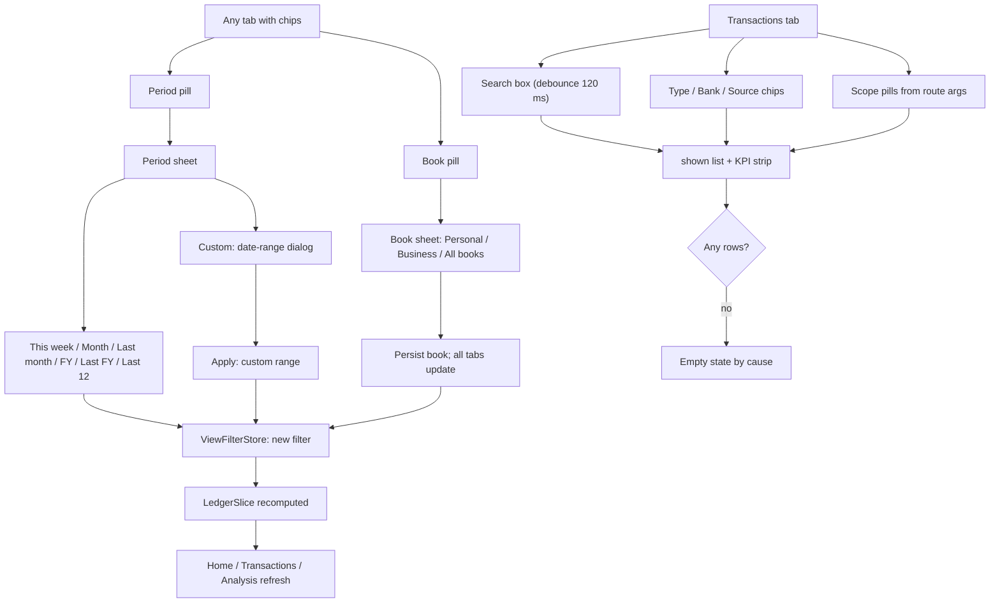

# Search & Filters

| Field | Value |
|---|---|
| Feature ID | F-20 |
| Status | In progress (Phase 1: search and filters done; Fold adoption 2026-10-26: Source filter and amount range on the Transactions tab; Calendar and By-merchant honour the filters; global Book/Period store pending) ; 2026-10-27 shared Book and Period stores added (not persisted) ; 2026-10-31 mockups applied: source dropdown replaces Accounts/Cards chips, Book chips removed from the filter bar (Book set in More), BookTag widget |
| Priority | P0 |
| Phase | 1 |
| Last Updated | 2026-10-31 |

## 1. Description

Search and Filters narrows the ledger in two layers. The global filter picks a Book (Personal, Business or All books) and a Period, and every tab that reads the ledger follows it. On the Transactions tab the user can also search by text and narrow by type, bank and source. It exists so the user can look at exactly the slice of money they care about and find any single payment quickly.

## 2. What This Feature Will Do

- Lets the user pick a Book (Personal, Business or All books) with a chip and remembers it across launches.
- Lets the user pick a Period (this week, a month, last month, this FY, last FY, last 12 months or a custom date range) with a chip.
- Applies the chosen Book and Period to Home, Transactions, Analysis and other ledger screens at once.
- Works out the previous comparison period for the chosen Period.
- Searches transactions by merchant, bank, note, reference, UPI id, category and amount.
- Shows a match count and a clear button in the search box.
- Narrows the list by Type, Bank and Source, combined with search.
- Shows removable pills for an account or category the user arrived from.
- Clears the Type, Bank and Source chips with one tap.
- Shows a distinct empty message for a search miss, a filter miss and an empty period.
- Keeps the list, search text and chips in step when the Book or Period changes.

### 2.1 Inputs

- Taps on the Book chip, Period chip and custom date-range picker.
- Typing in the search box on the Transactions tab.
- Taps on the Type, Bank and Source chips and the Clear action.
- Navigation from other screens that carry an account, category or month.
- Stored transactions and accounts, including each account's personal or business use.
- The saved Book choice read at app start.

### 2.2 Processing

1. Hold one app-wide Book and Period value that every tab reads.
2. Turn the Period into a date range and a previous period.
3. Load the transactions and accounts for that range and apply the Book rule.
4. Wait briefly after typing, then match the text against the searchable fields and amount.
5. Apply Type, Bank and Source choices together with search and scope.
6. Total the filtered list for the summary strip.
7. Save the Book choice; the Period resets each launch.

### 2.3 Outputs

- The user sees the chips, sheets, search box, filter chips, scope pills and filtered list with its summary, or the matching empty message.
- The Book choice is stored on the phone; the Period and search text are not.
- Other features receive the shared ledger slice: [17_dashboard_home.md](17_dashboard_home.md), [18_analytics.md](18_analytics.md) and [08_transactions_ledger.md](08_transactions_ledger.md).

### 2.4 Out of Scope

- Does not draw the list, calendar or merchant views, multi-select actions or the summary strip layout ([08_transactions_ledger.md](08_transactions_ledger.md)).
- Does not own the Analysis category cross-filter ([18_analytics.md](18_analytics.md)).
- Does not own the Home widgets that use the slice ([17_dashboard_home.md](17_dashboard_home.md)).
- Does not edit an account's personal or business use ([13_accounts_management.md](13_accounts_management.md)).
- Does not own category names ([09_categorization.md](09_categorization.md)).
- Does not search across all tabs or search custom category names; full-text search is proposed only.

## 3. Behaviour in Existing App

Source: `app/src/main/kotlin/com/hisaab/app/ui/ledger/Ledger.kt` (252 lines), `ui/ledger/FilterChips.kt` (133), `ui/transactions/TransactionsViewModel.kt` (235), `ui/transactions/TransactionViews.kt` (`SearchBox` line 95, `TxFilters` line 179), `ui/transactions/TransactionsScreen.kt` (lines 160-218), analysis Part A 2.3 and 2.5.

### 3.1 Global Book + Period chips (`BookPeriodChips`, `FilterChips.kt:54`)

Two pills, "Book ▾" (work icon) and "{period label} ▾" (calendar icon). `showBook = false` hides the Book pill (used in Transactions, where the chips sit in the filter row, but the Book filter still applies). Shown on Home, Transactions and Analysis ([17_dashboard_home.md](17_dashboard_home.md), [18_analytics.md](18_analytics.md)).

- Book sheet (ModalBottomSheet, title "Book"): rows Personal, Business, All books in that order, check mark on the current one, footer "Applies to every tab." Tapping a row sets the book and closes the sheet.
- Period sheet (title "Period"): rows This week, "{Month yyyy}" for the current month, Last month, This FY, Last FY, Last 12 months, Custom…; check mark on the active one; footer "Applies to every tab."
- Custom: closes the sheet and opens a `DatePickerDialog` with a Material `DateRangePicker` (title "Choose dates", initial selection = the current range), buttons "Apply" (enabled once a start is chosen; a missing end defaults to the start) and "Cancel".
- Pill labels: Book label (`All books`, `Personal`, `Business`); Period label = `ViewFilter.label`: MONTH -> "MMM yyyy" (for example "Oct 2026"), FY -> "FY 2026-27", LAST_FY -> "FY 2025-26", CUSTOM -> "d MMM – d MMM", else the kind label ("This week", "Last month", "Last 12 months").

### 3.2 `ViewFilter` (`Ledger.kt:44-101`)

```text
Book:       ALL "All books" | PERSONAL "Personal" | BUSINESS "Business"        (default ALL)
PeriodKind: THIS_WEEK "This week" | MONTH "Month" | LAST_MONTH "Last month" | FY "This FY"
            | LAST_FY "Last FY" | LAST_12 "Last 12 months" | CUSTOM "Custom"   (default MONTH, current month)
```

Range (inclusive, in the device zone `Periods.zone`):

| Kind | From | To |
|---|---|---|
| THIS_WEEK | Monday on or before today | today |
| MONTH | first day of `month` | last day of `month` |
| LAST_MONTH | first day of previous calendar month | its last day |
| FY | 1 April of the current Indian FY (`fyStart(today)`) | 31 March next year (may be in the future) |
| LAST_FY | 1 April of the previous FY | 31 March just ended |
| LAST_12 | first day of the month 11 months before this month | today |
| CUSTOM | `customFrom` (default first of this month) | `customTo` (default today) |

`fyStart(d) = LocalDate(d.month >= 4 ? d.year : d.year - 1, 4, 1)`.

`previous` (the comparison period): for MONTH and LAST_MONTH the whole previous calendar month; for every other kind the equal-length period immediately before (`days = daysBetween(a, b) + 1`; `a - days .. a - 1`).

### 3.3 `ViewFilterStore` (singleton)

State flow of `ViewFilter`. Operations: `setBook(b)` (also persisted), `setKind(k)` (resets `month` to the current month only when `k == MONTH`), `setMonth(m)` (kind = MONTH), `shiftMonth(by)` (kind = MONTH, month + by), `setCustom(from, to)` (kind = CUSTOM). Persistence: DataStore `view_filter`, key `book` (`ALL|PERSONAL|BUSINESS`); on start the saved book is applied unless the user already chose one (`chosen` flag guards against a slow load overwriting a choice). Period, month and custom range are not persisted. A navigation argument `month=YYYY-MM` (Home "See all", budget taps, category/analysis drill-downs) calls `setMonth` once in the Transactions view model init.

### 3.4 `LedgerSource` - the shared slice

`LedgerSlice(filter, from, to, txs, previous, year, months, accounts, loaded)` recomputed (`flatMapLatest`) whenever the filter changes, from three live queries: transactions between `min(previousFrom, first day of the 12-month window)` and the end of `to`, accounts with activity (since the first of the period's month) and merged accounts. Computation off the UI thread; shared with `WhileSubscribed(10 s)`.

- `months` = 12 months ending with the period's last month, oldest first; `txs` = period; `previous` = previous period; `year` = the 12-month window.
- Book rule (`inBook`): `ALL` all rows; `PERSONAL`: rows with no account or whose account `usage != BUSINESS`; `BUSINESS`: rows with an account whose `usage == BUSINESS`. Usage is looked up on visible and merged accounts (a merged child counts with its own usage).
- `accounts` = non-hidden accounts, and for a specific book only those with that usage.
- Millis helpers: start of day in `Periods.zone`; end = start of next day minus 1 ms.

### 3.5 Transactions search and filters

Fixed controls (above the list, `TransactionsScreen.kt:162-177`): `SearchBox`, then a horizontally scrolling `TxFilters` row: [leading: Period pill (Book hidden), account pill, category pill] then dropdown chips Type, Bank, Source, then "Clear" when any chip is set. A fade gradient on the right edge hints at scrolling.

- `SearchBox`: 44 dp rounded tray, search icon (accent when focused), placeholder "Search merchant, amount, note…", single line, IME action Search (clears focus), match-count badge (`ui.shown.size`) and a clear button ("Clear search") when the query is non-empty. Test tag `search`.
- Query pipeline: `query` -> `debounce(120 ms)` -> `trim()` -> `distinctUntilChanged()`, starting with "".
- Match rule (`matchesSearch`, `TransactionsViewModel.kt:228`): empty query matches everything; otherwise a transaction matches if the query is a case-insensitive substring of `merchant`, `bankName`, `note`, `referenceNumber`, `upiId`, or the category's English `label`, OR the query's amount digits prefix-match the whole-rupee amount: `digits = query.replace(",", "").replace("₹", "").trim().substringBefore('.')`; `digits` non-empty, all digits, and `(amountMinor / 100).toString().startsWith(digits)`. It uses `amountMinor` in the transaction's own currency (not `inrMinor`). Custom category names are not searched.
- Type chip (`TxKind`, dropdown label "Type"): All, Income, Spends, Investments, Transfers (the chips list `CHIPS`); `REVIEW` "Needs review" appears in the menu only while active (it is selected by the review banner). Matching: ALL true; EXPENSE `isSpend` (DEBIT and category != TRANSFER); INCOME `isIncome` (CREDIT and category != TRANSFER); TRANSFER `type == TRANSFER || category == TRANSFER`; INVESTMENT `type == INVESTMENT`; REVIEW `needsReview`.
- Bank chip (label "Bank"): options "All banks" + one per brand in the already scoped period list, most-used first, each with its logo. Key = `Brands.forBank(bankName).name` (so "HDFC" and "HDFC Bank" merge); label = key without a trailing " Bank"; a bank chosen in an earlier period stays selectable (count 0) so it can be cleared.
- Source chip (label "Source"): options "All sources" + SMS, Email, Statement, App (matches stored sources `APP` and `NOTIFICATION`), and Manual (offered only when at least one row in the list has none of the known sources). `TxSource.matches(sources)`: for Manual, no stored source code belongs to any non-manual group; otherwise any stored source (upper-cased) is in the group's codes. Sources per transaction come from `transaction_sources`, looked up in batches of 500 ids.
- The three chips combine with AND, and with search and scope; "Clear" (`clearFilters`) resets Type, Bank and Source only (search text and scope pills stay).
- Scope (from route args `accountId`, `category`): pills "{account name} ••last4" (or "One account") and "{category}" with a close icon; `accountId > 0` expands to the account plus every account merged into it (`mergedIntoId`).
- Result lists: `base` = period rows after scope; `shown` = `base` after Type, Bank, Source, search. KPI strip uses `shown`: Income = `income(shown)`, Expenses = `spent(shown) + invested(shown)`, Net = Income - Expenses (transfers count as 0); caption "{n} transactions · {period}" plus " · Out includes investments" when expenses include investments.
- Empty states (`EmptyState`, "Nothing here"): search miss "Nothing matches “{query}” in {period}."; chip miss "No transactions match these filters in {period}."; empty period "No transactions in {period}."

There is no cross-tab global search; the v2 spec lists FTS5 search as proposed.

## 4. User Stories

1. As a user I switch between my personal and business books and every tab follows.
2. As a user I look at this week, any month, a financial year, the last 12 months or my own date range.
3. As a user I find a payment by typing a merchant, bank, note, reference, UPI id, category or amount.
4. As a user I narrow the list to income, spends, investments or transfers.
5. As a user I narrow to one bank or card issuer and to one source (SMS, email, statement, app, manual).
6. As a user I arrive from an account or category screen and can remove that narrowing with one tap.
7. As a user my chosen Book is still selected the next time I open the app.

## 5. Functional Requirements (FR-20-01 ...)

1. FR-20-01: A global `ViewFilter` (book, period kind, month, custom range) is held in one app-wide store; every tab reads the same value and changes apply immediately to all tabs.
2. FR-20-02: The Book pill opens a sheet with Personal, Business, All books, marks the current one, and shows "Applies to every tab."; the choice is persisted (`view_filter.book`) and restored on the next launch unless the user has already chosen one in the session.
3. FR-20-03: The Period pill opens a sheet with This week, the current month, Last month, This FY, Last FY, Last 12 months and Custom…, and marks the active option; the period is not persisted and resets to the current month on each launch.
4. FR-20-04: Custom opens a date-range picker titled "Choose dates"; Apply is disabled until a start date is chosen; a missing end date equals the start; the range is inclusive.
5. FR-20-05: Period ranges and labels follow the table in section 2.2, including `fyStart` (1 April), Monday-start weeks, the 12-month window and the default custom range.
6. FR-20-06: The previous period is the previous calendar month for MONTH and LAST_MONTH and the equal-length preceding period for all other kinds.
7. FR-20-07: `setKind(MONTH)` resets the month to the current month; `setMonth` and `shiftMonth` set kind MONTH; opening Transactions with `month=YYYY-MM` sets that month once per visit.
8. FR-20-08: The ledger slice is recomputed whenever the filter, transactions or accounts change, off the UI thread, and exposes period rows, previous-period rows, the 12-month window rows, the 12 month list and visible accounts.
9. FR-20-09: The Book rule is applied identically everywhere: Personal = no account or non-business account; Business = account with usage BUSINESS; All = everything; merged accounts use their own usage.
10. FR-20-10: Visible accounts exclude hidden ones and, for a specific book, those of another usage.
11. FR-20-11: The Transactions tab shows a search box (placeholder "Search merchant, amount, note…"), a debounce of 120 ms, trimmed and de-duplicated queries, a match-count badge and a clear button.
12. FR-20-12: Search matches case-insensitive substrings of merchant, bank name, note, reference number, UPI id and category label, and a whole-rupee amount prefix by the digit rule in section 2.5 (comma, ₹ and the decimal part ignored).
13. FR-20-13: Type chip options All, Income, Spends, Investments, Transfers (plus Needs review while selected) filter by the `TxKind` rules.
14. FR-20-14: Bank chip options are the brands present in the scoped period (merged "HDFC"/"HDFC Bank"), sorted by count desc, with logos; a previously chosen bank stays selectable; "All banks" clears it.
15. FR-20-15: Source chip options are SMS, Email, Statement, App (APP + NOTIFICATION) and Manual (only when a manual-type row exists) with "All sources" to clear; sources are looked up per transaction in batches of 500.
16. FR-20-16: Type, Bank, Source, search and scope combine with AND; "Clear" resets Type, Bank and Source only; the scope pills (account, category) each have their own remove action.
17. FR-20-17: An account scope includes accounts merged into it.
18. FR-20-18: KPI strip and counts describe the filtered (`shown`) list; transfers contribute 0; expenses include investments.
19. FR-20-19: Empty states distinguish search miss, filter miss and empty period with the exact texts in section 2.5.
21. FR-20-21: The Transactions filter bar has an amount range: Min and Max in rupees (digits, optional comma grouping and up to two decimals) converted to paise by integer math (`rupeesToMinor`; invalid or empty = open). `LedgerFilter.minMinor` and `maxMinor` are inclusive bounds on `amount_minor`. Together with the Source chips (FR-20-15) the range combines with every other filter by AND; "Clear" also resets Source and the range and empties the Min and Max fields.
22. FR-20-22: The app-wide Period (`periodProvider`, `PeriodSelection`) offers This month, Last month, This week, This FY, Last FY, 12 months, All time and Custom range; the Transactions filter mirrors it, so Home, Transactions, Analysis and Portfolio lists can read one store.
23. FR-20-23: The app-wide Book (`bookProvider`: All books, Personal, Business; default All books) is shown as chips (`BookChips`, `PeriodChips` in `lib/app/scope_bar.dart`) and scopes lists and totals by account usage (rows without an account are personal).
24. FR-20-24: `LedgerFilter` carries `accountKind` and `usage`; `accountScopeProvider` holds the account or card an Analysis is scoped to.
20. FR-20-20: A change of the global Book or Period while the Transactions tab is open updates the list without losing search text or chip selections.

## 6. Non-Functional Requirements (performance, battery, privacy, offline)

- Performance: search over 50,000 transactions under 150 ms (debounce 120 ms plus filtering in an isolate or a Drift query); slice recomputation under 100 ms; chip taps under 100 ms.
- Battery: none (no polling).
- Privacy: no query text is stored or logged; search is local; the Book choice is the only persisted filter value.
- Offline: fully offline.
- Accessibility: chips and pills have semantic labels and checked states; the match-count badge is announced; custom range picker uses the platform date-range picker.
- Consistency: all tabs must get identical results for identical filters (one `LedgerSource`).

## 7. UI / Screens & User Flow (screen list + flow diagram)

| Screen / sheet / control | Source (Kotlin) | Notes |
|---|---|---|
| Book + Period chips | `FilterChips.kt:54` | Two pills |
| Book sheet | `FilterChips.kt:63` | Personal, Business, All books |
| Period sheet | `FilterChips.kt:79` | 7 options |
| Custom range dialog | `FilterChips.kt:113` | Date-range picker, Apply/Cancel |
| Search box | `TransactionViews.kt:95` | Count badge, clear |
| Type / Bank / Source dropdown chips | `TransactionViews.kt:150-227` | Menus with check marks, bank logos |
| Scope pills (account, category) | `TransactionsScreen.kt:171-175` | Close icon removes |
| Filter empty states | `TransactionsScreen.kt:210-218` | Three texts |



Reference GIFs (all Status: Pending, not yet captured):

-  (Status: Pending, not yet captured)
-  (Status: Pending, not yet captured)
-  (Status: Pending, not yet captured)
-  (Status: Pending, not yet captured)
-  (Status: Pending, not yet captured)
-  (Status: Pending, not yet captured)

## 8. Data Models (Dart entities + fields + types)

In `lib/features/search_filters/domain/entities/`. Dates are `DateTime` at local midnight (date-only values); amounts `int` paise.

```dart
enum Book { all, personal, business } // labels: All books, Personal, Business

enum PeriodKind { thisWeek, month, lastMonth, fy, lastFy, last12, custom }

@freezed
class ViewFilter with _$ViewFilter {
  const ViewFilter._();
  const factory ViewFilter({
    @Default(Book.all) Book book,
    @Default(PeriodKind.month) PeriodKind kind,
    required YearMonth month,
    DateTime? customFrom,
    DateTime? customTo,
  }) = _ViewFilter;

  (DateTime from, DateTime to) get range;      // table in section 2.2
  (DateTime from, DateTime to) get previous;   // section 2.2
  String get label;                            // "Oct 2026", "FY 2026-27", "This week" ...
  bool get isMonth => kind == PeriodKind.month;
  static DateTime fyStart(DateTime d) => DateTime(d.month >= 4 ? d.year : d.year - 1, 4, 1);
}

@freezed
class LedgerSlice with _$LedgerSlice {
  const factory LedgerSlice({
    required ViewFilter filter,
    required DateTime from, required DateTime to,
    @Default([]) List<Transaction> txs,          // in period and book
    @Default([]) List<Transaction> previous,     // previous period
    @Default([]) List<Transaction> year,         // 12-month window
    @Default([]) List<YearMonth> months,         // oldest first, ends with `to` month
    @Default([]) List<AccountWithActivity> accounts,
    @Default(false) bool loaded,
  }) = _LedgerSlice;
}

enum TxKind { all, income, expense, investment, transfer, review } // chips: all..transfer; review via banner
enum TxSource { sms, email, statement, app, manual }               // app = {APP, NOTIFICATION}

@freezed
class BankOption with _$BankOption {
  const factory BankOption({required String key, required String short, required String bankName, required int count}) = _BankOption;
}

@freezed
class Scope with _$Scope {
  const factory Scope({int? accountId, Category? category}) = _Scope;
}

@freezed
class TxFilterState with _$TxFilterState {
  const factory TxFilterState({
    @Default('') String query,
    @Default(TxKind.all) TxKind kind,
    String? bankKey,
    TxSource? source,
    @Default(Scope()) Scope scope,
  }) = _TxFilterState;
}
```

`Transaction`, `Category`, `AccountWithActivity` are defined in [08_transactions_ledger.md](08_transactions_ledger.md), [09_categorization.md](09_categorization.md) and [13_accounts_management.md](13_accounts_management.md). `YearMonth` is a `core/` value type.

## 9. Database Tables / Changes

No new tables. Reads `transactions`, `transaction_sources` (for the Source chip), `accounts` (`usage`, `hidden`, `mergedIntoId`).

Persisted value (Drift `app_settings` key-value table, see [26_settings_data_sources.md](26_settings_data_sources.md)):

| Store | Key | Values | Default |
|---|---|---|---|
| `view_filter` | `book` | `ALL`, `PERSONAL`, `BUSINESS` | `ALL` (when absent) |

Queries (Drift DAOs): `watchBetween(fromMs, toMs)` over `transactions` ordered by `timestamp` (existing index `index_transactions_timestamp`); `sourcesOf(ids)` = `SELECT transactionId, source FROM transaction_sources WHERE transactionId IN (...)` in chunks of 500; `watchWithActivity(sinceMs)`; `watchMerged()`. Optional later: an FTS5 virtual table over merchant, note, reference, upiId (proposed in the v2 spec; not in the existing app).

## 10. Business Rules & Logic (regex, parsing rules, algorithms, thresholds)

Constants: debounce 120 ms; source lookup chunk 500; slice shared with `WhileSubscribed(10 s)`; 12-month window; default book ALL; default period current month.

Search algorithm (Dart port):

```text
matches(t, q):
  if q.isEmpty -> true
  has(s) = s != null && s.toLowerCase().contains(q.toLowerCase())
  digits = q.replaceAll(',', '').replaceAll('₹', '').trim().split('.').first
  return has(t.merchant) || has(t.bankName) || has(t.note) || has(t.referenceNumber) || has(t.upiId) || has(t.category.label)
      || (digits.isNotEmpty && digits is all [0-9] && (t.amountMinor ~/ 100).toString().startsWith(digits))
```

Note the query is trimmed before matching (inner spaces are kept in the substring test and make the digit test fail).

Worked search examples for a transaction `{merchant: "Swiggy", bankName: "HDFC Bank", note: "dinner", ref: "UTR1234567", upiId: "swiggy@icici", category: FOOD, amountMinor: 245050}`: "swig" yes; "hdfc" yes; "DINNER" yes; "utr12" yes; "icici" yes; "food" yes (English label contains "Food"); "2450" yes; "24" yes; "₹2,450" yes; "2450.5" yes (decimal part ignored); "245" yes; "2451" no; "50" no (prefix only); "zomato" no.

Type rules: `isSpend = DEBIT && category != TRANSFER`; `isIncome = CREDIT && category != TRANSFER`; `isTransfer = type == TRANSFER || category == TRANSFER`; `isInvest = type == INVESTMENT`; `REVIEW = needsReview`. Note an INVESTMENT row is not "Spends" and a card-bill payment (TRANSFER) is only under Transfers.

Source rule: groups SMS {SMS}, Email {EMAIL}, Statement {STATEMENT}, App {APP, NOTIFICATION}, Manual = none of those codes found (a row with no source rows is Manual; "CSV", "MANUAL", "SCREENSHOT" sources count as Manual).

Net/KPI: `net(t) = isTransfer ? 0 : CREDIT ? rupees(t) : -rupees(t)` with `rupees = inrMinor ?? (INR ? amountMinor : 0)`; strip Income = sum of income rows, Expenses = spend + investment rows.

Book rule and ranges: section 2.

Worked period examples (today Saturday 17 Oct 2026):

| Kind | From | To | Previous |
|---|---|---|---|
| THIS_WEEK | 2026-10-12 | 2026-10-17 | 2026-10-06 .. 2026-10-11 |
| MONTH (Oct 2026) | 2026-10-01 | 2026-10-31 | 2026-09-01 .. 2026-09-30 |
| LAST_MONTH | 2026-09-01 | 2026-09-30 | 2026-08-01 .. 2026-08-31 |
| FY | 2026-04-01 | 2027-03-31 | 2025-04-01 .. 2026-03-31 |
| LAST_FY | 2025-04-01 | 2026-03-31 | 2024-04-01 .. 2025-03-31 |
| LAST_12 | 2025-11-01 | 2026-10-17 | 2024-11-15 .. 2025-10-31 |
| CUSTOM 2026-08-10..2026-08-20 | 2026-08-10 | 2026-08-20 | 2026-07-30 .. 2026-08-09 |

## 11. Platform / Native Requirements (permissions, channels, background work)

None. Date-range picker: Flutter `showDateRangePicker` (Material). Persisted book via the app settings store. No permissions or background work.

## 12. Dependencies (other features → link to their memory file; packages)

Features: [08_transactions_ledger.md](08_transactions_ledger.md) (consumer UI), [17_dashboard_home.md](17_dashboard_home.md) and [18_analytics.md](18_analytics.md) (consumers), [13_accounts_management.md](13_accounts_management.md) (usage, hidden, merged), [09_categorization.md](09_categorization.md) (category labels), [05_statement_import.md](05_statement_import.md) / [02_sms_ingestion.md](02_sms_ingestion.md) / [03_email_ingestion.md](03_email_ingestion.md) / [04_notification_ingestion.md](04_notification_ingestion.md) (source codes), [26_settings_data_sources.md](26_settings_data_sources.md) (key-value store), [29_localization.md](29_localization.md) (labels), [19_tax_centre.md](19_tax_centre.md) (its own FY logic mirrors `fyStart`).

Packages: `flutter_riverpod`, `freezed`, `drift`, `intl`, `rxdart` (debounce) or Riverpod `ref.debounce` helpers.

## 13. Folder Location (lib/features/<name>/...)

```text
lib/features/search_filters/
  data/
    view_filter_store.dart              # persists book, holds filter state
    ledger_source.dart                  # combines transactions, accounts, merged -> LedgerSlice
    sources_dao_ext.dart                # sourcesOf(ids) batching
  domain/
    entities/view_filter.dart, ledger_slice.dart, tx_filter_state.dart, bank_option.dart
    usecases/book_rule.dart, period_range.dart, search_match.dart, tx_kind_matcher.dart, tx_source_matcher.dart, bank_key.dart
  presentation/
    providers/view_filter_provider.dart, ledger_slice_provider.dart, tx_filter_provider.dart
    widgets/book_period_chips.dart, book_sheet.dart, period_sheet.dart, custom_range_dialog.dart,
            search_box.dart, tx_filters_row.dart, drop_chip.dart, scope_pills.dart
```

## 14. Edge Cases & Error Handling

- Book saved value unknown/corrupt: treat as ALL; failure to read the store never blocks start (the `runCatching` read).
- User picks a Book before the saved value loads: the choice wins.
- Custom range where the end is before the start: the picker prevents it; defensively swap or clamp.
- FY and LAST_12 end dates in the future (FY) or today (LAST_12): analysis windows clamp to today where needed ([18_analytics.md](18_analytics.md)).
- Switching Period to MONTH resets to the current month (not the previously viewed month).
- A bank chosen in an earlier period is still listed so it can be cleared; counts show 0.
- A source of a row missing from `transaction_sources` counts as Manual.
- Query with only spaces: trimmed to empty, matches everything.
- Query "₹" or "," only: `digits` empty -> amount test skipped; text tests run on the raw query.
- Amount search uses the original currency amount; a USD 12.00 spend is found by "12" even though its rupee value differs.
- Account scope for a merged account includes children; an unknown account id shows "One account".
- Search text is lost on leaving the screen (view-model state); chips reset when the Transactions route is recreated.
- Locale: no localisation of the English category label used in matching.
- FY label formatting `FY {yyyy}-{(yyyy+1)%100}` is not zero-padded (see section 17).

## 15. Test Cases (unit / widget / integration + sample fixtures)

Unit:

1. TC-20-01 (FR-20-05, FR-20-06): period ranges and previous periods for all 7 kinds equal the table in section 10 for today = 2026-10-17; for 1 Jan and 31 Mar (FY boundary) `fyStart` returns 1 Apr of the previous year; on 1 Apr it returns that year.
2. TC-20-02 (FR-20-12): the search examples in section 10 return the stated results; "" matches all; "  " matches all.
3. TC-20-03 (FR-20-13): TxKind matchers: INVESTMENT row not Spends; own-transfer row only under Transfers; REVIEW only needsReview.
4. TC-20-04 (FR-20-15): TxSource matcher: APP and NOTIFICATION both under App; row with sources [SMS, EMAIL] matches SMS and Email; row with [CSV] or [] matches Manual only.
5. TC-20-05 (FR-20-14): bank key merging "HDFC" and "HDFC Bank" to one option with summed count; stale selected bank is retained with count 0; sorted by count desc.
6. TC-20-06 (FR-20-09, FR-20-10): Book rule with accounts A personal, B business, and a no-account row: Personal -> A rows + no-account; Business -> B rows only; All -> all; hidden account excluded from `accounts`.
7. TC-20-07 (FR-20-07): `setKind(month)` resets month to now; `setMonth(2026-08)` sets kind MONTH; arg `month=2026-08` applied once.
8. TC-20-08 (FR-20-02, FR-20-03): store round trip: setBook(business) persists; a new store instance restores BUSINESS; period resets to the current month.
9. TC-20-09 (FR-20-18): KPI for rows [income 1000, spend 400, investment 200, transfer 300] = Income 1000, Expenses 600, Net +400.
10. TC-20-10 (FR-20-17): account scope 7 includes children merged into 7.

Widget:

11. TC-20-11 (FR-20-02, FR-20-03, FR-20-04): sheets list options in order with check marks; Custom opens the range dialog; Apply disabled until a start date; result label "d MMM – d MMM".
12. TC-20-12 (FR-20-11, FR-20-16, FR-20-19): typing filters after 120 ms; count badge equals shown length; clear resets text; "Clear" resets chips but not query; empty states show exact texts per cause.
13. TC-20-13 (FR-20-20): changing Book while on Transactions keeps query and chips.

Integration:

14. TC-20-14 (FR-20-01, FR-20-08): switching Book to Business changes Home total, Transactions list and Analysis donut consistently for the same fixture data.

Fold adoption:

- TC-20-15 (FR-20-15): through the real in-memory ledger, `LedgerFilter(sources: {sms})` returns only SMS-sourced rows, `{email, manual}` returns both groups, empty returns all.
- TC-20-16 (FR-20-21): amount range is inclusive in paise (10,000 to 250,050 returns both bounds; min 250,051 and max 9,999 exclude them) and combines with sources.
- TC-20-17 (FR-20-21): `rupeesToMinor` gives 125000 for "1250", 125050 for "1,250.5", 7 for "₹ 0.07" and null for "", "abc", "1.234", "-5"; `LedgerViewState` carries the filters into `toFilter` and `cleared()` resets them.
- TC-20-18 (FR-20-22): `periodRange` for this week (Mon to Mon), this FY (Apr to Apr, Jan-Mar belongs to the previous FY), last FY, 12 months.
- TC-20-19 (FR-20-23, FR-20-24): `bookProvider`, `periodProvider`, `accountScopeProvider` defaults and updates; business book returns only business-account rows; Cards chip and Book chips toggle in the filter bar.

Fixtures (masked): `HDFC Bank: Rs 2450.50 debited from a/c XX1234 on 17-10-26 to VPA swiggy@icici (UPI Ref 6xxxxxxxx1)`; business account usage BUSINESS "ICICI ••9876"; personal "HDFC ••1234".

## 16. Acceptance Criteria

1. AC-20-01: Book and Period selections apply to Home, Transactions and Analysis at once; the Book survives a restart and the Period resets. (FR-20-01, FR-20-02, FR-20-03, FR-20-08; TC-20-08, TC-20-14)
2. AC-20-02: Every period kind produces the exact range, label and previous period listed. (FR-20-04, FR-20-05, FR-20-06, FR-20-07; TC-20-01, TC-20-07, TC-20-11)
3. AC-20-03: Book rule results are identical in every consumer. (FR-20-09, FR-20-10; TC-20-06, TC-20-14)
4. AC-20-04: Search returns the examples in section 10 and honours the 120 ms debounce. (FR-20-11, FR-20-12; TC-20-02, TC-20-12)
5. AC-20-05: Type, Bank and Source chips filter and combine per the rules; "Clear" scope is limited to the three chips. (FR-20-13, FR-20-14, FR-20-15, FR-20-16; TC-20-03, TC-20-04, TC-20-05, TC-20-12)
6. AC-20-06: Scope pills and merged-account expansion work. (FR-20-16, FR-20-17; TC-20-10)
7. AC-20-07: KPI strip and empty states describe the filtered list. (FR-20-18, FR-20-19; TC-20-09, TC-20-12)
8. AC-20-08: Changing the global filter keeps the Transactions search and chips. (FR-20-20; TC-20-13)

## 17. Open Questions

1. Time zone: `Periods.zone` is the device zone for ranges and day bucketing while the parser, forex day keys and balance-update days use `Asia/Kolkata`; confirm Flutter should use one zone (IST or device) everywhere.
2. The FY label uses `(year + 1) % 100` without zero padding ("FY 2008-9" for FY 2008-09); harmless for 2026-27 but should be `%02d`.
3. Search uses `amountMinor` in the original currency; should a foreign spend also match its rupee value (`inrMinor`)?
4. Search does not cover custom-category names, sub-categories or the original source text; and the category match uses the English label (not the translated one). Intended?
5. The Book rule counts account-less transactions as personal; confirm for cash/manual entries in a business-only workflow.
6. Whether the Period should persist (the analysis states only the Book is persisted; period resets each launch).
7. Account `usage` is the only book discriminator; the v2 spec adds Family books (proposed, not existing).
8. The Analysis tab has its own category cross-filter that is not part of the global filter ([18_analytics.md](18_analytics.md)).
9. `Clear` does not reset search text or scope pills; confirm this is intentional for Flutter parity.
10. FTS5 search (v2 spec) is proposed; confirm it stays out of scope for the Flutter 1.0.

## 18. Implementation Notes

Phase 1 Transactions-tab subset. Code: `features/search_filters/domain/ledger_view_state.dart` (`PeriodKind`, `periodRange`, `LedgerViewState.toFilter`), `presentation/{ledger_view_notifier,ledger_filter_bar}.dart`. Tests: `test/features/search_filters/ledger_filters_test.dart`.

Done: FR-20-03/04/05 partial (This month, Last month, Custom range via "Choose dates" picker, All time; local-time ranges, inclusive custom end, missing end = start), FR-20-11 (placeholder "Search merchant, amount, note...", 120 ms debounce, trimmed query, match-count badge, clear button), FR-20-12 (matching done in the repository), FR-20-13 (type chips), FR-20-16 (type, account, category AND-combined; "Clear" resets chips only), FR-20-17 (merged children, repository), FR-20-18 (strip describes shown rows), FR-20-19 (three empty texts). Account and category filters are menu chips with a delete action. The state is local to the tab (`ledgerViewProvider`), not yet app-wide.

Deferred: FR-20-01/02 (global Book store, persistence), FR-20-03 This week / FY / 12 months, FR-20-06..10 (previous period, ViewFilter slice, Book rule, account visibility by book), FR-20-14/15 (bank and source chips), FR-20-20, FR-20-08.

2026-10-26: Source chips (SMS, Email, Notification = APP, Statement, Manual, all always shown) and Min/Max amount fields added to `LedgerFilterBar`; state in `LedgerViewState.{sources,minMinor,maxMinor}` and `LedgerViewNotifier.{toggleSource,setAmountRange}`; the repository already filtered by `LedgerFilter.sources`, and now also applies `minMinor`/`maxMinor` (no schema change). Tests: `test/features/search_filters/source_amount_filter_test.dart`. Deferred: bank chips (FR-20-14), source chip counts, widget test of the two new controls.

2026-10-22: Calendar and By-merchant segments of the Transactions tab operate on the filtered rows and period (see [Transactions](08_transactions_ledger.md)).

## 19. Change Log (date | change | reason)

| Date | Change | Reason |
|---|---|---|
| 2026-10-17 | Created from hisaab_apk 2.9.8 analysis | Initial |
| 2026-10-19 | Restructured to the 19-section standard (Description, What This Feature Will Do, Implementation Notes added); Last Updated bumped | Audit Gate (Prompt 2, Part A) |
| 2026-10-21 | Phase 1 UI landed | Phase 1 |
| 2026-10-22 | Ledger: transfer/EMI pairing, calendar+merchant views, bulk actions, rules screen | Hardening |
| 2026-10-26 | Source filter and amount range on the Transactions filter bar (FR-20-15 in Flutter, FR-20-21; TC-20-15 to TC-20-17) | Fold adoption |
| 2026-10-27 | Audit: search and type, bank, source, category filters confirmed done; app-wide Book store, Book chip, shared Period store and custom range confirmed not built | Kotlin parity audit |
| 2026-10-27 | Shared Period store (7 presets + custom), Book store and chips, account/card scope provider, Accounts/Cards chips (FR-20-22..24; persistence of Book/Period across launches still open) | Kotlin parity |
| 2026-10-31 | Source dropdown (key source_dropdown) replaces the Accounts/Cards chips in the filter bar; Book chips removed from the filter bar (Book is chosen in More); BookTag and TabTitle added to scope_bar.dart (FR-08-23, FR-20-23; tests: source dropdown filters, view dropdown switches, Book tag) | Approved Transactions/Analysis mockups |