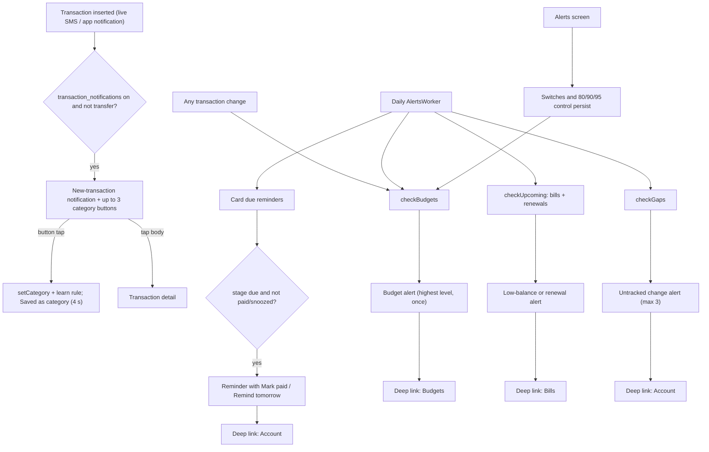

# Alerts & Reminders

| Field | Value |
|---|---|
| Feature ID | F-21 |
| Status | In progress (pure alert decision logic done: budgets, low-balance bills, renewals, untracked changes, card-bill stages, new-transaction, balance-updated and statement-locked texts; channels, posting, persistence, worker and Alerts screen pending) |
| Priority | P1 |
| Phase | 4 |
| Last Updated | 2026-10-21 |

## 1. Description

Alerts and Reminders is everything the app tells the user outside the app, plus the settings that control it. It sends a notification for each new transaction, budget warnings, low-balance warnings before a bill is debited, insurance renewals, credit-card bill reminders and a notice when a statement needs a password. It exists so the user hears about money events in time without opening the app. All checks run on the phone and each alert is sent only once.

## 2. What This Feature Will Do

- Notifies on each new spend or credit, with up to 3 one-tap category buttons.
- Saves the category the user taps, learns it for that merchant and confirms with a short message.
- Notifies when a bank balance changes by an amount no transaction explains, at most once per account per day.
- Warns when a category budget reaches the chosen percentage and again when it is used up.
- Warns when a bill due within 3 days is more than the paying account's known balance.
- Reminds of insurance renewals due within 7 days.
- Reminds of credit-card bills 5 days before, 2 days before, on the due date and once when overdue.
- Offers Mark paid and Remind tomorrow buttons on card reminders.
- Notifies when money moved on an account with no message, so the user can add it.
- Notifies when a statement arrives that needs a password, without showing any figures.
- Opens the matching screen when an alert is tapped.
- Never sends the same alert twice.
- Runs the checks every day, after transaction changes and when the app starts or syncs.
- Lets the user turn transaction alerts and card reminders on or off and choose the budget alert percentage (80, 90 or 95).
- Shows a banner when notifications are blocked in Android settings.

### 2.1 Inputs

- A newly added transaction from a live SMS or a payment-app notification.
- Balance and unexplained-difference results from account reconciliation.
- Budgets and monthly category totals, recurring bills and insurance policies, and credit-card bill positions already stored.
- A statement that arrives locked.
- The user's taps on notification buttons and on the three settings.
- A daily scheduled check, transaction changes, app start and the sync button.

### 2.2 Processing

1. Confirm notifications are allowed before sending anything.
2. For a new transaction, skip merged, duplicate and transfer entries, then suggest the user's most-used categories for that type.
3. For budgets, find the highest alert level reached this month and send it if not already sent.
4. For bills, compare the paying account's balance with the amount due in the next 3 days; for insurance, look 7 days ahead.
5. For credit cards, pick the most urgent reminder stage, skipping paid, snoozed or long-overdue bills.
6. Record a key for each sent alert so it is not repeated.
7. When the user taps Mark paid or Remind tomorrow, store the choice and remove the notification.
8. Run the checks one at a time so a failure in one does not stop the others.

### 2.3 Outputs

- The user sees notifications in three groups (New transactions, Budgets and bills, Statements) and the Notifications and alerts screen with its banner and settings.
- Stored on the phone: the three settings, the keys of alerts already sent, and the card reminder state (sent, paid, snoozed).
- Other features receive category choices ([09_categorization.md](09_categorization.md)) and deep links into their screens ([10_expense_tracking.md](10_expense_tracking.md), [12_recurring_transactions.md](12_recurring_transactions.md), [13_accounts_management.md](13_accounts_management.md), [05_statement_import.md](05_statement_import.md)).

### 2.4 Out of Scope

- Does not produce the data the alerts read: budgets ([10_expense_tracking.md](10_expense_tracking.md)), recurring and insurance detection ([12_recurring_transactions.md](12_recurring_transactions.md)), gap and balance reconciliation ([13_accounts_management.md](13_accounts_management.md)), card bill figures ([14_credit_cards.md](14_credit_cards.md)) and statement unlocking ([05_statement_import.md](05_statement_import.md)).
- Does not make the first-run notification permission request or show the in-app notice sheet ([17_dashboard_home.md](17_dashboard_home.md)).
- Does not offer quiet hours or a limit of 3 alerts per hour (proposed only, not in the existing app).

## 3. Behaviour in Existing App

Source: `app/src/main/kotlin/com/hisaab/app/notify/` (`Alerts.kt` 219 lines, `NewTransactionNotifier.kt` 146, `CardDueReminders.kt`, `BalanceNotifications.kt` 94, `StatementNotifications.kt` 72), `ui/more/AlertsScreen.kt` (80), analysis Part A 4.5 and 4.6, Part B 2.8.

### 3.1 Channels, ids and actions

| Notification | Channel id (name, importance) | Notification id | Trigger | Tap target | Actions |
|---|---|---|---|---|---|
| New transaction | `new_transactions` ("New transactions", LOW) | `10000 + txId` | `NewTransactionNotifier.onIngested` | `hisaab://transaction/<id>` | Up to 3 category buttons (`CategoryActionReceiver`) |
| Category saved confirmation | `new_transactions` | `10000 + txId` (replaces the above) | After a category button tap | none | none; auto-removed after 4 s |
| Balance updated | `new_transactions` | `9000` | `BalanceNotifications.onBalancesUpdated` | opens the app (no deep link) | none |
| Budget alert | `budgets_bills` ("Budgets & bills", DEFAULT) | `key.hashCode()` | `AlertsChecker.checkBudgets` | `hisaab://budgets` | none |
| Upcoming payment (low balance) | `budgets_bills` | `key.hashCode()` | `checkUpcoming` | `hisaab://bills` | none |
| Insurance renewal | `budgets_bills` | `key.hashCode()` | `checkUpcoming` | `hisaab://bills` | none |
| Untracked change | `budgets_bills` | `key.hashCode()` (key `gap:<gapKey>`) | `checkGaps` | `hisaab://account/<accountId>` | none |
| Card bill reminder | `budgets_bills` | `30000 + cardId * 3` | `CardDueReminderChecker.check` | `hisaab://account/<cardId>` | "Mark paid" (request id +1, action `com.hisaab.app.CARD_DUE_PAID`), "Remind tomorrow" (+2, `com.hisaab.app.CARD_DUE_SNOOZE`) via `CardDueActionReceiver` |
| Statement needs password | `statements` ("Statements", DEFAULT) | `4000 + statementId` | `StatementNotifications.onLocked` | `hisaab://statements?unlock=<statementId>` | none |

Channel descriptions: `new_transactions` "Each new transaction, with buttons to change its category"; `budgets_bills` "Budget limits, payments due from a low balance, and insurance renewals"; `statements` "A statement arrived that needs its password". Every post first checks `NotificationManagerCompat.areNotificationsEnabled()` and swallows `SecurityException`; small icon `ic_stat_statement`; every string goes through the translation function. Receivers `CategoryActionReceiver` and `CardDueActionReceiver` are not exported and use `goAsync()` with the app scope.

### 3.2 New-transaction notification (`NewTransactionNotifier`)

- Sent only when the ingest outcome is `INSERTED` (not merged, duplicate, or rescan), the setting `transaction_notifications` is on, and the transaction is not a TRANSFER (type or category). Callers seen: live SMS receiver (source "SMS") and the payment-app listener (source "APP"); the transaction is found from `(source, messageId)`.
- Title: CREDIT "{amount} received from {who}", otherwise "{amount} at {who}" with `amount = Money.format(amountMinor, currency)` (paise shown only when non-zero, foreign currency symbol kept) and `who = merchant ?? bankName`.
- Text: "{Category label}[ · ••{last4}] · expand to change". `setOnlyAlertOnce`, `setAutoCancel`, category STATUS.
- Category buttons (`alternatives(current, type)`): the categories this user picked most often for the same transaction type in the last 90 days (`transactions.categoryUsage(type, since)`, already ordered by use), followed by defaults - CREDIT: SALARY, REFUND, INCOME, TRANSFER; otherwise FOOD, GROCERIES, SHOPPING, TRANSPORT, BILLS - `distinct`, excluding the current category and OTHER, first 3. Request code `id * 31 + category.ordinal`.
- Tapping a button: `repository.setCategory([id], category)` (also learns the merchant rule, [09_categorization.md](09_categorization.md)), then replaces the notification (same id) with title "Saved as {category}" and text "DhanKosh will use it for this merchant from now on.", timeout 4 s.

### 3.3 Balance-updated notification (`BalanceNotifications`)

Shown when statement/SMS balances reveal an unexplained difference (`BalanceGap` list from the reconciler, [13_accounts_management.md](13_accounts_management.md)). Requires `transaction_notifications`. At most one notification per account per IST day (`BalanceReconciler.due(lastDay, today)`, SharedPreferences `balance-updates`, per account key -> last epoch day). One notification id 9000, merged as more accounts update that day: single -> title "{what} updated", text "{amount} not explained · transactions may be missing"; several -> title "{n} balances updated", text = lines joined by " · ", InboxStyle with summary "transactions may be missing". Line = "{label} · {amount} not explained" with `amount = Money.format(|unexplained|, showPaise=false)`. Tap opens the app. Uses the `new_transactions` channel.

### 3.4 Budget alerts (`AlertsChecker.checkBudgets`)

For the current calendar month: for each budget, `used` = category total of DEBIT and INVESTMENT rows in the month (`observeCategoryTotals`, rupee-valued); `levels = distinct([budgetAlertPercent, 100]) sorted descending`; for each level: if `used * 100 < limit * level` continue; key `budget:<CATEGORY>:<yyyy-MM>:<level>`; if the key is in `alertedKeys` stop (the highest reached level was already announced); otherwise notify and store the key and stop (so only the highest reached level is sent). Title: "{Category}: budget used up" (level 100) or "{Category}: {level}% of budget used"; text: if `left > 0` "{used} of {limit} spent. {left} left for {Month yyyy}." else "{used} spent against {limit}, {over} over." (amounts `Money.format(.., showPaise=false)`). Tap `hisaab://budgets`. Runs after every transaction change (`TransactionsChangedHub`), on the Home sync button, and once a day. `budget_alert_percent` default 90; the screen offers 80/90/95. Budget CRUD: [10_expense_tracking.md](10_expense_tracking.md).

### 3.5 Upcoming payments and renewals (`checkUpcoming`)

- Inputs: transactions of the last 400 days, accounts with activity since the month start, merged map, manual recurring items. Items = `Planning.withManual(Planning.recurring(...), manual, today)` that are not income ([12_recurring_transactions.md](12_recurring_transactions.md)).
- For each item with `daysUntil(nextDue)` in 0..3: the paying account = the item's account resolved through merge, then through a debit card's linked account; it must be `ACCOUNT` kind with a known `currentBalanceMinor` strictly less than the amount; key `bill:<name>:<nextDue>`; not previously alerted. Title: 0 days "{name} {amount} due today", 1 "{name} {amount} due tomorrow", else "{name} {amount} due in {days} days". Text: "{account} ••{last4} has {balance}. Add {shortfall} so it doesn't bounce." where account = nickname or bank name. Tap `hisaab://bills`.
- Renewals: `Planning.policies(...)` that are not monthly, due in 0..7 days; key `renewal:<insurer>:<nextDue>`; title "{kind} insurance renews today" or "{kind} insurance renews in {days} days"; text "{insurer}: last premium {amount} on {date}. Renew in time to stay covered."; tap `hisaab://bills`.

### 3.6 Untracked change (`checkGaps`)

Requires `transaction_notifications`. `gaps.openNow()` filtered to gaps whose `toTime` is within the last 14 days (`GAP_ALERT_DAYS`), at most 3 per run; each is announced once (`markNotified`). Title "Untracked change"; text by case with `who = BalanceReconciler.accountLabel(bank, last4, nickname)`, `amount = |delta|` without paise: card & money left "{account}: {amount} of limit used with no message. Add it?"; card & came in "{account}: {amount} of limit freed with no message. Add it?"; account & left "{account}: {amount} left the account with no message. Add it?"; else "{account}: {amount} came in with no message. Add it?". Key `gap:<gap.key>`; tap `hisaab://account/<accountId>`. Gap detection and the Add/Assign/Ignore card: [13_accounts_management.md](13_accounts_management.md).

### 3.7 Credit-card bill reminders (`CardDueReminders.kt`)

- Stages `DueStage`: `DAYS_5 (5)`, `DAYS_2 (2)`, `DUE_DAY (0)`, `OVERDUE (-1)`. `CardDueReminderPlan.next(now, dueDate, sentStages, paid, snoozedUntil)`: paid -> null; `snoozedUntil != null && now < snoozedUntil` -> null; `days = dueDate - now`; `days < -7` (`OVERDUE_WINDOW`) -> null; stage = the entry with the smallest offset among those with `days <= offset` (only the most urgent stage reached); null if none or already sent. `markSent` records the stage and every stage with a larger or equal offset as sent.
- Check (daily in `AlertsWorker`, at app start, and cheap to re-run): cards = credit-card rows that are not hidden; for each card the position from `CardDues.position(statements, balance, cardFlow since window, today)`; `billed > 0` and a due day required, otherwise any existing notification for that card is cancelled; if reminders are off (`card_due_reminders`) nothing is sent; if the stage is null and the bill is marked paid the notification is cancelled; sends only when notifications are enabled; on success the stage is marked sent. Bill maths: [14_credit_cards.md](14_credit_cards.md).
- Text: title `days < 0` "{card} bill overdue", 0 "{card} bill due today", 1 "{card} bill due tomorrow", else "{card} bill due in {days} days" (card = nickname if not blank else bank name); body "{amount} · pay by {d MMM}." or "About {amount} · pay by {d MMM}." when estimated, plus " Minimum {amount}." when the minimum due is known (amounts without paise). One notification per card (a later stage replaces the earlier one; id offset by 3 so action request codes +1/+2 stay unique). "Mark paid" stores `paid` for `(card, dueEpochDay)` and cancels the notification (no ledger entry; clears manual overrides elsewhere); "Remind tomorrow" stores `snoozed` until `today + 1` and cancels.
- Store (DataStore `card_due_reminders`): `sent` set of "cardId|dueEpochDay|STAGE", `paid` set of "cardId|dueEpochDay", `snoozed` set of "cardId|dueEpochDay|untilEpochDay" (one per card+due); entries older than 120 days past the due date are pruned on write.

### 3.8 Statement locked notice (`StatementNotifications`)

On a password-protected statement: title "{bank} statement detected" (or "A statement detected"), text "It's password protected. Tap to enter the password so DhanKosh can read it.", BigText "{file} is password protected. Tap to enter its password. It's read and kept only on this phone."; category REMINDER; never shows figures; id `4000 + statementId`; tap opens the unlock dialog ([05_statement_import.md](05_statement_import.md)).

### 3.9 Scheduling

`AlertsWorker` (HiltWorker, unique periodic `daily-alerts`, 1 day, `KEEP`): runs `cardDues.check()`, `alerts.checkUpcoming()`, `alerts.checkBudgets()`, `alerts.checkGaps()` each in `runCatching`, returns success. `TransactionsChangedHub` (after any transaction change): update the home widget ([30_home_widget.md](30_home_widget.md)) and `checkBudgets()`. App start runs `cardDueReminders.check()` and schedules the worker ([17_dashboard_home.md](17_dashboard_home.md) sync also runs budget/upcoming checks). A process-wide `Mutex` serialises checks.

### 3.10 Alerts screen (`AlertsRoute`, `AlertsScreen.kt:35`)

Scaffold "Notifications & alerts" with cards:

1. Banner (only when notifications are disabled; re-checked on every resume): "Notifications are off" / "Android is blocking alerts from DhanKosh" with button "Allow" (opens the app's notification settings; the lock is skipped once).
2. Card "Transactions": switch "Transaction alerts" - "Each new spend, with quick category buttons" (`transaction_notifications`, default on).
3. Card "Budgets": text "Alert me when a budget reaches", `Segmented` 80% / 90% / 95% (`budget_alert_percent`), help "You are also told when a budget is used up."
4. Card "Credit cards": switch "Card bill reminders" - "5 days, 2 days and on the due date" (`card_due_reminders`, default on).

## 4. User Stories

1. As a user I get a notification for each new spend and can fix its category from the notification.
2. As a user I am warned when a category budget reaches my chosen percentage and again when it is used up.
3. As a user I am warned before a bill is debited from an account that cannot cover it.
4. As a user I am reminded of insurance renewals a week before.
5. As a user I get credit-card bill reminders 5 days and 2 days before, on the due date, and once after it is overdue, and can mark the bill paid or snooze it for a day.
6. As a user I am told when money moved on an account without any message so I can add it.
7. As a user I choose which alerts I receive and what budget percentage triggers one.
8. As a user I never get the same alert twice.

## 5. Functional Requirements (FR-21-01 ...)

1. FR-21-01: Create three channels with the ids, names, importance and descriptions in section 2.1 before posting; reuse them if present.
2. FR-21-02: Post a new-transaction notification only for newly inserted (not merged/duplicate/rescanned) non-transfer transactions from live SMS and payment-app notifications when `transaction_notifications` is on; title, text, id (10000 + txId) and tap link per section 2.2.
3. FR-21-03: Add up to 3 category action buttons chosen by 90-day usage for the same type, then defaults, excluding the current category and OTHER; tapping one sets the category, learns the merchant rule, and shows "Saved as {category}" for 4 s without opening the app.
4. FR-21-04: Post one merged "balance updated" notification (id 9000) at most once per account per IST day when `transaction_notifications` is on, with the single and multi-account texts in section 2.3.
5. FR-21-05: `checkBudgets` alerts at the highest reached level of {user percent, 100} once per (category, month, level) with the exact titles and texts; it runs after every transaction change, on sync, and daily.
6. FR-21-06: `checkUpcoming` alerts for non-income recurring items due in 0-3 days whose paying bank account balance is known and lower than the amount, once per (name, due date), with the title/text variants in section 2.5.
7. FR-21-07: `checkUpcoming` alerts for non-monthly insurance renewals due in 0-7 days once per (insurer, due date).
8. FR-21-08: `checkGaps` announces at most 3 recent (last 14 days) untracked changes per run, once each, when `transaction_notifications` is on, with the four text variants.
9. FR-21-09: Card reminders follow `CardDueReminderPlan` (stages 5, 2, 0, overdue; only the most urgent stage; none after 7 days overdue; none if paid or snoozed) and are cancelled when the bill is no longer billed or paid.
10. FR-21-10: The reminder carries "Mark paid" and "Remind tomorrow" actions that persist `paid` or `snoozed` state without opening the app, and cancel the notification.
11. FR-21-11: Reminder state (sent stages, paid, snoozed) is stored per card and due date and pruned 120 days after the due date.
12. FR-21-12: A statement-locked notification (channel `statements`, id 4000 + id) shows only issuer and file name and opens the unlock dialog.
13. FR-21-13: `AlertsWorker` runs once a day (unique, keep-existing) and executes card reminders, upcoming/renewals, budgets and gaps, each isolated so one failure does not stop the rest; the app also runs card reminders at start.
14. FR-21-14: Alert de-duplication keys (`budget:`, `bill:`, `renewal:`, `gap:`) are persisted (cap 300 most recent) and checked before sending.
15. FR-21-15: Tapping any alert deep-links to the matching screen (`hisaab://transaction/<id>`, `budgets`, `bills`, `account/<id>`, `statements?unlock=<id>`).
16. FR-21-16: Before posting, verify that notifications are enabled and swallow permission errors; never log notification text.
17. FR-21-17: The Alerts screen shows the "Notifications are off" banner (re-checked on resume) with an Allow action, the Transaction alerts switch, the 80/90/95 budget segmented control, and the Card bill reminders switch, each persisting immediately.
18. FR-21-18: Settings defaults: `transaction_notifications = true`, `budget_alert_percent = 90`, `card_due_reminders = true`.
19. FR-21-19: A global mutex serialises alert checks so concurrent triggers cannot double-send.
20. FR-21-20: All amounts in alert text use Indian grouping; amounts without paise except in the new-transaction title (`Money.format` default).

## 6. Non-Functional Requirements (performance, battery, privacy, offline)

- Performance: each check reads at most 400 days of rows and the budget totals; under 200 ms typical; alert posting is non-blocking.
- Battery: one daily periodic job (no network, no wake-ups beyond WorkManager); ingest-driven checks piggy-back on existing writes; target total under 1%/day.
- Privacy: all checks local; notification text for statements never contains figures; payment-app notification text is never logged; amounts shown in alerts are real (lock-screen visibility follows the OS; use `VISIBILITY_PRIVATE`/public version when hide-amounts is on - see section 17).
- Offline: fully offline.
- Reliability: de-duplication keys persist across restarts and reinstalls of the worker; a failed post never marks an alert as sent (see section 17 for the existing exception).
- Accessibility: action buttons have text labels; titles are self-contained.
- Localisation: all texts via translation keys with `{named}` placeholders ([29_localization.md](29_localization.md)).

## 7. UI / Screens & User Flow (screen list + flow diagram)

| Screen / surface | Source (Kotlin) | Notes |
|---|---|---|
| Notifications & alerts screen | `AlertsScreen.kt:35` | Banner, 2 switches, budget segmented |
| New transaction notification (expanded with buttons) | `NewTransactionNotifier.kt:64-83` | Up to 3 category buttons |
| Category saved confirmation | `NewTransactionNotifier.kt:133` | 4 s |
| Balance updated notification | `BalanceNotifications.kt:64` | Single and inbox styles |
| Budget alert notification | `Alerts.kt:73` | Two levels |
| Upcoming payment / renewal notification | `Alerts.kt:101,118` | Low balance, insurance |
| Untracked change notification | `Alerts.kt:143` | Opens account |
| Card bill reminder (Mark paid / Remind tomorrow) | `CardDueReminders.kt:158` | Staged |
| Statement locked notification | `StatementNotifications.kt:38` | Opens unlock dialog |



Reference GIFs (all Status: Pending, not yet captured):

-  (Status: Pending, not yet captured)
-  (Status: Pending, not yet captured)
-  (Status: Pending, not yet captured)
-  (Status: Pending, not yet captured)
-  (Status: Pending, not yet captured)
-  (Status: Pending, not yet captured)
-  (Status: Pending, not yet captured)
-  (Status: Pending, not yet captured)
-  (Status: Pending, not yet captured)
-  (Status: Pending, not yet captured)

## 8. Data Models (Dart entities + fields + types)

In `lib/features/alerts_reminders/domain/entities/`. Amounts `int` paise.

```dart
enum DueStage { days5(5), days2(2), dueDay(0), overdue(-1); const DueStage(this.offsetDays); final int offsetDays; }

enum AlertChannel { newTransactions, budgetsBills, statements }

@freezed
class AlertSettings with _$AlertSettings {
  const factory AlertSettings({
    @Default(true) bool transactionNotifications,
    @Default(90) int budgetAlertPercent,       // UI offers 80, 90, 95
    @Default(true) bool cardDueReminders,
  }) = _AlertSettings;
}

@freezed
class AlertMessage with _$AlertMessage {
  const factory AlertMessage({
    required String key,            // dedupe key, e.g. budget:FOOD:2026-10:90
    required AlertChannel channel,
    required int notificationId,
    required String title,
    required String body,
    required String link,           // hisaab://...
    @Default([]) List<AlertAction> actions,
  }) = _AlertMessage;
}

@freezed
class AlertAction with _$AlertAction {
  const factory AlertAction({required String id, required String label, required Map<String, String> payload}) = _AlertAction;
}

@freezed
class CardDueState with _$CardDueState {
  const factory CardDueState({
    required int cardId, required int dueEpochDay,
    @Default({}) Set<DueStage> sent,
    @Default(false) bool paid,
    int? snoozedUntilEpochDay,
  }) = _CardDueState;
}

@freezed
class BalanceGap with _$BalanceGap {
  const factory BalanceGap({required String key, required String label, required int unexplainedMinor}) = _BalanceGap;
}
```

`UntrackedGap` (`key`, `accountId`, `deltaMinor`, `card`, `moneyLeft`, `toTime`) is defined in [13_accounts_management.md](13_accounts_management.md); `Recurring`, `InsurancePolicy` in [12_recurring_transactions.md](12_recurring_transactions.md); `CardPosition` in [14_credit_cards.md](14_credit_cards.md).

Pure planner (testable without the OS):

```dart
DueStage? nextDueStage({required DateTime now, required DateTime dueDate, required Set<DueStage> sent, required bool paid, DateTime? snoozedUntil});
List<Category> alternativeCategories({required Category current, required TransactionType type, required List<Category> usedMostFirst});
```

## 9. Database Tables / Changes

Settings in the key-value store ([26_settings_data_sources.md](26_settings_data_sources.md)): `transaction_notifications` (bool, default true), `budget_alert_percent` (int, default 90), `card_due_reminders` (bool, default true), `notifications_asked` (bool). Replace the DataStore string sets with Drift tables (the DataStore `alerted_keys` set capped at 300; `card_due_reminders` sets pruned at 120 days; SharedPreferences `balance-updates`):

```dart
class AlertedKeys extends Table {
  TextColumn get key => text()();                 // budget:CAT:yyyy-MM:level | bill:name:date | renewal:insurer:date | gap:key
  IntColumn get sentAt => integer()();            // epoch ms; keep newest 300, prune older on insert
  @override
  Set<Column> get primaryKey => {key};
}

class CardDueReminderState extends Table {
  IntColumn get cardId => integer()();
  IntColumn get dueEpochDay => integer()();
  TextColumn get stagesSent => text().withDefault(const Constant(''))(); // csv of DueStage names
  BoolColumn get paid => boolean().withDefault(const Constant(false))();
  IntColumn get snoozedUntilEpochDay => integer().nullable()();
  @override
  Set<Column> get primaryKey => {cardId, dueEpochDay};
}

class BalanceNoticeDays extends Table {
  TextColumn get accountKey => text()();          // per account key from the reconciler
  IntColumn get lastEpochDay => integer()();      // IST day of the last notice
  @override
  Set<Column> get primaryKey => {accountKey};
}
```

Prune `CardDueReminderState` rows whose `dueEpochDay` is more than 120 days old on every write. Reads (other features): `budgets`, `transactions` (category totals, `categoryUsage(type, sinceMs)` = `SELECT category, COUNT(*) FROM transactions WHERE type = ? AND timestamp >= ? GROUP BY category ORDER BY COUNT(*) DESC`), `accounts`, `statements`, `recurring`, `transaction_sources` (message id to transaction id).

## 10. Business Rules & Logic (regex, parsing rules, algorithms, thresholds)

Constants: card stages 5, 2, 0, -1; overdue window 7 days; upcoming window 0-3 days; renewal window 0-7 days; gap window 14 days, max 3 per run; `alerted_keys` cap 300; reminder-state prune 120 days; category-usage window 90 days; saved-confirmation timeout 4000 ms; notification id bases 10000, 9000, 30000 (x3), 4000; budget levels {user percent, 100}.

Card-due staging table (`now`, `due` in days):

| days to due | Stage chosen | Notes |
|---|---|---|
| 10 | none | no offset >= 10 |
| 5, 4, 3 | DAYS_5 | sent once |
| 2, 1 | DAYS_2 | a card first seen at 1 day gets the 2-day reminder only |
| 0 | DUE_DAY | |
| -1 .. -7 | OVERDUE | sent once |
| <= -8 | none | window over |

`markSent(stage)` also marks every stage with offset >= stage's offset as sent (so a DAYS_2 send marks DAYS_5 and DAYS_2).

Budget alert algorithm:

```text
for b in budgets:
  used = categoryTotal(b.category, thisMonth)
  for level in distinct([alertPercent, 100]) sorted desc:
    if used * 100 < b.limit * level: continue
    key = "budget:${b.category.name}:${yyyy-MM}:$level"
    if key in alerted: break
    notify(...); alerted.add(key); break
```

Worked example: limit ₹10,000 FOOD, percent 90. Used ₹9,000 -> level 100 not reached, level 90 reached -> "Food: 90% of budget used" and key `...:90`. Later used ₹10,200 -> level 100 reached, key `...:100` new -> "Food: budget used up" ("₹10,200 spent against ₹10,000, ₹200 over."). Later checks do nothing.

Low-balance alert example: bill "Netflix" ₹649 due in 2 days, paying account HDFC ••1234 balance ₹300 -> "Netflix ₹649 due in 2 days" / "HDFC ••1234 has ₹300. Add ₹349 so it doesn't bounce." Key `bill:Netflix:2026-10-19`.

Category-button example: HDFC debit ₹250 at Swiggy, category FOOD; last-90-days DEBIT usage order SHOPPING, FOOD, TRANSPORT, OTHER -> buttons: Shopping, Transport, Groceries (current FOOD and OTHER excluded; defaults GROCERIES next).

Notification texts: section 2 lists each; Money formatting `Money.format` (₹ with en-IN grouping, paise only when non-zero, `showPaise=false` where noted).

Dedup keys: exact formats in section 9; stored after the notification call (existing behaviour; see section 17).

## 11. Platform / Native Requirements (permissions, channels, background work)

- Permission: `POST_NOTIFICATIONS` (Android 13+), requested once from Home ([17_dashboard_home.md](17_dashboard_home.md)); `areNotificationsEnabled` checked before each post; Allow button opens app notification settings (`Settings.ACTION_APP_NOTIFICATION_SETTINGS` with the package extra).
- Flutter packages: `flutter_local_notifications` (channels, actions, big text, inbox style, `timeoutAfter`, `onlyAlertOnce`, `autoCancel`), `workmanager` (daily periodic task named `daily-alerts`, keep-existing), `app_links`/`go_router` for `hisaab://` deep links (payload carries the link).
- Notification actions must run without opening the UI: use `onDidReceiveBackgroundNotificationResponse` (top-level `@pragma('vm:entry-point')` function that opens the Drift database in the background isolate) for category buttons and Mark paid / Remind tomorrow; or a small native `BroadcastReceiver` that calls a headless Dart entry point.
- Android 12+ exact timing is not required (daily job is approximate); no exact-alarm permission.
- Manifest: `POST_NOTIFICATIONS`; receivers not exported.
- iOS (future): no SMS-driven notifications; reminders would be scheduled local notifications.

## 12. Dependencies (other features → link to their memory file; packages)

Features: [02_sms_ingestion.md](02_sms_ingestion.md) and [04_notification_ingestion.md](04_notification_ingestion.md) (ingest outcomes that trigger new-transaction alerts), [05_statement_import.md](05_statement_import.md) (locked statements), [09_categorization.md](09_categorization.md) (setCategory + rule learning, categories), [10_expense_tracking.md](10_expense_tracking.md) (budgets, category totals), [12_recurring_transactions.md](12_recurring_transactions.md) (recurring and policies), [13_accounts_management.md](13_accounts_management.md) (balances, gaps, reconciliation), [14_credit_cards.md](14_credit_cards.md) (CardDues position), [17_dashboard_home.md](17_dashboard_home.md) (permission prompt, sync-triggered checks), [30_home_widget.md](30_home_widget.md) (refresh on change), [25_security_privacy.md](25_security_privacy.md) (hide amounts), [26_settings_data_sources.md](26_settings_data_sources.md) (settings store), [29_localization.md](29_localization.md).

Packages: `flutter_local_notifications`, `workmanager`, `permission_handler`, `flutter_riverpod`, `drift`, `freezed`, `timezone` (IST day for balance notices).

## 13. Folder Location (lib/features/<name>/...)

```text
lib/features/alerts_reminders/
  data/
    notification_service.dart             # channels, post, cancel, action handlers
    alert_store.dart                      # alerted keys, card due state, balance notice days (Drift)
    alerts_worker.dart                    # workmanager callback: daily-alerts
  domain/
    entities/alert_message.dart, alert_settings.dart, card_due_state.dart, due_stage.dart
    usecases/check_budgets.dart, check_upcoming.dart, check_gaps.dart, check_card_dues.dart,
             next_due_stage.dart, alternative_categories.dart, notify_new_transaction.dart, notify_balance_updated.dart
  presentation/
    alerts_screen.dart
    providers/alert_settings_provider.dart
    widgets/notifications_off_banner.dart
android/app/src/main/kotlin/com/hisaab/notifications/   # optional native action receivers
```

## 14. Edge Cases & Error Handling

- Notifications disabled at OS level: posts are skipped; the Alerts screen shows the banner with Allow; (existing behaviour still marks alert keys as sent, see section 17).
- `SecurityException` (permission revoked mid-post): swallowed.
- No budgets: `checkBudgets` returns immediately.
- Alert percent outside 80/90/95 (value stored elsewhere): the segmented control has no selection; checks use the stored value.
- A budget with limit 0 would alert immediately (`used*100 >= 0*level` is always true); the existing code does not guard it (Home and Analysis ignore limit 0; see section 17).
- Bill account unknown, card kind, or balance unknown: no low-balance alert.
- Debit card payee: the paying account is its linked bank account.
- A merged-away account id resolves to its target before the balance lookup.
- Duplicate triggers (ingest burst + daily worker): the mutex and stored keys prevent repeats.
- Card first seen with an unpaid bill 1 day before due gets the 2-day reminder only; a card first seen overdue (<= 7 days) gets one overdue reminder; later than 7 days gets none.
- Marking paid after the reminder hides it; if the bill amount later reappears as billed for a new due date a new reminder cycle starts (state is per due date).
- Snooze applies for the rest of the day only (`now < snoozedUntil` with `snoozedUntil = today + 1`).
- Category button tapped after the transaction was deleted: do nothing.
- Notification id collisions for hash-based ids are possible but rare (see section 17).
- Time zone: card-due days use the device zone (`Periods.zone`); balance notices use IST.
- Gap alerts older than 14 days are not announced (they stay on the account screen).

## 15. Test Cases (unit / widget / integration + sample fixtures)

Unit:

1. TC-21-01 (FR-21-09): `nextDueStage` table: days 10 -> null, 5 -> days5, 3 -> days5, 2 -> days2, 1 -> days2, 0 -> dueDay, -1 -> overdue, -7 -> overdue, -8 -> null; already sent stage -> null; paid -> null; snoozed until tomorrow -> null today and allowed tomorrow.
2. TC-21-02 (FR-21-11): `markSent(days2)` also records days5; a stage sent for one due date does not block the next due date; rows older than 120 days pruned.
3. TC-21-03 (FR-21-05): budget algorithm worked example: 9,000 -> 90% alert; 10,200 -> used-up alert; repeat -> none; percent 80 and used 8,000 -> 80% alert; month change creates new keys.
4. TC-21-04 (FR-21-06): bill alert fires only for days 0..3, balance < amount, kind ACCOUNT, known balance; resolves merged and debit-card links; key stored; text variants for days 0, 1, 2.
5. TC-21-05 (FR-21-07): renewal alert for yearly policies within 0..7 days; monthly policies skipped.
6. TC-21-06 (FR-21-08): gaps: only `toTime` within 14 days, max 3, once each, four text variants, nothing when `transaction_notifications` off.
7. TC-21-07 (FR-21-03): alternatives example gives [Shopping, Transport, Groceries]; credit defaults [Salary, Refund, Income, Transfer] minus current.
8. TC-21-08 (FR-21-02): new-transaction title/text/id for DEBIT ₹250 Swiggy HDFC ••1234 ("₹250 at Swiggy" / "Food · ••1234 · expand to change"), CREDIT with currency USD, transfer skipped, MERGED outcome skipped.
9. TC-21-09 (FR-21-14): alerted key store caps at 300 newest and survives restart.
10. TC-21-10 (FR-21-04): balance notices: second update of the same account on the same IST day is suppressed; two accounts merge into one notification with the inbox lines.

Widget:

11. TC-21-11 (FR-21-17, FR-21-18): Alerts screen shows banner only when notifications are disabled, switches and segmented control persist, defaults true/90/true, resume re-check.

Integration:

12. TC-21-12 (FR-21-13, FR-21-19): run the worker twice in a row with fixture data: each alert posts once; one check throwing does not stop the others.
13. TC-21-13 (FR-21-10): simulate action "Mark paid": state stored, notification cancelled, next check sends nothing; "Remind tomorrow": nothing today, reminder tomorrow.
14. TC-21-14 (FR-21-15): each alert's tap payload opens the correct route.

Fixture messages (masked): `HDFC Bank: Rs 250.00 debited from a/c XX1234 on 17-10-26 to VPA swiggy@icici (UPI Ref 6xxxxxxxx1)` (new-tx alert); card bill SMS `Your HDFC Bank Credit Card XX4321 statement: Total Due Rs 12,450.00, Min Due Rs 620.00, Due Date 25-Oct-26` (card reminder).

## 16. Acceptance Criteria

1. AC-21-01: Channels, ids, importance, actions and texts match section 2.1 exactly. (FR-21-01, FR-21-02, FR-21-12; TC-21-08)
2. AC-21-02: A newly inserted spend produces one notification with 3 category buttons; tapping one saves the category and shows the 4 s confirmation without opening the app. (FR-21-02, FR-21-03; TC-21-07, TC-21-08)
3. AC-21-03: Budget alerts fire at the highest reached level once per month and level. (FR-21-05, FR-21-14, FR-21-18; TC-21-03, TC-21-09)
4. AC-21-04: Low-balance and renewal alerts fire in the stated windows once. (FR-21-06, FR-21-07; TC-21-04, TC-21-05)
5. AC-21-05: Card reminders follow the staging table, honour Mark paid and snooze, and are cancelled when no longer billed. (FR-21-09, FR-21-10, FR-21-11; TC-21-01, TC-21-02, TC-21-13)
6. AC-21-06: Untracked-change and balance-updated notifications respect their caps and the transaction-alerts setting. (FR-21-04, FR-21-08; TC-21-06, TC-21-10)
7. AC-21-07: The daily worker runs all checks, isolates failures, and does not double-send. (FR-21-13, FR-21-19; TC-21-12)
8. AC-21-08: The Alerts screen reflects the OS notification state and persists the three settings. (FR-21-17, FR-21-18; TC-21-11)
9. AC-21-09: Every alert deep-links to the right screen. (FR-21-15; TC-21-14)

## 17. Open Questions

1. Lost alerts: `AlertsChecker.notify` returns silently when notifications are disabled, but the callers still call `settings.addAlerted(key)` afterwards, so an alert suppressed by the OS setting is marked as sent and never shown even after the user turns notifications on. Keep, or only mark after a successful post?
2. Default budget percent: setting default 90 vs `BudgetSummary.alertPercent` fallback 80 in Analysis; UI offers 80/90/95 (analysis Open Question 2). Confirm 90 canonical.
3. The "Transaction alerts" switch (subtitle "Each new spend, with quick category buttons") also gates balance-updated and untracked-change notifications; should the copy say so or should they get their own switches?
4. Notification ids for budget, bill, renewal and gap alerts are `key.hashCode()`; collisions are possible and `hashCode` of strings is stable across Dart runs only if a deterministic hash is used. Use a stable int hash in Dart.
5. The new-transaction notification is wired for live SMS and payment-app notifications; email-sourced and statement-sourced inserts were not seen calling it. Intended?
6. Renewal text says "renews in {days} days" even for 1 day ("in 1 days").
7. Card reminder snooze is exactly "until tomorrow"; no longer snooze options exist. Intended?
8. Hide-amounts and lock screen: alerts show real amounts regardless of `hide_amounts`. Should Flutter use private lock-screen visibility with a redacted public version?
9. `AlertsWorker` is periodic 1 day with no flex or time-of-day anchor (the nightly SMS sync is anchored at 02:30, [02_sms_ingestion.md](02_sms_ingestion.md)); confirm the desired time for reminders (morning is better for "due today").
10. Quiet hours and "max 3 per hour" are in the v2 spec only; not part of this file until scheduled.
11. `Info`/explanation text for alerts is not wired in the Alerts screen; none needed?
12. `checkBudgets` has no guard for `monthlyLimitMinor <= 0` (always alerts) while Home/Analysis ignore such budgets; confirm the budget dialog can never save 0.
13. The `BalanceReconciler.due` rule is documented here as "once per account per IST day" from the call sites; its exact predicate was not read.

## 18. Implementation Notes

Phase 4 domain logic (no OS code). Code in `lib/features/alerts_reminders/domain/`: `alert_models.dart`, `alert_text.dart`, `alert_rules.dart`. Decisions are plain `AlertDecision` values; posting, the 300-key alerted store, the lock and cancel calls are the callers' jobs. Card reminder staging reuses `CardReminderPlan` from `credit_cards/domain`; budget levels reuse `BudgetMath.pendingAlert` from `expense_tracking/domain`.

FR status: done in domain: FR-21-02 and 03 (`newTransactionAlert`, `alternativeCategories`, `categorySavedAlert`), 04 (`balanceUpdatedAlert`; once per IST day per account is the caller's filter), 05 (`budgetAlerts`), 06 (`lowBalanceBillAlerts`), 07 (`renewalAlerts`), 08 (`gapAlerts`), 09 and 10 (`cardBillAlerts`, actions "Mark paid" / "Remind tomorrow"), 12 (`statementLockedAlert`), 15 (links), 18 (`AlertSettings` defaults), 20 (`AlertText.money`). Pending: FR-21-01, 11 (state store), 13, 14 (persisted keys), 16, 17, 19, and the Alerts screen.

Public API:
- `AlertRules.budgetAlerts({budgets, spentByCategory, year, month, settings, alerted}) -> List<AlertDecision>`; `lowBalanceBillAlerts({List<BillDueInput> bills, today, alerted})`; `renewalAlerts({List<RenewalInput> policies, today, alerted})`; `gapAlerts({List<GapInput> gaps, nowMs, settings, alerted})` (<= 3, <= 14 days); `cardBillAlerts({List<CardBillInput> cards, todayEpochDay, settings})` (includes cancel decisions); `newTransactionAlert({...}) -> AlertDecision?`; `categorySavedAlert`; `alternativeCategories({current, isCredit, usedMostFirst}) -> List<Category>`; `balanceUpdatedAlert({gaps, settings}) -> AlertDecision?`; `statementLockedAlert({statementId, bank})`.
- `AlertDecision{kind, key, channel, notificationId, title, body, link, actions, stage, timeoutMs, cancel}` plus `AlertDecision.cancel(...)`; `AlertChannel{id}`, `AlertKind`, `AlertAction{id,label,payload}`, `AlertSettings{transactionNotifications=true, budgetAlertPercent=90, cardDueReminders=true}`; input values `BillDueInput`, `RenewalInput`, `GapInput`, `CardBillInput`, `BalanceGapInput`; `AlertText.money/monthYear/stableId`.

Decisions: dedupe keys are to be stored only after a successful post (Open Question 1 closed: no lost alerts); notification ids for keyed alerts use `AlertText.stableId` (FNV-1a, Open Question 4 closed); budgets with a limit <= 0 never alert (Open Question 12 closed); renewal title says "in 1 day" (Open Question 6 closed); default percent 90 (Open Question 2 closed, memory 10). The bill alert resolves the paying account outside (merge map, then a debit card's linked account) and passes label, last4, balance and an `accountIsBank` flag. "Unusual spend" is not in memory 21 or the Kotlin app (only a v2 idea), so no rule was added; the nearest existing signal is the category-drift insight in [Analytics](18_analytics.md).

Tests: `test/features/alerts_reminders/alert_rules_test.dart` (budget boundary values: 90% exactly vs one paisa under, 100, over, already alerted, percents 80/95/100, zero limit, new month; bills 0..3-day window and balance equal to amount; renewals 0..7; gaps 14-day boundary, cap 3, once each; card stage table days 10..-8, snooze ends today, paid cancels; new-transaction text, buttons, gating; balance and statement texts; money grouping).

## 19. Change Log (date | change | reason)

| Date | Change | Reason |
|---|---|---|
| 2026-10-17 | Created from hisaab_apk 2.9.8 analysis | Initial |
| 2026-10-19 | Restructured to the 19-section standard (Description, What This Feature Will Do, Implementation Notes added); Last Updated bumped | Audit Gate (Prompt 2, Part A) |
| 2026-10-21 | Phase 4 data layer landed | Phase 4 |
| 2026-10-21 | Phase 4 domain logic landed | Phase 4 |
