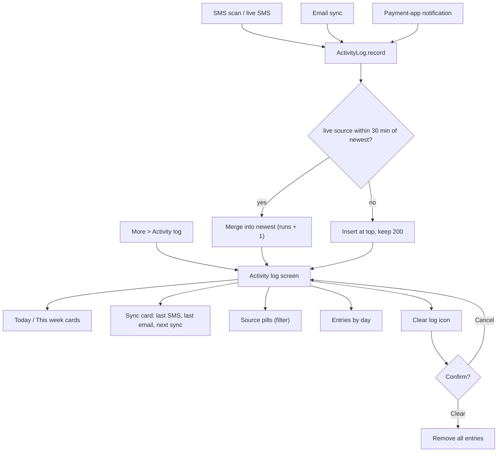

# Activity Log

| Field | Value |
|---|---|
| Feature ID | F-22 |
| Status | In progress (Phase 5: schema v5 table, repository with coalescing and 200 cap, ActivityLogger port wired into SMS scan, live SMS and email runs, Activity screen and More tile done; notification, statements and email statement counts not recorded; native-only live runs not logged) |
| Priority | P2 |
| Phase | 5 |
| Last Updated | 2026-10-22 |

## 1. Description

The Activity log is a private, on-device history of every sync run. Each SMS scan, live SMS batch, email sync, statement read and payment-app notification read is recorded with counts only, and the error type if it failed. It exists so the user can see that the app is working and why something was skipped, without any message text, sender or amount ever being stored or leaving the phone.

## 2. What This Feature Will Do

- Records an entry for each SMS scan, live SMS batch, email sync (IMAP or Gmail) and payment-app notification read.
- Stores counts only: messages read, relevant, added, merged, sent to review, duplicates, emails, statements, locked statements and duration.
- Stores only the error type when a run fails, never the error message.
- Stores a short generic reason when a notification was read but not turned into a transaction.
- Records a permission error when SMS access is missing.
- Combines live SMS or notification entries that arrive within 30 minutes into one entry with a run count.
- Keeps the newest 200 entries and restores them after a restart.
- Shows totals for today and this week: SMS read, emails read, added and statements.
- Shows when the last SMS scan and email sync ran and when the next sync is scheduled.
- Lists entries grouped by day, each with its counts, time and duration.
- Filters the list by source.
- Clears the whole log after confirmation, without touching transactions.

### 2.1 Inputs

- A finished SMS scan, a live SMS batch, an email sync or a payment-app notification read, reported by the feature that did the work.
- A failed run, with its error type.
- The user opening the Activity log screen.
- The user's taps on source filters, Clear log and its confirmation.
- The next scheduled sync times from the background scheduler.

### 2.2 Processing

1. Receive a run report from an ingestion source.
2. Turn it into an entry holding counts, duration and error type only.
3. For live SMS and notification entries, merge into the newest entry of the same source when it is within 30 minutes.
4. Put the entry at the top of the list and drop anything beyond the newest 200.
5. When the screen opens, total today and this week and find the last successful SMS scan and email sync.
6. Group the entries by day and apply the chosen source filter.
7. Ignore any logging failure so a sync is never interrupted.

### 2.3 Outputs

- The user sees the Today and This week cards, the Sync card, the source pills, the day-grouped entries, or the empty message "No activity yet".
- The log is stored on the phone only, is left out of backups and exports, and is never sent anywhere.
- No other feature reads it; Data sources shows its own last-scan line ([26_settings_data_sources.md](26_settings_data_sources.md)).

### 2.4 Out of Scope

- Does not read or ingest messages itself: [02_sms_ingestion.md](02_sms_ingestion.md), [03_email_ingestion.md](03_email_ingestion.md), [04_notification_ingestion.md](04_notification_ingestion.md) and [05_statement_import.md](05_statement_import.md) own that.
- Does not schedule the background syncs; it only shows the next run (scheduling is owned by [02_sms_ingestion.md](02_sms_ingestion.md) and [03_email_ingestion.md](03_email_ingestion.md)).
- Does not own the Data sources status line ([26_settings_data_sources.md](26_settings_data_sources.md)).
- Does not store message text, senders, subjects or amounts.

## 3. Behaviour in Existing App

Source: `app/src/main/kotlin/com/hisaab/app/log/ActivityLog.kt` (154 lines), `ui/more/ActivityLogScreen.kt` (241), recorders in `sms/OptimizedSmsReaderWorker.kt:57,102`, `sms/SmsReceiver.kt:98`, `notify/PaymentNotificationListener.kt:74,87`, and `ActivityLog.record(connection, report, startedAt, error)` implementing the email module's `SyncActivity` interface; analysis Part A 2.9 and 4.13.

### 3.1 Data (`ActivityEntry`)

| Field | Type | Meaning |
|---|---|---|
| `at` | Long (epoch ms) | Start time of the run (live entries: arrival time) |
| `source` | `ActivitySource` | `SMS_SCAN` "SMS scan", `SMS_LIVE` "Live SMS", `GMAIL` "Gmail", `IMAP` "IMAP", `STATEMENTS` "Statements", `NOTIFICATIONS` "Notifications" |
| `read` | Int | Messages (SMS or notifications) looked at |
| `relevant` | Int | Of `read`, those from banks or payment apps |
| `added` | Int | Transactions inserted |
| `merged` | Int | Merged into an existing transaction |
| `review` | Int | Flagged for review (possible duplicates) |
| `skipped` | Int | Duplicates already processed |
| `emails` | Int | Emails fetched (email runs) |
| `statements` | Int | Statements read in this run |
| `locked` | Int | Of those, password-protected and still locked |
| `millis` | Long | Duration |
| `error` | String? | Error class name (e.g. "IOException", "auth", "permission"), never its message |
| `runs` | Int (default 1) | Number of coalesced runs in this entry |
| `note` | String? | Short generic reason when a notification was read but not understood; never text from it |

Stored as a JSON array under DataStore `activity_log`, key `entries`, newest first, at most 200 (`MAX_ENTRIES`). JSON keys: `at`, `src`, `read`, `rel`, `add`, `mrg`, `rev`, `skp`, `eml`, `st`, `lck`, `ms`, `runs`, `err`, `note`. Unknown source names are dropped when decoding; a corrupt array decodes to an empty list. `clear()` removes the key. All writes are wrapped in `runCatching`.

### 3.2 Who records what

- SMS scan (`OptimizedSmsReaderWorker`): `SMS_SCAN`, `at = start`, `read = examined`, `relevant = bankMessages`, `added/merged/review/skipped` from the ingest report, `millis`. With no SMS permission: an entry with `error = "permission"` (counts 0). The same run saves a summary string `"{examined} SMS checked, {bankMessages} from banks, {inserted} new, {merged} merged, {flagged} to review ({x.x}s)"` into `last_sms_result` (shown in Data sources, [26_settings_data_sources.md](26_settings_data_sources.md)).
- Live SMS (`SmsReceiver`): `SMS_LIVE`, `read = relevant = number of sender groups in the broadcast`, counts from the ingest outcomes, `millis`, `error = exception class name` on failure; recorded only when SMS reading is enabled.
- Payment-app notification (`PaymentNotificationListener`): success -> `NOTIFICATIONS` with `read = 1`, `relevant = 1` and the outcome counted in `added`/`merged`/`review`/`skipped`; skip -> `NOTIFICATIONS`, `read = 1`, `relevant = 0`, `note = reason`. Reasons seen: "app notifications are off in settings", "not understood" (default) and the parser rejection reasons (analysis Part A 4.4): "too short", "otp or security text", "failed or pending payment", "request, reminder or due notice", "offer or promotion", "no payment wording", "no amount", "own transfer or card bill". Only the generic reason is stored.
- Email sync (`ActivityLog.record(connection, report, startedAt, error)`): source `IMAP` when `MailConnection.IMAP`, else `GMAIL`; `at = startedAt`; counts from the ingest report (`inserted`, `merged`, `flagged`, `skipped`), `emails = report.fetched`, `statements` and `locked` from `processed_emails` rows written since `startedAt` (`statementStatusSince`: sum of counts, and the sum for status LOCKED), `millis`, `error`.
- `STATEMENTS`: defined and filterable, but no code path records an entry with this source in 2.9.8 (statements surface through email entries, see Open Questions).

### 3.3 Coalescing

For `SMS_LIVE` and `NOTIFICATIONS` only: if the newest entry has the same source and `entry.at - head.at` is within 0..30 minutes (`COALESCE_MS = 30 * 60 * 1000`), the new entry is merged into it: `read`, `relevant`, `added`, `merged`, `review`, `skipped`, `millis` are summed, `runs` summed, `error = new.error ?: old.error`, `note = new.note ?: old.note`; `at` stays the first entry's. Otherwise the entry is inserted at index 0 and the list is truncated to 200.

### 3.4 Screen (`ActivityLogRoute`, `ActivityLogScreen.kt:142`)

`MoreScaffold` titled "Activity log"; top-bar action "Clear log" (delete-sweep icon) only when entries exist. Lazy column, card gap `CardGap`:

1. Card "Today": four KPIs "SMS read", "Emails read", "Added", "Statements".
2. Card "This week": same KPIs (week starts Monday).
3. Card "Sync": rows "Last SMS scan" (time or "Not yet"), "Last email sync" (time or "Not yet"), "Next scheduled sync" (time or "Not scheduled"), each with a 36 dp badge icon (Sms, Email, Sync).
4. Source filter pills (horizontal scroll): "All" then one pill per `ActivitySource` with its icon (SMS scan, Live SMS, Gmail, IMAP, Statements, Notifications); tapping the active pill clears the filter. The filter is `rememberSaveable`.
5. Empty state (no entries after filtering): `EmptyState(History, "No activity yet", "Each sync is recorded here, on this phone only.")`.
6. One `HCard` per day (title via `Periods.dayHeader`: "Today", "Yesterday", "EEE, d MMM yyyy") with an `EntryRow` per entry.

Totals: today = entries with `at >= startOfToday` (device zone); week = entries since the Monday on or before today; `sms = sum(read)` over `SMS_SCAN` and `SMS_LIVE`; `emails = sum(emails)` over all entries; `added = sum(added)` over all entries; `statements = sum(statements)` over all entries. `lastSms` = `at` of the newest `SMS_SCAN` entry without an error; `lastEmail` = newest `GMAIL`/`IMAP` entry without an error; `nextSync` = the minimum `nextScheduleTimeMillis` among enqueued WorkManager infos for unique work `gmail-sync-periodic` and `nightly-sync` that lie in the future.

`EntryRow`: leading 36 dp badge (source icon; red-tinted on error), title = source label plus " · ×{runs}" when `runs > 1`, subtitle = either "Failed: {error}" or the parts joined by " · ":

- `read > 0`: SMS sources: "{n} SMS, {b} from banks" when `relevant != read`, else "{n} SMS"; `NOTIFICATIONS`: "{n} notifications"; other sources with `read > 0`: "{n} SMS".
- `emails > 0`: "{n} emails".
- always: "{n} added".
- `merged > 0` "{n} merged"; `review > 0` "{n} to review"; `skipped > 0` "{n} duplicates"; `statements > 0` "{n} statements"; `locked > 0` "{n} locked"; `note != null` "Skipped: {reason}".

Trailing: time of day (`Periods.time(at)`) and, when `millis >= 1000`, a second line with "%.1fs".

Filter match (`matches`): no filter -> all; `STATEMENTS` -> entries of source `STATEMENTS` or any entry with `statements > 0`; otherwise `source == filter`.

Clear dialog: AlertDialog "Clear log?" - "Removes every entry. Transactions are not affected." [Clear (red) | Cancel].

## 4. User Stories

1. As a user I can see when my SMS and email were last read and when the next sync will run.
2. As a user I can see how many messages, emails and statements were read today and this week and how many transactions were added.
3. As a user I can see why a notification was skipped without seeing its content.
4. As a user I can see that a sync failed and with which kind of error.
5. As a user I can filter the history by source.
6. As a user I can clear the history without touching my transactions.

## 5. Functional Requirements (FR-22-01 ...)

1. FR-22-01: Every SMS scan, live SMS batch, email sync and payment-app notification read records one entry via a single `ActivityLog.record` API; the entry contains counts and the error class name only, never message text, sender, subject or amount.
2. FR-22-02: The log keeps the newest 200 entries (newest first) in local storage and survives restarts; corrupt stored data yields an empty log, never a crash.
3. FR-22-03: A missing SMS permission records an `SMS_SCAN` entry with `error = "permission"` and zero counts.
4. FR-22-04: `SMS_LIVE` and `NOTIFICATIONS` entries within 30 minutes of the newest entry of the same source are merged into it (sum counts and `runs`, keep the first `at`, keep the latest non-null `error` and `note`); other sources always create a new entry.
5. FR-22-05: Email runs record `IMAP` or `GMAIL` by connection type with `emails`, ingest counts, `statements` and `locked` from the statements written during the run, `millis` and the error class.
6. FR-22-06: A payment-app notification that cannot be turned into a transaction records `read = 1`, `relevant = 0` and a generic `note` reason (the parser reason or "not understood" or "app notifications are off in settings").
7. FR-22-07: The screen shows cards "Today" and "This week" with SMS read, Emails read, Added and Statements, computed as defined in section 2.4 (week starts Monday).
8. FR-22-08: The Sync card shows Last SMS scan, Last email sync (newest entries of the matching sources with no error, or "Not yet") and Next scheduled sync (earliest known future scheduled run, or "Not scheduled").
9. FR-22-09: Source pills (All + 6 sources with icons) filter the list; tapping the active pill clears it; the Statements pill also includes any entry with `statements > 0`.
10. FR-22-10: Entries are grouped into one card per local day with the day header "Today", "Yesterday" or "EEE, d MMM yyyy", each row rendered as defined in section 2.4 (title with " · ×n", parts, "Failed: {error}", time, duration when >= 1 s).
11. FR-22-11: The empty state "No activity yet" / "Each sync is recorded here, on this phone only." is shown when no entries match.
12. FR-22-12: "Clear log" (visible only when entries exist) asks for confirmation and removes every entry without affecting transactions.
13. FR-22-13: Recording failures must never break a sync (wrapped, ignored).
14. FR-22-14: The log is excluded from any backup/export and never transmitted.

## 6. Non-Functional Requirements (performance, battery, privacy, offline)

- Performance: recording is a single small transaction (under 10 ms); the screen renders 200 entries instantly (lazy list).
- Battery: no extra wake-ups; entries are written by the work that already ran.
- Privacy: counts and generic reasons only; no message text, sender names, subjects, amounts; error stores the class name, not the message; no analytics or upload; cleared with "Clear log".
- Offline: fully offline.
- Accessibility: each row has a combined semantic label ("SMS scan, 12 SMS, 4 from banks, 2 added, today 14:02").
- Storage: bounded (200 rows).

## 7. UI / Screens & User Flow (screen list + flow diagram)

| Screen / dialog | Source (Kotlin) | Notes |
|---|---|---|
| Activity log | `ActivityLogScreen.kt:142` | Today, This week, Sync, filters, entries |
| Today / This week KPI cards | `ActivityLogScreen.kt:197` | SMS read, Emails read, Added, Statements |
| Sync times card | `ActivityLogScreen.kt:188` | Last SMS, last email, next scheduled |
| Source filter pills | `ActivityLogScreen.kt:156` | All + 6 sources |
| Entry row | `ActivityLogScreen.kt:215` | Counts, error, time, duration |
| Empty state | `ActivityLogScreen.kt:164` | No activity yet |
| Clear log? dialog | `ActivityLogScreen.kt:176` | Confirm |



Reference GIFs (all Status: Pending, not yet captured):

-  (Status: Pending, not yet captured)
-  (Status: Pending, not yet captured)
-  (Status: Pending, not yet captured)
-  (Status: Pending, not yet captured)
-  (Status: Pending, not yet captured)

## 8. Data Models (Dart entities + fields + types)

In `lib/features/activity_log/domain/entities/`.

```dart
enum ActivitySource {
  smsScan('SMS scan'), smsLive('Live SMS'), gmail('Gmail'), imap('IMAP'),
  statements('Statements'), notifications('Notifications');
  const ActivitySource(this.label);
  final String label;
}

@freezed
class ActivityEntry with _$ActivityEntry {
  const ActivityEntry._();
  const factory ActivityEntry({
    required DateTime at,
    required ActivitySource source,
    @Default(0) int read,
    @Default(0) int relevant,
    @Default(0) int added,
    @Default(0) int merged,
    @Default(0) int review,
    @Default(0) int skipped,
    @Default(0) int emails,
    @Default(0) int statements,
    @Default(0) int locked,
    @Default(0) int millis,
    String? error,          // class name only
    @Default(1) int runs,
    String? note,           // generic reason only
  }) = _ActivityEntry;

  /// Coalescing merge for live sources.
  ActivityEntry plus(ActivityEntry o) => copyWith(
    read: read + o.read, relevant: relevant + o.relevant, added: added + o.added, merged: merged + o.merged,
    review: review + o.review, skipped: skipped + o.skipped, millis: millis + o.millis,
    error: o.error ?? error, runs: runs + o.runs, note: o.note ?? note,
  );
}

@freezed
class ActivityTotals with _$ActivityTotals {
  const factory ActivityTotals({@Default(0) int sms, @Default(0) int emails, @Default(0) int added, @Default(0) int statements}) = _ActivityTotals;
}

@freezed
class ActivityState with _$ActivityState {
  const factory ActivityState({
    @Default([]) List<ActivityEntry> entries,           // newest first
    @Default(ActivityTotals()) ActivityTotals today,
    @Default(ActivityTotals()) ActivityTotals week,
    DateTime? lastSms,
    DateTime? lastEmail,
    DateTime? nextSync,
  }) = _ActivityState;
}

abstract class SyncActivity {
  Future<void> recordEmail(MailConnection connection, SyncReport? report, DateTime startedAt, String? error);
}
```

## 9. Database Tables / Changes

New Drift table (replaces the DataStore JSON array):

```dart
class ActivityEntries extends Table {
  IntColumn get id => integer().autoIncrement()();
  IntColumn get at => integer()();                       // epoch ms
  TextColumn get source => text()();                     // SMS_SCAN | SMS_LIVE | GMAIL | IMAP | STATEMENTS | NOTIFICATIONS
  IntColumn get read => integer().withDefault(const Constant(0))();
  IntColumn get relevant => integer().withDefault(const Constant(0))();
  IntColumn get added => integer().withDefault(const Constant(0))();
  IntColumn get merged => integer().withDefault(const Constant(0))();
  IntColumn get review => integer().withDefault(const Constant(0))();
  IntColumn get skipped => integer().withDefault(const Constant(0))();
  IntColumn get emails => integer().withDefault(const Constant(0))();
  IntColumn get statements => integer().withDefault(const Constant(0))();
  IntColumn get locked => integer().withDefault(const Constant(0))();
  IntColumn get millis => integer().withDefault(const Constant(0))();
  TextColumn get error => text().nullable()();
  IntColumn get runs => integer().withDefault(const Constant(1))();
  TextColumn get note => text().nullable()();
}
// Index: (at DESC). Trim: after each insert/update DELETE FROM activity_entries WHERE id NOT IN (SELECT id FROM activity_entries ORDER BY at DESC, id DESC LIMIT 200).
```

Coalescing runs inside one transaction: read the newest row; if the new entry is `smsLive` or `notifications`, same source and `0 <= new.at - head.at <= 1,800,000`, update the head row with the summed counts; else insert. Clear = `DELETE FROM activity_entries`.

Reads for the screen: `activity_entries` (stream, newest first); scheduled times from the settings store keys `next_sms_sync_at` and `next_email_sync_at` (epoch ms, written when the Flutter app schedules the nightly SMS and daily email work, because `workmanager` cannot be queried for the next run time; see section 17). Email statement counts come from `processed_emails` / `statements` rows written since the run start ([05_statement_import.md](05_statement_import.md)): `SELECT status, COUNT(*) FROM statements WHERE processedAt >= :startedAt GROUP BY status` (existing query `statementStatusSince`).

## 10. Business Rules & Logic (regex, parsing rules, algorithms, thresholds)

Constants: `MAX_ENTRIES = 200`; `COALESCE_MS = 1,800,000`; duration shown only when `millis >= 1000` as `"%.1fs"`; week start Monday; JSON key abbreviations in section 2.1 (only needed for importing old data, which Flutter does not do).

Totals algorithm:

```text
dayStart = startOfToday(zone); weekStart = Monday(on or before today) at 00:00
totals(list):
  sms        = sum(e.read      for e in list if e.source in {smsScan, smsLive})
  emails     = sum(e.emails    for e in list)
  added      = sum(e.added     for e in list)
  statements = sum(e.statements for e in list)
today = totals(entries where at >= dayStart); week = totals(entries where at >= weekStart)
lastSms   = first(entries where source == smsScan and error == null)?.at
lastEmail = first(entries where source in {gmail, imap} and error == null)?.at
```

Row subtitle algorithm: section 2.4 parts list.

Worked examples:

| Entry | Row title | Subtitle |
|---|---|---|
| SMS_SCAN read 412, relevant 63, added 9, merged 2, review 1, skipped 4, 3200 ms | SMS scan | `412 SMS, 63 from banks · 9 added · 2 merged · 1 to review · 4 duplicates`; trailing `02:30` / `3.2s` |
| SMS_LIVE coalesced: 3 runs, read 3, relevant 3, added 2 | Live SMS · ×3 | `3 SMS · 2 added` |
| IMAP emails 18, added 5, statements 2, locked 1 | IMAP | `18 emails · 5 added · 2 statements · 1 locked` |
| NOTIFICATIONS read 1, relevant 0, note "failed or pending payment" | Notifications | `1 notifications · 0 added · Skipped: failed or pending payment` |
| SMS_SCAN error "permission" | SMS scan | `Failed: permission` (red badge) |

Coalescing example: NOTIFICATIONS at 10:00 (read 1, added 1) then 10:20 (read 1, relevant 0, note "no amount") -> one entry at 10:00 with `read 2`, `relevant 1`, `added 1`, `runs 2`, `note "no amount"`; a third at 10:55 (55 min after the head) creates a new entry.

Time formats: `Periods.time(at)` (for example "2:30 am"), `Periods.dateTime(at)` ("d MMM yyyy, h:mm a"), day header as in section 2.4; English patterns, not localised (consistent with the app).

## 11. Platform / Native Requirements (permissions, channels, background work)

No permissions. Background workers (SMS scan, live receiver, notification listener, email sync, statement processing) call the log from Dart through the shared repository; the native Android receivers/listeners that run when the Flutter engine is not alive must either start a headless Dart isolate or write entries through a small native shim into the same SQLite database (WAL mode) so that live SMS and notification runs are logged ([02_sms_ingestion.md](02_sms_ingestion.md), [04_notification_ingestion.md](04_notification_ingestion.md)). The next-sync display reads times persisted at scheduling.

## 12. Dependencies (other features → link to their memory file; packages)

Features: [02_sms_ingestion.md](02_sms_ingestion.md) (SMS scan, live SMS, nightly 02:30 schedule), [03_email_ingestion.md](03_email_ingestion.md) (email run report and 24 h schedule), [04_notification_ingestion.md](04_notification_ingestion.md) (skip reasons), [05_statement_import.md](05_statement_import.md) (statements/locked counts), [06_transaction_parsing_engine.md](06_transaction_parsing_engine.md) (rejection reasons), [07_dedup_review.md](07_dedup_review.md) (ingest outcomes inserted/merged/flagged/already processed), [26_settings_data_sources.md](26_settings_data_sources.md) (last SMS result line), [25_security_privacy.md](25_security_privacy.md) (privacy rule), [28_theming_customisation.md](28_theming_customisation.md).

Packages: `drift`, `flutter_riverpod`, `freezed`, `intl`, `workmanager`.

## 13. Folder Location (lib/features/<name>/...)

```text
lib/features/activity_log/
  data/
    activity_log_dao.dart                 # insert/coalesce/trim/clear, watchAll
    activity_log_repository_impl.dart     # implements ActivityLog + SyncActivity
    schedule_times_store.dart             # next_sms_sync_at / next_email_sync_at
  domain/
    entities/activity_entry.dart, activity_totals.dart, activity_state.dart
    repositories/activity_log_repository.dart
    usecases/record_activity.dart, build_activity_state.dart, entry_subtitle.dart
  presentation/
    activity_log_screen.dart
    providers/activity_log_providers.dart
    widgets/totals_card.dart, sync_times_card.dart, source_filter_row.dart, entry_row.dart
```

## 14. Edge Cases & Error Handling

- No entries: empty state; the delete icon is hidden; Last SMS/Last email show "Not yet", Next shows "Not scheduled".
- Entry with an error is excluded from "Last SMS scan"/"Last email sync" but still listed (red badge).
- A coalesced entry may carry a `note` from only one of its runs (the latest non-null), so "Skipped" can appear next to successes.
- Entries older than the newest 200 are dropped silently.
- Clock changes: entries are ordered by insertion (newest first), so a backwards clock change can produce out-of-order days; grouping by local day still works.
- Time zone: the Today/This week boundaries use the device zone.
- Source name unknown (future version): row skipped when decoding (not applicable to the new schema, keep a default icon instead).
- Large `millis` (hours): shown as "%.1fs" (no minutes format).
- Recording during a database migration or while the database is closed: ignored (never fails the caller).
- The filter pill for Statements includes email runs that read statements.
- Email runs report `emails` = fetched messages (including non-bank), SMS runs `read` = all inbox messages examined.

## 15. Test Cases (unit / widget / integration + sample fixtures)

Unit:

1. TC-22-01 (FR-22-02): inserting 205 entries leaves 200, newest first; clear empties.
2. TC-22-02 (FR-22-04): coalescing: NOTIFICATIONS at 10:00 then 10:20 -> 1 row with summed counts and `runs 2`; at 10:55 -> 2 rows; `SMS_SCAN` and email entries never coalesce; different live sources never coalesce; error and note carry the latest non-null.
3. TC-22-03 (FR-22-07): totals for a fixture: today entries [SMS_SCAN read 100 added 5, SMS_LIVE read 2 added 1, IMAP emails 10 added 2 statements 1], older entries excluded; week boundary on Monday 00:00.
4. TC-22-04 (FR-22-08): lastSms ignores an errored newer scan; lastEmail considers both GMAIL and IMAP; null -> "Not yet".
5. TC-22-05 (FR-22-10): subtitle builder for the five worked examples in section 10.
6. TC-22-06 (FR-22-09): filter semantics including Statements pill showing an IMAP entry with `statements > 0`.
7. TC-22-07 (FR-22-01, FR-22-06): the recorder rejects/never stores text fields: only error class and generic reason; reason values limited to the known list.
8. TC-22-08 (FR-22-03): missing permission records `error = permission` with zero counts.
9. TC-22-09 (FR-22-05): email run recording derives `statements`/`locked` from statements written since `startedAt`.

Widget:

10. TC-22-10 (FR-22-07 to FR-22-11): screen renders cards, sync rows, pills, grouped days ("Today", "Yesterday", "Fri, 9 Oct 2026"), error badge, duration only when >= 1 s, empty state.
11. TC-22-11 (FR-22-12): clear flow shows the dialog; Cancel keeps data; Clear empties; transactions unaffected.

Integration:

12. TC-22-12 (FR-22-01, FR-22-13): run a fake SMS scan, a live SMS batch and a notification skip -> entries appear live in the screen; a thrown error inside recording does not fail the scan.

Fixture rows (masked): scan summary `412 SMS checked, 63 from banks, 9 new, 2 merged, 1 to review (3.2s)`; notification skip reason `failed or pending payment`.

## 16. Acceptance Criteria

1. AC-22-01: Each ingestion path records exactly one entry per run (or coalesced run) with counts only. (FR-22-01, FR-22-03, FR-22-05, FR-22-06; TC-22-07, TC-22-08, TC-22-09, TC-22-12)
2. AC-22-02: The log is bounded to 200 entries and coalesces live sources within 30 minutes. (FR-22-02, FR-22-04; TC-22-01, TC-22-02)
3. AC-22-03: Totals and the Sync card reproduce the Kotlin figures for the fixture. (FR-22-07, FR-22-08; TC-22-03, TC-22-04)
4. AC-22-04: Rows, filters, day grouping and the empty state render exactly as specified. (FR-22-09, FR-22-10, FR-22-11; TC-22-05, TC-22-06, TC-22-10)
5. AC-22-05: Clear log removes entries only after confirmation and never touches transactions. (FR-22-12; TC-22-11)
6. AC-22-06: Recording errors never break a sync and no message text is ever stored. (FR-22-13, FR-22-14; TC-22-07, TC-22-12)

## 17. Open Questions

1. `ActivitySource.STATEMENTS` is in the enum and filter list but no code records it; statement activity only appears through email entries (`statements`, `locked`) and manual statement imports are not logged. Should Flutter record file-picker imports as `STATEMENTS`?
2. `SMS_LIVE` records `read = relevant = bySender.size` (number of sender groups in the broadcast), not the number of messages; "SMS read" totals therefore under-count live multi-part messages. Keep or count messages?
3. SMS scan totals double count when the same inbox window is re-read (14-day catch-up and nightly runs both add their `examined`); "SMS read today" is runs x messages, not distinct messages. Intended?
4. Coalesced notification entries keep only the latest `note`, so "Skipped: reason" can appear beside successful reads; consider per-reason counts.
5. Entry rows for non-SMS sources with `read > 0` print "{n} SMS" (e.g., an email entry never has `read`, but the rule would mislabel); only a concern if a source adds `read`.
6. "Next scheduled sync" comes from WorkManager's `nextScheduleTimeMillis`; `workmanager` for Flutter cannot query it. Decide: persist planned times at scheduling (assumed in section 9) or add a native method channel to read WorkManager.
7. Email polling interval mismatch: the connect dialog says "checks every hour" while the worker is daily (analysis Part A Open Question 1); the "Next scheduled sync" will show the daily time.
8. English-only day and time formats; should they follow the language pack/locale ([29_localization.md](29_localization.md))?
9. Whether the log should include user-visible reasons for rejected SMS (the SMS path stores `relevant` vs `read` only; rejection reasons exist only for notifications).

## 18. Implementation Notes

Phase 5 (2026-10-21). Code: `features/activity_log/{domain,data,presentation}`; table `core/db/tables/activity_entries.dart` (Drift schema v5, real migration v4 -> v5, index on `at`); providers in `app/di/security_providers.dart`.

- FR-22-01/03: `ActivityLogger.record` is called by `ScanSms` (SMS_SCAN, permission error with zero counts), `HandleLiveSms` (one SMS_LIVE entry per accepted message, coalesced by the repository) and `EmailSyncRunner.onReport` (recorded as `IMAP`; `GMAIL` unused until Gmail sync exists). Foreground and headless (nightly, drain) runs both log because they use the same providers.
- FR-22-02/04/13: coalescing, trim to 200 and the swallow-all error guard are inside `ActivityLogRepositoryImpl.record` (one DB transaction). Unknown source codes are skipped on read.
- FR-22-07..12: `ActivityStats` (pure) plus `ActivityLogScreen` at `/activity`, More tile `ActivityTile`. Times use `intl` English patterns.
- Next scheduled sync reads settings keys `next_sms_sync_at` / `next_email_sync_at`; nothing writes them yet, so it shows "Not scheduled".
- Not done: FR-22-05 `statements`/`locked` counts (email run records 0), FR-22-06 notification entries (no notification ingest path exists yet), STATEMENTS source, native receiver logging when the engine is dead. TC-22-07/08/09/12 not covered by an end-to-end test; the recorder takes no free text by construction.
- Tests: `test/features/activity_log/activity_log_test.dart` (TC-22-01..06, 10, 11), `test/core/db/migration_v4_v5_test.dart`.

- Hardening 2026-10-22: payment-app notifications now log one `notifications` entry per watched-app notification (`NotificationEngine` with optional `ActivityLogger`; unwatched, summary, empty and switched-off ones are not logged). Statement import logging is PENDING: the statement owner must call `activityLoggerProvider` (`ActivitySource.statements`) from the import flow. Next scheduled sync is now written when the nightly job is (re)registered and after each run.

## 19. Change Log (date | change | reason)

| Date | Change | Reason |
|---|---|---|
| 2026-10-17 | Created from hisaab_apk 2.9.8 analysis | Initial |
| 2026-10-19 | Restructured to the 19-section standard (Description, What This Feature Will Do, Implementation Notes added); Last Updated bumped | Audit Gate (Prompt 2, Part A) |
| 2026-10-21 | Phase 5 security + activity log landed | Phase 5 |
| 2026-10-22 | Hardening: lock skip around system flows, Home SMS card, activity entries | Hardening |
