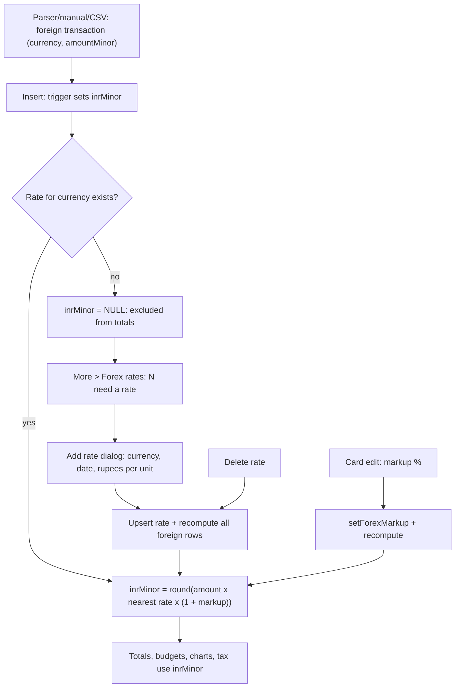

# Forex Rates

| Field | Value |
|---|---|
| Feature ID | F-23 |
| Status | Existing |
| Priority | P2 |
| Phase | 4 |
| Last Updated | 2026-10-21 |

## 1. Description

Forex Rates handles spends made in other currencies, such as a dollar card charge or a euro hotel booking. These are stored in their own currency, but every total, budget, chart and tax figure in the app is in rupees. The user sets a rupee rate per currency and day, and the app converts each foreign spend to rupees, adds the card's forex markup, and shows which spends still need a rate. Until a spend has a rate it stays out of totals instead of being counted as rupees.

## 2. What This Feature Will Do

- Stores a rupee rate for each currency and day that the user enters.
- Replaces the rate when the user saves the same currency and day again.
- Shows how many spends abroad there are for each currency and how many still need a rate.
- Shows "All counted" for a currency once every spend in it has a rate.
- Lets the user add a rate from a button, or straight from the "need a rate" link for a currency.
- Lists saved rates by currency, newest day first, and lets the user delete one.
- Converts each foreign spend to rupees using the rate of its own day, or the nearest day with a rate.
- Adds the card's forex markup to the rupee value.
- Recalculates rupee values when a spend is added or edited, when a rate is saved or deleted and when a card's markup changes.
- Keeps spends without a rate out of every total, budget, chart and tax figure.
- Shows the rupee value of a foreign spend on its detail screen, or a hint to add a rate.

### 2.1 Inputs

- Taps on Add rate, on a currency's "need a rate" link and on a rate's delete button.
- The currency, date and rupee rate typed into the rate dialog.
- Foreign-currency transactions already stored, with their amount, currency, account and date.
- The forex markup percentage set on each card ([13_accounts_management.md](13_accounts_management.md)).

### 2.2 Processing

1. Save the rate entered for a currency and day.
2. For each foreign spend, find the rate for its currency whose day is closest to the spend's day.
3. Multiply the amount by that rate and by the card markup, and round to the nearest paisa.
4. If the currency has no rate, leave the rupee value empty.
5. Recalculate all foreign spends after any rate is saved or deleted or a markup changes.
6. Count foreign spends per currency and how many have no rupee value.
7. Treat a spend with no rupee value as zero in all totals.

### 2.3 Outputs

- The user sees the Forex rates screen with the "Your spends abroad" card, the list of rates and the rate dialog.
- The rupee value of each foreign spend is stored with the transaction, and the rates are stored on the phone.
- Other features receive the rupee value for their totals: [10_expense_tracking.md](10_expense_tracking.md), [17_dashboard_home.md](17_dashboard_home.md), [18_analytics.md](18_analytics.md) and [19_tax_centre.md](19_tax_centre.md).
- Transaction detail shows the "In rupees" row ([08_transactions_ledger.md](08_transactions_ledger.md)).

### 2.4 Out of Scope

- Does not read a foreign amount out of a message ([06_transaction_parsing_engine.md](06_transaction_parsing_engine.md)).
- Does not provide the markup field on the card ([13_accounts_management.md](13_accounts_management.md)).
- Does not draw the transaction detail screen ([08_transactions_ledger.md](08_transactions_ledger.md)).
- Does not download rates or look up historical rates; the app is offline by design and the user types every rate.

## 3. Behaviour in Existing App

Source: `shared/src/main/kotlin/com/hisaab/shared/db/Forex.kt` (84 lines: `ForexRateEntity`, `CurrencyCount`, `ForexDao`, `ForexSql`), `app/src/main/kotlin/com/hisaab/app/ui/settings/ForexRatesScreen.kt` (198), `ui/accounts/AccountsScreen.kt:276,654-705` (markup), `ui/transactions/TransactionDetailScreen.kt:159`, `parser-core/.../extract/AmountExtractor.kt:9`; analysis Part A 2.9 (Forex rates screen), 6.3 and Part B 1.1, 1.4, 1.7, 2.9.

### 3.1 Screen (`ForexRatesRoute`, `ForexRatesScreen.kt:89`)

Scaffold "Forex rates" with back arrow; floating action button "Add rate" (plus icon) that opens the rate dialog preselecting the first foreign currency in use, else "USD". Lazy column (10 dp spacing):

1. Card "Your spends abroad" (only when any foreign transaction exists): one row per currency `"{CUR} · {count}"`; if `unpriced > 0` a text button "{n} need a rate" that opens the dialog for that currency, else "All counted" (primary colour).
2. Help text: "Each spend uses the rate of its date, or the nearest date you set. Card markup is set on each card."
3. One list item per saved rate, ordered by currency then newest day first: headline `1 {CUR} = ₹{rate with 2 decimals}` (for example `1 USD = ₹83.10`), supporting text the date `d MMM yyyy`, trailing delete icon "Delete" (no confirmation). Items animate.

Rate dialog (`RateDialog`, AlertDialog "Add rate"): filter chips for currencies in use plus USD, EUR, GBP, AED, SGD (distinct); text field "Currency" (3 letters, upper-cased, letters only); read-only "Date" field (default today) that opens a `DatePickerDialog` ("Done"/"Cancel"); decimal field "Rupees for 1 {currency}" with "₹" prefix (digits and ".", max 10 characters, must parse to a number > 0); buttons Save (enabled when the currency has 3 letters and the rate is valid) and Cancel.

ViewModel: `save(currency, day, rate)` = `upsert(ForexRateEntity(CURRENCY, day.toEpochDay(), rate))` then `recompute()`; `delete(rate)` = `delete(currency, day)` then `recompute()`. Flows: `observeRates()` and `observeForeign()`.

### 3.2 Where foreign amounts come from

The parser recognises explicit currency codes in `AmountExtractor.CURRENCY_AMOUNT = \b(INR|USD|EUR|GBP|AED|SGD|AUD|CAD|JPY|CHF|SAR|QAR)\s*(NUMBER)` and stores `currency` plus `amountMinor` in that currency (always amount x 100, also for currencies without decimals such as JPY; see Open Questions). Example fixture: "USD200.00 was spent on your SBI Corporate Card ending 1234 ...". Manual entry and CSV import carry `currency` too ([08_transactions_ledger.md](08_transactions_ledger.md), [24_backup_export.md](24_backup_export.md)).

### 3.3 Data and the conversion

Table `forex_rates`: composite PK `(currency TEXT, day INTEGER)`, `inrPerUnit REAL` (rupees for one unit; `day` is an epoch day in India time). `transactions.inrMinor INTEGER NULL` holds the rupee value in paise (added in migration 11-12; INR rows are backfilled with `amountMinor`).

Formula (`ForexSql.inr`, used by the triggers and by `recompute`):

```sql
CASE WHEN row.currency = 'INR' THEN row.amountMinor ELSE (
  SELECT CAST(ROUND(row.amountMinor * r.inrPerUnit *
         (1 + COALESCE((SELECT a.forexMarkupBps FROM accounts a WHERE a.id = row.accountId), 0) / 10000.0)) AS INTEGER)
  FROM forex_rates r
  WHERE r.currency = row.currency
    AND ABS(r.day - (row.timestamp + 19800000) / 86400000) = (
        SELECT MIN(ABS(r2.day - (row.timestamp + 19800000) / 86400000)) FROM forex_rates r2 WHERE r2.currency = row.currency)
  LIMIT 1) END
```

- `(timestamp + 19,800,000) / 86,400,000` = the transaction's IST epoch day (integer division).
- The nearest rate day is used with no cut-off; no rate for the currency yields NULL.
- `forexMarkupBps` comes from the transaction's account (0 when none), 350 = 3.5%.
- Triggers (not part of the exported schema JSON; created by `ForexSql.install` in migration 11-12 and again on every database open, `CREATE TRIGGER IF NOT EXISTS`): `transactions_inr_insert AFTER INSERT ON transactions` and `transactions_inr_update AFTER UPDATE OF amountMinor, currency, accountId, timestamp ON transactions`, each `UPDATE transactions SET inrMinor = <formula for NEW> WHERE id = NEW.id`.
- A change to a rate or to a card's markup fires no trigger; the app calls `ForexDao.recompute()` = `UPDATE transactions SET inrMinor = <formula> WHERE currency != 'INR'` (called after save/delete of a rate and when a card's markup changes in the edit sheet: `if (bps != a.forexMarkupBps) { dao.setForexMarkup(id, bps); forex.recompute() }`).
- `observeForeign()`: `SELECT currency, COUNT(*) AS count, SUM(CASE WHEN inrMinor IS NULL THEN 1 ELSE 0 END) AS unpriced FROM transactions WHERE currency != 'INR' GROUP BY currency ORDER BY count DESC`.

### 3.4 How the rupee value is used everywhere

`LedgerMath.rupees(t) = inrMinor ?: (currency == "INR" ? amountMinor : 0)`; the same in `MonthSpend` and `TaxIncome`; SQL aggregations sum `inrMinor` (NULL ignored). So an unpriced foreign spend counts as 0 in totals, budgets, Home, Analysis and Tax until a rate exists. The Forex screen is the only place that counts them. Display: lists show the original amount `Money.format(amountMinor, currency)`; transaction detail shows the row "In rupees": `≈ ₹x` (`Money.format(inrMinor)`) or, when `inrMinor` is NULL, the hint "Add a rate in Settings › Forex rates". Foreign rows still appear in lists and can be categorised normally.

### 3.5 Card forex markup (set on the card, consumed here)

Card edit sheet field: percent, 0-20 (error otherwise), supporting text "Added to spends in other currencies. Include GST: 3.5% + 18% = 4.13%." stored as `accounts.forexMarkupBps` (percent x 100; 4.13% = 413). Detail in [13_accounts_management.md](13_accounts_management.md) and [14_credit_cards.md](14_credit_cards.md).

## 4. User Stories

1. As a traveller I see which foreign spends are not yet in my totals and add a rate in two taps.
2. As a user I enter one rate per currency and date and each spend uses the rate of its own day or the nearest one.
3. As a card holder I add my card's forex markup (with GST) so my rupee total matches my statement.
4. As a user I delete or correct a rate and every affected spend updates.
5. As a user I see the rupee value of a foreign spend on its detail screen.

## 5. Functional Requirements (FR-23-01 ...)

1. FR-23-01: Store user rates per (currency code, day) with `inrPerUnit` as a positive real; saving the same (currency, day) replaces the rate.
2. FR-23-02: The Forex rates screen shows the "Your spends abroad" card (currency, count, unpriced count or "All counted"), the explanatory text, and the list of rates ordered by currency then newest day, with a delete action per rate.
3. FR-23-03: The FAB and the "{n} need a rate" button open the rate dialog (currency chips for currencies in use plus USD, EUR, GBP, AED, SGD; 3-letter currency field; date picker defaulting to today; decimal rate > 0); Save is enabled only for a 3-letter currency and a positive number.
4. FR-23-04: Every transaction has `inrMinor`: for INR equal to `amountMinor`; for other currencies `round(amountMinor * rate * (1 + markupBps/10000))` using the rate of the same currency whose day is nearest to the transaction's IST day; NULL when the currency has no rate.
5. FR-23-05: `inrMinor` is recomputed automatically when a transaction is inserted or when its amount, currency, account or timestamp changes.
6. FR-23-06: `inrMinor` of all non-INR transactions is recomputed after any rate is saved or deleted and after a card's markup changes.
7. FR-23-07: Totals, charts, budgets and tax calculations use `inrMinor` (0 when NULL for non-INR), so unpriced foreign spends are excluded and never counted as rupees.
8. FR-23-08: Transaction detail shows the "In rupees" row for non-INR transactions: `≈ ₹x` when priced, otherwise the hint to add a rate.
9. FR-23-09: The unpriced count per currency updates live as rates are added or removed.
10. FR-23-10: Tie-breaking between two equally near rate days is deterministic (earlier day wins) in the Flutter port.
11. FR-23-11: The IST day of a transaction is `floor((timestampMs + 19,800,000) / 86,400,000)`.
12. FR-23-12: Currency codes are stored upper-case; the dialog accepts letters only and at most 3 characters.
13. FR-23-13: Deleting a rate requires no confirmation but is reflected immediately (recompute) and can be re-added.
14. FR-23-14: The screen and dialog strings are translatable and follow the texts in section 2.

## 6. Non-Functional Requirements (performance, battery, privacy, offline)

- Performance: `recompute()` over up to tens of thousands of foreign rows completes in under 500 ms (single SQL UPDATE with an index on `forex_rates(currency, day)` primary key); triggers add under 1 ms per insert.
- Battery: none.
- Privacy: rates are user-entered local data; no network calls, no remote rate source.
- Offline: fully offline by design.
- Accuracy: money in integer paise; rounding half away from zero (SQLite `ROUND`).
- Accessibility: rate rows read as "1 US dollar equals 83.10 rupees, 12 October 2026".

## 7. UI / Screens & User Flow (screen list + flow diagram)

| Screen / dialog | Source (Kotlin) | Notes |
|---|---|---|
| Forex rates | `ForexRatesScreen.kt:89` | Spends-abroad card, help text, rate list, FAB |
| Add rate dialog | `ForexRatesScreen.kt:148` | Currency chips and field, date, rate |
| Date picker (rate date) | `ForexRatesScreen.kt:185` | `DatePickerDialog` |
| Transaction detail "In rupees" row | `TransactionDetailScreen.kt:159` | Priced or hint |
| Card edit: forex markup field | `AccountsScreen.kt:654-705` | Owned by feature 13 |



Reference GIFs (all Status: Pending, not yet captured):

-  (Status: Pending, not yet captured)
-  (Status: Pending, not yet captured)
-  (Status: Pending, not yet captured)
-  (Status: Pending, not yet captured)

## 8. Data Models (Dart entities + fields + types)

In `lib/features/forex_rates/domain/entities/`. Amounts are `int` paise.

```dart
@freezed
class ForexRate with _$ForexRate {
  const factory ForexRate({
    required String currency,     // upper-case ISO-like code, 3 letters
    required int day,             // epoch day (India time) the user chose
    required double inrPerUnit,   // rupees for 1 unit of currency, > 0
  }) = _ForexRate;
}

@freezed
class CurrencyCount with _$CurrencyCount {
  const factory CurrencyCount({required String currency, required int count, required int unpriced}) = _CurrencyCount;
}

@freezed
class ForexState with _$ForexState {
  const factory ForexState({
    @Default([]) List<ForexRate> rates,          // ordered by currency, day DESC
    @Default([]) List<CurrencyCount> foreign,    // ordered by count DESC
  }) = _ForexState;
}

@freezed
class RateDraft with _$RateDraft {
  const RateDraft._();
  const factory RateDraft({required String currency, required DateTime day, @Default('') String rateText}) = _RateDraft;
  double? get rate { final v = double.tryParse(rateText); return (v != null && v > 0) ? v : null; }
  bool get canSave => currency.length == 3 && rate != null;
}
```

Pure converter (also used by the trigger tests and by in-memory previews):

```dart
int? inrMinorFor({
  required int amountMinor, required String currency, required int timestampMs,
  required int? markupBps, required List<ForexRate> ratesForCurrency,
}); // null when no rate; INR -> amountMinor
```

## 9. Database Tables / Changes

New Drift table:

```dart
class ForexRates extends Table {
  TextColumn get currency => text()();                 // 'USD'
  IntColumn get day => integer()();                    // epoch day (India time)
  RealColumn get inrPerUnit => real()();
  @override
  Set<Column> get primaryKey => {currency, day};
}
```

Columns on other tables used here: `transactions.inrMinor INTEGER NULL` ([08_transactions_ledger.md](08_transactions_ledger.md)), `transactions.amountMinor`, `currency`, `accountId`, `timestamp`; `accounts.forexMarkupBps INTEGER NULL` ([13_accounts_management.md](13_accounts_management.md)).

Triggers (created in `MigrationStrategy.onCreate` and again in `beforeOpen` with `IF NOT EXISTS`, because they are not part of Drift's generated schema):

```sql
CREATE TRIGGER IF NOT EXISTS transactions_inr_insert AFTER INSERT ON transactions
BEGIN UPDATE transactions SET inrMinor = <inr(NEW)> WHERE id = NEW.id; END;

CREATE TRIGGER IF NOT EXISTS transactions_inr_update AFTER UPDATE OF amountMinor, currency, accountId, timestamp ON transactions
BEGIN UPDATE transactions SET inrMinor = <inr(NEW)> WHERE id = NEW.id; END;
```

with `<inr(NEW)>` the formula in section 2.3 (use `ORDER BY ABS(r.day - istDay), r.day` instead of the ambiguous `LIMIT 1` to make ties deterministic: earlier day wins). Because `inrMinor` is not in the trigger's column list, the trigger does not re-fire itself.

DAO queries: `watchRates()` = `SELECT * FROM forex_rates ORDER BY currency, day DESC`; `upsert(rate)` (insert or replace); `deleteRate(currency, day)`; `watchForeign()` as in section 2.3; `recompute()` = `UPDATE transactions SET inrMinor = <inr(transactions)> WHERE currency != 'INR'` (run inside a transaction). Migration note: the Android migration 11-12 backfilled `inrMinor = amountMinor` for INR rows; the fresh Flutter schema v1 needs no backfill because the insert trigger sets it. If Android data is ever imported, run the backfill and `recompute()`.

## 10. Business Rules & Logic (regex, parsing rules, algorithms, thresholds)

Constants: IST offset 19,800,000 ms; ms per day 86,400,000; markup range 0-20% (0-2000 bps; the field also shows GST math 3.5% x 1.18 = 4.13%); currency codes recognised by the parser: INR, USD, EUR, GBP, AED, SGD, AUD, CAD, JPY, CHF, SAR, QAR; rate input max 10 characters, digits and "."; displayed rate `%.2f`.

Algorithm `inrMinorFor`:

```text
if currency == 'INR': return amountMinor
istDay = (timestampMs + 19800000) ~/ 86400000
rate   = nearest(ratesForCurrency, istDay)         // minimal |r.day - istDay|, tie -> smaller day
if rate == null: return null
return round(amountMinor * rate.inrPerUnit * (1 + (markupBps ?? 0) / 10000.0))   // half away from zero
```

Worked examples:

| Case | Inputs | Result |
|---|---|---|
| A (no markup) | USD 200.00 (`amountMinor` 20,000), rate USD 83.10 on the same day, no markup | 20,000 x 83.10 = 1,662,000 paise = ₹16,620.00 |
| B (markup 4.13%) | as A with `forexMarkupBps` 413 | 1,662,000 x 1.0413 = 1,730,640.6 -> 1,730,641 paise = ₹17,306.41 |
| C (nearest day) | rates USD 83.0 on 1 Oct and 84.0 on 20 Oct; spend on 12 Oct IST | distances 11 and 8 -> uses 84.0 |
| D (tie) | rates on 5 Oct and 15 Oct; spend on 10 Oct | earlier day (5 Oct) in the port (undefined in the original) |
| E (no rate) | EUR spend, only USD rates | `inrMinor = NULL`, shown in "{n} need a rate" |
| F (IST boundary) | spend at 2026-10-12 20:00 UTC | IST time 13 Oct 01:30, so IST day = 13 Oct |
| G (INR) | INR 450.00 | `inrMinor = 45,000` |

`recompute` side effects: totals and budget alerts change when a rate is added; callers should then trigger the same refresh as other transaction changes (the Kotlin save path does not call `onTransactionsChanged`; see section 17).

Unpriced summary: `unpriced = count(rows with currency != 'INR' and inrMinor IS NULL)` per currency; button shown when > 0.

## 11. Platform / Native Requirements (permissions, channels, background work)

None. No permissions, no background work. The date picker uses Flutter's `showDatePicker`. SQL triggers require SQLite with trigger support (SQLCipher builds support them).

## 12. Dependencies (other features → link to their memory file; packages)

Features: [08_transactions_ledger.md](08_transactions_ledger.md) (`inrMinor`, transaction detail row), [06_transaction_parsing_engine.md](06_transaction_parsing_engine.md) (currency capture), [13_accounts_management.md](13_accounts_management.md) and [14_credit_cards.md](14_credit_cards.md) (card markup field), [24_backup_export.md](24_backup_export.md) (CSV currency column), [10_expense_tracking.md](10_expense_tracking.md), [17_dashboard_home.md](17_dashboard_home.md), [18_analytics.md](18_analytics.md), [19_tax_centre.md](19_tax_centre.md) (all consume rupee values), [26_settings_data_sources.md](26_settings_data_sources.md) (More entry), [29_localization.md](29_localization.md).

Packages: `drift` (with `customStatement` for triggers), `flutter_riverpod`, `freezed`, `intl` (currency symbols/formatting), SQLCipher via the `sqlite3` build hook.

## 13. Folder Location (lib/features/<name>/...)

```text
lib/features/forex_rates/
  data/
    forex_dao.dart                        # rates, foreign summary, upsert, delete, recompute
    forex_sql.dart                        # inr formula, trigger install (onCreate + beforeOpen)
    forex_repository_impl.dart
  domain/
    entities/forex_rate.dart, currency_count.dart, rate_draft.dart
    repositories/forex_repository.dart
    usecases/inr_minor_for.dart, save_rate.dart, delete_rate.dart, recompute_inr.dart
  presentation/
    forex_rates_screen.dart
    providers/forex_providers.dart
    widgets/spends_abroad_card.dart, rate_tile.dart, rate_dialog.dart
```

## 14. Edge Cases & Error Handling

- No rate for a currency: `inrMinor` NULL; excluded from totals; detail shows the hint; the Forex screen shows the count.
- Rate removed after pricing: `recompute` sets `inrMinor` back to NULL (or to another nearest rate).
- Two rates for the same currency and day: second save replaces the first (primary key).
- Rate far from the spend date (months): still used (no cut-off); the user is shown only the date of each rate, not which one a spend used.
- Equal-distance rate days: deterministic earlier-day rule in the port.
- A spend moved to another account with a different markup: the update trigger recomputes.
- Changing a card's markup or a rate while many rows exist: single UPDATE; UI shows no spinner (sub-second).
- Non-positive or non-numeric rate: Save disabled; very long input limited to 10 characters.
- Lower-case currency typed: upper-cased; digits and symbols dropped; fewer than 3 letters disables Save.
- Currency not recognised by the parser (for example a code outside the 12) is stored only if provided by manual entry or CSV.
- Zero-decimal currencies (JPY): the parser stores `amount x 100`, so `inrPerUnit` must be per whole unit; consistent as long as every path uses the same convention.
- Foreign transactions in a hidden or merged account still convert.
- Time zone: a device outside IST still converts using the IST day (stable across devices).
- Large `amountMinor * rate` exceeding 64-bit: not realistic.

## 15. Test Cases (unit / widget / integration + sample fixtures)

Unit:

1. TC-23-01 (FR-23-04): worked examples A, B, C, E, G produce the stated `inrMinor` (and NULL for E).
2. TC-23-02 (FR-23-10, FR-23-11): example D picks the earlier day; example F gives IST day 13 Oct; nearest-day with equal distance deterministic.
3. TC-23-03 (FR-23-05): SQL trigger test: insert a USD row with a rate present -> `inrMinor` set; update `amountMinor`, `accountId` (different markup), `currency` -> recomputed; inserting INR sets `inrMinor = amountMinor`.
4. TC-23-04 (FR-23-06): adding a rate recomputes previously NULL rows; deleting it sets them back to NULL; changing a card markup via `setForexMarkup` + `recompute` changes the value.
5. TC-23-05 (FR-23-07): `LedgerMath.rupees` returns 0 for an unpriced USD row; month spend excludes it; after pricing it is included.
6. TC-23-06 (FR-23-01): upsert same (currency, day) replaces; different day adds; list order by currency then day desc.
7. TC-23-07 (FR-23-09): `watchForeign` counts per currency with unpriced counts updating as rates change.
8. TC-23-08 (FR-23-03, FR-23-12): `RateDraft.canSave`: "US" false, "USD" with "0" false, "USD" with "83.1" true, "12.3.4" false.

Widget:

9. TC-23-09 (FR-23-02, FR-23-03, FR-23-13): screen shows the card, help text and rates; "{n} need a rate" opens the dialog with that currency preselected; Save adds a rate and the card flips to "All counted"; delete removes and counts return.
10. TC-23-10 (FR-23-08): transaction detail shows "≈ ₹x" or the add-a-rate hint.

Integration:

11. TC-23-11 (FR-23-04, FR-23-06): ingest the fixture SMS `USD200.00 was spent on your SBI Corporate Card ending 1234` (no rate) -> row appears unpriced -> add a rate for the same day -> Home spent and Analysis totals change by the converted amount.

Fixture message (masked): `USD200.00 was spent on your SBI Corporate Card ending XX1234 at AMAZON on 12-Oct-26`.

## 16. Acceptance Criteria

1. AC-23-01: Given a USD 200 spend and a rate of 83.10 for its day, the row's `inrMinor` is 1,662,000 and with a 4.13% card markup 1,730,641; totals use it. (FR-23-04, FR-23-07; TC-23-01, TC-23-05)
2. AC-23-02: Spends without a rate are excluded from every total and listed as "{n} need a rate"; adding the rate includes them immediately. (FR-23-06, FR-23-07, FR-23-09; TC-23-04, TC-23-11)
3. AC-23-03: Inserting or editing a transaction's amount, currency, account or time recomputes `inrMinor` without an explicit call. (FR-23-05; TC-23-03)
4. AC-23-04: The Forex screen lists, adds, replaces and deletes rates with the exact texts and validation. (FR-23-01, FR-23-02, FR-23-03, FR-23-12, FR-23-13; TC-23-06, TC-23-08, TC-23-09)
5. AC-23-05: Rate selection uses the nearest day with a deterministic tie-break and the IST day. (FR-23-10, FR-23-11; TC-23-02)
6. AC-23-06: Transaction detail shows the "In rupees" row correctly. (FR-23-08; TC-23-10)

## 17. Open Questions

1. Tie-break: the original SQL uses `LIMIT 1` without ORDER BY (undefined order); the port picks the earlier day. Confirm.
2. The Kotlin save/delete paths call `recompute()` but not `TransactionsChangedNotifier.onTransactionsChanged()`, so budget alerts and the home widget do not refresh after a rate change. Should the port notify?
3. Rates have no date cut-off: a rate from years away is silently used. Should the screen show which rate a spend used, or warn when the nearest rate is far (for example more than 30 days)?
4. Rate display uses 2 decimals (`%.2f`), so rates such as JPY 0.55 or small currencies lose precision on screen (stored as `REAL`). Use more decimals for display?
5. `CategoryDetailScreen` sums `inrMinor ?: amountMinor` (an unpriced USD amount counted as rupees there), unlike the rest of the app. Align with `rupees()`?
6. Zero-decimal currencies (JPY): the parser stores amount x 100; confirm the user is expected to enter the rate per whole unit and that display (`Money.format` uses 0 or 2 fraction digits) is correct.
7. Hint text says "Settings › Forex rates" but the screen is under More; update the copy.
8. No automatic rate source: user-entered rates only (v2 spec lists a market prices feed as proposed). Keep manual in Flutter 1.0?
9. A transaction detail "In rupees" row does not show which markup was applied; show the breakdown?
10. The empty state (no rates and no foreign spends) shows only the help text; confirm no dedicated empty state is wanted.
11. Currency list for the dialog is hard-coded (USD, EUR, GBP, AED, SGD plus those in use); the parser knows 12 codes (AUD, CAD, JPY, CHF, SAR, QAR not offered as chips unless used).

## 18. Implementation Notes

N/A - not built yet. Filled during the build (decisions, deviations).

## 19. Change Log (date | change | reason)

| Date | Change | Reason |
|---|---|---|
| 2026-10-17 | Created from hisaab_apk 2.9.8 analysis | Initial |
| 2026-10-19 | Restructured to the 19-section standard (Description, What This Feature Will Do, Implementation Notes added); Last Updated bumped | Audit Gate (Prompt 2, Part A) |
| 2026-10-21 | Package `sqlcipher_flutter_libs` replaced by the `sqlite3` 3.x SQLCipher build hook | Package obsolete after sqlite3 3.x; see ADR-0003 |
