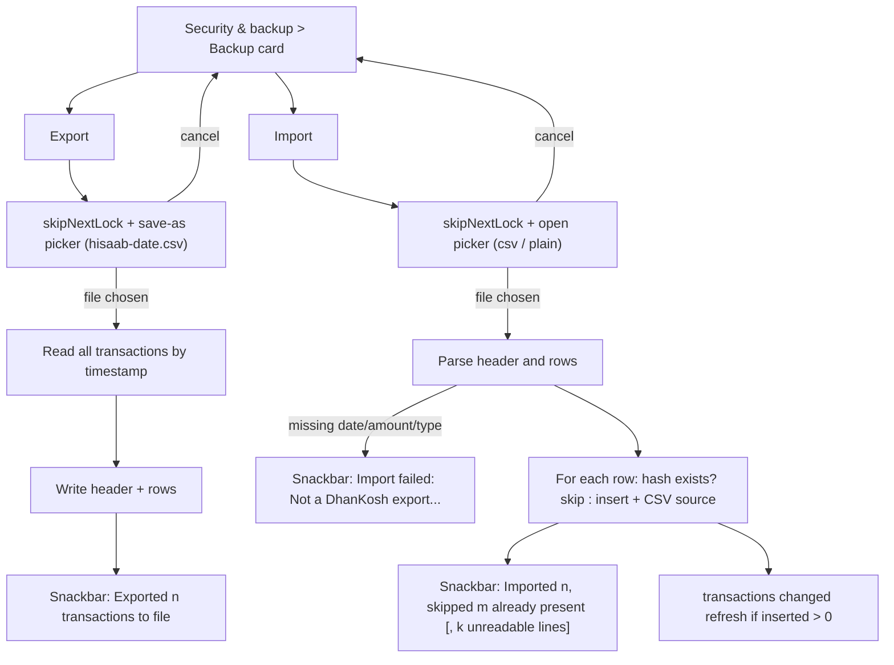

# Backup & Export

| Field | Value |
|---|---|
| Feature ID | F-24 |
| Status | In progress (CSV done; encrypted full backup and restore, PDF summary and portfolio reports done with tests; device pickers, Kotlin-free; large-file timing and real-device restore untested; per-account card network, colour, limits, markup and merge/link restored) |
| Priority | P1 |
| Phase | 5 |
| Last Updated | 2026-10-27 |

## 1. Description

Backup and Export lets the user take their transactions out of the app and bring them back. Export CSV writes every transaction to a file the user chooses, and Import CSV reads such a file, or a hand-edited one, and adds the rows that are not already present. The app has no cloud backup and Android backup is off, so the CSV is the only built-in way to move or archive data. It exists so the user keeps control of their own data.

## 2. What This Feature Will Do

- Exports every transaction, including those needing review, to a CSV file the user chooses.
- Suggests a file name with today's date and lets the user pick where to save it.
- Writes a fixed set of columns, with the oldest transaction first.
- Shows how many transactions were exported and to which file.
- Imports a CSV file the user picks, including a hand-edited file or one with reordered or extra columns.
- Requires date, amount and type columns and fills sensible defaults for the other columns.
- Skips unreadable lines and reports how many there were, without stopping the import.
- Skips rows that are already in the app, so importing the same file twice adds nothing.
- Adds new rows as transactions, creating the account from bank and last four digits when needed.
- Shows how many rows were imported and how many were already present.
- Shows an error message when the file is not a valid export.
- Keeps the app from locking again when the user returns from the file picker.
- States that data never leaves the phone.

### 2.1 Inputs

- The user's tap on Export or Import in the Backup card.
- The save location and file name chosen in the system file picker.
- The CSV file chosen for import, from Downloads, Drive or other storage.
- All stored transactions, for export.

### 2.2 Processing

1. On export, read all transactions in date order and write a header row and one row per transaction.
2. Quote only the fields that contain commas, quotes or line breaks.
3. On import, match columns by header name, ignoring case and spacing.
4. Check that date, amount and type are present, otherwise stop with an error.
5. Read each line, using defaults for blank optional columns and counting lines that cannot be read.
6. Work out each row's duplicate fingerprint if the file does not carry one.
7. Skip rows whose fingerprint is already stored and add the rest in one all-or-nothing step.
8. Refresh budget alerts and the home widget if anything was added.
9. Show the result message.

### 2.3 Outputs

- The user sees the Backup card, the file picker and a result message for export or import.
- A CSV file is written to the location the user chose.
- Imported rows are stored as transactions, each with a CSV source record.
- Other features receive the new transactions through the normal ledger refresh, and the duplicate fingerprint comes from [07_dedup_review.md](07_dedup_review.md).
- The file carries transactions only; account nicknames, merges, custom categories, budgets, rules, settings and rates are not included.

### 2.4 Out of Scope

- Does not own the other Security and backup cards: app lock and hide amounts ([25_security_privacy.md](25_security_privacy.md)) and text size ([28_theming_customisation.md](28_theming_customisation.md)).
- Does not offer encrypted full backup, Drive or iCloud backup or XLSX and PDF export (proposed only, not in the existing app).
- Does not import bank statements ([05_statement_import.md](05_statement_import.md)).
- Does not define the duplicate fingerprint ([07_dedup_review.md](07_dedup_review.md)).
- Does not set the rules for creating accounts ([13_accounts_management.md](13_accounts_management.md)).
- Does not restore a full backup, flag fuzzy duplicates, learn categories or send per-row notifications for imported rows.

## 3. Behaviour in Existing App

Source: `app/src/main/kotlin/com/hisaab/app/csv/CsvTransfer.kt` (88 lines), `ui/settings/SettingsViewModel.kt:171-191` (`export`, `import`), `ui/more/SecurityScreen.kt:64-95`, `shared/.../repo/TransactionRepository.kt:591-609` (`importTransactions`), `shared/.../db/Daos.kt:199` (`getAll`), `parser-core/.../hash/TransactionHasher.kt`, test `app/src/test/.../CsvTransferTest.kt`; analysis Part A 4.9.

### 3.1 UI

Card "Backup" with two rows:

1. "Export CSV" - "Every transaction, to a file you choose" - button "Export": calls `AppLockGate.skipNextLock()` (so returning from the picker does not re-lock the app), then `CreateDocument("text/csv")` with the suggested name `hisaab-<yyyy-MM-dd>.csv` (today's local date).
2. "Import CSV" - "Rows already present are skipped" - button "Import": `skipNextLock()`, then `OpenDocument` with MIME types `text/csv`, `text/comma-separated-values`, `text/plain`.

Results appear as snackbars (the screen collects `vm.messages`):

- Export success: "Exported {n} transactions to {file}" (`file` = the chosen document's display name via `DocumentFile.fromSingleUri`, else "file").
- Import success: "Imported {inserted}, skipped {skipped} already present" plus ", {n} unreadable lines" when `badLines > 0`.
- Import failure (any exception, including "Not a DhanKosh export: needs date, amount and type columns"): "Import failed: {error}".
A privacy note below the card: "Your data never leaves this phone. No servers, no tracking."

### 3.2 File format (`CsvTransfer.HEADER`, exact order)

`date, amount, currency, type, bank, account_last4, account_kind, merchant, category, channel, reference, balance, upi_id, note, hash`

| Column | Export value | Import handling |
|---|---|---|
| `date` | `Instant.ofEpochMilli(timestamp).toString()` (ISO-8601 UTC, for example `2026-10-17T08:15:30Z`; fractional seconds only when non-zero) | Required; `Instant.parse`; the instant becomes both `transactionTime` and `messageTimestamp`; `hasExplicitTime = true` |
| `amount` | Plain decimal with 2 places (`BigDecimal.valueOf(minor, 2).toPlainString()`, no grouping, no sign) | Required; `replace(",", "")`, then `BigDecimal(..).movePointRight(2).longValueExact()` (more than 2 decimals fails the row) |
| `currency` | `currency` | Default `INR` when blank |
| `type` | enum name: `DEBIT`, `CREDIT`, `TRANSFER`, `INVESTMENT` | Required; trimmed, upper-cased, `TransactionType.valueOf` (unknown -> bad line) |
| `bank` | `bankName` | Default `"Imported"` when blank |
| `account_last4` | `accountLast4` or empty | Optional |
| `account_kind` | `ACCOUNT` or `CARD` | Enum, default `ACCOUNT` when blank or unknown |
| `merchant` | `merchant` or empty | Optional |
| `category` | built-in `Category` enum name (custom-category rows export `OTHER`) | Enum, default `OTHER` when blank or unknown |
| `channel` | `UPI`, `IMPS`, `NEFT`, `RTGS`, `CARD`, `ATM`, `AUTO_DEBIT`, `OTHER` | Enum, default `OTHER` |
| `reference` | `referenceNumber` or empty | Optional |
| `balance` | `balanceMinor` as plain decimal or empty | Optional; `BigDecimal(text)` (no comma stripping; unparseable -> bad line) |
| `upi_id` | `upiId` or empty | Optional |
| `note` | `note` or empty | Exported but not read back (the importer builds no note) |
| `hash` | `transactionHash` | Used when present; otherwise computed |

Export: `transactions.getAll()` = `SELECT * FROM transactions ORDER BY timestamp` (all rows including needs-review ones), written through OpenCSV `CSVWriter` with `applyQuotesToAll = false` (fields quoted only when they contain separators, quotes or line breaks), header first, UTF-8, comma separator, `"` quote, one row per transaction; the stream opens with mode `"wt"` (truncate).

Import (`CsvTransfer.import(reader, zone = systemDefault)`): header names are matched case-insensitively after trimming, so reordered columns or extra columns work; `date`, `amount`, `type` columns are mandatory (else `IllegalArgumentException("Not a DhanKosh export: needs date, amount and type columns")`); an empty file returns no rows. For each data line, any `RuntimeException` (bad date, bad amount, bad enum, short line) increments `badLines` and the line is skipped. Each good row becomes a `ParsedTransaction` with `source = Source.SMS`, `sender = "csv"`, `confidence = 1`, `availableLimitMinor = null`, and `transactionHash = hash column ?: TransactionHasher.hash(amountMinor, type, last4, localDate(zone), reference)`.

Hash (from the parser module): `SHA-256(UTF-8("<amountMinor/100>.<2-digit paise>|<OUT|IN|XFER>|<last4 or empty>|<yyyy-MM-dd>|<reference or empty>"))`, lower-case hex ([07_dedup_review.md](07_dedup_review.md)).

### 3.3 Duplicate skipping (`TransactionRepository.importTransactions`)

Inside one write transaction, for each row: skip (count `skipped`) when `txDao.findByHash(hash) != null` or `sourceDao.exists("CSV", hash)`; otherwise insert the transaction (`toEntity(ensureAccount(tx), now)`; the account is found or created from `bank` + `account_last4`, subject to the usual guards such as the user's own phone numbers) and a `transaction_sources` row `(source = "CSV", sourceMessageId = hash, sender = "csv", parsedHash = hash, rawText = null, receivedAt = now)`; if the insert returns -1 count it as skipped. The report is `IngestReport(inserted, merged = 0, flagged = 0, skipped)`. Importing the same file twice, or over the data it came from, adds nothing. No fuzzy duplicate matching, no review flags, no category/merchant learning and no per-row notification run for imported rows. When `inserted > 0` the app calls `onTransactionsChanged()` (budget alerts, widget refresh). Imported rows show source "CSV" in the transaction's Messages list and fall under the "Manual" source chip ([20_search_filters.md](20_search_filters.md)).

### 3.4 What the CSV does not carry

Accounts' nicknames, balances, types, merges and hidden flags, custom categories and sub-categories, merchant rules, budgets, recurring items, loans, holdings, statements, tax what-if, settings, source messages, notes (read back), review state, forex rates, and `inrMinor` (recomputed by the database triggers from rates, [23_forex_rates.md](23_forex_rates.md)). So the export is a transaction ledger backup, not a full restore, despite the code comment "so a backup restores losslessly".

## 4. User Stories

1. As a user I export all my transactions to a CSV file in a place I choose (Downloads, Drive, a USB drive).
2. As a user I import a previous export after reinstalling or on a new phone and get my transactions back without duplicates.
3. As a user I import the same file twice and nothing is duplicated.
4. As a user I can open the CSV in a spreadsheet and edit or add rows, then import them.
5. As a user I see how many rows were added, how many were already present and how many lines could not be read.
6. As a privacy-conscious user I know the file stays where I put it and the app never uploads it.

## 5. Functional Requirements (FR-24-01 ...)

1. FR-24-01: The Backup card shows "Export CSV" and "Import CSV" rows with their subtitles and buttons, and the privacy note below.
2. FR-24-02: Export opens the platform "save as" picker with the suggested name `hisaab-<yyyy-MM-dd>.csv` (local date) and MIME `text/csv`; cancelling the picker does nothing.
3. FR-24-03: Export writes a header row with the exact 15 column names in the exact order, then one row per transaction ordered by timestamp ascending, covering every transaction (including those needing review).
4. FR-24-04: Export value formats: `date` ISO-8601 UTC instant; `amount` and `balance` plain decimals with 2 places and no grouping; enum columns by name; empty string for nulls; fields containing comma, quote or newline are quoted with doubled quotes; fields are otherwise unquoted.
5. FR-24-05: After a successful export show "Exported {n} transactions to {file}" with the chosen file's display name (or "file").
6. FR-24-06: Import opens the platform file picker for CSV, comma-separated-values and plain-text files; cancelling does nothing.
7. FR-24-07: Import matches columns by trimmed, case-insensitive header name; requires `date`, `amount`, `type`; otherwise fails with "Not a DhanKosh export: needs date, amount and type columns".
8. FR-24-08: Import applies the per-column parsing and defaults in section 2.2 (currency INR, bank "Imported", kind ACCOUNT, channel OTHER, category OTHER, hash computed when absent).
9. FR-24-09: A line that cannot be parsed (bad date, amount with more than 2 decimals, unknown type, bad balance, too few fields) is skipped and counted as an unreadable line; it never aborts the import.
10. FR-24-10: Rows whose hash already exists as a transaction hash or as a CSV source id are skipped and counted; new rows are inserted with a `CSV` source record, an account found or created from bank and last four digits, confidence 1.0 and an explicit time.
11. FR-24-11: The whole insert phase is one atomic database transaction.
12. FR-24-12: After an import that inserted at least one row, trigger the standard "transactions changed" refresh (budget alert check, home widget refresh); never show per-row notifications.
13. FR-24-13: Show "Imported {inserted}, skipped {skipped} already present" plus ", {n} unreadable lines" when any; on any exception show "Import failed: {error}".
14. FR-24-14: Skip the app lock once when leaving to the picker so returning does not require re-authentication.
15. FR-24-15: Export and import run off the UI thread; memory use stays bounded for 100,000 rows (stream rows to and from the file).
16. FR-24-16: Round trip: exporting and importing into an empty database reproduces every transaction's date, amount, currency, type, bank, last four digits, kind, merchant, category (built-in), channel, reference, balance and UPI id.

17. FR-24-17: Encrypted container, written and read by `BackupCrypto`: magic `DKBK`, version byte 1, PBKDF2 iteration count (u32 big-endian, at least 200,000 written, 1,000..5,000,000 accepted on read), 16-byte random salt, 12-byte random nonce, then AES-256-GCM ciphertext plus 16-byte tag over gzip(JSON). The 37 header bytes are the GCM authenticated data. The key is PBKDF2-HMAC-SHA256(passphrase, salt, iterations), 32 bytes. Encryption and decryption run in a background isolate.
18. FR-24-18: The JSON document has `format = "dhankosh-backup"`, `schema = 1`, `createdAt` (epoch ms) and sections `accounts`, `loans`, `transactions` (each with its source messages), `rules`, `customCategories`, `customSubcategories`, `budgets`, `recurring`, `holdings`, `cardOverrides`, `cardPaid`, `loanLinks`, `forex`, `settings`. Money is integer paise; custom categories and accounts are referenced by name and by `bank|last4`, never by database id.
19. FR-24-19: The `settings` section holds a whitelist of preferences only (hide amounts, history days, budget alert percent, transaction and card-due notifications, update check, auto-lock minutes, block screenshots, weekly summary). It never holds the app-lock flag, passwords, email credentials, tokens, identity details or database keys.
20. FR-24-20: A wrong passphrase, or any changed byte in header or body, fails with "Wrong passphrase, or the backup file is damaged" (`BackupAuthException`); nothing is imported.
21. FR-24-21: A file without the magic, with an unknown newer version, with an iteration count outside the accepted range or with unreadable content fails with a short `BackupFormatException` message; nothing is imported.
22. FR-24-22: The Backup screen has "Export encrypted backup": passphrase and repeat, at least 8 characters, both must match, and the warning "We cannot recover this passphrase". The file is saved through the system picker as `dhankosh-backup-<yyyy-MM-dd>.dkbk` and the time is stored (`last_full_backup`).
23. FR-24-23: "Restore from backup" picks a file, asks the passphrase, then shows what the backup holds (counts per section and its date) before anything is written; Cancel writes nothing.
24. FR-24-24: A strength hint (Weak, Fair, Strong) shows under the passphrase; length under 8 blocks the export.
25. FR-24-25: Restore writes only through repositories: transactions through `TransactionRepository.ingestBatch` (one batch, oldest first, original source ids so a second restore adds nothing and a later rescan skips them), accounts, loans, rules, categories, budgets, recurring items, holdings, card overrides and paid marks, loan links, forex rates and settings through their own repositories. Merge is the default: existing values are kept, only missing items are added.
26. FR-24-26: After a restore the screen shows what was added ("Restored 12 transactions, 3 accounts") or "Nothing new to add".
27. FR-24-27: "Replace everything" first shows the summary, then a second confirmation ("Erase and replace?"), then erases all data tables (settings kept) and restores the backup.
28. FR-24-28: File saving and picking for backups and PDFs go through the `BlobGateway` port (`file_picker`), which arms the lock skip first (FR-25-06).
29. FR-24-29: "Monthly or yearly summary" writes an A4 PDF with income, spent, saved, spend by category with share, top 10 merchants, budgets (limit, spent, left; yearly limits times 12) and net worth today. Review rows and transfers are excluded; amounts use `Rs 1,23,456.50` formatting by integer math.
30. FR-24-30: "Portfolio report" writes an A4 PDF with value, invested, gain, return, allocation by class and the holdings list.
31. FR-24-31: Reports are built and rendered on the phone with the `pdf` package, carry the footer "Made on your phone by DhanKosh. This file was not sent anywhere.", and use Latin-1 text only (other characters print as `?`). The Tax Centre export is specified in [19_tax_centre.md](19_tax_centre.md).
32. FR-24-32: The backup also carries user SIPs (`sips`), goals with their contributions (`goals`) and recorded MF orders (`mfOrders`). They are optional sections of JSON schema 1: older files without them restore unchanged, and the counts show "SIPs", "goals", "MF orders". Restore goes through `SipRepository.add`, `GoalRepository.addGoal`/`addContribution` and `HoldingRepository.restoreMfOrders`; items are merged by content (SIP name, amount, frequency, day, start; goal name, target, date; contribution amount, day, note; order identifier, time, amount, units), so a second restore adds nothing. Restored orders claim their dedup keys so the same purchase arriving later by mail or SMS is not counted again.
33. FR-24-33: The `accounts` section also carries `balance`, `limit`, `balanceAt`, `markup` (bps), `linked` and `mergedInto` (`bank|last4` keys) next to the existing colour, network, nickname and usage. All are optional keys of schema 1; merged-away accounts are now exported. Restore sets colour, network, markup and the stated figures on created accounts, fills missing colour/network on existing ones and re-links debit cards and merges once all accounts exist (`AccountAdminRepository`).

## 6. Non-Functional Requirements (performance, battery, privacy, offline)

- Performance: export of 100,000 rows under 5 s; import under 10 s (batched prepared inserts in one transaction); UI shows progress and stays responsive.
- Battery: foreground only, short.
- Privacy: no network; the file location is chosen by the user through the system picker (no storage permission requested); the file is unencrypted plain text and contains merchants, UPI ids, balances, notes - the UI should say so; no copy is kept in app storage; Android cloud backup stays off.
- Offline: fully offline.
- Reliability: partial files must not be left as "successful": on a write error show the failure and delete the incomplete file where the platform allows.
- Compatibility: UTF-8; the file opens in Excel/Sheets/LibreOffice (see BOM and formula-injection notes in section 17).
- Accessibility: buttons and snackbars are announced.

## 7. UI / Screens & User Flow (screen list + flow diagram)

| Screen / surface | Source (Kotlin) | Notes |
|---|---|---|
| Security & backup (Backup card) | `SecurityScreen.kt:83-95` | Export and Import rows |
| System "save as" picker | `SecurityScreen.kt:64,86` | `CreateDocument("text/csv")` |
| System "open file" picker | `SecurityScreen.kt:65,91` | `OpenDocument` with 3 MIME types |
| Result snackbars | `SettingsViewModel.kt:177,187,189` | Export, import, failure |
| Privacy note | `SecurityScreen.kt:96` | "Your data never leaves this phone..." |



Reference GIFs (all Status: Pending, not yet captured):

-  (Status: Pending, not yet captured)
-  (Status: Pending, not yet captured)
-  (Status: Pending, not yet captured)
-  (Status: Pending, not yet captured)

## 8. Data Models (Dart entities + fields + types)

In `lib/features/backup_export/domain/entities/`. Amounts `int` paise.

```dart
const csvHeader = [
  'date', 'amount', 'currency', 'type', 'bank', 'account_last4', 'account_kind', 'merchant',
  'category', 'channel', 'reference', 'balance', 'upi_id', 'note', 'hash',
];

@freezed
class CsvImportResult with _$CsvImportResult {
  const factory CsvImportResult({required List<ParsedTransaction> rows, required int badLines}) = _CsvImportResult;
}

@freezed
class ImportReport with _$ImportReport {
  const factory ImportReport({
    required int inserted, @Default(0) int merged, @Default(0) int flagged, required int skipped,
    @Default(0) int badLines,
  }) = _ImportReport;
}

@freezed
class ExportResult with _$ExportResult {
  const factory ExportResult({required int count, required String fileName}) = _ExportResult;
}

sealed class BackupMessage {
  const BackupMessage();
}
class Exported extends BackupMessage { const Exported(this.count, this.file); final int count; final String file; }
class Imported extends BackupMessage { const Imported(this.inserted, this.skipped, this.badLines); final int inserted, skipped, badLines; }
class ImportFailed extends BackupMessage { const ImportFailed(this.error); final String error; }
```

`ParsedTransaction` (the shared parser output: `amountMinor`, `currency`, `type`, `bankName`, `accountLast4`, `accountKind`, `merchant`, `upiId`, `referenceNumber`, `channel`, `balanceMinor`, `availableLimitMinor`, `transactionTime`, `hasExplicitTime`, `category`, `source`, `sender`, `messageTimestamp`, `confidence`, `transactionHash`) is defined in [06_transaction_parsing_engine.md](06_transaction_parsing_engine.md). `Transaction` in [08_transactions_ledger.md](08_transactions_ledger.md).

Pure codec API (testable without files):

```dart
String exportCsv(List<Transaction> rows);                       // header + rows, \n line ends
CsvImportResult importCsv(String text, {required Location zone}); // zone for hash-date when `hash` is absent
```

## 9. Database Tables / Changes

No new tables. Reads `transactions` (all rows, `ORDER BY timestamp`). Writes `transactions` and `transaction_sources` (one `CSV` row per inserted transaction, `sourceMessageId = hash`, unique index `(source, sourceMessageId)`), and `accounts` (found or created). Queries used:

- `SELECT * FROM transactions ORDER BY timestamp` (export; stream in pages of 2,000 by `timestamp, id`).
- `SELECT * FROM transactions WHERE transactionHash = ?` (unique index `index_transactions_transactionHash`).
- `SELECT EXISTS(SELECT 1 FROM transaction_sources WHERE source = 'CSV' AND sourceMessageId = ?)`.
- Insert transaction + source row in one Drift `transaction`.

The insert trigger sets `inrMinor` for foreign-currency rows if a rate exists ([23_forex_rates.md](23_forex_rates.md)). Settings: none persisted (no "last export" record in the existing app).

## 10. Business Rules & Logic (regex, parsing rules, algorithms, thresholds)

Constants: header (15 columns, section 8), default currency `INR`, default bank `"Imported"`, default kind `ACCOUNT`, channel `OTHER`, category `OTHER`, source `SMS` on the parsed object but stored source row `"CSV"`, sender `"csv"`, confidence 1.0, `hasExplicitTime = true`; export file name `hisaab-<yyyy-MM-dd>.csv`.

Algorithms:

```text
export(rows):  write header; for t in rows (timestamp asc):
  [ iso(t.timestamp), dec2(t.amountMinor), t.currency, t.type.name, t.bankName, t.accountLast4 ?? '', t.accountKind.name,
    t.merchant ?? '', t.category.name, t.channel.name, t.referenceNumber ?? '', t.balanceMinor == null ? '' : dec2(t.balanceMinor),
    t.upiId ?? '', t.note ?? '', t.transactionHash ]
  dec2(minor) = sign-less plain decimal with exactly 2 fraction digits ("2450.50")
import(text):
  header = first row, each trimmed + lower-cased; need indexes of date, amount, type else throw
  for each line:
    try:
      time   = Instant.parse(line[date].trim())                       // e.g. 2026-10-17T08:15:30Z
      amount = decimal(line[amount].trim().replaceAll(',', '')).movePointRight(2) must be an exact integer
      type   = TransactionType.valueOf(line[type].trim().toUpperCase())
      col(name) = value at header index if present and in range, trimmed, null when empty
      hash   = col('hash') ?? sha256("${amountMinor ~/ 100}.${pad2(amountMinor % 100)}|${type.direction}|${last4 ?? ''}|${localDate(time, zone)}|${ref ?? ''}")
      rows += parsed
    except any parse error: bad++
dedupe: skip when a transaction with the same hash exists or a CSV source with sourceMessageId = hash exists
```

`type.direction`: DEBIT and INVESTMENT -> `OUT`, CREDIT -> `IN`, TRANSFER -> `XFER` ([07_dedup_review.md](07_dedup_review.md)). The hash-date for rows without a `hash` column uses the device zone in the Kotlin importer (the parser hashes with IST); see section 17.

Worked examples (masked):

Export row for a UPI spend:

```csv
date,amount,currency,type,bank,account_last4,account_kind,merchant,category,channel,reference,balance,upi_id,note,hash
2026-10-17T08:15:30Z,2450.50,INR,DEBIT,HDFC Bank,1234,ACCOUNT,Swiggy,FOOD,UPI,UTR6XXXXXXXX1,45210.00,swiggy@icici,dinner,01bfd481ed2a0a0d2da415ec97f25af00ced371eba3462c4673f1ec3c8140ca3
```

(the hash is `SHA-256("2450.50|OUT|1234|2026-10-17|UTR6XXXXXXXX1")`).

A hand-written minimal file (hash computed on import, reordered columns, extra column ignored):

```csv
Type,Date,Amount,Memo
debit,2026-10-17T08:15:30Z,"250.00",lunch
```

-> one row: DEBIT 25,000 paise, currency INR, bank "Imported", no account, category OTHER, hash `a6abbb99d42490b8f91be1efc69a4bc498ae6823d474e5f279ce0718d0e50b00` (= `SHA-256("250.00|OUT||2026-10-17|")`).

Bad-line examples: `date` "17/10/2026" (not an instant) -> bad; amount "12.345" -> bad; type "EXPENSE" -> bad; line with only 2 fields -> bad; unknown category "FOODIE" -> accepted with category OTHER (enums fall back to defaults, only `type` is strict).

Result message examples: 3 new, 2 present, 1 bad -> "Imported 3, skipped 2 already present, 1 unreadable lines"; second run of the same file -> "Imported 0, skipped 5 already present".

### 10.1 Encrypted backup format (FR-24-17, FR-24-18)

```text
offset  size  field
0       4     magic "DKBK" (44 4B 42 4B)
4       1     container version (1)
5       4     PBKDF2-HMAC-SHA256 iterations, big-endian (default 210000)
9       16    salt (random)
25      12    GCM nonce (random)
37      n+16  AES-256-GCM(gzip(utf8(JSON))) plus 128-bit tag; AAD = bytes 0..36
```

JSON top level: `format`, `schema`, `createdAt`, then the sections of FR-24-18. Transaction entry: `hash` (base hash, any `#...` review suffix removed), `amount`, `currency`, `type`, `bank`, `last4`, `kind`, `merchant`, `upi`, `ref`, `channel`, `balance`, `limit`, `ts`, `explicitTime`, `category`, `sub`, `custom` (category name), `confidence`, `review`, `note`, `inr`, and `sources[]` (`source`, `id`, `sender`, `hash`, `raw`, `at`, `subject`). Enum values use the database form (`SNAKE_UPPER`).

Optional sections added after v1 (no schema bump): `sips` (`name`, `amount`, `freq`, `day`, `weekday`, `start`), `goals` (`name`, `target`, `targetDay`, `createdAt`, `contributions[]` of `amount`, `day`, `note`) and `mfOrders` (`identifier`, `scheme`, `at`, `amount`, `units`, `nav`, `platform`). Readers ignore sections they do not know; files lacking them restore as before.

Restore order: custom categories and sub-categories, rules (existing keys kept), accounts (create missing, fill blank nickname/type/manual balance on existing), loans, transactions (`ingestBatch`; dedup may merge or flag a row that nearly matches existing data), then per-row category and sub-category fixes through `setCategory`/`setSubcategory`, recurring (matched by name, amount, day, direction), budgets (existing categories kept), holdings (by identifier, grouped by source), SIPs, goals and contributions, MF orders (FR-24-32), card overrides and paid marks, loan links, forex rates, settings. Row-level review state is rebuilt by dedup, not copied.

## 11. Platform / Native Requirements (permissions, channels, background work)

- No storage permissions: use the system pickers only (Android SAF `ACTION_CREATE_DOCUMENT` / `ACTION_OPEN_DOCUMENT`; iOS Files). Flutter packages: `file_picker` (`FilePicker.platform.saveFile(fileName: ..., bytes: ...)` on Android writes through SAF; `pickFiles(type: FileType.custom, allowedExtensions: ['csv', 'txt'])`), or `file_saver`; `share_plus` as an alternative export route ("Share CSV"); streaming large files may need a small platform channel using `ContentResolver.openOutputStream(uri, "wt")` / `openInputStream`.
- Before launching a picker call the app-lock gate's "skip next lock" so the lock does not trigger when the activity resumes ([25_security_privacy.md](25_security_privacy.md)).
- Display name of the created document: query `OpenableColumns.DISPLAY_NAME` through a channel, or use the name returned by the picker.
- Manifest: none for this feature; the backup exclusion flags (`allowBackup=false`, `dataExtractionRules`) stay.
- Run CSV encode/decode in a background isolate (`compute`/`Isolate.run`).
- Encrypted backup and PDF files use `FilePicker.saveFile` and `pickFile` (`BlobGateway`); no Kotlin and no permission. KDF, cipher and JSON encoding run in `Isolate.run`.

## 12. Dependencies (other features → link to their memory file; packages)

Features: [08_transactions_ledger.md](08_transactions_ledger.md) (transaction entity and table), [07_dedup_review.md](07_dedup_review.md) (hash definition and the `CSV` source), [06_transaction_parsing_engine.md](06_transaction_parsing_engine.md) (`ParsedTransaction`, `TransactionHasher`), [13_accounts_management.md](13_accounts_management.md) (account creation on import), [23_forex_rates.md](23_forex_rates.md) (`inrMinor` after import), [21_alerts_reminders.md](21_alerts_reminders.md) and [30_home_widget.md](30_home_widget.md) (refresh after import), [25_security_privacy.md](25_security_privacy.md) (lock skip, privacy note, hosting screen), [20_search_filters.md](20_search_filters.md) (Manual source chip).

Packages: `pointycastle` (PBKDF2, AES-GCM), `pdf` (reports), `csv` (parse/encode RFC-4180), `file_picker`, `share_plus` (optional), `crypto` (SHA-256), `intl`, `drift`, `flutter_riverpod`, `freezed`.

## 13. Folder Location (lib/features/<name>/...)

```text
lib/features/backup_export/
  data/
    csv_codec.dart                        # exportCsv / importCsv (pure)
    backup_repository_impl.dart           # reads all rows, writes imported rows in one Drift transaction
    file_gateway.dart                     # pickers and stream read/write (platform channel where needed)
  domain/
    entities/csv_import_result.dart, import_report.dart, export_result.dart, backup_message.dart
    repositories/backup_repository.dart
    usecases/export_transactions.dart, import_transactions.dart
  presentation/
    backup_card.dart                      # embedded in the Security & backup screen
    providers/backup_providers.dart       # messages stream for snackbars
```

## 14. Edge Cases & Error Handling

- Empty database: export writes only the header and shows "Exported 0 transactions to {file}".
- Empty file or header-only file: import succeeds with 0 inserted, 0 skipped.
- File without the required columns: failure message; nothing inserted.
- UTF-8 BOM at the start (common for Excel "CSV UTF-8"): the first header would not match `date` in the original; the port must strip a BOM (see section 17).
- Windows line endings and quoted multi-line notes are accepted.
- Amount with thousands separators ("1,234.50") accepted via comma removal; amounts with a currency symbol or more than 2 decimals are bad lines.
- Negative amounts: accepted by the parser (`-250.00`) and stored negative; type still decides direction (not validated; see section 17).
- Dates without a zone or in other formats are bad lines; fractional seconds accepted.
- Hash column present but wrong (hand-edited): used as is; rows can collide or duplicate; document that editing amount/date/ref without clearing `hash` keeps the old identity.
- Same row twice in one file: second skipped (hash now exists).
- Huge files: stream; do not load all text into memory.
- User picks a non-CSV file: usually "Not a DhanKosh export" or all lines bad.
- Picker cancelled or permission to the document revoked mid-way: no changes; show failure for I/O errors.
- Import while an SMS scan runs: serialised by the single write transaction; ingestion later dedupes against imported hashes (CSV rows have confidence 1 and hash-based identity).
- Export while the app is locked in background: lock skip flag consumed once.
- Time zone: export dates are UTC; the hash date for hash-less rows uses the device zone.
- Rows for own mobile numbers as `account_last4` do not create accounts (existing guard) but are still inserted without account.

## 15. Test Cases (unit / widget / integration + sample fixtures)

Unit (mirror `CsvTransferTest`):

1. TC-24-01 (FR-24-03, FR-24-04): `exportCsv` of two transactions yields the exact header, rows ordered by timestamp, `2450.50` style amounts, ISO instants, empty strings for nulls; a merchant "A, B" and a note with a quote are quoted/escaped; other fields unquoted.
2. TC-24-02 (FR-24-16): export then import into an empty store reproduces all listed fields (date, amount, currency, type, bank, last4, kind, merchant, built-in category, channel, reference, balance, upi id).
3. TC-24-03 (FR-24-07, FR-24-08): import with reordered columns, upper-case headers and an extra column works; defaults applied (INR, "Imported", ACCOUNT, OTHER); missing `date`/`amount`/`type` column throws the expected message.
4. TC-24-04 (FR-24-09): bad-line cases (date "17/10/2026", amount "12.345", type "EXPENSE", short line, bad balance) each count as bad and the other lines import.
5. TC-24-05 (FR-24-08): hash-less minimal file gives hash `a6abbb99...0b00`; with explicit last4 and reference gives the documented SHA-256 of the key; the `hash` column, when present, is used verbatim.
6. TC-24-06 (FR-24-10): dedupe: inserting rows with an existing transaction hash or an existing CSV source id counts skipped; importing the same file twice inserts 0 the second time; two identical rows in one file insert 1.
7. TC-24-07 (FR-24-08): unknown `category` ("FOODIE") and `channel` fall back to OTHER; unknown `account_kind` falls back to ACCOUNT; type is strict.
8. TC-24-08 (FR-24-04): amounts: 0.05 -> "0.05", 1234567.8 -> "1234567.80"; round trip preserves paise.
9. TC-24-09 (FR-24-11): a failure on row N rolls back all inserts (atomic).

Widget:

10. TC-24-10 (FR-24-01, FR-24-05, FR-24-13): Backup card rows and buttons; mocked picker -> snackbars "Exported 3 transactions to hisaab-2026-10-17.csv", "Imported 3, skipped 2 already present, 1 unreadable lines", "Import failed: ...".
11. TC-24-11 (FR-24-02, FR-24-06, FR-24-14): cancelling either picker changes nothing; the lock-skip flag is set before each picker launch.

Integration:

12. TC-24-12 (FR-24-12, FR-24-15): import of a 100,000-row generated file completes within budget, inserts all, triggers one "changed" refresh and one budget check; export of the same data produces a byte-identical file on a second run.
13. TC-24-13 (FR-24-10): after import, the transaction's Messages list shows a "CSV" source and the Source chip "Manual" includes it ([20_search_filters.md](20_search_filters.md)).
- TC-24-14 (FR-24-17, FR-24-20, FR-24-21): container round trip, random salt and nonce, wrong passphrase, tampered body and header bytes, not-a-backup and newer-version files (`full_backup_test.dart`).
- TC-24-15 (FR-24-25): backup of a seeded database restored into a fresh in-memory database gives identical transactions, rules, budgets, holdings, recurring items, forex, card overrides, loans and settings; totals equal.
- TC-24-16 (FR-24-25): restoring onto the same data adds nothing and leaves everything identical; multi-source rows keep their source ids; replace erases first.
- TC-24-17 (FR-24-19): the document has no `app_lock` and no secrets.
- TC-24-18 (FR-24-22, FR-24-24, FR-24-23, FR-24-26, FR-24-27, FR-24-20): widget flows for passphrase dialog (warning, strength, match, minimum length), restore summary and merge, replace needing a second confirm, wrong passphrase message (`full_backup_ui_test.dart`).
- TC-24-19 (FR-24-29, FR-24-30, FR-24-31): report documents have the right totals, shares, merchants, budgets and net worth; generated PDF bytes start with `%PDF-` and contain the expected words; non-Latin text becomes `?`; compressed output is still a PDF (`reports_test.dart`, `reports_section_test.dart`).

Fixture files: the export row and the minimal file in section 10; a BOM-prefixed file `date,amount,type\n2026-10-17T08:15:30Z,250.00,DEBIT`.

## 16. Acceptance Criteria

1. AC-24-01: Export produces a CSV with the exact header and values defined, ordered by time, for all transactions, and reports the count and file name. (FR-24-02 to FR-24-05; TC-24-01, TC-24-08, TC-24-10)
2. AC-24-02: Importing an export into an empty app restores every transaction field the CSV carries. (FR-24-08, FR-24-16; TC-24-02)
3. AC-24-03: Importing twice or over existing data adds nothing and reports skipped rows. (FR-24-10, FR-24-13; TC-24-06)
4. AC-24-04: Unreadable lines are counted and never abort the import; a wrong file shows the failure message. (FR-24-07, FR-24-09; TC-24-03, TC-24-04, TC-24-10)
5. AC-24-05: Imported rows are atomic, create a CSV source record, trigger exactly one refresh, and never post notifications. (FR-24-10, FR-24-11, FR-24-12; TC-24-09, TC-24-12, TC-24-13)
6. AC-24-06: Pickers use the system UI without storage permissions and do not re-lock the app on return. (FR-24-14; TC-24-11)
7. AC-24-07: Large files stream within the time and memory budget. (FR-24-15; TC-24-12)
8. AC-24-08: A passphrase-encrypted backup restores accounts, transactions with sources, rules, categories, budgets, recurring items, holdings, card entries, loan terms and links, forex rates and preference settings into an empty app, without secrets, and a wrong passphrase or damaged file imports nothing. (FR-24-17 to FR-24-27; TC-24-14 to TC-24-18)
9. AC-24-09: Monthly, yearly and portfolio PDFs are built on the phone, saved through the picker and show correct integer-math amounts. (FR-24-29 to FR-24-31; TC-24-19)

## 17. Open Questions

1. "Restores losslessly" (code comment) is not true: notes, custom categories and sub-categories, account details, rules, budgets, recurring items, review state and source messages are not exported or imported. Should Flutter ship a fuller backup (JSON/zip, optionally encrypted; proposed in the v2 spec) in addition to the CSV? Answered 2026-10-26: yes, the passphrase-encrypted `.dkbk` backup (FR-24-17..27) is the recovery path because the database key is bound to the phone (ADR-0010).
2. `note` is exported but never imported (the importer builds no note). Should import restore it?
3. Hash-less rows hash their date with the device zone (`ZoneId.systemDefault()`), while the parser hashes in IST; a device outside IST gets different hashes for the same instant (duplicates of SMS-sourced rows, or misses). Use IST consistently?
4. UTF-8 BOM: OpenCSV would see the first header as `date` and reject Excel-saved CSV UTF-8 files. Strip BOM in Flutter (assumed).
5. CSV/formula injection: merchant or note values starting with `=`, `+`, `-`, `@` are exported verbatim and can execute as formulas in spreadsheet apps. Prefix with `'` on export?
6. Import accepts negative amounts and does not check that `type` and the sign agree; `INVESTMENT` rows are allowed. Validate?
7. Import creates accounts from bank + `account_last4` (and "Imported" for rows without bank); there is no preview, no mapping UI, and no undo. Add a preview/dry run ("n new, m duplicates")?
8. Imports are not recorded in the Activity log ([22_activity_log.md](22_activity_log.md)) and show no progress for large files. Add both?
9. The export includes needs-review (possible duplicate) rows and their duplicate pointers are lost; on import they become normal rows (no review flags).
10. Imported transactions have `Source.SMS` on the parsed object but a `CSV` source row; the "Manual" chip groups CSV rows. Confirm the intended label.
11. `getAll()` loads every row into memory; for 100,000+ rows page/stream in the port.
12. Export file name uses the local date only; consider including time or a counter to avoid overwriting by the same name (the system picker prompts on conflicts).
13. Whether to offer "Share" in addition to "Save as" (not in the existing app).

## 18. Implementation Notes

Built 2026-10-21 (FR-24-01..13, 16 done; FR-24-14 and FR-24-15 partial).

- Code: `data/csv_codec.dart` (pure `exportCsv`/`importCsv`, integer-math `dec2`), `data/backup_service.dart` (builds CSV, ingests via `TransactionRepository.ingestBatch` only), `data/file_gateway.dart` (`FilePicker.saveFile` / `pickFile`), `domain/backup_models.dart`, `lib/app/di/backup_providers.dart`, screen `/settings/backup` plus `BackupTile` on More.
- Import shows a confirm dialog (rows to add, unreadable lines) before writing, then the summary snackbar.
- Deviation: the stored source row is `MANUAL` with id `csv:<hash>` (no `CSV` value in the `Source` enum, no schema change this phase). A re-import is idempotent through that id and the hash dedup; rows matching an existing near-duplicate may be merged or flagged and are reported.
- Deviation: hash date for hash-less rows uses IST (as the parsers), not the device zone.
- Added "Last export" time (setting `last_csv_export`); skipped-as-present count includes merged rows.
- Deferred: full structured backup (accounts, rules, budgets, recurring, holdings, settings) and password encryption (out of scope in 2.4, no Kotlin parity); app-lock skip-next-lock (FR-24-14, waits for F-25); streaming 100k rows (Isolate for large files only); Excel BOM / formula-injection options; GIFs; real-device picker test.

Built 2026-10-26 (Fold adoption): FR-24-17..31 done. Code: `data/backup_crypto.dart`, `data/backup_data.dart` (collect and restore through `BackupDeps`), `data/full_backup_service.dart`, `data/report_service.dart`, `domain/full_backup.dart` (`FullBackupPort`, `BackupCounts`, `OpenedBackup`), `domain/blob_gateway.dart`, `domain/backup_errors.dart`, `domain/passphrase_strength.dart`, `domain/report_builders.dart`, `shared/report/*` (document model and PDF renderer), `presentation/encrypted_backup_section.dart`, `presentation/reports_section.dart`; wiring in `app/di/backup_providers.dart`. `DataResetRepository.eraseAll({keepSettings})` supports replace. Packages added: `pdf`, `pointycastle`.
- Deviations: pure-Dart PBKDF2 and AES-GCM are slow on large files (isolate used); account colour, card network, limits and merged-account links are not restored (no repository setters); rows removed by the user earlier (tombstones) are not in the backup; review flags are rebuilt by dedup; tax what-if values are in-memory and not backed up.
- Not verified: file pickers and restore on a real phone, restore time for 100,000 rows.

## 19. Change Log (date | change | reason)

| Date | Change | Reason |
|---|---|---|
| 2026-10-17 | Created from hisaab_apk 2.9.8 analysis | Initial |
| 2026-10-19 | Restructured to the 19-section standard (Description, What This Feature Will Do, Implementation Notes added); Last Updated bumped | Audit Gate (Prompt 2, Part A) |
| 2026-10-21 | Phase 5 backup/export landed | Phase 5 |
| 2026-10-26 | Encrypted full backup and restore (FR-24-17..28), PDF summary and portfolio reports (FR-24-29..31); format documented in 10.1 | Fold adoption |
| 2026-10-26 | Backup includes SIPs, goals, MF orders | Fold adoption |
| 2026-10-27 | Backup carries and restores account colour, network, limits, markup, debit link and merge links (FR-24-33) | Kotlin parity |
