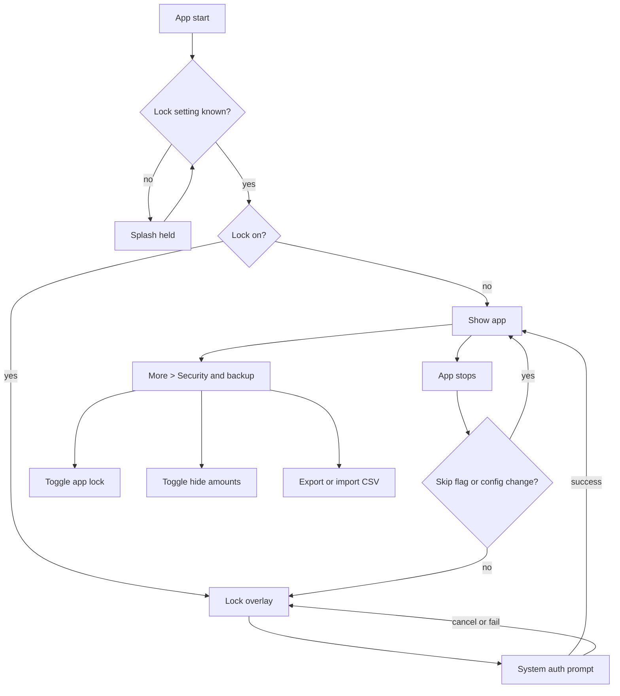

# Security and Privacy

| Field | Value |
|---|---|
| Feature ID | F-25 |
| Status | In progress (Phase 5: app lock gate, Security & privacy screen and More tile done; native biometric prompt, theme and FragmentActivity change are not compiled or run on a device; Keystore sealing stays on flutter_secure_storage; hosted text size and backup rows, skip-hop callers, FLAG_SECURE, widget masking pending) |
| Priority | P0 |
| Phase | 5 (secure-storage helper is built in Phase 0 and reused by Phase 2 email) |
| Last Updated | 2026-10-22 |

## 1. Description

Security and Privacy keeps a person's financial data private on the phone where it lives. It provides an optional app lock, a setting that hides amounts on screen, encrypted storage for passwords and identity details, and a stance of no backups, no cloud and no tracking. It exists so the promise "Your data never leaves this phone. No servers, no tracking." is true and visible, and so someone holding an unlocked phone cannot read the user's finances.

## 2. What This Feature Will Do

- Locks the app behind the phone's fingerprint, face or screen lock when the user turns the app lock on.
- Disables the lock switch, with a reason, when the phone has no screen lock set.
- Shows a locked screen with an Unlock button and asks again for authentication each time the app returns from the background.
- Keeps the user on the same screen after a successful unlock.
- Skips the lock when the app briefly leaves for a system screen, such as a file picker or permission page.
- Hides all amounts, including on the home widget, by default, with a switch to show them.
- Stores email passwords, sign-in tokens, statement passwords and identity details only in encrypted form, never shows them again and never logs them.
- Treats a secret whose key was reset as missing and asks the user to enter it again.
- Blocks cloud backup and device-to-device transfer of app data.
- Allows only encrypted network connections and trusts only the phone's built-in certificate authorities.
- Bundles no analytics, crash-reporting or advertising tools and keeps message text, senders, amounts and passwords out of logs and notifications.
- Shows the Security and backup screen and keeps the privacy table (what leaves the phone, and why) in step with real network use.

### 2.1 Inputs

- The user switching App lock or Hide amounts on or off on the Security screen.
- The phone's authentication result (fingerprint, face or screen lock) each time the app opens or returns.
- Secrets entered elsewhere in the app (email passwords, statement passwords, identity details), saved on entry.
- The app being sent to the background or brought back, and deliberate hops to system screens.

### 2.2 Processing

1. On start, wait until the lock setting is known, then show the lock screen if the lock is on.
2. Ask the phone to authenticate and, on success, reveal the screen the user was on.
3. On every return from the background, lock again unless the app left for a system screen on purpose or only rotated.
4. Apply the hide-amounts setting to every amount shown, treating amounts as hidden until the setting loads.
5. Encrypt each secret with a key held in the phone's secure hardware before saving it, and decrypt it only for the moment of use.
6. Check that each network call uses an encrypted connection and matches an entry in the privacy table.

### 2.3 Outputs

- A lock screen with an Unlock button, and a system authentication prompt.
- Masked amounts everywhere, including the home widget ([Home widget](30_home_widget.md)).
- Encrypted secrets stored on the phone and read by [Profile](27_profile.md) and the email and statement features.
- The Security and backup screen: App lock, Hide amounts, plus hosted rows for text size ([Theming and customisation](28_theming_customisation.md)) and CSV backup.
- A privacy note and a privacy table that state what, if anything, leaves the phone.

### 2.4 Out of Scope

- Text size logic and preview (see [Theming and customisation](28_theming_customisation.md)); this screen only hosts the row.
- CSV import and export (this screen only hosts the buttons).
- Email credential entry and statement password guessing.
- Profile identity entry (see [Profile](27_profile.md)).
- The share-with-amounts confirmation in the Tax Centre, which belongs to the tax feature ([Tax Centre](19_tax_centre.md)).
- A PIN of the app's own, and blocking of screenshots or recent-app previews (not done in the existing app).

## 3. Behaviour in Existing App

Source: `existing_app_analysis.md` Part A 4.7, 5, 6.3, 6.4; Part C 1.5. Kotlin refs are relative to `hisaab_apk/app/src/main/kotlin/com/hisaab/app/` unless stated.

### 3.1 App lock

- `MainActivity.kt:31` is a `FragmentActivity` (BiometricPrompt requires it). The splash (`Theme.Hisaab.Starting`) is held until the app-lock setting is known, so `lockEnabled` is `null` (unknown) until the first DataStore emission (`MainActivity.kt:46`).
- Content tree: `HisaabTheme { Box { HisaabNavHost(); if (lock && !unlocked) LockScreen } }`. The nav host stays composed under the lock so unlocking returns to the same screen (`MainActivity.kt:62-72`).
- `LockScreen` (`ui/lock/LockScreen.kt:21`): full-screen overlay with a lock icon, text "DhanKosh is locked" and an "Unlock" button that re-triggers the prompt.
- `BiometricPrompt` (`MainActivity.kt:87`): title "Unlock DhanKosh", subtitle "Your transactions are protected", authenticators `BIOMETRIC_WEAK or DEVICE_CREDENTIAL`. There is no PIN of the app's own. The prompt is re-fired on resume when the app is still locked.
- Locking rule (`security/AppLockGate.kt`): the app locks on every activity `onStop`, except when `isChangingConfigurations` or `AppLockGate.consumeSkip()` returns true.
- `AppLockGate.skipNextLock()` is called before every deliberate hop to a system UI: file pickers (CSV import/export, statement import, screenshot picker), Google consent, opening provider app-password pages, notification-listener settings, notification settings, App settings, and the APK installer (`SettingsViewModel.installUpdate`). The runtime-permission dialog does not stop the activity, so no skip is used there.
- Turning the lock ON inside the app sets `unlocked = true` for the current session so the user is not locked out immediately.
- Enabling the switch is only possible when `BiometricManager.canAuthenticate(BIOMETRIC_WEAK or DEVICE_CREDENTIAL) == SUCCESS`; otherwise the switch is disabled with helper text "Set a screen lock on this phone first".
- Info canned text `Info.APP_LOCK` (defined, not wired in screens read): "Asks for your fingerprint, face or screen lock each time DhanKosh opens, so someone holding your unlocked phone can't see your finances."

### 3.2 Hide amounts

- DataStore `app_settings.hide_amounts` (bool), default **true**.
- `AmountPrivacy.hidden` is global Compose state, default **true** so figures never flash on launch; `MainActivity` pushes the stored value on every settings emission. The Home eye icon toggles the stored setting (UI owned by the Home feature; this feature owns the rule and the setting).
- `Money.format` (`ui/format/Format.kt:29`) returns `"₹••••"` for INR or `"<CUR> ••••"` for other currencies when hidden. `Money.compact` returns `"₹••••"` when hidden.
- The home-screen widget uses `Money.format` too, so it shows masked amounts whenever the process default is still true (see [Home widget](30_home_widget.md)).
- Tax Centre share (image/PDF) always carries real numbers, so when amounts are hidden an AlertDialog "Share with amounts?" asks for confirmation first (tax feature file owns the dialog).
- Masking applies to rendered text only; exports (CSV) and share files contain real values.

### 3.3 Secrets sealed with Keystore (`:email` module)

- `KeystoreSecret` (`E/auth/KeystoreSecret.kt`): AES-256-GCM key held in AndroidKeyStore under an alias; no padding; 12-byte IV prefixed to the ciphertext; 128-bit tag; Base64 `NO_WRAP`. `open()` returns null if the key was reset (for example device lock removed). `deleteKey()` makes ciphertext permanently unreadable.
- Aliases: `hisaab.mail.password` (IMAP app passwords, `MailAccountStore.kt:70`), `hisaab.gmail.token` (OAuth token, `TokenStore.kt:49`), `hisaab.statement.passwords` (`StatementPasswordStore.kt:150`).
- Stores:
  - `MailAccountStore` DataStore `mail_account`: one string-set entry per account as `email` + U+001F + `sealed`; also reads a legacy single `email`/`password` pair as the first account.
  - `TokenStore` DataStore `gmail_tokens`: keys `token` (sealed) and `expires_at`.
  - `StatementPasswordStore` DataStore `statement_passwords`: saved passwords (`entries`, label + sealed), the 7-field identity (name, dob ISO, PAN, phone, altName, altPhone, email; U+001F separated, append-only field order), per-account bank details (customerId, accountNumber, ifsc, name, mobile, email). Details of identity live in [Profile](27_profile.md).
- Passwords are "used for the call and never logged" (`MailClient.kt:57`). The UI never shows a stored secret again; copy says "Encrypted on this phone".
- The Room database (transactions, accounts) is not described as encrypted anywhere in the analysis; see Open Questions.

### 3.4 Backup, transfer and obfuscation

- Manifest: `allowBackup=false`, `fullBackupContent=false`; `res/xml/data_extraction_rules.xml` excludes everything from cloud backup and device transfer.
- Release build: `minify` + `shrinkResources` on; signing from `local.properties` (`RELEASE_STORE_FILE`, `RELEASE_STORE_PASSWORD`, `RELEASE_KEY_ALIAS`, `RELEASE_KEY_PASSWORD`) or environment `HISAAB_STORE_FILE/PASSWORD/KEY_ALIAS/KEY_PASSWORD`; falls back to debug signing when absent.
- ML Kit telemetry: the manifest strips the Google DataTransport CCT backend so usage counters cannot be uploaded (`AndroidManifest.xml:97-103`).
- The window is NOT marked `FLAG_SECURE` (no screenshot or recents-thumbnail blocking).

### 3.5 Network security

- `network_security_config.xml`: `cleartextTrafficPermitted=false`, system CAs only (no user CAs, no pinning).
- All network use is enumerated in the privacy table below. Nothing about the user is uploaded; downloads are anonymous GETs (language packs, news RSS, GitHub release metadata and APK) plus the user's own mail servers.
- Exported manifest components: `MainActivity`, `SmsReceiver` (guarded by `BROADCAST_SMS`), `PaymentNotificationListener` (guarded by `BIND_NOTIFICATION_LISTENER_SERVICE`), `SpendWidgetReceiver`. Non-exported: `CategoryActionReceiver`, `CardDueActionReceiver`, FileProvider `${applicationId}.updates`.

### 3.6 Data minimisation behaviours enforced elsewhere (owned by the named feature, listed for the privacy table)

- SMS: sender-header filter runs before any body is read; only bank/card/EPFO/NPS senders are accepted.
- Payment-app notifications: only 19 whitelisted packages are read; WhatsApp only when the notification looks like a payment (conversations never read); notification text is never logged.
- Activity log: counts, reasons, class names only; never message text, senders or amounts.
- Statement-needs-password notification shows issuer and file name only, never figures.
- Sync run log: counts, timing and error class only.

### 3.7 Security screen (`SecurityRoute`, `ui/more/SecurityScreen.kt:59`, "Security & backup")

Sections in order: App lock switch; Hide amounts switch; Text size Segmented (Small / Default / Large / XL) with a live preview card; Backup (Export CSV via `CreateDocument("text/csv")` named `hisaab-<date>.csv`; Import CSV via `OpenDocument` for `text/csv`, `text/comma-separated-values`, `text/plain`); privacy note "Your data never leaves this phone. No servers, no tracking."; snackbars for export/import results. Text size is specified in [Theming and customisation](28_theming_customisation.md); CSV format and importer belong to the CSV import/export feature (see Section 12).

### 3.8 Privacy table (what leaves the phone)

| Data | Stored where | Leaves phone? | Network destination / reason |
|---|---|---|---|
| SMS bodies, parsed transactions, accounts, holdings | Room DB on device | No | none |
| Payment-app notification text | Parsed in memory; derived transaction in Room | No | none |
| Email app passwords, OAuth token | DataStore, Keystore-sealed | Only to the user's own mail server as login | IMAP host of the provider (TLS) / Gmail API |
| Bank emails and statement PDFs | Read in memory, parsed, rows saved; locked PDFs kept | No | fetched from the user's own mailbox only |
| Statement passwords, identity (PAN, DOB, names, phones) | DataStore, Keystore-sealed | No | none |
| Profile name, email, phone, occupation, photo | DataStore + `filesDir/profile-*.jpg` | No | none |
| Screenshots for OCR | Processed by bundled ML Kit Latin model | No | none (telemetry backend stripped) |
| Update check | none sent | Anonymous GET | `api.github.com/repos/.../releases/latest`, release asset download |
| Language packs | none sent | Anonymous GET | `raw.githubusercontent.com/.../lang/<code>.json` |
| News headlines | none sent | Anonymous GET with UA "Mozilla/5.0 (Android) DhanKosh" | Business Standard, Economic Times, Mint, Moneycontrol RSS |
| Support donation | none stored | User hands off to a UPI app | `upi://pay` intent (no network from this app) |
| CSV export / tax share | Written to a user-chosen file or `cache/shared/` | Only if the user shares it | system share sheet |

## 4. User Stories

- As a user, I want the app to ask for my fingerprint, face or screen lock every time I come back, so someone holding my unlocked phone cannot read my finances.
- As a user, I want amounts masked by default and a quick toggle, so I can open the app in public.
- As a user, I want my email password and PAN stored encrypted and never displayed again, so a leak of the phone's storage does not expose them.
- As a user, I want to know exactly what the app sends over the network, so I can trust it.
- As a user without a screen lock, I want the lock switch disabled with a clear reason, so I understand why.

## 5. Functional Requirements (FR-25-01 ...)

- FR-25-01: A setting `app_lock` (bool, default false) enables the lock. The setting is stored locally only.
- FR-25-02: The lock switch is disabled, with text "Set a screen lock on this phone first", unless the device can authenticate with biometric (weak) or device credential.
- FR-25-03: When the lock is enabled, the app shows an opaque lock overlay on cold start and whenever the app returns from the background after being stopped, and fires the system authentication prompt (title "Unlock DhanKosh", subtitle "Your transactions are protected", biometric-weak or device credential).
- FR-25-04: A lock overlay with text "DhanKosh is locked" and an "Unlock" button is shown while locked; the button re-fires the prompt; the prompt also re-fires on resume while locked.
- FR-25-05: The navigation state is preserved under the overlay; successful unlock returns to the exact prior screen.
- FR-25-06: The app does not lock on configuration changes (rotation, theme) nor on a deliberate hop to a system UI. An `AppLockGate.skipNextLock()` equivalent is called before: file pickers, Google consent, provider app-password pages, notification-listener settings, notification settings, App settings, APK install.
- FR-25-07: Enabling the lock inside the app marks the session unlocked so the user is not locked out at once.
- FR-25-08: Splash/blank state is held until the lock setting is known so there is no flash of content before the lock appears.
- FR-25-09: A setting `hide_amounts` (bool, default true) masks all money text as `₹••••` (INR) or `<CUR> ••••` (other currencies); compact form also masks. The in-memory default is true until settings load.
- FR-25-10: Hide amounts applies to the home widget text, using the same formatter and default.
- FR-25-11: Secrets (mail app passwords, OAuth token, statement passwords, identity PAN/DOB/names/phones, per-account bank details) are encrypted with a hardware-backed key (AES-256-GCM, 12-byte IV prefix, 128-bit tag, Base64) before being persisted, using separate key aliases `hisaab.mail.password`, `hisaab.gmail.token`, `hisaab.statement.passwords`.
- FR-25-12: If a key has been invalidated (open returns null) the secret is treated as absent, never as an error crash; the user is asked to re-enter.
- FR-25-13: Secrets are never logged and never displayed again after entry; UI copy says "Encrypted on this phone".
- FR-25-14: The app disables OS cloud backup and device-to-device transfer of all app data.
- FR-25-15: All network traffic uses TLS; cleartext is refused; only system certificate authorities are trusted.
- FR-25-16: The Security screen shows, in order: App lock, Hide amounts, Text size (hosted), Backup (Export CSV, Import CSV; hosted), and the privacy note "Your data never leaves this phone. No servers, no tracking.".
- FR-25-17: No analytics, crash-reporting or advertising SDK is bundled; ML Kit telemetry is disabled.
- FR-25-18: Logs, the activity log and notifications never contain message bodies, senders, amounts, passwords or statement figures.
- FR-25-19: Release builds are obfuscated and shrunk; signing keys come from local properties or environment variables, never committed.
- FR-25-20: The privacy table in Section 2.8 is reproduced in the in-app privacy/about copy or docs and kept in sync with real network destinations.

## 6. Non-Functional Requirements (performance, battery, privacy, offline)

- Lock overlay appears within one frame of resume; no content frame may render before it when lock is on.
- Authentication prompt must not run on the UI isolate's critical path; platform channel call only.
- Encryption/decryption of a secret under 10 ms on mid-range devices; no key generation on the main path after first use.
- Fully offline: lock, hide amounts and secret storage need no network.
- Privacy: no secret in logs, crash reports, screenshots of settings, or the clipboard (except the user's own Paste into the app-password field).
- Battery: no polling; lock state is event-driven by lifecycle.

## 7. UI / Screens & User Flow (screen list + flow diagram)

Screens, dialogs and sheets:

| # | Screen / overlay | Source ref |
|---|---|---|
| 1 | Security and backup screen | `ui/more/SecurityScreen.kt:59` |
| 2 | Lock overlay | `ui/lock/LockScreen.kt:21` |
| 3 | System biometric prompt | `MainActivity.kt:87` |
| 4 | Text size preview card (hosted, owned by theming) | `SecurityScreen.kt` |
| 5 | Export / Import CSV pickers and result snackbars (hosted) | `SecurityScreen.kt`, `csv/CsvTransfer.kt` |
| 6 | "Set a screen lock first" disabled state | `SecurityScreen.kt` |



Reference GIFs (Status: Pending, not yet captured):

-  (Status: Pending, not yet captured)
-  (Status: Pending, not yet captured)
-  (Status: Pending, not yet captured)
-  (Status: Pending, not yet captured)
-  (Status: Pending, not yet captured)
-  (Status: Pending, not yet captured)

## 8. Data Models (Dart entities + fields + types)

```dart
@freezed
class SecuritySettings with _$SecuritySettings {
  const factory SecuritySettings({
    @Default(false) bool appLock,        // key app_lock
    @Default(true) bool hideAmounts,     // key hide_amounts
  }) = _SecuritySettings;
}

enum LockStatus { unknown, unlocked, locked }

@freezed
class LockState with _$LockState {
  const factory LockState({
    @Default(LockStatus.unknown) LockStatus status,
    @Default(false) bool skipNext,        // AppLockGate.skipNextLock
  }) = _LockState;
}

enum AuthAvailability { available, noneEnrolled, unsupported, unavailable }

@freezed
class SealedSecret with _$SealedSecret {
  const factory SealedSecret({
    required String alias,                // hisaab.mail.password | hisaab.gmail.token | hisaab.statement.passwords
    required String base64Blob,           // 12-byte IV + ciphertext + 16-byte tag, Base64 NO_WRAP
  }) = _SealedSecret;
}
```

Interfaces (domain layer):

- `SecureVault { Future<String?> open(String alias, String blob); Future<String> seal(String alias, String plain); Future<void> deleteKey(String alias); }`
- `AppLockService { Future<AuthAvailability> availability(); Future<bool> authenticate(); void skipNextLock(); }`

## 9. Database Tables / Changes

No Drift tables. Persistence is key-value (shared_preferences or a typed settings store; see [Data sources and settings](26_settings_data_sources.md) for the full key inventory):

| Key | Type | Default |
|---|---|---|
| `app_lock` | bool | false |
| `hide_amounts` | bool | true |

Sealed blobs live in the secure store (flutter_secure_storage or a custom Keystore plugin) under the three aliases in FR-25-11. `allowBackup=false` and the extraction rules apply to the whole app data directory including the Drift DB file.

## 10. Business Rules & Logic (regex, parsing rules, algorithms, thresholds)

- Lock decision: `locked = lockEnabled == true && !unlocked`. `lockEnabled == null` means "not yet known": render nothing (splash) rather than content.
- On stop: `if (!isChangingConfigurations && !consumeSkip()) unlocked = false`. `consumeSkip()` reads and clears the flag atomically.
- Authenticators: biometric-weak OR device credential. No own PIN, no retry counter in the app (the OS enforces lockout).
- Masking: `₹••••` uses four U+2022 bullets; non-INR uses `"<CUR> ••••"`. Applies to `format` and `compact`.
- Seal format: `base64( iv[12] || ciphertext || tag[16] )`, AES/GCM/NoPadding, key 256-bit non-exportable, per-alias.
- `deleteKey(alias)` is the "forget everything" primitive: ciphertext becomes unreadable.
- Network: no cleartext, system CA store only.

## 11. Platform / Native Requirements (permissions, channels, background work)

- Android: `USE_BIOMETRIC` permission. Flutter: `local_auth` with `biometricOnly: false` (allows device credential); the host activity must extend `FlutterFragmentActivity`.
- Lifecycle mapping: Android `onStop` maps to `AppLifecycleState.paused` (and `hidden` on newer Flutter); `inactive` alone (permission dialogs, system sheets) must NOT lock, matching the existing behaviour where the permission dialog does not stop the activity. Pickers that do pause the activity need an explicit skip flag.
- Keystore: either `flutter_secure_storage` (EncryptedSharedPreferences, RSA/AES wrapped key in Keystore) or a small custom MethodChannel plugin reproducing AES-256-GCM per alias. Chosen option must support separate aliases and `deleteKey`.
- Manifest: `android:allowBackup="false"`, `android:fullBackupContent="false"`, `dataExtractionRules` excluding all domains, `networkSecurityConfig` with `cleartextTrafficPermitted="false"` and `<certificates src="system"/>`.
- Release: `flutter build apk --obfuscate --split-debug-info=<dir>`; R8 minify on; signing via `key.properties` or env.
- No `FLAG_SECURE` today; optionally add as a hardening item (Open Question).
- iOS (if ever targeted): `NSFaceIDUsageDescription`, Keychain accessibility `whenUnlockedThisDeviceOnly`, excluded from iCloud backup.

## 12. Dependencies (other features → link to their memory file; packages)

Features:

- [Theming and customisation](28_theming_customisation.md): Text size segmented control hosted on the Security screen.
- [Profile](27_profile.md): identity fields sealed under `hisaab.statement.passwords`.
- [Data sources and settings](26_settings_data_sources.md): DataStore key inventory, `AppLockGate` skip callers.
- [Home widget](30_home_widget.md): consumes `hide_amounts`.
- [News, support and updates](31_news_support_updates.md): network destinations in the privacy table.
- Email, statements, CSV import/export, tax share, ledger (separate feature files): consumers of the vault, skip flag and masking; link them from the index once numbering is fixed.

Packages: `local_auth`, `flutter_secure_storage` (or custom plugin), `shared_preferences`, `flutter_riverpod`, `freezed`, `drift` (storage location only).

## 13. Folder Location (lib/features/<name>/...)

```text
lib/features/security/
  data/
    app_lock_repository_impl.dart
    secure_vault_android.dart
    security_settings_store.dart
  domain/
    app_lock_service.dart
    secure_vault.dart
    security_settings.dart
    lock_state.dart
  presentation/
    security_screen.dart
    lock_overlay.dart
    lock_gate.dart            // wraps the app, listens to lifecycle
    providers.dart
lib/core/privacy/
  amount_privacy.dart         // global hidden flag, default true
  money_mask.dart
android/app/src/main/res/xml/
  network_security_config.xml
  data_extraction_rules.xml
```

## 14. Edge Cases & Error Handling

- Device lock removed after enabling the app lock: authentication reports unavailable; show "Set a screen lock on this phone first", keep the app locked or auto-disable per Open Question, and do not crash.
- Keystore key invalidated (lock removed, biometric enrolment changed on devices that bind keys): `open` returns null; treat as no secret; prompt the user to reconnect email / re-enter passwords.
- User cancels the prompt: remain locked with the Unlock button.
- Prompt dismissed by app going to background mid-prompt: stay locked; re-fire on resume.
- Process death while unlocked: cold start locks again (state is in memory).
- Config change (rotation): do not lock.
- Skip flag set but the external UI never opens: flag is consumed by the next stop only; ensure it also expires (Open Question).
- Hide amounts before settings load: masked by default.
- Biometric hardware present but not enrolled: availability `noneEnrolled`, switch disabled.
- Sealed blob corrupted or truncated: decrypt throws; treat as absent and clear it.

## 15. Test Cases (unit / widget / integration + sample fixtures)

Unit:

- TC-25-01 (FR-25-09): `MoneyMask.format(123456, 'INR', hidden: true)` returns `₹••••`; `'USD'` returns `USD ••••`; hidden false returns grouped rupees.
- TC-25-02 (FR-25-09): `compact` hidden returns `₹••••`.
- TC-25-03 (FR-25-11): seal then open with the same alias returns the plaintext; blob decodes to at least 12 + 16 bytes; two seals of the same text differ (random IV).
- TC-25-04 (FR-25-12): opening a blob after `deleteKey` returns null without throwing.
- TC-25-05 (FR-25-01, FR-25-09): settings defaults are `appLock=false`, `hideAmounts=true`.
- TC-25-06 (FR-25-06): `skipNextLock()` then one stop does not lock; a second stop locks.
- TC-25-07 (FR-25-06): an `inactive` lifecycle event alone does not lock; `paused` does.

Widget:

- TC-25-08 (FR-25-02): availability `noneEnrolled` renders the lock switch disabled with the text "Set a screen lock on this phone first".
- TC-25-09 (FR-25-04): locked state shows "DhanKosh is locked" and an Unlock button that calls `authenticate`.
- TC-25-10 (FR-25-16): Security screen renders sections in the specified order and privacy note text.
- TC-25-11 (FR-25-08): with lock setting unknown, neither content nor lock overlay is shown (splash).

Integration:

- TC-25-12 (FR-25-03, FR-25-05): enable lock, background the app, resume, overlay shown, authenticate success, same route visible.
- TC-25-13 (FR-25-07): enabling the lock does not immediately show the overlay.
- TC-25-14 (FR-25-14, FR-25-15): manifest assertion: `allowBackup=false`, extraction rules present, cleartext false.
- TC-25-15 (FR-25-18): run an ingest fixture and assert logs and activity entries contain no message body.

Fixtures: a masked sample secret `abcd efgh ijkl mnop` (app-password shape), an INR amount `1234567` paise, a USD amount `2500` cents.

## 16. Acceptance Criteria

- AC-25-01: With lock on, cold start and resume-after-background always show the lock overlay before any content (FR-25-03, FR-25-04, FR-25-08; TC-25-09, TC-25-11, TC-25-12).
- AC-25-02: File pickers, consent pages and settings hops do not trigger the lock on return (FR-25-06; TC-25-06, TC-25-07).
- AC-25-03: Lock cannot be enabled on a device with no screen lock and the reason is shown (FR-25-02; TC-25-08).
- AC-25-04: All money text, including the widget, is masked by default and unmasks only after the user toggles (FR-25-09, FR-25-10; TC-25-01, TC-25-02, TC-25-05).
- AC-25-05: Every stored secret is ciphertext at rest, separate per alias, and deleting the key makes it unreadable (FR-25-11, FR-25-12, FR-25-13; TC-25-03, TC-25-04).
- AC-25-06: The built app declares no-backup, TLS-only and contains no analytics SDK (FR-25-14, FR-25-15, FR-25-17; TC-25-14).
- AC-25-07: No log, notification or activity entry carries message content or credentials (FR-25-18; TC-25-15).
- AC-25-08: The Security screen matches the specified layout and copy (FR-25-16; TC-25-10).

## 17. Open Questions

1. Is the Room database encrypted? The analysis found no SQLCipher or similar; only secrets are sealed. Should Flutter add SQLCipher (Drift supports it) or keep parity?
2. `FLAG_SECURE` is not set, so recents thumbnails show amounts when hide-amounts is off. Add it for Flutter, at least when the lock is on?
3. `Info.APP_LOCK` text exists but is not wired to a screen read. Show an info button on the lock switch?
4. Keystore keys are non-exportable, so sealed secrets from v2.9.8 cannot be migrated to the Flutter app; users must re-enter email passwords and statement identity. Confirm acceptable (and whether the Flutter app replaces the package or installs side by side).
5. Does `skipNextLock` expire? In Kotlin it is consumed on the next stop; if the external UI never opens the next real background would not lock. Define an expiry (for example 60 s) for Flutter.
6. When the device lock is removed while app lock is on, current behaviour is untested in the analysis (prompt fails). Should the app auto-disable the lock or stay locked?
7. Is certificate pinning wanted for GitHub and mail endpoints? Today system CAs only.
8. The privacy note claims "No servers, no tracking", yet email IMAP/Gmail, GitHub and news RSS are contacted. Confirm wording stays.
9. Cross-links to feature files outside 25 to 31 are listed by name only because their file names were not fixed when this file was written.

## 18. Implementation Notes

Phase 5 (2026-10-21). Code: `features/security_privacy/{domain,data,presentation}`, `app/lock_gate.dart` (wraps the app in `app.dart`, outside `AppLifecycleGate`), providers in `app/di/security_providers.dart`.

- FR-25-01..08: `LockGate` hides the child with `Offstage + TickerMode` behind an opaque `LockOverlay` ("DhanKosh is locked", Unlock). Blank splash until the `app_lock` setting is known. `LockController` locks on `paused`/`hidden` only (never `inactive`), prompts on start and on resume while locked, one prompt at a time, cancel stays locked. `skipNextLock()` is a one-shot flag that expires after 60 s (Open Question 5). Enabling the lock calls `markUnlocked()`. Locks immediately on background; no timeout setting (this memory defines none).
- Auth: `LocalAuthAppLockService` over `local_auth` (device credential allowed). Availability is `available` when `isDeviceSupported`, else `noneEnrolled`; the lock switch is then disabled with "Set a screen lock on this phone first". The prompt title is the plugin default (a custom title needs `local_auth_android`, not a direct dependency).
- Native (UNVERIFIED, CI compiles): `MainActivity` now extends `FlutterFragmentActivity`; `LaunchTheme`/`NormalTheme` (values and values-night) derive from `Theme.AppCompat.*.NoActionBar` as `local_auth` requires. `USE_BIOMETRIC` was already declared. No Kotlin `secure` channel methods were added.
- FR-25-11/12 (sealed secrets): kept on `flutter_secure_storage` (allowed by section 11); unchanged this round. FR-25-14/15 manifest settings already exist. FLAG_SECURE not added (out of scope, Open Question 2).
- FR-25-09: masking already provided by `hideAmountsProvider` and the money formatter; the Security screen hosts the switch. FR-25-10 (widget) belongs to F-30.
- FR-25-16: `/settings/security` (More tile `SecurityTile`) shows App lock, Hide amounts, a `hostedRows` slot (text size, CSV backup; the router does not pass any yet), short privacy rows and Clear all data (reuses `DataResetRepository.clearLedger`, confirm dialog).
- Headless workers never pass through `LockGate`, so they are not blocked.
- Not done: `skipNextLock` callers at file pickers, consent and settings hops (owners call `lockControllerProvider.notifier.skipNextLock()`), hosted text size and backup rows, auto-disable when the device lock is removed (the app stays locked and Unlock re-prompts), TC-25-03/04 (vault tests, N/A while on flutter_secure_storage), TC-25-14/15.
- Tests: `test/features/security_privacy/lock_gate_test.dart` (TC-25-06/07/08/09/11/12/13).

- Hardening 2026-10-22: `skipNextLock` is now armed through the `LockSkipper` port before SMS and notification permission requests, App info, notification access settings, the statement file picker (`LockSkippingFileSource`) and the backup picker. The skip now spans the whole hop (cleared on resume, not on the first `hidden`), since Android sends `hidden` then `paused`. Tests: `test/features/security_privacy/lock_skip_flows_test.dart`. No UPI/URL hand-offs exist yet (no `url_launcher`).

## 19. Change Log (date | change | reason)

| Date | Change | Reason |
|---|---|---|
| 2026-10-17 | Created from hisaab_apk 2.9.8 analysis | Initial |
| 2026-10-19 | Restructured to the 19-section standard (Description, What This Feature Will Do, Implementation Notes added); Last Updated bumped | Audit Gate (Prompt 2, Part A) |
| 2026-10-21 | Phase 5 security + activity log landed | Phase 5 |
| 2026-10-22 | Hardening: lock skip around system flows, Home SMS card, activity entries | Hardening |
