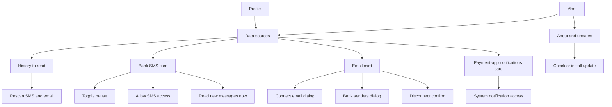

# Settings and Data Sources

| Field | Value |
|---|---|
| Feature ID | F-26 |
| Status | In progress (Phase 1: settings store and a first Data sources screen with SMS card, paste import, masking switch and developer tools; email, notification rows, history choices, More hub and About pending) |
| Priority | P0 |
| Phase | 1 (Data sources screen and settings store); 2 extends it with email and notification rows |
| Last Updated | 2026-10-27 |

## 1. Description

Settings and Data Sources is the one place where the user controls where transactions come from: bank SMS, email and payment-app notifications. It shows whether each source is working, lets the user choose how far back to read and which email senders to trust, and holds the About and updates screen. It exists so the user can tell at a glance whether the ledger is complete and fix it, and so every saved preference in the app is defined in one place.

## 2. What This Feature Will Do

- Shows a Data sources screen with cards for Bank SMS, Email and Payment-app notifications and the status of each.
- Lets the user choose a history window of 7, 30, 90, 180 or 365 days to read, defaulting to 90.
- Re-reads SMS and email for the new window when the history setting changes, keeping transactions already found.
- Pauses and resumes SMS reading without removing the phone permission or deleting data.
- Asks for SMS access and offers a Read new messages now button.
- Turns payment-app notification reading on or off and opens the phone's notification access page when access is missing.
- Shows a warning row with a Turn on button when app notifications are off or lack access.
- Lets the user edit the list of trusted bank email senders, one per line, and reset it to the defaults.
- Shows email status, last sync, extra addresses and disconnect or sign-out confirmation.
- Shows the About and updates screen with the app version, update states and a privacy note.
- Shows short plain-language Info explanations in a dialog opened from info buttons.
- Stores every saved preference in the app as a single typed list with defaults, keeping secret values elsewhere.

### 2.1 Inputs

- The user changing the history window, toggles, sender list or permissions on the Data sources screen.
- Phone permission and notification-access state, checked whenever the screen is shown.
- Results reported by the SMS, email and notification features, such as last read time and last result.
- The user opening a help button or the About and updates screen.

### 2.2 Processing

1. Read the saved settings and the live permission state.
2. Work out each source status: SMS as No permission, Paused or On; Email as Not connected, Sign in again, Paused or Connected; notifications as On, Needs access or Off.
3. On a history change, save it and start a fresh SMS read and email read for the new window, never moving the SMS read position backwards.
4. On a sender list save, clean up the entries and re-read older mail from any newly added sender.
5. Before leaving the app for a system screen, mark the app lock to skip once (see [Security and privacy](25_security_privacy.md)).
6. Ask for the notification permission at most once.

### 2.3 Outputs

- A Data sources screen showing status, last read time and last result for each source.
- Saved settings that other features read, such as SMS pause, history window and notification opt-in.
- Updated trusted sender list used by the email reader.
- An About and updates screen that displays the update states ([News, support and updates](31_news_support_updates.md)).
- A subtitle on the More list summarising which sources are on.
- The full inventory of saved setting keys, each with its owning feature.

### 2.4 Out of Scope

- SMS parsing, scan workers and receivers (SMS feature).
- Email connection and sync engines (Email feature).
- Reading and parsing of payment-app notifications (notifications feature).
- Update download, checksum check and release notes (see [News, support and updates](31_news_support_updates.md)).
- The values and behaviour of settings owned by other features; this file only lists them with their owner.

## 3. Behaviour in Existing App

Source: `existing_app_analysis.md` Part A 2.9, 3.1, 4.1 to 4.4; Part C 1.6 to 1.8. Kotlin refs relative to `hisaab_apk/app/src/main/kotlin/com/hisaab/app/`.

### 3.1 Data sources screen (`DataSourcesRoute`, `ui/more/DataSourcesScreen.kt:144`, title "Data sources")

Reached from More ("Data sources", subtitle `SMS ✓/✗ · Email ✓/✗ · Notifications ✓/✗`, drawn in the warn colour when SMS or notification reading is off) and from Profile. Content, top to bottom:

1. Intro text.
2. Amber warning row when app notifications are off or lack access, with a "Turn on" button.
3. "History to read": Segmented control 7d / 30d / 90d / 180d / 365d, default 90. Changing it re-reads SMS (a full scan) and email. Backed by `GmailSettings.lookbackDays` (choices `LOOKBACK_CHOICES = 7,30,90,180,365`). Increasing the window clears the email sync position (full re-read); the same value drives SMS inbox scans. Info text `Info.FETCH_HISTORY`.
4. Card "Bank SMS": status No permission / Paused / On; last read time and last result string; toggle `sms_enabled`; button "Allow SMS access" or "Open app settings" with hint "Then App info › ⋮ › Allow restricted settings."; button "Read new messages now".
5. Card "Email": status Not connected / Sign in again / Paused / Connected; last synced time; toggle; "Connect email"; per-address "Remove"; "Add another email"; "Bank senders" editor dialog; "Disconnect email" / "Sign out" confirm dialog.
6. Card "Payment-app notifications": status On / Needs access / Off; toggle sets `app_notifications` and opens the system notification-listener settings if access is missing.

Google sign-in uses the `StartIntentSenderForResult` consent flow. `AppLockGate.skipNextLock()` is called before every external launch (see [Security and privacy](25_security_privacy.md)). The email connect dialog itself (`settings/EmailConnect.kt:145`) belongs to the Email feature.

Status derivation:

| Source | Status logic |
|---|---|
| SMS | no READ_SMS grant: "No permission"; `sms_enabled=false`: "Paused"; else "On" |
| Email | no account: "Not connected"; `needsReauth`: "Sign in again"; disabled: "Paused"; else "Connected" |
| Payment-app notifications | `app_notifications=true` and listener access granted: "On"; setting on but no access: "Needs access"; setting off: "Off" |

Last SMS result string format (`last_sms_result`): `"N SMS checked, M from banks, a new, b merged, c to review (x.xs)"`.

### 3.2 Sender lists

**Bank senders (email) dialog `SendersDialog`**: multiline text, one address or domain per line, helper text "A domain matches every address at it.", buttons Defaults / Cancel / Save. Save lowercases and trims, stores the set, and calls `forgetPosition` so older mail from newly added senders is re-read. Defaults removes the override (`resetSenders`). Default value = `registry.defaultEmailSenders` = every bank parser's `emailSenders` + `STATEMENT_SENDERS` (`ParserRegistry.kt:82-83`). 55 listed banks add domains via `IndianBanks` with no duplicate claims (`ParserRegistry.kt:124-139`). Per-bank domains live in each bank parser (see the parser feature file).

`STATEMENT_SENDERS` (`ParserRegistry.kt:87-102`), full list:

- Registrars and depositories: camsonline.com, kfintech.com, karvy.com, nsdl.co.in, nsdl.com, cdslindia.com, cdslstatement.com, kfintech.net, camsonline.co.in, cdslindia.co.in, cdsl.co.in.
- Brokers and apps: icicidirect.com, icicisecurities.com, hdfcsec.com, kotaksecurities.com, indmoney.com, zerodha.com, zerodha.net, groww.in, upstox.com, angelone.in, dhan.co, kuvera.in, paytmmoney.com, etmoney.com, mfcentral.com, bsestarmf.in, mfuindia.com, scripbox.com, fisdom.com.
- EPF and NPS: epfindia.gov.in, epfo.gov.in, umang.gov.in, nps-proteantech.in, proteantech.in, npstrust.org.in, npscra.nsdl.co.in, kfintech-cra.com, camsnps.com.
- Card issuers and neo-banks without a dedicated parser: sbicard.com, americanexpress.co.in, aexp.com, rblbank.com, indusind.com, indusind.bank.in, hsbc.co.in, sc.com, onecard.in, getonecard.app, slicepay.in, sliceit.com, jupiter.money, fi.money, scapia.cards, uni.cards, bobfinancial.com, federalbank.co.in, aubank.in, canarabank.com, unionbankofindia.co.in, citibank.com, dbs.com, paytmbank.com, bajajfinserv.in.
- Lenders: propelld.com, adityabirlacapital.com, abcd.adityabirlacapital.com, tatacapital.com, credila.com, avanse.com, incred.com, smfgindiacredit.com, homecredit.co.in, kreditbee.in, navi.com, poonawallafincorp.com, hdbfs.com.

Matching (`GmailSyncEngine.kt:195-200`): `SenderAllowList.allows(from, subject)` = any `SenderKeys.candidates(from)` is in the set OR the subject looks like a statement (subject lists and regex are specified in the Email feature file). Subdomain matching (for example `alerts.sbi.co.in` for `sbi.co.in`) is described by a code comment, implementation unseen.

**SMS senders**: not user-editable. `registry.accepts(sender) || InvestmentParser.accepts(sender)` (sender-header filter before any body is read). Parser registry detail is in the parser feature file.

**Payment-app notification packages (not editable)**: 19 packages: `com.google.android.apps.nbu.paisa.user` Google Pay; `com.phonepe.app` PhonePe; `net.one97.paytm` Paytm; `in.org.npci.upiapp` BHIM; `com.dreamplug.androidapp` CRED; `in.amazon.mShop.android.shopping` Amazon Pay; `com.mobikwik_new` MobiKwik; `com.naviapp` Navi; `money.super.payments` super.money; `com.freecharge.android` Freecharge; `com.sbi.upi` BHIM SBI Pay; `com.sbi.lotusintouch` YONO SBI; `com.snapwork.hdfc` HDFC Bank; `com.csam.icici.bank.imobile` ICICI iMobile; `com.axis.mobile` Axis Mobile; `com.msf.kbank.mobile` Kotak Bank; `com.samsung.android.spay` Samsung Wallet; `com.samsung.android.spaymini` Samsung Pay Mini; `com.whatsapp` and `com.whatsapp.w4b` WhatsApp Pay (that is 20 package names for 19 apps counting WhatsApp once).

### 3.3 Settings used by sources (behaviour)

- `sms_enabled` (default true) is checked by the live SMS receiver; paused means no ingest, not a revoked permission.
- `sms_cursor` is the receive time of the newest scanned SMS; `smsScanned` keeps the max; `resetSmsCursor` removes it. Cursor never moves backwards. Full scan window = now - lookbackDays from cursor 0; recent scan = `min(cursor, now - days)`.
- `app_notifications` default false (opt-in). `notifications_asked` records that POST_NOTIFICATIONS was requested once (Home, Android 13+).
- `sms_prompt_dismissed`: "Not now" on the Home SMS card.
- `check_updates` default true; there is a view-model setter but no switch in the About & updates screen (see Open Questions).

### 3.4 About & updates screen (`SettingsRoute`, `settings/SettingsScreen.kt:44`, title "About & updates")

App name, version with the WhatsNew info button, Updates card (Check for updates / Checking… / "You have the latest version." / error text; Available shows Install; Downloading shows a progress bar) and a privacy note. Reached from More ("About & updates", subtitle `Version x`) and from the Home update notice. The update logic, release notes and installer are specified in [News, support and updates](31_news_support_updates.md).

### 3.5 DataStore / preferences inventory (every persisted key in the app)

All local to the device (`allowBackup=false`). "Owner" is the feature responsible for behaviour.

**DataStore `app_settings`** (`settings/AppSettings.kt:95`, `AppSettingsStore`):

| Key | Type | Default | Meaning | Owner |
|---|---|---|---|---|
| `app_lock` | bool | false | Biometric / device-credential lock | [25](25_security_privacy.md) |
| `theme` | string `ThemeMode` | SYSTEM | SYSTEM / LIGHT / DARK | [28](28_theming_customisation.md) |
| `theme_palette` | string `ThemePalette` | DHANKOSH | one of 22 palettes | [28](28_theming_customisation.md) |
| `pure_black` | bool | false | OLED black in dark mode | [28](28_theming_customisation.md) |
| `text_scale` | float | 1.0 | 0.9 / 1.0 / 1.1 / 1.2; `TextSize.of` snaps to nearest within 0.05 | [28](28_theming_customisation.md) |
| `sms_enabled` | bool | true | Pause or resume live SMS ingest | this file |
| `sms_cursor` | long | absent (0) | Receive time of newest scanned SMS | this file |
| `last_sms_scan` | long? | none | Time of last scan | this file |
| `last_sms_result` | string? | none | Summary of last scan | this file |
| `sms_prompt_dismissed` | bool | false | Home SMS card dismissed | this file |
| `app_notifications` | bool | false | Payment-app notification reading opt-in | this file |
| `notifications_asked` | bool | false | POST_NOTIFICATIONS asked once | this file |
| `budget_alert_percent` | int | 90 | UI choices 80 / 90 / 95 | alerts feature |
| `alerted_keys` | string set | empty | Alert dedupe keys, capped to last 300 on write | alerts feature |
| `transaction_notifications` | bool | true | New-transaction, untracked-gap and balance notifications | alerts feature |
| `card_due_reminders` | bool | true | Card bill reminders | alerts feature |
| `hide_amounts` | bool | true | Amounts shown as `₹••••` | [25](25_security_privacy.md) |
| `check_updates` | bool | true | Daily GitHub check | [31](31_news_support_updates.md) |
| `display_name` | string? | none | Profile name | [27](27_profile.md) |
| `profile_email`, `profile_phone`, `profile_occupation`, `profile_photo` | string? | none | Profile fields; photo = absolute path | [27](27_profile.md) |
| `profile_prompt_dismissed` | bool | false | Legacy first-run prompt | [27](27_profile.md) |
| `last_update_check` | long? | none | Once-a-day gating | [31](31_news_support_updates.md) |

**DataStore `tab_layout`** (`TabLayout.kt`): `order_home`, `order_analytics`, `order_portfolio` (comma-separated keys), `hidden` (string set of `"tab:key"`), migration flags `home_v2_seeded`, `home_spent_added`, `home_networth_left`, `analytics_when_last`. Owner: [28](28_theming_customisation.md).

**DataStore `net_worth_prefs`** (`NetWorthPrefs.kt`): `excluded_classes` (AssetClass names), `excluded_liabilities` (`LOANS`, `CARD_DUES`), `excluded_accounts` (account ids as strings). Everything counts by default. Owner: [28](28_theming_customisation.md) (UI) and portfolio.

**DataStore `local_lists`** (`LocalLists.kt`): `worth` = JSON array of `{day, a, l}` (net-worth daily points in paise), one per day, last 1100 entries. Owner: portfolio.

**DataStore `view_filter`** (`ui/ledger/Ledger.kt:103`): `book` (ALL / PERSONAL / BUSINESS, default ALL). Period, month and custom range are NOT persisted (reset on every launch). Owner: ledger.

**DataStore `language`** (`i18n/I18n.kt:62`): `language` code (en, hi, bn, te, mr, ta, gu, kn). Owner: [29](29_localization.md).

**DataStore `activity_log`** (`log/ActivityLog.kt:85`): `entries` JSON array, max 200. Owner: activity log feature.

**DataStore `card_due_reminders`** (`notify/CardDueReminders.kt:68`): `sent` (`cardId|dueEpochDay|STAGE`), `paid` (`cardId|dueEpochDay`), `snoozed` (`cardId|dueEpochDay|untilEpochDay`); pruned when due date is more than 120 days old. Owner: alerts feature.

**DataStore `untracked_gaps`** (`ui/accounts/GapTracker.kt:23`): `dismissed`, `notified`, `choices` (`"<accountId>=<GapChoice>"`); watch window 240 days. Owner: accounts feature.

**DataStore `loan_links`, `loan_dismissals`**: loans feature.

**`:email` module stores (Keystore-sealed where noted)**: `GmailSettingsStore` (`email/sync/GmailSettings.kt:156-162`: lookbackDays default 90, `LOOKBACK_CHOICES = 7,30,90,180,365`, senders list, enabled, needsReauth, `connection` GOOGLE or IMAP, `read_pdf` bool default true = read statement PDFs, `history_id` Gmail incremental-sync cursor, `last_sync` long, `last_result` string, and per-mailbox `imap_synced_at:<email lowercase>` long, `GmailSettings.kt:98`; all `imap_synced_at:*` keys are removed on disconnect, `GmailSettings.kt:148`); `mail_account` (sealed IMAP passwords); `gmail_tokens` (`token` sealed, `expires_at`); `statement_passwords` (sealed identity and passwords). Owners: email, statements, [25](25_security_privacy.md).

**Plain SharedPreferences**: `payee_accounts` (payee key to accountId), `maintenance` (one-time flags `reparse_v1`, `app_rows_v1`, `cardbill_v1`), `balance-updates` (per-account last notified epoch day), `nps-contributions` (key `applied`, string set of claimed NPS contribution keys so the same contribution arriving by SMS and email, or re-read by a rescan, is applied once; capped to the last 500 on write, `shared/repo/NpsContributions.kt:29,72-81`; behaviour owned by [16_portfolio.md](16_portfolio.md)), `mf-orders` (key `applied`, string set of processed mutual-fund order keys so a re-read statement does not duplicate orders; capped to the last 500 on write, `email/statement/StatementProcessor.kt:89,176-180,370-371`; behaviour owned by [05_statement_import.md](05_statement_import.md)).

**Legacy**: `datastore/tax_overrides.preferences_pb` is deleted on start (`TaxSource` init); tax what-if figures are never persisted.

**Files**: `filesDir/lang/<code>.json` (packs), `filesDir/profile-*.jpg`, `cacheDir/updates/*.apk`, `cacheDir/shared/*`.

### 3.6 `Info` canned explanations (`ui/components/InfoButton.kt:46-100`)

Opened by an `InfoButton` as an AlertDialog with a "Got it" button; each entry is an array of paragraphs. This section is the one shared list of every `InfoButton` (i) dialog; other features link here instead of repeating the text. Placements verified in source (`Info.X` entries are verbatim below): EMAIL on the Connect email dialog (`ui/settings/EmailConnect.kt:172`, title "Connecting email"); DUPLICATES in the Review top bar (`ui/review/ReviewScreen.kt:101`, "Possible duplicates"); CARD_LINK beside the debit-card link suggestion (`ui/accounts/AccountsScreen.kt:525`, "Linking a debit card"); MANUAL_BALANCE beside the balance field in the account editor (`AccountsScreen.kt:741`, title "Available limit" for cards, else "Current balance"). Three more dialogs carry inline text instead of an `Info` entry (listed after the verbatim entries). The remaining entries (SMS, APP_PASSWORD, FETCH_HISTORY, PAYMENT_APPS, STATEMENT_PASSWORDS, STATEMENTS, INVESTMENTS, APP_LOCK) are defined but no call site was found; `BillsScreen.kt:65` and `StatementsScreen.kt:68` import `InfoButton` without calling it (see Open Questions). Verbatim text:

- SMS: "DhanKosh reads SMS only from banks, card issuers, EPFO and NPS. Messages from people and other apps are skipped without being read." / "Bank SMS become transactions. OTPs, offers, reminders and failed payments are ignored." / "Everything stays on this phone."
- EMAIL: "Connecting your email lets DhanKosh read bank alert emails and the statement PDFs attached to them (card, bank, CAS, INDmoney and broker statements)." / "It reads only mail from the bank and investment senders in the filter, and only to your phone. Nothing is uploaded." / "To prove the address is yours, DhanKosh mails you a 6-digit code from your own account."
- APP_PASSWORD: "An app password is a separate 16-character password your email provider makes for one app. Your normal password won't work, and DhanKosh never sees it." / "Gmail: turn on 2-Step Verification, then create one at myaccount.google.com/apppasswords. You can delete it there at any time." / "It's stored encrypted with a key that never leaves this phone."
- FETCH_HISTORY: "How far back DhanKosh reads your SMS inbox and your email. A longer period finds more history but takes longer the first time." / "Changing it rescans for the new period. Transactions already found stay."
- PAYMENT_APPS: "Many banks don't send an SMS for small UPI payments, but GPay, PhonePe, Paytm and others always show a notification." / "With this on, DhanKosh reads notifications from known payment and bank apps only, and keeps only completed payments. Every other app's notifications are ignored." / "If the bank's SMS or email for the same payment comes later, the two are merged, not counted twice."
- STATEMENT_PASSWORDS: "Most statements are password protected. Save a password once and DhanKosh tries it on every new statement." / "Card statements often use the first 4 letters of your name + DDMM of birth (e.g. RAHU0105). CAS uses your PAN in capitals. Bank statements often use your customer ID or date of birth." / "Passwords are encrypted on this phone and never sent anywhere."
- STATEMENTS: "Statement PDFs attached to emails from your banks, card issuers, CAMS, KFintech, NSDL, CDSL and brokers are read automatically once email is connected. You can also import one from the phone." / "Card and bank statement rows become transactions. Rows already recorded from an SMS or email are merged, not doubled. A CAS or demat statement becomes investment holdings."
- INVESTMENTS: "EPF: the balance from EPFO's passbook SMS. NPS: the holding value from NPS SMS." / "Mutual funds, shares and ETFs: units and market value from your CAS (CAMS, KFintech, NSDL or CDSL) and broker statements such as INDmoney." / "Anything else (PPF, gold, FDs, US stocks): add it yourself. A newer statement or SMS updates the holdings it covers."
- CARD_LINK: "A debit card spends your bank account's money. Linking it makes its spends and ATM withdrawals count against that account, and the balance in its SMS updates the account." / "DhanKosh suggests a link when the balance in the card's SMS matches one of your accounts."
- DUPLICATES: "DhanKosh merges an SMS, an email and a statement row for the same payment automatically when it's sure." / "When it isn't sure (same amount and account, no reference number), it asks you here. Compare shows both side by side with their original messages." (see [Duplicate review](07_dedup_review.md))
- MANUAL_BALANCE: "Optional. If your bank's SMS don't include the balance, type it here once." / "DhanKosh moves it on with every transaction after that, and a newer balance from a bank message replaces it."
- APP_LOCK: "Asks for your fingerprint, face or screen lock each time DhanKosh opens, so someone holding your unlocked phone can't see your finances."

Inline (i) dialogs, text written at the call site:

- Budgets (`ui/budgets/BudgetsScreen.kt:126`, title "Budgets"): "A budget is a monthly limit for a category. Set it once: it applies to every month, and resets on the 1st." / "You get an alert when spending reaches your alert level (90% unless you change it) and again at 100%." / "Tap a budget to see every transaction behind it."
- Tax "About this estimate" (`ui/more/TaxScreen.kt:402`): "Worked out from what DhanKosh tracked, for a resident individual under 60, with the slabs, rebate, surcharge and cess for the year." / "Salary credits are after TDS and PF, so taxable salary may be higher. Check with a tax professional before you file."
- Tax "Income" (`TaxScreen.kt:502`): "Collected from salary, interest, dividend, rent and other credits DhanKosh tracked. Refunds, transfers between your accounts and reimbursements are left out." / "Salary credits are what reached your bank, after TDS and PF, so your taxable salary is likely higher. Use the calculator (top right) to try your own figures. What-if figures are not saved."

### 3.8 More hub live subtitles and footer (`ui/more/MoreScreen.kt:197-337`)

Each More entry shows a one-line subtitle computed from live state (12 sp, warn colour when `alert`, `MoreScreen.kt:176,364`):

- Plan: Budgets (none: "Set monthly limits by category"; some near limit: "{active} active · {near} near limit"; else "{active} active · all on track", `:202-203`); Bills & subscriptions ("Looking for repeat payments…", "No repeat payments found yet", "{n} recurring · {amount}/mo"); Loans ("Looking for loans…", "From loan messages and EMI debits", "{n} loan(s) · {amount} EMI/month", `:226-227`); Tax centre ("{fy} · New regime saves {amount}" / "Old regime saves {amount}" / "estimated {amount}"; before data "Estimate your tax for {fy}").
- Automation: Rules ("Learned as you categorise" or "{n} rule(s)"); Data sources (FR-26-10); Activity log ("Each sync, on this phone").
- Accounts: Accounts & cards ("Found from your messages" or "{n} account(s) and cards"); Statements ("Card, bank and investment PDFs", "{n} statement(s)", "{n} statement(s) · {n} need a password", `:264`).
- App: Customise ("{theme} theme · tab sections"); Notifications & alerts ("Transactions on/off · budgets at {pct}%"); Security & backup ("App lock on/off · amounts hidden/shown", plus " · text {size}" when not Default); Language; Forex rates ("Rates used for foreign spends"); About & updates ("Version {version}").
- Footer (`:335`): "You're all caught up" and "DhanKosh v{version}" (`BuildConfig.VERSION_NAME`).

All strings go through the i18n lookup ([29_localization.md](29_localization.md)). The header greeting uses the profile name, else the display name, else "You".

### 3.7 Application start tasks touching settings (`HisaabApplication.kt:34`)

On start, off the main thread: restore language, scan SMS if permitted, schedule daily alerts, check card-due reminders, schedule nightly sync (02:30 local), close matured deposits, check for updates if due, schedule email periodic sync if enabled. A collector keeps `transactions.phoneLast4s` = last 4 digits of the user's own numbers (profile phone, identity phone / altPhone, digits >= 10) so own mobile numbers never become accounts (see [Profile](27_profile.md)).

## 4. User Stories

- As a user, I want to see at a glance whether SMS, email and notifications are being read, so I know if my ledger is complete.
- As a user, I want to pick how far back the app reads (7 to 365 days), so I can trade history for speed.
- As a user, I want to pause SMS reading without revoking permission, so I can stop temporarily.
- As a user, I want to edit the list of bank senders the email reader trusts, and reset it to defaults.
- As a user, I want a "Read new messages now" button so I do not wait for the nightly scan.
- As a user, I want short plain-language explanations next to complicated options.

## 5. Functional Requirements (FR-26-01 ...)

- FR-26-01: The Data sources screen shows intro text, the notification warning row (when applicable), "History to read", and cards for Bank SMS, Email and Payment-app notifications in that order.
- FR-26-02: History choices are exactly 7, 30, 90, 180, 365 days, default 90. Changing the value triggers a full SMS re-read for the new window and an email re-read; transactions already found are kept; the cursor never moves backwards.
- FR-26-03: SMS card shows status (No permission / Paused / On), last read time and last result string, a toggle bound to `sms_enabled`, a permission button ("Allow SMS access" when not granted, "Open app settings" when permanently denied, with the restricted-settings hint), and "Read new messages now".
- FR-26-04: Turning `sms_enabled` off stops live ingestion but does not revoke OS permission and does not delete data.
- FR-26-05: Email card shows status (Not connected / Sign in again / Paused / Connected), last synced time, enable toggle, "Connect email", per-address Remove, "Add another email", "Bank senders", and a confirm dialog "Disconnect email" or "Sign out".
- FR-26-06: The Bank senders dialog is multiline, one address or domain per line, with the helper "A domain matches every address at it."; Save lowercases and trims and triggers a re-read of older mail for new senders; Defaults restores the default list; Cancel discards.
- FR-26-07: Payment-app notification card shows On / Needs access / Off. Turning it on sets `app_notifications=true` and, if listener access is missing, opens the system notification-access settings; turning it off sets false.
- FR-26-08: When app notifications are off or without access, an amber warning row with "Turn on" appears at the top.
- FR-26-09: Before leaving the app for any system UI from this screen, the app-lock skip flag is set (see [Security and privacy](25_security_privacy.md)).
- FR-26-10: The More list entry "Data sources" shows the subtitle `SMS ✓/✗ · Email ✓/✗ · Notifications ✓/✗`, in the warn colour when SMS or notification reading is off.
- FR-26-11: The About & updates screen shows app name, version, a WhatsNew info button, an Updates card whose states are idle, checking, up to date ("You have the latest version."), available (Install), downloading (progress) and failed (message), and a privacy note.
- FR-26-12: A typed settings store exposes every key in Section 2.5 with the stated defaults, as streams; reads before load return defaults, and `hide_amounts` defaults true.
- FR-26-13: `alerted_keys` is capped to the most recent 300 entries on write.
- FR-26-14: `sms_cursor` only increases (max on write) and can be explicitly reset.
- FR-26-15: `InfoButton` opens a dialog with the canned paragraphs and a "Got it" button; texts are the verbatim strings in Section 2.6 and are translatable via the localization key lookup.
- FR-26-16: POST_NOTIFICATIONS is requested at most once (tracked by `notifications_asked`).
- FR-26-17: The home SMS card "Not now" sets `sms_prompt_dismissed`.
- FR-26-18: The default email sender set equals the union of bank parser email senders and `STATEMENT_SENDERS`; a user override replaces it entirely until reset.
- FR-26-19: Daily update check runs at start when `check_updates` is true and the last check is at least 24 h old.
- FR-26-20: No settings value is included in OS backup or device transfer.
- FR-26-21: The settings inventory (Section 3.5) also lists `nps-contributions` (`applied`, cap 500) and `mf-orders` (`applied`, cap 500); both sets keep only the last 500 keys on write. Behaviour: [16_portfolio.md](16_portfolio.md), [05_statement_import.md](05_statement_import.md).
- FR-26-22: The Gmail/IMAP settings store persists `read_pdf` (default true), `history_id`, `last_sync`, `last_result` and `imap_synced_at:<email>`; disconnect clears all `imap_synced_at:*` keys.
- FR-26-23: The More hub shows a live subtitle per entry and a footer, as in Section 3.8. The footer reads "You're all caught up" and "DhanKosh v{version}".
- FR-26-24: Every `InfoButton` (i) opens an AlertDialog with a "Got it" button and the texts and placements in Section 3.6; other features link to that list rather than copy it.
- FR-26-26: (Phase 1 addition) "Paste a bank SMS": sender and message fields, "Parse and add" runs the normal ingest path and shows what was added (type, amount, merchant, account tail) or why it was ignored.
- FR-26-27: (Phase 1 addition) Developer section, shown while `developer_tools` is true (default true in this early build): "Add sample data" ingests 25 clearly dummy SMS (accounts XX1234 bank and XX5678 card, merchants prefixed DEMO) over the last 60 days through the normal ingest path.
- FR-26-28: (Phase 1 addition) "Clear all data" with a confirm dialog deletes transactions, sources, tombstones, accounts, rules and custom categories and resets the SMS cursor; settings and the sealed identity stay.
- FR-26-29: (Phase 1 addition) Privacy switch "Hide amounts" writes `hide_amounts` (default true).
- FR-26-25: The settings key-value store is one Drift table `settings(key TEXT PRIMARY KEY, value TEXT)`; every feature persisting a simple setting (including [01_onboarding_permissions.md](01_onboarding_permissions.md) and [17_dashboard_home.md](17_dashboard_home.md)) uses this name.

## 6. Non-Functional Requirements (performance, battery, privacy, offline)

- Settings reads are non-blocking; the first frame must not wait on disk beyond the splash hold for lock and theme.
- "Read new messages now" runs in background with progress, UI stays responsive; scan batches of 500 SMS (see the SMS feature file).
- Changing history window should coalesce rapid taps (only the last choice starts a scan).
- Offline: the screen and all toggles work offline; email status shows last synced time.
- Privacy: no setting here is transmitted; status strings contain counts only, never message text.

## 7. UI / Screens & User Flow (screen list + flow diagram)

| # | Screen / dialog / sheet | Source ref |
|---|---|---|
| 1 | Data sources screen | `ui/more/DataSourcesScreen.kt:144` |
| 2 | Notification warning row with "Turn on" | `DataSourcesScreen.kt` |
| 3 | History to read segmented control | `DataSourcesScreen.kt` |
| 4 | Bank SMS card (with permission states) | `DataSourcesScreen.kt` |
| 5 | Email card | `DataSourcesScreen.kt` |
| 6 | Bank senders dialog (`SendersDialog`) | `DataSourcesScreen.kt` |
| 7 | Disconnect / Sign out confirm dialog | `DataSourcesScreen.kt` |
| 8 | Payment-app notifications card | `DataSourcesScreen.kt` |
| 9 | Email connect dialog (owned by Email feature, hosted from here) | `settings/EmailConnect.kt:145` |
| 10 | About & updates screen | `settings/SettingsScreen.kt:44` |
| 11 | Info dialog (`InfoButton`) | `components/InfoButton.kt` |
| 12 | System permission prompts and notification-access settings | OS |



Reference GIFs (Status: Pending, not yet captured):

-  (Status: Pending, not yet captured)
-  (Status: Pending, not yet captured)
-  (Status: Pending, not yet captured)
-  (Status: Pending, not yet captured)
-  (Status: Pending, not yet captured)
-  (Status: Pending, not yet captured)
-  (Status: Pending, not yet captured)
-  (Status: Pending, not yet captured)
-  (Status: Pending, not yet captured)

## 8. Data Models (Dart entities + fields + types)

```dart
@freezed
class AppSettings with _$AppSettings {
  const factory AppSettings({
    @Default(false) bool appLock,
    @Default(ThemeMode.system) ThemeMode theme,
    @Default(ThemePalette.dhankosh) ThemePalette themePalette,
    @Default(false) bool pureBlack,
    @Default(1.0) double textScale,
    @Default(true) bool smsEnabled,
    int? smsCursor,                    // epoch ms, absent = 0
    int? lastSmsScan,                  // epoch ms
    String? lastSmsResult,
    @Default(false) bool smsPromptDismissed,
    @Default(false) bool appNotifications,
    @Default(false) bool notificationsAsked,
    @Default(90) int budgetAlertPercent,
    @Default(<String>{}) Set<String> alertedKeys,
    @Default(true) bool transactionNotifications,
    @Default(true) bool cardDueReminders,
    @Default(true) bool hideAmounts,
    @Default(true) bool checkUpdates,
    String? displayName,
    String? profileEmail,
    String? profilePhone,
    String? profileOccupation,
    String? profilePhoto,
    @Default(false) bool profilePromptDismissed,
    int? lastUpdateCheck,
  }) = _AppSettings;
}

enum SourceStatus { noPermission, paused, on, notConnected, signInAgain, connected, needsAccess, off }

@freezed
class DataSourcesState with _$DataSourcesState {
  const factory DataSourcesState({
    required int historyDays,                 // 7|30|90|180|365
    required SourceStatus sms,
    DateTime? lastSmsScan,
    String? lastSmsResult,
    required SourceStatus email,
    DateTime? lastEmailSync,
    @Default([]) List<String> mailAddresses,
    @Default([]) List<String> senders,
    @Default(false) bool sendersAreDefault,
    required SourceStatus appNotifications,
    @Default(false) bool showNotificationWarning,
    @Default(false) bool scanning,
  }) = _DataSourcesState;
}

@freezed
class InfoTopic with _$InfoTopic {
  const factory InfoTopic({required String id, required List<String> paragraphs}) = _InfoTopic;
}
```

## 9. Database Tables / Changes

No Drift tables are required for settings; persist through a typed key-value store (shared_preferences, or one Drift `settings(key TEXT PRIMARY KEY, value TEXT)` table if atomic multi-key writes are wanted). Store grouping mirrors the existing DataStore names so the inventory in Section 2.5 maps one to one:

| Flutter store | Existing store | Keys |
|---|---|---|
| `app_settings` | `app_settings` | the 25 keys in the `app_settings` table of Section 2.5 |
| `tab_layout` | `tab_layout` | see [28](28_theming_customisation.md) |
| `net_worth_prefs` | `net_worth_prefs` | 3 set keys |
| `view_filter` | `view_filter` | `book` |
| `language` | `language` | `language` |
| email stores | `GmailSettingsStore`, `mail_account`, `gmail_tokens`, `statement_passwords` | sealed, see [25](25_security_privacy.md); `GmailSettingsStore` keys in Section 3.5 |
| `nps-contributions`, `mf-orders` | plain SharedPreferences | `applied` string set each, capped at 500 (Section 3.5) |
| high-volume lists (`activity_log`, `local_lists.worth`, reminder and gap sets) | various | prefer Drift tables owned by their features rather than JSON blobs (Open Question) |

`maintenance` one-time flags (`reparse_v1`, `app_rows_v1`, `cardbill_v1`) are not needed for a fresh Flutter database unless data is imported from v2.9.8.

## 10. Business Rules & Logic (regex, parsing rules, algorithms, thresholds)

- History choices `{7, 30, 90, 180, 365}`, default 90. Increase clears the email sync position; SMS scan full window = now - days from cursor 0.
- Scan window rules: full = `now - lookbackDays` from 0 cursor (REPLACE policy); recent = `min(cursor, now - days)` with `days=14`; default = cursor (KEEP policy). Cursor never goes backwards.
- Senders set: lowercase, trimmed, unique; domain entry matches every address at it; override stored only when it differs from defaults.
- SMS id used for dedupe between live and scan paths: `"sms:" + hex(first 16 bytes of SHA-256("<SENDER_UPPER>|<sentAtMs>|<body>"))` (`SmsInboxSource.kt:55`); must match in Flutter.
- Last scan summary: `"N SMS checked, M from banks, a new, b merged, c to review (x.xs)"`.
- `alerted_keys` cap 300 (drop oldest on write).
- Update check gate: `check_updates && now - last_update_check >= 24 h`.
- Nightly sync at 02:30 local, battery-not-low; email periodic once per day (see Open Questions on "every hour" text).
- Subtitle on More: `SMS ✓/✗ · Email ✓/✗ · Notifications ✓/✗`; warn colour if SMS or notifications is ✗.

## 11. Platform / Native Requirements (permissions, channels, background work)

- Permissions: `READ_SMS` and `RECEIVE_SMS` (requested together from Home card or this screen), `POST_NOTIFICATIONS` (Android 13+, once), `INTERNET`, `ACCESS_NETWORK_STATE`. Notification listener is a special-access grant opened via `ACTION_NOTIFICATION_LISTENER_SETTINGS`; sideloaded builds may need "Allow restricted settings" (App info, overflow menu).
- Flutter: `permission_handler` for SMS and notifications; a MethodChannel (or `flutter_local_notifications` plus a native `NotificationListenerService`) for access state and opening settings; `telephony`-style native plugin for the inbox query and `SMS_RECEIVED` receiver (owned by the SMS feature).
- Background: `workmanager` unique work names `sms-scan` (KEEP / REPLACE), `nightly-sync` (1 day, 02:30), `gmail-sync-periodic` (1 day, UPDATE), `daily-alerts` (1 day, KEEP).
- Deep launches to system UIs must set the app-lock skip flag.
- Reading `isListenerEnabled`: package in `getEnabledListenerPackages` AND `app_notifications` true.

### Platform facts from the manifest and Gradle (`app/src/main/AndroidManifest.xml`)

- Negative facts the port must keep: no boot receiver (no `RECEIVE_BOOT_COMPLETED`; background work is re-armed on app start, Section 3.7), no `AlarmManager`, no foreground service. Everything periodic is WorkManager.
- `android:supportsRtl="true"` (`:26`); `compileSdk = 37`, `targetSdk = 36`, `minSdk = 26` (`app/build.gradle.kts:12,16,17`).
- WorkManager's default `androidx.work.WorkManagerInitializer` is removed from the manifest (`:113-122`, `tools:node="remove"`) because `HisaabApplication` initialises it with Hilt's worker factory. Flutter equivalent: the `workmanager` plugin is initialised from Dart (`Workmanager().initialize(callbackDispatcher)`) and tasks are registered on app start; no manifest provider override is needed unless a custom initialiser is added.
- `MainActivity` uses `android:windowSoftInputMode="adjustResize"` (`:35`) so sheets and forms resize above the keyboard (Flutter default `resizeToAvoidBottomInset` matches) and launches with the splash theme `Theme.Hisaab.Starting` (parent `Theme.SplashScreen`, `res/values/themes.xml:11`, `:34`). Splash colours: [28_theming_customisation.md](28_theming_customisation.md).

## 12. Dependencies (other features → link to their memory file; packages)

Features:

- [Security and privacy](25_security_privacy.md): lock skip flag, hide amounts key.
- [Profile](27_profile.md): own-number guard, profile keys.
- [Theming and customisation](28_theming_customisation.md): theme and tab-layout keys.
- [Localization](29_localization.md): `language` store and `t()` for Info texts.
- [News, support and updates](31_news_support_updates.md): update checker and WhatsNew in About screen.
- [Duplicate review](07_dedup_review.md): referenced by the DUPLICATES info text.
- SMS ingest, email sync, notification listener, statements, alerts, accounts feature files: consume the settings listed above.

Packages: `shared_preferences` (or `drift`), `riverpod`, `freezed`, `permission_handler`, `workmanager`, `app_settings` (open OS settings), `url_launcher`, `flutter_secure_storage`.

## 13. Folder Location (lib/features/<name>/...)

```text
lib/features/settings/
  data/
    app_settings_store.dart          // all keys, defaults
    sender_defaults.dart             // STATEMENT_SENDERS + bank domains
    source_status_repository_impl.dart
  domain/
    app_settings.dart
    data_sources_state.dart
    info_topics.dart                 // verbatim Info texts
    source_status_repository.dart
  presentation/
    data_sources_screen.dart
    senders_dialog.dart
    about_screen.dart
    info_button.dart
    providers.dart
```

## 14. Edge Cases & Error Handling

- SMS permission permanently denied: show "Open app settings" and the restricted-settings hint; never loop the prompt.
- Permission granted but `sms_enabled=false`: status "Paused", scans from the button still allowed? (Open Question).
- Notification access revoked while toggle is on: status "Needs access" and the amber warning appears.
- Changing history while a scan is running: cancel and restart with the new window (REPLACE), cursor not regressed.
- Senders dialog with an empty list or invalid lines: ignore blanks, trim, lowercase; empty result is treated as "Defaults".
- Disconnect while a sync is running: sync is cancelled; account removed; sealed password key entry deleted.
- Email needs re-auth: status "Sign in again"; sync paused until reconnected.
- Settings read failure: fall back to defaults (hide amounts true, lock false).
- `alerted_keys` growth: trim to 300.
- Device without telephony: SMS card shows unavailable (manifest `telephony required=false`).

## 15. Test Cases (unit / widget / integration + sample fixtures)

Unit:

- TC-26-01 (FR-26-12): default `AppSettings()` has `smsEnabled=true`, `appNotifications=false`, `budgetAlertPercent=90`, `hideAmounts=true`, `checkUpdates=true`, `cardDueReminders=true`, `transactionNotifications=true`.
- TC-26-02 (FR-26-13): adding 305 distinct alert keys leaves 300, the newest kept.
- TC-26-03 (FR-26-14): `smsScanned(100)` then `smsScanned(50)` keeps 100; `resetSmsCursor` clears.
- TC-26-04 (FR-26-02): history choices list equals `[7,30,90,180,365]`; default 90.
- TC-26-05 (FR-26-06): normalise `" Alerts@HDFCBANK.net \n\nsbi.co.in "` to `{alerts@hdfcbank.net, sbi.co.in}`.
- TC-26-06 (FR-26-18): default sender set contains `camsonline.com`, `zerodha.com`, `sbicard.com`, `navi.com` and every bank parser domain.
- TC-26-07 (FR-26-03): status function: no permission gives noPermission; permission and disabled gives paused; permission and enabled gives on.
- TC-26-08 (FR-26-19): update check gate true at 24 h and false at 23 h 59 m; false when `checkUpdates=false`.
- TC-26-09 (FR-26-15): info topics exist for all 12 ids with the verbatim paragraph counts (SMS 3, EMAIL 3, APP_PASSWORD 3, FETCH_HISTORY 2, PAYMENT_APPS 3, STATEMENT_PASSWORDS 3, STATEMENTS 2, INVESTMENTS 3, CARD_LINK 2, DUPLICATES 2, MANUAL_BALANCE 2, APP_LOCK 1).
- TC-26-10 (Section 10): SMS id for sender `VM-HDFCBK`, sentAt `1700000000000`, body `Rs 500 debited` equals `sms:` plus 32 hex characters and is stable across calls.

Widget:

- TC-26-11 (FR-26-01): screen renders sections in order; notification warning row hidden when access is on.
- TC-26-12 (FR-26-07, FR-26-08): toggling payment-app notifications on without access calls the open-settings callback and shows the warning.
- TC-26-13 (FR-26-10): More subtitle renders `SMS ✓ · Email ✗ · Notifications ✗` in warn colour for that state.
- TC-26-14 (FR-26-11): About screen shows the correct text for each update state.
- TC-26-17 (FR-26-21): writing 501 keys to `nps-contributions` or `mf-orders` leaves the last 500.
- TC-26-18 (FR-26-23): More subtitles render "2 active · 1 near limit", "3 statements · 1 need a password" and the footer "You're all caught up" / "DhanKosh v2.9.8" for matching state.
- TC-26-19 (FR-26-24): each placement in Section 3.6 opens a dialog with its text and a "Got it" button.

Widget (Phase 1, `test/features/settings_data_sources/settings_screen_test.dart`):

- TC-26-20 (FR-26-03): with SMS off the card shows "Not allowed", the permission card and a disabled Scan now; with SMS on, Scan now shows the summary and "Last scan: just now".
- TC-26-21 (FR-26-26): pasting a debit SMS shows "Added: debit ₹320.00"; pasting an OTP shows "Ignored".
- TC-26-22 (FR-26-27, FR-26-28): Add sample data inserts 25 transactions; Clear all data (confirm) empties the ledger.
- TC-26-23 (FR-26-29): the Hide amounts switch flips `hide_amounts` to false.

Integration:

- TC-26-15 (FR-26-02): change 90 to 180 triggers one full scan with window 180 days.
- TC-26-16 (FR-26-05, FR-26-09): Disconnect confirm removes the account, sets the skip flag before any external launch, and status becomes "Not connected".

## 16. Acceptance Criteria

- AC-26-01: The Data sources screen matches the layout and states described, for every status combination (FR-26-01, FR-26-03, FR-26-05, FR-26-07, FR-26-08; TC-26-07, TC-26-11, TC-26-12).
- AC-26-02: History window changes re-read both SMS and email without losing earlier transactions (FR-26-02; TC-26-04, TC-26-15).
- AC-26-03: Sender edits persist, reset to defaults, and trigger an older-mail re-read (FR-26-06, FR-26-18; TC-26-05, TC-26-06).
- AC-26-04: Every key in the inventory exists with the exact default (FR-26-12 to FR-26-14, FR-26-16, FR-26-17; TC-26-01 to TC-26-03).
- AC-26-05: Info dialogs show the verbatim text and can be translated (FR-26-15; TC-26-09).
- AC-26-06: Update status text and daily gating behave as specified (FR-26-11, FR-26-19; TC-26-08, TC-26-14).
- AC-26-07: SMS ids match the Kotlin format so a future data import dedupes (Section 10; TC-26-10).
- AC-26-08: No setting leaves the device or enters OS backup (FR-26-20).

## 17. Open Questions

1. Email cadence mismatch: the connect dialog says "then checks every hour" (`settings/EmailConnect.kt:206`) but the worker is daily at 02:30; which is intended?
2. `checkUpdates` has a setter and key but no switch in About & updates; add a switch in Flutter (FEATURES.md says opt-out)?
3. Budget alert default is 90 in settings but 80 in `BudgetSummary.alertPercent` when the stored value is out of 1..100; confirm 90 canonical.
4. Info texts SMS, APP_PASSWORD, FETCH_HISTORY, PAYMENT_APPS, STATEMENT_PASSWORDS, STATEMENTS, INVESTMENTS, APP_LOCK are unreferenced in the screens read; wire info buttons for them in Flutter?
5. Does the "Read new messages now" button work while `sms_enabled` is false?
6. The analysis counts 19 payment apps but lists 20 package ids (WhatsApp has two); confirm intended count.
7. Subdomain matching in `SenderKeys.candidates` is described in comments but its implementation was not read; verify before porting.
8. Which settings should move from key-value JSON blobs (`activity_log`, `worth`, reminder sets) to Drift tables?
9. Should data from v2.9.8 be importable (needs `maintenance` flags and sealed secrets, which cannot be migrated)?
10. Cross-links to SMS, email, alerts and similar feature files are by name only because their file names were not fixed when this file was written.

## 18. Implementation Notes

Phase 1 data layer (store only, no Data sources screen). Code: `lib/core/db/tables/settings.dart`, `features/settings_data_sources/{domain/setting_key,settings_repository,data/settings_repository_impl}.dart`, provider `settingsRepositoryProvider`. Tests: `test/features/settings_data_sources/settings_repository_test.dart`.

Done: FR-26-12 (typed keys with defaults, streams, `hide_amounts` default true; keys implemented: `sms_enabled`, `sms_cursor`, `last_sms_scan`, `last_sms_result`, `sms_prompt_dismissed`, `app_notifications`, `notifications_asked`, `history_days`, `hide_amounts`, `app_lock`, `transaction_notifications`, `card_due_reminders`, `check_updates`, `budget_alert_percent`; the rest are added by their owners as `SettingKey`s), FR-26-13 (`appendCapped`), FR-26-14 (`sms_cursor` max on write, `remove` resets).

Phase 1 UI (2026-10-21): `presentation/settings_data_sources_screen.dart` (More tab), `bank_sms_card.dart`, `paste_sms_card.dart`, `settings_providers.dart`; `domain/sample_data.dart`, `domain/data_reset_repository.dart` (impl `features/transactions_ledger/data/data_reset_repository_impl.dart`, kept with the ledger data layer so every write to `transactions` stays there). `SettingsKeyValueStore` (data) backs the string `KeyValueStore` port for onboarding and SMS settings; `SettingKeys.developerTools` is new. Done: FR-26-03 (status, last read, last result, Scan now; "No permission / Paused / On" is shown as Allowed / Not allowed plus the enable switch), FR-26-04 (switch pauses live ingestion without revoking permission), FR-26-12 (store), FR-26-16, FR-26-17 (via F-01), FR-26-26..29.

Pending: FR-26-01, 02, 05..11, 13 UI parts, 15, 18..25 (history choices, email, notification card, bank senders dialog, More hub subtitles, About, InfoButtons, updates).

Deviations: values are encoded text in one `settings(key, value)` table (bool, int, String, JSON string set); `history_days` is stored under this key rather than a separate DataStore name. The SMS ingestion agent's own settings store should be reconciled with this one.

## 19. Change Log (date | change | reason)

| Date | Change | Reason |
|---|---|---|
| 2026-10-17 | Created from hisaab_apk 2.9.8 analysis | Initial |
| 2026-10-19 | Restructured to the 19-section standard (Description, What This Feature Will Do, Implementation Notes added); Last Updated bumped | Audit Gate (Prompt 2, Part A) |
| 2026-10-19 | Added `nps-contributions`, `mf-orders`, full `gmail_settings` keys to inventory; More hub subtitles and footer (3.8); shared InfoButton placements with three inline dialogs (3.6; corrects "only four wired"); manifest and SDK platform facts; FR-26-21..25, TC-26-17..19; settings table named `settings` | Audit Gate gap, scan_4, scan_5, scan_6, scan_3 |
| 2026-10-21 | Phase 1 data layer landed (tables settings (key-value); typed `SettingKey`s and `SettingsRepository`) | Phase 1 |
| 2026-10-21 | Phase 1 pipeline wiring + UI landed | Phase 1 |
| 2026-10-27 | Audit: history-window UI (key only), SMS sender-list editor and sync pill confirmed not built | Kotlin parity audit |
