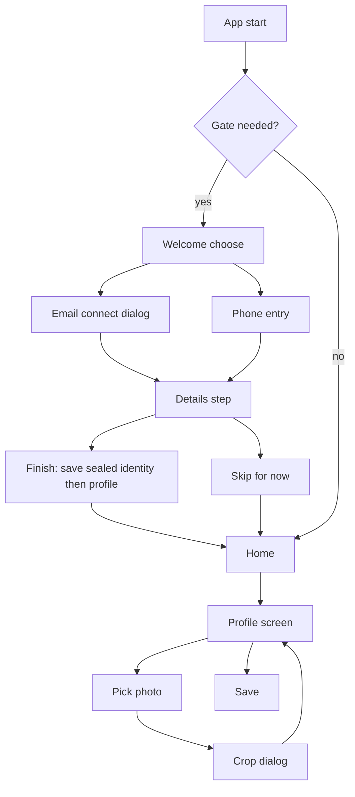

# Profile

| Field | Value |
|---|---|
| Feature ID | F-27 |
| Status | In progress (Support heart; Phase 3: personal fields, occupation, photo with crop/zoom/rotate, several alternate names and mobiles, per-bank unlock details done; header tint and Support icon pending) |
| Priority | P1 |
| Phase | 1 (first-run identity and Profile screen); statement-password use lands in Phase 3 |
| Last Updated | 2026-10-31 |

## 1. Description

Profile holds the user's identity on the phone: name, contact details, occupation, a photo, and the extra details needed to open password-protected statements. It also tells the ledger which phone numbers belong to the user so they never become bank accounts. It exists so the app is set up once at first run and statements can unlock automatically, with everything kept on the device and sensitive details encrypted.

## 2. What This Feature Will Do

- Shows a first-run Welcome screen that asks for the user's name and either an email or a phone number.
- Offers an optional step to save date of birth, PAN and an alternate name or mobile for locked statements.
- Lets the user skip the optional step and finish later.
- Shows a Profile screen with a photo header, a Personal card and a For locked statements card.
- Validates that the name is present and that PAN, when given, is in the correct format.
- Enables Save only when something changed and the entries are valid.
- Lets the user pick a photo with the system picker, crop it in a circle, zoom and rotate it, and remove it later.
- Tints the header from the colours of the chosen photo, or shows initials when there is no photo.
- Stores name, email, phone and occupation as normal settings and identity and bank details only in encrypted form.
- Shows how many per-bank unlock details are saved and links to where they are edited.
- Works out the last four digits of the user's own numbers and shares them with the ledger.
- Gives the statements feature a read-only copy of the identity.

### 2.1 Inputs

- The user typing name, email, phone, occupation and statement details on the Welcome or Profile screen.
- A photo chosen from the phone and the user's crop, zoom and rotate actions.
- Whether an email inbox is already connected, used to decide if first-run is needed.
- Per-bank unlock details saved from the account screens.

### 2.2 Processing

1. On launch, decide whether first-run setup is needed: no name, or no email, phone or connected inbox.
2. Validate the entries, then save the encrypted identity first and the normal profile settings second, so setup completes only when both succeed.
3. Crop the photo to a square, save it in app storage and delete any earlier photo.
4. Pick header colours from a small copy of the photo, or fall back to initials on a green gradient with a gold ring.
5. Fill any empty per-bank name, mobile or email from the profile.
6. Collect the user's own phone numbers with at least 10 digits and keep their last four digits for the ledger.

### 2.3 Outputs

- A completed first-run setup that lets the user into the app.
- A Profile screen and an avatar shown on the Home header and More bar.
- Encrypted identity, saved with the secure storage described in [Security and privacy](25_security_privacy.md).
- The identity used to try statement passwords in the statements feature.
- The list of own-number endings used by the ledger so personal numbers never become accounts.
- The Support entry point, shown only when support is available ([News, support and updates](31_news_support_updates.md)).

### 2.4 Out of Scope

- The email connect dialog and sign-in (Email feature).
- Password guessing and the locked-statement flow (Statements feature); this file only lists the fields it uses.
- The Support page (see [News, support and updates](31_news_support_updates.md)).
- The secure storage mechanism itself (see [Security and privacy](25_security_privacy.md)).
- Sending any profile value off the phone or including it in backups.

## 3. Behaviour in Existing App

Source: `existing_app_analysis.md` Part A 1.1, 2.1, 2.9 (Profile), 3.1, 4.1; Part C 2.3. Kotlin refs relative to `hisaab_apk/app/src/main/kotlin/com/hisaab/app/`.

### 3.1 First-run gate and WelcomeScreen (`ui/onboarding/WelcomeScreen.kt:105`)

- `WelcomeViewModel.needed` (`WelcomeScreen.kt:77`) = `profile.name == null || (profile.email == null && profile.phone == null && !mail.connected)`. While loading (`null`) nothing is drawn; `true` shows WelcomeScreen; `false` shows the app. Someone who connected an inbox before this screen existed counts as signed in. Welcome is a gate before the NavHost, not a route (`ui/nav/HisaabNavHost.kt:83-88`).
- Layout: gradient backdrop (accent 18% to transparent to second hero colour 12%), 96 dp `artha_mark`, "DhanKosh", "Know your money.". Name field "Full name (as per bank)". Three modes (`mode`, saveable):
  - **choose**: "Continue with email" (opens `EmailConnectDialog`, Email feature) and "Continue with phone number".
  - **phone**: "+91" prefix and 10 digits, "Continue", "Use email instead".
  - **details**: "Unlock your statements": mobile (only on the email path), `AlternateFields`, `StatementDetailsFields` (DOB and PAN), "Finish" enabled when PAN is valid or blank, "Skip for now".
- Footers: "Email sign-in also reads your bank alerts and statements." and a lock line "Your data never leaves this phone.".
- `finish()` saves `Identity(name, dob, pan, mobile, altName, altPhone, email)` into the sealed `StatementPasswordStore` FIRST, then `AppSettingsStore.saveProfile` (which ends sign-up). Alternates live only in the sealed identity.
- `ProfileSetupSheet` ("Create your profile": photo, name, email, Continue / Later) exists but has no caller (legacy; first-run is Welcome now). Setting `profile_prompt_dismissed` is its leftover.

### 3.2 Profile screen (`ProfileRoute`, `ui/profile/ProfileScreen.kt:202`, title "Profile")

Reached from the Home header avatar and the More top-bar avatar. Top to bottom:

1. Top bar with a Support cup icon (only if `SupportConfig.available`), opening [Support](31_news_support_updates.md).
2. Brand row.
3. `ProfileHeader`: photo-tinted gradient hero computed from a 64 px thumbnail palette; avatar ring; camera button; "Remove photo".
4. Personal card: name (required), email, phone, occupation.
5. "For locked statements" card: alternate name, alternate mobile, DOB, PAN (regex `[A-Z]{5}[0-9]{4}[A-Z]`), "Bank details" count (per-account unlock details, edited from the account screens).
6. Save button: enabled when something changed, name is present and PAN is valid.
7. Lock footnote (encrypted on this phone).

Hero tint algorithm (from the analysis): downscale the photo to a 64 px thumbnail; bucket pixels into 24 hue bins; ignore pixels with `v < 0.18`, `s < 0.16` or near-white; keep up to 3 bins with at least 4% weight whose hues are at least 30 degrees apart; build the gradient from them. Without a photo: initials on a green gradient (`2E7D32` to `00897B`) with a gold ring (`FFB300` at 80% in light, `C9A227` at 80% in dark).

### 3.3 Photo crop (`PhotoCropDialog`, `ui/profile/PhotoCrop.kt:140`)

Full-screen circular crop. Pinch zoom 1x to 5x, double-tap zoom, rotate in quarter turns, reset. Saved as a 512 x 512 JPEG, quality 90, at `filesDir/profile-<timestamp>.jpg`; only one file is kept (older ones deleted). The setting `profile_photo` stores the absolute path. Picking uses the system photo picker (no storage permission).

### 3.4 Storage

| Data | Where | Sealed? |
|---|---|---|
| name (`display_name`), email, phone, occupation, photo path | DataStore `app_settings`: `display_name`, `profile_email`, `profile_phone`, `profile_occupation`, `profile_photo` | No |
| Identity: name, DOB (ISO), PAN, phone, altName, altPhone, email | DataStore `statement_passwords`, one string with fields separated by U+001F, append-only field order | Yes, alias `hisaab.statement.passwords` |
| Per-account bank details: customerId, accountNumber, ifsc, name, mobile, email | same store | Yes |
| Saved statement passwords (label + sealed) | same store | Yes |

`effective` fallback (`StatementPasswordStore.kt:34-39`): per-account name, mobile and email fall back to the profile's when empty. The identity `email` is stored but not used for password guesses.

### 3.5 Identity fields used for statement passwords (consumer: statements feature)

`PasswordGuesser.candidates(me, last4s)` caps at 240 candidates (`forBanks` 300); any candidate shorter than 4 chars is dropped. The identity is used as follows (`S/PasswordGuesser.kt:98-145`):

1. PAN upper and lower case (CAS from CAMS, KFintech, NSDL, CDSL; NPS; tax docs).
2. For each 4-letter name prefix (first 4 letters of first, last and joined name parts, from `name` then `altName`, de-duplicated case-insensitively) in UPPER, lower and Capitalised forms, joined with: `ddmm`, `ddmmyy`, `ddmmyyyy`, card last 4, last 4 of each phone, birth year.
3. For each card last4: `ddmmyyyy+l4` (SBI Card), `ddmm+l4`, `l4+ddmm`.
4. Date-only forms: `ddmm, ddmmyyyy, ddmmyy, yyyymmdd, mmddyyyy, mmdd, yyyy`.
5. Phones (last 10 digits of up to two numbers): full, last 4, 5, 6.
6. PAN with DOB: `PAN+ddmmyyyy` (upper and lower), `PAN[0..5]+ddmm`.
7. `phone[-4:]+ddmm` and `ddmm+phone[-4:]`.

Documented formats: HDFC / Axis card = NAME+DDMM; ICICI / Kotak = name+DDMM; SBI Card = DDMMYYYY + last 4 of card; CAS = PAN; NPS and banks = DOB or customer details. Masked sample: name `Rahul Sharma`, DOB `01 May 1990`, PAN `ABCDE1234F` yields `RAHU0105`, `RAHU01051990`, `ABCDE1234F`.

### 3.6 Own-number guard (`HisaabApplication.kt`, startup collector)

A collector keeps `transactions.phoneLast4s` = last 4 digits of the user's own numbers (profile phone, identity phone, altPhone; only numbers with at least 10 digits). These never become accounts. The actual account-creation rule lives in the shared module (ledger/accounts feature).

### 3.7 Validation facts

- Name: required (profile cannot be saved or first-run finished without it).
- PAN: `[A-Z]{5}[0-9]{4}[A-Z]`; blank allowed; input upper-cased.
- Phone: Welcome phone path = "+91" plus exactly 10 digits.
- Email: stored as typed (validation rule not captured; see Open Questions).

## 4. User Stories

- As a new user, I want to enter my name and either an email or phone once, so the app is set up.
- As a user with password-protected statements, I want to save my DOB, PAN and alternate name or mobile once, so statements unlock automatically.
- As a user, I want to set a profile photo and crop it, so the app feels mine.
- As a user, I want to remove my photo and fall back to initials.
- As a user, I want my own phone numbers recognised so they are never treated as bank accounts.

## 5. Functional Requirements (FR-27-01 ...)

- FR-27-01: On launch the app evaluates the gate `needed = profile.name == null || (profile.email == null && profile.phone == null && !emailConnected)`. While unknown nothing renders; if true Welcome is shown over the app; if false the app is shown.
- FR-27-02: Welcome offers choose, phone and details modes with the copy in Section 2.1; the name field is "Full name (as per bank)".
- FR-27-03: The phone mode accepts exactly 10 digits with a fixed "+91" prefix and offers "Use email instead".
- FR-27-04: The details step shows mobile (email path only), alternate fields, DOB and PAN; "Finish" is enabled when PAN is valid or blank; "Skip for now" completes without them.
- FR-27-05: `finish()` writes the sealed identity first, then the profile settings; the order must be preserved so the gate flips only after both succeed.
- FR-27-06: The Profile screen shows header, Personal card, "For locked statements" card, Save, and a lock footnote; the Support icon appears only when support is available.
- FR-27-07: Save is enabled only when a field changed, name is non-empty and PAN is valid or blank.
- FR-27-08: PAN is validated with `[A-Z]{5}[0-9]{4}[A-Z]` and upper-cased on input.
- FR-27-09: Photo selection uses the platform photo picker (no storage permission), then a full-screen circular crop with pinch 1x to 5x, double-tap zoom, 90-degree rotation and reset.
- FR-27-10: The cropped photo is saved as a 512 x 512 JPEG at quality 90 in app files as `profile-<timestamp>.jpg`; any previous profile photo file is deleted so only one remains; the path is stored in `profile_photo`.
- FR-27-11: "Remove photo" deletes the file and clears `profile_photo`; the avatar falls back to initials on the green gradient with the gold ring.
- FR-27-12: The header hero gradient is derived from the photo using the algorithm in Section 2.2 (64 px thumbnail, 24 hue bins, ignore dark, desaturated or near-white pixels, up to 3 bins of at least 4% weight at least 30 degrees apart).
- FR-27-13: Name, email, phone, occupation are stored in plain settings; identity (name, DOB, PAN, phone, altName, altPhone, email) and per-account details are stored only sealed (see [Security and privacy](25_security_privacy.md)); alternates are never stored in plain settings.
- FR-27-14: Sealed identity uses seven fields separated by U+001F in a fixed, append-only order: name, dob (ISO), pan, phone, altName, altPhone, email.
- FR-27-15: The "Bank details" row shows the count of saved per-account unlock details and links to where they are edited.
- FR-27-16: Per-account name, mobile and email fall back to the profile values when empty.
- FR-27-17: The set of own-number last-4 digits is derived from profile phone, identity phone and altPhone (numbers with at least 10 digits) and is exposed to the ledger so those numbers never become accounts.
- FR-27-18: The identity is exposed to the statements feature as a read-only `Identity` object.
- FR-27-19: No profile value is sent off device or included in backups.
- FR-27-20: Avatar shown on Home header and More top bar uses the photo, or initials fallback, consistently.
- FR-27-21: (parity addition) Photo picker uses `image_picker` (gallery, max 2048 px); `PhotoCropScreen` offers pinch zoom 1x to 6x, pan and 90-degree rotation and returns a 512 x 512 PNG rendered from the visible square (dart:ui, no extra package). Saved in app-private storage as `profile/photo_<timestamp>.png` (a new name each time so image caches never show the old one); the previous file is deleted; Remove deletes the file and stores an empty path; Erase all deletes it. Deviation from FR-27-10: PNG, not JPEG, since dart:ui has no JPEG encoder; double-tap zoom and reset are not built.
- FR-27-22: (parity addition) The Personal card has an Occupation field stored in plain settings (`profile_occupation`).
- FR-27-23: (parity addition) "Other names as per bank" and "Other mobiles as per bank" are lists (chips with add and remove) in the sealed identity; the first entry is `altName` / `altPhone`, the rest are `moreNames` / `morePhones` (JSON keys added to the sealed identity). Every entry feeds the statement-password guesses as an extra bank identity, so the cap stays 300.
- FR-27-24: The Profile screen app bar has a heart button (key `profile-support`) at top right that opens Support (`/settings/support`). The More profile card carries no heart.

## 6. Non-Functional Requirements (performance, battery, privacy, offline)

- Photo decode and palette extraction off the UI isolate; the 64 px thumbnail keeps it under about 50 ms.
- Crop output and saved file at most 512 x 512 (small, a few tens of KB).
- Offline only; no network.
- Privacy: PAN, DOB and alternates are never logged, never shown in plain text outside the editing fields, never in notifications or crash reports.
- Typing latency: validation is synchronous and cheap.

## 7. UI / Screens & User Flow (screen list + flow diagram)

| # | Screen / dialog / sheet | Source ref |
|---|---|---|
| 1 | WelcomeScreen, mode choose | `ui/onboarding/WelcomeScreen.kt:105` |
| 2 | WelcomeScreen, mode phone | `WelcomeScreen.kt` |
| 3 | WelcomeScreen, mode details | `WelcomeScreen.kt` (`AlternateFields`, `StatementDetailsFields`) |
| 4 | Email connect dialog (Email feature, launched from Welcome) | `settings/EmailConnect.kt:145` |
| 5 | Profile screen | `ui/profile/ProfileScreen.kt:202` |
| 6 | Profile header with photo-tinted hero | `ProfileScreen.kt` (`ProfileHeader`) |
| 7 | Photo picker (system) | OS |
| 8 | Photo crop dialog | `ui/profile/PhotoCrop.kt:140` |
| 9 | Remove photo confirmation or action | `ProfileScreen.kt` |
| 10 | ProfileSetupSheet (legacy, no caller; do not port) | `ProfileScreen.kt` |



Reference GIFs (Status: Pending, not yet captured):

-  (Status: Pending, not yet captured)
-  (Status: Pending, not yet captured)
-  (Status: Pending, not yet captured)
-  (Status: Pending, not yet captured)
-  (Status: Pending, not yet captured)
-  (Status: Pending, not yet captured)
-  (Status: Pending, not yet captured)

## 8. Data Models (Dart entities + fields + types)

```dart
@freezed
class Profile with _$Profile {
  const factory Profile({
    String? name,            // display_name
    String? email,           // profile_email
    String? phone,           // profile_phone
    String? occupation,      // profile_occupation
    String? photoPath,       // profile_photo, absolute path
  }) = _Profile;
}

@freezed
class Identity with _$Identity {
  const factory Identity({
    @Default('') String name,
    DateTime? dob,           // stored ISO yyyy-MM-dd
    @Default('') String pan, // [A-Z]{5}[0-9]{4}[A-Z] or empty
    @Default('') String phone,
    @Default('') String altName,
    @Default('') String altPhone,
    @Default('') String email,
  }) = _Identity;
}

@freezed
class BankIdentity with _$BankIdentity {
  const factory BankIdentity({
    required int accountId,
    @Default('') String customerId,
    @Default('') String accountNumber,
    @Default('') String ifsc,
    @Default('') String name,
    @Default('') String mobile,
    @Default('') String email,
  }) = _BankIdentity;
}

@freezed
class ProfileFormState with _$ProfileFormState {
  const factory ProfileFormState({
    required Profile profile,
    required Identity identity,
    @Default(0) int bankDetailsCount,
    @Default(false) bool dirty,
    @Default(true) bool panValid,
    @Default(true) bool nameValid,
  }) = _ProfileFormState;
  // canSave = dirty && nameValid && panValid
}

@freezed
class HeroTint with _$HeroTint {
  const factory HeroTint({required List<Color> stops}) = _HeroTint; // up to 3
}

@freezed
class WelcomeState with _$WelcomeState {
  const factory WelcomeState({
    @Default(WelcomeMode.choose) WelcomeMode mode, // choose | phone | details
    @Default('') String name,
    @Default('') String phoneDigits,
    @Default(false) bool viaEmail,
  }) = _WelcomeState;
}
enum WelcomeMode { choose, phone, details }
```

## 9. Database Tables / Changes

No Drift tables. Profile plain fields are settings keys (see [Data sources and settings](26_settings_data_sources.md)); identity and bank details are sealed blobs in secure storage (see [Security and privacy](25_security_privacy.md)). A sealed per-account details map is keyed by account id. If the ledger Drift `accounts` table is used for the own-number guard, it stores no profile data; the guard list is derived at runtime.

| Key / blob | Type | Notes |
|---|---|---|
| `display_name`, `profile_email`, `profile_phone`, `profile_occupation`, `profile_photo` | string? | plain |
| `profile_prompt_dismissed` | bool | legacy; do not port unless the sheet is revived |
| `statement_passwords.identity` | sealed string | 7 fields, U+001F separated |
| `statement_passwords.accounts` | sealed map accountId to 6 fields | |
| `statement_passwords.entries` | sealed list label + secret | owned by statements feature |

## 10. Business Rules & Logic (regex, parsing rules, algorithms, thresholds)

- Gate: `needed = name == null || (email == null && phone == null && !mailConnected)`.
- PAN regex: `^[A-Z]{5}[0-9]{4}[A-Z]$`; blank allowed.
- Phone digits: normalise by stripping non-digits; own-number inclusion needs at least 10 digits; last 4 digits stored.
- Photo: output 512 x 512 JPEG q90; zoom range 1x to 5x; rotation in 90 degree steps; one file retained.
- Hero tint: 64 px thumbnail; 24 hue bins; ignore `v < 0.18`, `s < 0.16`, near-white; keep up to 3 bins with weight at least 4% and hue separation at least 30 degrees.
- Avatar fallback colours: initials on gradient `2E7D32` to `00897B`, ring `FFB300` at 80% (light) or `C9A227` at 80% (dark); `BackdropColors.gold = C9A227`.
- Save order on Welcome finish: sealed identity first, profile second.
- Password candidates caps: 240 (`candidates`), 300 (`forBanks`); minimum length 4 (statements feature applies them).
- Identity email is stored but not used for guesses.

## 11. Platform / Native Requirements (permissions, channels, background work)

- No permissions: use the Android photo picker (`image_picker`), so no camera, storage or contacts permissions (the existing app declares none).
- Image crop: `crop_your_image` or custom widget with `InteractiveViewer`; image processing via the `image` package in an isolate (`compute`).
- Palette: `palette_generator` is NOT the same algorithm; implement the hue-bin routine in Dart to match, or accept differences (Open Question).
- Secure storage via the vault in [Security and privacy](25_security_privacy.md).
- The own-number list should be pushed to the SMS ingest isolate or read from the shared Drift/settings layer; no native work required.

## 12. Dependencies (other features → link to their memory file; packages)

Features:

- [Security and privacy](25_security_privacy.md): sealed storage for identity.
- [Data sources and settings](26_settings_data_sources.md): profile keys, key inventory.
- [Theming and customisation](28_theming_customisation.md): gradient and ring colours, palette.
- [News, support and updates](31_news_support_updates.md): Support cup icon.
- Email (connect dialog, connected flag), Statements (password guesser consumer), Accounts / ledger (own-number guard, bank details), Home and More (avatar entry points): separate feature files.

Packages: `image_picker`, `crop_your_image` (or custom), `image`, `path_provider`, `flutter_secure_storage`, `riverpod`, `freezed`, `go_router` (gate is an overlay, not a route).

## 13. Folder Location (lib/features/<name>/...)

```text
lib/features/profile/
  data/
    profile_repository_impl.dart
    identity_store.dart              // sealed, U+001F format
    photo_storage.dart               // save/delete profile-<ts>.jpg
  domain/
    profile.dart
    identity.dart
    bank_identity.dart
    pan_validator.dart
    hero_tint_extractor.dart
    profile_repository.dart
  presentation/
    profile_screen.dart
    profile_header.dart
    photo_crop_dialog.dart
    statement_details_card.dart
    providers.dart
lib/features/onboarding/
  presentation/
    welcome_gate.dart
    welcome_screen.dart
    alternate_fields.dart
    statement_details_fields.dart
```

## 14. Edge Cases & Error Handling

- Name blank: Save disabled with inline error; Welcome cannot finish.
- PAN lower-case input: upper-cased before validation; invalid pattern shows an error and disables Save / Finish.
- Phone not 10 digits: Continue disabled.
- Photo file deleted externally: `photoPath` points to a missing file, show initials and clear the key silently.
- Photo decode failure or unsupported format: show a snackbar and keep the previous photo.
- Very large image: downsample before crop to avoid out-of-memory.
- Palette: monochrome or very dark photos yield no qualifying bin; fall back to the palette's default hero gradient.
- Identity sealed key invalidated: identity reads as empty; profile plain fields remain; prompt to re-enter statement details.
- Email connected before Welcome existed but no name: gate still requires name.
- Process killed mid-finish: because identity is saved before profile, the gate stays up and the user redoes the step; no partial "signed in" state.
- Dual SIM / international numbers: only the last 4 digits are kept; numbers under 10 digits are ignored for the guard.

## 15. Test Cases (unit / widget / integration + sample fixtures)

Unit:

- TC-27-01 (FR-27-01): gate truth table: (name null) true; (name set, email null, phone null, mail not connected) true; (name set, phone set) false; (name set, mail connected) false.
- TC-27-02 (FR-27-08): PAN `ABCDE1234F` valid; `abcde1234f` valid after upper-casing; `ABCD1234FG` invalid; `` valid (blank).
- TC-27-03 (FR-27-14): identity encode then decode round trip with fields containing spaces; unknown trailing field tolerated (append-only).
- TC-27-04 (FR-27-16): per-account mobile empty returns profile phone; non-empty returns own value.
- TC-27-05 (FR-27-17): phones `+91 98765 43210`, `98765-43211` and a 6-digit string yield last-4 set `{3210, 3211}`.
- TC-27-06 (FR-27-12): a synthetic image with 3 well-separated saturated hues returns 3 stops; a grey image returns none; two hues 20 degrees apart return one.
- TC-27-07 (FR-27-10): saving a second photo deletes the first file; exactly one `profile-*.jpg` remains and it is 512 x 512.
- TC-27-08 (FR-27-07): `canSave` false when not dirty, when name empty, when PAN invalid; true otherwise.
- TC-27-09 (FR-27-05): finish writes identity before profile (fake stores record order).

Widget:

- TC-27-10 (FR-27-02, FR-27-03): Welcome phone mode rejects 9 digits and accepts 10; shows "+91".
- TC-27-11 (FR-27-04): details step Finish enabled with blank PAN; disabled with invalid PAN; Skip always enabled.
- TC-27-12 (FR-27-06): Profile screen hides Support icon when support unavailable.
- TC-27-13 (FR-27-11): Remove photo shows initials avatar.

Integration:

- TC-27-14 (FR-27-09, FR-27-10): pick, crop with zoom 2x and rotate once, save; header updates and file exists.
- TC-27-15 (FR-27-19): backup rules exclude profile files (manifest check shared with [Security and privacy](25_security_privacy.md)).
- TC-27-16 (FR-27-24): tapping the heart on the Profile screen navigates to `/settings/support`.

Fixtures: name `Rahul Sharma`, DOB `1990-05-01`, PAN `ABCDE1234F`, phone `9876543210`, alt name `Priya Sharma`, alt phone `9876543211`.

## 16. Acceptance Criteria

- AC-27-01: A new install shows Welcome until a name and an email, phone or connected inbox exist; an upgrade with a connected inbox and a name skips it (FR-27-01 to FR-27-05; TC-27-01, TC-27-09, TC-27-10).
- AC-27-02: Profile Save is available only for valid, changed input and persists to plain and sealed stores as specified (FR-27-06 to FR-27-08, FR-27-13, FR-27-14; TC-27-02, TC-27-03, TC-27-08).
- AC-27-03: Photo flow yields one 512 x 512 JPEG, a tinted header, and a working Remove (FR-27-09 to FR-27-12; TC-27-06, TC-27-07, TC-27-13, TC-27-14).
- AC-27-04: Statement details reach the statements feature as an `Identity` and fall back correctly (FR-27-16, FR-27-18; TC-27-04).
- AC-27-05: Own numbers never become accounts (FR-27-17; TC-27-05).
- AC-27-06: No profile data is sent or backed up (FR-27-19; TC-27-15).

## 17. Open Questions

1. Email validation rule is not captured in the analysis; use a standard RFC-lite check or accept any string?
2. Should Flutter keep Welcome's two-step order (sealed identity, then profile) given a different storage stack, or use one transaction?
3. `palette_generator` differs from the custom 24-bin routine; is exact visual parity required?
4. `ProfileSetupSheet` and `profile_prompt_dismissed` are dead; confirm not porting.
5. Where are "Bank details" (per-account unlock details) edited? The Profile card only shows a count; the editor screen was not captured here.
6. DOB input format and picker (the analysis stores ISO but does not describe the control).
7. Should phone support non-Indian country codes? Today the Welcome phone path is fixed to +91.
8. Should the photo be included in a future user-initiated export? Today nothing exports it.
9. Cross-links to Email, Statements, Accounts, Home and More are by name only because their file names were not fixed when this file was written.

## 18. Implementation Notes

Phase 3 data layer (no UI). No Drift table (as specified). The identity (`IdentityRepository`), plain profile (`ProfileRepository`) and `SecureStore` already exist in `features/onboarding_permissions` (Phase 1) and are reused; this round adds `lib/features/profile/domain/{bank_identity,bank_identity_repository,effective_bank_identity,own_numbers,profile_draft}.dart` and `data/bank_identity_store.dart` (sealed JSON map under secure key `statement_passwords.accounts`). Provider `bankIdentityRepositoryProvider` in `lib/app/di/phase3_providers.dart`.

FR status done: FR-27-07/08 (`ProfileDraft.canSave`, PAN rule via `OnboardingValidators`), FR-27-13 and 15 (sealed per-account details with field limits, count via `readAll().length`), FR-27-16 (`effectiveBankIdentity`), FR-27-17 (`ownLast4s`), FR-27-18 (identity read through the existing port; password inputs via `assemblePasswordSource` in statement_import). Pending: the UI, photo (FR-27-09..12, 20), the first-run gate wiring, the own-number guard hook into the ledger.
Deviation: the identity is stored as JSON under `identity_v1` (Phase 1), not the U+001F seven-field blob of FR-27-14; revisit if Android data import is added.
APIs: `BankIdentityRepository.read(accountId)/readAll()/save(BankIdentity)` (an empty identity removes the entry; `customerId` alnum <= 20, `accountNumber` <= 24, `ifsc` upper <= 11), `ownLast4s(Iterable<String?>) -> Set<String>`, `ProfileDraft(name, pan, dirty).canSave`.
Tests: `test/features/phase3/phase3_repositories_test.dart` (profile and passwords group); `test/features/profile/profile_screen_test.dart` (validation, save order, counts).

UI (2026-10-21): `/profile` (`presentation/{profile_screen,bank_details_sheet}.dart`, providers in `lib/app/di/portfolio_providers.dart`), linked from a Profile tile at the top of More. Save is gated by `ProfileDraft.canSave` plus a valid mobile; writes the sealed identity first, then the profile (FR-27-05 order), then refreshes the onboarding gate. FR-27-06 (partly), 07, 08, 13, 15 UI done; the alternate name/phone are preserved but not editable yet.
Deferred UI: photo tint (FR-27-12), avatar on Home/More (FR-27-20, widget provided), Support icon, link from Accounts.
Parity round 2026-10-27 (agent D1): FR-27-09 (picker, crop, rotate), FR-27-10 and 11 (save and remove; PNG deviation), FR-27-21..23 done. Code: `presentation/photo_crop_screen.dart`, `domain/profile_photo.dart` (`ProfilePhotoStore`, `SetProfilePhoto`), `data/profile_photo_store_impl.dart`, `app/di/profile_providers.dart`, shared `lib/shared/widgets/profile_avatar.dart` (`ProfileAvatar(name:, photoPath:, radius:)`; Home and More headers should use it with `UserProfile.name` and `photoPath` from `profileDataProvider`, FR-27-20; wiring on Home belongs to F-17). `UserProfile.photoPath == ''` means no photo. Pending: header gradient from the photo (FR-27-12), Support icon, double-tap zoom.
Tests: `profile_photo_test.dart` (use case, file store, avatar, crop screen output size and rotation), `profile_screen_test.dart` (occupation, alternates), `statement_import/extra_alternates_test.dart`.

## 19. Change Log (date | change | reason)

| Date | Change | Reason |
|---|---|---|
| 2026-10-17 | Created from hisaab_apk 2.9.8 analysis | Initial |
| 2026-10-19 | Restructured to the 19-section standard (Description, What This Feature Will Do, Implementation Notes added); Last Updated bumped | Audit Gate (Prompt 2, Part A) |
| 2026-10-21 | Phase 3 data layer landed | Phase 3 |
| 2026-10-21 | Phase 3 Portfolio + Profile UI landed | Phase 3 |
| 2026-10-27 | Audit: fields and bank unlock details confirmed done; occupation and photo with crop confirmed not built | Kotlin parity audit |
| 2026-10-27 | Profile photo with crop, zoom and rotate (PNG, app-private), shared `ProfileAvatar` widget, occupation field, several alternate names and mobiles (FR-27-21..23) | Kotlin parity (D2) |
| 2026-10-31 | Heart button in the Profile app bar opens Support; More profile card restyled with a coloured badge (FR-27-24) | Approved More/Accounts/Profile mockups |
