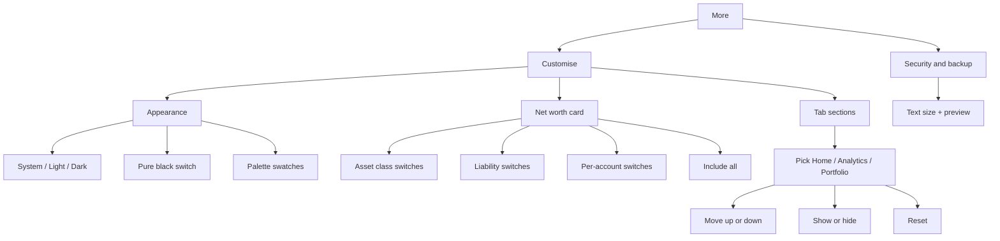

# Theming and Customisation

| Field | Value |
|---|---|
| Feature ID | F-28 |
| Status | In progress (Phase 5: 22 palettes (plus Mint default, pill nav and filled cards, 2026-10-31) ported verbatim, mode/pure-black/text size, Customise Appearance section and More tile done; layout store, Tab sections card, Home presets and Home/Portfolio edit mode done; Analysis consuming the store pending; Net worth card, backdrop, reduce-motion pending); 2026-10-27 parity: backdrop wash and glows (FR-28-08) and reduce motion (FR-28-10, FR-28-27) done |
| Priority | P1 |
| Phase | 0 (theme engine, tokens, text scale) and 5 (Customise screen polish, presets) |
| Last Updated | 2026-10-31 |

## 1. Description

Theming and Customisation gives DhanKosh its own look and lets the user tune it. The user can pick light, dark or system mode, an optional pure-black mode, one of 23 colour palettes, one of four text sizes, and which sections show on the Home, Analysis and Portfolio tabs and in what order. It exists so the app suits different eyes, screens and habits while money colours keep the same meaning on every palette.

## 2. What This Feature Will Do

- Applies the app's own theme in light, dark or system mode, never the phone's dynamic colours.
- Offers 23 colour palettes (22 ported plus Mint) in three groups: Classic, Hero and Cinema.
- Offers a pure-black dark mode that applies only in dark mode.
- Keeps money-in green, money-out red and warning amber the same on every palette.
- Offers four text sizes (Small, Default, Large, XL) and limits growth so layouts do not break.
- Skips decorative motion when the phone has animations turned off.
- Shows a Customise screen with Appearance, Net worth and Tab sections.
- Applies and saves theme, palette and pure-black changes immediately, without a restart.
- Lets the user include or leave out asset classes, liabilities and single accounts when net worth is calculated.
- Lets the user move sections up or down and show or hide them on Home, Analysis and Portfolio.
- Resets a tab to its default order and visibility, hiding Budgets on Home by default.
- Supports preset layouts such as Minimal and Investor in the saved-layout logic.

### 2.1 Inputs

- The user's choice of mode, palette, pure-black switch and text size.
- The user's net-worth include and exclude switches.
- The user's section order and visibility choices per tab.
- The phone's light or dark setting, system font scale and reduced-animation setting.

### 2.2 Processing

1. Read the saved appearance and layout choices, using defaults when none exist: system mode, DhanKosh palette, pure black off, text size Default.
2. Build the colours, text styles and backdrop from the chosen palette and mode.
3. Combine the phone's font scale with the chosen text size, snapping saved sizes to the nearest step and capping larger sizes.
4. Save each change and update every open screen at once.
5. Return each tab's sections in saved order, adding any unknown ones at the end, and leave out hidden ones.
6. On reset, clear the saved order, unhide all sections and re-hide Budgets on Home.

### 2.3 Outputs

- The whole app drawn in the chosen look and text size.
- A Customise screen with palette swatches grouped by type and the selected one marked.
- Saved choices for theme, layout and net-worth exclusions that other screens read.
- An ordered list of visible sections for Home, Analysis and Portfolio ([Portfolio](16_portfolio.md)).

### 2.4 Out of Scope

- The content of the Home, Analysis and Portfolio sections; this file only controls their order and visibility.
- The net worth calculation itself (see [Portfolio](16_portfolio.md)).
- Logos and brand marks (branding assets).
- The category list and category meanings (categories feature).
- The Security screen that hosts the text-size row (see [Security and privacy](25_security_privacy.md)).

## 3. Behaviour in Existing App

Source: `existing_app_analysis.md` Part A 2.9 (CustomizeTabsRoute), 3.1, 3.2, 6.1; Kotlin refs relative to `hisaab_apk/app/src/main/kotlin/com/hisaab/app/`: `ui/theme/Theme.kt`, `ui/theme/Palettes.kt` (627 lines), `ui/theme/Backdrop.kt` (63 lines), `settings/AppSettings.kt:21`, `settings/TabLayout.kt:18`, `ui/more/CustomizeTabsScreen.kt:118` (path as cited in the analysis).

### 3.1 Theme composition

- `MainActivity` wraps content in `HisaabTheme(theme, palette, textScale, pureBlack)` (`MainActivity.kt:62-72`). Dark mode comes from `ThemeMode` (SYSTEM follows `isSystemInDarkTheme`, LIGHT, DARK). Material You dynamic colour is deliberately not used (`Theme.kt:68`).
- `PaletteSpec` (`Palettes.kt:60`): `light` and `dark` `ColorScheme`, `heroLight` and `heroDark` (3-colour gradients), `glows` (3 backdrop glow colours), `bottomLight`, `bottomDark`, `glowStrength` (default 1, FOLD 0.25).
- Surfaces: cards on pure white in light themes, flat with a 1 dp hairline; `surfaceTint` transparent. Light scheme: `surfaceContainerLowest/Low/Container = white`, `surfaceContainerHigh = high`, `Highest = highest`, `surfaceBright = white`, `surfaceDim = highest`, `surfaceVariant = high`, `inverseSurface = ink`. Dark scheme: `lowest`, `container` (used for Low and Container), `high`, `highest`, `bright`, `surfaceDim = background`.
- Error colours shared by all palettes: light `D2453B` (container `FBE0DD`, onError white, onErrorContainer `5C0E08`); dark `FF7B70` (container `5C1A15`, onError `4A0904`, onErrorContainer `FFDAD5`).
- Pure black (`pureBlack()`): dark `background/surface/surfaceDim/inverseOnSurface/surfaceContainerLowest = 000000`; `surfaceContainerLow/Container = 0B0B0D`; `High = 141417`; `Highest = 1B1B1F`; `Bright = 222226`; `surfaceVariant = 141417`; palette `bottomDark = 000000`. Applies only when the effective mode is dark.

### 3.2 The 22 palettes (`ThemePalette`, `AppSettings.kt:21`)

Display names: DHANKOSH (default), FOLD, CLASSIC, EMERALD, GRAPHITE, INDIGO ("Indigo Night"), SAFFRON, OCEAN, ROSE_QUARTZ, LAVENDER_BLOOM, MIDNIGHT ("Midnight Knight"), ARC_RED, STAR_SHIELD, THUNDER, GAMMA, VIBRANIUM, IRON_THRONE, MIDDLE_REALM, NITRO, NEO_MATRIX, INTERSTELLAR_DUST, SPICE_DUNE. Groups on the Customise screen: **Classic** (first 10), **Hero** (MIDNIGHT to VIBRANIUM, 6), **Cinema** (IRON_THRONE to SPICE_DUNE, 6). FEATURES.md lists fewer (omits ROSE_QUARTZ and LAVENDER_BLOOM); the enum is the source of truth.

Accent and background (hex RGB, from `Palettes.kt`):

| Palette | primary L | primary D | bg L | bg D |
|---|---|---|---|---|
| DHANKOSH | 2873BE | 5FB3E8 | F6F8FA | 0B1418 |
| FOLD | 111113 | FFFFFF | FFFFFF | 000000 |
| CLASSIC | 2F5BEA | 7C9BFF | F7F7F5 | 0E0F12 |
| EMERALD | 0F7A55 | 5FD3A2 | F4F8F5 | 0B110E |
| GRAPHITE | 3D5A80 | 9DB6D8 | F5F6F7 | 0F1113 |
| INDIGO | 4F46E5 | A5A1FF | F6F5FB | 0D0C17 |
| SAFFRON | B45309 | F5B26B | FAF6F0 | 13100D |
| OCEAN | 0E7490 | 5ED0E6 | F3F8F9 | 0A1215 |
| ROSE_QUARTZ | A8466A | F4A3BF | FBF6F6 | 140C12 |
| LAVENDER_BLOOM | 6D4FC2 | CDB8FF | F8F6FB | 120C17 |
| MIDNIGHT | 26292E | F5C518 | F2F3F5 | 000000 |
| ARC_RED | B3122E | FF8A98 | FAF6F5 | 120B0C |
| STAR_SHIELD | 1F3A93 | A9BCF5 | F5F6F8 | 0B0E16 |
| THUNDER | 2C5C80 | 5CE1FF | F3F6F8 | 0B1016 |
| GAMMA | 1F6B3A | 7FD99A | F4F7F3 | 0B100C |
| VIBRANIUM | 5B2DB3 | BFA6FF | F5F5F8 | 050507 |
| IRON_THRONE | 3E5A73 | A9C6E0 | F3F5F7 | 0E1013 |
| MIDDLE_REALM | 5B6B2E | C2D08A | F8F4EA | 0D110D |
| NITRO | 1F5FD6 | 4DA3FF | F4F5F7 | 08090B |
| NEO_MATRIX | 1C6B3A | 5CE08A | F3F6F4 | 030504 |
| INTERSTELLAR_DUST | 22355E | E8C48A | F7F5F1 | 070A14 |
| SPICE_DUNE | A34A12 | F5A26A | FAF5EC | 120E0B |

Hero gradients, glows and backdrop bottoms (3 hex stops each, then bottom light / dark):

| Palette | heroLight | heroDark | glows | bottom L / D |
|---|---|---|---|---|
| DHANKOSH | 2E9E72, 2E8AA0, 2F6CCF | 1E7A57, 1F6878, 23509E | 4DB6A6, 3B78DB, 66D693 | EEF2F6 / 081014 |
| FOLD (glowStrength 0.25) | 0E0E10, 1E1E22, 34343A | 1C1C1F, 232327, 141416 | 8E8E93 x3 | FAFAFA / 000000 |
| CLASSIC | 2F5BEA, 5A48D6, 7A5AE0 | 2B4BC4, 5B3FB8, 3A2A86 | 2F5BEA, 7A5AE0, 16A394 | F2F3F7 / 0B0D13 |
| EMERALD | 0B6E4F, 0F8A6A, 0E6E7A | 0A5A40, 0C6655, 0A4A55 | 10A36F, 0E8A8A, 3B82C4 | EDF4F0 / 08100C |
| GRAPHITE | 2B3440, 3D5A80, 4A6587 | 1F2730, 2C4361, 33475F | 3D5A80, 64748B, 0E7490 | EEF0F2 / 0B0D0F |
| INDIGO | 4F46E5, 6D3FD9, 8B3FD0 | 3730A3, 5126A8, 3B1D80 | 4F46E5, 9333EA, DB2777 | F1F0F8 / 0A0914 |
| SAFFRON | B45309, C2410C, 9A3412 | 8A4108, 94360E, 6E2A12 | F59E0B, C2410C, A8432A | F6F0E7 / 0F0C0A |
| OCEAN | 0E7490, 0891B2, 1D6FB8 | 0A5568, 0A6A80, 1A4F86 | 0891B2, 2563EB, 14B8A6 | EBF4F6 / 071013 |
| ROSE_QUARTZ | 8E3A5C, A8466A, 8A5A8E | 5E2240, 7A2E52, 4E2A5E | E07A9E, A87AB8, C98A9A | F7EEEF / 0F090D |
| LAVENDER_BLOOM | 5A3FA8, 7A55C8, A066C0 | 3A2470, 523391, 6A3A85 | 9B7BE8, D08AE0, 6D4FC2 | F2EFF7 / 0D0911 |
| MIDNIGHT | 1A1C20, 2B2E34, 3D3624 | 0E0F11, 1C1D21, 2E2710 | F5C518, 4B5563, 9CA3AF | ECEEF1 / 000000 |
| ARC_RED | 8E0E24, B3122E, 9A6410 | 6E0A1E, 8A1026, 6E4A0E | D1213F, E0A526, 8E0E24 | F6EFEE / 0E0809 |
| STAR_SHIELD | 14275F, 1F3A93, 7A2333 | 0F1E4A, 182E73, 5E1A27 | 1F3A93, B22234, A0A8B8 | EEF0F4 / 080B12 |
| THUNDER | 2A3F55, 2C5C80, 0A7E9C | 1C2A3A, 244560, 075E75 | 00B4D8, 3A5A78, 7FA7C9 | ECF1F5 / 080C12 |
| GAMMA | 1B5E35, 2F6B3F, 5B3592 | 123F25, 1E4B2E, 3E2470 | 2FA35A, 7C4DCC, 1F6B3A | EDF3EC / 080C09 |
| VIBRANIUM | 16141F, 3A1F7A, 5B2DB3 | 0B0B10, 2A1660, 452399 | 6D3FD6, A0A4B0, 3A1F7A | EFEFF4 / 040406 |
| IRON_THRONE | 2A3A4A, 3E5A73, 8A4A1C | 1A242E, 2A4258, 6A3410 | 6F9CC4, E08A3C, 3E5A73 | ECEFF2 / 0A0C0F |
| MIDDLE_REALM | 3E4A20, 5B6B2E, 8C6A1E | 26301A, 3A4720, 5E4714 | 7E9440, C9A24A, 3E5A2E | F3EEE1 / 090C09 |
| NITRO | 15171C, 1A3C8C, 1F5FD6 | 0C0D10, 13306E, 1A4CB0 | 2F7BFF, FF7A1A, 3A3F48 | EDEFF2 / 050607 |
| NEO_MATRIX | 0F1A13, 173A24, 1C6B3A | 050806, 0D2416, 12482A | 22C55E, 0F3D22, 4ADE80 | ECF2EE / 020403 |
| INTERSTELLAR_DUST | 141E3A, 22355E, 8A5A1E | 0A1024, 18264A, 5E3E12 | 3A5BA0, E0A35A, 1A2550 | F0EDE6 / 04060D |
| SPICE_DUNE | 7A3410, A34A12, A0702A | 4E220B, 6E330F, 6E5018 | E07A2E, C9A050, 8A3A12 | F5EEE2 / 0D0A08 |

Full token sets (container, on-container, secondary, tertiary, ink, muted, outline, outlineVariant, surface levels, inversePrimary) live in `Palettes.kt` and must be ported verbatim; two complete examples:

- DHANKOSH light: primary `2873BE`, primaryContainer `D8E9F8`, onPrimaryContainer `0B2C4D`, secondary `2E8A99` (container `D5EEF0`, on `07343A`), tertiary `2FAE6E` (container `D3F2E2`, on `00391F`), background `F6F8FA`, ink `121A22`, muted `5A6672`, outline `97A2AD`, outlineVariant `E1E6EC`, high `EEF1F5`, highest `E6EAF0`, inversePrimary `5FB3E8`. Dark: primary `5FB3E8` (on `032A45`, container `12476E`, on-container `D3EAFB`), secondary `6CC5C9` (on `003638`, container `144C50`, on `CDEFF0`), tertiary `5FD39A` (on `003A20`, container `0F5235`, on `C8F4DD`), background `0B1418`, ink `E6EEF2`, muted `9AAAB2`, outline `63737B`, outlineVariant `1F2D33`, lowest `081014`, container `121C21`, high `19252B`, highest `203036`, bright `243439`, inversePrimary `2873BE`.
- FOLD light: primary `111113` (container `E8E8EA`), secondary `4A4A50`, tertiary `2C2C30`, background `FFFFFF`, ink `0E0E10`, muted `6B6B72`, outline `A1A1A8`, outlineVariant `EAEAEC`, high `F4F4F5`, highest `ECECEE`, inversePrimary `FFFFFF`. Dark: primary `FFFFFF` (on `000000`, container `2A2A2E`), secondary `C7C7CC`, tertiary `E5E5EA`, background `000000`, ink `F5F5F7`, muted `8E8E93`, outline `5A5A60`, outlineVariant `1F1F23`, lowest `000000`, container `111113`, high `1A1A1D`, highest `222225`, bright `2A2A2E`, inversePrimary `111113`.

### 3.3 Semantic and fixed colours (`MoneyColors`, `Hx`, `Theme.kt:138-161`)

- credit / positive: light `13895A`, dark `3CCB8B`. debit / negative: light `D2453B`, dark `FF7B70`. warn: light `C98A0B`, dark `F2B84B`. transfer: light `7A808A`, dark `8B919C`. accent = `colorScheme.primary`; accentSoft = accent at 10% alpha (light) or 14% (dark).
- Chart palette `Hx.palette`: `2F5BEA, E07A2E, 16A394, C2418B, 7A5AE0, C9A227, 3E9BD6, 8C8F96`.
- Kind colours: account `1A63C6` (dark `8AB4F8`), credit card `C8570F` (dark `FFB27A`), debit card `6A3FC2` (dark `C9A7FF`).
- Signed amounts (`TxStyle.amount`): transfer grey, credit `+` green, investment `−` accent, card spend `−` amber, bank/UPI spend `−` red. Credit-card bill payments are shown but never counted.
- Category colours (`Theme.kt:164-224`, 27): FOOD E8704A, GROCERIES 7CB342, TRANSPORT 3F88C5, FUEL 8D6E63, SHOPPING D64E8C, BILLS 5C6BC0, ENTERTAINMENT AB47BC, TRAVEL 26A69A, HEALTH EF5350, EDUCATION 42A5F5, RENT 795548, INSURANCE 78909C, EMI_LOAN FFA726, INVESTMENT 2E7D32, CASH 9E9D24, SUBSCRIPTIONS 7E57C2, PERSONAL_CARE EC407A, HOUSEHOLD A1887F, GIFTS E53935, DONATIONS FF7043, TAXES 546E7A, FEES 8E7CC3, SALARY 00897B, INCOME 43A047, REFUND 29B6F6, TRANSFER 90A4AE, OTHER 9E9E9E. Category taxonomy and icons belong to the categories feature; only the colour tokens are recorded here.

#### Design tokens in `doc/SPEC_NOTES.md` versus the code palette

The code palette (`ui/theme/Palettes.kt`, `Theme.kt:138-161`, tables above) is authoritative. The "Design tokens" block in `hisaab_apk/doc/SPEC_NOTES.md:35-39` is an early sketch and must not be used to build the theme. What matches the code: pos `13895A/3CCB8B`, neg `D2453B/FF7B70`, warn `C98A0B/F2B84B`, transfer `7A808A/8B919C`, and the 8-colour chart palette. What differs:

- bg: SPEC_NOTES `F7F7F5 / 0E0F12`; code (DHANKOSH) `F6F8FA / 0B1418`.
- accent: SPEC_NOTES one fixed `2F5BEA / 7C9BFF`; code accent is the selected palette's primary (DHANKOSH `2873BE / 5FB3E8`) and changes with the palette (22 palettes). `2F5BEA` survives only as the first chart colour.
- surface / surface-2 / border: SPEC_NOTES `FFF/17191E`, `F0F0EC/20232A`, `E6E6E1/2A2D35`; code derives them from the scheme (`surfaceContainer`, `surfaceContainerHigh`, `outlineVariant`; DHANKOSH light outlineVariant `E1E6EC`, dark `1F2D33`, high `EEF1F5`).
- Cards "16 dp radius, 16 dp padding, 1 dp border, no shadows" and "motion 200-400 ms": see 3.4 for the values actually used.

### 3.4 Typography, shape, motion

- Material3 default type scale with **tabular figures** (`fontFeatureSettings = "tnum"`) on every style; display-small, headline and title weights SemiBold. Shapes 8 / 12 / 16 / 22 / 32 dp.
- Backdrop (`Theme/Backdrop.kt:28`): vertical wash from base to the bottom colour starting at 35% height, plus three radial glows at (5%, 30%), (100%, 55%), (20%, 98%) with alphas 0.16, 0.13, 0.09 multiplied by `k = (dark ? 1 : 0.62) x glowStrength`.
- Reduce motion: `Settings.Global.ANIMATOR_DURATION_SCALE == 0` (read once) disables decorative motion (tab pill spring, icon bounce) via `LocalReduceMotion`.
- Branding: `artha_mark.png`, splash `ic_launcher_mark`, adaptive icon, notification icon `ic_stat_statement`; `values/themes.xml` colours `brand 1B6E4F`, `window_light F6FAF7`, `window_dark 101412`. Logo assets and brand marks are specified in the logos/branding part of the analysis (140 `.webp` logos in `assets/logos`).

### 3.5 Text size

`text_scale` (float, default 1.0). `TextSize` steps: Small 0.9, Default 1.0, Large 1.1, XL 1.2; `TextSize.of(value)` snaps to the nearest step within 0.05. `appFontScale(system, factor) = system * factor`, but when `factor > 1` it is capped at `max(1.3, system)`; shrinking always applies. The text-size Segmented control with a live preview card is hosted on the Security & backup screen (see [Security and privacy](25_security_privacy.md)), and the preview lives there; the scale logic lives here.

### 3.6 Customise screen (`CustomizeTabsRoute`, title "Customise")

Reached from More ("Customise"). Sections:

1. **Appearance**: Segmented System / Light / Dark; "Pure black in dark mode" switch; palette swatch rows grouped Classic / Hero / Cinema (select a swatch to apply immediately).
2. **Net worth** card: a switch per asset class, a switch per liability kind (loans, card dues), per-account switches folded away, and an "Include all" action. Stored in `net_worth_prefs` (`excluded_classes`, `excluded_liabilities`, `excluded_accounts`); everything counts by default. The net worth maths is in the portfolio feature.
3. **Tab sections** card: selector Home / Analytics / Portfolio, per-section up / down arrows and a visibility switch, and "Reset".

### 3.7 Tab layout customisation (`TabLayouts`, `settings/TabLayout.kt:18`)

Default order and labels:

- **home**: `spent` "Spent this month", `cards` "Credit card dues", `cashflow` "Cash flow", `upcoming` "Upcoming", `insights` "Insights", `categories` "Spend by category", `recent` "Recent transactions", `budgets` "Budgets". Hidden by default: `{"budgets"}` (`HOME_HIDDEN_BY_DEFAULT`, seeded once by `seedHomeOnce` and by `reset`).
- **analytics** (labelled "Analytics" in the Customise selector, "Analysis" elsewhere): `categories` "Spend by category", `monthly` "Monthly spend", `merchants` "Top merchants", `budgets` "Budgets", `when` "When you spend". Applies only to the Spending segment.
- **portfolio**: `value` "Portfolio value", `allocation` "Asset allocation", `networth` "Net worth", `holdings` "Holdings", `maturity` "Maturity calendar".

Semantics: `order(tab)` = saved order filtered to known keys with unknown keys appended; `visible(tab)` removes entries `"tab:key"` found in `hidden`; `move(by=+-1)` swaps neighbours; `reset` clears the order and un-hides everything (but re-hides `budgets` on home); `apply(tab, shown)` = preset (shown keys first in order, everything else hidden).

Home presets (`HOME_PRESETS`, `TabLayout.kt:47`; `apply()` exists but no UI calls it in 2.9.8):

- Minimal: spent, cashflow, upcoming
- Spender: spent, cashflow, budgets, categories, upcoming, recent
- Investor: spent, insights, upcoming
- Business: cashflow, upcoming, insights, recent
- Everything: spent, cards, cashflow, upcoming, insights, categories, recent, budgets

Migrations in `seedHomeOnce` (run from `HomeViewModel.init`): "when" moved to the end of the analytics order (`analytics_when_last`); "spent" inserted after "networth" (`home_spent_added`); "networth" removed from home and "spent" put first (`home_networth_left`); first seed (`home_v2_seeded`) removes the saved home order and hides budgets. A fresh Flutter install needs only the defaults and `reset`; migrations matter only for importing v2.9.8 preferences.

### 3.8 Persisted keys

DataStore `app_settings`: `theme` (SYSTEM / LIGHT / DARK, default SYSTEM), `theme_palette` (default DHANKOSH), `pure_black` (false), `text_scale` (1.0). DataStore `tab_layout`: `order_home`, `order_analytics`, `order_portfolio` (comma-separated), `hidden` (set of `"tab:key"`), flags `home_v2_seeded`, `home_spent_added`, `home_networth_left`, `analytics_when_last`. DataStore `net_worth_prefs` as above. Full inventory: [Data sources and settings](26_settings_data_sources.md).

## 4. User Stories

- As a user, I want to choose light, dark or system theme so the app matches my phone.
- As an OLED user, I want a true-black dark mode to save battery.
- As a user, I want to pick a colour palette I like from three groups.
- As a user with poor eyesight, I want larger text without breaking layouts.
- As a user, I want to hide sections I do not use on Home and reorder the rest.
- As a user, I want to exclude some assets, liabilities or accounts from net worth.
- As a user, I want to reset my layout to the defaults.

## 5. Functional Requirements (FR-28-01 ...)

- FR-28-01: The app theme is built from a `PaletteSpec` of the selected palette, the selected mode (system, light, dark), the pure-black flag, and the text scale; Material You dynamic colour is never used.
- FR-28-02: All 22 Kotlin palettes plus Mint (FR-28-29) are available, with the exact primary, background, hero, glow and bottom values in Section 2.2 and full token sets ported from `Palettes.kt`.
- FR-28-03: Default theme is SYSTEM, default palette MINT (existing users keep their stored choice), pure black off, text scale 1.0.
- FR-28-04: Pure black applies only in dark mode and sets the surface levels listed in Section 2.1.
- FR-28-05: Semantic colours (credit, debit, warn, transfer) and chart palette are independent of the chosen palette.
- FR-28-06: Cards are filled with the `surfaceContainer` colour, radius 20, no border and no surface tint (CardTheme and `AppCard`).
- FR-28-07: All text styles use tabular figures.
- FR-28-08: The backdrop is drawn as a vertical wash plus three radial glows with the alphas and positions in Section 2.4; glow strength scales per palette and by 0.62 in light mode.
- FR-28-09: Text scale choices are Small 0.9, Default 1.0, Large 1.1, XL 1.2; stored values snap to the nearest step within 0.05; effective scale = `system * factor`, and for `factor > 1` capped at `max(1.3, system)`.
- FR-28-10: When the OS has animations disabled, decorative motion (tab pill spring, icon bounce, count-up) is skipped.
- FR-28-11: The Customise screen shows Appearance, Net worth and Tab sections in that order.
- FR-28-12: Selecting a theme mode, pure-black switch or palette swatch applies immediately and persists.
- FR-28-13: Palette swatches are grouped Classic, Hero, Cinema, show the palette's display name, and mark the selected one.
- FR-28-14: The Net worth card exposes switches per asset class and per liability kind, folded per-account switches, and "Include all"; exclusions persist in `net_worth_prefs` and everything is included by default.
- FR-28-15: The Tab sections card offers a Home / Analytics / Portfolio selector, per-row up and down arrows (disabled at the ends), per-row visibility switches, and "Reset".
- FR-28-16: Default section orders and labels are exactly those in Section 2.7; Home hides `budgets` by default.
- FR-28-17: `order(tab)` returns saved order restricted to known keys with unknown keys appended; `visible(tab)` excludes keys in `hidden`.
- FR-28-18: Reset clears the saved order, un-hides all keys, and re-hides `budgets` on Home.
- FR-28-19: A preset operation `apply(tab, shown)` puts the shown keys first in order and hides the rest (Home presets Minimal, Spender, Investor, Business, Everything defined; exposing them in UI is optional, see Open Questions).
- FR-28-20: Each tab screen renders only visible sections in the stored order; the Analysis section order applies only to the Spending segment.
- FR-28-21: Settings changes propagate to all screens without restart.
- FR-28-22: Theme colours come from the code palette in section 3 (22 `PaletteSpec`s plus `MoneyColors`); the `SPEC_NOTES.md` design-token block is not authoritative and its differing values (bg, accent, surfaces, border) are not used.
- FR-28-23: The layout store keeps one JSON list `[{id, visible, order}]` per screen id (`home`, `analytics`, `portfolio`) in the settings key `layout_<screen>`; defaults are the Section 3.7 orders (Home hides `budgets`; Portfolio adds `loans` after `holdings`); unknown ids are dropped, new ids are appended with their default visibility and bad JSON gives the defaults. `sectionLayoutProvider(screenId)` and `visibleSectionsProvider(screenId)` expose it to every screen.
- FR-28-24: The Customise screen has a Tab sections card: a Home / Analysis / Portfolio selector, a reorderable list (drag handle) with a visibility switch per section, and Reset (replaces the up/down arrows of FR-28-15; same outcome).
- FR-28-25: Home presets Minimal, Spender, Investor, Business and Everything are a working feature (chips in the editor): the preset's sections are shown first in order and every other section is hidden (answers open question 2; Kotlin 2.9.8 never called `apply()`).
- FR-28-26: Home has an edit mode (tune button) that swaps the sections for the same editor; Portfolio opens it from its app bar; Analysis reads `visibleSectionsProvider('analytics')` for its Spending segment (consumer owned by [18_analytics.md](18_analytics.md)).
- FR-28-28: The bottom bar is a floating rounded pill (`PillNavigationBar`: margin, `surfaceContainerHigh`, stadium indicator in `primaryContainer`, small labels, selected icon in `primary`).
- FR-28-29: A 23rd palette `PaletteId.mint` ('DhanKosh Mint', first of Classic) is the default; dark tokens: primary `8FD19E`, primaryContainer `1F4D4A`, surface `0B0E0D`, surfaceContainer `1A1F1E`, surfaceContainerHigh `222827`, outlineVariant `2A312F`, onSurface `E8EEEA`, onSurfaceVariant `8C9893`, tertiary `7FA9E6`, error `E8837C`; a light counterpart is defined in `app/theme/palette_mint.dart`.
- FR-28-30: `SectionLabel` (shared) renders uppercase, 11 px, letter-spaced, muted section headings.
- FR-28-27: A Reduce motion switch in Customise shall skip decorative motion (page transitions, spring and count-up) even when the phone allows it; effective value is `setting || system disableAnimations`, applied through `MediaQuery.disableAnimations`.

## 6. Non-Functional Requirements (performance, battery, privacy, offline)

- Theme switch repaints within one frame without rebuilding the navigation stack.
- Backdrop is a single `CustomPainter` (no per-frame allocation); respects reduce-motion.
- Pure black reduces OLED power; no gradients over true-black when pure black is on.
- Contrast: accent on its background meets WCAG AA for text at default size (palettes were chosen so white text works on light accents and dark text on dark-mode accents).
- Offline only; nothing leaves the device.
- Layouts must remain valid at scale 1.3 (cap) with long Indian-language strings.

## 7. UI / Screens & User Flow (screen list + flow diagram)

| # | Screen / dialog / sheet | Source ref |
|---|---|---|
| 1 | Customise screen | `CustomizeTabsScreen.kt:118` |
| 2 | Appearance section (mode segmented, pure black switch) | same |
| 3 | Palette swatch groups (Classic, Hero, Cinema) | same |
| 4 | Net worth inclusion card (incl. folded per-account switches) | same |
| 5 | Tab sections card (selector, reorder arrows, switches, Reset) | same |
| 6 | Text size control with live preview (hosted on Security screen) | `ui/more/SecurityScreen.kt:59` |



Reference GIFs (Status: Pending, not yet captured):

-  (Status: Pending, not yet captured)
-  (Status: Pending, not yet captured)
-  (Status: Pending, not yet captured)
-  (Status: Pending, not yet captured)
-  (Status: Pending, not yet captured)
-  (Status: Pending, not yet captured)
-  (Status: Pending, not yet captured)

## 8. Data Models (Dart entities + fields + types)

```dart
enum ThemeModeSetting { system, light, dark }

enum ThemePalette {
  dhankosh, fold, classic, emerald, graphite, indigo, saffron, ocean, roseQuartz, lavenderBloom,
  midnight, arcRed, starShield, thunder, gamma, vibranium,
  ironThrone, middleRealm, nitro, neoMatrix, interstellarDust, spiceDune,
}

enum PaletteGroup { classic, hero, cinema }

@freezed
class PaletteSpec with _$PaletteSpec {
  const factory PaletteSpec({
    required ColorScheme light,
    required ColorScheme dark,
    required List<Color> heroLight,   // 3
    required List<Color> heroDark,    // 3
    required List<Color> glows,       // 3
    required Color bottomLight,
    required Color bottomDark,
    @Default(1.0) double glowStrength,
  }) = _PaletteSpec;
}

@freezed
class AppearanceSettings with _$AppearanceSettings {
  const factory AppearanceSettings({
    @Default(ThemeModeSetting.system) ThemeModeSetting mode,
    @Default(ThemePalette.dhankosh) ThemePalette palette,
    @Default(false) bool pureBlack,
    @Default(1.0) double textScale,
  }) = _AppearanceSettings;
}

enum TextSize { small, normal, large, xl } // 0.9, 1.0, 1.1, 1.2

class MoneyColors extends ThemeExtension<MoneyColors> {
  final Color credit, debit, warn, transfer, accent, accentSoft;
  final List<Color> chart; // 8
}

enum TabKey { home, analytics, portfolio }

@freezed
class TabLayoutState with _$TabLayoutState {
  const factory TabLayoutState({
    @Default({}) Map<TabKey, List<String>> order, // saved order, may be partial
    @Default({}) Set<String> hidden,              // "tab:key"
  }) = _TabLayoutState;
}

@freezed
class NetWorthPrefs with _$NetWorthPrefs {
  const factory NetWorthPrefs({
    @Default({}) Set<String> excludedClasses,      // AssetClass names
    @Default({}) Set<String> excludedLiabilities,  // LOANS, CARD_DUES
    @Default({}) Set<String> excludedAccounts,     // account ids as strings
  }) = _NetWorthPrefs;
}
```

Constants: `kHomeDefault = [spent, cards, cashflow, upcoming, insights, categories, recent, budgets]`, `kAnalyticsDefault = [categories, monthly, merchants, budgets, when]`, `kPortfolioDefault = [value, allocation, networth, holdings, maturity]`, `kHomeHiddenByDefault = {budgets}`.

## 9. Database Tables / Changes

No Drift tables. Persist via the typed settings store (see [Data sources and settings](26_settings_data_sources.md)):

| Store | Keys |
|---|---|
| `app_settings` | `theme`, `theme_palette`, `pure_black`, `text_scale` |
| `tab_layout` | `order_home`, `order_analytics`, `order_portfolio` (comma-separated), `hidden` (set of `"tab:key"`) |
| `net_worth_prefs` | `excluded_classes`, `excluded_liabilities`, `excluded_accounts` |

Migration flags (`home_v2_seeded`, `home_spent_added`, `home_networth_left`, `analytics_when_last`) are only needed to import v2.9.8 data.

## 10. Business Rules & Logic (regex, parsing rules, algorithms, thresholds)

- Effective brightness: `mode == system ? platformBrightness : mode`. Pure black applied only if dark.
- Font scale: `appFontScale(system, factor) = factor > 1 ? min(system * factor, max(1.3, system)) : system * factor`.
- Text size snapping: nearest of `{0.9, 1.0, 1.1, 1.2}` if within 0.05, else default 1.0.
- Backdrop: `k = (dark ? 1.0 : 0.62) * glowStrength`; glows at (5%, 30%), (100%, 55%), (20%, 98%) with alphas `0.16k, 0.13k, 0.09k`; base-to-bottom wash begins at 35% height.
- Accent soft: `accent.withOpacity(dark ? 0.14 : 0.10)`.
- Tab layout: `order(tab) = saved.where(known) + known.where(notSaved)`; `visible(tab) = order(tab).where(k => !hidden.contains("$tab:$k"))`; `move` swaps neighbours (no wrap); `reset(tab)` clears order and un-hides, then re-hides `budgets` for home; `apply(tab, shown)` = shown (in given order) then others hidden.
- Net worth: an item counts unless its id is in the matching excluded set.
- Semantic colours never derive from the palette.

## 11. Platform / Native Requirements (permissions, channels, background work)

- No permissions.
- System brightness: `MediaQuery.platformBrightness`; text scale: `MediaQuery.textScaler` with `TextScaler.linear(effective)`.
- Reduce motion: `MediaQuery.disableAnimations` (maps to Android animator scale 0).
- Tabular figures: `TextStyle(fontFeatures: [FontFeature.tabularFigures()])` on every text style (font must support `tnum`; bundle a suitable font such as Inter or Roboto Flex; default Roboto supports it).
- Status/navigation bar styling via `SystemChrome.setSystemUIOverlayStyle` to match palette and pure black.
- Splash theme: `window_light F6FAF7` / `window_dark 101412` in Android launch theme; the splash is held until the theme and lock settings load (see [Security and privacy](25_security_privacy.md)).

## 12. Dependencies (other features → link to their memory file; packages)

Features:

- [Data sources and settings](26_settings_data_sources.md): key inventory and settings store.
- [Security and privacy](25_security_privacy.md): hosts the text-size control and shares the splash hold.
- [Home widget](30_home_widget.md): needs palette-independent widget colours (not these palettes).
- [Localization](29_localization.md): labels on this screen are translated via `t()`.
- Home, Analysis, Portfolio, More, categories and branding feature files consume section orders, colour tokens and logos.

Packages: `flutter_riverpod`, `freezed`, `shared_preferences`, `google_fonts` (optional) or bundled font, `flutter_animate` (optional, honour reduce-motion).

## 13. Folder Location (lib/features/<name>/...)

```text
lib/core/theme/
  app_theme.dart              // builds ThemeData from PaletteSpec
  palettes.dart               // all 22 PaletteSpec constants, ported verbatim
  palette_spec.dart
  money_colors.dart           // ThemeExtension, chart palette, kind colours
  category_colors.dart
  backdrop_painter.dart
  text_scale.dart
lib/features/customise/
  data/
    appearance_store.dart
    tab_layout_store.dart
    net_worth_prefs_store.dart
  domain/
    appearance_settings.dart
    tab_layout.dart            // defaults, order/visible/move/reset/apply, presets
    net_worth_prefs.dart
  presentation/
    customise_screen.dart
    palette_swatch_group.dart
    tab_sections_card.dart
    net_worth_card.dart
    providers.dart
```

## 14. Edge Cases & Error Handling

- Unknown stored palette or mode string: fall back to DHANKOSH / SYSTEM.
- Unknown keys in saved order (from an older version): ignored; new keys appended.
- All sections hidden on a tab: show an empty state with a "Reset" hint instead of a blank screen.
- `hidden` contains a key not in the tab: ignored.
- Pure black selected while in light mode: stored but has no visible effect until dark.
- Text scale 1.2 with system scale 1.4: capped at `max(1.3, 1.4) = 1.4`.
- Reduce motion on: switches and swatches change state instantly.
- Moving the first item up or last item down: arrows disabled.
- Legacy Home layouts that list `networth`: key unknown to Home, dropped (Open Question).
- Settings store read failure: use defaults.

## 15. Test Cases (unit / widget / integration + sample fixtures)

Unit:

- TC-28-01 (FR-28-03): default `AppearanceSettings` is system / dhankosh / false / 1.0.
- TC-28-02 (FR-28-02): all 22 palettes exist; each hero/glows list has 3 colours; primary and background hex match the Section 2.2 table (data-driven test over the table).
- TC-28-03 (FR-28-04): `pureBlack(dark)` yields background `000000`, container `0B0B0D`, high `141417`, highest `1B1B1F`, bright `222226`.
- TC-28-04 (FR-28-09): `effectiveScale(system=1.0, 1.2)` = 1.2; `(1.0, 1.2)` with cap rule for system 1.0 gives 1.2 (below 1.3); `(1.5, 1.2)` gives 1.5; `(1.0, 0.9)` gives 0.9; `snap(1.07)` gives 1.1; `snap(1.03)` gives 1.0; `snap(1.5)` gives 1.0.
- TC-28-05 (FR-28-16, FR-28-17): `order(home)` default equals the 8 keys; with saved `[recent, spent, bogus]` returns `[recent, spent, cards, cashflow, upcoming, insights, categories, budgets]`.
- TC-28-06 (FR-28-18): `reset(home)` leaves `hidden == {home:budgets}`; `reset(portfolio)` leaves `hidden` empty.
- TC-28-07 (FR-28-15): `move` on index 0 by -1 is a no-op; on index 1 by -1 swaps with index 0.
- TC-28-08 (FR-28-19): `apply(home, [spent, cashflow, upcoming])` leaves visible exactly those 3 first, others hidden.
- TC-28-09 (FR-28-14): net worth exclusion of class `GOLD` and account `12` is respected in `isIncluded`.
- TC-28-10 (FR-28-08): backdrop alphas for FOLD dark are `0.16 * 0.25` etc.; light mode multiplies by 0.62.
- TC-28-11 (FR-28-05): `MoneyColors` credit/debit/warn values are identical across all palettes (light `13895A`, `D2453B`, `C98A0B`).

Widget:

- TC-28-12 (FR-28-11, FR-28-13): Customise screen renders sections in order and three palette groups with 10, 6, 6 swatches.
- TC-28-13 (FR-28-12): tapping a swatch updates `ThemeData.colorScheme.primary` immediately.
- TC-28-14 (FR-28-07): a `Text` in the app theme has tabular figures feature.
- TC-28-15 (FR-28-10): with `disableAnimations` true, tab/segment transitions complete in zero duration.
- TC-28-16 (FR-28-20): Home shows only visible sections in stored order.

Integration:

- TC-28-17 (FR-28-21): changing palette in Customise changes the Home hero gradient without restart.
- TC-28-18 (FR-28-12): settings survive app restart.
- TC-28-19 (FR-28-22): DHANKOSH light uses bg `F6F8FA` and primary `2873BE` (not SPEC_NOTES `F7F7F5` / `2F5BEA`).
- TC-28-20 (FR-28-23): resolve drops unknown ids, appends new ones, falls back on bad JSON; encode/resolve round trip keeps order and visibility.
- TC-28-21 (FR-28-25): every preset leaves exactly its sections visible, first, in order.
- TC-28-22 (FR-28-24, FR-28-26): widget: edit mode on Home applies Minimal, hides a section, and persists to the store.

## 16. Acceptance Criteria

- AC-28-01: All 22 palettes render in light and dark with the specified tokens and persist across restarts (FR-28-01 to FR-28-03, FR-28-12, FR-28-13; TC-28-01, TC-28-02, TC-28-13, TC-28-18).
- AC-28-02: Pure black yields the exact surface levels (FR-28-04; TC-28-03).
- AC-28-03: Semantic colours never change with the palette (FR-28-05; TC-28-11).
- AC-28-04: Text size steps and cap behave as specified and do not break layouts at 1.3 (FR-28-09; TC-28-04).
- AC-28-05: Tab section order, visibility, reset and presets behave as specified and the tabs honour them (FR-28-15 to FR-28-20; TC-28-05 to TC-28-08, TC-28-16).
- AC-28-06: Net worth exclusions persist and default to include-all (FR-28-14; TC-28-09).
- AC-28-07: Backdrop and tabular figures match the spec; reduce-motion respected (FR-28-07, FR-28-08, FR-28-10; TC-28-10, TC-28-14, TC-28-15).

## 17. Open Questions

1. Full token sets for palettes other than DHANKOSH and FOLD (container, secondary, tertiary, ink, muted, outline, surface levels) were not captured here beyond primary/bg/hero/glow/bottom; port `Palettes.kt` verbatim (or generate Dart from it) before building. Also CLASSIC, EMERALD, GRAPHITE were partly seen only in the analysis.
2. Home presets: `HOME_PRESETS` and `apply()` exist but no UI calls them; add a presets control in Flutter or drop it?
3. FEATURES.md lists fewer palettes than the enum (omits ROSE_QUARTZ, LAVENDER_BLOOM); the enum is treated as truth.
4. Legacy Home `networth` key: confirm Home keeps no net-worth section and the Portfolio tab keeps it.
5. Analysis tab label is "Analytics" in the Customise selector and "Analysis" elsewhere; unify?
6. Text scale cap `max(1.3, system)` was derived from code; confirm the intended behaviour for large system scales.
7. Is Material You dynamic colour to stay excluded in Flutter (`dynamic_color`)? Assumed yes.
8. Palette display names other than INDIGO ("Indigo Night") and MIDNIGHT ("Midnight Knight") were not captured; confirm strings from the enum labels.
9. Branding assets (logos, marks) are summarised in the analysis section 6.1 but belong to a branding feature file; cross-links to Home, Analysis, Portfolio, More and categories are by name only because their file names were not fixed when this file was written.

## 18. Implementation Notes

Landed 2026-10-21: FR-28-01..07, 09, 12, 13, 21, 22 (TC-28-01..04, 11 via semantic colours, 12, 13, 18, 19 plus a 4.5:1 text/surface contrast test for all 22 palettes in light and dark).

- Code: `lib/app/theme/{palette_spec,palettes,app_theme,semantic_colors}.dart` (`palettes.dart` generated once from `Palettes.kt`, values verbatim); `features/theming_customisation/{domain/appearance.dart,data/appearance_repository_impl.dart,presentation/}`; providers in `app/di/appearance_providers.dart` (hand-written, no codegen); route `/settings/appearance`; `CustomiseTile` on More (optional-embed pattern).
- Persisted in the settings store: `theme`, `theme_palette`, `pure_black`, `text_scale_pct` (int percent, the store has no double). Text scale applied in `app.dart` via `effectiveTextScale`; theme via `AppTheme.build`, `themeMode`.
- `SemanticColors` values updated to the Kotlin `MoneyColors` (credit/debit/warn); `transfer` not added yet.
- Deferred: FR-28-08 backdrop wash and glows, FR-28-10 reduce-motion handling (Flutter `disableAnimations` is not wired to custom motion), FR-28-11 Net worth card (FR-28-14), Tab sections card and layout logic (FR-28-15..20), hero-gradient consumers of `PaletteSpec.heroLight/heroDark`, SystemChrome overlay styling, GIFs.
Layout store landed 2026-10-27: `features/theming_customisation/domain/section_layout.dart` (pure), `app/di/layout_providers.dart`, `presentation/section_layout_{editor,card}.dart`. Differs from Kotlin storage (`order_<tab>` plus a `hidden` set): one JSON key per screen, no migrations needed on a fresh install.

- 2026-10-27: Backdrop and reduce motion: `app/theme/backdrop.dart` (`BackdropTheme` extension, `BackdropPainter`, `Backdrop`, `BackdropPageTransitionsBuilder`); `AppTheme.build(backdrop: true)` makes scaffolds transparent and paints the backdrop under each page via the page transition builder (so route overlaps stay clean); off on pure black. `AppearanceSettings.reduceMotion` (key `reduce_motion`), switch `reduce-motion-switch`. Tests `test/app/theme/backdrop_test.dart`.

## 19. Change Log (date | change | reason)

| Date | Change | Reason |
|---|---|---|
| 2026-10-17 | Created from hisaab_apk 2.9.8 analysis | Initial |
| 2026-10-19 | Restructured to the 19-section standard (Description, What This Feature Will Do, Implementation Notes added); Last Updated bumped | Audit Gate (Prompt 2, Part A) |
| 2026-10-19 | Stated code palette is authoritative over SPEC_NOTES design tokens and listed discrepancies (FR-28-22, TC-28-19); persisted-keys table named `settings` per 26 | Audit Gate gap, scan_6 |
| 2026-10-21 | Phase 5 theming + localization landed | Phase 5 |
| 2026-10-27 | Audit: 22 palettes (incl. Fold), modes and text size confirmed done; Customise tab sections, presets, backdrop and reduce-motion confirmed not built | Kotlin parity audit |
| 2026-10-27 | Layout store (settings JSON per screen), Tab sections card with reorder and switches, working Home presets, Home edit mode, Portfolio `loans` section (FR-28-23..26) | Kotlin parity |
| 2026-10-27 | Backdrop and reduce motion: `app/theme/backdrop.dart` (`BackdropTheme` extension, `BackdropPainter`, `Backdrop`, `BackdropPageTransitionsBuilder`); `AppTheme.build(backdrop: true)` makes scaffolds transparent and paints the backdrop under each page via the page transition builder (so route overlaps stay clean); off on pure black | Kotlin parity |
| 2026-10-31 | Mockup look: Mint palette default, card and nav styling (FR-28-28..30; 23 palettes, Classic group 11; filled radius-20 cards without border; `PillNavigationBar`; `SectionLabel`) | Match approved mockups |
| 2026-10-31 | Home default sections reordered to Spent, Cash flow, Budgets, Upcoming, Credit cards, Insights, Spend by category, Recent; Budgets visible by default; Everything preset follows the same order | Home matched to approved mock |
