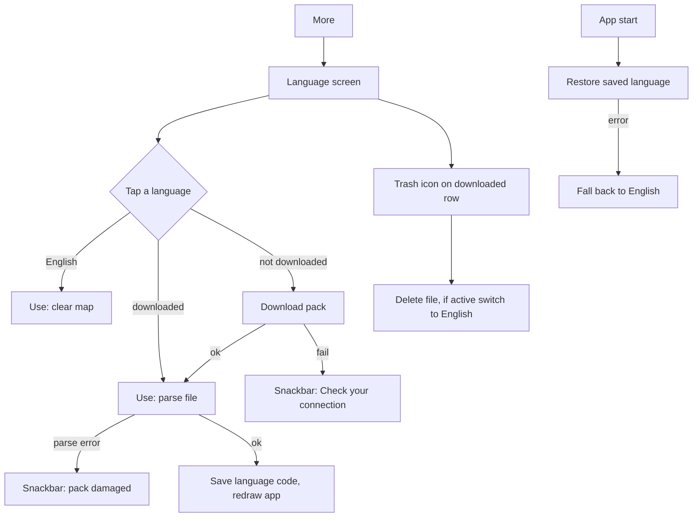

# Localization

| Field | Value |
|---|---|
| Feature ID | F-29 |
| Status | Existing |
| Priority | P2 |
| Phase | 5 (the `t()` lookup API is introduced in Phase 0 so all UI strings are wrapped from the start) |
| Last Updated | 2026-10-19 |

## 1. Description

Localization shows the app in the user's language without making the install large. English is built in, and seven Indian-language packs (Hindi, Bengali, Telugu, Marathi, Tamil, Gujarati, Kannada) are small files downloaded on demand and removable. It exists so people can use the app in their own language, and any text without a translation simply stays in English so nothing is ever blank.

## 2. What This Feature Will Do

- Shows app text in the active language, falling back to English where no translation exists.
- Fills in values such as counts and names inside translated sentences.
- Lists eight languages on a Language screen with native names and a state for each.
- Downloads a language pack over a secure connection when the user picks a language not yet on the phone.
- Checks the downloaded pack and saves it in app-private storage, replacing any older copy safely.
- Switches every visible screen to the chosen language without restarting the app.
- Removes a downloaded pack on request and returns to English if that language was in use.
- Restores the saved language on start and uses English if its pack is missing or damaged.
- Shows clear messages when a download fails or a pack is damaged.
- Sends no personal data when downloading.
- Checks at build time that every translatable text and every pack covers the shared key list.

### 2.1 Inputs

- The user choosing, downloading or removing a language on the Language screen.
- The saved language choice, read at start.
- Language pack files fetched from the project's GitHub repository.
- The English text of each message in the app, used as its lookup key.

### 2.2 Processing

1. On start, read the saved language and load its pack if present.
2. For each text, look up the translation, otherwise use the English text, then fill in placeholders.
3. On picking a language not on the phone, download its pack, check it has content, and save it atomically before using it.
4. Save the language choice and refresh all screens.
5. On delete, remove the pack file and switch to English if it was active.
6. Choose singular or plural wording with separate keys rather than rules.

### 2.3 Outputs

- The app interface in the chosen language, with English fallback.
- A Language screen showing Built in, Downloaded or Tap to download, plus In use, Download and Remove actions.
- Downloaded packs stored privately on the phone and left out of backup.
- Error messages for failed downloads and damaged packs.
- A build-time report of missing or extra translation keys.

### 2.4 Out of Scope

- Localising numbers, dates and currency, which keep their English and Indian formatting.
- Translating third-party content such as news headlines, bank names and merchant names.
- Right-to-left layouts, which none of the seven languages needs.
- The update checker, which shares the GitHub host (see [News, support and updates](31_news_support_updates.md)).

## 3. Behaviour in Existing App

Source: `existing_app_analysis.md` Part A 4.11, 6.2, 2.9 (LanguageRoute); Kotlin refs relative to `hisaab_apk/app/src/main/kotlin/com/hisaab/app/`: `i18n/I18n.kt`, `ui/more/LanguageScreen.kt:87`; repo folder `hisaab_apk/lang/`.

### 3.1 Languages

`Language` enum (`I18n.kt:25`): code, English name, native name.

| Code | English | Native | Built in |
|---|---|---|---|
| en | English | English | yes |
| hi | Hindi | हिन्दी | no |
| bn | Bengali | বাংলা | no |
| te | Telugu | తెలుగు | no |
| mr | Marathi | मराठी | no |
| ta | Tamil | தமிழ் | no |
| gu | Gujarati | ગુજરાતી | no |
| kn | Kannada | ಕನ್ನಡ | no |

`Language.of(code)` returns English for null or unknown codes.

### 3.2 The `t()` lookup

- English text is the key: `t(text, vararg "k" to v)` computes `I18n.strings[text] ?: text`, then replaces every `{k}` placeholder with `v.toString()`.
- `I18n.strings` and `I18n.language` are observable state, so changing language redraws every screen. The lookup is a single map access.
- Plurals are handled manually: a `plural()` helper plus separate keys such as `"{n} account and cards"`.
- Not everything is wrapped: ParserBench uses raw English, `Periods.dayHeader` returns English "Today" / "Yesterday" (callers sometimes wrap), tax `TaxItem` labels are wrapped at render time. Number and date formatting is not localised: `Periods` uses English patterns `d MMM yyyy`, `h:mm a`, `MMMM yyyy`, `EEE, d MMM yyyy`; device locale only affects `NumberFormat` for en-IN. `supportsRtl=true` is declared (none of the shipped languages is RTL).

### 3.3 Pack format and repository layout

- Pack: `{ "version": 1, "code": "hi", "strings": { "<English key>": "<translation>" } }`. Only blank values are skipped at parse time (blank means "keep English"). `version` and `code` are not checked by the loader (see Open Questions).
- `lang/keys.json` (about 40 KB): a flat JSON array of **1,455 unique English source strings**, the canonical key list. Each of `hi, bn, gu, kn, mr, ta, te` `.json` (about 122 to 150 KB each) carries all 1,455 keys under `strings`.
- `lang/tmp/` holds working shards (`bn.1..4.json`, `delta.*.json`) used while translating; not shipped.
- Keys contain `{named}` placeholders that must be preserved in translations.

### 3.4 Download, use, delete (`LanguageStore`, `I18n.kt:62`)

- Base URL: `https://raw.githubusercontent.com/DhyanendraSinghSikarwar/hisaab_apk/main/lang/<code>.json`. HTTP GET, connect timeout 10 s, read timeout 20 s; any non-2xx code raises `HTTP <code>`; the body is parsed and must contain at least one non-blank string (`Empty pack` otherwise).
- Storage: written to `filesDir/lang/<code>.json.tmp`, then renamed to `<code>.json` (atomic replace of an older copy).
- `isDownloaded(l)` = English or file exists. `packs()` lists every language with downloaded flag and file size.
- `use(l)`: parse the file into the map (on IO dispatcher), set `I18n.strings` and `I18n.language`, then write the code to DataStore `language` (key `language`).
- `delete(l)`: no-op for English; deletes the file; if that language was in use, switch to English.
- `restore()` at app start (first task in `HisaabApplication`): if the saved language is not English, apply it; on any error fall back to English (`strings` empty).
- Nothing about the user is sent; only the pack file is fetched. No checksum or signature is verified.

### 3.5 Language screen (`LanguageRoute`, `ui/more/LanguageScreen.kt:87`, title "Language")

Reached from More ("Language"). A list with one `HCard` per language:

- Leading 40 dp rounded tile showing the first character of the native name (accent background and white text when selected).
- Native name (16 sp, semi-bold) and a subtitle: "Built in" for English; `"<English name> · Downloaded"` when the pack exists; `"<English name> · Tap to download"` otherwise (English name itself passed through `t()`).
- Trailing state, animated cross-fade: busy spinner while downloading or applying; check-circle "In use" when selected; cloud-download icon "Download" when not downloaded; trash icon "Remove download" when downloaded and not selected.
- Tapping a row calls `choose`: if not downloaded, download then use; if downloaded, use. The selected row has the accent-soft container.
- Snackbars: "Couldn't download {lang}. Check your connection." and "That language pack is damaged. Download it again.".

### 3.6 Persisted data

DataStore `language`: key `language` (en, hi, bn, te, mr, ta, gu, kn), default en. Files `filesDir/lang/<code>.json`. See [Data sources and settings](26_settings_data_sources.md) for the full key inventory.

## 4. User Stories

- As a Hindi (or other supported language) speaker, I want to use the app in my language.
- As a user on limited storage or data, I want to download only the language I need and delete it later.
- As a user, I want untranslated text to show in English rather than disappear.
- As a user, I want the app to keep my language after restart and fall back safely if the pack is broken.
- As a maintainer, I want a single key list so new strings are translated consistently.

## 5. Functional Requirements (FR-29-01 ...)

- FR-29-01: A global `t(String english, {Map<String, Object?> args})` returns the translation of `english` for the active language, or `english` when no translation exists, then replaces each `{name}` placeholder with the argument's string value.
- FR-29-02: All user-visible strings (except those listed as out of scope) are passed through `t()`; the English text is the key.
- FR-29-03: Changing the active language rebuilds all visible screens without restarting the app.
- FR-29-04: Supported languages are en, hi, bn, te, mr, ta, gu, kn with the native names in Section 2.1; English is built in and cannot be deleted.
- FR-29-05: A pack is a JSON object with `version` (int), `code` (string) and `strings` (map English to translation); blank translations are ignored.
- FR-29-06: Downloading a pack performs an HTTPS GET of `<base>/<code>.json` with connect timeout 10 s and read timeout 20 s; a non-2xx status or an empty parsed map is an error.
- FR-29-07: The pack is written to a temporary file and atomically renamed over `lang/<code>.json`, replacing any older copy.
- FR-29-08: Selecting a downloaded language applies it and stores its code under the `language` key; selecting a not-downloaded one downloads first, then applies.
- FR-29-09: Deleting a downloaded pack removes the file; if it was active, the app switches to English and stores `en`.
- FR-29-10: On start the saved language is restored; if its pack is missing or unreadable the app uses English without crashing.
- FR-29-11: The Language screen lists all 8 languages in enum order, each row showing the native-name initial tile, native name, subtitle ("Built in" / "<English> · Downloaded" / "<English> · Tap to download") and a trailing state (spinner, "In use" check, "Download" cloud, "Remove download" trash).
- FR-29-12: While a language is downloading, its row shows a spinner and other taps on it are ignored; failures show "Couldn't download {lang}. Check your connection."; a corrupt pack shows "That language pack is damaged. Download it again.".
- FR-29-13: Placeholders in translations must keep the same `{name}` tokens as the English key; a missing token in the translation leaves the output without that value (see test and tooling requirement).
- FR-29-14: No personal data is sent during download; the request carries no identifiers beyond what the HTTP stack sends.
- FR-29-15: A build-time check verifies that every `t()` literal in the source exists in `lang/keys.json` and that every pack covers the key list (reports missing and extra keys).
- FR-29-16: Plural forms use separate keys (for example `"{n} account and cards"`) chosen by a `plural(n, one, other)` helper, not ICU.
- FR-29-17: Dates, numbers and currency keep the existing English / en-IN formatting regardless of language (parity with 2.9.8).
- FR-29-18: Language packs live in app-private storage and are excluded from backup.

## 6. Non-Functional Requirements (performance, battery, privacy, offline)

- Lookup is O(1) (hash map); no per-frame parsing. Pack parse (about 150 KB, 1,455 entries) under 50 ms on a mid-range phone, done off the UI isolate.
- Pack download is about 150 KB; only on explicit user action; no background polling.
- Offline: previously downloaded packs work offline; English always works.
- Privacy: only the pack file is fetched; nothing about the user is sent (see [Security and privacy](25_security_privacy.md) privacy table).
- Memory: one language map in memory at a time.

## 7. UI / Screens & User Flow (screen list + flow diagram)

| # | Screen / dialog / sheet | Source ref |
|---|---|---|
| 1 | Language screen (list of 8 languages) | `ui/more/LanguageScreen.kt:87` |
| 2 | Language row states: built in, tap to download, downloading, in use, downloaded | `LanguageScreen.kt` (`LanguageRow`) |
| 3 | Snackbars: download failed, pack damaged | `LanguageScreen.kt` (`LanguageViewModel.messages`) |



Reference GIFs (Status: Pending, not yet captured):

-  (Status: Pending, not yet captured)
-  (Status: Pending, not yet captured)
-  (Status: Pending, not yet captured)
-  (Status: Pending, not yet captured)
-  (Status: Pending, not yet captured)
-  (Status: Pending, not yet captured)

## 8. Data Models (Dart entities + fields + types)

```dart
enum AppLanguage {
  en('en', 'English', 'English'),
  hi('hi', 'Hindi', 'हिन्दी'),
  bn('bn', 'Bengali', 'বাংলা'),
  te('te', 'Telugu', 'తెలుగు'),
  mr('mr', 'Marathi', 'मराठी'),
  ta('ta', 'Tamil', 'தமிழ்'),
  gu('gu', 'Gujarati', 'ગુજરાતી'),
  kn('kn', 'Kannada', 'ಕನ್ನಡ');

  const AppLanguage(this.code, this.english, this.native);
  final String code, english, native;
  static AppLanguage of(String? code) =>
      values.firstWhere((l) => l.code == code, orElse: () => AppLanguage.en);
}

@freezed
class LanguagePack with _$LanguagePack {
  const factory LanguagePack({
    required int version,                        // 1
    required String code,
    required Map<String, String> strings,        // English key to translation
  }) = _LanguagePack;
}

@freezed
class PackInfo with _$PackInfo {
  const factory PackInfo({
    required AppLanguage language,
    required bool downloaded,                    // English always true
    @Default(0) int sizeBytes,
  }) = _PackInfo;
}

@freezed
class LanguageState with _$LanguageState {
  const factory LanguageState({
    @Default(AppLanguage.en) AppLanguage active,
    @Default({}) Map<String, String> strings,    // empty for English
    @Default([]) List<PackInfo> packs,
    AppLanguage? busy,
  }) = _LanguageState;
}
```

Global API: `String t(String english, {Map<String, Object?> args = const {}})` reading the current map from a Riverpod provider or `InheritedNotifier` so widgets rebuild on change.

## 9. Database Tables / Changes

No Drift tables. Persistence:

| Item | Where | Notes |
|---|---|---|
| `language` | settings key (see [Data sources and settings](26_settings_data_sources.md)) | code, default `en` |
| `lang/<code>.json` | app documents directory `lang/` | atomic write via `.json.tmp` then rename |

Repository files (not in the app database): `lang/keys.json` (array of 1,455 strings), `lang/<code>.json` for the 7 languages.

## 10. Business Rules & Logic (regex, parsing rules, algorithms, thresholds)

- Lookup: `result = map[text] ?? text`; for each arg `k, v`: `result = result.replaceAll('{$k}', '$v')`. Replace uses literal substitution, not regex.
- Parse: decode JSON; read `strings` object; include entries whose value is non-blank (`trim().isNotEmpty`); if `strings` missing the map is empty (treated as an error on download).
- Download validation: HTTP 200 to 299, parsed map non-empty. Timeouts 10 s connect, 20 s read.
- Atomicity: write `<code>.json.tmp`, rename to `<code>.json`.
- Restore: English short-circuits; otherwise apply, on exception set language English and clear map.
- Delete: English ignored; active language falls back to English and persists `en`.
- Key coverage: `keys.json` has 1,455 unique strings; each pack should have all 1,455 keys (currently true for hi, bn, gu, kn, mr, ta, te).
- Placeholder grammar: `{identifier}` with letters/digits/underscore; copied unchanged into translations.
- Pack URL base: `https://raw.githubusercontent.com/DhyanendraSinghSikarwar/hisaab_apk/main/lang` (make configurable in Flutter; see Open Questions).

## 11. Platform / Native Requirements (permissions, channels, background work)

- `INTERNET` permission only (shared with other features); no storage permission (app-private directory).
- Flutter: `http` or `dio` for download with timeouts; `path_provider` `getApplicationSupportDirectory()/lang`; `dart:convert` for JSON; parse in `compute()`.
- Optional: pair with Flutter's `flutter_localizations` for built-in widgets (date pickers, dialog buttons) by mapping `AppLanguage` to `Locale` (en-IN, hi-IN, bn-IN, te-IN, mr-IN, ta-IN, gu-IN, kn-IN). The app's own strings stay on the `t()` mechanism.
- Fonts: bundled or system fonts must cover Devanagari, Bengali, Telugu, Tamil, Gujarati, Kannada scripts (Noto Sans family on Android is adequate; test on devices with stripped fonts).
- No background work.

## 12. Dependencies (other features → link to their memory file; packages)

Features:

- [Data sources and settings](26_settings_data_sources.md): `language` key and Info texts that must be translatable.
- [Theming and customisation](28_theming_customisation.md): layout must tolerate long Indian-language strings at larger text scales.
- [News, support and updates](31_news_support_updates.md): same GitHub hosting; WhatsNew text is translatable.
- [Security and privacy](25_security_privacy.md): privacy table (language pack GET).
- Every screen-owning feature file: all strings wrapped in `t()`.

Packages: `flutter_riverpod`, `freezed`, `http` or `dio`, `path_provider`, `flutter_localizations` (optional), a lint rule or script (`tool/check_i18n.dart`) for key coverage.

## 13. Folder Location (lib/features/<name>/...)

```text
lib/core/i18n/
  t.dart                      // global t() + plural()
  i18n_state.dart             // provider holding the active map
lib/features/language/
  data/
    language_pack_remote.dart // GET with timeouts
    language_pack_local.dart  // atomic write, list, delete
    language_repository_impl.dart
  domain/
    app_language.dart
    language_pack.dart
    language_repository.dart
  presentation/
    language_screen.dart
    language_row.dart
    providers.dart
tool/
  check_i18n.dart             // verifies t() literals vs lang/keys.json and pack coverage
lang/
  keys.json
  hi.json bn.json te.json mr.json ta.json gu.json kn.json
```

## 14. Edge Cases & Error Handling

- No network on download: snackbar "Couldn't download {lang}. Check your connection."; state unchanged.
- HTTP 404 (pack missing from repo) or non-2xx: same message.
- Empty or non-JSON pack: "That language pack is damaged. Download it again."; the existing file is not replaced.
- Downloaded file later truncated or corrupt: use fails with the damaged message; restore at start falls back to English silently.
- User deletes the active language: switch to English immediately.
- Pack missing some keys: those strings show English.
- Translation lacking a `{placeholder}`: output omits the value; tooling should flag it.
- Download interrupted mid-write: temp file may remain; the live file is untouched; clean up stale `.tmp` on next download.
- Rapid taps on rows: ignore taps while any download is busy.
- Unknown saved code: treated as English.
- App updated with new keys but old pack downloaded: new strings fall back to English until the pack is re-downloaded (see Open Questions on versioning).

## 15. Test Cases (unit / widget / integration + sample fixtures)

Unit:

- TC-29-01 (FR-29-01): with map `{"Spent today": "आज का खर्च"}`, `t("Spent today")` returns the Hindi text; `t("Unknown")` returns `Unknown`.
- TC-29-02 (FR-29-01): `t("Imported {n}, skipped {m} already present", args: {"n": 5, "m": 2})` with an empty map returns `Imported 5, skipped 2 already present`.
- TC-29-03 (FR-29-05): parse ignores blank values: `{"strings":{"A":"x","B":"  ","C":""}}` gives `{A: x}`.
- TC-29-04 (FR-29-04): `AppLanguage.of(null)`, `of('xx')` return English; `of('ta')` returns Tamil.
- TC-29-05 (FR-29-06): download helper throws on HTTP 404 and on a body `{"strings":{}}`.
- TC-29-06 (FR-29-07): after a successful download only `<code>.json` exists (no `.tmp`); a failed write leaves the previous file intact.
- TC-29-07 (FR-29-09): deleting the active language sets active English, persists `en`, removes the file; deleting English is a no-op.
- TC-29-08 (FR-29-10): restore with a corrupt `hi.json` ends in English with no exception.
- TC-29-09 (FR-29-15): `check_i18n` reports a literal not in `keys.json` and a pack missing a key; passes on the repo packs (1,455 keys each).
- TC-29-10 (FR-29-16): `plural(1, "{n} account", "{n} accounts")` chooses the singular key; 2 the plural.

Widget:

- TC-29-11 (FR-29-11): Language screen lists 8 rows in order; English subtitle "Built in"; a not-downloaded row shows "Hindi · Tap to download" and a cloud icon.
- TC-29-12 (FR-29-03): switching language changes the visible title text without navigation.
- TC-29-13 (FR-29-12): failed download shows the snackbar text; a busy row ignores a second tap.

Integration:

- TC-29-14 (FR-29-08): choose Hindi (fake server), pack downloads, UI switches, restart keeps Hindi.
- TC-29-15 (FR-29-17): amounts and dates render with en-IN formats under Hindi.

Fixtures: a 3-key pack JSON, a corrupt pack `{`, an empty pack `{"version":1,"code":"hi","strings":{}}`.

## 16. Acceptance Criteria

- AC-29-01: Every UI string goes through `t()` and unknown strings render in English (FR-29-01, FR-29-02; TC-29-01, TC-29-02, TC-29-09).
- AC-29-02: The user can download, switch to, and delete each of the 7 languages, and the choice survives restart (FR-29-04, FR-29-08, FR-29-09, FR-29-10; TC-29-04, TC-29-07, TC-29-08, TC-29-14).
- AC-29-03: Network and format failures show the specified messages and never corrupt an existing pack (FR-29-06, FR-29-07, FR-29-12; TC-29-05, TC-29-06, TC-29-13).
- AC-29-04: The Language screen matches the specified rows and states (FR-29-11; TC-29-11).
- AC-29-05: Language changes apply live to all screens (FR-29-03; TC-29-12).
- AC-29-06: Packs cover all 1,455 keys and placeholders are preserved, enforced by tooling (FR-29-13, FR-29-15; TC-29-09).
- AC-29-07: Formatting of numbers, dates and currency stays English / en-IN (FR-29-17; TC-29-15).

## 17. Open Questions

1. The pack `version` and `code` fields are not validated by the loader. Should Flutter validate `code` matches and reject unknown versions? Should a newer `keys.json` version trigger "update available" for installed packs?
2. No integrity check (hash or signature) is applied to downloaded packs, while app updates use SHA-256. Add a checksum manifest for packs?
3. The pack host is the personal GitHub repo `hisaab_apk` on `raw.githubusercontent.com`; the Flutter app may live in a different repo. Where should packs be hosted, and should the URL be remote-configurable?
4. Should numbers, dates and "Today / Yesterday" be localised in Flutter (parity is English)? Native digits (for example Devanagari numerals) are not used today.
5. Should Flutter move to ARB / `gen_l10n` bundled packs instead of runtime downloads? The existing design avoids bloating the APK (about 1 MB for all packs); confirm keeping downloads.
6. Several screens are unwrapped (ParserBench, day headers, parts of tax). Which are in scope for Flutter wrapping?
7. Strings with formatted plurals use per-count keys; is ICU plural support wanted for languages with more plural forms?
8. Does device locale ever pick the initial language? Today the default is always English until the user chooses.
9. RTL is declared but no shipped language is RTL; adding Urdu or Arabic would require layout review.
10. Cross-links to other feature files are by name only because their file names were not fixed when this file was written.

## 18. Implementation Notes

N/A - not built yet. Filled during the build (decisions, deviations).

## 19. Change Log (date | change | reason)

| Date | Change | Reason |
|---|---|---|
| 2026-10-17 | Created from hisaab_apk 2.9.8 analysis | Initial |
| 2026-10-19 | Restructured to the 19-section standard (Description, What This Feature Will Do, Implementation Notes added); Last Updated bumped | Audit Gate (Prompt 2, Part A) |
| 2026-10-19 | Verified `lang/keys.json` has 1,455 unique keys (each pack 1,455); all counts in this file confirmed as 1,455 | Audit Gate gap, scan_N |
