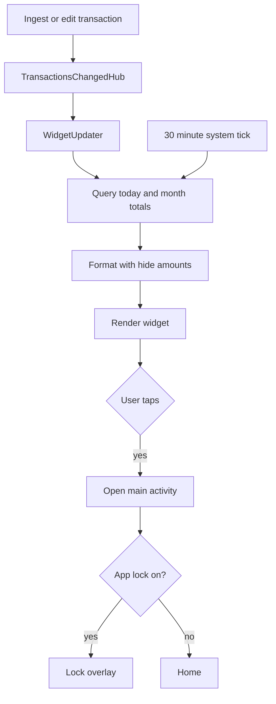

# Home Widget

| Field | Value |
|---|---|
| Feature ID | F-30 |
| Status | In progress (Dart sync, Kotlin provider, XML and manifest landed; native code uncompiled and unrun on a device, CI compiles it; midnight rollover, language re-render and background refresh pending) |
| Priority | P2 |
| Phase | 5 |
| Last Updated | 2026-10-21 |

## 1. Description

Home Widget is a resizable Android home-screen widget called DhanKosh spend. It shows how much the user has spent today and this month without opening the app, and tapping it opens the app. It exists so the user stays aware of spending at a glance, while still respecting the privacy setting that hides amounts.

## 2. What This Feature Will Do

- Offers one home-screen widget named DhanKosh spend in the phone's widget picker.
- Shows Spent today and This month, with an amount for each.
- Adds up spending from the start of the current day or month in the phone's time zone.
- Formats amounts like the rest of the app and masks them when hide amounts is on.
- Shows masked amounts until the real privacy setting can be read.
- Opens the app when the user taps the widget.
- Updates within a few seconds after the ledger changes, and every 30 minutes and on a date change.
- Resizes horizontally and vertically.
- Follows the phone's light or dark appearance and shows captions in the active language.
- Shows a zero or masked value instead of an error when there are no transactions.
- Works offline and without the app running, using data the app already saved.
- Ignores update failures so the app and ingestion never crash.

### 2.1 Inputs

- The stored transactions on the phone, read for today and the current month.
- The hide-amounts setting and the active language.
- Ledger changes, the 30-minute system schedule and date changes as triggers.
- The user's tap on the widget or resizing of it.

### 2.2 Processing

1. Get the start of today and the start of this month in the phone's time zone.
2. Sum the money spent and invested from each start to now.
3. Format each total and mask it if amounts are hidden.
4. Draw the two captions and amounts on the widget.
5. Refresh when the ledger changes or on schedule, and ignore any failure.
6. On a tap, launch the app.

### 2.3 Outputs

- The widget showing today's and this month's spend, or masked values.
- A tap target that opens the app.
- No transaction detail, merchant names or account information on the home screen.

### 2.4 Out of Scope

- Other widgets such as net worth, budgets or upcoming bills, and any widget settings screen.
- iOS widgets.
- The spending totals logic, which belongs to the ledger feature.
- The hide-amounts rule itself (see [Security and privacy](25_security_privacy.md)).
- Language packs (see [Localization](29_localization.md)).
- The unused extra widget layouts from the existing app, which are not ported.

## 3. Behaviour in Existing App

Source: `existing_app_analysis.md` Part A 2.10, 5, 6.3; Kotlin and resources relative to `hisaab_apk/app/src/main/`: `kotlin/com/hisaab/app/widget/SpendWidget.kt` (80 lines), `res/xml/spend_widget_info.xml`, `AndroidManifest.xml:90-98`.

### 3.1 Widget definition

- A Jetpack Glance `GlanceAppWidget` named `SpendWidget`, receiver `SpendWidgetReceiver` (exported, action `android.appwidget.action.APPWIDGET_UPDATE`, provider metadata `@xml/spend_widget_info`), label `@string/widget_name` ("DhanKosh spend"), description `@string/widget_description`.
- Provider info (`spend_widget_info.xml`): `minWidth=180dp`, `minHeight=110dp`, `targetCellWidth=3`, `targetCellHeight=2`, `resizeMode=horizontal|vertical`, `updatePeriodMillis=1800000` (30 minutes), `widgetCategory=home_screen`, `initialLayout=@layout/glance_default_loading_layout`.

### 3.2 Content and layout

A single column with a 20 dp rounded corner, background `GlanceTheme.colors.widgetBackground`, 14 dp padding, whole surface clickable (`actionStartActivity<MainActivity>()`):

1. Caption "Spent today" (12 sp, `onSurfaceVariant`).
2. Amount: today's spend, `Money.format(today)` (22 sp, bold, `onSurface`).
3. 8 dp spacer.
4. Caption "This month" (12 sp, `onSurfaceVariant`).
5. Amount: this month's spend, `Money.format(month)` (16 sp, medium, `primary`).

Strings pass through `t()` (see [Localization](29_localization.md)). It uses the Glance theme (system-driven colours) and not the DhanKosh palettes.

### 3.3 Data and calculation

- On each `provideGlance`, the widget reads directly from the database through a Hilt entry point (`TransactionDao`): `today = dao.total(["DEBIT","INVESTMENT"], Periods.startOfDay(now), now)` and `month = dao.total(["DEBIT","INVESTMENT"], Periods.startOfMonth(now), now)`, both in minor units (paise), with `now = System.currentTimeMillis()` and the system time zone (`Periods.zone = ZoneId.systemDefault()`).
- "Spent" = sum of `DEBIT` plus `INVESTMENT` transaction totals. (How transfers, card-bill payments, and foreign-currency rows are excluded inside `dao.total` was not captured; see Open Questions.)
- The widget ignores the Personal / Business book filter and the Home period selector (no filter parameters are passed).

### 3.4 Refresh triggers

- Every ingest: `WidgetUpdater` implements `TransactionsChangedNotifier`; `TransactionsChangedHub` (which also checks budgets under a mutex) calls `SpendWidget().updateAll(context)` inside `runCatching` after any ledger change.
- System periodic update every 30 minutes (`updatePeriodMillis`; Android enforces a minimum of 30 minutes).
- Not refreshed at midnight explicitly: "today" rolls over on the next scheduled update or ledger change (see Open Questions).

### 3.5 Privacy

- It uses `Money.format`, which honours `AmountPrivacy.hidden`. The global state defaults to **true** until settings load, so the widget shows `₹••••` when amounts are hidden, which is also the default setting (`hide_amounts = true`). In a fresh process where the widget renders before the app's settings push the stored value, it shows masked amounts even when the user turned hiding off (see Open Questions).
- No tap-through data; the click only starts the main activity. If the app lock is on, the lock screen then appears (see [Security and privacy](25_security_privacy.md)).

### 3.6 Where else the widget is mentioned

Manifest: one exported receiver (`SpendWidgetReceiver`), no extra permissions. `FEATURES.md`/analysis: no widget settings, no configuration activity, one widget type only. A separate `SafeWidget` / `NetWorthWidget` exists as dead code on Home composables (not the app widget).

## 4. User Stories

- As a user, I want to see today's and this month's spend on my home screen so I stay aware of spending without opening the app.
- As a privacy-conscious user, I want the widget to hide amounts when I have hiding on.
- As a user, I want the widget to update soon after a new transaction arrives.
- As a user, I want to tap the widget to open the app.
- As a user, I want to resize the widget to fit my layout.

## 5. Functional Requirements (FR-30-01 ...)

- FR-30-01: The app provides one home-screen widget named "DhanKosh spend" with a description, selectable from the system widget picker.
- FR-30-02: The widget declares minimum size 180 x 110 dp, target 3 x 2 cells, resizable horizontally and vertically, category home screen.
- FR-30-03: The widget shows two captions and two amounts: "Spent today" with today's total, and "This month" with this month's total, in that order, using the layout in Section 2.2.
- FR-30-04: Totals are the sum of `DEBIT` and `INVESTMENT` transaction amounts in paise, from local start of the current day (or month) to now, in the device time zone.
- FR-30-05: Amounts are formatted with the same currency formatter as the app (Indian digit grouping, rupee symbol, paise shown only when non-zero), and masked as `₹••••` when the hide-amounts setting is on.
- FR-30-06: The hide-amounts default for the widget is masked until the real setting can be read.
- FR-30-07: Tapping anywhere on the widget launches the app's main activity.
- FR-30-08: After any change to stored transactions (insert, merge, edit, delete, category change affecting totals), the widget is updated within 5 seconds (best effort).
- FR-30-09: The widget is also updated periodically at the system minimum interval (30 minutes) and when the device date changes.
- FR-30-10: Widget update failures are swallowed and never crash the app or ingestion.
- FR-30-11: The widget respects the system light/dark appearance using the system widget background and on-surface colours, not the in-app palettes.
- FR-30-12: Captions are translated according to the active language (see [Localization](29_localization.md)); the widget re-renders on a language change.
- FR-30-13: The widget shows a sensible empty value (zero rupees, or masked) when there are no transactions and does not display an error.
- FR-30-14: The widget works without the app process running (reads data persisted by the app) and offline.
- FR-30-15: The widget contains no per-transaction detail, merchant names or account information.

## 6. Non-Functional Requirements (performance, battery, privacy, offline)

- Render under 500 ms; the totals query is two indexed range sums.
- No wake locks; refresh only on ledger change and the system periodic tick.
- Offline always.
- Privacy: masked by default; no personal text on the widget beyond two totals; no export from the widget.
- Rapid ingest bursts (for example a full SMS scan inserting many rows) should coalesce widget updates (debounce about 2 seconds) to avoid battery cost; existing app updates per ingest event.

## 7. UI / Screens & User Flow (screen list + flow diagram)

| # | Surface | Source ref |
|---|---|---|
| 1 | Home-screen widget "DhanKosh spend" (3x2, resizable) | `widget/SpendWidget.kt`, `res/xml/spend_widget_info.xml` |
| 2 | Widget loading state (default Glance loading layout) | `glance_default_loading_layout` |
| 3 | Widget picker entry (name, description, preview) | manifest `@string/widget_name`, `@string/widget_description` |
| 4 | Widget masked state (`₹••••`) | `Money.format` with `AmountPrivacy.hidden` |



Reference GIFs (Status: Pending, not yet captured):

-  (Status: Pending, not yet captured)
-  (Status: Pending, not yet captured)
-  (Status: Pending, not yet captured)
-  (Status: Pending, not yet captured)
-  (Status: Pending, not yet captured)
-  (Status: Pending, not yet captured)

## 8. Data Models (Dart entities + fields + types)

```dart
@freezed
class SpendWidgetData with _$SpendWidgetData {
  const factory SpendWidgetData({
    required int todayMinor,        // paise
    required int monthMinor,        // paise
    required bool hidden,           // hide_amounts at render time
    required String todayText,      // already formatted or masked
    required String monthText,
    required String todayCaption,   // t("Spent today")
    required String monthCaption,   // t("This month")
    required DateTime updatedAt,
  }) = _SpendWidgetData;
}
```

Keys written to the widget's shared storage by `HomeWidget.saveWidgetData`: `spent_today_text`, `spent_month_text`, `caption_today`, `caption_month`, `updated_at`. The native provider only reads strings, so formatting, masking and translation are done in Dart.

Domain interface: `SpendTotalsRepository { Future<int> total(Set<TxType> types, DateTime from, DateTime to); }` implemented in the ledger feature.

## 9. Database Tables / Changes

No new tables. The widget reads aggregates from the ledger `transactions` table (see the ledger feature file) using the two sums:

```sql
SELECT COALESCE(SUM(amountMinor), 0) FROM transactions
WHERE type IN ('DEBIT','INVESTMENT') AND timestamp >= :from AND timestamp <= :to
```

(Exact filters such as transfer, card-bill and foreign-currency handling must match the ledger's `total` query; see Open Questions.) A Drift DAO method `totalForTypes` serves both the widget and Home. Widget text snapshots live in the widget's shared preferences, not the database.

## 10. Business Rules & Logic (regex, parsing rules, algorithms, thresholds)

- Types counted: `DEBIT` and `INVESTMENT` (investment outflows count as spend on the widget).
- Windows: today = `[startOfDay(now), now]`; month = `[startOfMonth(now), now]`; start boundaries use the device's current time zone.
- Formatting: `Money.format(minor)`: en-IN grouping, ₹, fraction digits 0 when `minor % 100 == 0`, else 2; hidden gives `₹••••`.
- Refresh: on ledger-change event; every 1,800,000 ms from the system.
- Default `hidden = true` until settings load.
- Tap action: start `MainActivity` (launch intent).
- Ignores Book filter and Home period.

## 11. Platform / Native Requirements (permissions, channels, background work)

- Flutter package `home_widget`; Android side needs a native `AppWidgetProvider` (`SpendWidgetProvider`) with an XML layout (`RemoteViews`; Glance is Kotlin-only and not available from Flutter without extra native code, so rebuild the layout as XML or use Glance in the host module).
- Manifest: `<receiver android:name=".SpendWidgetProvider" android:exported="true">` with `APPWIDGET_UPDATE` and `@xml/spend_widget_info` (same `minWidth=180dp`, `minHeight=110dp`, `targetCellWidth=3`, `targetCellHeight=2`, `resizeMode=horizontal|vertical`, `updatePeriodMillis=1800000`, `widgetCategory=home_screen`).
- Click: `HomeWidgetLaunchIntent.getActivity(context, MainActivity::class.java)` via `setOnClickPendingIntent` on the root view.
- Updating from Dart: after each ledger change, compute totals, call `HomeWidget.saveWidgetData(...)` then `HomeWidget.updateWidget(name: 'SpendWidgetProvider', androidName: ...)`.
- Periodic and background refresh without the UI running: `HomeWidget.registerBackgroundCallback` or a `workmanager` periodic task that opens the Drift database in a background isolate and writes the snapshot (the 30-minute tick plus the existing ingest path, since SMS ingest already runs in the background).
- Date rollover: schedule a one-shot update at local midnight (AlarmManager inexact or a workmanager task) to avoid a stale "today" (Open Question).
- Colours: use `?android:attr/colorBackground`-style system colours or Material You widget defaults so the widget follows the system theme; corner radius 20 dp via a shape drawable background.
- Permissions: none.

## 12. Dependencies (other features → link to their memory file; packages)

Features:

- [Security and privacy](25_security_privacy.md): `hide_amounts` setting and masked default, app lock after tap.
- [Data sources and settings](26_settings_data_sources.md): settings store key inventory.
- [Localization](29_localization.md): caption translations.
- [Theming and customisation](28_theming_customisation.md): widget deliberately does NOT use the in-app palettes.
- Ledger (totals query, change notifications) and SMS / email ingest (background refresh path): separate feature files.

Packages: `home_widget`, `workmanager`, `drift`, `intl` (en-IN currency formatting), `riverpod`, `freezed`.

## 13. Folder Location (lib/features/<name>/...)

```text
lib/features/home_widget/
  data/
    widget_updater_impl.dart        // saveWidgetData + updateWidget
    spend_totals_source.dart        // Drift sums
  domain/
    spend_widget_data.dart
    widget_updater.dart
    build_spend_widget_data.dart    // totals + format + mask + captions
  presentation/
    widget_background_callback.dart // entry point for background isolate
android/app/src/main/
  kotlin/<package>/SpendWidgetProvider.kt
  res/layout/spend_widget.xml
  res/xml/spend_widget_info.xml
  res/drawable/widget_background.xml
```

## 14. Edge Cases & Error Handling

- No transactions: shows zero rupees (or masked); no error text.
- Database locked or unavailable when the widget refreshes: keep the last snapshot; swallow the error.
- Day rollover while the device is idle: stale "today" until the next update; mitigate with a midnight update.
- Time zone or clock changes: recompute from the new zone on the next update; listen for `ACTION_TIMEZONE_CHANGED` / `ACTION_DATE_CHANGED` if feasible.
- Hide-amounts changed in the app: update the widget immediately.
- Language changed: re-render captions.
- Widget added before the app has ever run: show masked placeholders and "Open DhanKosh" tap target.
- Very large amounts: text must not overflow; use auto-size or compact (`₹1.2Cr`) fallbacks only if layout requires (existing widget does not compact).
- Foreign-currency rows with no rate: contribute 0 as in the app's totals (see Open Questions).
- Widget resized very small: text scales down or truncates; keep both lines visible at 3x2.
- Rapid ingest bursts: debounce updates.

## 15. Test Cases (unit / widget / integration + sample fixtures)

Unit:

- TC-30-01 (FR-30-04): with transactions DEBIT 500 and INVESTMENT 1000 today, CREDIT 2000 today, DEBIT 300 yesterday in the same month, `todayMinor = 150000` and `monthMinor = 180000` (amounts in paise).
- TC-30-02 (FR-30-04): a DEBIT at 23:59 on the last day of the previous month is excluded from this month; a DEBIT at 00:00 local of day 1 is included.
- TC-30-03 (FR-30-05): `todayText` for `123456` paise is `₹1,234.56`; for `120000` is `₹1,200`; hidden gives `₹••••`.
- TC-30-04 (FR-30-06): before settings load the builder returns masked text.
- TC-30-05 (FR-30-13): no transactions yields `₹0` (or `₹••••` when hidden).
- TC-30-06 (FR-30-12): captions come from `t()` and change with the language.
- TC-30-07 (FR-30-04): time zone Asia/Kolkata vs UTC changes the day boundary for a transaction at 20:00 UTC.

Widget / native:

- TC-30-08 (FR-30-01, FR-30-02): manifest and `spend_widget_info.xml` contain the specified size and resize attributes (static assertion in CI).
- TC-30-09 (FR-30-07): instrumentation test taps the widget and asserts `MainActivity` launches.
- TC-30-10 (FR-30-11): widget screenshot in light and dark system themes is legible.

Integration:

- TC-30-11 (FR-30-08): inserting a transaction through the ingest path updates the widget's stored strings within 5 seconds.
- TC-30-12 (FR-30-10): updater throwing an exception does not fail ingestion.
- TC-30-13 (FR-30-09): triggering the periodic task refreshes totals with the app process killed.

Fixtures: transactions list as in TC-30-01 with dates anchored to a fixed clock `2026-10-17 12:00 IST`.

## 16. Acceptance Criteria

- AC-30-01: A user can add the widget from the picker, see both totals, and resize it within the declared limits (FR-30-01 to FR-30-03; TC-30-08, TC-30-10).
- AC-30-02: Totals equal the sum of debit and investment amounts for the day and month in local time (FR-30-04; TC-30-01, TC-30-02, TC-30-07).
- AC-30-03: Amounts are formatted like the app and masked by default and when the setting is on (FR-30-05, FR-30-06; TC-30-03, TC-30-04).
- AC-30-04: Tapping opens the app (and the lock if enabled) (FR-30-07; TC-30-09).
- AC-30-05: New transactions refresh the widget quickly and periodic refresh works without the app running (FR-30-08, FR-30-09, FR-30-14; TC-30-11, TC-30-13).
- AC-30-06: Failures never crash the app (FR-30-10; TC-30-12).
- AC-30-07: Captions follow the language and empty state is clean (FR-30-12, FR-30-13; TC-30-05, TC-30-06).

## 17. Open Questions

1. What exactly does `TransactionDao.total(types, from, to)` exclude? (Transfers, credit-card bill payments, foreign-currency rows without `inrMinor`.) The widget must match Home's "Spent this month"; confirm whether it does today.
2. Should the widget follow the Personal / Business book filter or Home period? It ignores them today.
3. Day rollover: the widget does not update at midnight today. Add a midnight refresh in Flutter?
4. Masked default: in a fresh process the widget may show masked amounts even when the user turned hiding off. Read the stored setting directly in the widget path instead?
5. The widget name and description resource strings (`widget_name`, `widget_description`) were not read; the analysis calls it "DhanKosh spend". Confirm exact strings.
6. Should Flutter offer more widgets (net worth, upcoming bills, budgets)? Out of scope for parity.
7. Should the widget use the in-app palette or the system theme? Parity says system (Glance theme); confirm.
8. Whether a fixed `₹` compact format is needed for very large amounts on small widgets.
9. Cross-links to ledger and ingest feature files are by name only because their file names were not fixed when this file was written.

## 18. Implementation Notes

Dart: `lib/features/home_widget/{domain,data}`. `buildSpendWidgetData` (pure; FR-30-03/05/06/13; masked while the setting is unread), `WidgetSync` (subscribes to `watchTotals` for today and month in the device zone plus `hide_amounts`, sums spent + invested, debounces 2 s, swallows errors: FR-30-04/08/10/14), `HomeWidgetUpdater` (saves the five keys of section 8 with `HomeWidget.saveWidgetData`, then `updateWidget(qualifiedAndroidName: com.hisaab.widget.SpendWidgetProvider)`). Started by `lib/app/startup_tasks.dart` on launch and every resume (re-subscribing rolls the day/month window over); provider in `lib/app/di/updates_providers.dart`.

Native (UNVERIFIED, not compiled here): `android/app/src/main/kotlin/com/hisaab/widget/SpendWidgetProvider.kt` (extends the plugin's `HomeWidgetProvider`, reads strings only, masked defaults, tap launches `MainActivity` via `HomeWidgetLaunchIntent`), `res/layout/spend_widget.xml`, `res/xml/spend_widget_info.xml` (180x110 dp, 3x2 cells, resize both, 1,800,000 ms, home_screen), `res/drawable/widget_background.xml` (20 dp), `res/values{,-night}/widget_resources.xml` (system light/dark colours, name and description strings), manifest receiver with `APPWIDGET_UPDATE`.

Deviations and pending: Dart-owned data means the widget shows the last snapshot until the app runs, so FR-30-09 (periodic and date-change refresh with the app closed) and FR-30-14 are only partly met (no DATE_CHANGED/midnight refresh, no workmanager refresh yet); FR-30-12 captions are English constants until `t()` is wired (see 29); the 30-minute tick redraws the stored snapshot only. FR-30-01/02/07/08 done in code; FR-30-03/04/05/06/13/15 done and unit-tested; FR-30-10 tested; FR-30-11 done by resources (not screenshot-checked).

Tests: `test/features/home_widget/home_widget_test.dart` (TC-30-03, 04, 05; payload keys FR-30-15; WidgetSync against the real ledger repository and a failing updater, TC-30-12). TC-30-01/02/07 rely on the ledger `watchTotals` tests; TC-30-08..11, 13 need CI or a device.

## 19. Change Log (date | change | reason)

| Date | Change | Reason |
|---|---|---|
| 2026-10-17 | Created from hisaab_apk 2.9.8 analysis | Initial |
| 2026-10-19 | Restructured to the 19-section standard (Description, What This Feature Will Do, Implementation Notes added); Last Updated bumped | Audit Gate (Prompt 2, Part A) |
| 2026-10-21 | Phase 5 widget + updates + release pipeline landed | Phase 5 |
