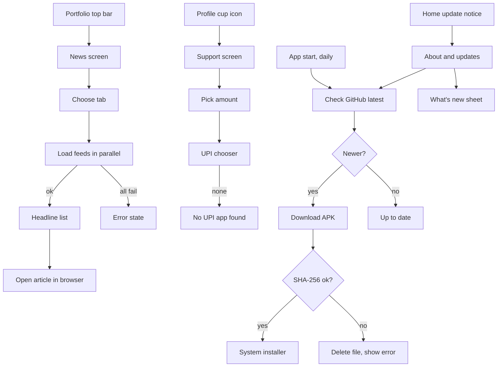

# News, Support and Updates

| Field | Value |
|---|---|
| Feature ID | F-31 |
| Status | In progress (news, Support, About and update check done in Dart; Kotlin `openUrl` hand-off unverified on device; in-app download with checksum, What's new bundled changelog, Home notice and Profile cup entry pending) |
| Priority | P2 |
| Phase | 5 |
| Last Updated | 2026-10-21 |

## 1. Description

News, Support and Updates covers three small optional pieces that reach outside the app. Market news is a read-only list of headlines from public Indian business feeds; Support hands the user to any UPI app to make a donation; Updates checks for a new app version, checks it is genuine, and hands it to the phone's installer. None of them sends user data or affects the core ledger.

## 2. What This Feature Will Do

- Shows market headlines in four tabs (Latest, Markets, Business, Stocks), newest first.
- Fetches each tab's feeds together and skips any feed that fails.
- Removes duplicate headlines and keeps at most 200 items.
- Keeps each tab's result for 10 minutes and refreshes on pull-down or Try again.
- Opens a tapped headline in the phone's browser.
- Shows a Support page with amount choices of 100, 200, 500 or a custom amount, and opens a UPI app with the payment prefilled.
- Hides the Support entry when no donation address is configured.
- Checks for a newer app version at start at most once a day, or on demand.
- Downloads the new version, verifies its checksum and refuses to install it if the check fails.
- Hands a verified download to the phone's installer.
- Shows a What's new sheet with cleaned release notes and up to two earlier versions.
- Shows clear, non-fatal messages when the network fails.

### 2.1 Inputs

- The user opening News, Support or the update controls, choosing a tab, amount or Check for updates.
- Public headline feeds from Indian business publications.
- The project's release information and installable file on GitHub.
- The update-check setting and the time of the last check.
- The donation address from configuration.

### 2.2 Processing

1. For News, fetch the tab's feeds in parallel, read titles, links and dates, clean titles, merge, sort newest first, remove repeats and cache the result.
2. For Support, build a UPI payment link from the chosen amount and open the phone's app chooser.
3. For Updates, ask GitHub for the latest release, compare its version with the installed one, and report the state.
4. When the user installs, download the file, check its checksum if one is published, and delete it on mismatch.
5. On a good checksum, mark the app lock to skip once and open the system installer (see [Security and privacy](25_security_privacy.md)).

### 2.3 Outputs

- A headline list with loading, error and empty states.
- A phone UPI chooser for donations, with a No UPI app found message when needed.
- Update states shown on the About screen ([Data sources and settings](26_settings_data_sources.md)), the What's new sheet and a Home notice.
- A saved time of the last update check.
- Nothing stored about donations, and no user data sent in any request.

### 2.4 Out of Scope

- The About and updates screen layout beyond update states (see [Data sources and settings](26_settings_data_sources.md)).
- Language packs (see [Localization](29_localization.md)).
- Store-based updates as an alternative.
- Reading articles inside the app, saved articles and news personalisation.
- Checking that a donation was actually paid.

## 3. Behaviour in Existing App

Source: `existing_app_analysis.md` Part A 2.9 (Support, WhatsNew, Settings), 4.8, 4.12, 5; Kotlin refs relative to `hisaab_apk/app/src/main/kotlin/com/hisaab/app/`: `ui/news/NewsScreen.kt`, `ui/more/SupportScreen.kt:89`, `ui/more/WhatsNew.kt`, `update/Updater.kt`, `settings/SettingsScreen.kt:44`.

### 3.1 News

- Route `news`, reached from the Portfolio top-bar newspaper icon (not in More). Title "Market news" with a one-line subtitle of publication names joined by " · " (`Business Standard · Economic Times · Moneycontrol · Mint`, derived from the feeds in order of first appearance).
- Four tabs (Segmented, `NewsFeed`): **Latest**, **Markets**, **Business**, **Stocks**. Each merges several public RSS feeds:

| Tab | Source | Feed URL |
|---|---|---|
| Latest | Business Standard | `https://www.business-standard.com/rss/latest.rss` |
| Latest | Economic Times | `https://economictimes.indiatimes.com/rssfeedsdefault.cms` |
| Latest | Moneycontrol | `https://www.moneycontrol.com/rss/latestnews.xml` |
| Latest | Moneycontrol | `https://www.moneycontrol.com/rss/MCtopnews.xml` |
| Markets | Economic Times | `https://economictimes.indiatimes.com/markets/rssfeeds/1977021501.cms` |
| Markets | Business Standard | `https://www.business-standard.com/rss/markets-106.rss` |
| Markets | Mint | `https://www.livemint.com/rss/markets` |
| Markets | Moneycontrol | `https://www.moneycontrol.com/rss/marketreports.xml` |
| Business | Business Standard | `https://www.business-standard.com/rss/companies-101.rss` |
| Business | Business Standard | `https://www.business-standard.com/rss/economy-102.rss` |
| Business | Economic Times | `https://economictimes.indiatimes.com/news/economy/rssfeeds/1373380680.cms` |
| Business | Moneycontrol | `https://www.moneycontrol.com/rss/business.xml` |
| Stocks | Economic Times | `https://economictimes.indiatimes.com/markets/stocks/rssfeeds/2146842.cms` |
| Stocks | Moneycontrol | `https://www.moneycontrol.com/rss/buzzingstocks.xml` |

  Code comment: "Moneycontrol's feeds stopped updating, so current publications are merged in alongside them."
- Fetch (`NewsRepository.load`): all feeds of the tab in parallel on IO; each fetch has User-Agent `Mozilla/5.0 (Android) DhanKosh`, connect timeout 10 s, read timeout 15 s, non-2xx raises `HTTP <code>`. A feed failing individually is ignored; if ALL fail the load errors ("No feed reachable").
- Parse: `XmlPullParser`; collect `item` elements with `title`, `link`, `pubDate` (TEXT and CDATA accumulated and trimmed); date parsed as RFC 1123 (`DateTimeFormatter.RFC_1123_DATE_TIME`), null if unparsable. Title cleaning: strip `<...>` tags, decode `&amp; &quot; &#39; &apos;`, collapse whitespace. Items with blank title or link are dropped.
- Merge: flatten, sort by published time descending (missing date = epoch), `distinctBy link`, then `distinctBy normalised title` (lower-case, letters and digits only), `take(200)`.
- Cache: in-memory per tab for 10 minutes (`System.currentTimeMillis() - cached < 10 * 60_000`); pull-to-refresh or "Try again" forces reload. Cache is not persisted.
- UI states: loading skeleton (6 `SkeletonCard`s: two grey bars and a short bar); list; error state with cloud-off icon, "Couldn't load headlines", "Check your connection and try again.", "Try again" button. Selecting a tab clears the list and loads (cache honoured). Pull-to-refresh indicator when loading with items present.
- Headline card: 3 dp accent rule (40 dp tall for the lead item, 28 dp otherwise), title (lead 17 sp bold, others 15 sp semibold, max 3 lines), subtitle `source · age` (12 sp), and an "Open in browser" icon. Age: "just now" (under 1 min), "{n}m ago" (under 60 min), "{n}h ago" (under 24 h), else "{n}d ago". Tap opens the link in the external browser via `ACTION_VIEW` (nothing is embedded).
- Nothing about the user is sent.

### 3.2 Support (`SupportRoute`, `ui/more/SupportScreen.kt:89`, "Support DhanKosh")

- Reached from the Profile top-bar cup icon, shown only when `SupportConfig.available(context)` is true.
- `SupportConfig`: `UPI_ID` (hard-coded personal VPA, a phone-number-based handle on the `@ybl` handle, masked here as `80xxxxxx10@ybl`), `PAYEE_NAME = "DhanKosh"`, `QR_ASSET = "support_qr.webp"` (not present in assets). `available` = `UPI_ID.isNotBlank() || assetExists`. The id is used only inside the link and is never displayed. The code comment says: "Fill UPI_ID; until then the Support button stays hidden."
- Link: `upi://pay?pa=<Uri.encode(UPI_ID, "@.")>&pn=DhanKosh&cu=INR` plus `&am=<rupees>` when the amount is positive.
- Layout: intro card with a coffee icon, title "Support DhanKosh" and "DhanKosh is free, private and built by one developer. If it helps you, you can buy the developer a coffee."; "Amount" card with pills `₹100`, `₹200`, `₹500`, `Custom` (tap again to deselect; Custom reveals a numeric field "Amount (₹)", digits only, at most 6); a full-width "Pay with a UPI app" button (52 dp); footer "Thank you. DhanKosh stays free either way.".
- Pay action: `ACTION_VIEW` on the UPI URI wrapped in a chooser titled "Pay with"; if no app handles it, toast "No UPI app found". With no amount selected the link has no `am` and the UPI app asks for it.
- The in-house QR generator `ui/more/QrCode.kt` (244 lines; byte mode, ECC M, versions 1 to 20) appears unused by the screen read.
- No payment confirmation is received or recorded; nothing is stored.

### 3.3 Updates (`Updater`, `update/Updater.kt`)

- Check: `GET https://api.github.com/repos/DhyanendraSinghSikarwar/hisaab_apk/releases/latest`, header `Accept: application/vnd.github+json`, connect timeout 15 s, read timeout 20 s, no payload. HTTP 404 means "no release" (treated as up to date); other non-2xx throws `GitHub answered <code>`.
- Parse: first asset whose `name` ends with `.apk` (none means no release); `tag_name` with a leading `v` removed is the version; `body` is the notes; SHA-256 is read with regex `sha256:\s*([0-9a-fA-F]{64})` from the body; notes exclude lines starting with `sha256:`; `size` from the asset.
- Version compare `isNewer(candidate, current)`: split on `.` and `-`, non-numeric parts count as 0, compare numerically part by part (so `1.10.0` > `1.9.2`); equal means not newer. `current` = `BuildConfig.VERSION_NAME` (`2.9.8`).
- `UpdateState`: Idle, Checking, UpToDate, Available(release), Downloading(release, progress), Failed(message). Failure text: "Couldn't check for updates: {reason}" (reason defaults to "no connection").
- `checkIfDue()` runs at app start: skipped when `check_updates` is false or `now - last_update_check < 24 h`; `last_update_check` is written after each successful check (including up-to-date).
- Download: clears `cacheDir/updates/`, file `DhanKosh-<version>.apk`; follows up to 5 manual redirects (GitHub CDN) with connect 15 s, read 30 s; 64 KB buffer; progress = bytes / (Content-Length or release size). Failure text: "Download failed: {reason}".
- Verify: when a SHA-256 is present in the notes, compute the file's SHA-256 (hex, lower-case) and compare case-insensitively; mismatch deletes the file and fails with "The download didn't match its checksum, so it wasn't installed. Try again."; when no checksum is published the file is installed unverified (see Open Questions).
- Install: `ACTION_VIEW` with MIME `application/vnd.android.package-archive` through FileProvider authority `<package>.updates` (`res/xml/update_paths.xml`, paths `cache/updates/` and `cache/shared/`), `FLAG_GRANT_READ_URI_PERMISSION | FLAG_ACTIVITY_NEW_TASK`. Needs `REQUEST_INSTALL_PACKAGES`. Android verifies the APK signature. `AppLockGate.skipNextLock()` is called before the installer (see [Security and privacy](25_security_privacy.md)).
- Home shows an update notice that navigates to the About & updates screen (see [Data sources and settings](26_settings_data_sources.md) for the screen shell).

### 3.4 About & updates screen (`settings/SettingsScreen.kt:44`)

App name, version with the WhatsNew button, Updates card (Check for updates; Checking…; "You have the latest version."; error; Available shows an Install button with version; Downloading shows a progress bar), and a privacy note. `check_updates` has a setter but no switch (Open Question, shared with file 26).

### 3.5 What's new (`WhatsNewButton`, `ui/more/WhatsNew.kt`)

- An (i) icon (content description "What's new") opens a `ModalBottomSheet` (skip partially expanded). Title "What's new"; subtitle "DhanKosh {version} is available" when an update is Available or Downloading, else "Version {version}".
- Points: the GitHub release notes cleaned by `cleanReleaseNotes` when present and non-empty; otherwise the bundled entry for that version; otherwise "Release notes aren't available.". Below: up to two earlier bundled versions, dimmed, each headed "Version {version}".
- `cleanReleaseNotes(body, maxLines = 12)`: trim lines; drop lines starting with `sha256:` or `full changelog` (case-insensitive); replace markdown links `[text](url)` with `text`; strip leading `#`s, list markers (`-*+`) and `*_\`` runs; remove commit hashes (`\(?\b[0-9a-f]{7,40}\b\)?`); collapse whitespace; drop empty lines; keep at most 12.
- Bundled changelog (`bundledChangelog()`, newest first; strings translated through `t()`):
  - 2.9.0: Spent this month card on Home, following Period and Book; Credit card dues with billed, unbilled and limit, editable on the card page; Card bill reminders with Mark paid; Payments linked to loans, and duplicate loans merged; Holdings files from Groww, Zerodha, Kuvera and INDmoney; Untracked payments detected from the next balance; Transfers between your accounts and cards; card bills never counted as spend; One transaction per payment across SMS, email and notifications; 49 more brand logos.
  - 2.7.0: Sync also re-reads the last 14 days of SMS; Separate Credit cards card on Home with the billed amount to pay; Choose which money counts in net worth; Add and remove loans; What's new and a Support page.
  - 2.6.0: New DhanKosh shield logo and colours, plus a Fold theme; Seven language packs, downloaded on demand; Activity log, duplicate account merge and bank, type and source filters; Loans from NBFC lenders, with their EMIs; NPS, Groww and mutual fund holdings with invested value and gains; Market news from several sources, newest first.
  - 2.4.0: Loan tracker with EMIs, payoff and amortisation; Profile redesign with photo crop and zoom; Hero and Cinema themes, pure-black dark mode; Cleaner transaction rows with coloured amounts; Smoother animations and haptics.
  - 2.2.0: Global Personal / Business book across the app; Net worth split by account; CAS, Excel and CSV statements, and Groww-style fund emails; Tax centre what-if, shareable as image or PDF; Extra themes and softer animations.
- Note: the bundled list has no entry for the installed 2.9.8 (latest bundled is 2.9.0), so offline it shows "Release notes aren't available." (Open Question).

### 3.6 Permissions and network

`INTERNET` (news, GitHub API and assets, packs), `REQUEST_INSTALL_PACKAGES` (installer hand-off). TLS only (see [Security and privacy](25_security_privacy.md)). No Play Services, no analytics.

## 4. User Stories

- As an investor, I want recent market headlines from trusted Indian publications in one list, newest first, and tap to read the full story in my browser.
- As a user, I want news to load quickly and still work if one source is down.
- As a user, I want to support the developer with a quick UPI payment of a preset or custom amount, without the app recording anything.
- As a user, I want to be told when a new version exists, see what changed, and install it safely (checksum verified).
- As a user, I want update checks to send nothing about me.

## 5. Functional Requirements (FR-31-01 ...)

- FR-31-01: News has four tabs (Latest, Markets, Business, Stocks) with the exact feed lists in Section 2.1; the default tab is Latest.
- FR-31-02: Feeds of the selected tab are fetched in parallel with User-Agent `Mozilla/5.0 (Android) DhanKosh`, connect 10 s, read 15 s; a feed failing individually is skipped; if all fail the tab shows the error state.
- FR-31-03: RSS `item` entries are parsed for `title`, `link`, `pubDate`; titles are cleaned (tags removed, the five listed entities decoded, whitespace collapsed); items without title or link are dropped; `pubDate` is parsed as RFC 1123, unparsable dates become null.
- FR-31-04: Merged items are sorted newest first (null date last), de-duplicated first by link then by normalised title (lower-case letters and digits only), and capped at 200.
- FR-31-05: Each tab's result is cached in memory for 10 minutes; pull-to-refresh and "Try again" bypass the cache.
- FR-31-06: News shows skeleton cards (6) while loading with no items, the headline list when items exist, and the error state ("Couldn't load headlines", "Check your connection and try again.", "Try again") when loading failed with no items.
- FR-31-07: A headline card shows an accent rule, title (3 lines max), `source · age` and an open-in-browser icon; the first item is larger; age strings are "just now", "{n}m ago", "{n}h ago", "{n}d ago".
- FR-31-08: Tapping a headline opens its link in the external browser; failures are ignored silently.
- FR-31-09: The news request carries no user identifiers or app data.
- FR-31-10: The Support page is available only when a UPI id (or QR) is configured; otherwise the entry point (Profile cup icon) is hidden.
- FR-31-11: The Support page shows the intro card, amount pills ₹100, ₹200, ₹500 and Custom (digits only, max 6), the "Pay with a UPI app" button and the thank-you footer.
- FR-31-12: The pay action opens a chooser with the link `upi://pay?pa=<VPA>&pn=DhanKosh&cu=INR[&am=<rupees>]` (VPA percent-encoded except `@` and `.`); with no UPI handler it shows "No UPI app found".
- FR-31-13: The VPA is loaded from configuration (not hard-coded in source) and is never displayed in the UI.
- FR-31-14: The app stores nothing about donations.
- FR-31-15: The update check performs `GET .../releases/latest` with `Accept: application/vnd.github+json`, connect 15 s and read 20 s; 404 yields "up to date"; other non-2xx yields Failed("Couldn't check for updates: {reason}").
- FR-31-16: Release parsing selects the first `.apk` asset, version from `tag_name` without leading `v`, notes from `body` without `sha256:` lines, and SHA-256 via `sha256:\s*([0-9a-fA-F]{64})`.
- FR-31-17: `isNewer` compares dot/dash separated numeric parts (non-numeric as 0) so `1.10.0 > 1.9.2` and equal versions are not newer.
- FR-31-18: The update check runs at app start at most once every 24 hours and only when `check_updates` is true; a manual "Check for updates" ignores the gate; `last_update_check` is saved after each successful check.
- FR-31-19: The UpdateState machine exposes Idle, Checking, UpToDate, Available, Downloading(progress 0..1) and Failed(message) to the About screen, the What's new sheet and the Home notice.
- FR-31-20: Download saves to the cache `updates/DhanKosh-<version>.apk` after clearing older files, follows up to 5 redirects, reports progress, and fails with "Download failed: {reason}" on error.
- FR-31-21: When a SHA-256 is published, the file hash must match (case-insensitive) or the file is deleted and the error "The download didn't match its checksum, so it wasn't installed. Try again." is shown; the installer is never launched on mismatch.
- FR-31-22: On success the app hands the APK to the system installer (package-archive MIME, FileProvider URI, read grant) after setting the app-lock skip flag.
- FR-31-23: The What's new sheet shows the version subtitle, cleaned release notes (or the bundled entry, or "Release notes aren't available."), and up to two earlier bundled versions.
- FR-31-24: `cleanReleaseNotes` implements the exact stripping rules of Section 2.5 and limits output to 12 lines.
- FR-31-25: All captions and messages are translatable through `t()`.
- FR-31-26: Network failures in all three sub-features are non-fatal and show the stated messages.
- FR-31-27: The release feed (GitHub release, signed APK asset, SHA-256 and release notes) consumed by the updater is produced by the pipeline in [Release pipeline](32_release_pipeline.md); this feature owns only consumer behaviour (FR-31-18 to FR-31-26).

## 6. Non-Functional Requirements (performance, battery, privacy, offline)

- News first paint from cache under 100 ms; network load typically under 3 s; parsing off the UI isolate.
- No background polling of news; the update check is at most daily at launch; downloads only on user action.
- Download uses a 64 KB buffer and streams to disk; progress updates throttled to about 10 per second.
- Offline: news shows cached items if any, else the error state; Support works without network (the UPI app handles payment); updates show a failure message.
- Privacy: only anonymous GETs (plus UA string for RSS); no cookies, no identifiers; headline taps leave the app.
- Security: HTTPS only for feeds, GitHub API and downloads; checksum verification; Android enforces signature match.

## 7. UI / Screens & User Flow (screen list + flow diagram)

| # | Screen / dialog / sheet | Source ref |
|---|---|---|
| 1 | News screen with 4 tabs and pull-to-refresh | `ui/news/NewsScreen.kt` (`NewsRoute`) |
| 2 | News loading skeleton | `NewsScreen.kt` (`SkeletonCard`) |
| 3 | News error state | `NewsScreen.kt` |
| 4 | Headline card (lead and normal) | `NewsScreen.kt` (`HeadlineCard`) |
| 5 | Support screen | `ui/more/SupportScreen.kt:89` |
| 6 | Custom amount field and UPI chooser | `SupportScreen.kt` |
| 7 | "No UPI app found" toast | `SupportScreen.kt` |
| 8 | About & updates screen (update states) | `settings/SettingsScreen.kt:44` |
| 9 | Update available notice on Home | Home screen (entry only) |
| 10 | What's new bottom sheet | `ui/more/WhatsNew.kt` |
| 11 | System package installer | OS |



Reference GIFs (Status: Pending, not yet captured):

-  (Status: Pending, not yet captured)
-  (Status: Pending, not yet captured)
-  (Status: Pending, not yet captured)
-  (Status: Pending, not yet captured)
-  (Status: Pending, not yet captured)
-  (Status: Pending, not yet captured)
-  (Status: Pending, not yet captured)
-  (Status: Pending, not yet captured)
-  (Status: Pending, not yet captured)
-  (Status: Pending, not yet captured)
-  (Status: Pending, not yet captured)
-  (Status: Pending, not yet captured)
-  (Status: Pending, not yet captured)

## 8. Data Models (Dart entities + fields + types)

```dart
enum NewsFeed {
  latest('Latest'), markets('Markets'), business('Business'), stocks('Stocks');
  const NewsFeed(this.label);
  final String label;
}

@freezed
class FeedSource with _$FeedSource {
  const factory FeedSource({required String source, required String url}) = _FeedSource;
}

@freezed
class Headline with _$Headline {
  const factory Headline({
    required String title,
    required String link,
    DateTime? published,        // zoned, RFC 1123
    required String source,
  }) = _Headline;
}

@freezed
class NewsState with _$NewsState {
  const factory NewsState({
    @Default(NewsFeed.latest) NewsFeed feed,
    @Default([]) List<Headline> items,
    @Default(false) bool loading,
    @Default(false) bool failed,
  }) = _NewsState;
}

@freezed
class SupportConfig with _$SupportConfig {
  const factory SupportConfig({
    @Default('') String upiId,           // from remote/config, never hard-coded
    @Default('DhanKosh') String payeeName,
    String? qrAsset,
  }) = _SupportConfig;
  // available => upiId.isNotEmpty || qrAsset != null
}

@freezed
class Release with _$Release {
  const factory Release({
    required String version,             // tag_name without leading v
    required String notes,               // body without sha256: lines
    required String apkUrl,
    @Default(0) int sizeBytes,
    String? sha256,
  }) = _Release;
}

@freezed
sealed class UpdateState with _$UpdateState {
  const factory UpdateState.idle() = UpdateIdle;
  const factory UpdateState.checking() = UpdateChecking;
  const factory UpdateState.upToDate() = UpdateUpToDate;
  const factory UpdateState.available(Release release) = UpdateAvailable;
  const factory UpdateState.downloading(Release release, double progress) = UpdateDownloading;
  const factory UpdateState.failed(String message) = UpdateFailed;
}

@freezed
class ChangeEntry with _$ChangeEntry {
  const factory ChangeEntry({required String version, required List<String> points}) = _ChangeEntry;
}
```

## 9. Database Tables / Changes

No Drift tables. Persisted values (see [Data sources and settings](26_settings_data_sources.md)):

| Key | Type | Default | Use |
|---|---|---|---|
| `check_updates` | bool | true | daily check gate |
| `last_update_check` | int? (epoch ms) | none | 24 h gate |

News cache is in memory only (10 minutes per tab). Downloaded APK lives in the cache directory `updates/` (cleared before each download). Bundled changelog is a Dart constant list (or an asset `assets/changelog.json`).

## 10. Business Rules & Logic (regex, parsing rules, algorithms, thresholds)

- News: parallel fetch; per-feed failure tolerated; all-fail is an error; sort desc by published (null as epoch); dedupe by link then by `title.toLowerCase().replaceAll(RegExp(r'[^a-z0-9]'), '')` (letters and digits; for non-Latin titles keep Unicode letters and digits); `take(200)`; cache TTL 10 min; tag-strip regex `<[^>]+>`; entities `&amp;`, `&quot;`, `&#39;`, `&apos;`; whitespace regex `\s+` to a single space.
- Age text: `<1 min` just now; `<60 min` `{n}m ago`; `<24 h` `{n}h ago`; else `{n}d ago`.
- UPI link: `upi://pay?pa=${encode(vpa, keep '@' and '.')}&pn=${encode(payee)}&cu=INR` + `&am=$amount` only if `amount > 0`; custom amount digits only, max 6 digits (up to 999,999 rupees); empty custom means no `am`.
- Updates: `isNewer` algorithm (split on `.` and `-`; non-numeric = 0; pad with 0; first differing part decides). SHA regex `sha256:\s*([0-9a-fA-F]{64})`. Daily gate `now - lastCheck >= 86,400,000 ms`. Redirect limit 5. Timeouts check 15 s / 20 s, download 15 s / 30 s. 404 means no release.
- Release notes cleaning (Section 2.5 regexes) with `maxLines = 12`.
- Checksum comparison: hex lower-case of SHA-256 over the whole file, case-insensitive compare.

## 11. Platform / Native Requirements (permissions, channels, background work)

- Permissions: `INTERNET`; `REQUEST_INSTALL_PACKAGES` for sideload installs (the Play Store build must not include it and should use Play In-App Updates instead; see Open Questions).
- FileProvider with authority `${applicationId}.updates` and `res/xml/update_paths.xml` (`cache-path` for `updates/` and `shared/`); flutter `open_filex` or a native MethodChannel to launch `ACTION_VIEW` with `application/vnd.android.package-archive` and `FLAG_GRANT_READ_URI_PERMISSION`.
- The user must allow "Install unknown apps" for the app; handle the settings redirect when denied.
- UPI: `url_launcher` with `LaunchMode.externalApplication` for `upi://pay` (Android 11+ needs a `<queries><intent><action android:name="android.intent.action.VIEW"/><data android:scheme="upi"/></intent></queries>` entry); a chooser via `android_intent_plus` (`ACTION_VIEW` with `Intent.createChooser`) reproduces the "Pay with" chooser.
- Browser: `url_launcher` external application mode for headlines (no in-app webview).
- Background: none (update check runs on app start, daily gate).
- Set the app-lock skip flag before installer, browser and UPI hand-offs (see [Security and privacy](25_security_privacy.md)).

## 12. Dependencies (other features → link to their memory file; packages)

Features:

- [Data sources and settings](26_settings_data_sources.md): About & updates screen shell, `check_updates` and `last_update_check` keys.
- [Security and privacy](25_security_privacy.md): network config, skip-lock flag, privacy table.
- [Localization](29_localization.md): captions and `t()`; language packs share the GitHub hosting.
- [Release pipeline](32_release_pipeline.md): producer of the release, APK asset, checksum and notes the updater reads.
- [Profile](27_profile.md): Support entry point (cup icon).
- [Theming and customisation](28_theming_customisation.md): accent colours and card styles.
- Portfolio (news entry icon) and Home (update notice): separate feature files.

Packages: `dio` or `http`, `xml` (RSS parsing), `intl` (RFC 1123 date parsing via `HttpDate.parse` from `dart:io` or `intl`), `url_launcher`, `android_intent_plus`, `open_filex`, `crypto` (SHA-256), `path_provider`, `package_info_plus`, `pull_to_refresh` (or `RefreshIndicator`), `riverpod`, `freezed`.

## 13. Folder Location (lib/features/<name>/...)

```text
lib/features/news/
  data/
    news_remote_source.dart        // fetch + RSS parse
    news_repository_impl.dart      // merge, dedupe, cache TTL 10 min
    news_feeds.dart                // 4 tabs x feed URLs
  domain/
    headline.dart
    news_repository.dart
  presentation/
    news_screen.dart
    headline_card.dart
    news_skeleton.dart
    providers.dart
lib/features/support/
  data/
    support_config_source.dart
  domain/
    support_config.dart
    upi_link_builder.dart
  presentation/
    support_screen.dart
lib/features/updates/
  data/
    github_release_source.dart
    apk_downloader.dart            // redirects, progress, sha256
    updater_impl.dart
  domain/
    release.dart
    update_state.dart
    version_compare.dart
    release_notes_cleaner.dart
    bundled_changelog.dart
  presentation/
    updates_card.dart              // embedded in About screen
    whats_new_button.dart
    whats_new_sheet.dart
    providers.dart
```

## 14. Edge Cases & Error Handling

- News: a feed returns HTTP error or malformed XML: skipped; items with no link or title dropped; dates in non-RFC formats become null and sort last.
- All feeds fail but cache exists: show cached items (existing app shows error only if no items); stale cache older than 10 min is still shown on failure.
- Switching tabs quickly: only the latest request's result is applied (the existing app checks that the selected feed is unchanged).
- Duplicate stories across publishers: removed by normalised-title match.
- Titles containing HTML entities beyond the five listed (for example `&#8217;`): shown raw today (Open Question).
- Support: no UPI app installed: toast "No UPI app found"; custom field empty: link without amount; custom amount over 6 digits cannot be typed; VPA missing: Support hidden.
- Updates: no assets or no `.apk` asset: treated as no release; GitHub rate limit (403) shows "GitHub answered 403"; no network shows "no connection"; download interrupted: partial file deleted on next download, error shown; checksum mismatch: file deleted, not installed; no SHA-256 in notes: installs unverified (Open Question); "Install unknown apps" not allowed: system settings prompt; low storage: download fails with the exception message.
- Version strings with pre-release suffix such as `2.10.0-beta`: split on `-`; `beta` becomes 0, so `2.10.0-beta` is treated as equal to `2.10.0` (Open Question).
- What's new: release with only commit hashes or markdown headings: cleaned to empty, falls back to bundled or the unavailable message.
- App lock: leaving for installer or browser must not lock on return (skip flag).

## 15. Test Cases (unit / widget / integration + sample fixtures)

Unit:

- TC-31-01 (FR-31-17): `isNewer('1.10.0','1.9.2')` true; `('2.9.8','2.9.8')` false; `('2.9.9','2.9.8')` true; `('2.9','2.9.0')` false; `('2.9.8','2.10.0')` false.
- TC-31-02 (FR-31-16): body `Fixes\nsha256: <64 hex>\nMore` yields sha256 captured and notes `Fixes\nMore`; a 63-char hash yields null.
- TC-31-03 (FR-31-16): releases JSON with assets `[app.aab, DhanKosh-2.9.9.apk]` selects the apk and tag `v2.9.9` yields version `2.9.9`; JSON with no apk yields null.
- TC-31-04 (FR-31-21): sha mismatch deletes the file and returns the checksum failure message; match returns the file.
- TC-31-05 (FR-31-18): gate false at 23 h, true at 24 h, false when `checkUpdates` false, manual check ignores the gate.
- TC-31-06 (FR-31-24): `cleanReleaseNotes` on `## Changes\n- Added **thing** (abc1234)\n[Docs](http://x)\nFull changelog: x\nsha256: ...` yields `Changes`, `Added thing`, `Docs`; more than 12 lines are truncated to 12.
- TC-31-07 (FR-31-03): RSS fixture with CDATA title `<![CDATA[Sensex &amp; Nifty <b>rise</b>]]>` cleans to `Sensex & Nifty rise`; item without link dropped; invalid date gives null.
- TC-31-08 (FR-31-04): two items with the same link merge to one; two with titles `RBI holds rates!` and `rbi holds rates` merge; 250 items cap to 200; order newest first with null dates last.
- TC-31-09 (FR-31-05): second `load` within 10 minutes makes no network call; with `force` it does; at 10 min 1 s it does.
- TC-31-10 (FR-31-07): age formatter boundaries: 30 s just now; 59 m `59m ago`; 60 m `1h ago`; 23 h `23h ago`; 24 h `1d ago`.
- TC-31-11 (FR-31-12): `upiLink(vpa:'abc@ybl', amount:null)` equals `upi://pay?pa=abc@ybl&pn=DhanKosh&cu=INR`; with 200 appends `&am=200`; amount 0 appends nothing.
- TC-31-12 (FR-31-02): one of four feeds throws; the result contains items from the other three; all four throwing raises the error.

Widget:

- TC-31-13 (FR-31-06): news screen shows 6 skeleton cards, then list, then error state with the exact copy.
- TC-31-14 (FR-31-10, FR-31-11): Support hidden when upiId empty; with a VPA the pills ₹100, ₹200, ₹500, Custom render; Custom field accepts only digits up to 6.
- TC-31-15 (FR-31-19, FR-31-23): About updates card renders each `UpdateState`; What's new sheet shows cleaned notes, then bundled fallback, then the unavailable message.
- TC-31-16 (FR-31-08): tapping a headline calls the launcher with its link in external mode.

Integration:

- TC-31-17 (FR-31-20, FR-31-22): fake GitHub server with one redirect serves an APK; progress reaches 1.0; hash verified; installer intent fired with the correct MIME.
- TC-31-18 (FR-31-26): airplane mode: news error, support still opens, update check shows "Couldn't check for updates: no connection".
- TC-31-19 (FR-31-09, FR-31-15): intercepted requests contain no custom headers beyond UA (news) and Accept (GitHub).

Fixtures: RSS 2.0 sample with CDATA, entity and missing-date items; GitHub release JSON with `.apk` asset and `sha256:` line; a 1 MB dummy APK with known SHA-256.

## 16. Acceptance Criteria

- AC-31-01: News tabs load, merge, dedupe, cap and cache exactly as specified, with the three view states (FR-31-01 to FR-31-07; TC-31-07 to TC-31-10, TC-31-12, TC-31-13).
- AC-31-02: Headline taps open the external browser and no user data is sent (FR-31-08, FR-31-09; TC-31-16, TC-31-19).
- AC-31-03: Support builds the correct UPI link, hides without configuration, and never shows the VPA (FR-31-10 to FR-31-14; TC-31-11, TC-31-14).
- AC-31-04: The update check, daily gating and version comparison behave as specified (FR-31-15 to FR-31-19; TC-31-01, TC-31-03, TC-31-05).
- AC-31-05: A downloaded APK is installed only if its SHA-256 matches when one is published (FR-31-20 to FR-31-22; TC-31-04, TC-31-17).
- AC-31-06: What's new shows cleaned notes with the specified fallbacks (FR-31-23, FR-31-24; TC-31-06, TC-31-15).
- AC-31-07: All failures are non-fatal with the stated messages and all text is translatable (FR-31-25, FR-31-26; TC-31-18).

## 17. Open Questions

1. The Support VPA is a hard-coded personal UPI handle in `SupportScreen.kt:66` (a phone-number-based `@ybl` id, masked here). Should the Flutter app keep donations at all? If yes, move the VPA to remote or build-time config; if the app is published on the Play Store, donation links outside Google Play billing may breach policy for in-app purchases of digital goods (a donation to a developer may need review).
2. `SupportConfig.QR_ASSET = "support_qr.webp"` is referenced but the asset is not present; `QrCode.kt` (in-house QR generator) is apparently unused. Show a QR for desktop or other-device payers, or drop both?
3. Updates: Flutter Android can distribute via Play Store (use `in_app_update`) or sideload (GitHub APK, SHA-256, `REQUEST_INSTALL_PACKAGES`). Which channel is the target? The two are mutually exclusive in practice, as Play forbids self-updating APKs.
4. When a release publishes no `sha256:` line, the APK is installed unverified (the signature check by Android is the only safeguard). Require a checksum in Flutter?
5. `check_updates` has no UI switch (shared with file 26); add one?
6. The bundled changelog has no entry for 2.9.8 (latest bundled is 2.9.0), so offline notes for the installed version are empty; bundle one per release in Flutter?
7. Version compare treats `-beta` suffixes as 0, so `2.10.0-beta` equals `2.10.0`; decide handling of pre-release tags.
8. HTML entity decoding covers only five entities; numeric entities like `&#8217;` appear raw. Decode all in Flutter?
9. Moneycontrol feeds reportedly stopped updating; verify each feed URL still serves items and keep, replace or drop dead ones; confirm the publisher terms permit RSS display in an app.
10. On all-feeds-fail with an existing (even stale) cache the existing code throws "No feed reachable" and `NewsViewModel.load` keeps previous items (`items ?: s.items`) while setting `failed=true`; the screen shows the list. Confirm this is intended.
11. Should news support more tabs or user-chosen sources, and should it respect the app language (all feeds are English)?
12. The update repository `DhyanendraSinghSikarwar/hisaab_apk` will differ for the Flutter app; define the release repo and tagging scheme.
13. Cross-links to Portfolio and Home feature files are by name only because their file names were not fixed when this file was written.

## 18. Implementation Notes

Code in `lib/features/news_support_updates/` (single feature folder, not the three folders of section 13) plus `lib/app/di/updates_providers.dart` (hand-written Riverpod providers, no codegen) and `lib/app/startup_tasks.dart`.

Done: News (FR-31-01..09): `domain/news.dart` (feed table, regex RSS parser, RFC 1123 parser, title cleaning, merge/dedupe/cap 200, age text), `data/news_remote_source.dart` (parallel `dart:io` HttpClient GETs, UA string, 10/15 s, per-feed failure tolerated), `NewsController` (10 min cache per tab), `NewsScreen` at `/news` (tabs, 6 skeletons, error state, pull to refresh, tap opens browser). No `xml` package was added, so parsing is regex based. Support (FR-31-10..14): `SupportScreen` at `/settings/support`, `buildUpiLink`, VPA from `--dart-define=SUPPORT_UPI_ID` (empty hides the More tile; never displayed; nothing stored). Updates (FR-31-15..19, 23 partly, 24): `GithubReleaseSource` (repo `DhyanendraSinghSikarwar/DhanKosh`, no identifiers sent), `parseRelease`, `isNewer`, `updateCheckDue` + `UpdateChecker` (daily gate via settings keys `check_updates` and `last_update_check`, stamp only on success, manual bypass), `cleanReleaseNotes`, `UpdateController`, `UpdatesScreen` at `/settings/updates` (version, update states, notes, privacy statement, licence note "all rights reserved" per ADR-0006). The daily check runs from `StartupTasks` at launch and resume. FR-31-26 failures are non-fatal. Installed version comes from `--dart-define=APP_VERSION` (default 0.1.0; the release workflow passes it) because `package_info_plus` is not a dependency.

Entry points: More tab tiles (News, Support, About and updates) via optional slots on `SettingsDataSourcesScreen`.

Native (UNVERIFIED): `com.hisaab/widget` channel (`WidgetBridge.kt`, method `openUrl` with optional chooser), attached in `MainActivity`; manifest `<queries>` for `upi` and `https` schemes.

Deferred (not built): in-app APK download, progress, SHA-256 verification and the FileProvider install (FR-31-20..22: Install currently opens the release APK URL in the browser/system via ACTION_VIEW, no checksum check, no `REQUEST_INSTALL_PACKAGES`), bundled changelog and What's new bottom sheet (notes show on the About screen), Home update notice, Portfolio and Profile entry icons, `t()` translations (FR-31-25).

Tests: `test/features/news_support_updates/` (`updates_domain_test.dart`: TC isNewer, release JSON fixtures, notes cleaning, throttle, checker incl. failure; TC-32-05 notes round trip; `news_domain_test.dart`: parse, merge, age, tabs; `news_support_screens_test.dart`: Support link, custom amount, no UPI app, About, install hand-off; `support_tile_test.dart`).

## 19. Change Log (date | change | reason)

| Date | Change | Reason |
|---|---|---|
| 2026-10-17 | Created from hisaab_apk 2.9.8 analysis | Initial |
| 2026-10-19 | Restructured to the 19-section standard (Description, What This Feature Will Do, Implementation Notes added); Last Updated bumped | Audit Gate (Prompt 2, Part A) |
| 2026-10-19 | Added FR-31-27 and dependency link to 32_release_pipeline.md as producer of the updater feed | Audit Gate gap, scan_N |
| 2026-10-21 | Phase 5 widget + updates + release pipeline landed | Phase 5 |
