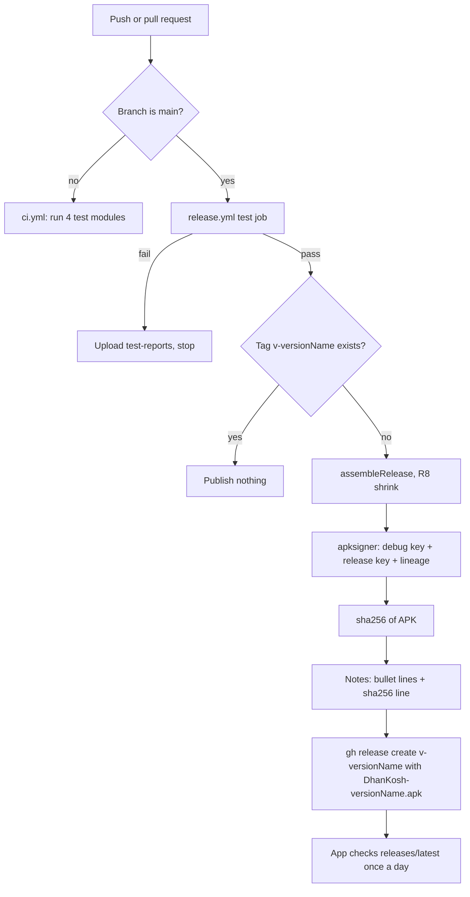

# Release Pipeline (CI, Signed APK, GitHub Release Notes)

| Field | Value |
|---|---|
| Feature ID | F-32 |
| Status | Existing |
| Priority | P2 |
| Phase | 5 |
| Last Updated | 2026-10-19 |

## 1. Description

The release pipeline is the behind-the-scenes machine that turns a finished version of the app into the download that people receive. When the developer raises the version number and saves the work to the main branch, a robot on GitHub runs all the automatic checks, builds the app, locks it with the developer's private signature, and publishes it as a "release" with a short list of what is new and a fingerprint of the file. The app on a phone looks at that release once a day and offers it as an update. Users never see the pipeline, but the in-app update only works if the pipeline keeps producing exactly what the app expects.

## 2. What This Feature Will Do

- Runs every automatic check on every change, and on the main branch also decides whether a new release is due.
- Publishes a release only when the version number is new and every check passed.
- Names the downloadable file `DhanKosh-<version>.apk`.
- Signs the file with the developer's release key and a proof that links it to the older key, so phones that have an earlier version accept it as an update.
- Writes the release notes from the developer's commit messages and adds a `sha256:` fingerprint line the app uses to verify the download.
- Keeps the contract with the in-app updater (see [News, Support and Updates](31_news_support_updates.md)) so the Flutter rebuild can keep using the same update path.

### 2.1 Inputs

- The source code pushed to a branch or pull request on GitHub.
- The app version (`versionName`, `versionCode`) written in the Android build file.
- Four secrets stored in the GitHub repository settings: the release keystore, its password, the original debug keystore and the key-lineage file.
- The commit messages since the last release (lines beginning with `- `).

### 2.2 Processing

1. On every branch push and pull request except main, run all automated test suites (CI).
2. On a push to main, run the same suites, then stop if any fail.
3. Read the version name from the build file and check whether the tag `v<version>` already exists; if it does, publish nothing.
4. Build the release APK (shrunk and obfuscated).
5. Sign it with the old debug key and the new release key together (key rotation), and print the signer for the log.
6. Compute the SHA-256 fingerprint of the signed APK.
7. Collect the feature lines from the commit messages, falling back to commit subjects.
8. Create the GitHub Release `v<version>` with the APK attached and the notes file as the description.

### 2.3 Outputs

- A GitHub Release tagged `v<version>` titled `DhanKosh <version>`.
- One attached file `DhanKosh-<version>.apk`, signed.
- Release notes: title line, a blank line, bullet lines, a blank line, then `sha256: <64 hex characters>`.
- On a test failure, an uploaded test report artifact and no release.

### 2.4 Out of Scope

- The in-app update screens and download logic (owned by [News, Support and Updates](31_news_support_updates.md)).
- Play Store or any other store publishing (not done by the existing pipeline; see Open Questions).
- Choosing the Flutter app's package name or key (decided in [Upgrade and Migration from the Kotlin App](33_upgrade_migration_from_kotlin.md)).
- Building an iOS app.
- Crash reporting, analytics or any telemetry (the app has none).

## 3. Behaviour in Existing App

Source: `hisaab_apk/.github/workflows/release.yml` (132 lines), `.github/workflows/ci.yml` (41 lines), `app/build.gradle.kts`, `app/proguard-rules.pro`, `AGENTS.md:37-44`, `README.md:156-182`, `docs/audit/scan_5_outputs_strings_integrations.md` rows 38 and 41, `docs/audit/scan_4_settings_permissions_background.md` rows P7, P14.

### 3.1 CI (`ci.yml`)

- Triggers: every `pull_request` and every push to branches other than `main` (`ci.yml:4-7`; main runs the same tests inside `release.yml`). Concurrency group per ref with `cancel-in-progress: true` (`ci.yml:9-11`).
- One job `test` on `ubuntu-latest`, 45 min timeout (`ci.yml:13-16`): checkout, Temurin JDK 17 and 21 (`ci.yml:20-26`), Android SDK `platforms;android-37.0` and `build-tools;37.0.0` through `sdkmanager` (`ci.yml:28-29`), `gradle/actions/setup-gradle@v4`.
- Command (`ci.yml:34`): `./gradlew --no-configuration-cache :parser-core:test :shared:testDebugUnitTest :email:testDebugUnitTest :app:testDebugUnitTest` (four modules).
- On failure it uploads `**/build/reports/tests/**` as artifact `test-reports` (`ci.yml:36-41`). Nothing is built for release in CI.

### 3.2 Release (`release.yml`)

- Triggers: `push` to `main` and `workflow_dispatch` (`release.yml:14-17`). Concurrency group `release`, no cancel (`release.yml:19-21`). Permission `contents: write` (`release.yml:23-24`).
- Header comment (`release.yml:1-11`): a release is made only when `versionName` in `app/build.gradle.kts` is new (no tag `v<versionName>` yet); required secrets `HISAAB_RELEASE_KEYSTORE` (base64 of `hisaab-release.jks`), `HISAAB_KEYSTORE_PASSWORD` (same for store and key), `HISAAB_DEBUG_KEYSTORE` (base64 of the original `debug.keystore`, signs the rotation proof), `HISAAB_KEY_LINEAGE` (base64 of `lineage.bin`, debug key to release key).
- Job `test` (`release.yml:27-48`): same environment and the same four-module command as CI (`release.yml:42`); `test-reports` upload on failure.
- Job `release` (`release.yml:50-132`), `needs: test` so nothing is published unless every test passed; 60 min timeout; checkout with `fetch-depth: 0` (needed for tags and history).
- Step "Version" (`release.yml:59-69`): `name=$(sed -n 's/^ *versionName = "\(.*\)"/\1/p' app/build.gradle.kts)`; `git rev-parse "v$name"` decides `exists=true|false`. Every later step is guarded by `exists == 'false'`.
- Step "Build release APK" (`release.yml:84-86`): `./gradlew --no-configuration-cache :app:assembleRelease`, output `app/build/outputs/apk/release/app-release.apk`.
- Step "Sign" (`release.yml:88-110`): fails with `::error::Signing secrets are missing` if any of the four secrets is empty (`release.yml:96-98`); decodes them into `$RUNNER_TEMP/keys`; output name `out="DhanKosh-${versionName}.apk"` (`release.yml:103`); command (`release.yml:104-107`):
  `apksigner sign --rotation-min-sdk-version 28 --v4-signing-enabled false --ks debug.keystore --ks-key-alias androiddebugkey --ks-pass pass:android --key-pass pass:android --next-signer --ks release.jks --ks-key-alias hisaab --ks-pass pass:<secret> --key-pass pass:<secret> --lineage lineage.bin --out <out> app-release.apk`
  using build-tools 37.0.0. It then runs `apksigner verify --print-certs` and greps the "Signer" lines (`release.yml:108`), deletes the key directory (`release.yml:109`) and exports `APK=<out>` (`release.yml:110`).
- Step "Publish the release" (`release.yml:112-132`):
  - `sha=$(sha256sum "$APK" | cut -d' ' -f1)` (lower-case hex, `release.yml:117`).
  - Commit range = last tag (`git describe --tags --abbrev=0`) or the root commit, to `HEAD` (`release.yml:118`).
  - Notes body = lines starting with `- ` from commit bodies (`git log --pretty='%b' | grep -E '^- ' | head -40`, `release.yml:121`). If none, fallback = commit subjects as `- ` lines with a leading `feat|fix|chore|docs|refactor(scope): ` and an optional `vX.Y.Z - ` removed, `head -30` (`release.yml:122-124`).
  - `notes.md` = `DhanKosh <version>`, blank line, features, blank line, `sha256: <hex>` (`release.yml:125-131`).
  - `gh release create "v<version>" "$APK" --title "DhanKosh <version>" --notes-file notes.md` (`release.yml:132`); `GH_TOKEN` is the workflow token.
- The commit convention that feeds the notes is `feat: vX.Y.Z - <short summary>` with `- ` bullet lines in the body (`AGENTS.md:41`).

### 3.3 Version bump rules

- To ship, raise both `versionCode` and `versionName` in `app/build.gradle.kts` (`AGENTS.md:38`; `README.md:165`). Current values `versionCode = 33`, `versionName = "2.9.8"` (`app/build.gradle.kts:18-19`).
- The pipeline keys off `versionName` only (tag `v<versionName>`); the in-app updater compares version names, not `versionCode` ([31](31_news_support_updates.md) section 3.3). Android itself refuses an install with a lower `versionCode`.
- Each release also adds a `CHANGELOG.md` entry (newest first) and the bundled list in `ui/more/WhatsNew.kt` (`AGENTS.md:44`). Version numbers are not contiguous (`CHANGELOG.md:5`).
- Pushes to main without a new `versionName` run tests only and publish nothing (`README.md:165-166`).

### 3.4 Build variants and shrinking

- Only `release` and the default `debug` exist; no product flavors (`app/build.gradle.kts:41-49`). `release`: `isMinifyEnabled = true`, `isShrinkResources = true`, ProGuard files `proguard-android-optimize.txt` and `proguard-rules.pro` (R8 full mode, the AGP default).
- `app/proguard-rules.pro` (14 lines): `-dontwarn` for OpenCSV bean classes (`java.beans`, commons beanutils, collections4, text), Ktor optional JVM classes (`org.slf4j`, `java.lang.management`); `-keepattributes SourceFile,LineNumberTable` and `-renamesourcefileattribute SourceFile` for readable crash traces.
- Local signing config reads `RELEASE_STORE_FILE` and related keys from `local.properties` or `HISAAB_STORE_FILE` and related environment variables (`app/build.gradle.kts:25-39`); without a store file the release build type falls back to the debug signing config (`app/build.gradle.kts:46-47`). The CI re-signs the unsigned or debug-signed output with apksigner, so this fallback is never what users receive.
- `ndk { abiFilters += arm64-v8a, armeabi-v7a }` (`app/build.gradle.kts:22`): one universal APK for phones, no x86; no per-ABI split APKs.
- `minSdk 26`, `targetSdk 36`, `compileSdk 37` (`app/build.gradle.kts:12,16-17`).
- Baseline profile: the `androidx.profileinstaller` library is a dependency (`app/build.gradle.kts:109`) but no `baseline-prof.txt` or Baseline Profile module exists in the repository (file search found only `proguard-rules.pro`). Startup is not tuned by a profile today.
- Local build mirror outside OneDrive and a local signed output `apk/Hisaab-<version>.apk` (gitignored) are documented in `AGENTS.md:30-35`; the local file name differs from the CI asset name.

### 3.5 Signing model

- Key rotation with APK Signature Scheme v3: first signer is the original Android debug key (alias `androiddebugkey`), next signer is the release key (alias `hisaab`), joined by `lineage.bin`, `--rotation-min-sdk-version 28` (`release.yml:104-107`). v4 signing is disabled.
- Purpose (README): earlier APKs were signed with the shared debug key; the app is now signed with Hisaab's own release key and "still installs over earlier versions" (`README.md:27-30,208`). Android refuses an update signed with a different key without a lineage link.
- Secrets are only in the GitHub repository settings (`README.md:172-182`); the key files live on the developer's build PC. They are not in the repository.

### 3.6 What the app consumes

[31](31_news_support_updates.md) section 3.3: `GET /repos/DhyanendraSinghSikarwar/hisaab_apk/releases/latest`; first asset whose name ends in `.apk`; version = `tag_name` without a leading `v`; notes = `body`; checksum = regex `sha256:\s*([0-9a-fA-F]{64})`; download cached as `DhanKosh-<version>.apk`; SHA-256 compared; Android checks the signature at install. This pipeline is the producer of exactly those fields.

## 4. User Stories

- As the developer, I want one push of a new version number to build, sign and publish the release without manual steps.
- As the developer, I want nothing published when any test fails.
- As a user, I want the in-app update to install over my current app and keep my data.
- As a user, I want the update checked against a fingerprint so a damaged download is rejected.
- As a user, I want "What's new" to show plain feature lines, not commit hashes.

## 5. Functional Requirements (FR-32-01 ...)

- FR-32-01: CI runs all test suites on every pull request and on every push to a non-main branch, and uploads test reports on failure.
- FR-32-02: A push to main runs the same suites first; the release job runs only if they all pass.
- FR-32-03: The release job reads the version name from the build file with the regex `^ *versionName = "(.*)"` and publishes only when the tag `v<versionName>` does not exist.
- FR-32-04: The release APK is built with code shrinking and resource shrinking enabled.
- FR-32-05: The APK is signed with apksigner using two signers (original debug key, then the release key) and the lineage file, with `--rotation-min-sdk-version 28` and v4 signing off, and the signer certificates are printed for verification.
- FR-32-06: The build fails with a clear error when any of the four signing secrets is missing; signing keys are never committed and are deleted from the runner after use.
- FR-32-07: The signed file is named `DhanKosh-<versionName>.apk`.
- FR-32-08: The release is created as tag `v<versionName>`, titled `DhanKosh <versionName>`, with that APK as its asset.
- FR-32-09: Release notes are `DhanKosh <versionName>`, a blank line, up to 40 `- ` lines taken from commit bodies since the last tag, a blank line, then `sha256: <lower-case hex SHA-256 of the APK>`.
- FR-32-10: When no commit body has `- ` lines, the notes use up to 30 commit subjects as `- ` lines with the conventional prefix and an optional `vX.Y.Z - ` removed.
- FR-32-11: Concurrent release runs are serialised, not cancelled.
- FR-32-12: Pushes that do not introduce a new version publish nothing.
- FR-32-13: Flutter contract: the Flutter release workflow keeps the asset name, tag, notes and checksum format in section 10 so the existing updater logic works unchanged.
- FR-32-14: Flutter contract: the release publishes exactly one `.apk` asset that runs on arm64-v8a and armeabi-v7a devices.
- FR-32-15: Flutter contract: the published APK is signed so Android accepts it as an update of the installed app (same package name and signing lineage, as decided in [33](33_upgrade_migration_from_kotlin.md)).

## 6. Non-Functional Requirements (performance, battery, privacy, offline)

- Time: test job limit 45 min, release job limit 60 min (`release.yml:29,53`).
- Reproducibility: the release is built from the pushed commit on a clean runner; the same test command is used by CI and release.
- Security: keys are base64 repository secrets, decoded into the runner temp directory and removed after signing (`release.yml:99-109`); the workflow token has only `contents: write`.
- Privacy: the pipeline touches no user data; the app sends nothing to GitHub except the anonymous update check ([31](31_news_support_updates.md)).
- Integrity: every release carries a SHA-256 of the exact signed file; Android enforces the signature.
- Offline: N/A - the pipeline runs on GitHub, not on the device.

## 7. UI / Screens & User Flow (screen list + flow diagram)

N/A - no screens; the pipeline has no user interface. The only visible results are the GitHub Release page and the in-app What's new sheet ([31](31_news_support_updates.md)). Flow:



Reference GIFs: N/A - no UI.

## 8. Data Models (Dart entities + fields + types)

N/A - the pipeline has no Dart entities. The app-side `Release` model that consumes its output is in [31](31_news_support_updates.md) section 8.

## 9. Database Tables / Changes

N/A - no database tables are involved.

## 10. Business Rules & Logic (regex, parsing rules, algorithms, thresholds)

Exact contract the Flutter app's release build must keep so the existing updater logic (FR-31-15 to FR-31-22) keeps working:

1. Tag: `v<versionName>`, where `<versionName>` is the user-visible version (`x.y.z`). The updater strips one leading `v`. In `pubspec.yaml` the part before `+` must equal `<versionName>`.
2. Version order: the installed `versionName` must compare lower than the release tag using `isNewer` (split on `.` and `-`, non-numeric parts count as 0). Pre-release suffixes such as `-beta` do not order correctly (see [31](31_news_support_updates.md) Open Question 7); use plain `x.y.z`.
3. Build number: the Android `versionCode` (the number after `+` in `pubspec.yaml`) must be greater than the installed one for every update; the Kotlin app's last value is 33 (`app/build.gradle.kts:18`).
4. Asset: exactly one asset whose name ends in `.apk`. Recommended name `DhanKosh-<versionName>.apk` (the updater only needs the `.apk` suffix, but caches the file under this name and the existing pipeline uses it). No other `.apk` asset may be listed before it, because the updater takes the first one.
5. APK content: a single universal APK for arm64-v8a and armeabi-v7a (the Kotlin app filtered ABIs the same way). Do not publish per-ABI split APKs as separate assets.
6. Checksum line: a line in the release body that matches `sha256:\s*([0-9a-fA-F]{64})`; written as `sha256: <hex>` on its own line, lower-case hex, computed with `sha256sum` over the final signed file (after signing, never before). Exactly one such line.
7. Notes: lines of the form `- <text>`; the updater shows the body minus `sha256:` lines, and the What's new sheet drops lines starting with `sha256:` or `full changelog`, strips markdown and commit hashes and keeps at most 12 lines (FR-31-24). Keep bullets short, plain and one feature per line, up to 40 lines.
8. Notes source: bullet lines come from commit bodies (`^- `) since the previous tag; fallback is commit subjects with the prefix stripped. Preserve this so release notes need no manual editing.
9. Signing: the final APK is signed with apksigner v3 using the same rotation lineage (or a lineage that extends it); the signer printed by `apksigner verify --print-certs` must be checked in the log. Without a valid lineage Android rejects the update.
10. Package name: the update installs over the installed app only if the `applicationId` is unchanged (see Open Questions and [33](33_upgrade_migration_from_kotlin.md)); the updater's FileProvider authority is `<applicationId>.updates`.
11. Repository: the updater reads `releases/latest` of one fixed repository. Old installs only see Flutter releases if they are published in `DhyanendraSinghSikarwar/hisaab_apk` as the latest release (see Open Questions).
12. Idempotence: publish only when the tag does not exist; never overwrite a published asset (the checksum would no longer match cached expectations).

## 11. Platform / Native Requirements (permissions, channels, background work)

- CI environment (existing): `ubuntu-latest` runner, Temurin JDK 17 and 21, Android SDK platform 37.0 and build-tools 37.0.0 (apksigner), Gradle with `--no-configuration-cache`.
- Flutter additions to the workflow: Flutter SDK setup (pinned stable version), `flutter pub get`, `dart run build_runner build -d`, `dart format --set-exit-if-changed .`, `flutter analyze`, `flutter test`, `flutter build apk --release` (R8/ProGuard rules for plugins), then the same apksigner step on the built APK. The Kotlin `:parser-core:test` style suites are replaced by Dart tests including the parser parity gate.
- On-device requirement the pipeline relies on: `REQUEST_INSTALL_PACKAGES` and the FileProvider (`<applicationId>.updates`, paths `cache/updates/` and `cache/shared/`) declared in the app manifest ([31](31_news_support_updates.md) section 11).
- No background work, channels or permissions of its own.

## 12. Dependencies (other features → link to their memory file; packages)

Features:

- [News, Support and Updates](31_news_support_updates.md): the consumer of this pipeline's output.
- [Upgrade and Migration from the Kotlin App](33_upgrade_migration_from_kotlin.md): package name, signing lineage and version continuity decisions.
- [Security and privacy](25_security_privacy.md): no cleartext, no analytics, key handling.
- [Data sources and settings](26_settings_data_sources.md): `check_updates` and `last_update_check`.

Tools: GitHub Actions (`actions/checkout@v4`, `actions/setup-java@v4`, `gradle/actions/setup-gradle@v4`, `actions/upload-artifact@v4`), `gh` CLI, `apksigner` 37.0.0, `sdkmanager`, `sha256sum`, `git`; for Flutter additionally `subosito/flutter-action` or equivalent (to be chosen).

## 13. Folder Location (lib/features/<name>/...)

N/A for `lib/`; the pipeline lives outside the app code:

```text
.github/workflows/
  ci.yml          // tests on PRs and non-main pushes
  release.yml     // tests, build, sign, publish on main when version is new
pubspec.yaml      // version: x.y.z+code (single source of the version)
CHANGELOG.md      // entry per release
```

## 14. Edge Cases & Error Handling

- Tag already exists: version step reports "already released; nothing to publish." and every build and publish step is skipped.
- Any signing secret empty: the job fails before building the signed file; no release is created.
- `versionName` line changed format (for example a different spacing or a variable): the `sed` match returns empty and the release would use an empty version; the Flutter workflow must read the version from `pubspec.yaml` and fail on an empty value.
- First release in a repository (no tags): the commit range falls back to the root commit.
- No commit body bullets and no matching subjects: the notes contain only the title and the checksum line.
- Two quick pushes: serialised by the `release` concurrency group, the second sees the tag and publishes nothing.
- Release created but workflow interrupted before upload: `gh release create` creates the tag and asset in one call, so a partial state is unlikely; if it happens the tag exists and the version is never re-published (manual cleanup needed).
- Unsigned or debug-signed APK accidentally published: Android rejects it as an update of installs signed with the release key.
- Test failure on main: nothing is published; the reports artifact is uploaded.

## 15. Test Cases (unit / widget / integration + sample fixtures)

- TC-32-01 (FR-32-03): version extraction on `versionName = "2.9.8"` returns `2.9.8`; for the Flutter workflow, `pubspec.yaml` `version: 3.0.0+34` returns name `3.0.0` and code `34`; an empty or missing value fails the job.
- TC-32-02 (FR-32-03, FR-32-12): with tag `v3.0.0` present the release steps are skipped; without it they run (dry-run on a scratch repository).
- TC-32-03 (FR-32-09): given three commits with `- ` body lines, `notes.md` has the title, those lines, a blank line and `sha256: <64 hex>`; more than 40 bullets are cut to 40.
- TC-32-04 (FR-32-10): commits `feat: v3.0.0 - Add X` and `fix(parser): Y` with no bullets produce `- Add X` and `- Y`.
- TC-32-05 (FR-32-09, FR-31-16): the notes of TC-32-03 fed to the updater's parser (the Dart `parseRelease`) yield the same 64-hex hash, and notes without the `sha256:` line.
- TC-32-06 (FR-32-07, FR-32-14): the release has exactly one asset, named `DhanKosh-<version>.apk`.
- TC-32-07 (FR-32-05, FR-32-15): `apksigner verify --print-certs` on the produced APK lists the release signer; installing it over a build signed with the earlier key succeeds on an API 28+ emulator (manual or scripted step).
- TC-32-08 (FR-32-06): running the sign step with one secret removed fails with the missing-secrets error.
- TC-32-09 (FR-32-01): a pull request with a failing test turns CI red and uploads `test-reports`.
- TC-32-10 (FR-32-13): end-to-end on a throwaway repository: publish release 9.9.9, run the Flutter updater logic against it, confirm Available, download, checksum match.

Fixtures: a small dummy APK with known SHA-256; a git history of three commits with and without bullet lines; a sample `pubspec.yaml`.

## 16. Acceptance Criteria

- AC-32-01: A push of a new version to main with passing tests produces one GitHub Release with the correct tag, title, single signed APK and notes in the contract format (FR-32-02, FR-32-03, FR-32-07 to FR-32-09; TC-32-02, TC-32-03, TC-32-06).
- AC-32-02: No release appears when tests fail, when the version is unchanged, or when a signing secret is missing (FR-32-02, FR-32-06, FR-32-12; TC-32-02, TC-32-08, TC-32-09).
- AC-32-03: The Flutter app's updater parses the published release without changes to its parsing logic (FR-32-13; TC-32-05, TC-32-10).
- AC-32-04: The signed APK installs as an update over the previous release (FR-32-05, FR-32-15; TC-32-07).

## 17. Open Questions

1. Signing lineage: the Kotlin app is signed with the rotated lineage debug key then release key (`hisaab`). Will the Flutter release be signed with the same lineage, or a new key (which forces a fresh install, see [33](33_upgrade_migration_from_kotlin.md))? The four secrets and the lineage file must be kept safe in either case; loss of the release keystore ends all in-place updates.
2. `--rotation-min-sdk-version 28` while `minSdk` is 26: what do devices on API 26 and 27 see as the signer, and can they update across the rotation? Not verified in the sources.
3. applicationId: `app/build.gradle.kts:15` sets `applicationId = "com.hisaab"` while the code namespace is `com.hisaab.app` (`app/build.gradle.kts:11`). `docs/audit/scan_5_outputs_strings_integrations.md` row 39 says the id is `com.hisaab.app`; the build file is the authority, so the installed package name is `com.hisaab`. Confirm with `adb shell pm list packages` on an installed 2.9.8, then reuse it in Flutter if in-place upgrade is chosen.
4. Release repository: the updater is hard-wired to `DhyanendraSinghSikarwar/hisaab_apk`. Should the Flutter app publish to the same repository (so old installs find it as `latest`) or to a new one (old installs never see it)? See [31](31_news_support_updates.md) Open Question 12.
5. Checksum is optional on the consumer side but always written by the pipeline. Make it mandatory in the Flutter updater (see [31](31_news_support_updates.md) Open Question 4)?
6. Pre-release or beta channel: none exists (tags are plain versions; `-beta` compares as equal). Needed?
7. Play Store distribution would need an AAB, Play App Signing and removal of self-update ([31](31_news_support_updates.md) Open Question 3); the existing pipeline produces only a sideload APK.
8. The step builds with `--no-configuration-cache` and JDK 17 and 21 together; the Flutter workflow needs its own pinned Flutter and Gradle versions. Which are chosen?
9. No Baseline Profile exists although `profileinstaller` is a dependency; set a startup target for Flutter or skip.
10. Notes depend on commit discipline (`- ` bullets); a squash-merge or an edited message can lose them and the fallback then shows commit subjects. Move notes to a `CHANGELOG.md` section instead?
11. `README.md` still describes an old APK (`apk/Hisaab-1.4.0.apk`) and the local build output name `Hisaab-<version>.apk` differs from the CI name `DhanKosh-<version>.apk`; treat the workflow as the source of truth.

## 18. Implementation Notes

N/A - not built yet.

## 19. Change Log (date | change | reason)

| Date | Change | Reason |
|---|---|---|
| 2026-10-19 | Created | Audit Gate gap |
