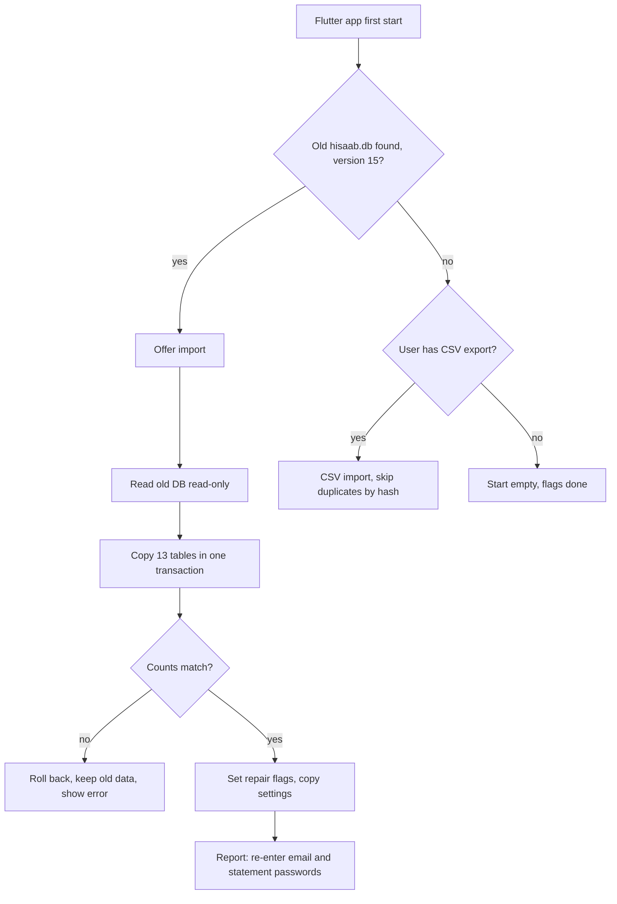

# Upgrade and Migration from the Kotlin App

| Field | Value |
|---|---|
| Feature ID | F-33 |
| Status | Proposed |
| Priority | P1 |
| Phase | 5 |
| Last Updated | 2026-10-19 |

## 1. Description

People already use the current DhanKosh app (version 2.9.8, built in Kotlin). When the rebuilt Flutter app arrives, they should be able to move over without losing their records, or at least know exactly what they will lose. This feature decides and specifies how that move works: whether the new app installs on top of the old one, how the saved transactions, accounts and settings are carried across, and which things (such as saved email and statement passwords) can never be carried and must be typed again. Nothing here is decided yet; every open decision is listed with its options.

## 2. What This Feature Will Do

- Lets an existing user move to the Flutter app with their ledger intact, by one of two routes: install over the old app and import its data automatically, or install fresh and import a CSV backup.
- Tells the user clearly what carried over and what needs to be set up again.
- Makes sure one-time repairs that the old app already ran are not run twice, and ones it never ran are applied to the carried data.
- Carries over the user's settings where that is safe.
- Records the old database's version history so the importer knows which versions it can read.

### 2.1 Inputs

- The old app's database file (`hisaab.db`, schema version 15, not encrypted) when the new app replaces the old one in place.
- Or a CSV file exported by the old app (15 columns), see [Backup and Export](24_backup_export.md).
- The old app's settings stores and small preference files (list in section 3.5).
- The user's choice of route and confirmation before anything is imported.

### 2.2 Processing

1. On first start, detect an old database or old settings left by the previous app.
2. Offer to import; show counts of what will come across.
3. Read the old database without changing it, copy rows into the new encrypted database in one transaction, check the counts, and only then mark the import done.
4. Copy the safe settings; leave out anything that was locked with the old phone-bound key.
5. Set the one-time repair flags correctly for the carried data.
6. Show a short report and a list of what must be set up again (email, statement passwords).

### 2.3 Outputs

- A new ledger with the old transactions, accounts and rules, or an explained partial result.
- An import report (counts per table, skipped rows, items to redo).
- Settings carried over.
- The old database file left untouched until the user confirms, or removed after a verified import (decision pending).

### 2.4 Out of Scope

- Importing from any other app.
- Carrying over saved email, Gmail or statement passwords (they cannot be read outside the old app's phone-bound key; see section 3.3).
- Cloud backup or restoring on a new phone (the old app disables Android backup; [Backup and Export](24_backup_export.md)).
- Building the release pipeline (see [Release Pipeline](32_release_pipeline.md)); this file only states what the pipeline must preserve.
- Migrating Flutter-to-Flutter database versions later (a normal Drift migration, see [Security and privacy](25_security_privacy.md) and the `drift-database` skill).

## 3. Behaviour in Existing App

Source (Kotlin refs relative to `hisaab_apk/`): `app/build.gradle.kts:11-19`, `shared/src/main/kotlin/com/hisaab/shared/db/HisaabDatabase.kt`, `shared/src/main/kotlin/com/hisaab/shared/di/SharedModule.kt:3-15`, `app/src/main/kotlin/com/hisaab/app/HisaabApplication.kt`, `email/src/main/kotlin/com/hisaab/email/auth/KeystoreSecret.kt`, `shared/schemas/com.hisaab.shared.db.HisaabDatabase/1.json` to `15.json`, `.github/workflows/release.yml:104`, `AGENTS.md:26`; docs `docs/audit/scan_5_outputs_strings_integrations.md` rows 39 and Gaps 1; `docs/audit/scan_4_settings_permissions_background.md` rows S31-S35; [Data sources and settings](26_settings_data_sources.md) lines 118-168, 354, 472.

### 3.1 Identity and signing of the existing app

- `namespace = "com.hisaab.app"`, `applicationId = "com.hisaab"`, `minSdk 26`, `targetSdk 36`, `versionCode 33`, `versionName "2.9.8"` (`app/build.gradle.kts:11-19`). Note: scan 5 row 39 states the id as `com.hisaab.app`; the build file says `com.hisaab` (see Open Question 1).
- Release APKs are signed with a v3 rotation lineage: original debug key, then the `hisaab` release key, `--rotation-min-sdk-version 28` (`release.yml:104`). `README.md:27-30,208`: earlier APKs used the debug key; Android refuses an update signed with another key.
- ABI filter arm64-v8a and armeabi-v7a (`app/build.gradle.kts:22`). `allowBackup=false` (`AndroidManifest.xml:20`), so there is no Android cloud or device-transfer restore of the data ([24](24_backup_export.md), [25](25_security_privacy.md)).

### 3.2 The old database

- Room database file name `hisaab.db` (`HisaabDatabase.NAME`, `HisaabDatabase.kt:44`), version 15 (`HisaabDatabase.kt:45`), opened with the bundled SQLite driver, migrations `Migrations.ALL`, no destructive fallback (`SharedModule.kt:6-10`). The file is plain SQLite: no SQLCipher, no encryption.
- 13 tables (`@Database` entities, `HisaabDatabase.kt:9-23`): `transactions`, `transaction_sources`, `processed_emails`, `accounts`, `budgets`, `deleted_messages`, `statements`, `holdings`, `merchant_rules`, `recurring`, `custom_categories`, `custom_subcategories`, `forex_rates`. Table names from the `@Entity` annotations in `Entities.kt`, `Categories.kt`, `Forex.kt`, `Investments.kt`, `Recurring.kt`.
- On every open the callback `ForexSql.install` recreates the triggers that keep `transactions.inrMinor` current (`SharedModule.kt:11-14`); they are not data.
- Statement PDF files are referenced by `statements.filePath` (files on disk in the old app's storage).
- Money is stored as integer minor units (`*Minor` columns), matching the Flutter rule of paise.

### 3.3 Sealed secrets

- Email app passwords (`mail_account`: `password`), Gmail token (`gmail_tokens`: `token`, `expires_at`) and statement passwords and identity (`statement_passwords`: `entries`, `account_details`, `identity`) are encrypted with an AES-256-GCM key held in the Android Keystore under an alias per store (`KeystoreSecret.kt:16,47-57`; `TokenStore.kt:24`, `MailAccountStore.kt:27`, `StatementPasswordStore.kt:60`).
- Project position ([26](26_settings_data_sources.md) line 354, 472): these cannot be migrated and must be re-entered. `KeystoreSecret.deleteKey()` exists (`KeystoreSecret.kt:36`); a different package or key gets no access to these Keystore keys.
- Consequence: after any route, email must be connected again (app password plus the 6-digit code, [03](03_email_ingestion.md)) and statement passwords and identity entered again ([05](05_statement_import.md)).

### 3.4 One-time flags and start-up repairs (`HisaabApplication.kt`)

Stored in SharedPreferences file `maintenance` (`HisaabApplication.kt:55,61,84`), keys at `HisaabApplication.kt:95-97`:

| Flag | Meaning | What runs | Source |
|---|---|---|---|
| `reparse_v1` | Re-read stored messages after the account-attribution parser fix so a masked mobile number or a payee account stops showing as the user's account | `transactions.reparseStored()` once, flag set only on success | `HisaabApplication.kt:78-91` |
| `app_rows_v1` | Re-attribute rows created from payment-app notifications | `transactions.reattributeAppRows()` once | `HisaabApplication.kt:54-58` |
| `cardbill_v1` | Credit card bill payments stored as spends become transfers | `transactions.reclassifyCardBills()` once | `HisaabApplication.kt:59-64` |

- Other start-up work that is not flagged and runs on every start: `holdings.dedupe()` (`HisaabApplication.kt:65-66`), `accounts.closeMatured(today IST)` (`:45`), card due check (`:42`), update check (`:46`).
- [26](26_settings_data_sources.md) line 354: the flags are not needed for a fresh Flutter database "unless data is imported from v2.9.8".

### 3.5 Settings and small stores to consider (inventory from [26](26_settings_data_sources.md) lines 118-168 and scan 4 rows S1-S35)

| Store | Keys | Contains secrets | Source |
|---|---|---|---|
| DataStore `app_settings` | `app_lock`, `theme`, `theme_palette`, `pure_black`, `text_scale`, `sms_enabled`, `sms_cursor`, `last_sms_scan`, `last_sms_result`, `sms_prompt_dismissed`, `app_notifications`, `notifications_asked`, `budget_alert_percent`, `alerted_keys`, `transaction_notifications`, `card_due_reminders`, `hide_amounts`, `check_updates`, `last_update_check`, `display_name`, `profile_email`, `profile_phone`, `profile_occupation`, `profile_photo`, `profile_prompt_dismissed` | No | `AppSettings.kt:167-191` |
| DataStore `tab_layout` | `order_home`, `order_analytics`, `order_portfolio`, `hidden`, flags `home_v2_seeded`, `home_spent_added`, `home_networth_left`, `analytics_when_last` | No | `TabLayout.kt:69,142-149` |
| DataStore `net_worth_prefs` | `excluded_classes`, `excluded_liabilities`, `excluded_accounts` | No | `NetWorthPrefs.kt:15,64-66` |
| DataStore `local_lists` | `worth` (up to 1100 daily net-worth points) | No | `LocalLists.kt:18,64` |
| DataStore `view_filter` | `book` | No | `Ledger.kt:103,135` |
| DataStore `language` | `language` | No | `I18n.kt:62,138` |
| DataStore `activity_log` | `entries` (max 200) | No | `ActivityLog.kt:85,146` |
| DataStore `card_due_reminders` | `sent`, `paid`, `snoozed` | No | `CardDueReminders.kt:68-80` |
| DataStore `untracked_gaps` | `dismissed`, `notified`, `choices` | No | `GapTracker.kt:23,36-38` |
| DataStore `loan_links`, `loan_dismissals` | `tx`, `payee`, `manual`; `payees` | No | `LoanLinkStore.kt:17-25`, `LoanDismissals.kt:15-21` |
| DataStore `gmail_settings` | `enabled`, `account`, `lookback_days`, `senders`, `read_pdf`, `history_id`, `last_sync`, `needs_reauth`, `last_result`, `connection`, `imap_synced_at[:email]` | No (but tied to sealed accounts) | `GmailSettings.kt:55,152-162` |
| SharedPreferences `payee_accounts` | payee key to accountId | No | `HisaabApplication.kt:51-53` |
| SharedPreferences `maintenance` | `reparse_v1`, `app_rows_v1`, `cardbill_v1` | No | `HisaabApplication.kt:55-97` |
| SharedPreferences `balance-updates` | per-account last notified day | No | `BalanceNotifications.kt:36` |
| SharedPreferences `mf-orders` | order dedupe key set | No | `StatementProcessor.kt:89` |
| SharedPreferences `nps-contributions` | `applied` key set (cap 500) | No | `NpsContributions.kt:29,72-81` |
| DataStore `gmail_tokens`, `mail_account`, `statement_passwords` | sealed values | Yes (Keystore-sealed) | see 3.3 |
| Files | `filesDir/lang/<code>.json`, `filesDir/profile-*.jpg`, statement PDFs, `cacheDir/updates/*.apk` | No | [26](26_settings_data_sources.md) line 168 |

DataStore preference files are protobuf files in the old app's private storage; they are readable only by an app running under the same package.

### 3.6 Room schema migrations (all 14, read from `HisaabDatabase.kt`)

| # | From to | Change | Source line |
|---|---|---|---|
| 1 | 1 to 2 | `accounts`: add `manualBalanceMinor`, `manualBalanceAt` | `HisaabDatabase.kt:54-61` |
| 2 | 2 to 3 | `accounts`: add `accountType`, `cardNetwork`, `linkedAccountId`; create `deleted_messages` | `:62-74` |
| 3 | 3 to 4 | create `statements` (unique `key`) and `holdings` (unique `identifier`) | `:75-93` |
| 4 | 4 to 5 | `statements`: add `kind`, `totalDueMinor`, `minDueMinor`, `dueEpochDay`, `creditLimitMinor`, `statementEpochDay` | `:94-102` |
| 5 | 5 to 6 | `holdings`: add `previousValueMinor`, `previousAsOf` | `:103-110` |
| 6 | 6 to 7 | `accounts`: add `hidden`; create `merchant_rules` | `:111-121` |
| 7 | 7 to 8 | create `recurring` | `:122-132` |
| 8 | 8 to 9 | `accounts`: add `usage` (default `PERSONAL`) | `:133-139` |
| 9 | 9 to 10 | `transaction_sources.subject`; `transactions.subcategory`, `customCategoryId`; create `custom_categories`, `custom_subcategories` (unique parent+name); `statements`: `openingMinor`, `closingMinor`, `debitsMinor`, `creditsMinor`, `availableMinor` | `:140-160` |
| 10 | 10 to 11 | `statements`: add `emailText` | `:161-167` |
| 11 | 11 to 12 | `transactions.inrMinor` (back-filled for INR); `accounts`: `maturityDay`, `maturityAction`, `forexMarkupBps`; create `forex_rates`; install forex triggers | `:168-183` |
| 12 | 12 to 13 | `merchant_rules`: add `matchType` (default `EXACT`), `subcategory`, `customCategoryId`, `manual` | `:184-193` |
| 13 | 13 to 14 | `accounts`: add `loanPrincipalMinor`, `loanRateBps`, `loanTenureMonths`, `loanStartDay` | `:194-203` |
| 14 | 14 to 15 | `accounts`: add `mergedIntoId` | `:204-208` |

- All are additive (new columns default to null or a stated default, new tables). Schema JSON for each version is in `shared/schemas/com.hisaab.shared.db.HisaabDatabase/<n>.json` (1 to 15) and is the authority for column types.
- The old app upgrades its own database when opened, so any installed 2.9.8 is already at version 15. A user still on an older Kotlin build has an older `user_version` until they open a newer build once.
- Convention in the old app: a DB change bumps `HisaabDatabase.VERSION`, adds `MIGRATION_n_m` and copies the schema JSON (`AGENTS.md:26`).

### 3.7 Other continuity points found in the old app

- Home-screen widget receiver `SpendWidgetReceiver` and background work names (`sms-scan`, `nightly-sync`, `daily-alerts`, `gmail-sync-periodic`, `gmail-sync-now`) are registered under the old package; after an in-place update the system may still hold instances and queued work for old classes (scan 4 rows P16, B2-B5). Whether this causes errors is not verified here.
- Deep links `hisaab://...`, FileProvider authority `${applicationId}.updates` and notification channels `new_transactions`, `budgets_bills`, `statements` are tied to the app id and channel ids (scan 4 rows P10, P11, P14, P26).
- Export to CSV is the only user-facing backup ([24](24_backup_export.md)): 15 columns `date, amount, currency, type, bank, account_last4, account_kind, merchant, category, channel, reference, balance, upi_id, note, hash`.

## 4. User Stories

- As an existing user, I want to update to the new app and still see all my past transactions and accounts.
- As an existing user, I want to be told what I need to set up again (email, statement passwords) instead of finding it broken.
- As an existing user, if I install the new app fresh, I want to import my exported CSV and have no duplicates.
- As a cautious user, I want the old data left untouched until I confirm the new app has everything.
- As the developer, I want the one-time repairs of the old app neither repeated nor skipped for carried data.

## 5. Functional Requirements (FR-33-01 ...)

All Proposed; the route in FR-33-02 and FR-33-03 depends on the Open Questions.

- FR-33-01: The Flutter release must state one decision for applicationId and signing lineage (Open Question 1 and 2) before any user-facing release.
- FR-33-02: If in-place upgrade is chosen, the Flutter APK uses the Kotlin app's `applicationId`, is signed with the same lineage (see [32](32_release_pipeline.md) section 10), and has `versionCode` greater than 33 and `versionName` greater than 2.9.8.
- FR-33-03: If in-place upgrade is chosen, on first start the app detects `databases/hisaab.db` with `PRAGMA user_version = 15` and offers an import before showing an empty ledger.
- FR-33-04: The importer opens the old database read-only and never modifies it; a failed import leaves the old file in place and the new database unchanged (single transaction, rolled back on error).
- FR-33-05: The importer copies all 13 tables listed in section 3.2, mapping columns by the schema JSON of version 15 into the Drift tables of the Flutter schema (mapping table to be written when the Drift schema is final; see [Transactions ledger](08_transactions_ledger.md) and the `drift-database` skill).
- FR-33-06: After copying, the importer verifies row counts per table and the sum of `amountMinor` per transaction type; it reports any mismatch and does not mark the import complete.
- FR-33-07: The importer does not read, copy or attempt to decrypt Keystore-sealed values (`mail_account.password`, `gmail_tokens.token`, `statement_passwords.*`); it lists email and statement passwords as items to set up again.
- FR-33-08: The old `transaction_sources` evidence rows and `deleted_messages` tombstones are carried so re-reading SMS and email does not recreate deleted or duplicate transactions ([07](07_dedup_review.md)).
- FR-33-09: After a carried import the new app sets its own equivalents of `reparse_v1`, `app_rows_v1` and `cardbill_v1` according to the old flags: true where the old flag was true (do not rerun), and the repair runs once where it was false or unknown.
- FR-33-10: On a fresh install without imported data the three repair flags are initialised as done.
- FR-33-11: Settings listed in section 3.5 marked "carry" in the decision table (Open Question 6) are copied, with unknown or invalid values replaced by defaults from [26](26_settings_data_sources.md).
- FR-33-12: If in-place upgrade is not chosen, the app offers CSV import on first run and, in the old app, the user is told to export first; import follows [24](24_backup_export.md) rules (duplicates skipped by `hash`).
- FR-33-13: The import report shows counts per table, rows skipped and the "set up again" list, and can be reopened from Settings.
- FR-33-14: The import runs once; a completion marker prevents offering it again, and a "retry import" action stays available while the old database file exists.
- FR-33-15: The importer reads the schema version; versions other than 15 are either upgraded by replaying the migrations in section 3.6 on a copy or refused with a message to open the latest Kotlin build first (Open Question 4).
- FR-33-16: The statement files referenced by `statements.filePath` are carried or the reference is cleared with a note (Open Question 8).

## 6. Non-Functional Requirements (performance, battery, privacy, offline)

- Import of a typical ledger (tens of thousands of rows) runs off the UI isolate with a progress indicator and completes in seconds to a few minutes; target to be measured with the fixture.
- Privacy: all work is on the device; nothing is uploaded; no analytics or remote logging; no financial data in logs.
- Safety: read-only access to the old database; one transaction; old data kept until verified.
- Offline: fully offline.
- Security: the carried data lands in the new encrypted database (SQLCipher, [25](25_security_privacy.md)); the old plain database file should be removed after a verified, user-confirmed import (Open Question 7).
- Idempotence: running the import twice does not duplicate rows (unique keys and hashes).

## 7. UI / Screens & User Flow (screen list + flow diagram)

| # | Screen / dialog / sheet | Source ref |
|---|---|---|
| 1 | "Bring your data" first-run sheet (import now, skip) | new (Proposed) |
| 2 | Import progress | new |
| 3 | Import report with "set up again" list | new |
| 4 | Old-app prompt "Export CSV first" (in the old app, if the fresh-install route is chosen) | `ui/more/SecurityScreen.kt:64-95` (existing export) |



Reference GIFs: not captured; screens are new (Pending).

## 8. Data Models (Dart entities + fields + types)

```dart
enum LegacyRoute { inPlaceDatabase, csvImport, none }

@freezed
class LegacyImportReport with _$LegacyImportReport {
  const factory LegacyImportReport({
    required LegacyRoute route,
    required int sourceSchemaVersion,            // 15
    required Map<String, int> rowsRead,          // table -> count
    required Map<String, int> rowsWritten,
    @Default(0) int rowsSkipped,
    @Default([]) List<String> setUpAgain,        // 'email', 'statement passwords', ...
    required DateTime completedAt,
  }) = _LegacyImportReport;
}

@freezed
class LegacyFlags with _$LegacyFlags {
  const factory LegacyFlags({
    @Default(false) bool reparseV1,
    @Default(false) bool appRowsV1,
    @Default(false) bool cardBillV1,
  }) = _LegacyFlags;
}
```

## 9. Database Tables / Changes

- Reads (old, read-only): the 13 Room tables in section 3.2, plus `room_master_table` and `PRAGMA user_version` to identify version.
- Writes (new Drift schema): the matching tables of the Flutter schema; column mapping to be fixed when that schema is final. Rows go through the single ledger write path ([08](08_transactions_ledger.md)) or an import-specific path that respects dedup keys; this is an Open Question because the rule says only the transaction repository writes `transactions`.
- New storage: an import marker and the three repair flags (in settings or a small table), no other new table.
- Triggers: the Flutter schema recreates its own equivalent of the old `inrMinor` triggers ([23](23_forex_rates.md)); the old triggers are not copied.

## 10. Business Rules & Logic (regex, parsing rules, algorithms, thresholds)

- Identify old database: file `hisaab.db`, `PRAGMA user_version = 15`.
- Copy order respects references: `accounts` before `transactions` (account ids), `transactions` before `transaction_sources`, `custom_categories` before rows that point to `customCategoryId`, `accounts.mergedIntoId` and `linkedAccountId` remapped if ids change (preferred: keep original ids).
- Keep original primary keys where possible so loan links and payee links in settings (which refer to transaction and account ids) stay valid.
- Money columns are integer minor units and copy unchanged; `REAL` columns (`holdings.units`, `forex_rates.inrPerUnit`) copy as doubles (units are not money).
- Repair flag rule: carried flag true means skip that repair; false or missing means run once after import and then set true.
- Decision rule for secrets: sealed values are never copied; their presence in settings produces entries in `setUpAgain`.
- CSV route: `hash` is the identity; rows are matched by hash and CSV source id ([24](24_backup_export.md)). Data not present in the 15 CSV columns is lost on this route: sub-category, own categories, review flags, source evidence, budgets, rules, recurring items, holdings, statements, forex rates, account metadata (type, limit, loan terms, hidden, merged, maturity).

## 11. Platform / Native Requirements (permissions, channels, background work)

- In-place route: a Kotlin platform channel (or Dart `sqlite3`) reads the old file from the app's databases directory; file access needs no permission when the package is the same.
- Fresh-install route: Storage Access Framework file picker for the CSV (`OpenDocument`), as in the old app.
- Same-package update: keep manifest component names that persist across updates if the widget and scheduled work should survive (Open Question 9); register the same notification channel ids; keep the FileProvider authority pattern `${applicationId}.updates`.
- Cancel or tolerate leftover WorkManager jobs from old worker classes on first start.
- No new permissions.

## 12. Dependencies (other features → link to their memory file; packages)

Features:

- [Release Pipeline](32_release_pipeline.md): package name, signing lineage, version codes, asset contract.
- [News, Support and Updates](31_news_support_updates.md): the in-app update path that delivers the Flutter build to existing installs.
- [Backup and Export](24_backup_export.md): CSV fallback.
- [Data sources and settings](26_settings_data_sources.md): settings inventory, flags, open question 9.
- [Security and privacy](25_security_privacy.md): Keystore, encrypted database.
- [Transactions ledger](08_transactions_ledger.md), [Dedup and review](07_dedup_review.md), [Accounts](13_accounts_management.md), [Statement import](05_statement_import.md), [Email ingestion](03_email_ingestion.md), [Portfolio](16_portfolio.md), [Loans](15_loans.md): the data the import writes.

Packages: `drift`, `sqlite3` (read the legacy file), `sqlcipher_flutter_libs`, `path_provider`, `file_picker` or SAF channel, `freezed`.

## 13. Folder Location (lib/features/<name>/...)

```text
lib/features/legacy_import/
  data/
    legacy_room_reader.dart        // read-only access to hisaab.db v15
    legacy_prefs_reader.dart       // old DataStore / SharedPreferences (if readable)
    legacy_import_repository_impl.dart
  domain/
    legacy_import_report.dart
    legacy_flags.dart
    legacy_import_repository.dart
  presentation/
    legacy_import_sheet.dart
    legacy_import_report_screen.dart
    providers.dart
android/app/src/main/kotlin/com/hisaab/   // legacy file access channel, if needed
```

## 14. Edge Cases & Error Handling

- Old database missing or empty: start empty, flags done.
- `user_version` not 15: handle per FR-33-15.
- Database locked or corrupt: show the error, keep the old file, offer CSV route.
- App killed mid-import: transaction rolled back; the marker is not set; the import is offered again.
- Not enough storage for the second copy: stop before writing, explain.
- User declines import: no data changed; import can be started later while the old file exists.
- Duplicate carried rows after running both routes: hashes and unique keys prevent duplicates.
- Settings values out of range (for example `text_scale` not in 0.9 to 1.2): replaced by defaults.
- Old statement PDFs missing: reference cleared, statement row kept.
- Different package (fresh install): the old data cannot be read at all; only CSV is possible; the two apps may run side by side with duplicate SMS reading until the old one is removed.
- Old app updated by the user to the Flutter build while an old Gmail sync is queued: leftover work is cancelled.

## 15. Test Cases (unit / widget / integration + sample fixtures)

- TC-33-01 (FR-33-03): a fixture `hisaab.db` built from `15.json` with `user_version = 15` is detected; one with 14 follows FR-33-15.
- TC-33-02 (FR-33-05, FR-33-06): import of a fixture with 10 accounts, 500 transactions, rules, budgets, holdings, recurring and 2 custom categories yields equal row counts per table and equal sums of `amountMinor` per type.
- TC-33-03 (FR-33-04): the fixture file hash is identical before and after import; a forced failure on the last table leaves the new database empty.
- TC-33-04 (FR-33-07): a fixture with sealed blobs in settings produces `setUpAgain` containing email and statement passwords and no blob is copied.
- TC-33-05 (FR-33-09): old flags (true,true,true) skip all repairs; (false,false,false) run each once and then set true; mixed flags run only the false ones.
- TC-33-06 (FR-33-10): fresh install sets all flags done and offers no repair.
- TC-33-07 (FR-33-08): after import a re-read of a carried SMS id does not create a transaction; a carried tombstone stays deleted.
- TC-33-08 (FR-33-11): `app_settings` fixture with `theme_palette`, `text_scale = 1.1`, `hide_amounts = false` carries; invalid `text_scale = 3` becomes default.
- TC-33-09 (FR-33-12): export from a fixture ledger, import into an empty ledger; counts match; second import skips all as duplicates.
- TC-33-10 (FR-33-02): release build metadata check: `applicationId` equals the old id, `versionCode > 33`, signed with the lineage.
- TC-33-11 (section 3.6): replaying migrations 1 to 15 on an empty version-1 schema yields the version-15 column set in `15.json`.
- TC-33-12 (FR-33-14): second launch after a completed import does not offer it again.

Fixtures: masked dummy Room v15 database (no real data), old DataStore fixtures, CSV from [24](24_backup_export.md).

## 16. Acceptance Criteria

- AC-33-01: A decision on package name and signing lineage is recorded and the release build matches it (FR-33-01, FR-33-02; TC-33-10).
- AC-33-02: An existing user's ledger, accounts, rules, budgets, holdings, recurring items and categories appear complete after import with matching counts and sums (FR-33-03 to FR-33-06; TC-33-01 to TC-33-03).
- AC-33-03: Sealed secrets are never copied and the user is told what to re-enter (FR-33-07, FR-33-13; TC-33-04).
- AC-33-04: One-time repairs run exactly where needed (FR-33-09, FR-33-10; TC-33-05, TC-33-06).
- AC-33-05: Without in-place upgrade, the CSV route works and states what is lost (FR-33-12; TC-33-09).
- AC-33-06: The import never damages the old data and never runs twice (FR-33-04, FR-33-14; TC-33-03, TC-33-12).

## 17. Open Questions

1. applicationId and signing (blocking, P1). Options: (A) same `applicationId` and same v3 lineage as the Kotlin app: in-place update, old database stays on the phone and can be imported automatically; needs the release keystore, debug key and `lineage.bin` and a Flutter app id equal to the old one. (B) New `applicationId` and a new key: installs beside the old app, no automatic data access, CSV only, two apps may both read SMS. (C) Same `applicationId` but a new key: Android refuses the update, forcing uninstall and data loss; not recommended. Also confirm the id: build file says `com.hisaab` (`app/build.gradle.kts:15`), scan 5 says `com.hisaab.app`.
2. If (A): does the rotated lineage (`--rotation-min-sdk-version 28`) work for API 26 and 27 devices, given `minSdk 26`? Options: keep minSdk 26 and test, raise Flutter minSdk to 28 (drops 26-27 users), or accept those users reinstalling via CSV.
3. Data route default. Options: automatic Room import (needs option A), CSV only (works with A or B but loses categories, rules, budgets, holdings and more, section 10), or both with automatic first and CSV as fallback.
4. Old schema versions. Options: support only version 15 and tell users on older builds to update the Kotlin app first (the old updater can do it), or replay migrations 1 to 15 on a copy to accept any version (more code, section 3.6 gives the steps).
5. Sealed secrets. Default per project position: re-enter. Alternative to verify: with option A the old Keystore keys may remain usable by the same package, so a native channel could unseal them using the same alias and AES-GCM format (`KeystoreSecret.kt`), but this conflicts with the position in [26](26_settings_data_sources.md) and must be tested before relying on it. Which?
6. Settings carry-over per store. Options per row of section 3.5: carry as is, carry with reset, or do not carry. Suggested starting point: carry theme, text size, language, profile, tab layout, net-worth exclusions, book filter, alert toggles and thresholds; reset update gate keys, alert dedupe sets, `gmail_settings` cursors (`history_id`, `last_sync`, `needs_reauth`) and anything tied to sealed accounts; carry `sms_cursor` only together with the database (otherwise rescan lookback). DataStore protobuf files can only be read with the same package (option A); under option B settings cannot be carried at all. Needs a decision per key.
7. Old file after import. Options: delete automatically after verification, ask the user, or keep until the user removes it. The old file is plain SQLite and holds the full ledger.
8. Statement PDFs (`statements.filePath`): carry the files into the new storage, keep references to the old location, or clear them and keep only the rows.
9. Persistence of widget, background work and channels under option A: keep the old widget receiver class name, cancel leftover work by name, reuse channel ids. Needs a test on a device that updates from 2.9.8.
10. Single ledger write path: the import writes many `transactions` rows outside the normal ingest. Allow a documented import path in the transaction repository, or push every row through the ingest entry point with its original hash?
11. Which Flutter release carries the importer, and how long is it kept (for example removed after N releases)?
12. How are existing Kotlin users told to update: reuse the old in-app updater by publishing the Flutter APK as `latest` in `DhyanendraSinghSikarwar/hisaab_apk` (see [32](32_release_pipeline.md) Open Question 4)? The old updater accepts any higher version tag and installs the first `.apk` asset.
13. If the Kotlin 2.9.8 build gets one last release before cut-over: add an "Export before you switch" prompt and a note that email and statement passwords must be re-entered?
14. Repair behaviour for carried data whose flags cannot be read (option B or CSV): rerun all three repairs on import, or treat CSV rows as already clean?

## 18. Implementation Notes

N/A - not built yet.

## 19. Change Log (date | change | reason)

| Date | Change | Reason |
|---|---|---|
| 2026-10-19 | Created | Audit Gate gap |
