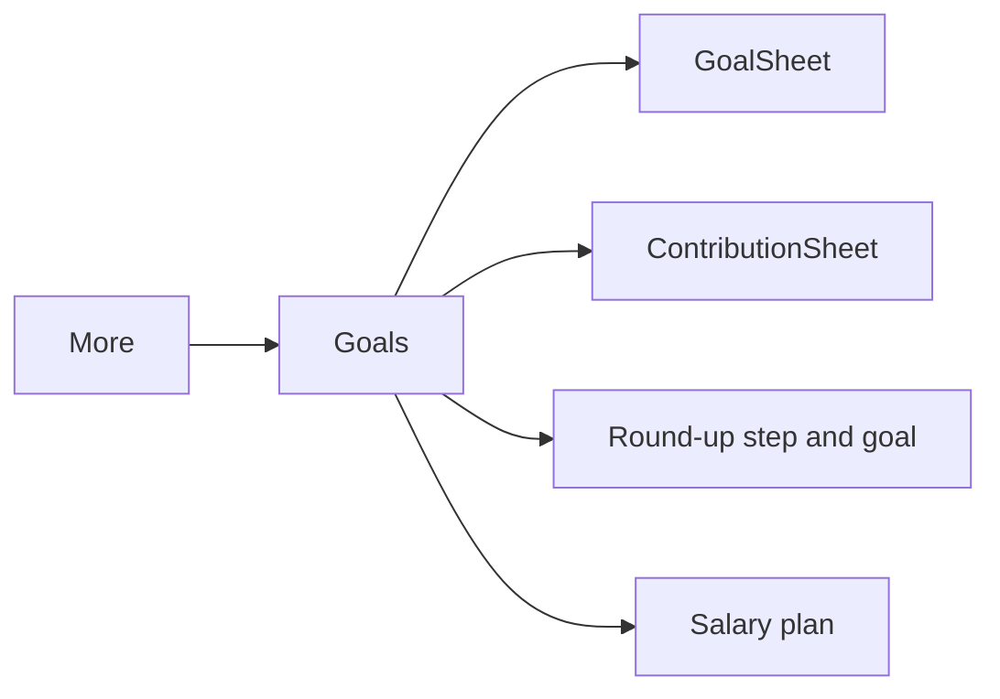

# Savings Goals, Round-ups & Salary Plan

| Field | Value |
|---|---|
| Feature ID | F-36 |
| Status | In Progress (goals, contributions, projection, round-up tracker, salary plan versus actual, `/goals` screen and More tile done; Home embed card built but not placed on Home) |
| Priority | P2 |
| Phase | 5 |
| Last Updated | 2026-10-26 |

## 1. Description
Savings Goals lets the user name something to save for, set a target and see how close they are. A round-up tracker shows, for the current month, how much extra could have been set aside by rounding every expense up to the next Rs 10, 50 or 100. A salary plan compares the user's chosen split of income (savings, investments, spending) with what actually happened each month. It only tracks and shows: no money ever moves.

## 2. What This Feature Will Do
- Stores goals with a name, a target amount and an optional target date.
- Records the money the user says they set aside for a goal (manual contributions).
- Calculates progress, the date the goal is reached at the pace so far, whether that meets the target date and the monthly amount needed.
- Calculates virtual round-ups from the ledger for the current month and shows "You could have saved Rs X".
- Stores a salary split (savings / investments / spending percent) and compares it with the last six months.
- Shows everything on the Goals screen, reachable from the More tab.

### 2.1 Inputs
- User entries: goals, contributions, round-up step and goal, salary percentages.
- Ledger rows (read only) through the transaction repository: expenses for round-ups, monthly totals (income, investments, spend) for the plan.

### 2.2 Processing
1. Progress = sum of the goal's contributions against its target; the pace uses at least 30 days; projected day = today + ceil(remaining x span / saved).
2. Round-up per expense = gap to the next multiple of the step (0 when already a multiple); summed over the current IST month on every read.
3. Plan versus actual per month: planned = income x percent (rounded down); actual savings = income - spending - investments (never below 0), investments = INVESTMENT rows, spending = expenses net of refunds.

### 2.3 Outputs
- The Goals screen (route `/goals`), a More tile and a compact `GoalsSummaryCard` widget a Home layout can embed.
- Stored: goals, contributions and three settings values. Nothing else; round-ups are never stored per transaction.

### 2.4 Out of Scope
- No transfer, auto-debit, sweep or any real money movement; no bank link.
- No ledger writes: contributions are notes, not transactions.
- No shared goals, rewards or interest.
- Round-ups are not added to a goal's saved amount; they are shown beside it.

## 3. Behaviour in Existing App
N/A - the existing app dropped Goals by its scope rule ([34](34_planned_insights_backlog.md) item 7). This feature adopts the idea from the Fold teardown under [ADR-0010](../docs/adr/0010-fold-ideas-adoption-rules.md) and [research](../docs/research/fold-adoption.md), with no backend and nothing leaving the phone.

## 4. User Stories
- As a saver I add "Goa trip, Rs 50,000 by March" and see how far along I am.
- As a saver I note Rs 5,000 set aside and see the projected finish move.
- As a spender I see how much rounding up this month's spends would have saved.
- As a salaried user I set 20/20/60 and see whether each month matched.

## 5. Functional Requirements (FR-36-01 ...)

- FR-36-01: The user shall add, edit and delete goals (name required, target > 0 in paise, optional target date); deleting a goal deletes its contributions.
- FR-36-02: The user shall add a contribution (amount > 0, dated today IST) to a goal and delete it; contributions never create transactions.
- FR-36-03: Each goal shall show saved, remaining, fraction (0..1), projected finish day (none without contributions; today when reached), on track (projected day <= target day) and the monthly amount needed to meet the target day.
- FR-36-04: The Goals screen shall list goals with a progress bar, "saved of target", the projection and "Behind"/"On track", an Add money action, an Edit action and an empty state.
- FR-36-05: The round-up for an expense shall be `(step - amount mod step) mod step` with step 10, 50 or 100 rupees (default 10); the month total counts DEBIT rows (not under review, not duplicates, not transfer category, INR value) in the current IST month, computed on read and never stored per transaction.
- FR-36-06: The Goals screen shall show step chips (10 / 50 / 100), a goal picker (or "No goal") and "You could have saved Rs X this month", with "Nothing is moved".
- FR-36-07: The user shall set the salary split as whole percents summing to 100 (default 20 savings, 20 investments, 60 spending); an invalid sum is rejected with a message; stored as `s:i:p` under `salary_plan`.
- FR-36-08: The screen shall show, for each of the last six months (empty months hidden, the current month always), income and the lines Savings, Investments, Spending with planned and actual amounts.
- FR-36-09: `/goals` shall open from a More tile (optional-embed pattern of the router) and a `GoalsSummaryCard` shall be available for Home (first goal, progress and this month's round-up; hidden without goals).
- FR-36-10: All figures shall be on device, in paise, formatted with en-IN grouping and honouring hide amounts.

## 6. Non-Functional Requirements (performance, battery, privacy, offline)
- Offline; no network; no background work.
- Reads only through `TransactionRepository`; the single ledger write path is untouched.
- Streams are small: goals, contributions, one month of rows, six `watchTotals` queries.

## 7. UI / Screens & User Flow
Goals screen: goal cards (progress, projection, Add money, Edit), Round-ups card, Salary plan card with month panels. Sheets: Add/Edit goal, Add money.

GIF: pending (`assets_reference/_screens_index.md`).

## 8. Data Models (Dart entities, fields, types)
`Goal(id, name, targetMinor, targetDay?, createdAt)`, `GoalContribution(id, goalId, amountMinor, day, note?)`, `GoalDraft.validate()`, interface `GoalRepository`; `GoalProgress`; `RoundUpSummary(totalMinor, count)`; `SalaryPlan(savingsPct, investPct, spendPct)`, `MonthActual`, `PlanLine`. Days are IST epoch days.

## 9. Database Tables / Changes
Schema v6 (migration v5 -> v6, additive): `goals` (`id`, `name`, `target_minor`, `target_day?`, `created_at`), `goal_contributions` (`id`, `goal_id` soft ref, `amount_minor`, `day`, `note?`, `created_at`). Settings keys: `roundup_step` (int, 10), `roundup_goal` (int goal id, 0 none), `salary_plan` (text `s:i:p`, empty = standard).

## 10. Business Rules & Logic (regex, algorithms, thresholds, formulas)
- Projection: `span = max(30, today - firstContributionDay + 1)`; `days = ceil(remaining * span / saved)`; `projected = today + days`.
- Monthly need: `months = max(1, ceil((targetDay - today) / 30))`; `need = ceil(remaining / months)`.
- Round-up: see FR-36-05; step 100 on Rs 50.00 gives Rs 50.00.
- Plan: `planned = income * pct ~/ 100`; saved = `max(0, income - spent - invested)`.
- Integer paise throughout; no double for money.

## 11. Platform / Native Requirements (permissions, channels, background work)
N/A - pure Dart, no permission, channel or background work.

## 12. Dependencies (links to other feature files; packages)
[08 Transactions ledger](08_transactions_ledger.md) (read only), [26 Settings](26_settings_data_sources.md) (key-value store), [16 Portfolio](16_portfolio.md) (investment rows), [11 Income tracking](11_income_tracking.md) (income meaning). No new packages.

## 13. Folder Location (lib/features/<name>/...)
`lib/features/savings_goals/{domain,data,presentation}`; DI in `lib/app/di/goals_providers.dart`; tables in `lib/core/db/tables/goals.dart`.

## 14. Edge Cases & Error Handling
- No income in a month: planned amounts are 0; empty past months are hidden.
- Goal deleted while chosen for round-ups: the picker falls back to "No goal".
- Target date in the past: needs 1 month's worth; shown as Behind when projected later.
- Foreign-currency expenses use their INR value; rows without one are skipped.
- Invalid percentages or amounts show a short error and save nothing.

## 15. Test Cases (unit / widget / integration + fixtures)
- TC-36-01 (FR-36-03): sums only own contributions; no projection without contributions; 30-day pace floor; longer history pace; on track / behind and monthly need; reached goal.
- TC-36-02 (FR-36-05): round-up gaps for steps 10/50/100 and exact multiples; month total ignores income, investments, other months, review rows and transfers.
- TC-36-03 (FR-36-07, FR-36-08): plan encode/decode, validity, plan versus actual lines, saved floored at 0, no income.
- TC-36-04 (FR-36-01, FR-36-02): repository add, edit, contribute, delete cascade; bad input throws; ledger untouched.
- TC-36-05 (FR-36-04): widget: add goal (validation), add money, progress and projection shown, no transactions written.
- TC-36-06 (FR-36-05, FR-36-06): widget: "You could have saved" amount, step 100 setting persisted, goal picker.
- TC-36-07 (FR-36-07): widget: percents must add up to 100; saved as `30:20:50`.
- TC-36-08: migration v5 -> v6 (`test/core/db/migration_v5_v6_test.dart`).
Files: `test/features/savings_goals/`.

## 16. Acceptance Criteria
- AC-36-01: Goals can be created, edited, funded and deleted, with correct progress and projection (FR-36-01..04; TC-36-01, 04, 05).
- AC-36-02: Round-ups match the rule and are shown as "could have saved", never stored or moved (FR-36-05, FR-36-06; TC-36-02, 06).
- AC-36-03: The salary plan validates, persists and compares with real months (FR-36-07, FR-36-08; TC-36-03, 07).
- AC-36-04: Nothing leaves the phone and no ledger row is written (FR-36-10; TC-36-04, 05).

## 17. Open Questions
- Should round-ups optionally count toward a goal's saved amount once the user confirms a manual transfer?
- Should "savings" in the plan use transfers to savings accounts instead of income left over?

## 18. Implementation Notes
- Savings in the plan is the income left after spending and investing, because own-account transfers cannot be told apart from savings moves reliably.
- The round-up goal and step live in settings, not in a table, so there is one value to read.
- `GoalsSummaryCard` is exposed for Home; this round does not edit Home.

## 19. Change Log (date | change | reason)

| Date | Change | Reason |
|---|---|---|
| 2026-10-26 | Created and implemented: goals, contributions, projection, round-up tracker, salary plan, `/goals` route and More tile, schema v6 | Fold adoption |
