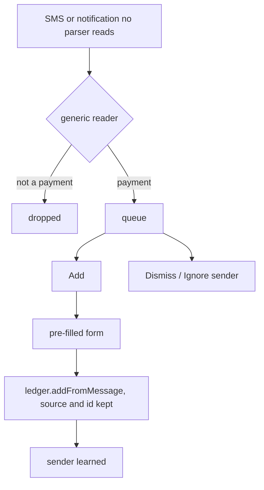

# Unrecognised Messages & Learned Senders

| Field | Value |
|---|---|
| Feature ID | F-38 |
| Status | In Progress (generic reader, encrypted queue, learned senders, queue and Learned senders screens, live and notification hooks, inbox scan done; "Spent X at Y?" alert and native verification pending) |
| Priority | P1 |
| Phase | 5 |
| Last Updated | 2026-11-06 |

## 1. Description
Some messages are real payments that no bank format recognises: a new bank, a changed wording, a payment app whose notification says only an amount. Until now they were dropped without a trace. This feature keeps the ones that look like payments in a review queue, shows what each looks like ("Looks like: ₹1,250 debit · Zomato · ••4821") and lets the user add it with one tap. After one confirmation the sender is learned and its later messages are offered straight away.

## 2. What This Feature Will Do
- Reads a likely payment out of text no parser claims, and scores how sure it is.
- Queues such messages for the user; nothing is added until the user saves.
- Shows each with a "Looks like" line and Add, Dismiss and Ignore sender.
- Adds a queued message through the single ledger write path, keeping its source and id, so it is never booked twice.
- Learns a sender after one Add, remembering the account used when the text does not point elsewhere.
- Offers later messages from a learned sender immediately.
- Lets the user list learned and switched-off senders and forget any.
- Queues a watched payment app's notification that carries an amount but no payment wording.
- Looks through the inbox for missed messages when the user asks.
- Drops the text of old queue entries after 30 days.

### 2.1 Inputs
- SMS from a sender no parser accepts: live (learned senders only) and the user's own inbox scan (any sender that passes the filters).
- A watched app's notification the strict reader skipped as "no payment wording" or "no amount" ([Notification ingestion](04_notification_ingestion.md)).
- User actions on the queue.

### 2.2 Processing
1. The generic reader normalises the text, rejects what is not a completed money movement, finds the amount, the direction, the account digits, the payee, a balance or limit and a reference, and scores it.
2. The offer step decides: switched-off sender, no; unknown sender, only if the reader found a payment; learned sender, any score; a payment-app notification, if it carries an amount (direction assumed and marked).
3. The queue stores the text, a hash of it and the status; an identical message later revives a handled row unless it arrives within 2 minutes.
4. Add opens the Add form pre-filled and, on Save, books through the ledger with the message's own id, marks the row added and learns the sender.

### 2.3 Outputs
- A queue of messages to review, a count on More, a Learned senders list.
- Transactions added with provenance (source SMS or APP, original message id, raw text).

### 2.4 Out of Scope
- Sending any message off the device: there is no "Report" to a website (CLAUDE.md prohibits it). The Diagnostic log and Activity log are the on-device equivalents.
- Writing bank parsers; a message that keeps coming from a new bank is a parser request, tracked in [Parsing engine](06_transaction_parsing_engine.md).
- Auto-booking from the generic reader: it only ever suggests.

## 3. Behaviour in Existing App
N/A - the Kotlin app has no such feature. Designed from a study of how a competing app handles unknown senders (behaviour only, no code, regexes or strings copied; that app is AGPL-3.0 and DhanKosh is proprietary). Differences on purpose: no off-device report, bounded encrypted retention, provenance kept, undo, forget.

## 4. User Stories
- US-38-01: As a user I want a payment from a new bank offered to me instead of lost.
- US-38-02: As a user I want to add it in one tap and have the app remember the sender.
- US-38-03: As a user I want a sender I do not care about switched off.
- US-38-04: As a user I want to see and forget what the app learned.
- US-38-05: As a user I want a PhonePe payment whose notification says only an amount still recorded.

## 5. Functional Requirements (FR-38-01 ...)

| ID | Requirement |
|---|---|
| FR-38-01 | Provide `GenericExtractor` in `parser_core`, a pure function of (sender, text) returning a suggestion or null. |
| FR-38-02 | A suggestion has amount (paise), currency, type (debit, credit, investment), payee, UPI id, last 4, balance, limit, reference and a confidence: 50 for a currency-tagged amount with a direction, +20 last 4, +20 payee or UPI id, +10 balance or limit, +5 reference, capped at 100. |
| FR-38-03 | The reader returns null for: a phone-number sender (10 or more digits), an OTP, a failed or declined attempt, a promotion, a due or reminder notice, a future debit, a money request, a mandate set-up, a balance-only message, an EMI invitation, a voucher, a missing amount, a missing or transfer direction. A suggestion line is shown at 60 or more, or at any score for a learned sender. |
| FR-38-04 | Queue messages in the encrypted database (`unrecognised_messages`), unique per (sender key, text hash), newest first, with a count. The user's own scan reads the inbox for senders no parser accepts, skipping `-P` and `-G` headers and phone numbers, and queues what the reader recognises. |
| FR-38-05 | Statuses are fresh, added, dismissed, ignored, expired. A message already waiting, or repeating a handled one within 2 minutes, is not queued again; the same words later revive the handled row. Dismiss can be undone while the text is kept. |
| FR-38-06 | A watched app's notification the strict reader skipped as "no payment wording" or "no amount" is offered; with an amount and no direction word the direction is assumed as a payment and marked ("payment?"). OTP, failure, offer and reminder notifications are never offered. |
| FR-38-07 | A sender is learned after one Add. The key drops the operator prefix and DLT suffix (`JD-ABCBNK-S`, `VM-ABCBNK`, `abcbnk` are one sender). The account used is remembered only when the text names no other last 4, and used again only when the text names no other digits and the same currency. Later live SMS from a learned sender with no parser is offered at any score. |
| FR-38-08 | Ignore sender switches a sender off: its waiting messages become ignored and later ones are not queued. |
| FR-38-09 | A Learned senders screen lists learned and switched-off senders with Forget. |
| FR-38-10 | Retention: text of a waiting message is dropped after 30 days (expired), text of a handled message after 30 days; the row stays as a tombstone for 400 days. Purge runs when the queue is opened. |
| FR-38-11 | Add books through the ledger's `addFromMessage` with the message's source and id; dedup applies; the same message read later is skipped; the queue row is marked added with the transaction id. |
| FR-38-12 | The Add form can be opened pre-filled from a draft (amount, type, payee, reference, category, account, date, note) with an optional confirm callback; shared text uses the same draft (see [Transactions ledger](08_transactions_ledger.md) FR-08-27). |
| FR-38-13 | "Spent ₹X at Y?" alert for a learned sender's message, tap opens Add pre-filled; Add and Not a payment actions. Pending. |

## 6. Non-Functional Requirements (performance, battery, privacy, offline)
- Offline and on-device; the queue lives in the SQLCipher database.
- The text of a queued message is the only place message text is stored outside the ledger sources; it is bounded by FR-38-10. Logs and the Activity log never carry it.
- The inbox scan is started by the user, runs in batches of 200 and reads only senders no parser claims.
- No network use of any kind.

## 7. UI / Screens & User Flow

| # | Screen | Route |
|---|---|---|
| 1 | Unrecognised messages: cards with sender, time, text (digits masked when amounts are hidden), "Looks like" line, Dismiss, Ignore sender, Add; search icon scans the inbox; school icon opens Learned senders | `/review/unrecognised` |
| 2 | Learned senders with Forget | `/review/unrecognised/senders` |
| 3 | More tile "Unrecognised messages" with the count | `/more` |
| 4 | Add transaction, pre-filled, with the message above the form | `/transactions/add` |



## 8. Data Models (Dart entities, fields, types)
`UnrecognisedMessage {id, source (sms/app), sender, senderKey, sourceMessageId, body, receivedAt, status, transactionId}`, `NewUnrecognised`, `SenderPref {senderKey, ignored, learnedAt, bankName, last4, currency}` with `accountFits`, `SenderKey.of`, `GenericSuggestion` (parser_core), `ConfirmedPayment`, `AddDraft`, `AddFormValues`.

## 9. Database Tables / Changes
Schema v7 (additive). `unrecognised_messages`: id, source, sender, sender_key, source_message_id, body_hash, body, received_at, status, transaction_id, created_at, handled_at; unique (sender_key, body_hash). `sender_prefs`: sender_key (pk), state (LEARNED or IGNORED), bank_name, last4, currency, updated_at.

## 10. Business Rules & Logic (regex, algorithms, thresholds, formulas)
- Confidence 50 / +20 / +20 / +10 / +5, shown at 60; a guessed direction starts at 40.
- Redelivery window 2 minutes; retention 30 days; tombstone 400 days; scan batch 200.
- Learned account fits only if the text names no other last 4 and the currency matches.
- The reader reuses DhanKosh's own extractors (amount, type, account, merchant, balance, reference, channel) and rejection rules.

## 11. Platform / Native Requirements (permissions, channels, background work)
No new native code for the queue: SMS bodies already reach Dart for every sender with a letter in it. Reading the inbox needs READ_SMS (already requested). Unverified on a device.

## 12. Dependencies (links to other feature files; packages)
[SMS ingestion](02_sms_ingestion.md) (live path hook, inbox source), [Notification ingestion](04_notification_ingestion.md) (skip hook), [Transaction parsing engine](06_transaction_parsing_engine.md) (extractors, rejection rules), [Transactions ledger](08_transactions_ledger.md) (`addFromMessage`, Add form), [Dedup and review](07_dedup_review.md), [Alerts](21_alerts_reminders.md) (pending alert). Packages: `drift`, `go_router`, `riverpod_annotation`.

## 13. Folder Location (lib/features/<name>/...)
```text
lib/features/unrecognised_messages/
  domain/ unrecognised_message.dart, unrecognised_repository.dart
          usecases/ offer_unrecognised, add_from_unrecognised, scan_missed_messages
  data/   unrecognised_repository_impl.dart
  presentation/ unrecognised_screen, learned_senders_screen, unrecognised_tile, unrecognised_providers
app/packages/parser_core/lib/src/generic/generic_extractor.dart
lib/app/di/unrecognised_providers.dart
lib/core/db/tables/unrecognised.dart
```

## 14. Edge Cases & Error Handling
- The same alert delivered twice within 2 minutes is one row.
- Two identical payments hours apart: the handled row is revived, so the second is offered again.
- A message whose text was dropped cannot be restored and shows no "Looks like" line.
- A failing queue never changes how live SMS or notifications are handled.
- An OTP that mentions an amount is never queued.
- A foreign-currency message is queued in its own currency; the Add form leaves the rupee field to the user.

## 15. Test Cases (unit / widget / integration + fixtures)

| ID | Type | Covers | Case |
|---|---|---|---|
| TC-38-01 | unit | FR-38-02 | Amount, direction, account, payee and balance score 100; amount and direction alone score 50 and are not shown; one extra field reaches 60. |
| TC-38-02 | unit | FR-38-03 | Twelve rejection fixtures (balance only, declined, failed, OTP with amount, promotion, due, future debit, request, no amount, no direction, EMI invite, e-voucher) give null; a phone-number sender gives null. |
| TC-38-03 | unit | FR-38-06 | Loose reading assumes a payment and marks it; a stated direction is never guessed; OTP, failure and offer still reject. |
| TC-38-04 | unit | FR-38-04, FR-38-05 | Queued once; same message again no; same words later revive; dismiss and restore; ignore sender; purge. |
| TC-38-05 | unit | FR-38-03, FR-38-07 | Unknown sender queued only for a described payment; live, only a learned sender; sender keys; learned account fits. |
| TC-38-06 | integration | FR-38-11 | Add books one transaction, marks it added, learns the sender; the same message again is skipped; other digits drop the learned account; a notification teaches no sender. |
| TC-38-07 | unit | FR-38-07 | Live handler offers an unaccepted sender and never breaks the live path. |
| TC-38-08 | unit | FR-38-06 | A notification with an amount and no wording is offered; OTP, failure, offer are not; a read payment is ingested. |
| TC-38-09 | widget | FR-38-04, FR-38-09, FR-38-11 | Empty state; "Looks like" line; Dismiss and Undo; Add opens the form pre-filled and Save books once; Learned senders lists and forgets. |

Tests: `app/packages/parser_core/test/generic_extractor_test.dart`; `app/test/features/unrecognised_messages/`; hook tests in `sms_ingestion/scan_sms_test.dart` and `notification_ingestion/notification_engine_test.dart`.

## 16. Acceptance Criteria
- AC-38-01: A payment from a sender no parser knows reaches the queue and can be added in one tap (FR-38-04, FR-38-11; TC-38-04, TC-38-09).
- AC-38-02: Adding it books one transaction and a later parser or rescan never books it again (FR-38-11; TC-38-06).
- AC-38-03: OTPs, offers and failures never reach the queue (FR-38-03; TC-38-02).
- AC-38-04: A learned sender's later messages are offered; Forget undoes it (FR-38-07, FR-38-09; TC-38-05, TC-38-09).
- AC-38-05: A PhonePe notification with an amount and no wording reaches the queue (FR-38-06; TC-38-08).
- AC-38-06: Message text is dropped after 30 days (FR-38-10; TC-38-04).

## 17. Open Questions
1. The "Spent ₹X at Y?" alert needs a new alert kind in the native alerts channel (FR-38-13).
2. Should learning wait for two Adds before alerts start? One keeps it simple; revisit if noise appears.
3. The live path queues only learned senders; an unknown bank's first message waits for the user's scan or the nightly job. A nightly scan of unknown senders was not added for privacy.
4. Add currently pre-fills one currency; a foreign amount leaves the rupee field blank.

## 18. Implementation Notes
Landed 2026-11-06 (issue I-02). Reader, queue, learned senders, screens, hooks and tests done; 1030+ tests, analyze clean. The queue screen's widget tests use an in-memory fake (`test/support/fake_unrecognised.dart`) because Drift streams leave timers pending after a widget tree is disposed. `TransactionRepository.addFromMessage` is the only new ledger entry point; it reuses `ingest`. Unverified: everything on a real phone.

## 19. Change Log (date | change | reason)

| Date | Change | Reason |
|---|---|---|
| 2026-11-06 | Created: generic reader, review queue, learned senders, Learned senders screen, live and notification hooks, inbox scan | Payments no parser recognised were dropped silently (issue I-02, from the PennyWise comparison) |
