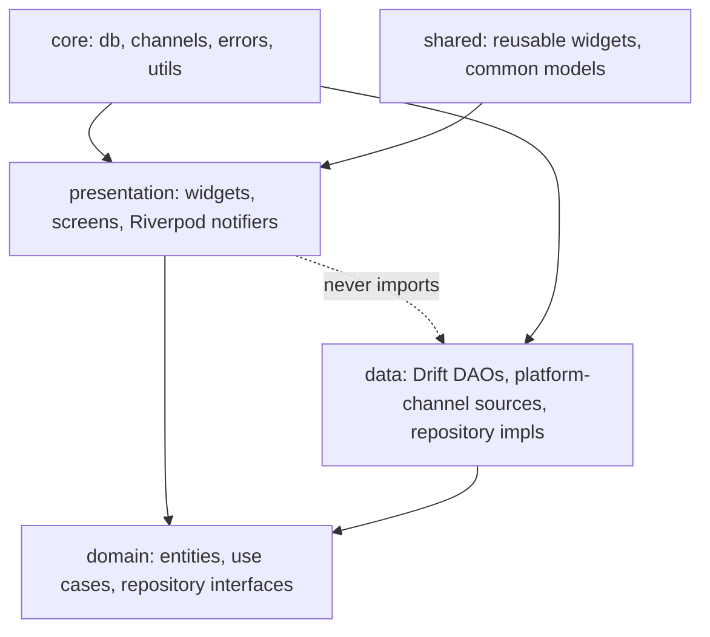
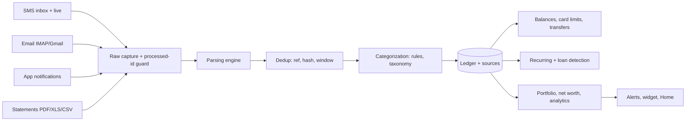
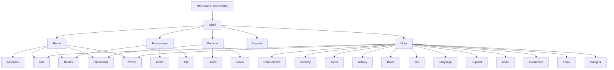

# Hisaab (DhanKosh) Flutter Rebuild: Master Plan

> App-wide structure only. Feature details live in `memory/` (one file per feature, linked in section 12). Raw analysis of the Android app: [docs/analysis/existing_app_analysis.md](docs/analysis/existing_app_analysis.md). Project rules: [CLAUDE.md](CLAUDE.md).

## 1. Overview

- **Vision:** an offline-first personal finance app that builds the ledger from what the phone already receives (bank SMS, email, payment-app notifications, statements) and records each payment once.
- **Baseline:** parity with the Android app `hisaab_apk` v2.9.8 (31 features, listed in section 12). The Kotlin app is the behavioural reference; the Flutter app is a rebuild, not a redesign.
- **Platform:** Android first. iOS cannot read SMS or notifications (Apple policy), so an iOS build could only offer email, statements and manual entry. Flutter is chosen so that iOS stays possible later; it is not in the first release.
- **Users:** individuals in India tracking spending, cards, loans and investments, who want data to stay on the phone.
- **Naming:** the Android app is branded DhanKosh (formerly Hisaab); package `com.hisaab`. This project uses "Hisaab" as the working name. Final brand: see Open Questions.

## 2. Tech Stack

Versions: use the latest stable at scaffold time, then pin in `pubspec.lock`. Record the pinned versions in `CLAUDE.md` once chosen.

| Area | Choice | Why |
|---|---|---|
| Framework | Flutter (stable), Dart 3 | One codebase, iOS stays open |
| State | Riverpod with code-gen (`riverpod_annotation`) | Compile-safe DI plus state; testable overrides |
| Navigation | `go_router` | Deep links (`hisaab://budgets`, `bills`, `transaction/{id}`, `account/{id}`, `statements`) and a shell route for the 5-tab bar |
| Local DB | Drift (SQLite) + SQLCipher (`sqlcipher_flutter_libs`) | Typed SQL, migrations, FTS, triggers; encryption at rest (the Android app has none beyond app-private storage) |
| Models | `freezed` + `json_serializable` | Immutable entities, value equality |
| Background | `workmanager` | Nightly SMS catch-up and email sync (about 02:30), constraints |
| Native (Kotlin) | Platform channels | `SmsReceiver` + inbox reader, `NotificationListenerService`, Keystore sealing, PDF text (PdfBox-Android), home widget |
| Email | `enough_mail` (IMAP, app password); Gmail API via `googleapis` + `google_sign_in` (advanced option) | Matches the existing IMAP-first design |
| Files | `file_picker`; PDF text via native PdfBox-Android channel (password support); `excel` and `csv` packages | PdfBox is what the Android app uses, so password behaviour matches |
| OCR | `google_mlkit_text_recognition` | Same engine as today (on-device) |
| Charts | `fl_chart` (+ custom painters for Sankey, heatmap, donut) | Covers the analysis views |
| Security | `local_auth`, `flutter_secure_storage` (Keystore-backed) | App lock; sealed email/statement passwords |
| Prefs | `shared_preferences` or Drift `settings` table | Replaces DataStore |
| Widget | `home_widget` | Spend widget |
| i18n | Own `t(key)` over downloadable JSON packs (same 1,455-key `lang/` format), plus `intl` for number/date | Existing packs are reused as-is |
| Testing | `flutter_test`, `mocktail`, `integration_test`, golden tests | See section 11 |
| Lint | `very_good_analysis` | Strict, widely used |

Native pieces stay in Kotlin by necessity (SMS and notification APIs are Android-only). Everything else, including the whole parser, is pure Dart so it is unit-testable without a device.

## 3. Architecture

Clean Architecture, feature-first. Each feature has `presentation`, `domain`, `data`.



Rules:
- `domain` is pure Dart: no Flutter, no Drift, no platform channels.
- `presentation` depends on `domain` only; `data` implements `domain` interfaces; wiring is in `app/di`.
- Features do not import each other's `data` or `presentation`. Cross-feature use goes through `domain` interfaces or `shared`.
- The single ledger write path is the transaction repository (ingest, dedup, balance update in one DB transaction), as in the Android app.
- Parsers are pure functions over text plus a sender: `parse(source, sender, body, receivedAt) -> ParseResult`.

## 4. Folder Structure

```
lib/
├── main.dart
├── app/            # app widget, router, theme, DI (providers)
├── core/           # constants, errors, utils, extensions, network, db (Drift), platform channels, money/format
├── shared/         # reusable widgets (cards, pills, empty state, sheets), common models
└── features/<feature>/{data,domain,presentation}
```

Feature folder names are listed in each memory file (section 13). Native code: `android/app/src/main/kotlin/com/hisaab/` (channels: `sms`, `notifications`, `secure`, `pdf`, `widget`).

## 5. Data Flow



Details per stage: [06 parsing](memory/06_transaction_parsing_engine.md), [07 dedup](memory/07_dedup_review.md), [09 categorization](memory/09_categorization.md), [08 ledger](memory/08_transactions_ledger.md), [12 recurring](memory/12_recurring_transactions.md), [16 portfolio](memory/16_portfolio.md).

## 6. Core Database Schema (high level)

Android schema is Room v15; the Flutter app starts a fresh Drift schema v1 that mirrors it. Columns and indexes live in the feature files.

| Table | Owner feature | Relations |
|---|---|---|
| transactions | [08](memory/08_transactions_ledger.md) | accountId FK (SET NULL) |
| transaction_sources | [08](memory/08_transactions_ledger.md) (dedup rules in [07](memory/07_dedup_review.md)) | transactionId FK (CASCADE) |
| processed_emails | [03](memory/03_email_ingestion.md) | |
| accounts | [13](memory/13_accounts_management.md) | merge group, linked debit card |
| budgets | [10](memory/10_expense_tracking.md) | by category |
| deleted_messages | [08](memory/08_transactions_ledger.md) | stops re-ingest after delete |
| statements | [05](memory/05_statement_import.md) | |
| holdings | [16](memory/16_portfolio.md) | |
| merchant_rules | [09](memory/09_categorization.md) | |
| recurring | [12](memory/12_recurring_transactions.md) | |
| custom_categories, custom_subcategories | [09](memory/09_categorization.md) | |
| forex_rates | [23](memory/23_forex_rates.md) | triggers keep `inrMinor` current (not in the Room schema JSON; recreate) |

Flutter-only tables (not in Room v15; defined in the owning feature file section 9): NetWorthPoints ([16](memory/16_portfolio.md)), PayeeAccounts, ActivityEntries ([22](memory/22_activity_log.md)), settings key-value ([26](memory/26_settings_data_sources.md)), LoanLinkRows and LoanDismissalRows ([15](memory/15_loans.md)), CardDueNotices and CardOverrides ([14](memory/14_credit_cards.md)), AlertedKeys, CardDueReminderState and BalanceNoticeDays ([21](memory/21_alerts_reminders.md)). The Android database is plain unencrypted Room; SQLCipher here is a new decision, not parity. Upgrade path from Room v15: [33](memory/33_upgrade_migration_from_kotlin.md).

## 7. Permissions & Platform Compliance

| Permission / access | Used for | Feature |
|---|---|---|
| READ_SMS, RECEIVE_SMS | Inbox scan, live bank SMS | [02](memory/02_sms_ingestion.md) |
| Notification listener (BIND_NOTIFICATION_LISTENER_SERVICE) | Payment-app notifications | [04](memory/04_notification_ingestion.md) |
| POST_NOTIFICATIONS | Alerts, "statement needs a password" | [21](memory/21_alerts_reminders.md) |
| USE_BIOMETRIC | App lock | [25](memory/25_security_privacy.md) |
| INTERNET, ACCESS_NETWORK_STATE | Email, update check, language packs, news | [03](memory/03_email_ingestion.md), [31](memory/31_news_support_updates.md) |
| REQUEST_INSTALL_PACKAGES | In-app update hand-off | [31](memory/31_news_support_updates.md) |

- **Google Play risk:** `READ_SMS` is allowed only for apps whose core purpose needs it (default SMS handler exemptions are narrow). **Primary distribution is a signed APK / GitHub Releases** (as today). Fallbacks if Play is wanted: email + notification + statement ingestion with no SMS permission, and a user-initiated SMS import via share/paste. Decide before any Play submission.
- Android 13+ "restricted settings" blocks SMS and notification access for sideloaded APKs; the onboarding flow guides the user ([01](memory/01_onboarding_permissions.md)).
- **Privacy:** all parsing and storage on-device; no analytics, no remote logging, no cloud backup (`allowBackup=false`). Network only to the user's email provider, update check, language packs, news, and the Support UPI hand-off. Details: [25](memory/25_security_privacy.md).

## 8. Navigation Map

Bottom bar (5 tabs): Home, Transactions, Portfolio, Analysis, More. About 30 routes and 5 deep links; the full screen tree and per-screen source refs are in `docs/analysis/existing_app_analysis.md` (Part A section 1) and in each feature file's section 7.



GIF reference of every existing screen: [assets_reference/_screens_index.md](assets_reference/_screens_index.md) (64 screens listed, all **Pending**: no device or emulator was available).

## 9. Design System

- Own palettes (22 in the Android app, no dynamic colour): theme tokens as `ThemeExtension`s. Light, dark and pure-black dark. Text size setting (Small/Default/Large/XL). Spec: [28](memory/28_theming_customisation.md).
- Money: store integer minor units (paise); format with en-IN digit grouping; INR default, multi-currency ready (foreign spends keep their currency with an INR value from [23](memory/23_forex_rates.md)). Amount masking (`₹••••`) is a global setting.
- Spacing and shared components (flat card with hairline, hero card, pills, segmented control, empty state, shimmer): `lib/shared/`.
- Brand logos: about 140 bundled WebP files, matched offline by bank/merchant name ([09](memory/09_categorization.md)).
- Language: [29](memory/29_localization.md).

## 10. Coding Standards

- Dart naming: `UpperCamelCase` types, `lowerCamelCase` members, `snake_case` files; one public widget per file; suffixes `Screen`, `Sheet`, `Dialog`, `Notifier`, `Repository`, `Dao`.
- Lint: `very_good_analysis`, zero issues. No generated files edited (`*.g.dart`, `*.freezed.dart`).
- Commits: Conventional Commits (`feat:`, `fix:`, `docs:`, `test:`, `refactor:`, `chore:`). Branches: `main` plus short-lived `feat/<feature-id>-<slug>`.
- UI copy: concise, no explanatory paragraphs (carried over from the Android app).

## 11. Testing Strategy

- **Unit:** parser, dedup, balances, recurring detection, tax rules, CSV. Parser fixtures are ported from the Kotlin corpora (`parser-core/src/test/.../corpus`, 337 tests, 940 field checks); a rule change is not done until a fixture exists.
- **Widget/golden:** key screens and sheets in light and dark.
- **Integration:** ingest SMS -> ledger -> Home totals; statement import; app lock. Native channels are mocked in Dart tests and covered by Android instrumented tests.
- **Parity gate:** the Dart parser must reproduce the Kotlin parser's output on the shared corpus before Phase 1 is accepted.
- Coverage targets: 90% for `domain` and parsers, 70% overall.

## 12. Feature Index

| # | Feature | Memory File | Priority | Phase | Status |
|---|---|---|---|---|---|
| 01 | Onboarding & Permissions | [01_onboarding_permissions.md](memory/01_onboarding_permissions.md) | P0 | 1 | Existing |
| 02 | SMS Ingestion | [02_sms_ingestion.md](memory/02_sms_ingestion.md) | P0 | 1 | Existing |
| 03 | Email Ingestion | [03_email_ingestion.md](memory/03_email_ingestion.md) | P1 | 2 | Existing |
| 04 | Notification Ingestion | [04_notification_ingestion.md](memory/04_notification_ingestion.md) | P1 | 2 | Existing |
| 05 | Statement Import | [05_statement_import.md](memory/05_statement_import.md) | P1 | 3 | Existing |
| 06 | Transaction Parsing Engine | [06_transaction_parsing_engine.md](memory/06_transaction_parsing_engine.md) | P0 | 1 | Existing |
| 07 | Dedup & Review | [07_dedup_review.md](memory/07_dedup_review.md) | P0 | 1 | Existing |
| 08 | Transactions Ledger | [08_transactions_ledger.md](memory/08_transactions_ledger.md) | P0 | 1 | Existing |
| 09 | Categorization & Rules | [09_categorization.md](memory/09_categorization.md) | P0 | 1 | Existing |
| 10 | Expense Tracking & Budgets | [10_expense_tracking.md](memory/10_expense_tracking.md) | P1 | 4 | Existing |
| 11 | Income Tracking | [11_income_tracking.md](memory/11_income_tracking.md) | P1 | 4 | Existing |
| 12 | Recurring Transactions & Bills | [12_recurring_transactions.md](memory/12_recurring_transactions.md) | P1 | 4 | Existing |
| 13 | Accounts Management | [13_accounts_management.md](memory/13_accounts_management.md) | P0 | 1 | Existing |
| 14 | Credit Cards | [14_credit_cards.md](memory/14_credit_cards.md) | P1 | 3 | Existing |
| 15 | Loans | [15_loans.md](memory/15_loans.md) | P2 | 4 | Existing |
| 16 | Portfolio & Net Worth | [16_portfolio.md](memory/16_portfolio.md) | P1 | 3 | Existing |
| 17 | Dashboard (Home) | [17_dashboard_home.md](memory/17_dashboard_home.md) | P0 | 1 | Existing |
| 18 | Analytics | [18_analytics.md](memory/18_analytics.md) | P1 | 4 | Existing |
| 19 | Tax Centre | [19_tax_centre.md](memory/19_tax_centre.md) | P2 | 4 | Existing |
| 20 | Search & Filters | [20_search_filters.md](memory/20_search_filters.md) | P0 | 1 | Existing |
| 21 | Alerts & Reminders | [21_alerts_reminders.md](memory/21_alerts_reminders.md) | P1 | 4 | Existing |
| 22 | Activity Log | [22_activity_log.md](memory/22_activity_log.md) | P2 | 5 | Existing |
| 23 | Forex Rates | [23_forex_rates.md](memory/23_forex_rates.md) | P2 | 4 | Existing |
| 24 | Backup & Export | [24_backup_export.md](memory/24_backup_export.md) | P1 | 5 | Existing |
| 25 | Security & Privacy | [25_security_privacy.md](memory/25_security_privacy.md) | P0 | 5 | Existing |
| 26 | Settings & Data Sources | [26_settings_data_sources.md](memory/26_settings_data_sources.md) | P0 | 1 | Existing |
| 27 | Profile | [27_profile.md](memory/27_profile.md) | P1 | 3 | Existing |
| 28 | Theming & Customisation | [28_theming_customisation.md](memory/28_theming_customisation.md) | P2 | 5 | Existing |
| 29 | Localization | [29_localization.md](memory/29_localization.md) | P2 | 5 | Existing |
| 30 | Home-screen Widget | [30_home_widget.md](memory/30_home_widget.md) | P2 | 5 | Existing |
| 31 | News, Support & Updates | [31_news_support_updates.md](memory/31_news_support_updates.md) | P2 | 5 | Existing |
| 32 | Release Pipeline | [32_release_pipeline.md](memory/32_release_pipeline.md) | P2 | 5 | Existing |
| 33 | Upgrade Migration from Kotlin App | [33_upgrade_migration_from_kotlin.md](memory/33_upgrade_migration_from_kotlin.md) | P1 | 5 | Proposed |
| 34 | Planned Insights & Backlog | [34_planned_insights_backlog.md](memory/34_planned_insights_backlog.md) | P2 | 5 | Proposed |

## 13. Roadmap / Milestones

| Phase | Goal | Features |
|---|---|---|
| 0 Setup | Flutter SDK, skeleton, CI, Drift + SQLCipher, channel stubs, theme | skeleton |
| 1 Core ledger + SMS | Permissions, SMS ingest, parser (10 banks + generic), dedup, ledger, categories, accounts, Home, search | 01, 02, 06, 07, 08, 09, 13, 17, 20, 26 |
| 2 Notifications + email | Payment-app notifications, IMAP/Gmail, sender lists | 03, 04 |
| 3 Statements + portfolio | Statement import and passwords, credit cards, portfolio, profile | 05, 14, 16, 27 |
| 4 Recurring + analytics | Recurring and bills, budgets, income, analysis, loans, tax, alerts, forex | 10, 11, 12, 15, 18, 19, 21, 23 |
| 5 Polish, security, release | App lock, encryption, backup, themes, languages, widget, news/updates, signing and release | 22, 24, 25, 28, 29, 30, 31 |

Backlog (not in the existing app; from `v2_design/Hisaab_Product_Spec.md`): iOS, JSON sender registry, FTS search, lots/XIRR/price feeds, Form 16/GST/AIS, Business mode, family books, goals, split-and-lend. Each becomes a new memory file (`Status: Proposed`) only when scheduled.

## 14. Risks & Mitigations

| Risk | Mitigation |
|---|---|
| Parser regression when porting Kotlin to Dart | Port corpora first; parity gate (section 11) |
| Google Play SMS policy | APK/GitHub distribution; fallback ingestion paths (section 7) |
| No maintained Flutter SMS-receiver plugin | Own Kotlin receiver + channel; headless Dart entrypoint for live SMS |
| Background limits (OEM battery managers) | WorkManager plus nightly catch-up scan, 14-day re-read |
| Statement PDF password variety, scanned PDFs | Candidate-password builder from profile; scanned images reported as unsupported |
| Money correctness | Integer paise; fixtures for balances and transfers |
| SQLCipher key loss | Key in Keystore; documented recovery = re-import from CSV |
| Dart port size (about 287 Kotlin files) | Feature-by-phase delivery; analysis doc and memory files as the spec |

## 15. Open Questions

1. Brand name for the Flutter app: Hisaab or DhanKosh?
2. Is iOS in scope for v1, or only kept possible?
3. Play Store distribution or APK only (decides the SMS-permission strategy)?
4. Reuse the existing `lang/` packs and logo assets as-is (licence check for Simple Icons logos is already CC0 per the Android README)?
5. Android inconsistencies to settle during porting: email sync cadence (UI says hourly, scheduler nightly), budget alert default (80 vs 90), card-pair window (5 days vs comment 3), FY2026-27 tax rules (copy of FY2025-26, unconfirmed). Tracked in the relevant feature files.
6. Flutter SDK is not installed on the authoring machine; the skeleton in `app/` was not compiled (see CLAUDE.md).
